# Persistence, Physical Data Model & Data Lifecycle Architecture — Tanpopo

> **Data Architecture Specification (Phase ASTRA A05 — Updated in `TP-IMP-0003` Spec Closure Batch C)**
> - **Document ID:** `ARCH-DATA-01` | **Version:** `0.2.0-step03-closure` | **Last Updated:** `2026-11-14`
> - **Authoring Roles:** Principal Data Architect & Cryptography/Security Lead
> - **Governance Status:** **Accepted Architecture Contract (`ACCEPTED` — `CR-03, CR-04, CR-06, CR-07` & `COND-PO-01..05`)** — synchronized 1-to-1 with machine-readable reference schemas [`db/spec-check/sqlite_schema.sql`](../../db/spec-check/sqlite_schema.sql) (executed live on `modernc.org/sqlite` in `M0`) and [`db/spec-check/postgres_schema.sql`](../../db/spec-check/postgres_schema.sql) (verified via static table/column/RLS parity checks in `M0`; **live PostgreSQL 16 DDL execution, monthly partition routing, and runtime `FORCE RLS` enforcement remain `UNVERIFIED` until `TP-IMP-0039`**), [`ADR-0003`](./adr/0003-dual-mode-persistence-and-cluster-state.md), and [`ADR-0005`](./adr/0005-two-phase-budget-ledger-and-commercial-billing-separation.md). **All quantitative latency, `RTO`/`RPO`, revocation (`< 1s` / `< 5s`), and erasure (`< 60s`) figures in this document are `TARGET / UNVERIFIED` design goals until empirically validated in `TP-IMP-0043` (`COND-PO-01`).**
> - **Requirements Traceability:** `GAP-04`, `GAP-05`, `GAP-06`; `TP-FR-0201`..`0206`, `TP-FR-0304`, `TP-FR-0401`..`0406`, `TP-FR-0501`..`0504`, `TP-FR-0704`, `TP-FR-0801`..`0806`, `TP-FR-1001`..`1005`, `TP-NFR-0402`, `TP-NFR-0404`, `TP-NFR-0501`, `TP-NFR-0502`, `TP-NFR-0601`.

---

## 1. Dual-Mode Portability & Multi-Tenant Isolation Rules

To ensure a single domain layer executes identically on **embedded SQLite (`WAL mode`, `modernc.org/sqlite`, `CGO_ENABLED=0`)** in standalone deployments and **PostgreSQL `16+`** (`pgx/v5`) in stateless HA clusters without ORM impedance or schema drift (`RSK-013`), every table in [`sqlite_schema.sql`](../../db/spec-check/sqlite_schema.sql) and [`postgres_schema.sql`](../../db/spec-check/postgres_schema.sql) enforces seven invariant rules:

1. **Time-Ordered Domain-Prefixed `UUIDv7` Primary Keys:**
   - Every domain entity ID is formatted as `<prefix>_<26_chars_crockford_base32_uuidv7>` (total length `<= 32` characters inside `VARCHAR(40)`), preserving monotonic B-Tree insertion order across both SQLite and PostgreSQL.
   - Canonical 26 prefixes (`TP-IMP-0007`): `org_`, `prj_`, `env_`, `prc_`, `vky_`, `sec_`, `ext_`, `exv_`, `ins_`, `adp_`, `con_`, `lmd_`, `dpl_`, `pol_`, `rte_`, `bdg_`, `rsv_`, `set_`, `trc_`, `aud_`, `ksw_`, `mcp_`, `apr_`, `whk_`, `agt_`, `tsk_`.
2. **Zero IEEE-754 Floating-Point Arithmetic for Currency (`ADR-0005`):**
   - Model pricing rate cards store unit rates as signed 64-bit integers in **`nano-USD` (`10^-9 USD / token`)**, while all budget ceilings, active holds, rollups, and settlements are stored as `BIGINT` in **`micro-USD` (`1 USD = 1_000_000 micro-USD`)** using deterministic ceiling division `ceil_div(nano_usd, 1000)`. `FLOAT`, `REAL`, and `DOUBLE PRECISION` columns are banned across all financial tables.
3. **Strict Billing Mode Separation (`DEC-004`):**
   - `provider_connections.billing_mode` and `usage_settlements.billing_mode` enforce `CHECK (billing_mode IN ('COMMERCIAL_API', 'SELF_HOSTED_INFRA'))`. Zero tables, columns, or states exist to pool or convert personal consumer subscriptions into shared API quota.
4. **Optimistic Concurrency Control (`ETag` / `version BIGINT` — `TP-FR-0901`):**
   - Every mutable configuration resource (`organizations`, `projects`, `environments`, `principals`, `role_bindings`, `virtual_keys`, `secret_credentials`, `oauth_token_states`, `extension_installations`, `org_extension_policies`, `provider_adapters`, `provider_connections`, `logical_models`, `model_deployments`, `route_policies`, `policies`, `mcp_servers`, `mcp_tools`, `mcp_tool_grants`, `agent_endpoints`, `a2a_tasks`, `approval_requests`, `admin_change_requests`, `webhook_subscriptions`, `budget_ledgers`, `emergency_kill_switches`) carries `version BIGINT NOT NULL DEFAULT 1`. Mutations execute `WHERE org_id = ? AND id = ? AND version = ?` while incrementing `version = version + 1`; `0` affected rows return `409 optimistic_lock_conflict` (`port.ErrVersionConflict`).
5. **Uniform UTC Epoch Millisecond Timestamps (`*_ms BIGINT`):**
   - All timestamps across both SQLite and PostgreSQL are stored as UTC Unix epoch milliseconds (`BIGINT`, e.g., `created_at_ms`, `updated_at_ms`, `settled_at_ms`, `expires_at_ms`), eliminating `TEXT` vs. `TIMESTAMPTZ` formatting drift during `SQLite -> PostgreSQL` migrations (`CT-32`).
6. **Four-Way Multi-Tenant Relational & Cryptographic Isolation (`CR-06`, `CR-07`):**
   - **SQL Composite Keys:** Every tenant-owned child table enforces `PRIMARY KEY (org_id, ...)` and composite foreign keys `FOREIGN KEY (org_id, ...) REFERENCES parent(org_id, id)` on both SQLite (`PRAGMA foreign_keys = ON;`) and PostgreSQL, making cross-organization entity wiring structurally impossible at the database layer.
   - **PostgreSQL `ENABLE + FORCE ROW LEVEL SECURITY`:** Every tenant-scoped table enforces `ENABLE ROW LEVEL SECURITY` and `FORCE ROW LEVEL SECURITY` bound to `current_setting('app.current_org_id', true)` under a non-`SUPERUSER`, non-`BYPASSRLS` application role. If `app.current_org_id` is unset, queries fail closed and return `0` rows.
   - **Context-Bound `AEAD AAD`:** Ciphertexts in `secret_credentials`, `debug_payload_blobs`, and `response_cache_entries` bind `org_id` (and `project_id` where project-scoped) inside `AES-256-GCM` Additional Authenticated Data.
   - **Valkey Hash-Tag Keyspace:** Distributed cluster keys use `tp:v1:{<org_id>}:*` so multi-key Lua scripts stay within a single hash slot and never touch cross-tenant state.
7. **Append-Only Immutability Triggers (`usage_settlements` & `audit_events`):**
   - Both SQLite and PostgreSQL enforce `BEFORE UPDATE` and `BEFORE DELETE` triggers aborting any attempt to mutate or delete settled financial records or security audit events (`usage_settlements_immutable`, `audit_events_immutable`). To prevent foreign-key cascades from colliding with immutability triggers during project or key cleanup, historical `usage_settlements` and `audit_events` rows store immutable identifier strings rather than cascading `ON DELETE` foreign keys.

---

## 2. Physical Schema Overview & Complete Table Inventory

### 2.1. Entity-Relationship Overview

```mermaid
erDiagram
    organizations ||--|{ projects : "org_id"
    organizations ||--|| org_encryption_keys : "org_id"
    org_encryption_keys ||--o{ project_encryption_keys : "org_id"
    projects ||--|| project_encryption_keys : "(org_id, project_id)"
    projects ||--|{ environments : "(org_id, project_id)"
    organizations ||--o{ principals : "org_id (nullable)"
    principals ||--o{ role_bindings : "principal_id"
    environments ||--o{ virtual_keys : "(org_id, env_id)"

    extension_packages ||--|{ extension_versions : "package_id"
    extension_packages ||--o| extension_installations : "package_id"
    extension_packages ||--o{ org_extension_policies : "package_id"
    extension_installations ||--o{ provider_adapters : "installation_id"

    organizations ||--o{ secret_credentials : "org_id"
    project_encryption_keys ||--o{ secret_credentials : "(org_id, owner_project_id)"
    secret_credentials ||--o| oauth_token_states : "(org_id, credential_id)"
    secret_credentials ||--o| oauth_token_leases : "(org_id, credential_id)"
    organizations ||--o{ oauth_authorization_sessions : "org_id"

    provider_adapters ||--o{ provider_connections : "adapter_id"
    provider_connections ||--o{ connection_secret_bindings : "(org_id, connection_id)"
    secret_credentials ||--o{ connection_secret_bindings : "(org_id, credential_id)"
    provider_connections ||--|{ model_deployments : "(org_id, connection_id)"
    logical_models ||--o{ model_deployments : "logical_model_id"

    environments ||--o{ route_policies : "(org_id, env_id)"
    route_policies ||--|{ route_targets : "(org_id, route_id)"
    model_deployments ||--o{ route_targets : "(org_id, deployment_id)"
    organizations ||--o{ policies : "org_id"

    projects ||--o{ mcp_servers : "(org_id, project_id)"
    mcp_servers ||--|{ mcp_tools : "(org_id, mcp_server_id)"
    mcp_tools ||--o{ mcp_tool_grants : "(org_id, mcp_tool_id)"
    projects ||--o{ agent_endpoints : "(org_id, project_id)"
    agent_endpoints ||--o{ a2a_tasks : "(org_id, agent_endpoint_id)"
    organizations ||--o{ approval_requests : "org_id (nullable)"
    organizations ||--o{ webhook_subscriptions : "org_id"
    webhook_subscriptions ||--o{ webhook_deliveries : "(org_id, subscription_id)"

    organizations ||--|{ budget_ledgers : "org_id"
    budget_ledgers ||--o{ valkey_hold_checkpoints : "(org_id, ledger_id)"
    organizations ||--o{ budget_reservations : "org_id"
    organizations ||--o{ usage_settlements : "org_id"
    organizations ||--o{ usage_rollups_hourly : "org_id"
    organizations ||--o{ request_traces_meta : "org_id"
    project_encryption_keys ||--o{ debug_payload_blobs : "(org_id, project_id)"
    organizations ||--o{ audit_events : "chain_key (org_id | SYSTEM)"
```



### 2.2. Master Inventory of the `26` Canonical Domain Subsystems (`48` Physical SQL Tables)

Every table referenced across `ARCH-SYS-01`, `ARCH-OPS-01`, `SPEC-SEC-02/03`, `SCR-01..16`, and implementation units `TP-IMP-0007`..`TP-IMP-0042` maps 1-to-1 to the physical tables below (`100%` parity between [`sqlite_schema.sql`](../../db/spec-check/sqlite_schema.sql) and [`postgres_schema.sql`](../../db/spec-check/postgres_schema.sql)):

| Domain Group | Physical SQL Table(s) | Classification (`C1..C4`) | Tenancy & PostgreSQL `RLS` Scope | Owning Unit |
|---|---|---|---|---|
| **0. Migration Ledger** | `schema_migrations` | `C1` | Instance-global (checksum & `dirty` guard — `FMEA-06`) | `TP-IMP-0007`, `0039` |
| **1. Organizations** | `organizations` | `C3` | Hybrid `FORCE RLS` (`id = current_org_id` or `OPERATOR`) | `TP-IMP-0007` |
| **2. Projects** | `projects` | `C3` | Strict `FORCE RLS` (`PRIMARY KEY (org_id, id)`) | `TP-IMP-0007` |
| **3. Environments** | `environments` | `C3` | Strict `FORCE RLS` (`PRIMARY KEY (org_id, id)`) | `TP-IMP-0007` |
| **4. Org Envelope Keys** | `org_encryption_keys` | `C4` | Strict `FORCE RLS` (`Org DEK` wrapped by `Master KEK`) | `TP-IMP-0008` |
| **5. Project Envelope Keys** | `project_encryption_keys` | `C4` | Strict `FORCE RLS` (`Project DEK` wrapped by `Org DEK`) | `TP-IMP-0008` |
| **6. Principals** | `principals` | `C3` / `C4` | Hybrid `FORCE RLS` + partial unique index `WHERE org_id IS NULL` | `TP-IMP-0009` |
| **7. RBAC Role Bindings** | `role_bindings` | `C3` | Hybrid `FORCE RLS` (`6` canonical roles) | `TP-IMP-0009` |
| **8. Virtual Keys** | `virtual_keys` | `C3` / `C4` | Strict `FORCE RLS` (`vk_tp_` + plain `SHA-256`, `SM-05`) | `TP-IMP-0009` |
| **9. Secret Vault & OAuth State** | `secret_credentials`, `oauth_token_states`, `oauth_token_leases` | `C4` | Strict `FORCE RLS` (`AEAD AAD` + `SM-03` single-flight lease) | `TP-IMP-0008`, `0034` |
| **10. OAuth 2.1 Auth Sessions** | `oauth_authorization_sessions` | `C4` | Strict `FORCE RLS` (sealed `PKCE code_verifier`, `state`, `device_code`) | `TP-IMP-0034` |
| **11. Extension Packages** | `extension_packages` | `C1` | Instance-global catalog (`official`, `verified`, `unverified_external`) | `TP-IMP-0011` |
| **12. Extension Versions** | `extension_versions` | `C1` | Instance-global (`enterprise_signed`, `DECLARATIVE_T1`..`ISOLATED_SIDECAR_T3`) | `TP-IMP-0011` |
| **13. Extension Installations** | `extension_installations` | `C3` | Instance-global (`SM-01`, nullable `active_version_id` while staging) | `TP-IMP-0011` |
| **14. Org Extension Policies** | `org_extension_policies` | `C3` | Strict `FORCE RLS` (`PRIMARY KEY (org_id, package_id)`) | `TP-IMP-0011`, `0019` |
| **15. Extension Revocations** | `extension_revocations` | `C1` / `C3` | Instance-global (`revocations.json` monotonic `version_serial`) | `TP-IMP-0011`, `0035` |
| **16. Provider Adapters** | `provider_adapters` | `C1` | Instance-global (`UNIQUE (installation_id, adapter_slug)`) | `TP-IMP-0012` |
| **17. Provider Connections** | `provider_connections` | `C3` | Strict `FORCE RLS` (`COMMERCIAL_API`/`SELF_HOSTED_INFRA`, `SM-02`) | `TP-IMP-0012` |
| **18. Connection Secret Bindings** | `connection_secret_bindings` | `C3` | Strict `FORCE RLS` (multi-slot `(org_id, connection_id, slot_name)`) | `TP-IMP-0012` |
| **19. Logical Models** | `logical_models` | `C1` / `C3` | Hybrid `FORCE RLS` (global `org_id IS NULL` + custom tenant models) | `TP-IMP-0012` |
| **20. Model Deployments** | `model_deployments` | `C3` | Strict `FORCE RLS` (`SM-04` `HALF_OPEN_PROBING`, `idle_chunk_timeout_ms`) | `TP-IMP-0012`, `0020` |
| **21. Routing, Policies, Idempotency & Cache** | `route_policies`, `route_targets`, `policies`, `idempotency_records`, `response_cache_entries` | `C3` / `C4` | Strict `FORCE RLS` (composite `(org_id, ...)` FKs; `Project DEK` cache) | `TP-IMP-0016`, `0019`, `0020`, `0041` |
| **22. MCP Governance Hub** | `mcp_servers`, `mcp_tools`, `mcp_tool_grants` | `C3` | Strict `FORCE RLS` (`JCS schema_hash`, Default-Deny tool ACLs) | `TP-IMP-0036` |
| **23. A2A Inter-Agent Plane** | `agent_endpoints`, `a2a_tasks` | `C3` | Strict `FORCE RLS` (`SM-09`, `hop_count <= 5`, sub-budget cap) | `TP-IMP-0042` |
| **24. Approvals, Four-Eyes & Webhooks** | `approval_requests`, `admin_change_requests`, `webhook_subscriptions`, `webhook_deliveries` | `C3` | Strict / Hybrid `FORCE RLS` (nullable `org_id`/`project_id` on instance approvals) | `TP-IMP-0037`, `0041` |
| **25. FinOps Budget Ledger & Rollups** | `budget_ledgers`, `budget_reservations`, `valkey_hold_checkpoints`, `usage_settlements`, `usage_rollups_hourly` | `C3` | Strict `FORCE RLS` (`usage_settlements` monthly partitioned + immutable) | `TP-IMP-0021`, `0040` |
| **26. Traces, Blobs, Audit, Kill-Switch & Sync** | `request_traces_meta`, `debug_payload_blobs`, `audit_events`, `emergency_kill_switches`, `config_changelog`, `distributed_leases` | `C2` / `C3` / `C4` | `FORCE RLS` on tenant/hybrid tables; global `config_changelog` & `distributed_leases` | `TP-IMP-0007`, `0022`, `0023` |

*(Note on non-RLS global coordination tables: `config_changelog` and `distributed_leases` intentionally omit per-`org_id` RLS because stateless Data Plane pods execute a single cluster-wide `SELECT ... FROM config_changelog WHERE config_epoch > $1` poll every `2 seconds` to refresh their in-memory `ConfigSnapshot`, and singleton leader jobs coordinate via `distributed_leases`; neither table stores secrets or conversational data.)*

---

## 3. Cryptographic, Hash-Chain, Valkey & DDL Contracts

### 3.1. Three-Tier Envelope Encryption & the Two Canonical `AEAD AAD` Formulas (`CR-06`)

1. **Key Hierarchy (`Master KEK -> Org DEK -> Project DEK`):**
   - `Master KEK` (`256-bit`, held in external Cloud KMS / HashiCorp Vault Transit or a `0400`/`0600` local keyfile / `TANPOPO_MASTER_KEY` strictly separated from the database and backups) wraps each organization's `256-bit` `Org DEK` inside `org_encryption_keys`.
   - Each organization's `Org DEK` wraps each child project's `256-bit` `Project DEK` inside `project_encryption_keys (org_id, project_id)`.
2. **Exact Two Canonical `AEAD AAD` Formulas (`Zero Drift Across All Modules`):**
   - **Formula 1 — `Organization`-Scoped Secret (`secret_credentials.owner_project_id IS NULL`, sealed under `Org DEK`):**
     ```text
     "tanpopo:v1:cred:" + org_id + ":" + credential_id + ":" + secret_kind
     ```
   - **Formula 2 — `Project`-Scoped Secret, Debug Payload Blob, or Opt-In Cache Entry (sealed under `Project DEK`):**
     ```text
     "tanpopo:v1:proj:" + org_id + ":" + project_id + ":" + record_kind + ":" + record_id
     ```
     where `(record_kind, record_id)` is:
     - `("cred", credential_id)` for project-owned rows in `secret_credentials` (`owner_project_id IS NOT NULL`),
     - `("debug_blob", request_id)` for opt-in rows in `debug_payload_blobs` (`TTL <= 72h`), and
     - `("cache_entry", cache_key_sha256)` for opt-in rows in `response_cache_entries` (`v0.3`).
3. **Plain `SHA-256` Virtual Key Digests (`AUD-026`):**
   - Client-facing Data Plane keys follow `vk_tp_<env>_<32_base62_chars>` (`256-bit` CSPRNG entropy). Only raw 32-byte `SHA-256(rawKey)` digests are persisted in `virtual_keys.active_key_hash` and `previous_key_hash` (compared via `crypto/subtle.ConstantTimeCompare`), decoupling `Virtual Key` validity from `Master KEK` rotation.

### 3.2. Partitioned `RFC 8785 JCS` Audit Hash Chains (`CR-06`, `TP-IMP-0023`, `TP-IMP-0039`)

To prevent concurrent multi-pod hash-chain forks and preserve `100%` self-verifiability for `ORG_OWNER` principals under `PostgreSQL FORCE RLS` without exposing rows from sibling tenants or instance-level operations (`NEG-2`):
- **Chain Partition Key (`chain_key`):** Enforced by SQL `CHECK ((org_id IS NULL AND chain_key = 'SYSTEM') OR (org_id IS NOT NULL AND chain_key = org_id))`. Every `Organization` maintains an independent gapless sequence `seq_no = 1, 2, ...`, alongside one dedicated `'SYSTEM'` chain for instance-scoped events (`org_id IS NULL`, such as initial bootstrap or `tanpopo admin reset-local-owner`).
- **Genesis Anchor (`seq_no = 1`):** `prev_hash = SHA-256("tanpopo:audit:genesis:v1:" + chain_key)`.
- **Deterministic `JCS` Entry Digest:** Metadata and envelope fields (`{ id, created_at_ms, org_id, actor_kind, actor_id, entry_point, event_type, target_type, target_id, request_id, metadata }`) are canonicalized per **RFC 8785 JSON Canonicalization Scheme (`JCS`)** prior to hashing:
  ```text
  entry_hash = SHA-256(chain_key + ":" + seq_no + ":" + prev_hash + ":" + JCS(event_envelope))
  ```
  Because `JCS` normalizes key order and whitespace deterministically, `entry_hash` remains bit-for-bit identical across `SQLite TEXT` and `PostgreSQL JSONB` migrations (`CT-32`).
- **HA Multi-Writer Serialization:** In PostgreSQL HA clusters, appending to `audit_events` acquires transaction-scoped `SELECT pg_advisory_xact_lock(hashtextextended('audit:' || chain_key, 0))` so concurrent Control Plane pods serialize `seq_no` per `chain_key` without blocking other organizations.

### 3.3. Valkey Cluster `{<org_id>}` Hash-Tags & `valkey_hold_checkpoints` (`CR-07`)

- **Cluster Hash-Slot Co-Location:** Every Valkey key embeds `{<org_id>}` as its sole Redis Cluster hash tag (`tp:v1:{<org_id>}:rl:...`, `tp:v1:{<org_id>}:budget:...`, `tp:v1:{<org_id>}:rsv:...`, `tp:v1:{<org_id>}:idem:...`, `tp:v1:{<org_id>}:cache:...`), guaranteeing that atomic Lua scripts evaluating `VirtualKey -> Env -> Project -> Org` rate limits or budget holds execute within a single hash slot (`0` `CROSSSLOT` errors).
- **Periodic Hold Checkpointing (`valkey_hold_checkpoints`):** Each Data Plane pod flushes its aggregate active in-flight Valkey hold total (`active_hold_micro_usd`, `active_inflight_streams`) every **`1 second`** (`TARGET / UNVERIFIED`) into PostgreSQL `valkey_hold_checkpoints (org_id, ledger_id, node_id, ...)`. When Valkey degrades and admission falls back directly to PostgreSQL `budget_ledgers`, Core subtracts `SUM(active_hold_micro_usd)` across active node checkpoints plus a conservative per-node in-flight safety margin before admitting new requests.

> [!IMPORTANT]
> **Product Owner Verification Condition (`COND-PO-03` — Distributed Ledger Consistency):**
> Defining a `1-second` `valkey_hold_checkpoints` table in the schema is **NOT** sufficient proof of financial ledger consistency. Full ledger invariants (`0` unattributed `micro-USD` drift, prevention of concurrent ceiling overspend, clean `OrphanReservationReaper` lease recovery, and post-failover reconstruction via `tanpopo admin verify-state --check-audit-chain --reconcile-orphaned-holds --rebuild-valkey-state`) remain **`TARGET / UNVERIFIED`** until proven under concurrent load, abrupt Valkey failover, network partition, and crash-recovery fault-injection tests in **`TP-IMP-0021`**, **`TP-IMP-0040`**, and **`TP-IMP-0043`**.

### 3.4. Core Subsystem Reference DDL Highlights (PostgreSQL `16+` — Full Schema in `db/spec-check/*`)

The complete, executable DDL for all `48` base tables, monthly partitions, secondary indexes, immutability triggers, and `46` `FORCE ROW LEVEL SECURITY` policies resides in [`db/spec-check/postgres_schema.sql`](../../db/spec-check/postgres_schema.sql) and [`db/spec-check/sqlite_schema.sql`](../../db/spec-check/sqlite_schema.sql). Key structural excerpts illustrating the hardened contracts:

```sql
-- Tenancy & Three-Tier Envelope Encryption Hierarchy (Groups 1..5)
CREATE TABLE organizations (
    id                          VARCHAR(40) PRIMARY KEY,
    slug                        VARCHAR(64) NOT NULL UNIQUE,
    display_name                VARCHAR(128) NOT NULL,
    status                      VARCHAR(24) NOT NULL DEFAULT 'ACTIVE'
                                CHECK (status IN ('ACTIVE', 'SUSPENDED', 'DELETING', 'PENDING_ERASURE')),
    default_data_region         VARCHAR(32),
    min_plugin_trust            VARCHAR(40) NOT NULL DEFAULT 'ANY_APPROVED'
                                CHECK (min_plugin_trust IN (
                                    'OFFICIAL_ONLY',
                                    'VERIFIED_OR_ENTERPRISE_SIGNED',
                                    'VERIFIED_ONLY',
                                    'ANY_APPROVED'
                                )),
    require_four_eyes_approval  BOOLEAN NOT NULL DEFAULT FALSE,
    version                     BIGINT NOT NULL DEFAULT 1 CHECK (version >= 1),
    created_at_ms               BIGINT NOT NULL,
    updated_at_ms               BIGINT NOT NULL
);

CREATE TABLE projects (
    id              VARCHAR(40) NOT NULL,
    org_id          VARCHAR(40) NOT NULL REFERENCES organizations(id) ON DELETE CASCADE,
    slug            VARCHAR(64) NOT NULL,
    display_name    VARCHAR(128) NOT NULL,
    status          VARCHAR(24) NOT NULL DEFAULT 'ACTIVE'
                    CHECK (status IN ('ACTIVE', 'EMERGENCY_HALTED', 'DELETING', 'PENDING_ERASURE')),
    enforced_region VARCHAR(32),
    version         BIGINT NOT NULL DEFAULT 1 CHECK (version >= 1),
    created_at_ms   BIGINT NOT NULL,
    updated_at_ms   BIGINT NOT NULL,
    PRIMARY KEY (org_id, id),
    UNIQUE (id),
    UNIQUE (org_id, slug)
);

CREATE TABLE org_encryption_keys (
    org_id          VARCHAR(40) PRIMARY KEY REFERENCES organizations(id) ON DELETE CASCADE,
    kek_key_id      VARCHAR(128) NOT NULL,
    aead_alg        VARCHAR(32) NOT NULL DEFAULT 'AES-256-GCM' CHECK (aead_alg = 'AES-256-GCM'),
    nonce           BYTEA NOT NULL,
    wrapped_org_dek BYTEA NOT NULL,
    dek_version     BIGINT NOT NULL DEFAULT 1 CHECK (dek_version >= 1),
    created_at_ms   BIGINT NOT NULL,
    rotated_at_ms   BIGINT NOT NULL
);

CREATE TABLE project_encryption_keys (
    org_id              VARCHAR(40) NOT NULL,
    project_id          VARCHAR(40) NOT NULL,
    org_dek_version     BIGINT NOT NULL DEFAULT 1 CHECK (org_dek_version >= 1),
    aead_alg            VARCHAR(32) NOT NULL DEFAULT 'AES-256-GCM' CHECK (aead_alg = 'AES-256-GCM'),
    nonce               BYTEA NOT NULL,
    wrapped_project_dek BYTEA NOT NULL,
    dek_version         BIGINT NOT NULL DEFAULT 1 CHECK (dek_version >= 1),
    created_at_ms       BIGINT NOT NULL,
    rotated_at_ms       BIGINT NOT NULL,
    PRIMARY KEY (org_id, project_id),
    FOREIGN KEY (org_id) REFERENCES org_encryption_keys(org_id) ON DELETE CASCADE,
    FOREIGN KEY (org_id, project_id) REFERENCES projects(org_id, id) ON DELETE CASCADE
);
```

```sql
-- Append-Only Partitioned Ledger, Checkpoint & Per-Org/SYSTEM Audit Chain (Groups 25..26)
CREATE TABLE valkey_hold_checkpoints (
    org_id                  VARCHAR(40) NOT NULL,
    ledger_id               VARCHAR(40) NOT NULL,
    node_id                 VARCHAR(64) NOT NULL,
    active_hold_micro_usd   BIGINT NOT NULL DEFAULT 0 CHECK (active_hold_micro_usd >= 0),
    active_inflight_streams INTEGER NOT NULL DEFAULT 0 CHECK (active_inflight_streams >= 0),
    updated_at_ms           BIGINT NOT NULL,
    PRIMARY KEY (org_id, ledger_id, node_id),
    FOREIGN KEY (org_id, ledger_id) REFERENCES budget_ledgers(org_id, id) ON DELETE CASCADE
);

CREATE TABLE usage_settlements (
    id                            VARCHAR(40) NOT NULL,
    settled_at_ms                 BIGINT NOT NULL,
    request_id                    VARCHAR(40) NOT NULL,
    reservation_id                VARCHAR(40),
    org_id                        VARCHAR(40) NOT NULL,
    project_id                    VARCHAR(40) NOT NULL,
    env_id                        VARCHAR(40) NOT NULL,
    virtual_key_id                VARCHAR(40) NOT NULL,
    plane                         VARCHAR(16) NOT NULL CHECK (plane IN ('PROVIDER', 'MCP', 'A2A')),
    deployment_id                 VARCHAR(40),
    logical_model_slug            VARCHAR(128),
    billing_mode                  VARCHAR(24) NOT NULL CHECK (billing_mode IN ('COMMERCIAL_API', 'SELF_HOSTED_INFRA')),
    usage_accuracy                VARCHAR(24) NOT NULL CHECK (usage_accuracy IN ('EXACT', 'ESTIMATED', 'UNMETERED_FLAGGED')),
    input_tokens                  INTEGER NOT NULL DEFAULT 0 CHECK (input_tokens >= 0),
    output_tokens                 INTEGER NOT NULL DEFAULT 0 CHECK (output_tokens >= 0),
    cache_read_tokens             INTEGER NOT NULL DEFAULT 0 CHECK (cache_read_tokens >= 0),
    cache_write_tokens            INTEGER NOT NULL DEFAULT 0 CHECK (cache_write_tokens >= 0),
    reasoning_tokens              INTEGER NOT NULL DEFAULT 0 CHECK (reasoning_tokens >= 0),
    media_usage_json              JSONB NOT NULL DEFAULT '{}'::jsonb,
    applied_pricing_snapshot_json JSONB NOT NULL DEFAULT '{}'::jsonb,
    total_cost_micros             BIGINT NOT NULL CHECK (total_cost_micros >= 0),
    PRIMARY KEY (org_id, id, settled_at_ms),
    UNIQUE (request_id, settled_at_ms)
) PARTITION BY RANGE (settled_at_ms);

CREATE TABLE audit_events (
    id            VARCHAR(40) NOT NULL,
    created_at_ms BIGINT NOT NULL,
    org_id        VARCHAR(40),
    chain_key     VARCHAR(40) NOT NULL,
    seq_no        BIGINT NOT NULL CHECK (seq_no >= 1),
    actor_kind    VARCHAR(24) NOT NULL,
    actor_id      VARCHAR(64) NOT NULL,
    entry_point   VARCHAR(24) NOT NULL
                  CHECK (entry_point IN ('admin_api', 'cli', 'gitops_boot', 'system_reaper', 'data_plane_guard')),
    event_type    VARCHAR(64) NOT NULL,
    target_type   VARCHAR(32) NOT NULL,
    target_id     VARCHAR(64) NOT NULL,
    request_id    VARCHAR(40),
    metadata_json JSONB NOT NULL,
    prev_hash     CHAR(64) NOT NULL,
    entry_hash    CHAR(64) NOT NULL,
    CHECK ((org_id IS NULL AND chain_key = 'SYSTEM') OR (org_id IS NOT NULL AND chain_key = org_id)),
    PRIMARY KEY (chain_key, seq_no, created_at_ms),
    UNIQUE (id, created_at_ms)
) PARTITION BY RANGE (created_at_ms);

-- Reference Engine-Level Isolation Applied Across All Tenant Tables:
ALTER TABLE secret_credentials ENABLE ROW LEVEL SECURITY;
ALTER TABLE secret_credentials FORCE ROW LEVEL SECURITY;
CREATE POLICY tenant_isolation ON secret_credentials
    USING (org_id = current_setting('app.current_org_id', true))
    WITH CHECK (org_id = current_setting('app.current_org_id', true));
```

---

## 4. Query-Plan-Justified Indexing Strategy

Every secondary and partial index in [`sqlite_schema.sql`](../../db/spec-check/sqlite_schema.sql) and [`postgres_schema.sql`](../../db/spec-check/postgres_schema.sql) maps directly to a bounded production query path:

| Index Name | Table & Key Columns | Target Query Plan Optimized |
|---|---|---|
| `idx_principals_instance_operator_unique` | `principals (kind, email_or_sub) WHERE org_id IS NULL` | Prevents duplicate global `OPERATOR` accounts when `org_id` is `NULL` (`CR-06`). |
| `idx_vkeys_env_active` | `virtual_keys (org_id, project_id, env_id) WHERE state IN ('CREATED_ACTIVE', 'ROTATING_DUAL_VALID')` | Fast `ConfigSnapshot` hydration and Console active-key listing. |
| `idx_rsv_orphan_lease` | `budget_reservations (lease_expires_at_ms) WHERE state IN ('RESERVED_HOLD', 'STREAMING_ACCRUING')` | Enables `OrphanReservationReaper` to reclaim expired holds in `< 1 ms` (`TARGET / UNVERIFIED`) without scanning settled rows. |
| `idx_hold_checkpoints_updated` | `valkey_hold_checkpoints (org_id, ledger_id, updated_at_ms DESC)` | Sums active per-node Valkey holds during PostgreSQL fallback admission. |
| `idx_settlements_chargeback` | `usage_settlements (org_id, project_id, usage_accuracy, settled_at_ms DESC)` | Powers `Chargeback` exports separating `EXACT`, `ESTIMATED`, and `UNMETERED_FLAGGED` spend (`TP-FR-0803`). |
| `idx_traces_project_time` | `request_traces_meta (org_id, project_id, env_id, created_at_ms DESC)` | Powers cursor-paginated (`created_at_ms, request_id`) trace exploration in `SCR-11`. |
| `idx_traces_error_lookup` | `request_traces_meta (org_id, canonical_error_code, created_at_ms DESC) WHERE canonical_error_code IS NOT NULL` | Accelerates failed-request triage without indexing `2xx` traffic rows. |
| `idx_traces_blast_radius_ext` / `_conn` | `request_traces_meta (extension_installation_id, created_at_ms DESC)` & `(org_id, connection_id, created_at_ms DESC)` | Powers incident `Blast-Radius` correlation across compromised extensions or credentials (`TP-FR-0705`). |
| `idx_debug_blobs_ttl` | `debug_payload_blobs (expires_at_ms)` | Bounded batch purging of expired `<= 72h` opt-in debug payload blobs. |
| `idx_audit_org_time` / `idx_audit_target_time` | `audit_events (chain_key, created_at_ms DESC)` & `(target_type, target_id, created_at_ms DESC)` | Per-`Organization` / `SYSTEM` chain verification (`VerifyAuditChain`) and forensic lookups. |
| `idx_webhook_deliveries_queue` | `webhook_deliveries (status, next_attempt_at_ms) WHERE status IN ('PENDING', 'RETRY_SCHEDULED')` | Polls due outbound webhook retries without scanning delivered rows. |
| `idx_config_changelog_org_epoch` | `config_changelog (org_id, config_epoch DESC)` | Supports rapid delta inspection alongside the global `config_epoch` tail query. |

---

## 5. Migrations, `SQLite -> PostgreSQL` Promotion, Retention & Crypto-Shredding

1. **Zero-Downtime Schema Migrations (`Expand / Contract` — `SM-08`, `FMEA-06`):**
   - Managed via sequentially numbered, `SHA-256` checksum-verified SQL migrations tracked in `schema_migrations`. If `dirty = true` or any previously applied checksum mismatches, `tanpopo serve` refuses to bind traffic ports and exits with code **`31`**.
   - Clustered PostgreSQL upgrades coordinate DDL behind `pg_advisory_lock` and obey strict **Expand -> Rollout -> Contract** sequencing so draining `N-1` Data Plane pods never encounter missing columns.
2. **Lossless Standalone-to-HA Engine Promotion (`tanpopo db migrate-engine` — `CT-32`):**
   - Step 1: Freeze Control Plane configuration writes via `tanpopo admin freeze-writes --reason "Promote SQLite to PostgreSQL"` (live Data Plane inference continues uninterrupted from resident `ConfigSnapshot`).
   - Step 2: Execute `tanpopo db migrate-engine --from sqlite:///var/lib/tanpopo/tanpopo.db --to postgres://... --verify`, which: (a) opens the SQLite source strictly read-only, (b) **pre-creates all required historical and 3-month lookahead monthly `RANGE` partitions** (`usage_settlements_YYYY_MM`, `request_traces_meta_YYYY_MM`, `audit_events_YYYY_MM`) on PostgreSQL prior to bulk copy so historical timestamps never fail partition routing, and (c) verifies exact row counts, `SUM(total_cost_micros)`, `VerifyAuditChain` across every `chain_key`, and trial `DEK` unwrapping (rolling back and exiting with code **`22`** on any discrepancy).
   - Step 3: Point `tanpopo` nodes to PostgreSQL + Valkey, verify `/readyz = 200`, and lift the write lock via **`tanpopo admin unfreeze-writes`**.
3. **Zero-Lock Automated Retention (`TP-NFR-0501`):**
   - **PostgreSQL:** `partition_manager.go` pre-creates monthly partitions 3 months ahead and detaches/drops expired partitions (`DETACH PARTITION CONCURRENTLY` -> `DROP TABLE`) past configured retention windows (`7–90 days` default `30 days` for `request_traces_meta`; `>= 365 days` after archival export for `usage_settlements` and `audit_events`).
   - **SQLite:** `RetentionAndErasureWorker` deletes aged `request_traces_meta` and `debug_payload_blobs` in bounded micro-batches interleaved with `50 ms` yields so WAL writers are never stalled.
4. **Organization & Single-Project Erasure (`< 60s TARGET / UNVERIFIED` — `TP-NFR-0502`, `OPS-AC-09`):**
   - **Single-Project Erasure:** Transitions `projects.status` to `PENDING_ERASURE`, broadcasts an emergency stream-abort and `DEK` cache-eviction event via `config_changelog` / `Valkey Pub/Sub`, and deletes the project's row in `project_encryption_keys (org_id, project_id)` (cascading live `Project`-owned `secret_credentials`, `debug_payload_blobs`, and `response_cache_entries` without affecting sibling projects or breaking the parent organization's `audit_events` hash chain).
   - **Full Organization Erasure:** Destroys `org_encryption_keys` (and all child `project_encryption_keys`), purges `tp:v1:{<org_id>}:*` keys in Valkey, removes mutable tenant configuration, and records an anonymized `tenant.crypto_shredded` compliance receipt.

> [!IMPORTANT]
> **Product Owner Verification Condition (`COND-PO-02` — Calibrated per `CR-12` Option A [`DEC-017`]):**
> Core 3-tier envelope vault erasure (`project_encryption_keys` / `org_encryption_keys`), RAM `DEK` zeroization, WAL/page residue cleanup (`vault_pending_shred_cleanups` + `CheckpointWAL`), generation-fenced idempotency, and live/post-shred/KEK-less non-recoverability passed in **`TP-IMP-0008` (`DONE`, `DEC-018`)**. Under `v0.1` standalone shared `Master KEK` (`DEC-017`), historical pre-shred cold backups holding an intact shared `Master KEK` remain decryptable unless `DR-03` `Master KEK` rotation + old-KEK retirement + pre-rotation backup purge executes (`TP-IMP-0032`) or per-project external KMS/Vault root keys are enabled (`TP-IMP-0041`). The end-to-end **`< 60s` erasure SLA**, live `.tpop.enc` CLI backup/restore drills (`TP-IMP-0032`), and clustered PostgreSQL PITR / HA drills (`TP-IMP-0043`) remain **`TARGET / UNVERIFIED`**.

5. **Online Hot Backup & `Master KEK` Separation (`RTO < 15m TARGET / UNVERIFIED` — `TP-FR-1003`, `TP-NFR-0601`):**
   - **Standalone (`SQLite WAL`):** `tanpopo backup create --output backup.tpop.enc` captures an online snapshot via `VACUUM INTO` bundled with `tanpopo.lock` and a `SHA-256` manifest.
   - **Clustered HA (`PostgreSQL 16+`):** Continuous base backups + WAL archiving (`pgBackRest` / `WAL-G`, `RPO < 5m TARGET / UNVERIFIED`).
   - **`Master KEK` Separation Invariant:** `.tpop.enc` archives and PostgreSQL dumps **never** include `TANPOPO_MASTER_KEY`.
