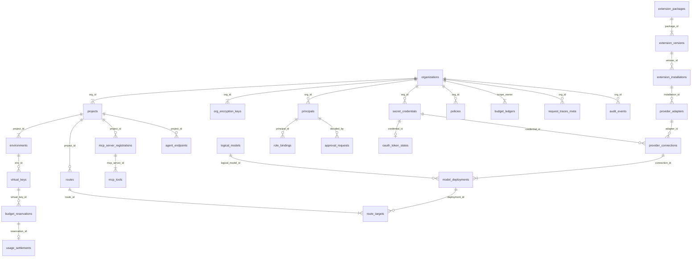

# Persistence, Physical Data Model & Data Lifecycle Architecture — Tanpopo

> **Data Architecture Document (Phase ASTRA A05 — Gate G3: `READY_FOR_REVIEW` | `PROPOSED — PRE-APPROVAL`)**
> - **Document ID:** `ARCH-DATA-01` | **Version:** `0.1.0-step05-draft` | **Last Updated:** `2026-11-11`
> - **Authoring Roles:** Principal Architect & Data/Security Engineer
> - **Governance Status:** **Proposed Schema Design (`PROPOSED`)** — coupled to [`ADR-0003`](./adr/0003-dual-mode-persistence-and-cluster-state.md) and [`ADR-0005`](./adr/0005-two-phase-budget-ledger-and-commercial-billing-separation.md).
> - **Requirements Traceability:** `TP-FR-0201`..`0206`, `TP-FR-0304`, `TP-FR-0401`..`0406`, `TP-FR-0501`..`0504`, `TP-FR-0704`, `TP-FR-0801`..`0806`, `TP-FR-1001`..`1005`, `TP-NFR-0402`, `TP-NFR-0501`, `TP-NFR-0502`, `TP-NFR-0601`.

---

## 1. Dual-Mode Portability Rules (`Dual-Mode Portability Rules`)

So that a single domain layer executes cleanly on both **embedded SQLite (`WAL mode`)** in standalone deployments and **PostgreSQL `16+`** in HA clusters without heavyweight ORMs or fragmented business logic (`RSK-013`), the physical schema enforces six invariant portability rules:

1. **Time-Ordered Domain-Prefixed Primary Keys (`UUIDv7` / `ULID`):** Stored as canonical strings (`TEXT` / `VARCHAR(40)`, e.g., `org_01jc8x...`, `vk_01jc8x...`, `req_01jc8x...`), ensuring monotonic sequential B-Tree inserts without index page fragmentation and identical behavior across SQLite and PostgreSQL.
2. **Zero IEEE-754 Floating-Point Arithmetic for Currency (`Zero IEEE-754 Float for Money`):** All budgets, active holds, and cost settlements are persisted as signed 64-bit integers (**`BIGINT` denominated in `nano-USD` for unit rates (`10^-9 USD / token`) and `micro-USD` for ledger balances (`1 USD = 1_000_000 micro-USD`)**), eliminating cumulative rounding drift entirely (`ADR-0005`).
3. **Strict Billing Mode Separation (`Strict Billing Mode Separation`):** The `billing_mode` column on `provider_connections` accepts exclusively `'COMMERCIAL_API'` (metered against legitimate commercial API token/unit pricing) or `'SELF_HOSTED_INFRA'` (`0 micro-USD` or internal chargeback unit rates for self-hosted GPU clusters). Zero tables or states exist to convert personal consumer subscriptions into shared API quota.
4. **Optimistic Concurrency Control (`Optimistic Concurrency Control`):** Every mutable configuration table modified via Console, CLI, or GitOps includes `version BIGINT NOT NULL DEFAULT 1` (mapped directly to HTTP `ETag`). All updates enforce `WHERE id = ? AND version = ?` while incrementing `version = version + 1`; if `rows_affected == 0`, the API immediately returns `409 version_conflict` (`TP-FR-0901`).
5. **Canonical UTC Timestamps:** Every timestamp is stored in UTC (`TIMESTAMPTZ` on PostgreSQL; uniform `epoch_ms BIGINT` or `ISO-8601 UTC` strings on SQLite normalized through the `storage/port` type adapter).
6. **Defense-in-Depth Multi-Tenant Isolation (`Defense-in-Depth Tenant Isolation`):** Every tenant-scoped table carries a mandatory `org_id` column in foreign keys and leading composite index positions; on PostgreSQL, **`Row-Level Security (RLS)`** policies bound to session variable `app.current_org_id` provide a second line of defense against omitted `WHERE org_id = ?` predicates.

---

## 2. Physical Schema Overview (`Physical Schema Overview`)



---

## 3. Detailed Subsystem DDL Specification (Reference PostgreSQL `16+` DDL)

### 3.1. Tenancy, Identity, RBAC & Virtual Keys (`Tenancy, IAM & Virtual Keys`)

```sql
-- 1. Organizations & Organization-Scoped Envelope Keys (enables < 60s Crypto-Shredding)
CREATE TABLE organizations (
    id                  VARCHAR(40) PRIMARY KEY, -- 'org_...'
    slug                VARCHAR(64) NOT NULL UNIQUE,
    display_name        VARCHAR(128) NOT NULL,
    status              VARCHAR(24) NOT NULL DEFAULT 'ACTIVE', -- ACTIVE | SUSPENDED | PENDING_ERASURE
    default_data_region VARCHAR(32),             -- NULL (Global) | 'EU' | 'US' | 'APAC' | 'ON_PREM'
    min_plugin_trust    VARCHAR(24) NOT NULL DEFAULT 'UNVERIFIED_ALLOWED', -- OFFICIAL_ONLY | VERIFIED_PLUS | UNVERIFIED_ALLOWED
    version             BIGINT NOT NULL DEFAULT 1,
    created_at          TIMESTAMPTZ NOT NULL DEFAULT NOW(),
    updated_at          TIMESTAMPTZ NOT NULL DEFAULT NOW()
);

CREATE TABLE org_encryption_keys (
    org_id              VARCHAR(40) PRIMARY KEY REFERENCES organizations(id) ON DELETE CASCADE,
    kek_key_id          VARCHAR(128) NOT NULL,   -- Master key identifier in KMS/Vault/LocalKeyring
    wrapped_dek         BYTEA NOT NULL,          -- 256-bit Org DEK AEAD-wrapped by Master KEK
    rotated_at          TIMESTAMPTZ NOT NULL DEFAULT NOW()
);

-- 2. Projects & Environments (Rigid 3-tier hierarchy: Org -> Project -> Environment)
CREATE TABLE projects (
    id                  VARCHAR(40) PRIMARY KEY, -- 'prj_...'
    org_id              VARCHAR(40) NOT NULL REFERENCES organizations(id),
    slug                VARCHAR(64) NOT NULL,
    display_name        VARCHAR(128) NOT NULL,
    status              VARCHAR(24) NOT NULL DEFAULT 'ACTIVE', -- ACTIVE | EMERGENCY_HALTED | DELETING
    enforced_region     VARCHAR(32),             -- Must equal or narrow Org's default_data_region
    version             BIGINT NOT NULL DEFAULT 1,
    created_at          TIMESTAMPTZ NOT NULL DEFAULT NOW(),
    UNIQUE (org_id, slug)
);

CREATE TABLE environments (
    id                  VARCHAR(40) PRIMARY KEY, -- 'env_...'
    org_id              VARCHAR(40) NOT NULL REFERENCES organizations(id),
    project_id          VARCHAR(40) NOT NULL REFERENCES projects(id) ON DELETE CASCADE,
    slug                VARCHAR(32) NOT NULL,    -- 'dev' | 'staging' | 'prod'
    require_tested_caps BOOLEAN NOT NULL DEFAULT FALSE, -- When TRUE (prod): rejects DECLARED-only capabilities
    created_at          TIMESTAMPTZ NOT NULL DEFAULT NOW(),
    UNIQUE (project_id, slug)
);

-- 3. Administrative Principals & RBAC Role Bindings
CREATE TABLE principals (
    id                  VARCHAR(40) PRIMARY KEY, -- 'usr_...' | 'svc_...'
    org_id              VARCHAR(40) REFERENCES organizations(id), -- NULL for global Instance Operator
    kind                VARCHAR(24) NOT NULL,    -- HUMAN_LOCAL | HUMAN_OIDC | ADMIN_SERVICE_TOKEN
    email_or_sub        VARCHAR(255) NOT NULL,
    password_argon2id   TEXT,                    -- NULL when OIDC-backed; Argon2id hash for local admin
    oidc_issuer         TEXT,
    status              VARCHAR(24) NOT NULL DEFAULT 'ACTIVE',
    last_login_at       TIMESTAMPTZ,
    created_at          TIMESTAMPTZ NOT NULL DEFAULT NOW(),
    UNIQUE (org_id, kind, email_or_sub)
);

CREATE TABLE role_bindings (
    id                  VARCHAR(40) PRIMARY KEY,
    principal_id        VARCHAR(40) NOT NULL REFERENCES principals(id) ON DELETE CASCADE,
    scope_type          VARCHAR(24) NOT NULL,    -- INSTANCE | ORG | PROJECT
    scope_id            VARCHAR(40) NOT NULL,
    role_name           VARCHAR(32) NOT NULL,    -- OPERATOR | ORG_OWNER | TEAM_ADMIN | REVIEWER | DEVELOPER
    created_at          TIMESTAMPTZ NOT NULL DEFAULT NOW(),
    UNIQUE (principal_id, scope_type, scope_id, role_name)
);

-- 4. Inference & Agent Virtual Keys (SM-05 — One-way hashed, dual-valid rotation & emergency revocation)
CREATE TABLE virtual_keys (
    id                      VARCHAR(40) PRIMARY KEY, -- 'vk_...'
    org_id                  VARCHAR(40) NOT NULL REFERENCES organizations(id),
    project_id              VARCHAR(40) NOT NULL REFERENCES projects(id),
    env_id                  VARCHAR(40) NOT NULL REFERENCES environments(id),
    name                    VARCHAR(128) NOT NULL,
    key_prefix              VARCHAR(20) NOT NULL,    -- Safe display prefix, e.g., 'vk_tp_live_9a2f'
    active_key_hash         BYTEA NOT NULL UNIQUE,   -- HMAC-SHA256 of active secret (Write-Only)
    previous_key_hash       BYTEA UNIQUE,            -- Prior key hash during ROTATING_DUAL_VALID grace window
    rotation_grace_until    TIMESTAMPTZ,
    state                   VARCHAR(32) NOT NULL DEFAULT 'CREATED_ACTIVE', -- SM-05
    allowed_planes          VARCHAR(64) NOT NULL DEFAULT 'PROVIDER',       -- Subset of: PROVIDER,MCP,A2A
    allowed_routes_json     JSONB NOT NULL DEFAULT '["*"]',
    allowed_mcp_tools_json  JSONB NOT NULL DEFAULT '[]',                   -- Empty by default (Default-Deny for MCP!)
    rpm_limit               INTEGER,
    tpm_limit               INTEGER,
    max_concurrent_streams  INTEGER NOT NULL DEFAULT 50,
    expires_at              TIMESTAMPTZ,
    revoked_at              TIMESTAMPTZ,
    revocation_mode         VARCHAR(24),             -- STANDARD | EMERGENCY_SECURITY
    version                 BIGINT NOT NULL DEFAULT 1,
    created_at              TIMESTAMPTZ NOT NULL DEFAULT NOW()
);
```

### 3.2. Secret Vault, OAuth 2.1, Extensions & the 4-Entity Model Chain

```sql
-- 5. AEAD Write-Only Secret Vault (TP-FR-0204)
CREATE TABLE secret_credentials (
    id                  VARCHAR(40) PRIMARY KEY, -- 'sec_...'
    org_id              VARCHAR(40) NOT NULL REFERENCES organizations(id),
    owner_project_id    VARCHAR(40) REFERENCES projects(id), -- NULL = Org-owned
    name                VARCHAR(128) NOT NULL,
    secret_kind         VARCHAR(32) NOT NULL,    -- API_KEY | OAUTH2_TOKEN_SET | HMAC_SECRET | MTLS_CLIENT_CERT
    aead_alg            VARCHAR(32) NOT NULL DEFAULT 'AES-256-GCM',
    nonce               BYTEA NOT NULL,
    ciphertext          BYTEA NOT NULL,          -- AAD cryptographically bound to (org_id || id || secret_kind)
    bound_audience      TEXT,                    -- Enforced match to block Cross-Audience Token Confusion (RFC 8707)
    key_fingerprint     VARCHAR(32) NOT NULL,    -- One-way digest for rotation audit without secret disclosure
    version             BIGINT NOT NULL DEFAULT 1,
    created_at          TIMESTAMPTZ NOT NULL DEFAULT NOW(),
    updated_at          TIMESTAMPTZ NOT NULL DEFAULT NOW()
);

-- 6. Authorized OAuth State Machine & Single-Flight Refresh Lease (SM-03)
CREATE TABLE oauth_token_states (
    credential_id       VARCHAR(40) PRIMARY KEY REFERENCES secret_credentials(id) ON DELETE CASCADE,
    org_id              VARCHAR(40) NOT NULL REFERENCES organizations(id),
    state               VARCHAR(32) NOT NULL DEFAULT 'UNBOUND', -- SM-03: TOKEN_VALID | REFRESHING_SINGLEFLIGHT | REAUTH_REQUIRED...
    granted_scopes      TEXT NOT NULL,
    access_expires_at   TIMESTAMPTZ,
    refresh_lease_owner VARCHAR(64),             -- Node ID holding the Single-Flight Refresh lease
    refresh_lease_until TIMESTAMPTZ,
    last_refresh_error  VARCHAR(128),
    updated_at          TIMESTAMPTZ NOT NULL DEFAULT NOW()
);

-- 7. Extension Packages, Versions & Installations (SM-01)
CREATE TABLE extension_packages (
    id                  VARCHAR(40) PRIMARY KEY, -- 'pkg_...'
    canonical_name      VARCHAR(160) NOT NULL UNIQUE, -- e.g., '@acme-cloud/regional-llm-adapter'
    publisher_id        VARCHAR(128) NOT NULL,
    origin_trust_tier   VARCHAR(32) NOT NULL,    -- OFFICIAL | VERIFIED | PRIVATE_ENTERPRISE | UNVERIFIED_EXTERNAL
    created_at          TIMESTAMPTZ NOT NULL DEFAULT NOW()
);

CREATE TABLE extension_versions (
    id                  VARCHAR(40) PRIMARY KEY, -- 'extv_...'
    package_id          VARCHAR(40) NOT NULL REFERENCES extension_packages(id),
    semver              VARCHAR(64) NOT NULL,
    contract_version    VARCHAR(16) NOT NULL,    -- e.g., '0.1'
    runtime_tier        VARCHAR(24) NOT NULL,    -- DECLARATIVE | SANDBOXED_WASM | ISOLATED_SIDECAR
    bundle_sha256       CHAR(64) NOT NULL,
    signature_verified  BOOLEAN NOT NULL DEFAULT FALSE,
    source_uri          TEXT NOT NULL,
    manifest_json       JSONB NOT NULL,
    sbom_digest         CHAR(64),
    created_at          TIMESTAMPTZ NOT NULL DEFAULT NOW(),
    UNIQUE (package_id, semver)
);

CREATE TABLE extension_installations (
    id                          VARCHAR(40) PRIMARY KEY, -- 'inst_...'
    package_id                  VARCHAR(40) NOT NULL REFERENCES extension_packages(id),
    active_version_id           VARCHAR(40) NOT NULL REFERENCES extension_versions(id),
    previous_pinned_version_id  VARCHAR(40) REFERENCES extension_versions(id), -- Enables < 5s Rollback
    candidate_version_id        VARCHAR(40) REFERENCES extension_versions(id), -- Populated while UPDATING_PENDING_RECONSENT
    lifecycle_state             VARCHAR(40) NOT NULL,    -- SM-01: PENDING_PERMISSION_APPROVAL | ENABLED_ACTIVE | QUARANTINED...
    approved_permissions_json   JSONB NOT NULL,          -- Explicit permission set granted by Admin
    approved_by_principal_id    VARCHAR(40) REFERENCES principals(id),
    approved_at                 TIMESTAMPTZ,
    quarantine_reason           TEXT,
    version                     BIGINT NOT NULL DEFAULT 1,
    updated_at                  TIMESTAMPTZ NOT NULL DEFAULT NOW()
);

-- 8. 4-Entity Model Chain: Adapter -> Connection -> Logical Model -> Model Deployment
CREATE TABLE provider_adapters (
    id                  VARCHAR(40) PRIMARY KEY,
    installation_id     VARCHAR(40) NOT NULL REFERENCES extension_installations(id),
    adapter_slug        VARCHAR(64) NOT NULL UNIQUE,
    native_prefix       VARCHAR(64),             -- e.g., '/native/anthropic'
    supported_dialects  JSONB NOT NULL
);

CREATE TABLE provider_connections (
    id                  VARCHAR(40) PRIMARY KEY, -- 'conn_...'
    org_id              VARCHAR(40) NOT NULL REFERENCES organizations(id),
    owner_project_id    VARCHAR(40) REFERENCES projects(id), -- NULL = Org-Shared (one-way downward sharing to Projects)
    adapter_id          VARCHAR(40) NOT NULL REFERENCES provider_adapters(id),
    credential_id       VARCHAR(40) REFERENCES secret_credentials(id), -- NULL for keyless internal Ollama
    name                VARCHAR(128) NOT NULL,
    endpoint_base_url   TEXT NOT NULL,
    allow_private_ip    BOOLEAN NOT NULL DEFAULT FALSE, -- Only Operator may enable TRUE for internal GPU hosts
    data_region         VARCHAR(32) NOT NULL,    -- 'EU' | 'US' | 'APAC' | 'ON_PREM'
    billing_mode        VARCHAR(24) NOT NULL CHECK (billing_mode IN ('COMMERCIAL_API', 'SELF_HOSTED_INFRA')),
    state               VARCHAR(40) NOT NULL DEFAULT 'DRAFT', -- SM-02
    shared_project_ids  JSONB NOT NULL DEFAULT '[]',
    config_json         JSONB NOT NULL DEFAULT '{}',
    version             BIGINT NOT NULL DEFAULT 1,
    created_at          TIMESTAMPTZ NOT NULL DEFAULT NOW()
);

CREATE TABLE logical_models (
    id                  VARCHAR(40) PRIMARY KEY, -- 'mdl_...'
    canonical_slug      VARCHAR(128) NOT NULL UNIQUE, -- e.g., 'claude-sonnet-4-5', 'gpt-4o', 'qwen2.5-72b'
    modality_kind       VARCHAR(32) NOT NULL,    -- CHAT | EMBEDDING | MULTIMODAL
    context_window      INTEGER NOT NULL,
    max_output_tokens   INTEGER NOT NULL,
    base_capabilities   JSONB NOT NULL           -- vision, audio_input, document_input, tool_calling, strict_json_schema...
);

CREATE TABLE model_deployments (
    id                      VARCHAR(40) PRIMARY KEY, -- 'dep_...'
    org_id                  VARCHAR(40) NOT NULL REFERENCES organizations(id),
    connection_id           VARCHAR(40) NOT NULL REFERENCES provider_connections(id),
    logical_model_id        VARCHAR(40) NOT NULL REFERENCES logical_models(id),
    upstream_model_name     VARCHAR(160) NOT NULL,   -- Exact model identifier sent to upstream provider
    capability_overrides    JSONB NOT NULL DEFAULT '{}',
    assurance_level         VARCHAR(16) NOT NULL DEFAULT 'DECLARED', -- DECLARED | TESTED | VERIFIED
    pricing_nano_usd_json   JSONB NOT NULL,          -- Unit rates in nano-USD/token for input, output, cache_read, cache_write, reasoning
    health_state            VARCHAR(32) NOT NULL DEFAULT 'PROVISIONED', -- SM-04
    cooldown_until          TIMESTAMPTZ,
    connect_timeout_ms      INTEGER NOT NULL DEFAULT 5000,
    first_byte_timeout_ms   INTEGER NOT NULL DEFAULT 30000, -- Up to 120000 for cold-loading Ollama/vLLM models
    version                 BIGINT NOT NULL DEFAULT 1,
    created_at              TIMESTAMPTZ NOT NULL DEFAULT NOW()
);
```

### 3.3. Routing, Hierarchical Policies, MCP, A2A & Idempotency

```sql
-- 9. Routes & Hierarchical Governance Policies
CREATE TABLE routes (
    id                  VARCHAR(40) PRIMARY KEY, -- 'rt_...'
    org_id              VARCHAR(40) NOT NULL REFERENCES organizations(id),
    project_id          VARCHAR(40) NOT NULL REFERENCES projects(id),
    env_id              VARCHAR(40) NOT NULL REFERENCES environments(id),
    route_slug          VARCHAR(128) NOT NULL,   -- Virtual model slug invoked by API Clients (e.g., 'prod-default' or 'claude-sonnet')
    strategy            VARCHAR(32) NOT NULL DEFAULT 'PRIORITY_FAILOVER', -- PRIORITY_FAILOVER | WEIGHTED | LOWEST_COST
    max_failover_hops   SMALLINT NOT NULL DEFAULT 3 CHECK (max_failover_hops BETWEEN 0 AND 5),
    required_region     VARCHAR(32),
    version             BIGINT NOT NULL DEFAULT 1,
    UNIQUE (env_id, route_slug)
);

CREATE TABLE route_targets (
    route_id            VARCHAR(40) NOT NULL REFERENCES routes(id) ON DELETE CASCADE,
    deployment_id       VARCHAR(40) NOT NULL REFERENCES model_deployments(id),
    priority_order      SMALLINT NOT NULL,
    weight              SMALLINT NOT NULL DEFAULT 100,
    PRIMARY KEY (route_id, deployment_id)
);

CREATE TABLE policies (
    id                  VARCHAR(40) PRIMARY KEY, -- 'pol_...'
    org_id              VARCHAR(40) NOT NULL REFERENCES organizations(id),
    scope_type          VARCHAR(16) NOT NULL,    -- ORG | PROJECT | ENV
    scope_id            VARCHAR(40) NOT NULL,
    policy_type         VARCHAR(32) NOT NULL,    -- MODEL_ALLOWLIST | DATA_RESIDENCY | GUARDRAIL | MCP_GOVERNANCE
    failure_mode        VARCHAR(16) NOT NULL DEFAULT 'FAIL_CLOSED', -- FAIL_OPEN prohibited for Auth/Residency/HardBudget/DestructiveMCP
    rules_json          JSONB NOT NULL,
    enabled             BOOLEAN NOT NULL DEFAULT TRUE,
    version             BIGINT NOT NULL DEFAULT 1,
    updated_at          TIMESTAMPTZ NOT NULL DEFAULT NOW()
);

-- 10. MCP Plane, A2A Plane, Human-in-the-Loop Approvals (SM-06) & Idempotency Records
CREATE TABLE mcp_server_registrations (
    id                  VARCHAR(40) PRIMARY KEY, -- 'mcps_...'
    org_id              VARCHAR(40) NOT NULL REFERENCES organizations(id),
    project_id          VARCHAR(40) NOT NULL REFERENCES projects(id),
    server_slug         VARCHAR(64) NOT NULL,    -- Forms canonical namespace '<server_slug>__<tool_name>'
    transport_kind      VARCHAR(24) NOT NULL,    -- STREAMABLE_HTTP | SIDECAR_STDIO
    endpoint_url        TEXT NOT NULL,
    credential_id       VARCHAR(40) REFERENCES secret_credentials(id),
    pinning_mode        VARCHAR(24) NOT NULL DEFAULT 'STRICT_LOCK', -- STRICT_LOCK | WARN_ONLY
    status              VARCHAR(24) NOT NULL DEFAULT 'ACTIVE',
    version             BIGINT NOT NULL DEFAULT 1,
    UNIQUE (project_id, server_slug)
);

CREATE TABLE mcp_tools (
    id                      VARCHAR(40) PRIMARY KEY,
    org_id                  VARCHAR(40) NOT NULL REFERENCES organizations(id),
    mcp_server_id           VARCHAR(40) NOT NULL REFERENCES mcp_server_registrations(id) ON DELETE CASCADE,
    tool_name               VARCHAR(128) NOT NULL,
    side_effect_class       VARCHAR(24) NOT NULL DEFAULT 'MUTATING', -- READ_ONLY | MUTATING | DESTRUCTIVE
    approved_schema_sha256  CHAR(64) NOT NULL,   -- Approved RFC 8785 JCS digest (MCP Rug-Pull defense)
    observed_schema_sha256  CHAR(64) NOT NULL,
    schema_drift_locked     BOOLEAN NOT NULL DEFAULT FALSE,
    tool_schema_json        JSONB NOT NULL,
    UNIQUE (mcp_server_id, tool_name)
);

CREATE TABLE agent_endpoints (
    id                      VARCHAR(40) PRIMARY KEY, -- 'agt_...'
    org_id                  VARCHAR(40) NOT NULL REFERENCES organizations(id),
    project_id              VARCHAR(40) NOT NULL REFERENCES projects(id),
    agent_slug              VARCHAR(64) NOT NULL,
    endpoint_url            TEXT NOT NULL,
    agent_card_json         JSONB NOT NULL,
    max_delegation_hops     SMALLINT NOT NULL DEFAULT 5 CHECK (max_delegation_hops <= 10),
    status                  VARCHAR(24) NOT NULL DEFAULT 'ACTIVE',
    UNIQUE (project_id, agent_slug)
);

CREATE TABLE approval_requests (
    id                      VARCHAR(40) PRIMARY KEY, -- 'apr_...'
    org_id                  VARCHAR(40) NOT NULL REFERENCES organizations(id),
    project_id              VARCHAR(40) NOT NULL REFERENCES projects(id),
    action_kind             VARCHAR(32) NOT NULL,    -- MCP_DESTRUCTIVE_CALL | EXTENSION_ESCALATION | BUDGET_OVERRIDE
    requester_key_or_sub    VARCHAR(64) NOT NULL,
    target_identifier       VARCHAR(160) NOT NULL,   -- e.g., 'prod_db__drop_table'
    params_jcs_sha256       CHAR(64) NOT NULL,       -- Cryptographically bound to canonicalized parameter digest!
    state                   VARCHAR(24) NOT NULL DEFAULT 'AWAITING_APPROVAL', -- SM-06
    pre_approval_token_hash BYTEA UNIQUE,            -- Single-use token hash for asynchronous approval replay
    decided_by              VARCHAR(40) REFERENCES principals(id),
    decision_reason         TEXT,
    expires_at              TIMESTAMPTZ NOT NULL,
    created_at              TIMESTAMPTZ NOT NULL DEFAULT NOW(),
    decided_at              TIMESTAMPTZ
);

CREATE TABLE idempotency_records (
    org_id                  VARCHAR(40) NOT NULL,
    scope_owner_id          VARCHAR(40) NOT NULL,    -- virtual_key_id or principal_id
    idempotency_key         VARCHAR(128) NOT NULL,
    payload_sha256          CHAR(64) NOT NULL,
    state                   VARCHAR(16) NOT NULL,    -- IN_FLIGHT | COMPLETED
    http_status             SMALLINT,
    response_headers_json   JSONB,
    response_body_bytes     BYTEA,
    expires_at              TIMESTAMPTZ NOT NULL,
    PRIMARY KEY (org_id, scope_owner_id, idempotency_key)
);
```

### 3.4. Two-Phase Budget Ledger, Observability Traces & Immutable Security Audit

```sql
-- 11. Hierarchical Budget Ledgers (Unit: micro-USD = 10^-6 USD)
CREATE TABLE budget_ledgers (
    id                          VARCHAR(40) PRIMARY KEY, -- 'bdg_...'
    org_id                      VARCHAR(40) NOT NULL REFERENCES organizations(id),
    scope_type                  VARCHAR(16) NOT NULL,    -- ORG | PROJECT | ENV | VIRTUAL_KEY
    scope_id                    VARCHAR(40) NOT NULL,
    period_kind                 VARCHAR(16) NOT NULL,    -- MONTHLY | DAILY | TOTAL_LIFETIME
    period_start                TIMESTAMPTZ NOT NULL,
    period_end                  TIMESTAMPTZ NOT NULL,
    hard_limit_micros           BIGINT NOT NULL CHECK (hard_limit_micros >= 0),
    reserved_hold_micros        BIGINT NOT NULL DEFAULT 0 CHECK (reserved_hold_micros >= 0),
    settled_exact_micros        BIGINT NOT NULL DEFAULT 0 CHECK (settled_exact_micros >= 0),
    settled_estimated_micros    BIGINT NOT NULL DEFAULT 0 CHECK (settled_estimated_micros >= 0),
    negative_carryover_micros   BIGINT NOT NULL DEFAULT 0 CHECK (negative_carryover_micros >= 0),
    soft_alert_thresholds_pct   JSONB NOT NULL DEFAULT '[50, 80, 100]',
    last_alerted_threshold_pct  SMALLINT NOT NULL DEFAULT 0,
    UNIQUE (scope_type, scope_id, period_kind, period_start)
);

-- 12. Active In-Flight Budget Reservations (SM-07)
CREATE TABLE budget_reservations (
    id                  VARCHAR(40) PRIMARY KEY, -- 'rsv_...'
    request_id          VARCHAR(40) NOT NULL UNIQUE,
    org_id              VARCHAR(40) NOT NULL,
    project_id          VARCHAR(40) NOT NULL,
    env_id              VARCHAR(40) NOT NULL,
    virtual_key_id      VARCHAR(40) NOT NULL,
    state               VARCHAR(32) NOT NULL,    -- RESERVED_HOLD | STREAMING_ACCRUING | SETTLED_* | RELEASED_UNUSED | EXPIRED_RECLAIMED
    hold_micros         BIGINT NOT NULL CHECK (hold_micros >= 0),
    lease_expires_at    TIMESTAMPTZ NOT NULL,    -- Enables OrphanReservationReaper reclamation upon worker crash
    created_at          TIMESTAMPTZ NOT NULL DEFAULT NOW(),
    updated_at          TIMESTAMPTZ NOT NULL DEFAULT NOW()
);

-- 13. Immutable Cost Settlement Ledger (Append-Only, Monthly Range-Partitioned in Postgres)
CREATE TABLE usage_settlements (
    id                      VARCHAR(40) NOT NULL,
    settled_at              TIMESTAMPTZ NOT NULL DEFAULT NOW(),
    request_id              VARCHAR(40) NOT NULL,
    reservation_id          VARCHAR(40),
    org_id                  VARCHAR(40) NOT NULL,
    project_id              VARCHAR(40) NOT NULL,
    env_id                  VARCHAR(40) NOT NULL,
    virtual_key_id          VARCHAR(40) NOT NULL,
    plane                   VARCHAR(16) NOT NULL,    -- PROVIDER | MCP | A2A
    deployment_id           VARCHAR(40),
    logical_model_slug      VARCHAR(128),
    billing_mode            VARCHAR(24) NOT NULL,    -- COMMERCIAL_API | SELF_HOSTED_INFRA
    usage_accuracy          VARCHAR(24) NOT NULL CHECK (usage_accuracy IN ('EXACT', 'ESTIMATED', 'UNMETERED_FLAGGED')),
    input_tokens            INTEGER NOT NULL DEFAULT 0,
    output_tokens           INTEGER NOT NULL DEFAULT 0,
    cache_read_tokens       INTEGER NOT NULL DEFAULT 0,
    cache_write_tokens      INTEGER NOT NULL DEFAULT 0,
    reasoning_tokens        INTEGER NOT NULL DEFAULT 0,
    total_cost_micros       BIGINT NOT NULL CHECK (total_cost_micros >= 0),
    PRIMARY KEY (id, settled_at)
) PARTITION BY RANGE (settled_at);

-- 14. Technical Request Trace Metadata (Metadata-Only by Default — ZERO Prompt/Response Payloads!)
CREATE TABLE request_traces_meta (
    request_id              VARCHAR(40) NOT NULL,
    started_at              TIMESTAMPTZ NOT NULL,
    org_id                  VARCHAR(40) NOT NULL,
    project_id              VARCHAR(40) NOT NULL,
    env_id                  VARCHAR(40) NOT NULL,
    virtual_key_id          VARCHAR(40),
    entry_point             VARCHAR(24) NOT NULL,    -- unified_http | native_http | mcp_http | a2a_http | playground
    otel_trace_id           CHAR(32),
    route_slug              VARCHAR(128),
    selected_deployment_id  VARCHAR(40),
    failover_attempts       SMALLINT NOT NULL DEFAULT 0,
    http_status             SMALLINT NOT NULL,
    canonical_error_code    VARCHAR(64),
    proxy_overhead_us       INTEGER NOT NULL,        -- Tanpopo internal proxy overhead (microseconds)
    ttft_ms                 INTEGER,                 -- Time-to-First-Token (ms)
    total_duration_ms       INTEGER NOT NULL,
    PRIMARY KEY (request_id, started_at)
) PARTITION BY RANGE (started_at);

-- Strictly segregated table for opt-in debug payloads (Written ONLY when Admin explicitly enables + hard TTL <= 72h)
CREATE TABLE debug_payload_blobs (
    request_id              VARCHAR(40) PRIMARY KEY,
    org_id                  VARCHAR(40) NOT NULL REFERENCES organizations(id) ON DELETE CASCADE,
    nonce                   BYTEA NOT NULL,
    encrypted_payload_aead  BYTEA NOT NULL,          -- Auth headers stripped & AEAD-encrypted under Org DEK
    expires_at              TIMESTAMPTZ NOT NULL     -- Enforced <= started_at + INTERVAL '72 hours'
);

-- 15. Immutable Administrative & Security Audit Log (Append-Only + Tamper-Evident Hash Chain)
CREATE TABLE audit_events (
    id                      VARCHAR(40) NOT NULL,    -- 'aud_...'
    occurred_at             TIMESTAMPTZ NOT NULL DEFAULT NOW(),
    org_id                  VARCHAR(40),             -- NULL for Instance-scoped events
    actor_kind              VARCHAR(24) NOT NULL,
    actor_id                VARCHAR(64) NOT NULL,
    entry_point             VARCHAR(24) NOT NULL,    -- admin_api | cli | gitops_boot | system_reaper
    event_type              VARCHAR(64) NOT NULL,    -- e.g., 'plugin.quarantined', 'virtual_key.emergency_revoked'
    target_type             VARCHAR(32) NOT NULL,
    target_id               VARCHAR(64) NOT NULL,
    request_id              VARCHAR(40),
    metadata_json           JSONB NOT NULL,          -- Scrubbed through strict secret-field denylist
    prev_event_hash         CHAR(64) NOT NULL,
    event_hash              CHAR(64) NOT NULL,       -- SHA-256(prev_event_hash || occurred_at || event_type || target_id || metadata_json)
    PRIMARY KEY (id, occurred_at)
) PARTITION BY RANGE (occurred_at);
```

---

## 4. Indexing Strategy (`Query-Plan-Justified Indexes`)

Avoiding indiscriminate indexing that degrades write throughput (`performance-optimization`), every index below directly serves a high-frequency production query plan:

| Index Name | Table & Ordered Key Columns `(Equality -> Range/Sort)` | Target Query Plan Optimized |
|---|---|---|
| `idx_vkeys_env_active` | `virtual_keys (org_id, project_id, env_id) WHERE state IN ('CREATED_ACTIVE', 'ROTATING_DUAL_VALID')` | Fast `ConfigSnapshot` hydration and Console active-key listing (*Partial Index*). |
| `idx_rsv_orphan_lease` | `budget_reservations (lease_expires_at) WHERE state IN ('RESERVED_HOLD', 'STREAMING_ACCRUING')` | Enables `OrphanReservationReaper` to locate expired holds in `< 1 ms` without scanning finalized reservations! |
| `idx_settlements_chargeback` | `usage_settlements (org_id, project_id, usage_accuracy, settled_at DESC)` | Generates `Chargeback` exports separating `EXACT` vs `ESTIMATED / UNMETERED` columns by billing window (`TP-FR-0803`). |
| `idx_traces_project_time` | `request_traces_meta (org_id, project_id, env_id, started_at DESC)` | Powers cursor-paginated (`started_at, request_id`) log/trace exploration in the Web Console. |
| `idx_traces_error_lookup` | `request_traces_meta (org_id, canonical_error_code, started_at DESC) WHERE canonical_error_code IS NOT NULL` | Accelerates blocked/failed request triage without indexing `99%` of successful traffic rows. |
| `idx_audit_org_time` | `audit_events (org_id, occurred_at DESC)` & `audit_events (target_type, target_id, occurred_at DESC)` | Powers compliance audit queries and incident blast-radius lookups (`Impact Analysis` — `TP-FR-0705`). |
| `idx_debug_blobs_ttl` | `debug_payload_blobs (expires_at)` | Fast batch purging of expired debug payload blobs (`<= 72 hours`). |

---

## 5. Schema Migrations, Retention, `< 60s` Erasure & Backup/Recovery

1. **Zero-Downtime Schema Migrations (`Expand / Contract Migrations`):**
   - Managed via sequentially numbered, checksum-verified SQL migration files (`db/migrations/postgres/*.sql` and `db/migrations/sqlite/*.sql`).
   - In HA clusters (`SM-08`), every upgrade follows the **Expand → Migrate Rollout → Contract** discipline: Control Plane upgrades introduce only nullable/defaulted columns or new tables so prior-version Data Plane pods undergoing `Rolling Drain` never encounter broken SQL statements; deprecated columns are dropped only in a subsequent release.
2. **Zero-Lock Automated Retention (`Zero-Lock Retention` — `TP-NFR-0501`):**
   - **On PostgreSQL:** `usage_settlements`, `request_traces_meta`, and `audit_events` are range-partitioned by time (monthly/weekly). Upon retention expiry (default `7–30 days` for `request_traces_meta`, `>= 365 days` for `usage_settlements` & `audit_events`), the worker detaches and drops expired partitions (`DETACH PARTITION CONCURRENTLY` → `DROP TABLE`) with **zero `VACUUM` bloat and zero locks on active partitions**.
   - **On SQLite (Standalone):** `RetentionAndErasureWorker` deletes in small bounded batches (`DELETE FROM request_traces_meta WHERE rowid IN (SELECT rowid ... LIMIT 500)`) interleaved with `50 ms` yields so WAL writers are never stalled.
3. **`< 60-Second` Organization/Project Erasure Integrity (`Crypto-Shredding + Erasure` — `TP-NFR-0502`):**
   - Step 1 (`< 1 second`): Transition status to `PENDING_ERASURE` and broadcast an emergency revocation signal terminating all active streams belonging to that tenant scope.
   - Step 2 (`< 5 seconds`): **Permanently delete the `org_encryption_keys` row (or `Project` subkey) along with all rows in `secret_credentials`, `oauth_token_states`, and `debug_payload_blobs`** → any secret or debug ciphertext becomes immediately undecipherable even on unoverwritten disk pages (*Crypto-Shredding*).
   - Step 3 (`< 60 seconds`): Purge all routes and virtual keys, retaining only minimal anonymized accounting aggregates where required by the host organization's statutory financial retention rules.
4. **Online Hot Backup & Disaster Recovery (`RTO < 15 Minutes` — `TP-NFR-0601`):**
   - **Standalone Mode (`SQLite`):** `tanpopo backup create --out backup.tdb.enc` invokes SQLite's online hot backup primitive (`VACUUM INTO` / Online Backup API) bundled with `tanpopo.lock` without pausing live traffic.
   - **HA Cluster Mode (`PostgreSQL`):** Uses base backups paired with continuous WAL archiving (`pgBackRest` / Cloud PITR).
   - **Master Key Separation Invariant (`TP-FR-1003`):** Database backup archives **never contain the `Master KEK`**. An attacker who exfiltrates a complete SQL dump remains cryptographically unable to decrypt any upstream `Secret Credential`.
