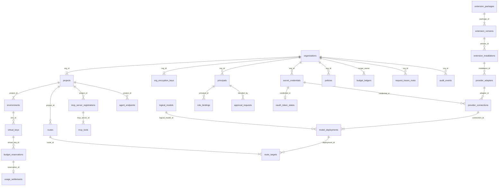

# Thiết kế Lưu trữ Dữ liệu, Lược đồ Vật lý & Vòng đời Dữ liệu (Persistence & Physical Data Model) — Tanpopo

> **Tài liệu Kiến trúc Dữ liệu (Phase ASTRA A05 — Gate G3: `READY_FOR_REVIEW` | `PROPOSED — PRE-APPROVAL`)**
> - **Mã tài liệu:** `ARCH-DATA-01` | **Phiên bản:** `0.1.0-step05-draft` | **Ngày cập nhật:** `2026-11-11`
> - **Vai trò biên soạn:** Principal Architect & Data/Security Engineer
> - **Trạng thái quản trị:** **Thiết kế Lược đồ Đề xuất (`PROPOSED`)** — gắn với quyết định kiến trúc [`ADR-0003`](./adr/0003-dual-mode-persistence-and-cluster-state.md) và [`ADR-0005`](./adr/0005-two-phase-budget-ledger-and-commercial-billing-separation.md).
> - **Truy vết Yêu cầu:** `TP-FR-0201`..`0206`, `TP-FR-0304`, `TP-FR-0401`..`0406`, `TP-FR-0501`..`0504`, `TP-FR-0704`, `TP-FR-0801`..`0806`, `TP-FR-1001`..`1005`, `TP-NFR-0402`, `TP-NFR-0501`, `TP-NFR-0502`, `TP-NFR-0601`.

---

## 1. Quy tắc Thiết kế Lưu trữ Khả chuyển Hai Chế độ (`Dual-Mode Portability Rules`)

Để cùng một tầng nghiệp vụ chạy mượt cả trên **SQLite nhúng (`WAL mode`)** ở chế độ đơn nút lẫn **PostgreSQL `16+`** ở chế độ cụm HA mà không cần ORM cồng kềnh hay phân mảnh logic (`RSK-013`), lược đồ vật lý tuân thủ 6 quy tắc bất biến sau:

1. **Khóa chính có thứ tự thời gian (`UUIDv7` / `ULID` có tiền tố miền):** Lưu dạng chuỗi chuẩn (`TEXT` / `VARCHAR(40)`, ví dụ `org_01jc8x...`, `vk_01jc8x...`, `req_01jc8x...`) giúp chèn tuần tự vào cây B-Tree không gây phân mảnh trang chỉ mục và hoạt động giống hệt nhau trên cả SQLite lẫn PostgreSQL.
2. **Đơn vị tiền tệ tuyệt đối không dùng số thực dấu phẩy động (`Zero IEEE-754 Float for Money`):** Toàn bộ ngân sách, khoản giữ chỗ và quyết toán chi phí lưu bằng số nguyên 64-bit có dấu **`BIGINT` tính theo đơn vị `nano-USD` cho đơn giá (`10^-9 USD / token`) và `micro-USD` cho sổ cái (`1 USD = 1_000_000 micro-USD`)**, triệt tiêu hoàn toàn sai số làm tròn tích lũy (`ADR-0005`).
3. **Không trộn lẫn thanh toán API thương mại với thuê bao cá nhân (`Strict Billing Mode Separation`):** Cột `billing_mode` trên `provider_connections` chỉ nhận giá trị `'COMMERCIAL_API'` (tính phí theo đơn giá token/đơn vị API hợp pháp) hoặc `'SELF_HOSTED_INFRA'` (hạ tầng GPU nội bộ `0 micro-USD` hoặc đơn giá phân bổ nội bộ). Tuyệt đối không tồn tại bảng hay trạng thái nào quy đổi gói thuê bao tiêu dùng cá nhân thành hạn mức API dùng chung.
4. **Kiểm soát đồng thời lạc quan (`Optimistic Concurrency Control`):** Mọi bảng cấu hình có thể chỉnh sửa từ Console/CLI/GitOps đều có cột `version BIGINT NOT NULL DEFAULT 1` (tương ứng tiêu đề HTTP `ETag`). Mọi câu lệnh cập nhật đều ép điều kiện `WHERE id = ? AND version = ?` và tăng `version = version + 1`; nếu `rows_affected == 0` trả ngay `409 version_conflict` (`TP-FR-0901`).
5. **Thời gian chuẩn UTC:** Mọi dấu thời gian lưu ở chuẩn UTC (`TIMESTAMPTZ` trên PostgreSQL; số nguyên `epoch_ms BIGINT` hoặc chuỗi `ISO-8601 UTC` đồng nhất trên SQLite thông qua bộ chuyển đổi kiểu tại tầng `storage/port`).
6. **Cô lập Đa Tổ chức Chiều sâu (`Defense-in-Depth Tenant Isolation`):** Mọi bảng thuộc phạm vi người thuê đều mang cột `org_id` bắt buộc trong khóa ngoại và chỉ mục dẫn đầu; trên PostgreSQL kích hoạt thêm chính sách **`Row-Level Security (RLS)`** đối chiếu biến phiên `app.current_org_id` để chặn mọi rủi ro quên mệnh đề `WHERE org_id = ?`.

---

## 2. Sơ đồ Thực thể Vật lý Tổng thể (`Physical Schema Overview`)



---

## 3. Đặc tả Lược đồ Chi tiết Theo Từng Phân Hệ (Thiết kế DDL Chuẩn PostgreSQL `16+`)

### 3.1. Phân hệ Đa Tổ chức, Danh tính, Vai trò & Khóa Ảo (`Tenancy, IAM & Virtual Keys`)

```sql
-- 1. Tổ chức & Khóa bọc dữ liệu cấp Tổ chức (phục vụ Crypto-Shredding < 60s)
CREATE TABLE organizations (
    id                   VARCHAR(40) PRIMARY KEY, -- 'org_...'
    slug                VARCHAR(64) NOT NULL UNIQUE,
    display_name        VARCHAR(128) NOT NULL,
    status              VARCHAR(24) NOT NULL DEFAULT 'ACTIVE', -- ACTIVE | SUSPENDED | PENDING_ERASURE
    default_data_region VARCHAR(32),             -- NULL (Global) | 'EU' | 'US' | 'APAC' | 'ON_PREM'
    min_plugin_trust    VARCHAR(24) NOT NULL DEFAULT 'UNVERIFIED_ALLOWED', -- OFFICIAL_ONLY | VERIFIED_PLUS | UNVERIFIED_ALLOWED
    version             BIGINT NOT NULL DEFAULT 1,
    created_at          TIMESTAMPTZ NOT NULL DEFAULT NOW(),
    updated_at          TIMESTAMPTZ NOT NULL DEFAULT NOW()
);

CREATE TABLE org_encryption_keys (
    org_id              VARCHAR(40) PRIMARY KEY REFERENCES organizations(id) ON DELETE CASCADE,
    kek_key_id          VARCHAR(128) NOT NULL,   -- Định danh khóa chủ trong KMS/Vault/LocalKeyring
    wrapped_dek         BYTEA NOT NULL,          -- Org DEK 256-bit đã bọc AEAD bởi Master KEK
    rotated_at          TIMESTAMPTZ NOT NULL DEFAULT NOW()
);

-- 2. Dự án & Môi trường (3 tầng cứng Org -> Project -> Environment)
CREATE TABLE projects (
    id                  VARCHAR(40) PRIMARY KEY, -- 'prj_...'
    org_id              VARCHAR(40) NOT NULL REFERENCES organizations(id),
    slug                VARCHAR(64) NOT NULL,
    display_name        VARCHAR(128) NOT NULL,
    status              VARCHAR(24) NOT NULL DEFAULT 'ACTIVE', -- ACTIVE | EMERGENCY_HALTED | DELETING
    enforced_region     VARCHAR(32),             -- Chỉ được bằng hoặc hẹp hơn default_data_region của Org
    version             BIGINT NOT NULL DEFAULT 1,
    created_at          TIMESTAMPTZ NOT NULL DEFAULT NOW(),
    UNIQUE (org_id, slug)
);

CREATE TABLE environments (
    id                  VARCHAR(40) PRIMARY KEY, -- 'env_...'
    org_id              VARCHAR(40) NOT NULL REFERENCES organizations(id),
    project_id          VARCHAR(40) NOT NULL REFERENCES projects(id) ON DELETE CASCADE,
    slug                VARCHAR(32) NOT NULL,    -- 'dev' | 'staging' | 'prod'
    require_tested_caps BOOLEAN NOT NULL DEFAULT FALSE, -- Nếu TRUE (prod): chặn năng lực chỉ ở mức DECLARED
    created_at          TIMESTAMPTZ NOT NULL DEFAULT NOW(),
    UNIQUE (project_id, slug)
);

-- 3. Chủ thể Quản trị & Gán Vai trò RBAC
CREATE TABLE principals (
    id                  VARCHAR(40) PRIMARY KEY, -- 'usr_...' | 'svc_...'
    org_id              VARCHAR(40) REFERENCES organizations(id), -- NULL cho Instance Operator toàn cục
    kind                VARCHAR(24) NOT NULL,    -- HUMAN_LOCAL | HUMAN_OIDC | ADMIN_SERVICE_TOKEN
    email_or_sub        VARCHAR(255) NOT NULL,
    password_argon2id   TEXT,                    -- NULL nếu dùng OIDC; băm Argon2id cho quản trị cục bộ
    oidc_issuer         TEXT,
    status              VARCHAR(24) NOT NULL DEFAULT 'ACTIVE',
    last_login_at       TIMESTAMPTZ,
    created_at          TIMESTAMPTZ NOT NULL DEFAULT NOW(),
    UNIQUE (org_id, kind, email_or_sub)
);

CREATE TABLE role_bindings (
    id                  VARCHAR(40) PRIMARY KEY,
    principal_id        VARCHAR(40) NOT NULL REFERENCES principals(id) ON DELETE CASCADE,
    scope_type          VARCHAR(24) NOT NULL,    -- INSTANCE | ORG | PROJECT
    scope_id            VARCHAR(40) NOT NULL,
    role_name           VARCHAR(32) NOT NULL,    -- OPERATOR | ORG_OWNER | TEAM_ADMIN | REVIEWER | DEVELOPER
    created_at          TIMESTAMPTZ NOT NULL DEFAULT NOW(),
    UNIQUE (principal_id, scope_type, scope_id, role_name)
);

-- 4. Khóa Ảo Suy luận & Tác nhân (SM-05 — Băm một chiều, hỗ trợ xoay khóa kép & thu hồi khẩn cấp)
CREATE TABLE virtual_keys (
    id                      VARCHAR(40) PRIMARY KEY, -- 'vk_...'
    org_id                  VARCHAR(40) NOT NULL REFERENCES organizations(id),
    project_id              VARCHAR(40) NOT NULL REFERENCES projects(id),
    env_id                  VARCHAR(40) NOT NULL REFERENCES environments(id),
    name                    VARCHAR(128) NOT NULL,
    key_prefix              VARCHAR(20) NOT NULL,    -- Hiển thị nhận diện an toàn, VD: 'vk_tp_live_9a2f'
    active_key_hash         BYTEA NOT NULL UNIQUE,   -- HMAC-SHA256 của khóa đang chạy (Write-Only)
    previous_key_hash       BYTEA UNIQUE,            -- Khóa cũ trong cửa sổ ân hạn ROTATING_DUAL_VALID
    rotation_grace_until    TIMESTAMPTZ,
    state                   VARCHAR(32) NOT NULL DEFAULT 'CREATED_ACTIVE', -- SM-05
    allowed_planes          VARCHAR(64) NOT NULL DEFAULT 'PROVIDER',       -- Tập con: PROVIDER,MCP,A2A
    allowed_routes_json     JSONB NOT NULL DEFAULT '["*"]',
    allowed_mcp_tools_json  JSONB NOT NULL DEFAULT '[]',                   -- Mặc định rỗng (Default-Deny cho MCP!)
    rpm_limit               INTEGER,
    tpm_limit               INTEGER,
    max_concurrent_streams  INTEGER NOT NULL DEFAULT 50,
    expires_at              TIMESTAMPTZ,
    revoked_at              TIMESTAMPTZ,
    revocation_mode         VARCHAR(24),             -- STANDARD | EMERGENCY_SECURITY
    version                 BIGINT NOT NULL DEFAULT 1,
    created_at              TIMESTAMPTZ NOT NULL DEFAULT NOW()
);
```

### 3.2. Phân hệ Kho Bí mật, OAuth 2.1, Phần mở rộng & Chuỗi 4 Thực thể Mô hình

```sql
-- 5. Kho Bí mật Ghi Một Chiều (AEAD Write-Only Secret Vault — TP-FR-0204)
CREATE TABLE secret_credentials (
    id                  VARCHAR(40) PRIMARY KEY, -- 'sec_...'
    org_id              VARCHAR(40) NOT NULL REFERENCES organizations(id),
    owner_project_id    VARCHAR(40) REFERENCES projects(id), -- NULL = Sở hữu cấp Org
    name                VARCHAR(128) NOT NULL,
    secret_kind         VARCHAR(32) NOT NULL,    -- API_KEY | OAUTH2_TOKEN_SET | HMAC_SECRET | MTLS_CLIENT_CERT
    aead_alg            VARCHAR(32) NOT NULL DEFAULT 'AES-256-GCM',
    nonce               BYTEA NOT NULL,
    ciphertext          BYTEA NOT NULL,          -- AAD khóa cứng vào (org_id || id || secret_kind)
    bound_audience      TEXT,                    -- Bắt buộc khớp để chặn Token Cross-Audience (RFC 8707)
    key_fingerprint     VARCHAR(32) NOT NULL,    -- Mã rút gọn 1 chiều để kiểm toán xoay khóa mà không lộ khóa
    version             BIGINT NOT NULL DEFAULT 1,
    created_at          TIMESTAMPTZ NOT NULL DEFAULT NOW(),
    updated_at          TIMESTAMPTZ NOT NULL DEFAULT NOW()
);

-- 6. Máy trạng thái OAuth Được cấp phép & Khóa Làm mới Đơn luồng (SM-03)
CREATE TABLE oauth_token_states (
    credential_id       VARCHAR(40) PRIMARY KEY REFERENCES secret_credentials(id) ON DELETE CASCADE,
    org_id              VARCHAR(40) NOT NULL REFERENCES organizations(id),
    state               VARCHAR(32) NOT NULL DEFAULT 'UNBOUND', -- SM-03: TOKEN_VALID | REFRESHING_SINGLEFLIGHT | REAUTH_REQUIRED...
    granted_scopes      TEXT NOT NULL,
    access_expires_at   TIMESTAMPTZ,
    refresh_lease_owner VARCHAR(64),             -- ID nút đang giữ quyền Single-Flight Refresh
    refresh_lease_until TIMESTAMPTZ,
    last_refresh_error  VARCHAR(128),
    updated_at          TIMESTAMPTZ NOT NULL DEFAULT NOW()
);

-- 7. Gói Phần mở rộng, Phiên bản & Bản cài đặt (SM-01)
CREATE TABLE extension_packages (
    id                  VARCHAR(40) PRIMARY KEY, -- 'pkg_...'
    canonical_name      VARCHAR(160) NOT NULL UNIQUE, -- VD: '@acme-cloud/regional-llm-adapter'
    publisher_id        VARCHAR(128) NOT NULL,
    origin_trust_tier   VARCHAR(32) NOT NULL,    -- OFFICIAL | VERIFIED | PRIVATE_ENTERPRISE | UNVERIFIED_EXTERNAL
    created_at          TIMESTAMPTZ NOT NULL DEFAULT NOW()
);

CREATE TABLE extension_versions (
    id                  VARCHAR(40) PRIMARY KEY, -- 'extv_...'
    package_id          VARCHAR(40) NOT NULL REFERENCES extension_packages(id),
    semver              VARCHAR(64) NOT NULL,
    contract_version    VARCHAR(16) NOT NULL,    -- VD: '0.1'
    runtime_tier        VARCHAR(24) NOT NULL,    -- DECLARATIVE | SANDBOXED_WASM | ISOLATED_SIDECAR
    bundle_sha256       CHAR(64) NOT NULL,
    signature_verified  BOOLEAN NOT NULL DEFAULT FALSE,
    source_uri          TEXT NOT NULL,
    manifest_json       JSONB NOT NULL,
    sbom_digest         CHAR(64),
    created_at          TIMESTAMPTZ NOT NULL DEFAULT NOW(),
    UNIQUE (package_id, semver)
);

CREATE TABLE extension_installations (
    id                          VARCHAR(40) PRIMARY KEY, -- 'inst_...'
    package_id                  VARCHAR(40) NOT NULL REFERENCES extension_packages(id),
    active_version_id           VARCHAR(40) NOT NULL REFERENCES extension_versions(id),
    previous_pinned_version_id  VARCHAR(40) REFERENCES extension_versions(id), -- Phục vụ Rollback < 5s
    candidate_version_id        VARCHAR(40) REFERENCES extension_versions(id), -- Khi đang UPDATING_PENDING_RECONSENT
    lifecycle_state             VARCHAR(40) NOT NULL,    -- SM-01: PENDING_PERMISSION_APPROVAL | ENABLED_ACTIVE | QUARANTINED...
    approved_permissions_json   JSONB NOT NULL,          -- Tập quyền đã được Admin phê duyệt tường minh
    approved_by_principal_id    VARCHAR(40) REFERENCES principals(id),
    approved_at                 TIMESTAMPTZ,
    quarantine_reason           TEXT,
    version                     BIGINT NOT NULL DEFAULT 1,
    updated_at                  TIMESTAMPTZ NOT NULL DEFAULT NOW()
);

-- 8. Chuỗi 4 Thực thể Mô hình: Adapter -> Connection -> Logical Model -> Model Deployment
CREATE TABLE provider_adapters (
    id                  VARCHAR(40) PRIMARY KEY,
    installation_id     VARCHAR(40) NOT NULL REFERENCES extension_installations(id),
    adapter_slug        VARCHAR(64) NOT NULL UNIQUE,
    native_prefix       VARCHAR(64),             -- VD: '/native/anthropic'
    supported_dialects  JSONB NOT NULL
);

CREATE TABLE provider_connections (
    id                  VARCHAR(40) PRIMARY KEY, -- 'conn_...'
    org_id              VARCHAR(40) NOT NULL REFERENCES organizations(id),
    owner_project_id    VARCHAR(40) REFERENCES projects(id), -- NULL = Org-Shared (chia sẻ 1 chiều xuống Project)
    adapter_id          VARCHAR(40) NOT NULL REFERENCES provider_adapters(id),
    credential_id       VARCHAR(40) REFERENCES secret_credentials(id), -- NULL cho Ollama nội bộ không khóa
    name                VARCHAR(128) NOT NULL,
    endpoint_base_url   TEXT NOT NULL,
    allow_private_ip    BOOLEAN NOT NULL DEFAULT FALSE, -- Chỉ Operator mới có quyền bật TRUE cho GPU nội bộ
    data_region         VARCHAR(32) NOT NULL,    -- 'EU' | 'US' | 'APAC' | 'ON_PREM'
    billing_mode        VARCHAR(24) NOT NULL CHECK (billing_mode IN ('COMMERCIAL_API', 'SELF_HOSTED_INFRA')),
    state               VARCHAR(40) NOT NULL DEFAULT 'DRAFT', -- SM-02
    shared_project_ids  JSONB NOT NULL DEFAULT '[]',
    config_json         JSONB NOT NULL DEFAULT '{}',
    version             BIGINT NOT NULL DEFAULT 1,
    created_at          TIMESTAMPTZ NOT NULL DEFAULT NOW()
);

CREATE TABLE logical_models (
    id                  VARCHAR(40) PRIMARY KEY, -- 'mdl_...'
    canonical_slug      VARCHAR(128) NOT NULL UNIQUE, -- VD: 'claude-sonnet-4-5', 'gpt-4o', 'qwen2.5-72b'
    modality_kind       VARCHAR(32) NOT NULL,    -- CHAT | EMBEDDING | MULTIMODAL
    context_window      INTEGER NOT NULL,
    max_output_tokens   INTEGER NOT NULL,
    base_capabilities   JSONB NOT NULL           -- vision, audio_input, document_input, tool_calling, strict_json_schema...
);

CREATE TABLE model_deployments (
    id                      VARCHAR(40) PRIMARY KEY, -- 'dep_...'
    org_id                  VARCHAR(40) NOT NULL REFERENCES organizations(id),
    connection_id           VARCHAR(40) NOT NULL REFERENCES provider_connections(id),
    logical_model_id        VARCHAR(40) NOT NULL REFERENCES logical_models(id),
    upstream_model_name     VARCHAR(160) NOT NULL,   -- Tên model thực tế gửi lên nhà cung cấp đích
    capability_overrides    JSONB NOT NULL DEFAULT '{}',
    assurance_level         VARCHAR(16) NOT NULL DEFAULT 'DECLARED', -- DECLARED | TESTED | VERIFIED
    pricing_nano_usd_json   JSONB NOT NULL,          -- Đơn giá nano-USD/token cho input, output, cache_read, cache_write, reasoning
    health_state            VARCHAR(32) NOT NULL DEFAULT 'PROVISIONED', -- SM-04
    cooldown_until          TIMESTAMPTZ,
    connect_timeout_ms      INTEGER NOT NULL DEFAULT 5000,
    first_byte_timeout_ms   INTEGER NOT NULL DEFAULT 30000, -- Tới 120000 cho Ollama/vLLM nạp nguội
    version                 BIGINT NOT NULL DEFAULT 1,
    created_at              TIMESTAMPTZ NOT NULL DEFAULT NOW()
);
```

### 3.3. Phân hệ Định tuyến, Chính sách, MCP, A2A & Chống Gọi Trùng

```sql
-- 9. Tuyến Định tuyến (Routes) & Chính sách Phân cấp (Policies)
CREATE TABLE routes (
    id                  VARCHAR(40) PRIMARY KEY, -- 'rt_...'
    org_id              VARCHAR(40) NOT NULL REFERENCES organizations(id),
    project_id          VARCHAR(40) NOT NULL REFERENCES projects(id),
    env_id              VARCHAR(40) NOT NULL REFERENCES environments(id),
    route_slug          VARCHAR(128) NOT NULL,   -- Tên model ảo mà API Client gọi (VD: 'prod-default' hoặc 'claude-sonnet')
    strategy            VARCHAR(32) NOT NULL DEFAULT 'PRIORITY_FAILOVER', -- PRIORITY_FAILOVER | WEIGHTED | LOWEST_COST
    max_failover_hops   SMALLINT NOT NULL DEFAULT 3 CHECK (max_failover_hops BETWEEN 0 AND 5),
    required_region     VARCHAR(32),
    version             BIGINT NOT NULL DEFAULT 1,
    UNIQUE (env_id, route_slug)
);

CREATE TABLE route_targets (
    route_id            VARCHAR(40) NOT NULL REFERENCES routes(id) ON DELETE CASCADE,
    deployment_id       VARCHAR(40) NOT NULL REFERENCES model_deployments(id),
    priority_order      SMALLINT NOT NULL,
    weight              SMALLINT NOT NULL DEFAULT 100,
    PRIMARY KEY (route_id, deployment_id)
);

CREATE TABLE policies (
    id                  VARCHAR(40) PRIMARY KEY, -- 'pol_...'
    org_id              VARCHAR(40) NOT NULL REFERENCES organizations(id),
    scope_type          VARCHAR(16) NOT NULL,    -- ORG | PROJECT | ENV
    scope_id            VARCHAR(40) NOT NULL,
    policy_type         VARCHAR(32) NOT NULL,    -- MODEL_ALLOWLIST | DATA_RESIDENCY | GUARDRAIL | MCP_GOVERNANCE
    failure_mode        VARCHAR(16) NOT NULL DEFAULT 'FAIL_CLOSED', -- Cấm FAIL_OPEN cho Auth/Residency/HardBudget/DestructiveMCP
    rules_json          JSONB NOT NULL,
    enabled             BOOLEAN NOT NULL DEFAULT TRUE,
    version             BIGINT NOT NULL DEFAULT 1,
    updated_at          TIMESTAMPTZ NOT NULL DEFAULT NOW()
);

-- 10. Mặt phẳng MCP, A2A, Phê duyệt Con người (SM-06) & Khóa Idempotency
CREATE TABLE mcp_server_registrations (
    id                  VARCHAR(40) PRIMARY KEY, -- 'mcps_...'
    org_id              VARCHAR(40) NOT NULL REFERENCES organizations(id),
    project_id          VARCHAR(40) NOT NULL REFERENCES projects(id),
    server_slug         VARCHAR(64) NOT NULL,    -- Dùng tạo namespace '<server_slug>__<tool_name>'
    transport_kind      VARCHAR(24) NOT NULL,    -- STREAMABLE_HTTP | SIDECAR_STDIO
    endpoint_url        TEXT NOT NULL,
    credential_id       VARCHAR(40) REFERENCES secret_credentials(id),
    pinning_mode        VARCHAR(24) NOT NULL DEFAULT 'STRICT_LOCK', -- STRICT_LOCK | WARN_ONLY
    status              VARCHAR(24) NOT NULL DEFAULT 'ACTIVE',
    version             BIGINT NOT NULL DEFAULT 1,
    UNIQUE (project_id, server_slug)
);

CREATE TABLE mcp_tools (
    id                      VARCHAR(40) PRIMARY KEY,
    org_id                  VARCHAR(40) NOT NULL REFERENCES organizations(id),
    mcp_server_id           VARCHAR(40) NOT NULL REFERENCES mcp_server_registrations(id) ON DELETE CASCADE,
    tool_name               VARCHAR(128) NOT NULL,
    side_effect_class       VARCHAR(24) NOT NULL DEFAULT 'MUTATING', -- READ_ONLY | MUTATING | DESTRUCTIVE
    approved_schema_sha256  CHAR(64) NOT NULL,   -- Băm JCS RFC 8785 đã duyệt (Chống MCP Rug-Pull)
    observed_schema_sha256  CHAR(64) NOT NULL,
    schema_drift_locked     BOOLEAN NOT NULL DEFAULT FALSE,
    tool_schema_json        JSONB NOT NULL,
    UNIQUE (mcp_server_id, tool_name)
);

CREATE TABLE agent_endpoints (
    id                      VARCHAR(40) PRIMARY KEY, -- 'agt_...'
    org_id                  VARCHAR(40) NOT NULL REFERENCES organizations(id),
    project_id              VARCHAR(40) NOT NULL REFERENCES projects(id),
    agent_slug              VARCHAR(64) NOT NULL,
    endpoint_url            TEXT NOT NULL,
    agent_card_json         JSONB NOT NULL,
    max_delegation_hops     SMALLINT NOT NULL DEFAULT 5 CHECK (max_delegation_hops <= 10),
    status                  VARCHAR(24) NOT NULL DEFAULT 'ACTIVE',
    UNIQUE (project_id, agent_slug)
);

CREATE TABLE approval_requests (
    id                      VARCHAR(40) PRIMARY KEY, -- 'apr_...'
    org_id                  VARCHAR(40) NOT NULL REFERENCES organizations(id),
    project_id              VARCHAR(40) NOT NULL REFERENCES projects(id),
    action_kind             VARCHAR(32) NOT NULL,    -- MCP_DESTRUCTIVE_CALL | EXTENSION_ESCALATION | BUDGET_OVERRIDE
    requester_key_or_sub    VARCHAR(64) NOT NULL,
    target_identifier       VARCHAR(160) NOT NULL,   -- VD: 'prod_db__drop_table'
    params_jcs_sha256       CHAR(64) NOT NULL,       -- Khóa chặt vào băm tham số!
    state                   VARCHAR(24) NOT NULL DEFAULT 'AWAITING_APPROVAL', -- SM-06
    pre_approval_token_hash BYTEA UNIQUE,            -- Dùng 1 lần duy nhất cho luồng bất đồng bộ
    decided_by              VARCHAR(40) REFERENCES principals(id),
    decision_reason         TEXT,
    expires_at              TIMESTAMPTZ NOT NULL,
    created_at              TIMESTAMPTZ NOT NULL DEFAULT NOW(),
    decided_at              TIMESTAMPTZ
);

CREATE TABLE idempotency_records (
    org_id                  VARCHAR(40) NOT NULL,
    scope_owner_id          VARCHAR(40) NOT NULL,    -- virtual_key_id hoặc principal_id
    idempotency_key         VARCHAR(128) NOT NULL,
    payload_sha256          CHAR(64) NOT NULL,
    state                   VARCHAR(16) NOT NULL,    -- IN_FLIGHT | COMPLETED
    http_status             SMALLINT,
    response_headers_json   JSONB,
    response_body_bytes     BYTEA,
    expires_at              TIMESTAMPTZ NOT NULL,
    PRIMARY KEY (org_id, scope_owner_id, idempotency_key)
);
```

### 3.4. Phân hệ Sổ cái Ngân sách Hai Pha, Vết Quan sát & Nhật ký Kiểm toán Bất biến

```sql
-- 11. Sổ cái Ngân sách Phân cấp (Đơn vị: micro-USD = 10^-6 USD)
CREATE TABLE budget_ledgers (
    id                          VARCHAR(40) PRIMARY KEY, -- 'bdg_...'
    org_id                      VARCHAR(40) NOT NULL REFERENCES organizations(id),
    scope_type                  VARCHAR(16) NOT NULL,    -- ORG | PROJECT | ENV | VIRTUAL_KEY
    scope_id                    VARCHAR(40) NOT NULL,
    period_kind                 VARCHAR(16) NOT NULL,    -- MONTHLY | DAILY | TOTAL_LIFETIME
    period_start                TIMESTAMPTZ NOT NULL,
    period_end                  TIMESTAMPTZ NOT NULL,
    hard_limit_micros           BIGINT NOT NULL CHECK (hard_limit_micros >= 0),
    reserved_hold_micros        BIGINT NOT NULL DEFAULT 0 CHECK (reserved_hold_micros >= 0),
    settled_exact_micros        BIGINT NOT NULL DEFAULT 0 CHECK (settled_exact_micros >= 0),
    settled_estimated_micros    BIGINT NOT NULL DEFAULT 0 CHECK (settled_estimated_micros >= 0),
    negative_carryover_micros   BIGINT NOT NULL DEFAULT 0 CHECK (negative_carryover_micros >= 0),
    soft_alert_thresholds_pct   JSONB NOT NULL DEFAULT '[50, 80, 100]',
    last_alerted_threshold_pct  SMALLINT NOT NULL DEFAULT 0,
    UNIQUE (scope_type, scope_id, period_kind, period_start)
);

-- 12. Khoản Tạm Giữ Hạn mức Đang Chạy (SM-07)
CREATE TABLE budget_reservations (
    id                  VARCHAR(40) PRIMARY KEY, -- 'rsv_...'
    request_id          VARCHAR(40) NOT NULL UNIQUE,
    org_id              VARCHAR(40) NOT NULL,
    project_id          VARCHAR(40) NOT NULL,
    env_id              VARCHAR(40) NOT NULL,
    virtual_key_id      VARCHAR(40) NOT NULL,
    state               VARCHAR(32) NOT NULL,    -- RESERVED_HOLD | STREAMING_ACCRUING | SETTLED_* | RELEASED_UNUSED | EXPIRED_RECLAIMED
    hold_micros         BIGINT NOT NULL CHECK (hold_micros >= 0),
    lease_expires_at    TIMESTAMPTZ NOT NULL,    -- Phục vụ OrphanReservationReaper thu hồi khi nút sập
    created_at          TIMESTAMPTZ NOT NULL DEFAULT NOW(),
    updated_at          TIMESTAMPTZ NOT NULL DEFAULT NOW()
);

-- 13. Sổ cái Quyết toán Chi phí Bất biến (Append-Only, Phân vùng theo tháng ở Postgres)
CREATE TABLE usage_settlements (
    id                      VARCHAR(40) NOT NULL,
    settled_at              TIMESTAMPTZ NOT NULL DEFAULT NOW(),
    request_id              VARCHAR(40) NOT NULL,
    reservation_id          VARCHAR(40),
    org_id                  VARCHAR(40) NOT NULL,
    project_id              VARCHAR(40) NOT NULL,
    env_id                  VARCHAR(40) NOT NULL,
    virtual_key_id          VARCHAR(40) NOT NULL,
    plane                   VARCHAR(16) NOT NULL,    -- PROVIDER | MCP | A2A
    deployment_id           VARCHAR(40),
    logical_model_slug      VARCHAR(128),
    billing_mode            VARCHAR(24) NOT NULL,    -- COMMERCIAL_API | SELF_HOSTED_INFRA
    usage_accuracy          VARCHAR(24) NOT NULL CHECK (usage_accuracy IN ('EXACT', 'ESTIMATED', 'UNMETERED_FLAGGED')),
    input_tokens            INTEGER NOT NULL DEFAULT 0,
    output_tokens           INTEGER NOT NULL DEFAULT 0,
    cache_read_tokens       INTEGER NOT NULL DEFAULT 0,
    cache_write_tokens      INTEGER NOT NULL DEFAULT 0,
    reasoning_tokens        INTEGER NOT NULL DEFAULT 0,
    total_cost_micros       BIGINT NOT NULL CHECK (total_cost_micros >= 0),
    PRIMARY KEY (id, settled_at)
) PARTITION BY RANGE (settled_at);

-- 14. Siêu dữ liệu Vết Kỹ thuật (Mặc định Metadata-Only — KHÔNG chứa nội dung Prompt/Response!)
CREATE TABLE request_traces_meta (
    request_id              VARCHAR(40) NOT NULL,
    started_at              TIMESTAMPTZ NOT NULL,
    org_id                  VARCHAR(40) NOT NULL,
    project_id              VARCHAR(40) NOT NULL,
    env_id                  VARCHAR(40) NOT NULL,
    virtual_key_id          VARCHAR(40),
    entry_point             VARCHAR(24) NOT NULL,    -- unified_http | native_http | mcp_http | a2a_http | playground
    otel_trace_id           CHAR(32),
    route_slug              VARCHAR(128),
    selected_deployment_id  VARCHAR(40),
    failover_attempts       SMALLINT NOT NULL DEFAULT 0,
    http_status             SMALLINT NOT NULL,
    canonical_error_code    VARCHAR(64),
    proxy_overhead_us       INTEGER NOT NULL,        -- Micro-giây nội bộ Tanpopo
    ttft_ms                 INTEGER,                 -- Time-to-First-Token (ms)
    total_duration_ms       INTEGER NOT NULL,
    PRIMARY KEY (request_id, started_at)
) PARTITION BY RANGE (started_at);

-- Bảng tách biệt hoàn toàn cho nội dung gỡ lỗi (Chỉ ghi khi Admin bật tường minh + TTL cứng <= 72h)
CREATE TABLE debug_payload_blobs (
    request_id              VARCHAR(40) PRIMARY KEY,
    org_id                  VARCHAR(40) NOT NULL REFERENCES organizations(id) ON DELETE CASCADE,
    nonce                   BYTEA NOT NULL,
    encrypted_payload_aead  BYTEA NOT NULL,          -- Đã lọc sạch Header xác thực & mã hóa bằng Org DEK
    expires_at              TIMESTAMPTZ NOT NULL     -- Bắt buộc <= started_at + INTERVAL '72 hours'
);

-- 15. Nhật ký Kiểm toán Quản trị & An ninh Bất biến (Append-Only + Chuỗi băm chống sửa trộm)
CREATE TABLE audit_events (
    id                      VARCHAR(40) NOT NULL,    -- 'aud_...'
    occurred_at             TIMESTAMPTZ NOT NULL DEFAULT NOW(),
    org_id                  VARCHAR(40),             -- NULL cho sự kiện cấp Instance
    actor_kind              VARCHAR(24) NOT NULL,
    actor_id                VARCHAR(64) NOT NULL,
    entry_point             VARCHAR(24) NOT NULL,    -- admin_api | cli | gitops_boot | system_reaper
    event_type              VARCHAR(64) NOT NULL,    -- VD: 'plugin.quarantined', 'virtual_key.emergency_revoked'
    target_type             VARCHAR(32) NOT NULL,
    target_id               VARCHAR(64) NOT NULL,
    request_id              VARCHAR(40),
    metadata_json           JSONB NOT NULL,          -- Đã qua bộ lọc cấm tuyệt đối trường khóa bí mật
    prev_event_hash         CHAR(64) NOT NULL,
    event_hash              CHAR(64) NOT NULL,       -- SHA-256(prev_event_hash || occurred_at || event_type || target_id || metadata_json)
    PRIMARY KEY (id, occurred_at)
) PARTITION BY RANGE (occurred_at);
```

---

## 4. Chiến lược Đánh Chỉ mục (`Query-Plan-Justified Indexes`)

Tuân thủ nguyên tắc không đánh chỉ mục bừa bãi gây chậm tốc độ ghi (`performance-optimization`), mỗi chỉ mục dưới đây phục vụ trực tiếp một mẫu truy vấn thực tế có tần suất cao:

| Tên chỉ mục | Bảng & Cột theo đúng thứ tự `(Equality -> Range/Sort)` | Truy vấn mục tiêu được tối ưu |
|---|---|---|
| `idx_vkeys_env_active` | `virtual_keys (org_id, project_id, env_id) WHERE state IN ('CREATED_ACTIVE', 'ROTATING_DUAL_VALID')` | Nạp nhanh `ConfigSnapshot` và liệt kê khóa đang hoạt động trên Console (*Partial Index*). |
| `idx_rsv_orphan_lease` | `budget_reservations (lease_expires_at) WHERE state IN ('RESERVED_HOLD', 'STREAMING_ACCRUING')` | Giúp `OrphanReservationReaper` tìm khoản giữ chỗ quá hạn trong `< 1 ms` mà không quét các giao dịch đã đóng! |
| `idx_settlements_chargeback` | `usage_settlements (org_id, project_id, usage_accuracy, settled_at DESC)` | Xuất báo cáo `Chargeback` tách cột `EXACT` vs `ESTIMATED / UNMETERED` theo kỳ thời gian (`TP-FR-0803`). |
| `idx_traces_project_time` | `request_traces_meta (org_id, project_id, env_id, started_at DESC)` | Trang tra cứu log/trace trên Web Console có phân trang con trỏ (`started_at, request_id`). |
| `idx_traces_error_lookup` | `request_traces_meta (org_id, canonical_error_code, started_at DESC) WHERE canonical_error_code IS NOT NULL` | Điều tra nhanh các yêu cầu bị chặn/lỗi mà không đánh chỉ mục lên `99%` dòng thành công. |
| `idx_audit_org_time` | `audit_events (org_id, occurred_at DESC)` & `audit_events (target_type, target_id, occurred_at DESC)` | Truy vấn kiểm toán và tra cứu bán kính ảnh hưởng sự cố (`Impact Analysis` — `TP-FR-0705`). |
| `idx_debug_blobs_ttl` | `debug_payload_blobs (expires_at)` | Xóa lô nhanh nội dung gỡ lỗi hết hạn `<= 72 giờ`. |

---

## 5. Di trú Lược đồ, Lưu giữ, Xóa Sạch `< 60 Giây` & Sao lưu Phục hồi

1. **Di trú Lược đồ Không Gián đoạn (`Expand / Contract Migrations`):**
   - Quản lý bằng các tệp SQL đánh số tuần tự kiểm tra mã băm (`db/migrations/postgres/*.sql` và `db/migrations/sqlite/*.sql`).
   - Trong chế độ cụm HA (`SM-08`), mọi bản nâng cấp tuân thủ mẫu **Expand → Migrate Rollout → Contract**: chỉ thêm cột có giá trị mặc định/cho phép `NULL` hoặc bảng mới ở bước nâng cấp Control Plane để các nút Data Plane phiên bản cũ đang rút lưu lượng (`Rolling Drain`) không bị gãy câu lệnh SQL; việc xóa cột cũ chỉ thực hiện ở bản phát hành kế tiếp.
2. **Lưu giữ Tự động Không Khóa Bảng (`Zero-Lock Retention` — `TP-NFR-0501`):**
   - **Trên PostgreSQL:** Bảng `usage_settlements`, `request_traces_meta` và `audit_events` được phân vùng theo khoảng thời gian (tháng/tuần). Khi hết hạn lưu giữ (mặc định `7–30 ngày` cho `request_traces_meta`, `>= 365 ngày` cho `usage_settlements` & `audit_events`), hệ thống tháo và hủy phân vùng cũ (`DETACH PARTITION CONCURRENTLY` → `DROP TABLE`) mà **không tốn chi phí `VACUUM` hay giữ khóa bảng nóng**.
   - **Trên SQLite (Đơn nút):** `RetentionAndErasureWorker` xóa cuốn chiếu từng lô nhỏ (`DELETE FROM request_traces_meta WHERE rowid IN (SELECT rowid ... LIMIT 500)`) xen kẽ nhịp nghỉ `50 ms` để không chặn luồng ghi WAL.
3. **Toàn vẹn Xóa Dữ liệu Tổ chức/Dự án trong `< 60 Giây` (`Crypto-Shredding + Erasure` — `TP-NFR-0502`):**
   - Bước 1 (`< 1 giây`): Đổi trạng thái sang `PENDING_ERASURE`, phát tín hiệu thu hồi khẩn cấp cắt đứt mọi luồng đang mở của đơn vị đó.
   - Bước 2 (`< 5 giây`): **Xóa vĩnh viễn hàng `org_encryption_keys` (hoặc khóa con của `Project`) và toàn bộ hàng trong `secret_credentials`, `oauth_token_states`, `debug_payload_blobs`** → mọi bản ghi bí mật hoặc nội dung gỡ lỗi lập tức mất khả năng giải mã kể cả trên trang đĩa chưa ghi đè (*Crypto-Shredding*).
   - Bước 3 (`< 60 giây`): Xóa sạch cấu hình tuyến/khóa ảo, chỉ giữ lại bút toán tổng hợp ẩn danh tối thiểu nếu pháp luật kế toán của đơn vị chủ quản yêu cầu.
4. **Sao lưu Nóng & Khôi phục Thảm họa (`RTO < 15 Phút` — `TP-NFR-0601`):**
   - **Chế độ Đơn nút (`SQLite`):** Lệnh `tanpopo backup create --out backup.tdb.enc` gọi nguyên hàm sao lưu nóng trực tuyến (`VACUUM INTO` / Online Backup API) kèm `tanpopo.lock` mà không dừng lưu lượng.
   - **Chế độ Cụm HA (`PostgreSQL`):** Sử dụng sao lưu nền kết hợp WAL liên tục (`pgBackRest` / Cloud PITR).
   - **Bất biến Tách Khóa Chủ (`TP-FR-1003`):** Tệp sao lưu cơ sở dữ liệu **không bao giờ chứa `Master KEK`**. Kẻ tấn công đánh cắp trọn vẹn tệp dump SQL vẫn không thể giải mã bất kỳ `Secret Credential` nào của nhà cung cấp.