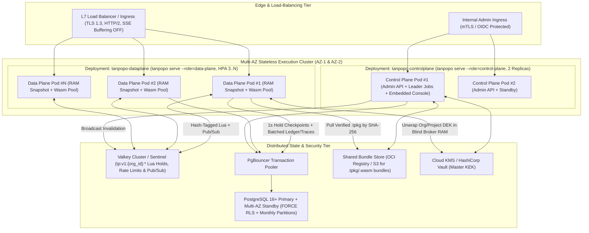

# Deployment Topology, Scale, High Availability & SRE Architecture — Tanpopo

> **Infrastructure & SRE Architecture Specification (Phase ASTRA A05 — Updated in `TP-IMP-0003` Spec Closure Batch C)**
> - **Document ID:** `ARCH-OPS-01` | **Version:** `0.2.0-step03-closure` | **Last Updated:** `2026-11-14`
> - **Authoring Roles:** Principal SRE & Platform Architect
> - **Governance Status:** **Accepted Infrastructure Contract (`ACCEPTED` — `CR-06, CR-07, CR-10` & `COND-PO-01..05`)** — coupled to [`ADR-0001`](./adr/0001-core-runtime-and-modular-monolith.md), [`ADR-0003`](./adr/0003-dual-mode-persistence-and-cluster-state.md), [`ADR-0006`](./adr/0006-immutable-config-snapshots-and-fast-revocation.md), and [`data-model.md`](./data-model.md). **Every latency, memory, throughput, availability, revocation (`< 1s` / `< 5s`), and failover/recovery figure in this document is `TARGET / UNVERIFIED` until empirically validated in `TP-IMP-0004`, `TP-IMP-0040`, and `TP-IMP-0043` (`COND-PO-01`).**
> - **Requirements Traceability:** `GAP-04`, `GAP-06`; `TP-FR-0702`, `TP-FR-0705`, `TP-FR-1001`..`1005`, `TP-NFR-0101`..`0302`, `TP-NFR-0404`, `TP-NFR-0601`, `TP-NFR-0602`, `TP-NFR-0901`.

---

## 1. Three Standardized Deployment Topologies (`Progressive Self-Hosted Topologies`)

Tanpopo's single static binary (`tanpopo`, invoked via `tanpopo serve --role=all|data-plane|control-plane`) lets teams start with a single command on a workstation or VM and progressively scale into a multi-AZ high-availability cluster **without changing API contracts, rewriting GitOps manifests, or repackaging `.tpkg` extensions**:

| Deployment Mode | Target Audience | Active Runtime Components | Resource Footprint & Availability (`TARGET / UNVERIFIED`) |
|---|---|---|---|
| **Mode A: `Standalone Zero-Dependency`** *(Default `v0.1`)* | Solo Developers, AI Power Users, small evaluation teams, or lightweight edge/on-prem setups. | **1 `tanpopo` binary (`tanpopo serve --role=all`, or 1 OCI container)** embedding Web Console SPA (`embed.FS`) + SQLite WAL + In-RAM counters + 3-tier Envelope Vault wrapped by `0400`/`0600` keyfile or `TANPOPO_MASTER_KEY`. | Idle RSS `< 128 MiB` (`TARGET / UNVERIFIED`), ready in `< 3 seconds` (`TARGET / UNVERIFIED` — `TP-NFR-0103`). Sustains `1,000` concurrent SSE streams on the `2 vCPU / 2 GiB RAM` reference floor (`TARGET / UNVERIFIED` — `TP-NFR-0301`). |
| **Mode B: `Team Compose Stack`** *(Mid-scale production)* | Dev Teams (10–100 engineers) running on 1–2 internal or cloud VMs. | `docker compose up -d`: `2x tanpopo` (`tanpopo serve`) behind Caddy/Nginx/Traefik + `PostgreSQL 16` (`FORCE RLS`) + `Valkey 8` + optional `OTel Collector`. | Zero-drop single-container restarts (`TARGET / UNVERIFIED`); sustains `>= 1,000` concurrent SSE streams/node (`TARGET / UNVERIFIED` — `TP-NFR-0301`). |
| **Mode C: `Clustered Multi-AZ HA`** *(Enterprise `v0.3`/`v1.0`)* | AI Platform Teams (50–500+ engineers) running continuous SLA-backed production traffic. | Kubernetes cluster: split `tanpopo-dataplane` Deployment (`tanpopo serve --role=data-plane`, stateless `HPA 3..N pods`) + `tanpopo-controlplane` (`tanpopo serve --role=control-plane`, `2 pods`) + `PgBouncer` + `PostgreSQL 16+ Multi-AZ` + `Valkey Sentinel/Cluster` + `Cloud KMS / Vault` + optional `Tier-3 Isolated Sidecar` pods. | Gateway internal availability **`>= 99.9%`** (`TARGET / UNVERIFIED` — `TP-NFR-0201`), linear horizontal scale-out with zero sticky sessions (`TP-FR-1005`). |

### High-Availability Cluster Topology Diagram (`Mode C — Multi-AZ Production HA`)

---

## 2. Immutable Config Snapshots & `< 1s` / `< 5s` Revocation Propagation (`ADR-0006`)

Executing SQL `SELECT` queries against PostgreSQL on every inference request to inspect `Virtual Key`, `Policy`, `Route`, and `Extension` state would inflate tail latency and saturate connection pools. Conversely, passive TTL caching (`TTL = 60s`) would leave compromised virtual keys active for up to a minute (`RSK-011`).

Tanpopo combines **Copy-on-Write `ConfigSnapshot` reads** with **3-Layer Push/Poll Invalidation**:

1. **Zero-Lock Hot-Path Snapshot Reads:**
   - Active configuration (`organizations`, `projects`, `environments`, `virtual_keys` SHA-256 hash maps, `policies`, `route_policies`, `model_deployments`, `extension_installations`, `org_extension_policies`, `mcp_tools`, `mcp_tool_grants`) is compiled into an immutable read-only graph swapped atomically via `atomic.Pointer[ConfigSnapshot]`.
   - Each inference goroutine resolves tenant scope and routing state in `< 50 ns` (`TARGET / UNVERIFIED`) with `0` `Mutex` contention and `0` SQL round-trips.
2. **Triple-Redundant Revocation & Key-Eviction Propagation (`< 1s` Standalone / `< 5s` Cluster `TARGET / UNVERIFIED` — `TP-NFR-0404`):**
   - **Layer 1 — Primary Fast Bus (`~10–100 ms TARGET / UNVERIFIED`):** Control Plane commits the state mutation and appends a monotonic `config_epoch` row to `config_changelog` inside one transaction, then immediately publishes `{ config_epoch, org_id, entity_kind, entity_id, mutation_type, emergency }` to Valkey channel `tp:v1:pubsub:revocations`.
   - **Layer 2 — Valkey-Outage Backup (`~50–300 ms TARGET / UNVERIFIED`):** Simultaneously emits `NOTIFY tanpopo_revocations` over PostgreSQL `LISTEN / NOTIFY`.
   - **Layer 3 — Hard Polling Backstop (`<= 2 seconds`):** Every Data Plane pod polls `SELECT MAX(config_epoch) FROM config_changelog` every **`2 seconds`**. Upon observing a newer `config_epoch` (including `REVOKE`, `QUARANTINE`, `KEY_ROTATE`, or `SHRED`), the pod applies the delta, swaps `ConfigSnapshot`, evicts affected `Org DEK` / `Project DEK` entries from `BlindBroker` RAM, and invokes `ActiveStreamRegistry.Abort(...)` to sever matching SSE streams.
   - **Stale-Node Circuit Breaker (`> 10s` Fail-Closed — `FMEA-07`):** If a Data Plane pod loses connectivity to both PostgreSQL and Valkey for more than **`10 seconds`**, it flips `/readyz` to `503` and rejects authenticated `Virtual Key` traffic (`Fail-Closed`) rather than serving against a stale revocation snapshot.

---

## 3. Valkey `{<org_id>}` Hash-Tag Keyspace, Hold Checkpointing & Connection Governance

### 3.1. Canonical Valkey Cluster Keyspace & `{<org_id>}` Hash-Tag Contract (`CR-07`)

On sharded `Valkey Cluster` / `Redis Cluster` deployments, multi-key `EVAL`/`EVALSHA` Lua scripts fail immediately with `CROSSSLOT Keys in request don't hash to the same slot` unless every key passed in `KEYS[]` contains an identical `{...}` hash tag. Tanpopo locks the following cluster-safe keyspace contract (`NEG-1`):

| Subsystem | Canonical Valkey Key Pattern (`{<org_id>}` Mandatory) | Atomic Multi-Key Lua / Access Semantics | TTL & Eviction Policy |
|---|---|---|---|
| **3D Rate Limiting (`RPM`, `TPM`, `Concurrency`)** | `tp:v1:{<org_id>}:rl:<project_id>:<env_id>:<vkey_id>` `tp:v1:{<org_id>}:rl_proj:<project_id>` | Single atomic `EVALSHA` checks & updates `VirtualKey` and `Project` GCRA `RPM`/`TPM` buckets + active stream concurrency lease in 1 round-trip (`< 0.5 ms TARGET / UNVERIFIED`). | Sliding window TTL (`60s–120s`); stream slot self-heals on TTL expiry if pod crashes. |
| **Two-Phase Budget Holds (`SM-07`)** | `tp:v1:{<org_id>}:budget:<scope_type>:<scope_id>:<period_start_ms>` `tp:v1:{<org_id>}:rsv:<request_id>` | Single atomic `EVALSHA` reserves ceiling `micro-USD` across `VIRTUAL_KEY -> ENV -> PROJECT -> ORG` scopes simultaneously (`CRC16(<org_id>) mod 16384` co-located) and writes the per-request hold lease. | Hold lease TTL = `90s` (renewed every `30s` while SSE stream is active). |
| **`Idempotency-Key` Locks (`TP-IMP-0016`)** | `tp:v1:{<org_id>}:idem:<project_id>:<vkey_id>:<key_sha256>` | Atomic `SET NX EX` transitions `IN_FLIGHT -> COMPLETED` bound to payload `SHA-256` without cross-tenant collision. | Configurable (`default 24h`). |
| **Opt-In Exact Response Cache (`v0.3` — `TP-IMP-0041`)** | `tp:v1:{<org_id>}:cache:<project_id>:<env_id>:<cache_key_sha256>` | Ciphertext sealed under **`Project DEK`** (`AAD = "tanpopo:v1:proj:" + org_id + ":" + project_id + ":cache_entry:" + cache_key_sha256`); never shared across orgs, projects, or envs. | Configurable bounded TTL; purged & crypto-shredded on Project deletion. |
| **Cluster Invalidation Bus** | Channel: `tp:v1:pubsub:revocations` | Broadcasts `{ config_epoch, mutation_type, entity_id }` to all subscribed Data Plane pods (no slot restriction on cluster Pub/Sub). | Ephemeral Pub/Sub frame (backed by `config_changelog`). |

- **Hard Cross-Org Prohibition:** Zero Lua scripts, `MGET`, or pipeline batches may reference keys belonging to two distinct `<org_id>` values in a single multi-key command.

### 3.2. Per-Node RAM Cache & Staleness Matrix

| Cached Artifact | Storage Tier | Tenant-Safe Key | Refresh Strategy & Max Staleness (`TARGET / UNVERIFIED`) |
|---|---|---|---|
| **`ConfigSnapshot` (Keys, Routes, Policies, Grants)** | Per-pod Go RAM | Partitioned internally by `org_id -> project_id -> env_id` | `Valkey Pub/Sub` + `PG LISTEN/NOTIFY` + `2s` `config_changelog` poll. Max staleness: **`< 1s` (standalone) / `< 5s` (cluster)**; `> 10s` fails closed (`503`). |
| **Compiled `.wasm` Modules** | RAM + Read-only scratch dir | `wasm_compiled:<contract_ver>:<bundle_sha256>` | Strictly immutable (content-addressed by `SHA-256`); `LRU`-evicted when unreferenced. |
| **OIDC `JWKS` Signing Keys** | Per-pod Go RAM | `jwks:<issuer_url_sha256>` | `TTL = 15m`; `Single-Flight` refresh on unknown `kid` (rate-limited `1/min`). |
| **Unwrapped `Org DEK` & `Project DEK`** | Private `BlindBroker` RAM only | `dek:org:<org_id>:<kek_id>` `dek:proj:<org_id>:<project_id>:<org_dek_ver>` | Short-lived (`TTL <= 5m`), immediately zeroized (`clear(buf)`) within `< 5s` (`TARGET / UNVERIFIED`) on `KEY_ROTATE` (`DR-03`), `REVOKE`, or `SHRED` events. |
| **Hard Budget Balances & `destructive` MCP Approvals** | **NEVER PASSIVELY TTL-CACHED** | Authoritative Valkey Lua / PostgreSQL transaction | **Max passive staleness = `0`** (prevents ceiling overspend and duplicate side-effect replay). |

### 3.3. Valkey Failover Budget Reconciliation (`valkey_hold_checkpoints`) & `COND-PO-03`

1. **`1-Second` Active-Hold Checkpointing (`CR-07`):**
   - While Valkey is healthy, Data Plane pods execute sub-millisecond holds in Valkey (`tp:v1:{<org_id>}:budget:*`) and flush finalized `usage_settlements` asynchronously in `250 ms` micro-batches.
   - To prevent split-brain budget overruns if Valkey crashes or partitions mid-flight before holds settle to PostgreSQL, each Data Plane pod (`node_id`) upserts its current aggregate in-flight Valkey hold total per active ledger every **`1 second`** (`TARGET / UNVERIFIED`) into PostgreSQL `valkey_hold_checkpoints (org_id, ledger_id, node_id, active_hold_micro_usd, active_inflight_streams, updated_at_ms)`.
2. **Conservative Safety Margin on PostgreSQL Fallback:**
   - If Valkey becomes unreachable, rate limiting degrades gracefully to conservative per-pod local buckets (`limit / estimated_active_pods`), while **hard budget admission fails over directly to serialized PostgreSQL checks on `budget_ledgers`**.
   - During PostgreSQL fallback admission, Core computes effective reserved spend as `budget_ledgers.reserved_hold_micros + SUM(valkey_hold_checkpoints.active_hold_micro_usd)` across non-expired node checkpoints **plus a conservative per-node active-flight safety margin** covering the `<= 1s` window since the last checkpoint, rejecting requests with **`429 project_budget_exceeded`** before hard ceilings can be breached.
   - Once Valkey recovers (or after PostgreSQL PITR in `DR-02`), **`tanpopo admin verify-state --check-audit-chain --reconcile-orphaned-holds --rebuild-valkey-state`** reconciles orphaned holds and reconstructs authoritative Valkey counters from PostgreSQL.

> [!IMPORTANT]
> **Product Owner Verification Condition (`COND-PO-03` — Checkpoint Alone Is Not Sufficient Proof):**
> A `1-second` `valkey_hold_checkpoints` flush interval **alone is NOT sufficient proof of financial ledger consistency**. Full distributed ledger consistency (`0` unattributed `micro-USD` drift, bounded single-stream carryover under 50+ concurrent racing callers, clean Valkey crash/failover cutover, network-partition safety, and `tanpopo admin verify-state` recovery) remains **`TARGET / UNVERIFIED`** and MUST be empirically verified under automated fault-injection and chaos suites in **`TP-IMP-0021`**, **`TP-IMP-0040`**, and **`TP-IMP-0043`**.

### 3.4. Database Connection Pool Sizing (`Anti-Exhaustion Pool Governance`)

- Data Plane pods write settlements and trace metadata in asynchronous micro-batches (`AsyncLedgerAndTraceFlusher`) and **never** hold a SQL connection open while awaiting upstream LLM token generation (`5–300 seconds`).
- Sizing invariant: `data_plane_replicas * max_open_db_conns_per_pod < 0.70 * postgres_max_connections`; clusters scaling above `10` replicas route through **`PgBouncer` (`transaction` pooling mode)**, where every transaction sets `SET LOCAL app.current_org_id = '<org_id>'` so session state never bleeds across pooled connections.

---

## 4. Load-Balancer Rules, `SQLite -> Postgres` Migration & Zero-Downtime Rolling Upgrades (`SM-08`)

1. **L7 Reverse-Proxy Configuration for Long-Lived SSE Streams:**
   - Every ingress proxy fronting `tanpopo` must disable response buffering (`X-Accel-Buffering: no` emitted automatically), maintain persistent `HTTP/2` / `Keep-Alive` pools, and set `proxy_read_timeout >= 300s` (`proxy_send_timeout >= 300s`) so deep-thinking reasoning streams are never severed mid-thought.
2. **Promoting Standalone Mode A to Clustered Mode B/C (`tanpopo db migrate-engine` — `CT-32`):**
   - Step 1: Run `tanpopo admin freeze-writes --reason "Migrate SQLite to PostgreSQL"` on the standalone node (freezing `/admin/v1/*` mutations while live `/v1/*` inference continues uninterrupted from RAM `ConfigSnapshot`).
   - Step 2: Execute `tanpopo db migrate-engine --from sqlite:///var/lib/tanpopo/tanpopo.db --to "postgres://tanpopo_app@pg.internal:5432/tanpopo?sslmode=require" --verify`, which pre-creates all historical and 3-month lookahead monthly `RANGE` partitions (`usage_settlements_YYYY_MM`, `request_traces_meta_YYYY_MM`, `audit_events_YYYY_MM`), copies sealed ciphertexts without decrypting raw secrets, and verifies exact row counts, `micro-USD` sums, `VerifyAuditChain`, and trial `DEK` unwrapping (rolling back and exiting `22` on mismatch).
   - Step 3: Start the clustered `tanpopo serve` replicas backed by PostgreSQL + Valkey, confirm `/readyz = 200`, and explicitly lift the write lock via **`tanpopo admin unfreeze-writes`**.
3. **Zero-Downtime Rolling Upgrade & Instant Rollback (`SM-08` — `OPS-AC-06`):**
   - **Step 1 (`tanpopo upgrade preflight` — `TP-FR-1004`):** Verifies that every `ENABLED_ACTIVE` row in `extension_installations` satisfies the target `tanpopo` binary's `N-1` contract window; incompatible packages halt in `BLOCKED_INCOMPATIBLE` (escaping cleanly to `ABORTED_SAFE`, exit code `22`) before touching live pods.
   - **Step 2 (`Encrypted Backup & Expand Migration`):** Captures a `.tpop.enc` / PostgreSQL snapshot and applies backward-compatible *Expand-Only* SQL migrations.
   - **Step 3 (`Graceful Stream Drain`):** Upgrades `control-plane` pods first, then rolls `data-plane` pods sequentially: `SIGTERM` immediately flips `/readyz` to `503` so the Load Balancer stops sending new requests, allows open SSE streams (including long reasoning calls) to complete naturally within `drain_timeout` (default **`300 seconds`**, aligned with `proxy_read_timeout >= 300s`), and flushes `100%` of queued `usage_settlements` and `request_traces_meta` batches prior to process exit.
   - **Step 4 (`Instant Rollback < 60s TARGET / UNVERIFIED` — `DR-04`):** Because migrations follow *Expand-Only* discipline and `tanpopo.lock` retains prior pinned digests, reverting the `tanpopo` image tag (`helm rollback` / `docker compose up -d`) restores the prior release without cold database restoration.
