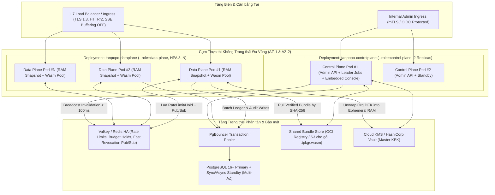

# Topo Triển khai, Mở rộng Quy mô, Sẵn sàng Cao & Vận hành SRE (Deployment Topology, Scale & HA Architecture) — Tanpopo

> **Tài liệu Kiến trúc Hạ tầng & SRE (Phase ASTRA A05 — Gate G3: `READY_FOR_REVIEW` | `PROPOSED — PRE-APPROVAL`)**
> - **Mã tài liệu:** `ARCH-OPS-01` | **Phiên bản:** `0.1.0-step05-draft` | **Ngày cập nhật:** `2026-11-11`
> - **Vai trò biên soạn:** Principal SRE & Platform Architect
> - **Trạng thái quản trị:** **Thiết kế Hạ tầng Đề xuất (`PROPOSED`)** — gắn với [`ADR-0001`](./adr/0001-core-runtime-and-modular-monolith.md), [`ADR-0003`](./adr/0003-dual-mode-persistence-and-cluster-state.md) và [`ADR-0006`](./adr/0006-immutable-config-snapshots-and-fast-revocation.md).
> - **Truy vết Yêu cầu:** `TP-FR-0702`, `TP-FR-0705`, `TP-FR-1001`..`1005`, `TP-NFR-0101`..`0302`, `TP-NFR-0404`, `TP-NFR-0601`, `TP-NFR-0602`, `TP-NFR-0901`.

---

## 1. Ba Chế độ Triển khai Chuẩn Hóa (`Progressive Self-Hosted Topologies`)

Kiến trúc của Tanpopo cho phép một nhóm kỹ thuật bắt đầu từ 1 câu lệnh duy nhất trên laptop/VPS và nâng cấp dần lên cụm đa vùng sẵn sàng cao (`>= 99.9%`) mà **không phải đổi cấu trúc API, không phải viết lại cấu hình GitOps hay đóng gói lại Plugin**:

| Chế độ triển khai | Đối tượng phù hợp | Thành phần chạy thực tế | Đặc tính tài nguyên & Độ sẵn sàng (*Mục tiêu dự kiến*) |
|---|---|---|---|
| **Mode A: `Standalone Zero-Dependency`** *(Mặc định `v0.1`)* | Solo Dev, AI Power User, nhóm nhỏ thử nghiệm hoặc môi trường biên/nội bộ gọn nhẹ. | **1 nhị phân `tanpopod` (hoặc 1 Docker container)** nhúng sẵn Web Console SPA + SQLite WAL + Bộ đếm RAM + Kho khóa mã hóa bằng tệp/biến `TANPOPO_MASTER_KEY`. | RAM rỗi `< 128 MB`, sẵn sàng nhận tải `< 3 giây` (`TP-NFR-0103`). Phù hợp `<= 200–500` luồng SSE đồng thời trên 1 máy chủ. |
| **Mode B: `Team Compose Stack`** *(Khuyến nghị sản xuất quy mô vừa)* | Dev Teams (10–100 kỹ sư) chạy trên 1–2 máy chủ VM nội bộ hoặc đám mây. | `docker compose up -d`: `2x tanpopod` (sau Caddy/Nginx/Traefik) + `PostgreSQL 16` + `Valkey 8` + tùy chọn `OTel Collector`. | Chịu lỗi khởi động lại từng container không rớt dịch vụ; duy trì `>= 1.000` luồng SSE đồng thời/nút (`TP-NFR-0301`). |
| **Mode C: `Clustered Multi-AZ HA`** *(Chuẩn doanh nghiệp `v0.3`/`v1.0`)* | AI Platform Teams (50–500+ kỹ sư), lưu lượng sản xuất liên tục yêu cầu SLA. | Cụm Kubernetes: tách riêng Deployment `tanpopo-dataplane` (`HPA 3..N pods` không trạng thái) + `tanpopo-controlplane` (`2 pods`) + `PgBouncer` + `PostgreSQL Multi-AZ` + `Valkey Sentinel/Cluster` + `Cloud KMS / Vault` + `Isolated Sidecar Pods` (nếu dùng Tier-3). | Độ sẵn sàng tầng Gateway mục tiêu **`>= 99.9%`** (`TP-NFR-0201`), mở rộng ngang tuyến tính không cần `sticky sessions` (`TP-FR-1005`). |

### Sơ đồ Topo Cụm Sẵn sàng Cao (`Mode C — Multi-AZ Production HA`)

---

## 2. Cơ chế Ảnh chụp Cấu hình Bất biến & Đảm bảo SLA Thu hồi `< 1s` / `< 5s` (`ADR-0006`)

Nếu mỗi yêu cầu suy luận đều gọi `SELECT` vào PostgreSQL để kiểm tra `Virtual Key`, `Policy`, `Route` và `Extension`, độ trễ sẽ tăng vọt và cơ sở dữ liệu sẽ sập ngay khi có bão lưu lượng. Ngược lại, nếu dùng bộ nhớ đệm TTL thông thường (`TTL = 60s`), khóa bị lộ sẽ tiếp tục bị kẻ tấn công khai thác suốt 1 phút (`RSK-011`).

Tanpopo giải quyết triệt để bằng mô hình **Copy-on-Write `ConfigSnapshot` kết hợp Phát Tín hiệu Thu hồi Kép (`Dual-Channel Invalidation`)**:

1. **Đọc Không Khóa trên Đường Nóng (`Zero-Lock Hot Path`):**
   - Toàn bộ cấu trúc đang hoạt động (`Organizations`, `Projects`, `Environments`, bảng băm `Virtual Keys`, `Policies`, `Routes`, `Deployments`, quyền `Extensions`, `MCP Tool Hashes`) được biên dịch sẵn thành một cây cấu trúc bất biến chỉ đọc trong RAM, truy cập qua con trỏ nguyên tử `atomic.Pointer[ConfigSnapshot]`.
   - Mọi luồng suy luận đọc cấu hình trong `< 50 nano-giây`, `0` tranh chấp khóa `Mutex`, `0` truy vấn SQL.
2. **Đường Truyền Thu hồi Khẩn cấp Ba Lớp Bảo hiểm (`SLA < 1s Standalone` / `< 5s Cluster` — `TP-NFR-0404`):**
   - **Lớp 1 — Tức thì (`~10–100 ms`):** Khi quản trị viên bấm `Emergency Revoke` (hoặc `Quarantine`), Control Plane ghi vào DB kèm tăng số thứ tự `config_epoch`, sau đó bắn ngay gói sự kiện nhỏ `{ epoch, revoke_type, target_id, emergency: true }` qua kênh **Valkey/Redis Pub/Sub**.
   - **Lớp 2 — Dự phòng khi Valkey lỗi (`~50–300 ms`):** Phát đồng thời qua kênh **`PostgreSQL LISTEN / NOTIFY`** (`NOTIFY tanpopo_revocations`).
   - **Lớp 3 — Chốt chặn an toàn tuyệt đối (`<= 2 giây`):** Mỗi nút Data Plane duy trì vòng lặp nhẹ kiểm tra `SELECT max(config_epoch) FROM config_changelog` mỗi **`2 giây`**. Nếu phát hiện `epoch` mới hơn bản trong RAM (dù lỡ cả Pub/Sub lẫn NOTIFY do đứt mạng thoáng qua), nút kéo ngay phần chênh lệch (`delta`) về cập nhật `ConfigSnapshot` và gọi `ActiveStreamRegistry.Abort(target_id)` để cắt đứt các luồng đang mở.
   - **Chốt chặn Chống Nút "Mù" (`Stale-Node Circuit Breaker`):** Nếu một nút Data Plane mất kết nối hoàn toàn tới cả DB lẫn Valkey quá `10 giây`, nút đó tự chuyển `/readyz = 503` và từ chối mở luồng đối với các thao tác nhạy cảm (`Fail-Closed`) thay vì chạy với danh sách thu hồi quá cũ.

---

## 3. Chiến lược Bộ nhớ Đệm, Giới hạn Tốc độ & Quản trị Kết nối DB

### 3.1. Quy tắc Bộ nhớ Đệm Rõ ràng Khóa & Cửa sổ Cũ (`Explicit Cache Matrix`)

| Dữ liệu được đệm | Nơi lưu | Cấu trúc Khóa Đệm (`Tenant-Safe Key`) | Chiến lược Làm mới & Độ trễ cũ tối đa chấp nhận |
|---|---|---|---|
| **`ConfigSnapshot` (Khóa ảo, Tuyến, Chính sách)** | RAM từng nút | Phân vùng nội bộ theo `org_id -> project_id -> env_id` | Đẩy sự kiện `Pub/Sub` + `LISTEN/NOTIFY` + đối chiếu mỗi `2s`. Độ trễ cũ tối đa: **`< 1s` (đơn nút) / `< 5s` (cụm)**. |
| **Mô-đun `.wasm` đã biên dịch ra mã máy** | RAM + Đĩa tạm chỉ đọc | `wasm_compiled:<contract_ver>:<bundle_sha256>` | **Bất biến tuyệt đối** (định danh theo nội dung băm `SHA-256`); giải phóng theo `LRU` khi không còn `Installation` nào tham chiếu. |
| **Chứng chỉ công khai OIDC `JWKS`** | RAM từng nút | `jwks:<issuer_url_sha256>` | `TTL = 15 phút`, làm mới nền đơn luồng (`Single-Flight`) khi gặp `kid` mới (giới hạn tối đa `1 lần/phút` để chống tấn công làm ngập IdP). |
| **Khóa gốc giải mã (`Org DEK` / `OAuth Access Token`)** | Chỉ trong vùng nhớ kín của `Blind Broker` | `dek:<org_id>:<kek_id>` | Giữ ngắn hạn trong RAM (`TTL <= 5 phút`), xóa sạch vùng đệm (`zeroize` nỗ lực cao nhất) ngay khi thu hồi kết nối hoặc xóa `Organization`. |
| **Số dư Ngân sách Cứng & Cờ Phê duyệt `destructive`** | **KHÔNG ĐỆM CŨ** | Kiểm tra nguyên tử trực tiếp tại Sổ cái / Valkey | **Độ trễ cũ = `0`** (không bao giờ phục vụ từ bộ nhớ đệm hết hạn để tránh chi vượt trần hoặc thực thi lặp công cụ xóa dữ liệu). |

### 3.2. Giới hạn Tốc độ Phân tán & Quản lý Hồ Kết nối (`Rate-Limiting & Connection Pools`)

1. **Thuật toán Giới hạn Tốc độ Đa chiều (`TP-FR-0702`):**
   - Thực thi đồng thời 3 bộ đếm cho từng `Virtual Key` (và trần `Project`): **`RPM`** (thuật toán *GCRA / Sliding Window* mượt không bị gấp đôi ở mép cửa sổ), **`TPM`** (trừ tạm token đầu vào ước tính lúc vào, điều chỉnh theo token thật lúc xong), và **`Max Concurrent Streams`** (bộ đếm nguyên tử có TTL tự giải phóng chống rò rỉ khi sập nút).
   - Ở chế độ cụm HA, cả 3 kiểm tra được gộp trong **1 kịch bản Lua nguyên tử duy nhất trên Valkey** (`1` vòng mạng `< 0.5 ms`).
2. **Định cỡ Hồ Kết nối Cơ sở Dữ liệu (`Anti-Exhaustion Pool Sizing`):**
   - Mỗi tiến trình Data Plane chỉ ghi theo lô bất đồng bộ (`AsyncLedgerAndTraceFlusher`), không giữ kết nối DB trong suốt thời gian chờ nhà cung cấp AI sinh chữ (`5–60 giây`!).
   - Công thức cứng: `data_plane_replicas × max_open_db_conns_per_pod` luôn giữ dưới `70%` `max_connections` của PostgreSQL; khi chạy `> 10` bản sao autoscaling, bắt buộc đi qua **`PgBouncer` (chế độ `transaction pooling`)**.

---

## 4. Cấu hình Bắt buộc ở Tầng Cân bằng Tải, Nâng cấp Không Gián đoạn & Quay lui (`SM-08`)

1. **Cấu hình Cân bằng Tải cho Luồng SSE Dài hạn:**
   - Mọi Reverse Proxy phía trước Tanpopo (Nginx, Envoy, Cloudflare, AWS ALB) phải đặt: **tắt đệm phản hồi (`X-Accel-Buffering: no` do Tanpopo tự động gắn sẵn)**, bật `HTTP/2` về phía khách và giữ kết nối tái sử dụng (`HTTP Keep-Alive` / `HTTP/2`) về phía Tanpopo, đồng thời đặt `proxy_read_timeout >= 300s` để không cắt nhầm các mô hình suy luận sâu (`reasoning models`).
2. **Quy trình Nâng cấp Không Gián đoạn (`Zero-Downtime Rolling Upgrade` — `SM-08`):**
   - **Bước 1 (`tanpopo upgrade preflight` — `TP-FR-1004`):** Kiểm tra toàn bộ `extension_installations` đang `ENABLED_ACTIVE` xem `contract_version` có nằm trong dải hỗ trợ của nhị phân mới hay không. Nếu lệch → dừng ngay với mã `BLOCKED_INCOMPATIBLE` trước khi chạm vào hệ thống đang chạy.
   - **Bước 2 (`Backup & Expand Migration`):** Chụp ảnh sao lưu cấu hình/sổ cái và chạy các di trú SQL tương thích ngược.
   - **Bước 3 (`Graceful Stream Drain`):** Nâng cấp Control Plane trước, sau đó cuộn từng nút Data Plane: nút cũ nhận `SIGTERM` → trả `/readyz = 503` ngay lập tức (để Load Balancer ngưng gửi yêu cầu mới) → chờ các luồng SSE đang truyền dở hoàn tất tự nhiên trong cửa sổ `drain_timeout` (mặc định `90 giây`) → xả cạn hàng đợi quyết toán chi phí xuống DB rồi mới tắt hẳn.
   - **Bước 4 (`Instant Rollback`):** Do di trú lược đồ tuân thủ quy tắc *Expand-Only* ở bước chuyển tiếp và `tanpopo.lock` lưu giữ nguyên bản ghim trước đó, nếu kiểm tra sức khỏe hậu nâng cấp thất bại, việc quay lui chỉ cần trỏ lại ảnh container phiên bản liền trước (`< 60 giây`) mà không cần khôi phục lại toàn bộ cơ sở dữ liệu từ bản sao lưu lạnh.