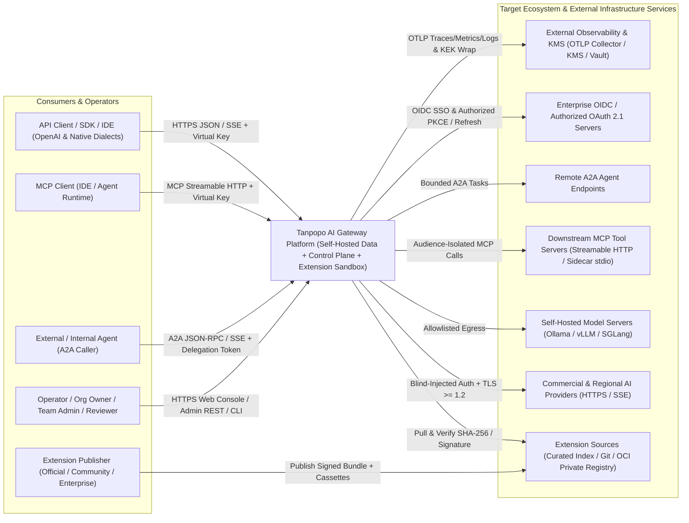
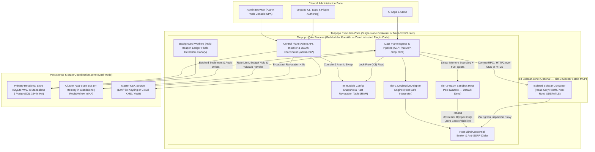
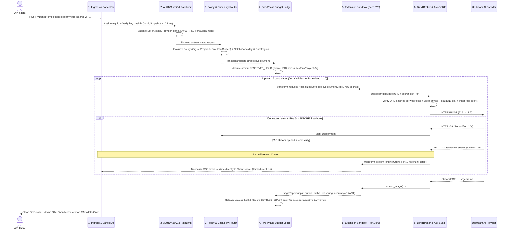
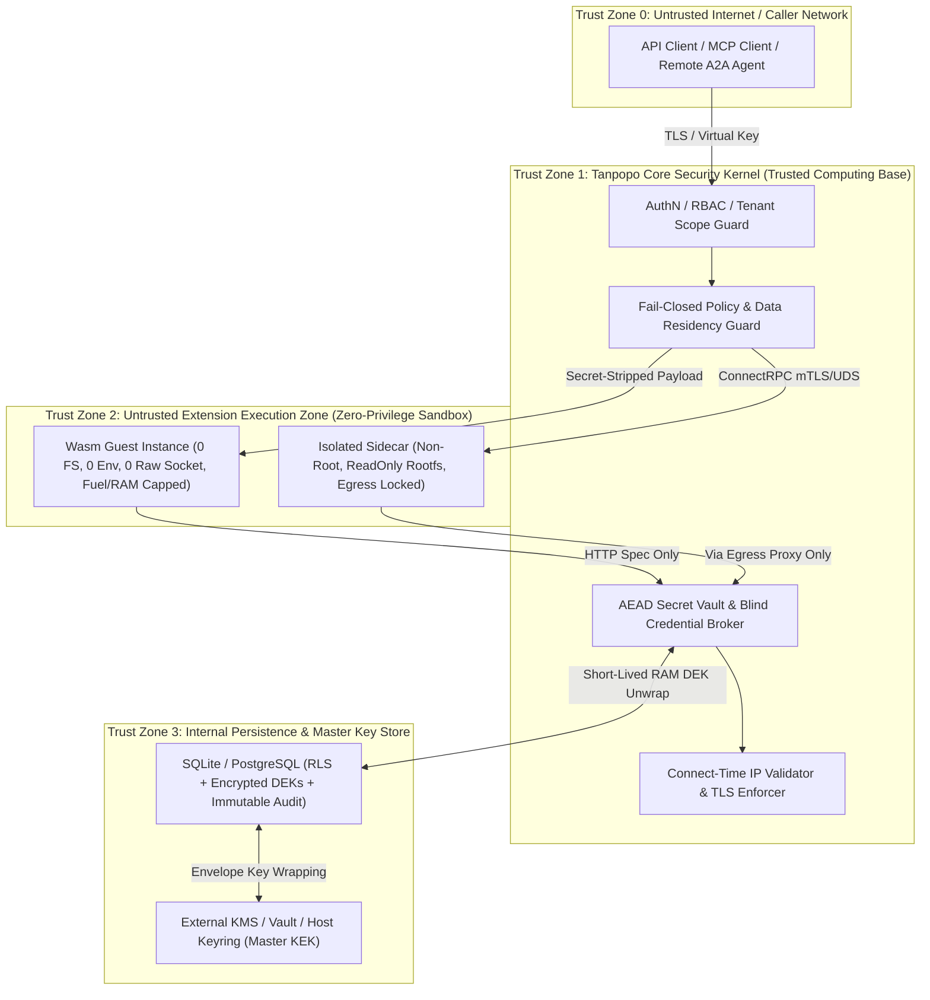

# System Architecture & Technical Design — Tanpopo

> **System Architecture Document (Phase ASTRA A05 — Gate G3: `READY_FOR_REVIEW` | `PROPOSED — PRE-APPROVAL`)**
> - **Document ID:** `ARCH-SYS-01` | **Version:** `0.1.0-step05-draft` | **Last Updated:** `2026-11-11`
> - **Authoring Roles:** Principal Architect, SRE & Security Architect
> - **Governance Status:** **Proposed Architecture Design (`PROPOSED`)** — awaiting explicit Product Owner approval at **Gate G1**, **Gate G2**, and architecture decision set **`ADR-0001`..`ADR-0006`**. No application source code or PoC code may be written prior to explicit approval.
> - **Requirements Traceability:** `TP-FR-0101`..`1005`, `TP-NFR-0101`..`1002`, `SPEC-EXT-01`..`06`, `DEC-001`..`008`.

---

## 1. Architectural Philosophy: Pragmatic, Production-Grade, Zero Premature Complexity

Tanpopo resolves two seemingly opposing forces simultaneously: **single-command self-hosted startup in under 3 minutes (`TP-FR-1001`)** and **stateless horizontal scale with enterprise-grade security isolation for third-party extensions (`TP-FR-0302`, `TP-FR-1005`)**.

To avoid the *over-engineering* trap (splitting into dozens of microservices + Kafka + ClickHouse at `v0.1` and crippling the self-hosted experience), Tanpopo adopts a **Plane-Separated Modular Monolith** architecture:
1. **A single native binary (`tanpopod` / `tanpopo`)** bundles the **Data Plane**, **Control Plane**, **Background Reconcilers**, and embedded **Web Console** static assets for default single-node operation.
2. **Strict unidirectional module boundaries in source code:** The Data Plane **never** queries relational configuration tables directly on the inference hot path; instead, it reads from an **Immutable In-Memory Config Snapshot** compiled and published atomically by the Control Plane.
3. **Role separation for large-scale clusters (`--role=all | data-plane | control-plane`):** The exact same binary can run stateless `data-plane` replicas behind a load balancer while isolating `control-plane` instances on an internal management network at milestone `v0.3+` **without rewriting a single line of business logic** (`ADR-0001`).
4. **Uncompromising security & technical candor:** Zero untrusted third-party extension code is ever loaded into Core's uncontrolled memory space (**`0 in-process untrusted code`**); no false promises of *"zero latency overhead"* or *"100% lossless protocol compatibility across every model"*; and strict separation of commercial API key billing from personal consumer subscriptions (`ADR-0002`, `ADR-0005`).

---

## 2. System Context, Container Topology & Internal Component Graph (C4 Model)

### 2.1. System Context Diagram — C4 Level 1 (`System Context`)

### 2.2. Deployment Container Diagram — C4 Level 2 (`Container & Plane Boundary`)

### 2.3. Core Internal Component Graph — C4 Level 3 (`Acyclic Internal Component Graph`)

Complying with `TP-NFR-1001` and the Capability Map in [`prd.md`](../product/prd.md), internal packages within Tanpopo Core enforce strict top-down unidirectional dependencies with **zero circular dependencies (`0 circular imports`)**:

1. **`ingress/http` & `ingress/mcp` & `ingress/a2a`:** Manages HTTP/1.1 and HTTP/2 connections, `text/event-stream` (SSE) framing, `x-tanpopo-request-id` + W3C `traceparent` assignment, payload size limits, and request context cancellation (`context.Context`) upon client socket closure.
2. **`iam/authn` & `iam/rbac`:** Looks up `Virtual Key` hashes from `ConfigSnapshot`, validates `SM-05` lifecycle state (`CREATED_ACTIVE` / `ROTATING_DUAL_VALID`), and enforces `Environment` scope and traffic plane boundaries (`TP-BR-0103`, `0104`).
3. **`policy/engine` & `ratelimit/limiter`:** Evaluates hierarchical `Org ∩ Project ∩ Env` policy intersections under a `Fail-Closed` posture (`TP-FR-0701`), enforces `RPM`/`TPM`/`Concurrency` rate limits, and acquires atomic `Idempotency-Key` locks.
4. **`routing/resolver` & `routing/health`:** Matches required capabilities against `Capability Profile` (`DECLARED`/`TESTED`/`VERIFIED`), applies hard `Data Residency` filtering, checks `SM-04` circuit-breaker states, and ranks candidate deployments (`<= 3` hops).
5. **`finops/ledger`:** Executes two-phase budget holds (`RESERVED_HOLD` across `Key → Env → Project → Org`) using integer `micro-USD` arithmetic and settles actual usage at stream completion (`SETTLED_EXACT` / `ESTIMATED` / `UNMETERED_FLAGGED`).
6. **`extension/runtime` (`declarative`, `wasm`, `sidecar`) & `extension/lifecycle`:** Multi-source installer, `SM-01` permission reconciliation, `tanpopo.lock` pinning, Wasm instance pool management (`wazero`), and Sidecar IPC channels.
7. **`security/vault` & `security/egress`:** Envelope AEAD encryption (`KEK`/`DEK`), single-flight OAuth refresh coordination (`SM-03`), network-edge blind credential injection, and anti-SSRF / DNS-rebinding TCP dialers.
8. **`telemetry/otel` & `audit/sink`:** OpenTelemetry trace/metric/structured-log exporting (`Fail-Open` with bounded ring buffers) and hash-chained immutable security audit logging (`Fail-Closed` for administrative and security events).
9. **`storage/port` (`sqlite`, `postgres`, `memory`, `valkey`):** Abstract storage ports isolating all SQL and Lua statements from domain logic.

---

## 3. Technology Stack Decision Matrix (`Technology Stack Decision Matrix`)

> **Architectural Objectivity Discipline:** Pre-existing `@astryxdesign/*` and `@stylexjs/stylex` entries in [`package.json`](../../package.json) predating Phase A00 **do not automatically constitute a final decision**; they must be scored independently against viable alternatives across operational cost, performance, maintainability, and self-hosting ergonomics (`ADR-0001`..`ADR-0004`).

### 3.1. Core Language & Runtime Selection (`ADR-0001`)

| Evaluation Criterion (Weight) | **Go `1.24+`** *(Proposed)* | **Rust (`Tokio` + `Wasmtime`)** | **TypeScript (`Node 22` / `Bun`)** | **Python (`FastAPI` / `uvloop`)** |
|---|---|---|---|---|
| **Concurrent SSE Throughput & `p95` Tail Latency (25%)** | **9/10** — Lightweight goroutines (~2–4 KB/stream), rock-solid native HTTP/2 & SSE, sub-millisecond GC pauses with buffer pooling (`sync.Pool`). | **10/10** — Zero GC, lowest and most predictable tail latency. | **6.5/10** — Single-threaded V8/JSC event loop suffers `p99` tail spikes when parsing large JSON payloads while flushing `1,000+` SSE streams. | **4/10** — Interpreter overhead and GIL push high-load proxy latency well past the `< 2 ms` target (real-world lesson from LiteLLM). |
| **Cross-OS Single-Binary Packaging & Zero CGO Dependency (20%)** | **9.5/10** — Clean static cross-compilation across `linux`/`darwin`/`windows` via `wazero` (pure-Go Wasm) + pure-Go SQLite driver, embedding SPA assets via `embed.FS`. | **8.5/10** — Compact binaries, but static multi-platform cross-compilation toolchains are more complex in CI. | **5/10** — Heavy single-executable bundles (`80–120 MB`) with large runtime overhead. | **3/10** — Complex Python virtualenv / native C wheel dependencies hurt self-hosting. |
| **Safe Out-of-Core Extension Isolation (20%)** | **9/10** — `wazero` executes isolated Wasm inside the Go process without CGO, eliminating native C JIT memory-safety bugs. | **9.5/10** — `wasmtime` is the strongest reference runtime for the Wasm Component Model. | **6/10** — High temptation toward unsafe in-process `import()`; Node's `vm` module is not a security boundary. | **5/10** — Lacks a lightweight, secure built-in sandbox primitive. |
| **Control Plane, OAuth, MCP Velocity & OSS Contributor Accessibility (20%)** | **9/10** — Explicit syntax, mature networking/cloud/OTel/SQL ecosystem, and a large open-source infrastructure contributor pool. | **6/10** — Slower iteration cycles for async admin CRUD, OAuth, and MCP/A2A state flows; steeper contributor onboarding barrier. | **9.5/10** — Fastest for CRUD/JSON and shared frontend/backend types. | **8.5/10** — Fast at small scale, harder to enforce strict type safety at scale. |
| **Idle Memory Footprint `< 128 MB` (`TP-NFR-0103`) (15%)** | **9/10** — Resident `~35–65 MB` RAM including SQLite WAL. | **10/10** — Resident `~15–30 MB` RAM. | **6/10** — Resident `~90–160 MB` RAM. | **5/10** — Multi-worker processes consume hundreds of MB of RAM. |
| **Weighted Composite Score** | **`9.05 / 10` (SELECTED — `PROPOSED`)** | `8.65 / 10` | `6.78 / 10` | `5.05 / 10` |

### 3.2. Persistent Storage & Cluster State Selection (`ADR-0003`)

| Option | Strengths | Weaknesses / Trade-offs | Architectural Decision |
|---|---|---|---|
| **1. Dual-Mode via Abstract Port: `SQLite (WAL)` for Standalone + `PostgreSQL 16+` & `Redis/Valkey` for HA Cluster** | Delivers `< 3s` single-command startup with `0` sidecar containers for small teams; scales to HA on standard enterprise primitives (`Postgres` + Apache/BSD-licensed `Valkey`), supporting monthly range partitioning for ledger & audit tables without requiring ClickHouse. | Requires portable SQL discipline (or separated `sqlite`/`postgres` packages via `sqlc`) and dual-engine CI testing (`RSK-013`). | **PROPOSED SELECTION (`PROPOSED`)** — Optimal balance between Day-1 DX and enterprise resilience. |
| **2. Mandatory `PostgreSQL + Redis` Across All Modes** | Maintains only a single storage driver stack. | Violates the `Zero-Dependency Standalone` requirement (`TP-FR-1001`), multiplying evaluation and onboarding friction. | **Rejected.** |
| **3. Embedded Distributed Consensus (`Raft / rqlite / etcd`) in Core** | Avoids external Postgres in a 3-node setup. | Running Raft consensus for continuous write-heavy financial ledger entries risks split-brain failure modes and complicates standard SQL backup/reconciliation. | **Rejected** (misplaced complexity). |
| **4. Mandatory `ClickHouse / Kafka` for Telemetry & Ledger** | Blazing-fast analytics over billions of log rows. | Massive operational burden for self-hosters. Instead, Tanpopo uses Postgres table partitioning + standard **OTLP** export so large enterprises can stream into their existing ClickHouse/Datadog stacks. | **Excluded from mandatory Core** (supported via standard OTLP egress). |

### 3.3. Independent Evaluation of the Web Console Stack (`ADR-0004`)

| UI Stack Option | Advantages | Disadvantages / Maintenance Cost | Verdict |
|---|---|---|---|
| **1. Static SPA `TypeScript + React 19 + Vite + StyleX + Astryx v0.7.13 (neutral)` Embedded into Go Binary** | Leverages a rigorous 174-component design system, compiles static CSS at build time via StyleX (`0` runtime CSS overhead), and enforces `WCAG 2.2 AA` contrast/keyboard standards; critically, once built to `dist/` and embedded into the Go binary (`embed.FS`), **production servers require zero Node.js runtime**, consuming zero extra RAM or network ports. | Requires workspace reorganization (relocating root UI files into `web/console/` during monorepo initialization), configuring Vite + StyleX plugins properly, and correcting `"license": "ISC"` to `"Apache-2.0"` (`ISS-001`..`005`). | **PROPOSED SELECTION (`PROPOSED`)** — Chosen on substantive architectural merit (zero-server-runtime static SPA + standardized dense data tables), not status-quo inertia. |
| **2. `React + Tailwind CSS + shadcn/ui`** | Rich template ecosystem. | Discards the design conventions and `neutral` theme chosen by the Owner in `DEC-007`; prone to ad-hoc utility class drift without automated structural checks like `astryx doctor`. | **Not selected** (no compelling advantage over Option 1). |
| **3. `Next.js App Router (SSR Node Server)`** | Strong for public SEO-driven websites. | An authenticated internal self-hosted Web Console **has zero SEO requirement**; forcing self-hosters to operate a parallel Node.js SSR server alongside Go Core wastes operational resources. | **Rejected outright.** |
| **4. `Go HTML Templates + HTMX`** | Eliminates JS build step. | Poor fit for rich client-state workflows such as parallel side-by-side SSE streaming in `Playground`, interactive `Route Explain` trees, and JSON Schema permission inspectors in `v0.2`. | **Rejected.** |

---

## 4. Per-Request Runtime Path (`12-Stage Runtime Request Path`) & Incident Scenarios

### 4.1. End-to-End Inference Hot Path from `API Client` to `Provider` (End-to-End Verification)

**Projected Internal Latency Budget (`Internal Latency Budget` — `TP-NFR-0101`):**
- Stages 1–3 *(Ingress + Snapshot Auth + Local/Pipelined Rate Limit + Policy/Router)*: **`~0.4 – 0.8 ms`**.
- Stage 4 *(Budget Hold)*: **`~0.1 ms`** (standalone in-memory) or **`~0.5 – 0.9 ms`** (same-LAN Valkey Lua script).
- Stages 5–6 *(Adapter Request Transform + Blind Broker Header Inject)*: **`~0.3 – 0.6 ms`** (Tier-1 Declarative) or **`~1.5 – 3.0 ms`** (Tier-2 Wasm Sandbox).
- **Total Pre-Egress Proxy Overhead (`Pre-Benchmark Target`):** **`< 2.0 ms` (`p95`) for Tier 1** and **`< 5.0 ms` (`p95`) for Tier 2** — realistic and achievable without making implausible *"0 ms overhead"* claims.

### 4.2. End-to-End Extension Installation & Activation Path Without Rebuilding Core (`Plugin Installation Path`)

1. **Safe Intake & Fetch (`CP Installer`):** An administrator runs `tanpopo plugin install <source>` (Marketplace Index / Git commit SHA / `.tpkg` / OCI `@sha256`). The fetcher enforces hard uncompressed size (`<= 64 MB`) and file count (`<= 256`) caps and rejects any path traversal (`..`) or `symlink` entries.
2. **Cryptographic & Contract Verification (`VERIFYING` — `SM-01`):** Computes full-bundle `SHA-256`; verifies `Sigstore/Ed25519` signatures when `official`/`verified` trust labels apply; validates `contractVersion` against Core's supported window; and verifies hermetic packaging (zero runtime `npm`/`pip` network calls).
3. **Human Permission Consent Gate (`PENDING_PERMISSION_APPROVAL`):** Extracts requested permissions (`allowedHosts`, `secretSlots`, `payloadAccess`, `tier`) and provenance trust tier (`official` / `verified` / `unverified-external`). If an upgrade requests any new privilege beyond the previously approved grant → blocks in `UPDATING_PENDING_RECONSENT` while the existing active version continues serving traffic.
4. **Offline Cassette Smoke Test & Pre-Warm (`Pre-Warm`):** Executes bundled golden cassette tests (when provided) and ahead-of-time compiles `.wasm` modules into a `sha256`-keyed native code cache to eliminate first-request cold-start stalls.
5. **Atomic Commit & Snapshot Broadcast (`ENABLED_ACTIVE`):** Commits installation records to the database + updates `tanpopo.lock` + appends an immutable `AuditEvent` → compiles `ConfigSnapshot` generation `V+1` → swaps the in-process `atomic.Pointer` (`< 100 ms` standalone) and broadcasts a `Pub/Sub` event so all Data Plane nodes pull the verified bundle from shared storage (`< 5 seconds`). **The `tanpopod` process preserves its exact `PID` and binary digest with `0` seconds of traffic interruption.**

### 4.3. Runtime Incident & Degradation Matrix (`Incident & Failure Matrix`)

| Production Incident Scenario | Affected Component | Mandatory Self-Protecting Architectural Behavior | Caller Impact |
|---|---|---|---|
| **1. Data Plane process crashes while holding `50` open SSE streams** | Orphaned `RESERVED_HOLD` records in the budget ledger. | Every reservation carries `lease_expires_at` (renewed via `30s` `heartbeat` while the stream remains active). Background worker `OrphanReservationReaper` reclaims expired leases into `EXPIRED_RECLAIMED` with an `AuditEvent`. | Budget capacity self-heals within `<= 60–90 seconds`; never permanently leaked. |
| **2. Transient `Redis/Valkey` outage in HA mode** | Fast `RPM/TPM` counters and `Pub/Sub` bus. | **Rate Limiting (`Bounded Local Fail-Open`):** Falls back to per-node in-memory counters scaled to `limit / active_nodes_estimate`. **Auth, Policy & Hard Budgets (`Fail-Closed`):** Falls back directly to PostgreSQL + `LISTEN/NOTIFY` backup channel (`ADR-0006`). | Legitimate traffic continues flowing; hard budget ceilings cannot be breached and revoked keys remain blocked. |
| **3. External `OpenTelemetry Collector` hangs or runs out of disk** | `Traces` & `Metrics` export pipeline. | OTLP ring buffer enforces a hard memory cap (e.g., `32 MB`); when full, **automatically drops the oldest telemetry batch (`Drop-Oldest`)** and increments internal counter `tanpopo_telemetry_dropped_total` (`TP-FR-0805`). | `0 ms` backpressure on the inference hot path; financial settlements and security `AuditEvent` records still persist safely in the primary DB. |
| **4. Community Plugin Wasm module hits an infinite loop or RAM allocation bomb** | Only the in-flight request invoking that Plugin. | Fuel metering (`CPU fuel / epoch deadline <= 15 ms`) forcibly traps the Wasm guest upon hitting its ceiling; linear memory cap (`<= 32 MB`) blocks out-of-bounds allocation within that guest instance (`TP-NFR-0202`). | Only that single request receives `502 extension_execution_trapped`; Core and `999` sibling streams remain unaffected; repeated traps past threshold automatically transition the Plugin to `QUARANTINED`. |
| **5. Emergency revocation of a leaked `Virtual Key` during a long-lived SSE stream** | Active in-flight streams authenticated with that key. | In-RAM `ActiveStreamRegistry` maps `virtual_key_id -> []context.CancelFunc`. Upon receiving `EMERGENCY_REVOKE`, every Data Plane node invokes `cancel()` immediately, tearing down both client and upstream sockets (`BA-OQ-003`). | Active streams terminate in `< 1 second` (standalone) / `< 5 seconds` (cluster), halting further token exfiltration. |

---

## 5. Isolation, Security & Trust Boundaries (`Isolation, Security & Threat Boundaries`)

1. **Two-Tier Envelope Encryption & Crypto-Shredding (`Envelope Encryption` & `Crypto-Shredding`):**
   - Each `Organization` owns a dedicated data encryption key (`Org DEK` — `256-bit`), itself envelope-wrapped by the **Master Key Encryption Key (`Master KEK`)** stored in Cloud KMS / HashiCorp Vault (or a host keyfile/environment variable separated from the database file in standalone mode).
   - Every `Secret Credential` is authenticated-encrypted with `AES-256-GCM` (binding `AAD = org_id || credential_id || purpose`) prior to hitting disk. When permanently erasing an `Organization` (`TP-NFR-0502`), destroying its `Org DEK` renders all historical secret ciphertexts cryptographically irrecoverable immediately (*crypto-shredding*).
2. **Anti-SSRF & Connect-Time DNS-Rebinding Defense (`Connect-Time DNS-Rebinding Defense`):**
   - Pre-flight URL string validation alone is insufficient (an attacker can pass validation with a domain resolving initially to a public IP, then flip a `TTL=0` DNS record to `169.254.169.254` or `127.0.0.1` right as the socket dials).
   - Tanpopo's `SSRFGuard` hooks directly into Go's `net.Dialer.Control` callback (immediately prior to the OS kernel `connect()` handshake): it inspects the **final resolved IP address**, hard-blocking loopback (`127.0.0.0/8`, `::1`), RFC 1918 private networks (`10/8`, `172.16/12`, `192.168/16`), CGNAT (`100.64/10`), link-local / Cloud Metadata (`169.254.0.0/16`, `fe80::/10`), and IPv6 ULA (`fc00::/7`), while **disabling automatic cross-origin HTTP redirect following (`301/302/307/308`)**. Private-network exceptions for self-hosted `Ollama`/`vLLM` servers are permitted strictly for exact `IP/CIDR + Port` pairs explicitly allowlisted by an `Operator`.
3. **5-Level Data Classification (`Data Classification`) & Multi-Tenant Isolation:**
   - **`S0 (Public Schema/Catalog)`:** Canonical model catalogs and contract documentation.
   - **`S1 (Tenant Config & Operational Metadata)`:** `Project` and `Route` definitions, token counts, latencies — strictly bound to `org_id`, enforced both at the Repository layer and via PostgreSQL `Row-Level Security (RLS)`.
   - **`S2 (Sensitive Prompt/Tool Payloads)`:** **Never persisted to disk by default (`Metadata-Only` — `TP-FR-0806`)**; transits ephemeral streaming buffers and is immediately released. When time-bounded debug capture is explicitly enabled, payloads are stored in a dedicated table encrypted under `Org DEK` with a hard `TTL <= 72 hours`.
   - **`S3 (Financial Ledger & Immutable Audit)`:** Strictly `append-only` (single-row updates/deletes prohibited), protected by a cryptographic `prev_hash` chain to detect unauthorized direct database tampering.
   - **`S4 (Cryptographic Secrets & Tokens)`:** Unwrapped exclusively inside ephemeral memory of the `Blind Credential Broker` at header-injection time; automatically scrubbed (`redact`) across all logging and error pipelines.
4. **Service-to-Service Trust (`Service-to-Service Trust`):**
   - In role-separated HA clusters or pod-network calls to a `Tier-3 Isolated Sidecar`, all internal RPC links enforce mutual **`mTLS`** using short-lived certificates issued by an internal cluster CA (or SPIFFE/cert-manager) paired with service identity verification.

---

## 6. Error Budgets, Background Jobs & Process Lifecycle

### 6.1. Internal SLO Targets & Error Budgets (`Pre-Benchmark Targets`)

> **AI Gateway SLO Measurement Principle:** Upstream `429`/`5xx` responses returned by OpenAI/Anthropic when every eligible target in a caller's route is simultaneously degraded are classified as **`Upstream Dependency Exhaustion`** and are **not** counted as Tanpopo internal software defects; conversely, any process crash, frame transformation failure, vault error, false circuit trip, or internal proxy latency breach burns directly against **Tanpopo's Error Budget**.

| Internal SLI Metric | SLO Target (`Pre-Benchmark`) | 30-Day Error Budget | Burn-Rate Alert Thresholds (`Burn-Rate Alerts`) |
|---|---|---|---|
| **Gateway Internal Availability (HA Cluster)** | **`>= 99.9%`** of valid requests free of Tanpopo-originated `5xx` errors (`TP-NFR-0201`). | **`43 minutes 49 seconds`** equivalent downtime (or `0.1%` of total requests). | - **`PAGE`:** Burn rate `>= 14.4x` across `1h` & `5m` windows (consumes 2% of monthly budget in 1 hour). - **`TICKET`:** Burn rate `>= 1.0x` sustained over `3 days`. |
| **Proxy Internal Overhead** | `p95 < 2 ms` (Tier 1) & `p95 < 5 ms` (Tier 2); per-SSE-chunk `p95 < 1 ms` (`TP-NFR-0101`, `0102`). | At most `5%` of requests exceeding target threshold within a `15-minute` sliding window. | **`TICKET` / `PAGE`:** `p95 > 10 ms` sustained `> 10 minutes` (investigate GC pauses, DB pool contention, or Wasm fuel pressure). |
| **Emergency Revocation Propagation** | `< 1 second` (standalone) & `< 5 seconds` across `99.9%` of cluster nodes (`TP-NFR-0404`). | `0` instances allowing a key revoked `> 5 seconds` ago to open new connections. | **Immediate `PAGE`** if any Data Plane node's `ConfigSnapshot` sync age drifts `> 5 seconds` behind the Control Plane. |

### 6.2. Catalog of 6 Leader-Coordinated Background Jobs (`Background Jobs`)

In multi-replica clusters, cluster-wide singleton jobs acquire lightweight PostgreSQL leader leases (`pg_try_advisory_lock` / `distributed_leases` table) so exactly one node executes per cycle, whereas buffer-flushing workers run locally on every node:

| Background Worker | Execution Scope | Default Cadence | Responsibility & Safety Mechanism |
|---|---|---|---|
| **`AsyncLedgerAndTraceFlusher`** | Every `Data Plane` node | Every `250 ms` or batch size `200` | Micro-batches usage settlement writes & trace metadata into the DB to minimize IOPS; on graceful shutdown (`SIGTERM`), drains `100%` of queued records before exit. |
| **`OrphanReservationReaper`** | `Control Plane` (Leader Lease) | Every `30 seconds` | Scans `RESERVED_HOLD` records with `lease_expires_at < now()`, transitions them to `EXPIRED_RECLAIMED`, restores held quota in `budget_ledgers`, and emits an `AuditEvent`. |
| **`OAuthProactiveRefresher`** | `Control Plane` (Single-Flight Lease) | Every `60 seconds` | Identifies `SM-03` connections expiring within `< 5 minutes` and refreshes tokens proactively ahead of live traffic; transitions to `REAUTH_REQUIRED` on `invalid_grant`. |
| **`RetentionAndErasureWorker`** | `Control Plane` (Leader Lease) | Every `15 minutes` (Immediate on emergency erasure) | Detaches/drops expired log partitions (`DROP PARTITION`) or deletes in small non-blocking batches (`LIMIT 1000`); executes `Project`/`Org` erasure within `< 60 seconds`. |
| **`RevocationAndMCPWatcher`** | `Control Plane` (Leader Lease) | Every `5–15 minutes` | Polls signed extension revocation feeds (`revocations.json`) and verifies `schema_hash` integrity across active `MCP Server` registrations (`TP-FR-0307`, `0402`). |
| **`FinOpsRollupAggregator`** | `Control Plane` (Leader Lease) | Every `5 minutes` | Incrementally rolls up hourly/daily summaries (`usage_rollups_hourly`) so Web Console financial dashboards load instantaneously without scanning millions of raw settlement rows. |

---

## 7. Technical Spike / PoC Protocols (`Technical Spikes / PoC Protocols` — No Code Prior to Approval)

> **Mandatory Governance Constraint:** The four technical spikes below are specified as **reproducible verification protocols** to retire open assumptions (`ASM-002`, `ASM-004`, `ASM-006`, `POC-01`..`03`). **Zero PoC code shall be written during Phase A05 until explicitly authorized by the Product Owner.**

### `SPIKE-01`: Hot-Loading an External Provider Adapter Without Rebuilding Core (`EXP-02` / `POC-02`)
- **Hypothesis:** An independently authored external `Provider Adapter` package (both Tier-1 Declarative and Tier-2 `.wasm`) can be installed, permission-approved, bound to blind credentials, and serve live streaming traffic while the Core binary's `SHA-256` digest and OS `PID` remain completely unchanged; furthermore, the Tier-1 declarative mapping operators cover at least `8/10` representative providers.
- **Quantitative Pass Criteria:**
  1. `sha256sum(tanpopod)` before and after installing, invoking, and rolling back the Adapter matches `100%`; `PID` remains unchanged.
  2. At least `8/10` representative providers (OpenAI, Anthropic passthrough/chat, Gemini, Mistral, Groq, Together, Ollama, vLLM, Azure OpenAI, Cohere) are expressible as Tier-1 Declarative Bundles in `<= 120 lines of YAML` per bundle with zero compiled code.
- **Planned Execution Steps (once approved):** Stand up a local mock server representing a brand-new 11th provider (`mock-sovereign-llm`) → package `.tpkg` → run dynamic install → stream SSE responses and verify version rollback in `< 5 seconds`.
- **Evidence Collected:** Binary digest logs, 10-provider coverage matrix, and `EXT-ACCEPT-01` verification record. *Fallback path if falsified:* Add built-in Host SSE framing presets for common streaming dialects rather than bloating the YAML DSL into a programming language.

### `SPIKE-02`: Wasm Sandbox Streaming Performance & Blind Broker Security Isolation (`EXP-01` / `POC-01`)
- **Hypothesis:** Go's pure-Go `wazero` runtime can sustain `1,000` concurrent SSE streams passing through Wasm chunk-transformation hooks with `< 5 ms` (`p95`) per-request overhead, `< 1 ms` (`p95`) per-SSE-chunk overhead, and `< 256 MB` incremental RAM via pooled instances, while trapping `100%` of infinite loops and memory bombs and leaking zero raw API key bytes into Wasm linear memory.
- **Quantitative Pass Criteria:**
  1. Benchmark two candidate ABIs (`WASI Preview 2 WIT` vs `Shared Linear-Memory Ring Buffer ABI`) at `1,000` concurrent SSE streams (`50 chunks/stream`): select the ABI achieving `p95 request overhead < 5.0 ms` and `p95 chunk latency < 1.0 ms`.
  2. Hostile guest tests (`while(true){}`, `128 MB` allocation exceeding the `32 MB` cap, unauthorized host egress) trap cleanly in `<= 15 ms` with `0` Host panics, and full Wasm linear-memory dumps confirm `0` byte matches against the Host's `sk-live-...` secret.
- **Planned Execution Steps (once approved):** Run local SSE load generators (`k6` / `vegeta` or Go benchmark harness) comparing Baseline passthrough vs Tier 1 vs Tier 2 WIT vs Tier 2 Linear-Memory constrained to `2 vCPU, 2 GB RAM`.
- **Evidence Collected:** `p50/p95/p99` latency distributions, `pprof` heap profiles, and adversarial test transcripts `CT-14`..`CT-17`. *Fallback path if falsified:* Invoke Wasm only at request/finalization boundaries while handling mid-stream SSE framing via parameterized native Host parsers.

### `SPIKE-03`: Disconnected Stream Token Reconciliation & Two-Phase Budget Holds Under Contention (`EXP-04`)
- **Hypothesis:** The `Two-Phase Budget Hold` protocol (`RESERVED_HOLD` → `SETTLEMENT`) prevents hard-ceiling overspend when `50` parallel requests race against a nearly depleted budget, and when an `API Client` disconnects mid-stream, Tanpopo closes the upstream socket within `< 500 ms` and records an `ESTIMATED` settlement within `<= 5%` of ground-truth tokens emitted.
- **Quantitative Pass Criteria:**
  1. Fire `50` simultaneous requests (each with a `0.10 USD` ceiling estimate) against a project with `0.50 USD` remaining: exactly `5` streams are admitted, `45` are rejected immediately with `429 project_budget_exceeded`, and final settled spend never breaches the ceiling beyond bounded single-stream delta of legitimately admitted requests.
  2. Abruptly sever the client TCP socket at SSE chunk #15: the mock upstream server observes `EOF`/`RST` within `< 500 ms`, the ledger records `SETTLED_ESTIMATED` (`> 0 micro-USD`), and after `kill -9` on a worker process, `OrphanReservationReaper` reclaims `100%` of orphaned holds on its next sweep.
- **Evidence Collected:** Reconciliation ledger comparing `budget_reservations` against `usage_settlements` (`0` unattributed micro-USD drift).

### `SPIKE-04`: `Authorized OAuth 2.1 + PKCE`, Single-Flight Refresh & `Audience` Isolation (`SM-03`)
- **Hypothesis:** Core's OAuth coordinator completes `Authorization Code + PKCE (S256)` callbacks with `state`/CSRF enforcement, coalesces `100` concurrent requests hitting an expired access token into **exactly `1` upstream `refresh_token` call** (`Single-Flight`), transitions immediately to `REAUTH_REQUIRED` on `invalid_grant`, and hard-blocks any attempt to inject an `MCP Hub`-scoped token into a `Provider` connection.
- **Quantitative Pass Criteria:**
  1. Mock OAuth authorization server records exactly `1` `/oauth/token` (`grant_type=refresh_token`) request when `100` concurrent inference calls arrive at the instant of token expiry.
  2. `100%` of cross-`aud` test cases (RFC 8707) are rejected with `403 token_audience_violation` (`CT-19`, `CT-22`).
- **Evidence Collected:** Chronological trace logs and automated `SM-03` state-machine test results.
