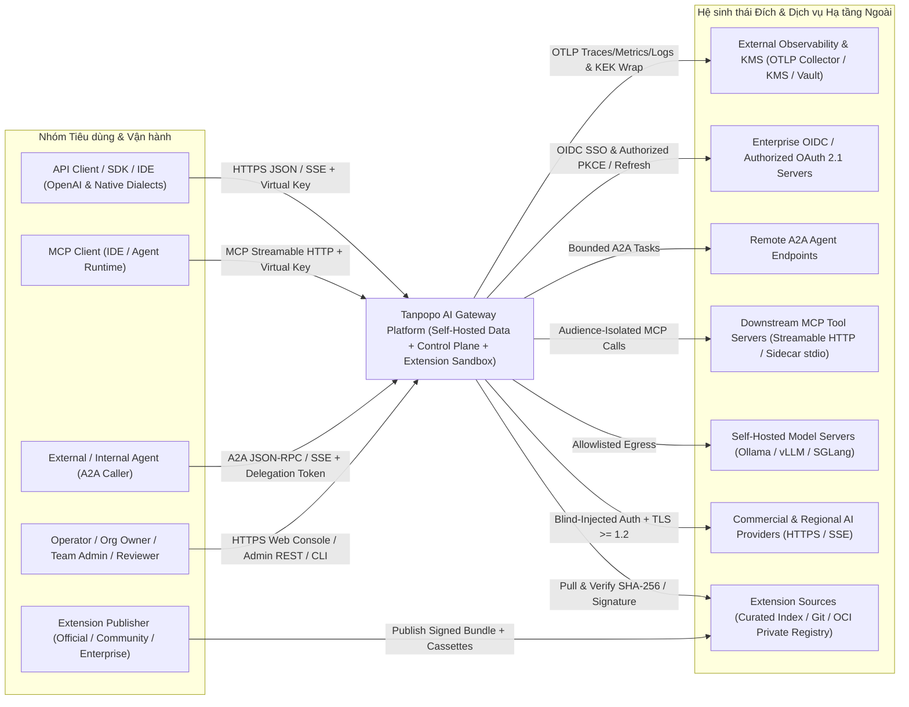
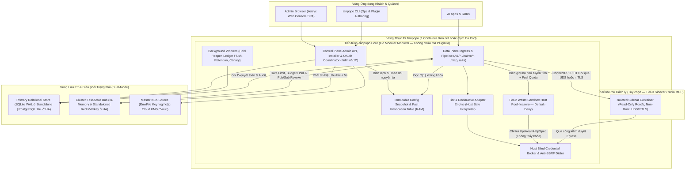
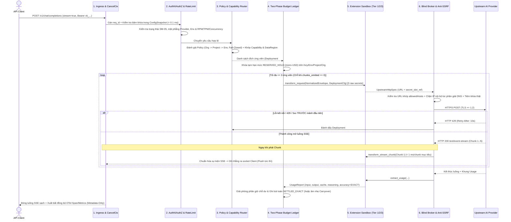
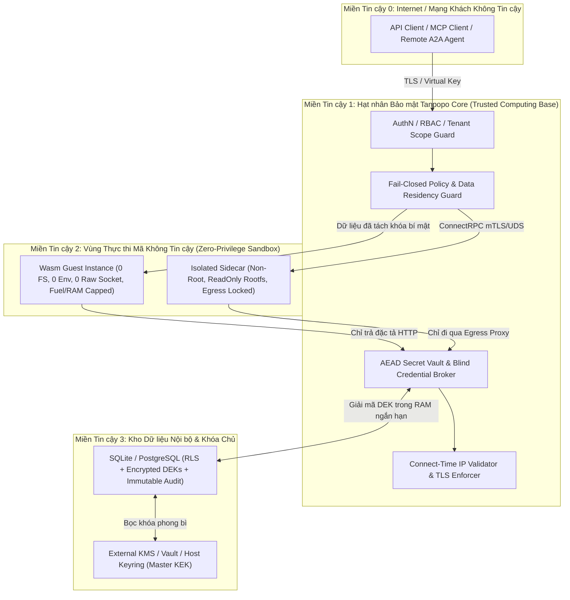

# Thiết kế Kiến trúc Hệ thống Tổng thể (System Architecture & Technical Design) — Tanpopo

> **Tài liệu Kiến trúc Hệ thống (Phase ASTRA A05 — Gate G3: `READY_FOR_REVIEW` | `PROPOSED — PRE-APPROVAL`)**
> - **Mã tài liệu:** `ARCH-SYS-01` | **Phiên bản:** `0.1.0-step05-draft` | **Ngày cập nhật:** `2026-11-11`
> - **Vai trò biên soạn:** Principal Architect, SRE & Security Architect
> - **Trạng thái quản trị:** **Thiết kế Kiến trúc Đề xuất (`PROPOSED`)** — chờ Product Owner phê duyệt các cổng **Gate G1**, **Gate G2** và bộ quyết định kiến trúc **`ADR-0001`..`ADR-0006`**. Chưa viết mã nguồn ứng dụng hay mã PoC trước khi có phê duyệt tường minh.
> - **Truy vết Yêu cầu:** `TP-FR-0101`..`1005`, `TP-NFR-0101`..`1002`, `SPEC-EXT-01`..`06`, `DEC-001`..`008`.

---

## 1. Triết lý Kiến trúc: Thực dụng, Chuẩn Sản xuất, Không Phức tạp Hóa Sớm

Tanpopo giải quyết đồng thời hai lực kéo tưởng như đối lập: **khởi chạy tự vận hành đơn giản trong 1 lệnh dưới 3 phút (`TP-FR-1001`)** và **mở rộng quy mô ngang không trạng thái, cô lập bảo mật phần mở rộng bên thứ ba ở cấp doanh nghiệp (`TP-FR-0302`, `TP-FR-1005`)**.

Để tránh bẫy *over-engineering* (chia nhỏ thành hàng chục microservices + Kafka + ClickHouse ngay từ `v0.1` làm tê liệt trải nghiệm tự host), Tanpopo chọn kiến trúc **Modular Monolith Phân tách Mặt phẳng (`Plane-Separated Modular Monolith`)**:
1. **Một tệp nhị phân gốc duy nhất (`tanpopod` / `tanpopo`)** đóng gói sẵn cả **Data Plane**, **Control Plane**, **Background Reconcilers** và tài sản tĩnh của **Web Console** cho chế độ chạy đơn nút mặc định.
2. **Ranh giới mô-đun một chiều nghiêm ngặt trong mã nguồn:** Data Plane **không bao giờ** truy vấn trực tiếp bảng cấu hình quan hệ trên đường nóng suy luận, mà đọc từ **Ảnh chụp Cấu hình Bất biến trong Bộ nhớ (`Immutable In-Memory Config Snapshot`)** do Control Plane biên dịch và phát hành nguyên tử.
3. **Khả năng tách vai trò khi lên cụm lớn (`--role=all | data-plane | control-plane`):** Cùng một tệp nhị phân có thể chạy độc lập các bản sao `data-plane` không trạng thái phía sau cân bằng tải và tách riêng `control-plane` trong mạng quản trị nội bộ ở cột mốc `v0.3+` mà **không phải viết lại bất kỳ dòng logic nào** (`ADR-0001`).
4. **Không thỏa hiệp về an ninh & trung thực kỹ thuật:** Tuyệt đối **không nạp mã phần mở rộng bên ngoài vào chung không gian bộ nhớ không kiểm soát của Core (`0 in-process untrusted code`)**; không hứa hẹn *"độ trễ bằng 0"* hay *"tương thích 100% mọi giao thức mọi mô hình"*; không trộn lẫn chi phí thương mại API Key với các khái niệm thuê bao tiêu dùng cá nhân (`ADR-0002`, `ADR-0005`).

---

## 2. Bối cảnh Hệ thống, Sơ đồ Container & Sơ đồ Thành phần Nội bộ (C4 Model)

### 2.1. Sơ đồ Bối cảnh Hệ thống — C4 Level 1 (`System Context`)

### 2.2. Sơ đồ Container Triển khai — C4 Level 2 (`Container & Plane Boundary`)

### 2.3. Sơ đồ Thành phần Nội bộ Nhân Core — C4 Level 3 (`Acyclic Internal Component Graph`)

Tuân thủ `TP-NFR-1001` và Bản đồ Năng lực tại [`prd.md`](../product/prd.md), các gói nội bộ của Tanpopo Core chỉ phụ thuộc theo một chiều từ trên xuống dưới, **nghiêm cấm vòng lặp phụ thuộc (`0 circular imports`)**:

1. **`ingress/http` & `ingress/mcp` & `ingress/a2a`:** Quản lý kết nối HTTP/1.1, HTTP/2, khung luồng `text/event-stream` (SSE), gán `x-tanpopo-request-id` + W3C `traceparent`, giới hạn kích thước gói tin và hủy ngữ cảnh (`context.Context`) khi khách đóng socket.
2. **`iam/authn` & `iam/rbac`:** Tra cứu băm `Virtual Key` từ `ConfigSnapshot`, kiểm tra trạng thái vòng đời `SM-05` (`CREATED_ACTIVE` / `ROTATING_DUAL_VALID`), xác minh phạm vi `Environment` và mặt phẳng lưu lượng (`TP-BR-0103`, `0104`).
3. **`policy/engine` & `ratelimit/limiter`:** Hợp nhất chính sách phân cấp `Org ∩ Project ∩ Env` theo tư thế `Fail-Closed` (`TP-FR-0701`), kiểm tra hạn mức tốc độ `RPM`/`TPM`/`Concurrency` và khóa nguyên tử `Idempotency-Key`.
4. **`routing/resolver` & `routing/health`:** Đối chiếu yêu cầu năng lực với `Capability Profile` (`DECLARED`/`TESTED`/`VERIFIED`), lọc cứng `Data Residency`, kiểm tra máy trạng thái ngắt mạch `SM-04` và xếp hạng danh sách ứng viên (`<= 3` bước nhảy).
5. **`finops/ledger`:** Thực thi giữ chỗ ngân sách hai pha (`RESERVED_HOLD` trên `Key → Env → Project → Org`) bằng số nguyên `micro-USD` và quyết toán cuối luồng (`SETTLED_EXACT` / `ESTIMATED` / `UNMETERED_FLAGGED`).
6. **`extension/runtime` (`declarative`, `wasm`, `sidecar`) & `extension/lifecycle`:** Trình cài đặt đa nguồn, đối chiếu quyền `SM-01`, khóa `tanpopo.lock`, vận hành hồ chứa Wasm (`wazero`) và kênh IPC Sidecar.
7. **`security/vault` & `security/egress`:** Mã hóa phong bì AEAD (`KEK`/`DEK`), điều phối làm mới OAuth đơn luồng (`SM-03`), tiêm khóa mù tại biên mạng và bộ quay số TCP chống SSRF / DNS Rebinding.
8. **`telemetry/otel` & `audit/sink`:** Xuất vết/chỉ số/nhật ký cấu trúc OpenTelemetry (`Fail-Open` có vòng đệm giới hạn) và ghi nhật ký kiểm toán bảo mật bất biến có chuỗi băm (`Fail-Closed` cho sự kiện quản trị/an ninh).
9. **`storage/port` (`sqlite`, `postgres`, `memory`, `valkey`):** Giao diện lưu trữ trừu tượng cách ly hoàn toàn câu lệnh SQL/Lua khỏi tầng nghiệp vụ.

---

## 3. Ma trận Quyết định Lựa chọn Công nghệ (`Technology Stack Decision Matrix`)

> **Kỷ luật khách quan kiến trúc:** Các gói `@astryxdesign/*` và `@stylexjs/stylex` đã có sẵn trong [`package.json`](../../package.json) từ trước bước A00 **không mặc định trở thành quyết định cuối cùng**, mà phải được chấm điểm độc lập với các phương án thay thế về chi phí vận hành, hiệu năng, bảo trì và khả năng tự host (`ADR-0001`..`ADR-0004`).

### 3.1. Lựa chọn Ngôn ngữ & Runtime cho Tanpopo Core (`ADR-0001`)

| Tiêu chí đánh giá (Trọng số) | **Go `1.24+`** *(Đề xuất)* | **Rust (`Tokio` + `Wasmtime`)** | **TypeScript (`Node 22` / `Bun`)** | **Python (`FastAPI` / `uvloop`)** |
|---|---|---|---|---|
| **Hiệu năng SSE đồng thời & Độ trễ đuôi `p95` (25%)** | **9/10** — Goroutines nhẹ (~2–4 KB/luồng), HTTP/2 & SSE gốc cực ổn định, GC trễ dưới mili-giây khi tái sử dụng vùng đệm (`sync.Pool`). | **10/10** — Không có GC, độ trễ đuôi thấp và ổn định nhất. | **6.5/10** — Luồng đơn V8/JSC dễ nghẽn độ trễ đuôi `p99` khi đồng thời phân tích JSON lớn và đẩy `1.000+` luồng SSE. | **4/10** — Chi phí thông dịch và GIL làm độ trễ proxy dưới tải cao vượt xa mục tiêu `< 2 ms` (bài học thực tế từ LiteLLM). |
| **Đóng gói Single-Binary Đa OS & Không phụ thuộc CGO (20%)** | **9.5/10** — Biên dịch chéo tĩnh siêu gọn cho `linux`/`darwin`/`windows` nhờ `wazero` (pure Go Wasm) + trình điều khiển SQLite thuần Go, nhúng sẵn SPA qua `embed.FS`. | **8.5/10** — Nhị phân gọn nhẹ nhưng biên dịch chéo liên kết tĩnh đa nền tảng phức tạp hơn trong CI. | **5/10** — Single executable nặng (`80–120 MB`), phụ thuộc runtime lớn. | **3/10** — Phụ thuộc môi trường ảo Python/wheels C phức tạp khi tự host. |
| **Cô lập Phần mở rộng An toàn Không chạy In-Process (20%)** | **9/10** — `wazero` chạy Wasm cô lập ngay trong tiến trình Go không cần CGO, loại bỏ rủi ro lỗi bộ nhớ C ở trình biên dịch JIT ngoài. | **9.5/10** — `wasmtime` là chuẩn tham chiếu Wasm Component Model mạnh nhất. | **6/10** — Rất dễ bị cám dỗ dùng `import()` không an toàn; cô lập `vm` của Node không phải ranh giới bảo mật. | **5/10** — Thiếu cơ chế sandbox nội tại an toàn nhẹ. |
| **Tốc độ Phát triển Nghiệp vụ Control Plane, OAuth, MCP & Dễ Đóng góp OSS (20%)** | **9/10** — Cú pháp tường minh, hệ sinh thái mạng/cloud/OTel/SQL trưởng thành, cộng đồng kỹ sư hạ tầng đóng góp mã nguồn mở đông đảo. | **6/10** — Chu kỳ viết/sửa CRUD quản trị, OAuth, MCP/A2A bất đồng bộ chậm hơn đáng kể; rào cản người đóng góp cao. | **9.5/10** — Nhanh nhất cho CRUD/JSON và dùng chung kiểu với Frontend. | **8.5/10** — Viết nhanh ở quy mô nhỏ nhưng khó giữ an toàn kiểu khi lớn. |
| **Dấu chân RAM khi rỗi `< 128 MB` (`TP-NFR-0103`) (15%)** | **9/10** — Thường trực `~35–65 MB` RAM kèm SQLite WAL. | **10/10** — Thường trực `~15–30 MB` RAM. | **6/10** — Thường trực `~90–160 MB` RAM. | **5/10** — Nhiều worker tiến trình ngốn hàng trăm MB RAM. |
| **Điểm Tổng hợp Có Trọng số** | **`9.05 / 10` (CHỌN — `PROPOSED`)** | `8.65 / 10` | `6.78 / 10` | `5.05 / 10` |

### 3.2. Lựa chọn Tầng Lưu trữ Bền vững & Trạng thái Cụm (`ADR-0003`)

| Phương án | Điểm mạnh | Nhược điểm / Đánh đổi | Quyết định Kiến trúc |
|---|---|---|---|
| **1. Hai Chế độ qua Port Trừu tượng: `SQLite (WAL)` cho Đơn nút + `PostgreSQL 16+` & `Redis/Valkey` cho Cụm HA** | Đạt trọn vẹn khởi chạy 1 lệnh `< 3 giây`, `0` container phụ cho nhóm nhỏ; khi lên cụm HA dùng chính chuẩn công nghiệp phổ biến nhất (`Postgres` + `Valkey` Apache/BSD), hỗ trợ phân vùng bảng theo tháng cho sổ cái & audit mà không cần dựng thêm ClickHouse. | Phải giữ kỷ luật câu lệnh SQL tương thích kép (hoặc sinh mã qua `sqlc` tách gói `sqlite`/`postgres`) và chạy CI test trên cả 2 hệ quản trị (`RSK-013`). | **ĐỀ XUẤT CHỌN (`PROPOSED`)** — Cân bằng tối ưu nhất giữa DX ngày đầu và khả năng chịu tải doanh nghiệp. |
| **2. Bắt buộc `PostgreSQL + Redis` ở mọi chế độ** | Chỉ duy trì 1 bộ driver lưu trữ duy nhất. | Phá vỡ yêu cầu `Zero-Dependency Standalone` (`TP-FR-1001`), làm tăng ma sát cài đặt thử nghiệm gấp nhiều lần. | **Loại bỏ.** |
| **3. Nhúng cụm đồng thuận phân tán (`Raft / rqlite / etcd`) vào Core** | Không cần cài Postgres ngoài khi chạy 3 nút. | Vận hành đồng thuận Raft cho dữ liệu sổ cái tài chính ghi liên tục rất dễ gãy split-brain và khó sao lưu đối soát SQL chuẩn. | **Loại bỏ** (phức tạp hóa sai chỗ). |
| **4. Tách thêm `ClickHouse / Kafka` bắt buộc cho Telemetry & Ledger** | Phân tích hàng tỷ dòng log cực nhanh. | Gánh nặng vận hành khổng lồ cho người tự host. Thay vào đó, Tanpopo dùng phân vùng bảng Postgres + xuất chuẩn **OTLP** để doanh nghiệp lớn tự đổ vào ClickHouse/Datadog sẵn có của họ! | **Loại bỏ khỏi Core bắt buộc** (hỗ trợ qua ngõ xuất OTLP chuẩn). |

### 3.3. Đánh giá Độc lập Stack Giao diện Web Console (`ADR-0004`)

| Phương án UI | Ưu điểm | Nhược điểm / Chi phí bảo trì | Phán quyết |
|---|---|---|---|
| **1. SPA Tĩnh `TypeScript + React 19 + Vite + StyleX + Astryx v0.7.13 (neutral)` nhúng vào binary Go** | Tận dụng hệ thống 174 component chuẩn mực, biên dịch CSS tĩnh lúc build qua StyleX (`0` runtime CSS overhead), đạt chuẩn tương phản/bàn phím `WCAG 2.2 AA`; đặc biệt khi xuất ra thư mục tĩnh `dist/` và nhúng vào binary Go (`embed.FS`), **máy chủ sản xuất không cần chạy Node.js runtime**, không tốn thêm RAM hay cổng mạng! | Cần tổ chức lại workspace (dời code UI gốc vào `web/console/` khi khởi tạo cấu trúc monorepo), cấu hình plugin Vite + StyleX chuẩn và sửa `"license": "ISC"` thành `"Apache-2.0"` (`ISS-001`..`005`). | **ĐỀ XUẤT CHỌN (`PROPOSED`)** — Chọn vì giá trị kiến trúc thực chất (SPA tĩnh biên dịch sẵn không tốn runtime server + chuẩn hóa bảng dữ liệu dày đặc), không phải vì ngại thay đổi. |
| **2. `React + Tailwind CSS + shadcn/ui`** | Hệ sinh thái mẫu phong phú. | Phải gỡ bỏ toàn bộ quy ước thiết kế & theme `neutral` mà Owner đã chọn ở `DEC-007`; dễ phát sinh các lớp CSS tự phát thiếu kiểm định tự động như `astryx doctor`. | **Không chọn** (không mang lại lợi ích vượt trội so với phương án 1). |
| **3. `Next.js App Router (SSR Node Server)`** | Mạnh cho trang web công cộng cần SEO. | Web Console quản trị nội bộ tự host **không cần SEO**; ép người dùng tự host phải nuôi thêm một tiến trình máy chủ Node.js SSR song song với Go Core là sự lãng phí tài nguyên vô ích. | **Loại bỏ dứt khoát.** |
| **4. `Go HTML Templates + HTMX`** | Không cần bước build JS. | Khó xây dựng mượt các màn hình tương tác trạng thái phức tạp như `Playground` truyền luồng SSE song song, cây `Route Explain` trực quan và trình duyệt quyền JSON Schema ở `v0.2`. | **Loại bỏ.** |

---

## 4. Đường đi Thời gian chạy trên Từng Yêu cầu (`12-Stage Runtime Request Path`) & Kịch bản Sự cố

### 4.1. Luồng Xử lý Đường nóng Suy luận từ `API Client` tới `Provider` (End-to-End Verification)

**Phân bổ Ngân sách Độ trễ Nội bộ Dự kiến (`Internal Latency Budget` — `TP-NFR-0101`):**
- Bước 1–3 *(Ingress + Snapshot Auth + Local/Pipelined Rate Limit + Policy/Router)*: **`~0.4 – 0.8 ms`**.
- Bước 4 *(Budget Hold)*: **`~0.1 ms`** (bộ nhớ đơn nút) hoặc **`~0.5 – 0.9 ms`** (Valkey Lua cùng vùng LAN).
- Bước 5–6 *(Adapter Request Transform + Blind Broker Header Inject)*: **`~0.3 – 0.6 ms`** (Tầng 1 Khai báo) hoặc **`~1.5 – 3.0 ms`** (Tầng 2 Wasm Sandbox).
- **Tổng độ trễ cộng thêm trước khi đẩy gói tin ra mạng (`Pre-Benchmark Target`):** **`< 2.0 ms` (`p95`) cho Tầng 1** và **`< 5.0 ms` (`p95`) cho Tầng 2** — hoàn toàn khả thi mà không cần hứa hẹn phi thực tế *"0 ms overhead"*.

### 4.2. Đường đi Cài đặt & Kích hoạt Phần mở rộng Đầu-Cuối Không Rebuild Core (`Plugin Installation Path`)

1. **Tiếp nhận & Tải An toàn (`CP Installer`):** Quản trị viên gọi `tanpopo plugin install <source>` (Marketplace Index / Git commit SHA / `.tpkg` / OCI `@sha256`). Bộ tải áp trần kích thước giải nén (`<= 64 MB`), số tệp (`<= 256`) và từ chối mọi đường dẫn thoát thư mục (`..`) hoặc `symlink`.
2. **Xác minh Mật mã & Hợp đồng (`VERIFYING` — `SM-01`):** Tính `SHA-256` toàn gói; kiểm tra chữ ký `Sigstore/Ed25519` nếu nguồn yêu cầu nhãn `official`/`verified`; đối chiếu `contractVersion` với cửa sổ hỗ trợ của Core và kiểm tra tính đóng kín phụ thuộc (không gọi `npm`/`pip` lúc chạy).
3. **Cổng Duyệt Quyền Con người (`PENDING_PERMISSION_APPROVAL`):** Trích xuất bảng quyền (`allowedHosts`, `secretSlots`, `payloadAccess`, `tier`) và nhãn nguồn gốc (`official` / `verified` / `unverified-external`). Nếu là bản cập nhật mà đòi thêm bất kỳ quyền mới nào so với bản đã duyệt → chặn ở `UPDATING_PENDING_RECONSENT`, giữ nguyên bản cũ phục vụ lưu lượng.
4. **Kiểm thử Khói Ngoại tuyến & Nạp Sẵn (`Pre-Warm`):** Chạy tự động bộ băng ghi mẫu đính kèm gói (nếu có) và biên dịch trước mô-đun `.wasm` vào bộ nhớ đệm mã máy theo khóa `sha256` để loại bỏ trễ khởi động nguội ở yêu cầu đầu tiên.
5. **Chốt Nguyên tử & Phát Ảnh chụp Cấu hình (`ENABLED_ACTIVE`):** Ghi bản ghi vào cơ sở dữ liệu + cập nhật `tanpopo.lock` + ghi `AuditEvent` bất biến → biên dịch `ConfigSnapshot` thế hệ `V+1` → hoán đổi con trỏ nguyên tử `atomic.Pointer` (đơn nút `< 100 ms`) và phát tín hiệu `Pub/Sub` cho toàn bộ các nút Data Plane nạp gói từ kho chung (`< 5 giây`). **Tiến trình `tanpopod` giữ nguyên `PID` và mã băm nhị phân, `0` giây gián đoạn lưu lượng.**

### 4.3. Ma trận Xử lý Sự cố & Suy giảm Chức năng Thời gian chạy (`Incident & Failure Matrix`)

| Kịch bản sự cố thực tế | Thành phần bị ảnh hưởng | Hành vi tự bảo vệ bắt buộc của Kiến trúc | Tác động tới người gọi |
|---|---|---|---|
| **1. Sập tiến trình Data Plane khi đang giữ `50` luồng SSE mở** | Các khoản `RESERVED_HOLD` trên sổ cái bị mồ côi. | Mỗi khoản giữ chỗ có `lease_expires_at` (gia hạn nhịp `heartbeat` mỗi `30s` khi luồng còn sống). Tác vụ nền `OrphanReservationReaper` tự động thu hồi các khoản quá hạn sang `EXPIRED_RECLAIMED` kèm `AuditEvent`. | Hạn mức ngân sách tự phục hồi trong `<= 60–90 giây`, không bị kẹt vĩnh viễn. |
| **2. Cụm `Redis/Valkey` mất kết nối tạm thời ở chế độ HA** | Bộ đếm `RPM/TPM` và kênh `Pub/Sub` nhanh. | **Rate Limit (`Fail-Open có trần cục bộ`):** Tự động chuyển sang bộ đếm trong RAM từng nút chia theo `limit / active_nodes_estimate`. **Auth, Policy & Ngân sách cứng (`Fail-Closed`):** Đối chiếu trực tiếp PostgreSQL + kênh `LISTEN/NOTIFY` dự phòng (`ADR-0006`). | Lưu lượng hợp lệ tiếp tục chạy; không thể vượt trần ngân sách cứng hoặc dùng khóa đã thu hồi. |
| **3. Bộ thu `OpenTelemetry Collector` bên ngoài bị treo/đầy đĩa** | Đường xuất `Traces` & `Metrics`. | Vòng đệm xuất OTLP giới hạn cứng bộ nhớ (ví dụ `32 MB`); khi đầy, **tự động xả bỏ lô giám sát cũ nhất (`Drop-Oldest`)** và tăng chỉ số nội bộ `tanpopo_telemetry_dropped_total` (`TP-FR-0805`). | `0 ms` nghẽn luồng suy luận chính; sổ cái tài chính và `AuditEvent` bảo mật vẫn ghi an toàn vào DB chính. |
| **4. Mô-đun Wasm của Plugin cộng đồng rơi vào vòng lặp vô hạn hoặc cấp phát tràn RAM** | Yêu cầu đang gọi vào Plugin đó. | Bộ đếm nhiên liệu (`CPU fuel / epoch deadline <= 15 ms`) ngắt cưỡng bức thực thể Wasm ngay khi chạm trần; trần bộ nhớ tuyến tính (`<= 32 MB`) chặn cấp phát ngoài vùng nhớ riêng của thực thể đó (`TP-NFR-0202`). | Duy nhất yêu cầu đó nhận lỗi `502 extension_execution_trapped`; tiến trình Core và `999` luồng khác không hề hấn gì; nếu lặp lại vượt ngưỡng tự động chuyển Plugin sang `QUARANTINED`. |
| **5. Thu hồi khẩn cấp `Virtual Key` bị lộ khi kẻ tấn công đang mở luồng SSE dài** | Các luồng đang truyền dở của khóa đó. | Bảng `ActiveStreamRegistry` trong RAM ánh xạ `virtual_key_id -> []context.CancelFunc`. Khi nhận tín hiệu `EMERGENCY_REVOKE`, mọi nút Data Plane gọi `cancel()` ngay lập tức, đóng cả socket phía kẻ gọi lẫn phía nhà cung cấp (`BA-OQ-003`). | Luồng bị cắt đứt trong `< 1 giây` (đơn nút) / `< 5 giây` (cụm), ngăn rút máu thêm token. |

---

## 5. Kiến trúc Cô lập, Bảo mật & Ranh giới Tin cậy (`Isolation, Security & Threat Boundaries`)

1. **Mã hóa Phong bì Hai Tầng cho Kho Bí mật (`Envelope Encryption` & `Crypto-Shredding`):**
   - Mỗi `Organization` có khóa mã hóa dữ liệu riêng (`Org DEK` — `256-bit`), bản thân `Org DEK` được mã hóa bọc bằng **Khóa Bảo vệ Chủ (`Master KEK`)** đặt trong Cloud KMS / HashiCorp Vault (hoặc tệp khóa/biến môi trường tách rời cơ sở dữ liệu ở chế độ đơn nút).
   - Mọi `Secret Credential` được mã hóa xác thực bằng `AES-256-GCM` (gắn `AAD = org_id || credential_id || purpose`) trước khi chạm đĩa. Khi xóa vĩnh viễn một `Organization` (`TP-NFR-0502`), việc hủy `Org DEK` khiến mọi bản ghi bí mật cũ trở nên vô dụng mật mã ngay tức khắc (*crypto-shredding*).
2. **Phòng chống SSRF & Tấn công Đổi Địa chỉ DNS (`Connect-Time DNS-Rebinding Defense`):**
   - Kiểm tra chuỗi URL trước khi gọi là chưa đủ (kẻ tấn công có thể dùng tên miền phân giải lần 1 ra IP công khai để vượt qua bước kiểm tra, rồi đổi bản ghi DNS TTL=0 về `169.254.169.254` hoặc `127.0.0.1` lúc mở socket thật).
   - Bộ `SSRFGuard` của Tanpopo cài đặt móc kiểm tra ngay trong hàm `net.Dialer.Control` (trước khi bắt tay `connect()` ở tầng nhân OS): kiểm tra trực tiếp **địa chỉ IP đã phân giải cuối cùng**, chặn cứng mọi dải loopback (`127.0.0.0/8`, `::1`), mạng riêng RFC 1918 (`10/8`, `172.16/12`, `192.168/16`), CGNAT (`100.64/10`), link-local / Cloud Metadata (`169.254.0.0/16`, `fe80::/10`) và ULA (`fc00::/7`), đồng thời **tắt tự động đuổi theo HTTP Redirect (`301/302/307/308`)** sang miền khác. Ngoại lệ mạng nội bộ cho `Ollama`/`vLLM` chỉ mở theo đúng cặp `IP/CIDR + Port` do `Operator` khai báo tường minh.
3. **Phân loại Dữ liệu 5 Cấp (`Data Classification`) & Cô lập Đa Tổ chức:**
   - **`S0 (Public Schema/Catalog)`:** Danh mục mô hình chuẩn, tài liệu hợp đồng.
   - **`S1 (Tenant Config & Operational Metadata)`:** Cấu trúc `Project`, `Route`, số đếm token, độ trễ — gắn cứng `org_id`, kiểm tra ở cả tầng Repository lẫn `Row-Level Security (RLS)` trên PostgreSQL.
   - **`S2 (Sensitive Prompt/Tool Payloads)`:** **Mặc định không lưu xuống đĩa (`Metadata-Only` — `TP-FR-0806`)**; chỉ đi qua bộ nhớ đệm luồng ngắn hạn rồi giải phóng. Nếu bật gỡ lỗi có thời hạn, lưu tách bảng riêng mã hóa bằng `Org DEK` kèm `TTL <= 72 giờ`.
   - **`S3 (Financial Ledger & Immutable Audit)`:** Bất biến nối tiếp (`append-only`), cấm xóa/sửa đơn lẻ, có chuỗi băm liên kết `prev_hash` để phát hiện can thiệp trái phép trực tiếp vào DB.
   - **`S4 (Cryptographic Secrets & Tokens)`:** Chỉ giải mã trong vùng nhớ ngắn hạn của `Blind Credential Broker` ngay lúc chèn tiêu đề mạng; tự động quét che (`redact`) trên toàn bộ đường ống log/lỗi.
4. **Tin cậy Liên Dịch vụ (`Service-to-Service Trust`):**
   - Ở chế độ tách vai trò cụm HA hoặc gọi `Tier-3 Isolated Sidecar` qua mạng pod, toàn bộ kết nối nội bộ bắt buộc xác thực hai chiều **`mTLS`** với chứng chỉ thời hạn ngắn cấp bởi CA nội bộ của cụm (hoặc SPIFFE/cert-manager) kết hợp kiểm tra danh tính dịch vụ.

---

## 6. Ngân sách Lỗi (`Error Budgets`), Tác vụ Nền & Vòng đời Tiến trình

### 6.1. Mục tiêu SLO & Ngân sách Lỗi Nội bộ của Tanpopo (`Pre-Benchmark Targets`)

> **Nguyên tắc đo SLO của AI Gateway:** Lỗi `429`/`5xx` do bản thân máy chủ OpenAI/Anthropic sập khi tất cả các đích hợp lệ trong tuyến của khách hàng đều sập được phân loại là **`Upstream Dependency Exhaustion`**, **không** tính lẫn vào tỷ lệ lỗi phần mềm nội bộ của Tanpopo; ngược lại, mọi lỗi crash, lỗi biến đổi khung, lỗi kho khóa, lỗi ngắt mạch sai hoặc quá hạn độ trễ nội bộ đều đốt trực tiếp vào **Error Budget của Tanpopo**.

| Chỉ số SLI nội bộ | Mục tiêu SLO (`Pre-Benchmark`) | Ngân sách lỗi trong 30 ngày | Ngưỡng Cảnh báo Đốt Ngân sách (`Burn-Rate Alerts`) |
|---|---|---|---|
| **Độ sẵn sàng Xử lý Cổng (`Gateway Internal Availability` — Cụm HA)** | **`>= 99.9%`** yêu cầu hợp lệ không gặp lỗi nội bộ `5xx` của Tanpopo (`TP-NFR-0201`). | **`43 phút 49 giây`** downtime tương đương (hoặc `0.1%` tổng yêu cầu). | - **`PAGE`:** Tốc độ đốt `>= 14.4x` trong cửa sổ `1h` & `5m` (mất 2% ngân sách tháng trong 1 giờ). - **`TICKET`:** Tốc độ đốt `>= 1.0x` kéo dài `3 ngày`. |
| **Độ trễ Xử lý Nội bộ (`Proxy Internal Overhead`)** | `p95 < 2 ms` (Tầng 1) & `p95 < 5 ms` (Tầng 2); mảnh SSE `p95 < 1 ms` (`TP-NFR-0101`, `0102`). | Tối đa `5%` yêu cầu vượt ngưỡng mục tiêu trong cửa sổ trượt `15 phút`. | **`TICKET` / `PAGE`:** `p95 > 10 ms` kéo dài `> 10 phút` (kiểm tra nghẽn GC, DB pool hoặc Wasm fuel). |
| **Độ trễ Hiệu lực Thu hồi Khẩn cấp (`Emergency Revocation Propagation`)** | `< 1 giây` (đơn nút) & `< 5 giây` trên `99.9%` nút cụm (`TP-NFR-0404`). | `0` trường hợp cho phép khóa đã thu hồi quá `5 giây` mở kết nối mới. | **`PAGE` ngay lập tức** nếu tuổi đồng bộ `ConfigSnapshot` của bất kỳ nút Data Plane nào lệch `> 5 giây` so với Control Plane. |

### 6.2. Danh mục 6 Tác vụ Nền Có Điều phối Khóa Bầu chọn (`Background Jobs`)

Trong chế độ cụm nhiều bản sao, các tác vụ toàn cục sử dụng khóa bầu chọn nhẹ trên PostgreSQL (`pg_try_advisory_lock` / bảng `distributed_leases`) để chỉ một nút thực thi tại một thời điểm, trong khi các tác vụ xả đệm chạy cục bộ trên từng nút:

| Tác vụ nền | Phạm vi chạy | Chu kỳ mặc định | Nhiệm vụ & Cơ chế an toàn |
|---|---|---|---|
| **`AsyncLedgerAndTraceFlusher`** | Mọi nút `Data Plane` | Mỗi `250 ms` hoặc đủ lô `200` bản ghi | Gom lô ghi bút toán quyết toán chi phí & siêu dữ liệu vết vào DB để giảm tải IOPS; khi tắt máy (`SIGTERM`) bắt buộc xả cạn `100%` hàng đợi trước khi thoát. |
| **`OrphanReservationReaper`** | `Control Plane` (Leader Lease) | Mỗi `30 giây` | Quét các bản ghi `RESERVED_HOLD` có `lease_expires_at < now()`, chuyển sang `EXPIRED_RECLAIMED`, hoàn trả hạn mức treo vào `budget_ledgers` và ghi `AuditEvent`. |
| **`OAuthProactiveRefresher`** | `Control Plane` (Single-Flight Lease) | Mỗi `60 giây` | Tìm các kết nối `SM-03` sắp hết hạn trong `< 5 phút` để làm mới chủ động trước khi lưu lượng thật chạm lỗi hết hạn; nếu gặp `invalid_grant` chuyển sang `REAUTH_REQUIRED`. |
| **`RetentionAndErasureWorker`** | `Control Plane` (Leader Lease) | Mỗi `15 phút` (Xóa khẩn cấp chạy tức thì) | Cắt bỏ phân vùng bảng hết hạn (`DROP PARTITION` cho log cũ) hoặc xóa theo lô nhỏ (`LIMIT 1000`) không gây khóa bảng; xử lý lệnh xóa sạch `Project`/`Org` trong `< 60 giây`. |
| **`RevocationAndMCPWatcher`** | `Control Plane` (Leader Lease) | Mỗi `5–15 phút` | Kéo bản tin thu hồi phần mở rộng đã ký (`revocations.json`) và kiểm tra đối chiếu `schema_hash` của các `MCP Server` đang hoạt động (`TP-FR-0307`, `0402`). |
| **`FinOpsRollupAggregator`** | `Control Plane` (Leader Lease) | Mỗi `5 phút` | Tổng hợp lũy kế bảng tóm tắt theo giờ/ngày (`usage_rollups_hourly`) giúp bảng điều khiển tài chính Web Console mở tức thì mà không quét hàng triệu dòng giao dịch thô. |

---

## 7. Giao thức Thử nghiệm Kỹ thuật (`Technical Spikes / PoC Protocols` — Chưa Code Khi Chưa Duyệt)

> **Ràng buộc Quản trị Bắt buộc:** Bốn thử nghiệm kỹ thuật dưới đây được thiết kế thành **giao thức kiểm chứng có thể lặp lại** nhằm giải quyết dứt điểm các giả thuyết mở (`ASM-002`, `ASM-004`, `ASM-006`, `POC-01`..`03`). **Tuyệt đối không viết mã PoC trong bước A05 cho tới khi Product Owner cho phép rõ ràng.**

### `SPIKE-01`: Kiểm chứng Nạp Nóng External Provider Adapter Không Biên dịch lại Core (`EXP-02` / `POC-02`)
- **Giả thuyết (`Hypothesis`):** Một gói `Provider Adapter` viết độc lập bên ngoài (cả dạng Tầng 1 Khai báo và Tầng 2 `.wasm`) có thể được cài đặt, duyệt quyền, gắn khóa mù và phục vụ lưu lượng streaming thực tế mà mã băm `SHA-256` và `PID` của tệp thực thi Core giữ nguyên tuyệt đối; đồng thời tập toán tử ánh xạ Tầng 1 phủ được tối thiểu `8/10` nhà cung cấp mẫu.
- **Tiêu chí Thành công Định lượng (`Pass Criteria`):**
  1. `sha256sum(tanpopod)` trước và sau khi cài đặt/gọi/quay lui Adapter trùng khớp `100%`; `PID` không đổi.
  2. Tối thiểu `8/10` nhà cung cấp mẫu (OpenAI, Anthropic passthrough/chat, Gemini, Mistral, Groq, Together, Ollama, vLLM, Azure OpenAI, Cohere) mô tả được bằng Gói Khai báo Tầng 1 không quá `120 dòng YAML`/gói mà không cần viết mã biên dịch.
- **Các bước Thực hiện Dự kiến (khi được duyệt):** Dựng máy chủ giả lập địa phương cho nhà cung cấp thứ 11 mới tinh (`mock-sovereign-llm`) → đóng gói `.tpkg` → chạy lệnh nạp động → bắn luồng SSE và kiểm tra quay lui phiên bản trong `< 5 giây`.
- **Bằng chứng Thu thập (`Evidence`):** Nhật ký băm nhị phân, bảng độ phủ 10 nhà cung cấp và bản ghi `EXT-ACCEPT-01`. *Hướng rẽ nếu thất bại:* Mở rộng các móc chuẩn hóa có sẵn trong Host cho các định dạng SSE phổ biến thay vì làm phình ngôn ngữ YAML.

### `SPIKE-02`: Hiệu năng Streaming & Độ An toàn Vùng Cô lập Wasm + Blind Broker (`EXP-01` / `POC-01`)
- **Giả thuyết (`Hypothesis`):** Động cơ `wazero` trong Go có thể chạy `1.000` luồng SSE đồng thời đi qua móc biến đổi mảnh Wasm với độ trễ cộng thêm `< 5 ms` (`p95`) mỗi yêu cầu, `< 1 ms` (`p95`) mỗi mảnh SSE, RAM tăng thêm `< 256 MB` nhờ hồ chứa tái sử dụng thực thể, đồng thời chặn `100%` lỗi lặp vô hạn, tràn bộ nhớ và không để lọt chuỗi API key gốc vào bộ nhớ tuyến tính của Wasm.
- **Tiêu chí Thành công Định lượng (`Pass Criteria`):**
  1. Đo so sánh 2 giao diện ứng viên (`WASI Preview 2 WIT` vs `Shared Linear-Memory Ring Buffer ABI`) ở `1.000` luồng SSE (`50 chunks/luồng`): chọn giao diện đạt `p95 request overhead < 5.0 ms` và `p95 chunk latency < 1.0 ms`.
  2. Bài kiểm thử tấn công (`while(true){}`, cấp phát `128 MB` vượt trần `32 MB`, gọi host lạ) bị ngắt sạch trong `<= 15 ms`, `0` panic tiến trình chủ, và quét toàn bộ vùng nhớ tuyến tính (`memory dump`) của Wasm xác nhận `0` byte trùng khớp chuỗi `sk-live-...` của Host.
- **Các bước Thực hiện Dự kiến (khi được duyệt):** Chạy bộ sinh tải SSE cục bộ (`k6` / `vegeta` hoặc trình đo tải Go) đối chiếu đường thẳng (Baseline) vs Tầng 1 vs Tầng 2 WIT vs Tầng 2 Linear-Memory trên cấu hình giới hạn `2 vCPU, 2 GB RAM`.
- **Bằng chứng Thu thập (`Evidence`):** Biểu đồ phân vị `p50/p95/p99`, biểu đồ heap `pprof` và biên bản kiểm thử tấn công `CT-14`..`CT-17`. *Hướng rẽ nếu thất bại:* Chỉ gọi Wasm ở đầu/cuối luồng và dùng bộ giải khung SSE gốc cấu hình hóa của Host cho phần thân luồng ở giữa.

### `SPIKE-03`: Đối soát Token Khi Đứt Luồng Streaming & Giữ Chỗ Ngân sách Hai Pha Dưới Tải Đua Tranh (`EXP-04`)
- **Giả thuyết (`Hypothesis`):** Cơ chế `Two-Phase Budget Hold` (`RESERVED_HOLD` → `SETTLEMENT`) ngăn chặn tuyệt đối việc chi vượt trần khi `50` luồng song song ập vào cùng lúc lúc ngân sách gần cạn, đồng thời khi `API Client` ngắt kết nối giữa luồng, Tanpopo đóng kết nối upstream trong `< 500 ms` và quyết toán `ESTIMATED` sát thực tế trong biên độ sai số `<= 5%`.
- **Tiêu chí Thành công Định lượng (`Pass Criteria`):**
  1. Gửi đồng thời `50` yêu cầu (mỗi yêu cầu ước tính tối đa `0.10 USD`) vào dự án chỉ còn đúng `0.50 USD`: đúng `5` yêu cầu được mở luồng, `45` yêu cầu bị chặn ngay với `429 project_budget_exceeded`, tổng chi quyết toán cuối cùng không vượt trần quá phần chênh lệch của các luồng đã cấp phép hợp lệ.
  2. Ngắt đột ngột kết nối khách ở mảnh SSE thứ 15: socket phía nhà cung cấp giả lập nhận `EOF`/`RST` trong `< 500 ms`, bút toán mang nhãn `SETTLED_ESTIMATED` (`> 0 micro-USD`), và khi giết nóng tiến trình worker, `OrphanReservationReaper` thu hồi đủ `100%` khoản treo sau chu kỳ quét.
- **Bằng chứng Thu thập (`Evidence`):** Bảng đối chiếu tổng các bút toán `budget_reservations` vs `usage_settlements` (`0` sai lệch rò rỉ tiền).

### `SPIKE-04`: Luồng `Authorized OAuth 2.1 + PKCE`, Làm mới Đơn luồng & Cô lập `Audience` (`SM-03`)
- **Giả thuyết (`Hypothesis`):** Trình điều phối OAuth của Core xử lý trọn vẹn callback `Authorization Code + PKCE (S256)` có kiểm tra `state`/CSRF, gộp `100` yêu cầu đồng thời chạm token hết hạn thành **đúng `1` lệnh gọi `refresh_token`** duy nhất lên máy chủ định danh (`Single-Flight`), chuyển sang `REAUTH_REQUIRED` tức thì khi nhận `invalid_grant`, và chặn cứng mọi nỗ lực dùng token cấp cho diện đối tượng `MCP Hub` đem tiêm sang kết nối `Provider` khác.
- **Tiêu chí Thành công Định lượng (`Pass Criteria`):**
  1. Bộ đếm tại máy chủ OAuth giả lập ghi nhận đúng `1` yêu cầu `/oauth/token` (`grant_type=refresh_token`) khi bắn đồng thời `100` luồng suy luận tại thời điểm token vừa hết hạn.
  2. `100%` ca thử chéo `aud` (RFC 8707) bị từ chối với mã `403 token_audience_violation` (`CT-19`, `CT-22`).
- **Bằng chứng Thu thập (`Evidence`):** Nhật ký vết trình tự thời gian và kết quả kiểm thử tự động `SM-03`.