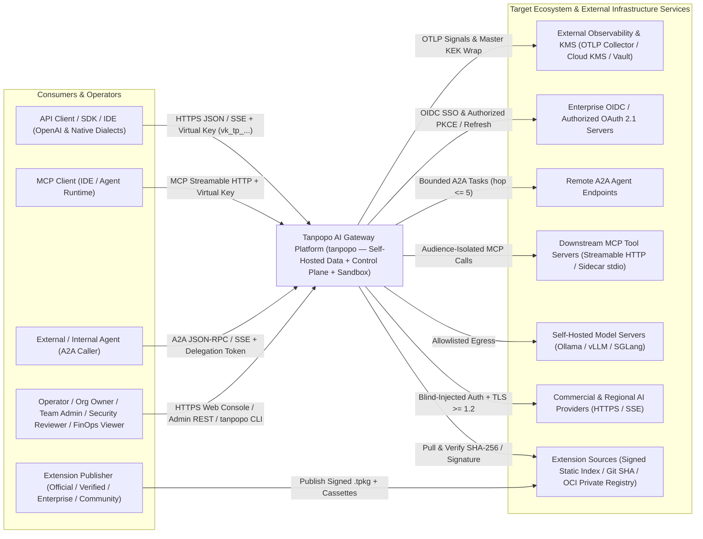
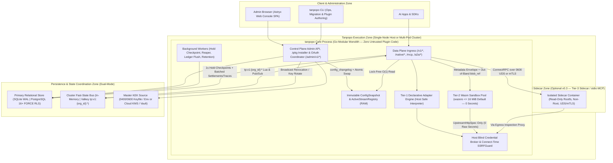
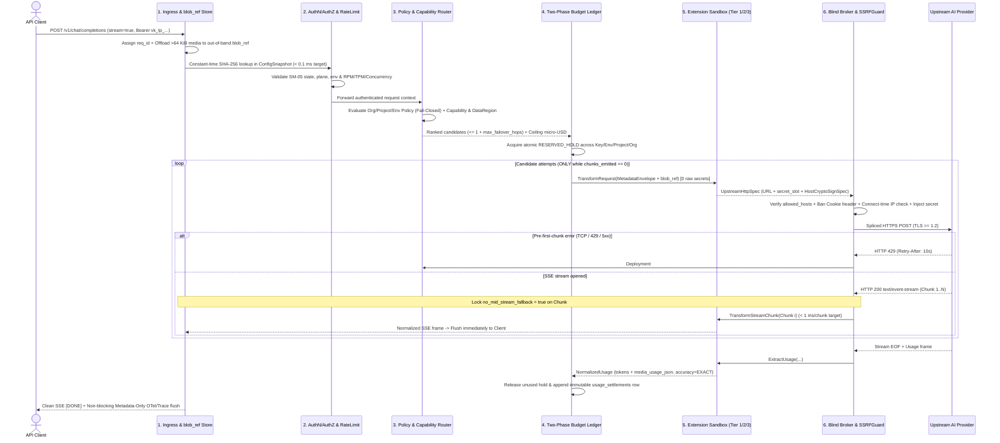
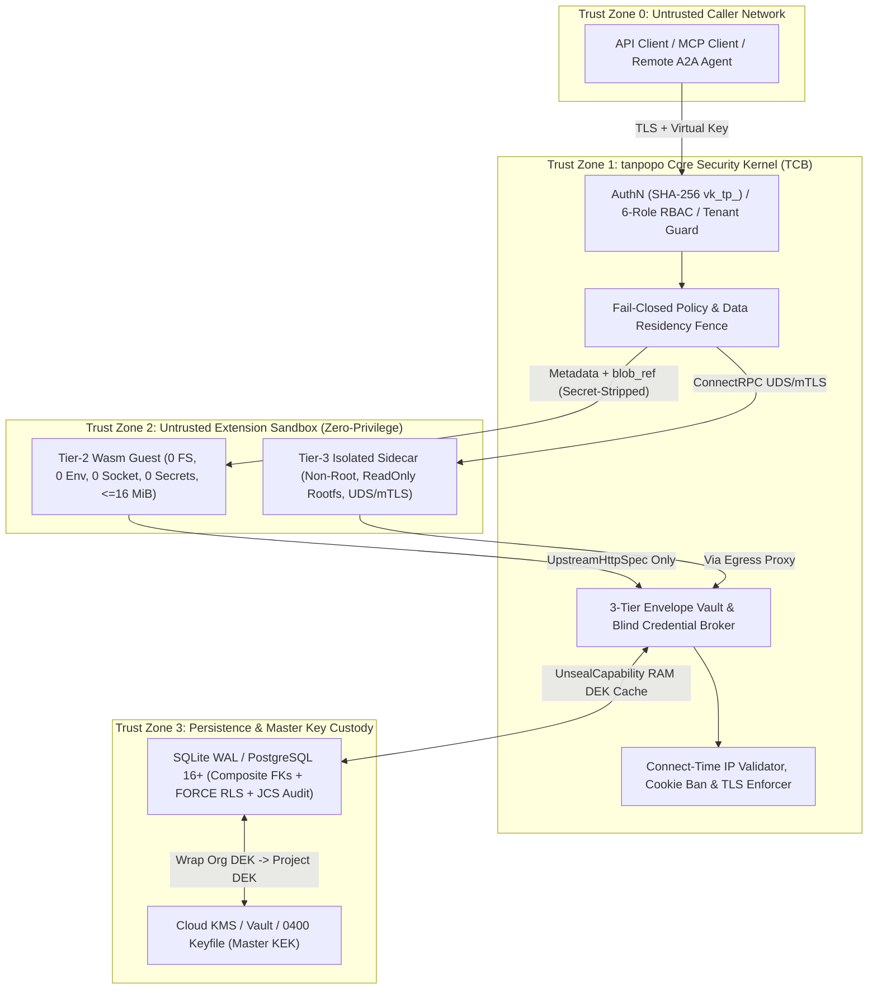

# System Architecture & Technical Design — Tanpopo

> **System Architecture Specification (Phase ASTRA A05 — Updated in `TP-IMP-0003` Spec Closure Batch C)**
> - **Document ID:** `ARCH-SYS-01` | **Version:** `0.2.0-step03-closure` | **Last Updated:** `2026-11-14`
> - **Authoring Roles:** Principal Architect, SRE & Security Architect
> - **Governance Status:** **Accepted Architecture Baseline (`ACCEPTED` — `ADR-0001`..`ADR-0006`, `CR-01`..`CR-10` & `COND-PO-01..05`)** — synchronized with [`data-model.md`](./data-model.md) (`ARCH-DATA-01`) and [`deployment-topology.md`](./deployment-topology.md) (`ARCH-OPS-01`). **All quantitative latency, memory, throughput, availability, revocation (`< 1s` / `< 5s`), and erasure (`< 60s`) figures in this document are `TARGET / UNVERIFIED` design goals until empirically validated in `TP-IMP-0004` (`SPIKE-01`..`04`) and `TP-IMP-0043` (`COND-PO-01`).**
> - **Requirements Traceability:** `TP-FR-0101`..`1005`, `TP-NFR-0101`..`1002`, `SPEC-EXT-01`..`06`, `DEC-001`..`008`.

---

## 1. Architectural Philosophy: Pragmatic, Production-Grade, Zero Premature Complexity

Tanpopo resolves two opposing operational forces simultaneously: **single-command self-hosted startup in under 3 minutes (`TARGET / UNVERIFIED` — `TP-FR-1001`)** and **stateless horizontal scale with capability-gated security isolation for third-party extensions (`TP-FR-0302`, `TP-FR-1005`)**.

To avoid premature microservice sprawl (dozens of services + Kafka + ClickHouse on day one), Tanpopo adopts a **Plane-Separated Modular Monolith** architecture:
1. **A single static pure-Go binary (`tanpopo`, compiled with `CGO_ENABLED=0`)** bundles the **Data Plane**, **Control Plane**, **Background Reconcilers**, CLI subcommands (`tanpopo serve`, `tanpopo db migrate-engine`, `tanpopo admin`, `tanpopo plugin`, `tanpopo backup`), and embedded **Web Console** static assets (`embed.FS`).
2. **Strict unidirectional module boundaries:** The Data Plane **never** queries relational configuration tables on the inference hot path; instead, it reads lock-free from an **Immutable Copy-on-Write `ConfigSnapshot`** (`atomic.Pointer`) compiled from `config_changelog`.
3. **Role separation for HA clusters (`tanpopo serve --role=all | data-plane | control-plane`):** The identical `tanpopo` binary runs stateless `data-plane` replicas behind an L7 load balancer while isolating `control-plane` instances on an internal management network in `v0.3+` (`ADR-0001`).
4. **Uncompromising security & technical candor:** Zero untrusted third-party extension code ever enters Core's Go address space (**`0 in-process untrusted code`**); no implausible claims of *"0 ms proxy overhead"* or *"universal lossless translation across all models"*; and hard structural separation of `COMMERCIAL_API` / `SELF_HOSTED_INFRA` connections from personal consumer subscriptions (`DEC-004`, `ADR-0002`, `ADR-0005`).

---

## 2. System Context, Container Topology & Internal Component Graph (C4 Model)

### 2.1. System Context Diagram — C4 Level 1 (`System Context`)

### 2.2. Deployment Container Diagram — C4 Level 2 (`Container & Plane Boundary`)

### 2.3. Core Internal Component Graph — C4 Level 3 (`Acyclic Package Boundaries`)

Complying with `TP-NFR-1001` and [`execution-baseline.md`](../governance/execution-baseline.md), internal Go packages under `module github.com/nguywnben/tanpopo` enforce strict top-down dependencies (`0` circular imports):

1. **`internal/ingress/{http,sse,native,idempotency,blob,cache,mcp,a2a}`:** Manages HTTP/1.1 & HTTP/2 connections, SSE framing, `x-tanpopo-request-id` + W3C `traceparent` propagation, `Idempotency-Key` deduplication, out-of-band `blob_ref://` multimodal streaming (`<= 32 MiB` kept outside `16 MiB` Wasm linear memory — `CR-05`), opt-in `Project DEK`-encrypted exact response caching (`v0.3`), and `context.Context` cancellation on client disconnect.
2. **`internal/iam/{bootstrap,auth,oidc,rbac,vkey}` & `internal/config/snapshot`:** Resolves `vk_tp_<env>_<32_base62>` plain `SHA-256` digests in `O(1)` from `ConfigSnapshot`, validates `SM-05` states (`CREATED_ACTIVE` / `ROTATING_DUAL_VALID`), and enforces the 6 canonical RBAC roles (`OPERATOR`, `ORG_OWNER`, `TEAM_ADMIN`, `SECURITY_REVIEWER`, `FINOPS_VIEWER`, `DEVELOPER`).
3. **`internal/policy/engine` & `internal/ratelimit`:** Evaluates monotonic `Org ∩ Project ∩ Env ∩ VirtualKey` policy intersections (`Fail-Closed` — `TP-FR-0701`) and enforces `RPM`, `TPM`, and `MaxConcurrentStreams` limits.
4. **`internal/routing/{resolver,breaker,failover}`:** Executes the deterministic 6-step routing pipeline, enforces hard `Data Residency` fences (`503 no_compliant_deployment_available`), tracks `SM-04` circuit states (`ACTIVE_HEALTHY`, `THROTTLED_COOLDOWN`, `CIRCUIT_OPEN_UNHEALTHY`, `HALF_OPEN_PROBING`, `DISABLED`), and restricts failover strictly to pre-first-chunk errors.
5. **`internal/finops/{pricing,ledger,rollup}`:** Executes integer `micro-USD` two-phase budget holds (`RESERVED_HOLD` -> `STREAMING_ACCRUING` -> `SETTLED_EXACT` / `SETTLED_ESTIMATED` / `SETTLED_UNMETERED_FLAGGED` — `SM-07`) and hourly rollups (`usage_rollups_hourly`).
6. **`internal/extension/{port,installer,lockfile,declarative,wasm,sidecar,registry}`:** Safe `.tpkg` extraction, `SM-01` capability consent & $\Delta P$ escalation guard, `tanpopo.lock` pinning, Tier-1 declarative engine, Tier-2 `wazero` sandbox pool (`16 MiB` default), and Tier-3 `ConnectRPC` UDS/`mTLS` sidecar client (`v0.3`).
7. **`internal/security/{vault,broker,oauth,foureyes,audit,killswitch}`:** Three-tier envelope encryption (`Master KEK -> Org DEK -> Project DEK`) with `UnsealCapability` restricted to `BlindBroker`, connect-time `SSRFGuard` dialer (banning outbound `Cookie`/`Set-Cookie` injection), `Authorized OAuth 2.1` single-flight coordinator (`SM-03`), per-`org_id` + `"SYSTEM"` `RFC 8785 JCS` audit hash chains, and the 4-level emergency Kill-Switch.
8. **`internal/telemetry/{otel,privacy,ttl}`:** `Metadata-Only` redactor (`0 bytes` of prompt text by default), bounded-cardinality `/metrics` & OTLP ring buffer (`<= 32 MiB` `Drop-Oldest`), and `<= 72h` TTL reaper for `debug_payload_blobs`.
9. **`internal/storage/{port,migrate,sqlite,postgres}` & `internal/cluster/valkey`:** Dialect-neutral persistence ports and `tp:v1:{<org_id>}:*` cluster Lua scripts.

---

## 3. Technology Stack Decision Matrix

### 3.1. Core Language & Runtime Selection (`ADR-0001`)

| Evaluation Criterion (Weight) | **Go `1.24+`** *(Accepted)* | **Rust (`Tokio` + `Wasmtime`)** | **TypeScript (`Node 22` / `Bun`)** | **Python (`FastAPI` / `uvloop`)** |
|---|---|---|---|---|
| **Concurrent SSE Throughput & `p95` Tail Latency (25%)** | **9/10** — Lightweight goroutines, native HTTP/2 & SSE, sub-millisecond GC pauses (`TARGET / UNVERIFIED`) with `sync.Pool`. | **10/10** — Zero GC, lowest tail latency. | **6.5/10** — Single-threaded event loop suffers `p99` spikes when parsing large JSON alongside `1,000+` SSE streams. | **4/10** — Interpreter overhead and GIL degrade high-load proxy latency. |
| **Cross-OS Single-Binary Packaging & `CGO_ENABLED=0` (20%)** | **9.5/10** — Clean static cross-compilation across `linux`/`darwin`/`windows` via `wazero` + `modernc.org/sqlite` + `embed.FS`. | **8.5/10** — Compact binaries, heavier multi-OS static cross-compilation in CI. | **5/10** — Heavy single-executable bundles (`80–120 MiB`). | **3/10** — Fragile virtualenv / native C wheel dependencies. |
| **Safe Out-of-Core Extension Isolation (20%)** | **9/10** — Pure-Go `wazero` isolates Wasm linear memory without CGO C-JIT memory-safety hazards. | **9.5/10** — `wasmtime` reference runtime. | **6/10** — Temptation toward unsafe in-process `import()`; `node:vm` is not a security boundary. | **5/10** — Lacks a lightweight built-in capability sandbox. |
| **Control Plane, OAuth, MCP Velocity & OSS Accessibility (20%)** | **9/10** — Mature networking/cloud/OTel/SQL ecosystem and broad infrastructure contributor base. | **6/10** — Slower iteration on async Admin CRUD, OAuth 2.1, and MCP/A2A workflows. | **9.5/10** — Fast CRUD/JSON velocity. | **8.5/10** — Fast at small scale, weaker compile-time guarantees. |
| **Idle Memory Footprint `< 128 MiB` (`TP-NFR-0103`) (15%)** | **9/10** — Projected `~35–65 MiB` RSS including SQLite WAL (`TARGET / UNVERIFIED`). | **10/10** — Projected `~15–30 MiB` RSS (`TARGET / UNVERIFIED`). | **6/10** — Projected `~90–160 MiB` RSS. | **5/10** — Multi-worker processes consume hundreds of MiB. |
| **Weighted Composite Score** | **`9.05 / 10` (`ACCEPTED`)** | `8.65 / 10` | `6.78 / 10` | `5.05 / 10` |

### 3.2. Persistent Storage & Cluster State Selection (`ADR-0003`)

| Option | Strengths | Weaknesses / Trade-offs | Architectural Decision |
|---|---|---|---|
| **1. Dual-Mode via `storage/port`: `SQLite WAL` Standalone + `PostgreSQL 16+` (`FORCE RLS`) & `Valkey` HA Cluster** | Delivers `< 3s` (`TARGET / UNVERIFIED`) zero-container startup on Day 1; scales horizontally on standard PostgreSQL monthly partitions + `Valkey` `{<org_id>}` Lua scripts without requiring ClickHouse or Kafka. | Requires portable SQL discipline and symmetric `Dual-DB` CI testing (`RSK-013`, `TP-IMP-0039`). | **`ACCEPTED`** — Optimal balance between Day-1 DX and enterprise HA. |
| **2. Mandatory `PostgreSQL + Redis` Across All Modes** | Single SQL dialect. | Breaks `Zero-Dependency Standalone` (`TP-FR-1001`). | **Rejected.** |
| **3. Embedded Raft (`rqlite` / `dqlite`) in Core** | Avoids external Postgres in 3-node clusters. | High write-amplification and complex disaster recovery for continuous financial settlement streams. | **Rejected.** |
| **4. Mandatory `ClickHouse / Kafka` in Core** | High throughput at multi-billion-row scale. | Excessive self-hosted footprint; supported externally via standard **OTLP** export. | **Excluded from Core.** |

### 3.3. Web Console Stack Selection (`ADR-0004`)

| UI Stack Option | Advantages | Disadvantages / Maintenance Cost | Verdict |
|---|---|---|---|
| **1. Static SPA (`TypeScript + React 19 + Vite + StyleX + Astryx v0.7.13 neutral`) Embedded into `tanpopo` (`embed.FS`)** | Build-time StyleX CSS (`0` runtime CSS overhead), `WCAG 2.2 AA` components, local `Figtree` `.woff2` Vite alias for `0`-external-request Air-Gap operation (`CR-10`), and `0` Node.js runtime processes in production. | Relocates root UI scaffold into `web/console/` and syncs `package.json` license to `Apache-2.0` (`TP-IMP-0005`). | **`ACCEPTED`** |
| **2. `React + Tailwind CSS + shadcn/ui`** | Broad template ecosystem. | Discards `DEC-007` baseline and automated `astryx doctor --built` enforcement. | **Not selected.** |
| **3. `Next.js App Router (SSR Node Server)`** | Strong for public SEO pages. | Authenticated internal console has `0` SEO requirement; adds an unnecessary Node.js server. | **Rejected.** |
| **4. `Go HTML Templates + HTMX`** | No JS build step. | Poor fit for side-by-side SSE `Playground`, interactive `Route Explain` trees, and permission diff modals. | **Rejected.** |

---

## 4. Per-Request Runtime Path & Incident Degradation Matrix

### 4.1. End-to-End Inference Hot Path (`API Client -> Provider`)

**Projected Internal Latency Budget (`TARGET / UNVERIFIED` — `TP-NFR-0101`, `COND-PO-01`):**
- Stages 1–3 *(Ingress + Snapshot SHA-256 Auth + Rate Limit + Policy/Router)*: **`~0.4 – 0.8 ms` (`TARGET / UNVERIFIED`)**.
- Stage 4 *(Two-Phase Budget Hold)*: **`~0.1 ms`** standalone RAM or **`~0.5 – 0.9 ms`** LAN Valkey `tp:v1:{<org_id>}:*` Lua (`TARGET / UNVERIFIED`).
- Stages 5–6 *(Adapter Transform + Blind Broker Header Inject)*: **`~0.3 – 0.6 ms`** Tier-1 Declarative or **`~1.5 – 3.0 ms`** Tier-2 Wasm (`TARGET / UNVERIFIED`).
- **Total Pre-Egress Proxy Overhead (`TARGET / UNVERIFIED`):** **`< 2.0 ms` (`p95`) for Tier 1** and **`< 5.0 ms` (`p95`) for Tier 2**; per-SSE-chunk forwarding **`< 1.0 ms` (`p95`)** (`TP-NFR-0102`).

### 4.2. Hot Extension Installation & Activation Path Without Rebuilding `tanpopo`

1. **Bounded Intake (`tanpopo plugin install <source>`):** Extracts `.tpkg` enforcing `<= 64 MiB` uncompressed size, `<= 256` entries, `<= 50:1` compression ratio, and rejecting `..` Zip-Slip or symlinks (`CT-04`).
2. **Provenance & Namespace Verification (`VERIFYING` — `SM-01`):** Verifies `SHA-256` digest, `Ed25519`/`Cosign` signatures, `contractVersion` (`N-1` window), and reserved namespace regex `^@tanpopo(-[a-z0-9]+)?/` (`CR-03`); stamps `origin_trust_tier` (`official`, `verified`, `unverified_external`) and `enterprise_signed`.
3. **Human Permission Consent Gate (`PENDING_PERMISSION_APPROVAL`):** Stages `extension_installations` with `active_version_id = NULL` and `candidate_version_id = <exv_id>`. On upgrades where $\Delta P = P_{\text{new}} \setminus P_{\text{approved}} \neq \emptyset$, parks at `UPDATING_PENDING_RECONSENT` while $v_{\text{old}}$ continues serving live traffic (`CT-18`).
4. **Pre-Warm & Atomic Snapshot Swap (`ENABLED_ACTIVE`):** Compiles `.wasm` into content-addressed cache, updates `tanpopo.lock`, appends an `audit_events` row + `config_changelog` epoch in one SQL transaction, swaps `atomic.Pointer[ConfigSnapshot]`, and broadcasts on `Valkey Pub/Sub`. **The running `tanpopo` process retains its exact OS `PID` and binary `SHA-256` digest with `0` seconds of downtime (`TARGET / UNVERIFIED`).**

### 4.3. Runtime Incident & Degradation Matrix

| Production Incident Scenario | Affected Subsystem | Mandatory Self-Protecting Architectural Behavior | Caller Impact (`TARGET / UNVERIFIED`) |
|---|---|---|---|
| **1. Data Plane pod crashes while holding `50` open SSE streams** | Orphaned `RESERVED_HOLD` / `STREAMING_ACCRUING` rows in `budget_reservations`. | Reservations carry `lease_expires_at_ms` (renewed every `30s` while streaming). Leader job `OrphanReservationReaper` transitions expired rows to `EXPIRED_RECLAIMED`, restores `budget_ledgers` headroom, and appends an `audit_events` record. | Budget headroom self-heals within `<= 60–90s`; never permanently leaked. |
| **2. Abrupt `Valkey` outage or failover in HA mode (`CR-07`, `COND-PO-03`)** | `tp:v1:{<org_id>}:*` rate-limit counters, fast holds & Pub/Sub. | **Rate Limits (`Bounded Fail-Open`):** Degrades to local per-pod buckets (`limit / estimated_pods`). **Auth, Policy & Hard Budgets (`Fail-Closed`):** Falls back to `PG LISTEN/NOTIFY` + `2s` `config_changelog` poll, and admits budgets directly on PostgreSQL adding `1s` `valkey_hold_checkpoints` totals + a conservative per-node active-flight safety margin. *(Per `COND-PO-03`, full ledger consistency under concurrent failover/partition requires empirical chaos verification in `TP-IMP-0021, 0040, 0043`.)* | Legitimate traffic continues; hard budget ceilings and key revocations remain fail-closed. |
| **3. External `OTel Collector` hangs or blackholes TCP** | Traces, Metrics & Logs export queue. | Bounded `<= 32 MiB` OTLP ring buffer evicts `Drop-Oldest` batches and increments `tanpopo_telemetry_dropped_total` (`TP-FR-0805`, `OPS-AC-12`). | `< 1 ms` hot-path impact; `usage_settlements` and `audit_events` still commit safely to SQL. |
| **4. Community Wasm plugin hits an infinite loop or memory bomb** | Only the single request invoking that plugin. | Context deadline + `16 MiB` default linear-memory ceiling (`64 MiB` max approved) traps only that Wasm instance (`TP-NFR-0202`). | Single request returns **`502 extension_execution_fault`**; sibling streams remain unaffected; repeated faults auto-`QUARANTINE` the plugin (`FMEA-05`). |
| **5. Emergency revocation of a leaked `Virtual Key` (even in `QUOTA_PAUSED`)** | Active SSE streams and future calls for that key. | `SM-05` transitions directly to `REVOKED` (preempting `QUOTA_PAUSED`), increments `config_changelog`, and triggers `ActiveStreamRegistry` `CancelFunc` callbacks across nodes. | Active SSE streams sever in `< 1s` standalone / `< 5s` cluster (`TARGET / UNVERIFIED`). |

---

## 5. Security Kernel, Three-Tier Envelope Vault & `C1..C4` Data Classification

1. **Three-Tier Context-Bound Envelope Encryption (`Master KEK -> Org DEK -> Project DEK` — `CR-06`):**
   - `Master KEK` wraps each organization's `256-bit` `Org DEK` (`org_encryption_keys`); each `Org DEK` wraps each child project's `256-bit` `Project DEK` (`project_encryption_keys`).
   - All `AES-256-GCM` operations enforce **exclusively two canonical `AEAD AAD` formulas** (`0` module drift):
     - **Org-scoped secret (`Org DEK`):** `"tanpopo:v1:cred:" + org_id + ":" + credential_id + ":" + secret_kind`
     - **Project-scoped secret / debug-blob / cache-entry (`Project DEK`):** `"tanpopo:v1:proj:" + org_id + ":" + project_id + ":" + record_kind + ":" + record_id`
   - **Verification Condition (`COND-PO-02` + `CR-12` Option A / `DEC-017`):** Vault-level `Master KEK -> Org DEK -> Project DEK` lifecycle, RAM `DEK` zeroization, WAL/page cleanup, generation fencing, and live/post-shred/KEK-less non-recoverability passed in `TP-IMP-0008` (`DONE`, `DEC-018`). Under `v0.1` standalone shared `Master KEK`, historical pre-shred cold backups retaining an intact `Master KEK` require `DR-03` KEK rotation + retirement (`TP-IMP-0032`) or `v0.3` external per-project KMS/Vault root keys (`TP-IMP-0041`); `< 60s` end-to-end CLI/backup erasure (`TP-IMP-0032`) and HA DR drills (`TP-IMP-0043`) remain **`TARGET / UNVERIFIED`**.
2. **Connect-Time Anti-SSRF, `allow_private_ip` Consent & Outbound `Cookie` Ban (`CR-05`, `CR-10`):**
   - `SSRFGuard` hooks `net.Dialer.Control` at TCP connect time to defeat `TTL=0` DNS-rebinding attacks, blocking loopback (`127.0.0.0/8`, `::1`), RFC 1918, CGNAT (`100.64.0.0/10`), IPv6 ULA (`fc00::/7`), and link-local/cloud metadata (`169.254.0.0/16`, `fe80::/10`, `fd00:ec2::254`), disabling cross-origin redirects, and **unconditionally banning outbound `Cookie`/`Set-Cookie` credential injection (`DEC-004`)**.
   - Local/LAN GPU servers (`Ollama`, `vLLM`) are permitted solely when an authorized administrator explicitly enables `allow_private_ip = true` with `allowed_cidrs_json` — even then, `169.254.169.254` and Tanpopo's own listener ports remain unconditionally blocked.
3. **Canonical 4-Tier Data Classification (`C1..C4` — `AUD-030`) & Multi-Tenant Isolation:**
   - **`C1 — Public`:** `logical_models` global catalog, public Marketplace index metadata, and contract schemas.
   - **`C2 — Operational Metadata`:** `request_traces_meta` (`request_id`, HTTP status, latency waterfall stages, token counts — **`0 bytes` of prompt/completion text**).
   - **`C3 — Confidential Tenant Config & FinOps`:** Tenant hierarchy, routes, policies, `micro-USD` financial tables (`budget_ledgers`, `usage_settlements`, `usage_rollups_hourly`), and immutable per-`org_id` + `"SYSTEM"` `RFC 8785 JCS` hash-chained `audit_events` (`>= 365 days`, protected by composite `(org_id, id)` keys + `PostgreSQL FORCE RLS`).
   - **`C4 — Restricted Secrets & Opt-In Debug Payloads`:** Write-only credentials (`secret_credentials`, `oauth_authorization_sessions`) unwrapped solely via `UnsealCapability` inside `BlindBroker` ephemeral RAM (`clear(buf)` immediately post-write), plus opt-in `debug_payload_blobs` (`0 bytes` stored by default; when explicitly enabled, sealed under `Project DEK` with hard `TTL <= 72 hours`).
4. **Service-to-Service Trust:**
   - Co-located `Tier-3 Isolated Sidecar` deployments use `0600` Unix Domain Sockets; networked HA deployments enforce mutual `mTLS` with short-lived (`TTL <= 24h`) SPIFFE-bound certificates (`AUTH-08`).

---

## 6. SLO Targets, Error Budgets & Leader-Coordinated Background Jobs

### 6.1. Internal SLO Targets & Error Budgets (`TARGET / UNVERIFIED` — `COND-PO-01`)

> **SLO Attribution Rule:** Upstream `429`/`5xx` responses when all compliant deployments in a caller's route are degraded are classified as **`Upstream Dependency Exhaustion`** rather than internal gateway defects; internal crashes, Wasm host faults, vault errors, false circuit trips, or proxy latency breaches burn directly against Tanpopo's Error Budget.

| Internal SLI Metric | Target Objective (`TARGET / UNVERIFIED`) | 30-Day Error Budget | Burn-Rate Alert Thresholds |
|---|---|---|---|
| **Gateway Internal Availability (HA Mode C)** | **`>= 99.9%`** of valid requests free of Tanpopo-originated `5xx` errors (`TP-NFR-0201`). | `43m 49s` equivalent (`0.1%` requests). | **`PAGE`:** `>= 14.4x` burn across `5m` & `1h`. **`TICKET`:** `>= 1.0x` sustained over `3d`. |
| **Proxy Internal Overhead** | `p95 < 2 ms` (Tier 1) & `p95 < 5 ms` (Tier 2); per-SSE-chunk `p95 < 1 ms` (`TP-NFR-0101`, `0102`). | `<= 5%` requests exceeding target in `15m` window. | **`TICKET` / `PAGE`:** `p95 > 10 ms` sustained `> 10m`. |
| **Emergency Revocation Propagation** | `< 1s` standalone & `< 5s` across `99.9%` of cluster pods (`TP-NFR-0404`). | `0` pods admitting keys revoked `> 5s` ago (`> 10s` triggers fail-closed `503`). | **Immediate `PAGE`** when `max(tanpopo_config_snapshot_age_seconds) > 5` for `> 30s`. |

### 6.2. Catalog of Background Workers

Cluster-wide singleton workers acquire leases in `distributed_leases` (backed by fencing tokens / PostgreSQL advisory locks), while per-pod flushers run locally on every Data Plane node:

| Background Worker | Execution Scope | Default Cadence | Responsibility & Safety Mechanism |
|---|---|---|---|
| **`AsyncLedgerAndTraceFlusher`** | Every `Data Plane` pod | `250 ms` or `200` rows + `1s` checkpoint | Micro-batches `usage_settlements` (`UNIQUE (request_id, settled_at_ms)`) & `request_traces_meta`, upserts `1s` `valkey_hold_checkpoints`, and drains `100%` of queued records on `SIGTERM`. |
| **`OrphanReservationReaper`** | `Control Plane` (`distributed_leases`) | Every `30 seconds` | Sweeps `RESERVED_HOLD` and `STREAMING_ACCRUING` rows in `budget_reservations` where `lease_expires_at_ms < now_ms` into `EXPIRED_RECLAIMED` (`SM-07`), restoring `budget_ledgers` headroom with an `audit_events` record. |
| **`OAuthProactiveRefresher`** | `Control Plane` (`oauth_token_leases`) | Every `60 seconds` | Proactively refreshes `SM-03` tokens expiring within `< 60s` via single-flight locking; halts at `0` retries into `AUTH_EXPIRED_REAUTH_REQUIRED` on `invalid_grant` (`FMEA-08`). |
| **`RetentionAndErasureWorker`** | `Control Plane` (`distributed_leases`) | Every `10–15 minutes` (Immediate on shred) | Purges expired `debug_payload_blobs` (`<= 72h`), detaches/drops aged PostgreSQL partitions (or batches SQLite deletes), and executes `Project`/`Org` erasure (`< 60s TARGET / UNVERIFIED`). |
| **`RevocationAndMCPWatcher`** | `Control Plane` (`distributed_leases`) | Every `5–15 minutes` | Verifies monotonic `version_serial` on signed `revocations.json` feeds (`extension_revocations`) and checks `RFC 8785 JCS` `approved_schema_sha256` drift across `mcp_tools`. |
| **`FinOpsRollupAggregator`** | `Control Plane` (`distributed_leases`) | Every `5 minutes` | Aggregates `EXACT`, `ESTIMATED`, and `UNMETERED_FLAGGED` settlements into `usage_rollups_hourly` for instant `SCR-12` dashboard rendering. |

---

## 7. Empirical Verification Spike Protocols (`TP-IMP-0004` — Isolated `tools/spikes/`)

> **Isolation Rule (`EXEC-BL-001`):** Executed strictly inside isolated `tools/spikes/go.mod` (`module github.com/nguywnben/tanpopo-spikes`) over `127.0.0.1` loopback mocks (`0` external network calls) to lock `POC-01` and `POC-02` prior to `M1` runtime coding.

1. **`SPIKE-01` — Hot-Loading External `.tpkg` Adapters Without Rebuilding `tanpopo` (`EXP-02` / `POC-02`):**
   - Verify `sha256sum(tanpopo)` and OS `PID` remain `100%` unchanged across dynamic install, live SSE streaming, and `< 5s` (`TARGET / UNVERIFIED`) version rollback; confirm Tier-1 declarative operators express `>= 8/10` representative providers in `<= 120` YAML lines.
2. **`SPIKE-02` — `wazero` Streaming ABI & Blind Broker Memory Isolation (`EXP-01` / `POC-01`):**
   - Benchmark `WASI Preview 2 WIT` vs. `Shared Linear-Memory Ring Buffer` across `1,000` concurrent SSE streams (`2 vCPU / 2 GiB RAM`), selecting the ABI meeting `p95 < 5.0 ms` request overhead and `p95 < 1.0 ms` per-chunk latency; confirm infinite loops, `> 16 MiB` memory bombs, and `blob_ref` streaming leak `0` secret bytes into Wasm linear memory.
3. **`SPIKE-03` — Disconnected SSE Reconciliation & Concurrent Two-Phase Holds (`EXP-04`):**
   - Fire `50` concurrent calls (`$0.10` ceiling hold) against `$0.50` remaining budget (`5` admitted, `45` rejected `429 project_budget_exceeded`); sever client TCP at chunk #15 and verify upstream socket close `< 500 ms` (`TARGET / UNVERIFIED`) + `SETTLED_ESTIMATED` within `<= 5%` of emitted tokens + `100%` `OrphanReservationReaper` recovery after `SIGKILL`.
4. **`SPIKE-04` — `Authorized OAuth 2.1 + PKCE S256`, Single-Flight Refresh & `RFC 8707` Binding (`SM-03`):**
   - Confirm `100` concurrent calls hitting an expired rotating refresh token trigger **exactly `1`** `/oauth/token` refresh request (`FMEA-08`) and `100%` of cross-audience replay probes fail with `403 credential_audience_mismatch` (`CT-19`).
