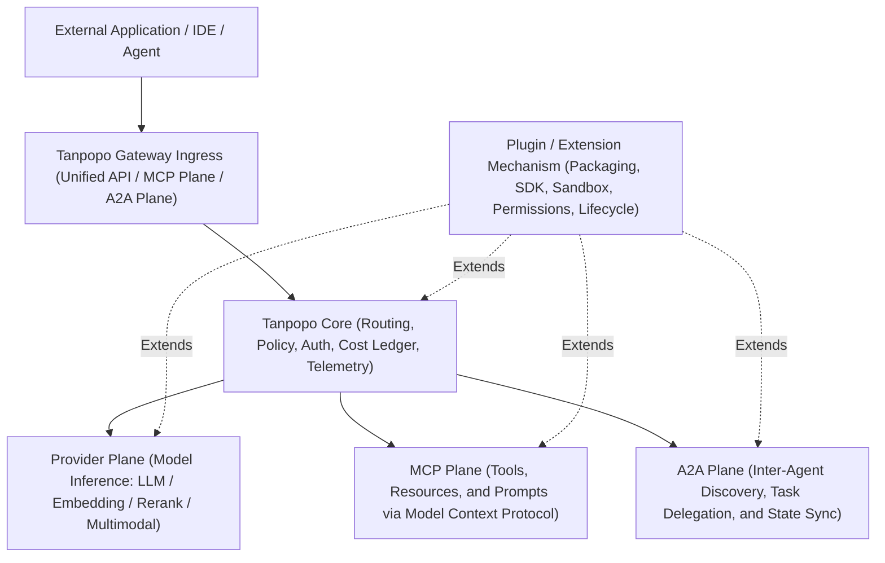

# Project Charter — Tanpopo

> **Canonical Context Artifact — Baseline A00–A02, Audited Through Phase A10**
> - **Version:** `0.4.0-en-baseline`
> - **Last Updated:** `2026-11-14`
> - **Authored By:** Product Intelligence Lead & Principal Solution Architect
> - **Document Status:** Confirmed foundational context baseline (`CONFIRMED_BY_OWNER`); **Gate G1, Gate G2, Gate G3 (A05–A07), and Gate G4 (A09–A10)** currently remain **`READY_FOR_REVIEW` / `BLOCKED`** (release scope, technology stack, and detailed architecture are not yet locked; see [`docs/reviews/integrated-audit.md`](../reviews/integrated-audit.md), [`docs/reviews/execution-readiness.md`](../reviews/execution-readiness.md), and [`docs/governance/owner-approval-sheet.md`](./owner-approval-sheet.md)).

---

## 1. Epistemic Status Taxonomy

Every strategic statement, policy rule, architectural decision, and hypothesis across Tanpopo documentation MUST carry one of six explicit epistemic labels to eliminate implicit cross-session drift:

| Epistemic Label | Definition | Governance Rule |
|---|---|---|
| `CONFIRMED_BY_OWNER` | Explicitly confirmed in writing or selected directly by the Product Owner. | Highest-authority source of truth for product direction and hard boundaries. |
| `VERIFIED_IN_REPO` | Empirically verified against actual source files, configuration, Git history, or CLI execution output in the repository. | Reflects *what currently exists on disk*; does NOT imply permanent architectural approval. |
| `PROPOSED` | Recommended by the Product Intelligence Lead / Solution Architect with explicit trade-off analysis, awaiting Product Owner sign-off. | Must NOT be treated as a locked decision for unapproved implementation. |
| `ASSUMED` | Temporary working hypothesis enabling structured analysis or candidate design while empirical data is pending. | Must state verification criteria and impact if disproved. |
| `OPEN` | Unresolved question, configuration conflict, or specification gap lacking an approved decision. | If *blocking*, execution MUST stop and escalate to the Product Owner before coding. |
| `REJECTED` | Direction, feature, or framing explicitly rejected by the Product Owner. | Strictly forbidden from re-entering design, code, or documentation under another name. |

---

## 2. Product Vision & Positioning

- **[`CONFIRMED_BY_OWNER`] Core Identity:** **Tanpopo** is an **open-source, self-hosted-first, extension-first AI Gateway designed for real-world production operation and horizontal scalability**.
- **[`CONFIRMED_BY_OWNER`] Beyond a Simple Key Rotator:** Tanpopo is **not merely an AI API key aggregator or rotator** (`REJECTED` if narrowed into a key rotator). It is a unified control and data plane connecting multiple AI providers, models, wire protocols, and legitimate authentication mechanisms.
- **[`CONFIRMED_BY_OWNER`] Eight Core Platform Pillars:**
  1. **Unified API:** Standardized application and agent programming surface across heterogeneous model ecosystems.
  2. **Routing:** Capability-aware request routing, pre-stream failover, and weighted/cost/latency load distribution.
  3. **Policies:** Hierarchical access control, rate limiting/quotas, safety guardrails, and compliance enforcement along the request/response path.
  4. **Monitoring:** Operational observability, structured logs, distributed traces, latency histograms, error rates, and connection health.
  5. **Cost Control:** Token and multimodal resource metering, two-phase budget accounting, and spend governance.
  6. **MCP Tools Connectivity:** Governed connectivity and tool-level access control for the Model Context Protocol (`MCP`) ecosystem.
  7. **Agent / A2A Connectivity:** Inter-agent (`Agent-to-Agent` / `A2A`) discovery and task delegation as an independent communication plane.
  8. **Web Console & CLI:** Production-grade visual administrative console paired with a first-class command-line interface for operators and developers.

> **Important Note [`CONFIRMED_BY_OWNER`]:** Detailed system architecture, technology stack choices, concrete screen implementations, and per-release scope boundaries remain **`PROPOSED` / `READY_FOR_REVIEW`** until explicitly signed off by the Product Owner at Gates G1–G4.

---

## 3. Core Differentiator: Extension-First Architecture (`CONFIRMED_BY_OWNER`)

Tanpopo's primary strategic differentiator is **decoupling the release cadence of Tanpopo Core from the rapid evolution of external AI providers**:

1. **[`CONFIRMED_BY_OWNER`] Zero-Core-Rebuild Independent Extension Installation:** Operators install **Provider Adapters** and other extensions directly from:
   - The public Marketplace index,
   - Pinned Git repositories,
   - Direct URLs / `.tpkg` package archives, or
   - Private organizational OCI/package registries.
   Users **never have to wait for a new Tanpopo Core release** whenever a new AI provider, model family, or enterprise integration emerges.
2. **[`CONFIRMED_BY_OWNER`] Production Engineering Standards for Extensions:** Extensions are governed software artifacts — never ad-hoc unverified scripts — and MUST provide:
   - **Versioned Contracts:** Explicit input/output schemas, semantic contract versioning, and structured capability declarations.
   - **Authoring SDK:** Language-agnostic contracts and tooling supporting API Keys, authorized OAuth, enterprise identity/credential types, and custom authentication.
   - **Managed Lifecycle:** Staged installation, permission review, activation, configuration, zero-downtime upgrade, rollback, quarantine, and removal.
   - **Security Isolation:** Strict capability sandboxing protecting Tanpopo Core and raw credentials from untrusted third-party code.
   - **Compatibility Tests:** Deterministic offline cassette test suites verifying conformance against the Core contract.
   - **Explicit Permissions:** Transparent, least-privilege declarations for network egress hosts, secret slots, and execution hooks.

---

## 4. Strict Separation of Four Architectural Planes (`CONFIRMED_BY_OWNER`)

An immutable architectural invariant of Tanpopo is that **MCP, A2A, Provider, and Plugin are four distinct conceptual layers and MUST NEVER be conflated** (`REJECTED`: any design collapsing them into a single universal entity or table):

| Conceptual Layer | Definition & Responsibility | Why Conflation Is Forbidden |
|---|---|---|
| **1. Provider** | Upstream service supplying AI model capabilities (chat/text generation, vision, audio, embeddings, rerank) with its own pricing rules, rate limits, model catalog, and authentication requirements. | A Provider may be connected via a declarative pack or sandboxed plugin; a Provider itself is neither an MCP tool server nor an autonomous peer agent. |
| **2. Plugin / Extension** | The packaging, distribution, permissioning, security-isolation, and lifecycle mechanism extending Tanpopo (e.g., *Provider Adapter*, *Policy/Guardrail Hook*, *Auth Driver*, *Custom Exporter*). | A Plugin is an **extensibility and runtime delivery mechanism**, not a traffic plane. Not every Plugin is a Provider Adapter, and registering a standard HTTP MCP server or A2A endpoint does not require installing new plugin code. |
| **3. MCP (Model Context Protocol)** | Standardized protocol plane connecting **Tools, Resources, and Prompts** to supply context and side-effectful actions to models/agents. | MCP requires stateful session semantics, per-tool ACLs, schema-drift (`Rug-Pull`) protection, and human-in-the-loop (`destructive`) approvals fundamentally distinct from stateless LLM inference. |
| **4. A2A (Agent-to-Agent)** | Protocol plane for `AgentCard` capability discovery, asynchronous multi-turn task delegation, status streaming, and sub-budget/privilege attenuation across autonomous agents. | Peer agents maintain long-running asynchronous task lifecycles (`SM-09`), recursion/hop ceilings, and cross-system trust boundaries that cannot be shoehorned into LLM chat completions or single MCP tool calls. |

---

## 5. Official vs. Community Ecosystem Policy & Terms-of-Service Compliance (`CONFIRMED_BY_OWNER`)

This legal, ethical, and product governance boundary MUST be enforced across every document, source file, SDK template, UI screen, and registry artifact owned by Tanpopo:

1. **[`CONFIRMED_BY_OWNER`] Separation of Official vs. Community/Private Adapters:**
   - **Official Adapters:** Built, cryptographically signed, verified, and maintained by the Tanpopo project; **strictly use official commercial Provider APIs and provider-sanctioned access methods**.
   - **Community / Private Adapters:** Independently developed, hosted, and distributed by third parties or internal enterprise platform teams via Git, URLs, private registries, or community channels.
2. **[`CONFIRMED_BY_OWNER`] Legitimate Authentication Primitives in the SDK:**
   - The Extension SDK supports legitimate technical authentication primitives: **API Keys**, **provider-authorized OAuth 2.1**, **enterprise identity/credential types** (e.g., Cloud IAM roles, service accounts, workload identity, mTLS/JWT), and **custom enterprise authentication** for internal gateways.
3. **[`CONFIRMED_BY_OWNER`] Hard Prohibition on Consumer Subscription Misuse (`DEC-004`):**
   - **Neither the existence of third-party community plugins nor a user clicking a "risk disclaimer" checkbox constitutes authorization to convert personal consumer subscriptions (e.g., ChatGPT Plus/Pro, Claude Pro/Max, Codex, Antigravity, etc.) into general-purpose APIs.**
   - **Tanpopo does NOT develop, bundle, list, document, or maintain Terms-of-Service-violating connectors.**
   - **[`REJECTED` `REJ-003`]:** Any proposal to market, document, or legitimize "turning personal consumer subscriptions into shared API credits behind a user-accepted risk warning" is permanently rejected.

---

## 6. Core Goals & Non-Goals

### 6.1. Confirmed Core Goals (`CONFIRMED_BY_OWNER`)
- **G1 — Pragmatic Self-Hosting:** Effortless day-one deployment on user-controlled infrastructure with a clean scale-out path as traffic grows.
- **G2 — Core-Decoupled Extensibility:** Install, verify, upgrade, and roll back Provider Adapters and extensions from diverse sources under explicit contracts, sandboxing, and permissions.
- **G3 — Unified Multi-Plane Governance:** Consistent Unified API, capability routing, hierarchical policy enforcement, observability, and cost control.
- **G4 — Agentic-Era Readiness:** First-class, cleanly separated `MCP` and `A2A` governance planes alongside the `Provider` and `Plugin` layers.
- **G5 — Dual Operator & Developer Ergonomics:** Cohesive Web Console and scriptable single-binary CLI.

### 6.2. Permanently Excluded Non-Goals (`CONFIRMED_BY_OWNER` / `REJECTED`)
- **NG1 [`REJECTED`]:** Reducing Tanpopo to a bare API-key round-robin proxy without policy, routing, telemetry, FinOps, or sandboxed extensibility.
- **NG2 [`REJECTED`]:** Requiring Tanpopo Core code edits and releases to add new AI providers.
- **NG3 [`REJECTED`]:** Maintaining, promoting, or legitimizing TOS-violating consumer subscription scrapers/proxies (`ChatGPT Plus/Pro`, `Codex`, `Antigravity`, etc.).
- **NG4 [`REJECTED`]:** Conflating `Provider`, `Plugin`, `MCP`, and `A2A` into a single ambiguous model or protocol.

### 6.3. Proposed Initial Scope Guardrails (`PROPOSED` — Pending Gate G1 / G2 Sign-Off)
- **NG-P1 [`PROPOSED`]:** No model training, fine-tuning, or local weight hosting engine inside Tanpopo (Tanpopo routes to external engines such as `vLLM` or `Ollama`).
- **NG-P2 [`PROPOSED`]:** No hosted multi-tenant SaaS billing clearinghouse/marketplace brokerage in the core open-source release; 100% focus on self-hosted excellence.
- **NG-P3 [`PROPOSED`]:** No application prompt-chaining framework (like LangChain/LlamaIndex) embedded inside Gateway Core.
- **NG-P4 [`PROPOSED`]:** No built-in LLM-as-a-Judge / live shadow-traffic evaluation suite in Core `v0.1–v1.0` to prevent scope bloat and prompt-privacy risk (see [`docs/discovery/positioning-and-success-metrics.md`](../discovery/positioning-and-success-metrics.md)).

---

## 7. Candidate Target Segments, Functional Roles & Workload Profile (`PROPOSED` / `ASSUMED` — Gate G1)

> Analyzed in detail in [`docs/discovery/users-jobs-use-cases.md`](../discovery/users-jobs-use-cases.md) and [`docs/governance/assumptions.md`](./assumptions.md), pending Product Owner approval under **`SD-G1-01`**:

1. **Prioritized User Segments (`PROPOSED` — `SD-G1-01`):**
   - **Priority #1 (Beachhead):** *Dev Teams (5–50 engineers)* integrating multiple models and MCP tools into applications and coding agents.
   - **Priority #2 (Co-Beachhead Scale):** *AI Platform Teams (50–500 engineers)* enforcing departmental budgets, custom enterprise auth, and private Provider Adapters.
   - **Priority #3 (Bottom-Up Adoption Funnel):** *Legitimate BYOK & Local-GPU Solo Developers / AI Power Users*.
   - **Priority #4 (`v1.0+` Horizon):** *Regulated Enterprises (>1,000 employees)* requiring specialized hardware/compliance certifications (`FIPS` / `HSM`).
2. **Four Functional Roles (`PROPOSED`):** `R1 — Gateway Operator`, `R2 — API Consumer Developer`, `R3 — Plugin/Adapter Publisher`, and `R4 — Security & FinOps Admin`.
3. **Traffic Profile Hypothesis (`ASSUMED` — `ASM-002`):** Data Plane traffic is dominated by long-lived streaming SSE / HTTP chunked connections requiring low proxy overhead (`< 2–5 ms p95` `TARGET / UNVERIFIED`) and bounded per-stream memory.

---

## 8. Project Constraints

| ID | Constraint Category | Description | Status |
|---|---|---|---|
| **C-01** | Open-Source Licensing | Root [`LICENSE`](../../LICENSE) is **Apache License 2.0** (requires synchronizing `"license": "ISC"` in [`package.json`](../../package.json) per `ISS-002`). | `VERIFIED_IN_REPO` / `OPEN` |
| **C-02** | Extension Security | External extensions are untrusted by default and MUST run under capability-isolated execution boundaries without raw vault access. | `CONFIRMED_BY_OWNER` |
| **C-03** | Legal & Provider TOS | Zero tolerance for TOS-violating consumer subscription connectors; strict provenance separation between `official` and `community`/`external` packages. | `CONFIRMED_BY_OWNER` |
| **C-04** | UI Design System Baseline | Repository has `@astryxdesign/core` (`0.7.13`), `@astryxdesign/theme-neutral` (`0.7.13`), `@astryxdesign/cli` (`0.7.13`), and `@stylexjs/stylex` (`0.19.1`) configured with default theme `neutral`; preserve this UI baseline intact without assuming the entire backend Core must be Node.js/React. | `CONFIRMED_BY_OWNER` & `VERIFIED_IN_REPO` |
| **C-05** | Engineering Workflow Skills | Repository includes 25 curated SDLC Agent Skills in [`.agents/skills/`](../../.agents/skills) and mandatory Astryx UI rules in [`AGENTS.md`](../../AGENTS.md). | `VERIFIED_IN_REPO` |

---

## 9. Canonical Glossary Summary

> **Full Domain Glossary:** The complete 12-actor, 4-entity model chain (`Provider Adapter → Provider Connection → Logical Model → Model Deployment`), financial ledger, and compliance glossary is maintained in [`docs/product/glossary.md`](../product/glossary.md).

| Term | Canonical Meaning in Tanpopo |
|---|---|
| **Tanpopo Core** | The AI Gateway kernel operating the Data Plane, Control Plane, capability router, policy engine, two-phase budget ledger, and extension host runtime. |
| **Control Plane** | Management subsystem governing tenancy, RBAC, virtual keys, extension lifecycle, route/policy configuration, and `/admin/v1/*` APIs for Web Console & CLI. |
| **Data Plane** | High-throughput, low-latency runtime path processing LLM inference, SSE streaming chunks, `/native/*` passthrough, `/mcp` tool calls, and `/a2a/*` tasks. |
| **Provider** | Upstream AI model service (commercial cloud API, enterprise cloud deployment, or self-hosted GPU inference server). |
| **Provider Adapter** | A specialized Extension implementing protocol translation, auth binding, capability metadata, error normalization, and token/usage extraction for a Provider. |
| **Extension (Plugin)** | Independently packaged `.tpkg` unit with a versioned manifest declaring permissions, contract range, and hooks to extend Tanpopo without rebuilding Core. |
| **Official Adapter** | Adapter built, tested, cryptographically signed, and maintained by the Tanpopo project exclusively against legitimate commercial/self-hosted Provider APIs. |
| **Community / Private Adapter** | Adapter authored and distributed by third parties or internal enterprise teams outside Tanpopo's official warranty boundary. |
| **Credential / Auth Method** | Upstream authentication secret or mechanism (API Key, Authorized OAuth 2.1, Cloud IAM/OIDC, mTLS, HMAC) sealed in the Host Vault and injected by the Blind Broker. |
| **MCP Plane** | Dedicated governance plane (`/mcp`) managing Model Context Protocol server registrations, per-tool ACLs, JCS `schema_hash` pinning, and HITL approvals. |
| **A2A Plane** | Dedicated inter-agent plane (`/a2a/*`) managing `AgentCard` discovery, asynchronous task state (`SM-09`), privilege intersection, and delegation hop ceilings. |

---

## 10. Source-of-Truth Hierarchy

Whenever a human engineer or AI Agent encounters potential ambiguity across project artifacts, resolution follows this strict precedence order:

1. **Explicit Product Owner Decisions** recorded as `CONFIRMED_BY_OWNER` / `APPROVED` in [`docs/governance/decisions.md`](./decisions.md), [`docs/governance/project-charter.md`](./project-charter.md), and [`docs/governance/execution-baseline.md`](./execution-baseline.md).
2. **Empirically Verified Repository State** (`VERIFIED_IN_REPO` — actual files on disk, lockfiles, and CLI check outputs) for questions of *what currently exists*.
3. **Mandatory Local Tooling Contracts** ([`AGENTS.md`](../../AGENTS.md) for Astryx Design System component/token rules and cold-start execution gates).
4. **Open Candidate Proposals & Working Hypotheses** (`PROPOSED` / `ASSUMED` in [`docs/governance/decisions.md`](./decisions.md), [`docs/governance/owner-approval-sheet.md`](./owner-approval-sheet.md), and [`docs/governance/assumptions.md`](./assumptions.md)) — **for review and analysis only; never execute code against unapproved gates without explicit Product Owner sign-off**.
