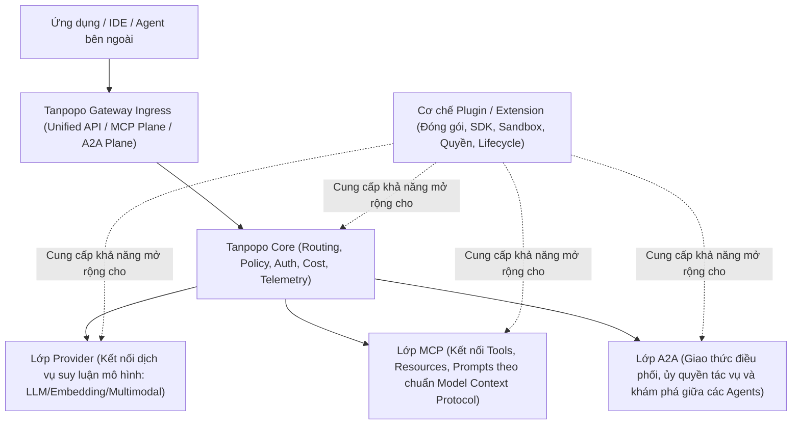

# Project Charter — Tanpopo

> **Tài liệu nguồn (Canonical Context Artifact — Phase A00)**
> - **Phiên bản:** `0.1.0-a00`
> - **Ngày cập nhật:** `2026-11-11`
> - **Vai trò biên soạn:** Product Intelligence Lead & Principal Solution Architect
> - **Trạng thái tài liệu:** Baseline chuẩn hóa bối cảnh (chưa phải PRD, chưa khóa kiến trúc/stack/UI/scope chi tiết)

---

## 1. Quy ước phân loại trạng thái (Epistemic Status Taxonomy)

Mọi tuyên bố định hướng, chính sách, quyết định và giả thuyết trong hệ thống tài liệu của Tanpopo bắt buộc gắn một trong sáu nhãn trạng thái sau để tránh suy diễn ngầm giữa các phiên làm việc:

| Nhãn trạng thái | Ý nghĩa | Quy tắc áp dụng |
|---|---|---|
| `CONFIRMED_BY_OWNER` | Đã được Product Owner xác nhận trực tiếp bằng văn bản hoặc lựa chọn rõ ràng. | Nguồn sự thật cấp cao nhất về định hướng và ranh giới sản phẩm. |
| `VERIFIED_IN_REPO` | Đã kiểm chứng thực nghiệm qua mã nguồn, cấu hình, lịch sử Git hoặc kết quả chạy lệnh CLI trong repository. | Chỉ phản ánh *cái đang tồn tại trên đĩa*, không đồng nghĩa với việc kiến trúc đó đã được duyệt lâu dài. |
| `PROPOSED` | Đề xuất từ Product Intelligence Lead / Solution Architect kèm phân tích đánh đổi (tradeoffs), đang chờ Owner phê duyệt. | Không được coi là quyết định đã chốt để tự ý triển khai diện rộng. |
| `ASSUMED` | Giả thuyết làm việc tạm thời để phục vụ phân tích/khung thiết kế khi chưa đủ dữ liệu. | Phải nêu rõ điều kiện kiểm chứng và rủi ro nếu giả thuyết sai. |
| `OPEN` | Câu hỏi mở, mâu thuẫn cấu hình hoặc khoảng trống thiết kế chưa có quyết định. | Nếu mang tính *blocking*, phải dừng lại hỏi Owner trước khi code. |
| `REJECTED` | Hướng đi, tính năng hoặc cách hiểu đã bị Product Owner bác bỏ rõ ràng. | Nghiêm cấm tái đưa vào thiết kế, code hoặc tài liệu dưới tên gọi khác. |

---

## 2. Tầm nhìn & Định vị sản phẩm (Product Vision & Positioning)

- **[`CONFIRMED_BY_OWNER`] Bản chất sản phẩm:** **Tanpopo** là một **AI Gateway mã nguồn mở (open-source), ưu tiên tự triển khai (self-hosted-first), lấy khả năng mở rộng làm trung tâm (extension-first), dùng được thực tế trong vận hành thật và có khả năng mở rộng quy mô (scalable)**.
- **[`CONFIRMED_BY_OWNER`] Vượt qua giới hạn Key Proxy đơn thuần:** Tanpopo **không chỉ là công cụ gom hoặc xoay vòng AI API keys** (`REJECTED` nếu thu hẹp sản phẩm thành key rotator). Đây là nền tảng kết nối đa nhà cung cấp (providers), đa mô hình (models), đa giao thức (protocols) và đa phương thức xác thực (auth methods) dưới một mặt phẳng điều phối thống nhất.
- **[`CONFIRMED_BY_OWNER`] Các trụ cột năng lực mục tiêu của nền tảng:**
  1. **Unified API:** Giao diện lập trình thống nhất cho ứng dụng và tác nhân gọi tới nhiều hệ sinh thái mô hình.
  2. **Routing:** Điều hướng truy vấn, dự phòng (fallback), phân phối tải theo điều kiện kỹ thuật hoặc chi phí.
  3. **Policies:** Kiểm soát truy cập, định mức (rate limit/quota), quy tắc an toàn và tuân thủ trên đường đi của request/response.
  4. **Monitoring:** Quan sát vận hành, nhật ký truy vết (logs/traces), độ trễ, tỷ lệ lỗi và sức khỏe kết nối.
  5. **Cost Control:** Theo dõi mức tiêu thụ token/tài nguyên, hạch toán chi phí và kiểm soát ngân sách.
  6. **MCP Tools Connectivity:** Kết nối và quản trị truy cập tới hệ sinh thái công cụ theo chuẩn Model Context Protocol (MCP).
  7. **Agent / A2A Connectivity:** Kết nối liên tác nhân (Agent-to-Agent / A2A) như một lớp giao tiếp độc lập.
  8. **Web Console & CLI:** Giao diện quản trị trực quan trên web song hành cùng công cụ dòng lệnh cho người vận hành và lập trình viên.

> **Lưu ý quan trọng [`CONFIRMED_BY_OWNER`]:** Kiến trúc chi tiết, ngăn xếp công nghệ (tech stack), thiết kế UI cụ thể và phạm vi (scope) từng phiên bản **hiện chưa được phê duyệt** và chỉ dừng ở mức giả thuyết/đề xuất cho đến khi qua các cổng quyết định tiếp theo.

---

## 3. Khác biệt cốt lõi: Kiến trúc Extension-First (`CONFIRMED_BY_OWNER`)

Khác biệt chiến lược cốt lõi của Tanpopo nằm ở việc **tách rời chu kỳ phát hành của Tanpopo Core khỏi tốc độ biến đổi của thị trường AI Providers**:

1. **[`CONFIRMED_BY_OWNER`] Cài đặt mở rộng độc lập với Core:** Người dùng tự cài đặt **Provider Adapters** cũng như các loại extension khác trực tiếp từ:
   - Marketplace công khai,
   - Git repository,
   - URL / gói cài đặt (package archive),
   - Private registry nội bộ của tổ chức.
   Người dùng **không cần chờ Tanpopo Core phát hành bản cập nhật mới** mỗi khi xuất hiện một AI provider, mô hình hay chuẩn tích hợp mới.
2. **[`CONFIRMED_BY_OWNER`] Chuẩn hóa kỹ thuật cho Plugin/Extension:** Hệ thống extension không phải là các đoạn script chắp vá tùy tiện mà bắt buộc có:
   - **Contract rõ ràng:** Giao ước đầu vào/đầu ra, phiên bản hóa schema và khả năng khai báo năng lực (capabilities).
   - **SDK phát triển:** Bộ công cụ hỗ trợ tác giả viết adapter/extension chuẩn mực, hỗ trợ API Key, OAuth được cấp phép, các loại identity/credential và custom authentication.
   - **Lifecycle quản trị được:** Cài đặt, kích hoạt, cấu hình, nâng cấp, vô hiệu hóa, gỡ bỏ và kiểm tra tương thích phiên bản.
   - **Security Isolation (Cô lập bảo mật):** Giới hạn phạm vi ảnh hưởng của mã bên thứ ba để bảo vệ Core và bí mật xác thực.
   - **Compatibility Tests:** Bộ kiểm thử xác nhận tính tương thích với hợp đồng của Core.
   - **Explicit Permissions:** Mô hình cấp quyền minh bạch (mạng, thông tin xác thực, hook/sự kiện được phép truy cập).

---

## 4. Phân tách rạch ròi 4 lớp khái niệm (`CONFIRMED_BY_OWNER`)

Một nguyên tắc kiến trúc bất biến của Tanpopo là **MCP, A2A, Provider và Plugin là 4 lớp khái niệm khác nhau, tuyệt đối không nhập làm một** (`REJECTED` mọi thiết kế gộp chung chúng thành một thực thể duy nhất):

| Lớp khái niệm | Định nghĩa & Trách nhiệm | Lý do không được nhập làm một |
|---|---|---|
| **1. Provider** | Thực thể cung cấp năng lực mô hình AI (suy luận văn bản, hình ảnh, âm thanh, embedding, rerank...) với mô hình định giá, giới hạn tốc độ, danh mục model và phương thức xác thực riêng. | Một Provider có thể được tích hợp sẵn hoặc cài qua Plugin; bản thân Provider không phải là một công cụ MCP hay một Agent tự chủ. |
| **2. Plugin / Extension** | Cơ chế đóng gói, phân phối, cấp quyền, cô lập bảo mật và quản lý vòng đời phần mở rộng cài thêm vào Tanpopo (ví dụ: *Provider Adapter*, *Policy/Guardrail Extension*, *Auth Extension*, *Telemetry Exporter*). | Plugin là **cơ chế mở rộng (packaging & runtime mechanism)**, không phải một giao thức nghiệp vụ đơn lẻ. Không phải mọi Plugin đều là Provider Adapter, và không phải mọi kết nối MCP/A2A đều là cài một Plugin mã nguồn mới. |
| **3. MCP (Model Context Protocol)** | Lớp giao thức chuẩn hóa kết nối tới **Tools, Resources và Prompts** phục vụ ngữ cảnh và hành động cho mô hình/agent. | MCP giải quyết bài toán cung cấp công cụ và ngữ cảnh thực thi, có vòng đời phiên (session/stateful capabilities) và mô hình phân quyền cấp tool khác hẳn lệnh gọi suy luận LLM stateless của Provider. |
| **4. A2A (Agent-to-Agent)** | Lớp giao thức kết nối, khám phá năng lực (Agent Card), ủy quyền tác vụ dài hạn (task delegation), cập nhật trạng thái và trao đổi kết quả giữa các tác nhân tự chủ. | Agent đối tác có trạng thái tác vụ bất đồng bộ, đàm phán năng lực và ranh giới tin cậy liên hệ thống, không thể ép vào khuôn mẫu chat completion của Provider hay tool call đơn giản của MCP. |

---

## 5. Chính sách Hệ sinh thái Official vs Community & Tuân thủ Điều khoản (`CONFIRMED_BY_OWNER`)

Đây là ranh giới pháp lý, đạo đức kỹ thuật và quản trị sản phẩm bắt buộc bảo toàn xuyên suốt mọi tài liệu, mã nguồn, SDK và giao diện của Tanpopo:

1. **[`CONFIRMED_BY_OWNER`] Phân định Official Adapters và Community/Private Adapters:**
   - **Official Adapters:** Do dự án Tanpopo chính thức phát triển/duy trì; **ưu tiên các Provider APIs chính thức và phương thức truy cập chính thức** được nhà cung cấp công bố và hỗ trợ.
   - **Community / Private Adapters:** Do bên thứ ba hoặc đội ngũ nội bộ của người dùng tự phát triển, tự lưu trữ và tự phân phối qua Git, URL, registry riêng hoặc nguồn cộng đồng.
2. **[`CONFIRMED_BY_OWNER`] Năng lực xác thực hợp lệ trong SDK:**
   - Plugin SDK có thể cung cấp các nguyên hàm kỹ thuật hỗ trợ: **API Key**, **OAuth được cấp phép (authorized OAuth)**, các loại **identity / credential types** (ví dụ: IAM role, service account, workload identity, mTLS/JWT) và **custom authentication** phục vụ tích hợp doanh nghiệp/nội bộ hợp lệ.
3. **[`CONFIRMED_BY_OWNER`] Ranh giới nghiêm ngặt đối với Consumer Subscriptions:**
   - **Không coi sự tồn tại của plugin cộng đồng hoặc việc người dùng bấm "chấp nhận rủi ro" (risk disclaimer) là bằng chứng hợp pháp hóa việc biến tài khoản thuê bao tiêu dùng cá nhân (consumer subscription — ví dụ: ChatGPT Plus/Pro, Codex, Antigravity, v.v.) thành general-purpose API.**
   - **Tanpopo không tự phát triển, không đóng gói kèm và không duy trì các connector trái điều khoản dịch vụ (TOS-violating connectors).**
   - **[`REJECTED`]** Mọi đề xuất đưa tính năng "biến gói thuê bao cá nhân thành API dùng chung qua cơ chế miễn trừ trách nhiệm" vào định vị sản phẩm, tài liệu hướng dẫn chính thức hoặc kho adapter chính thức của Tanpopo đều bị bác bỏ.

---

## 6. Mục tiêu (Goals) & Phi mục tiêu sơ bộ (Preliminary Non-Goals)

### 6.1. Mục tiêu cốt lõi (`CONFIRMED_BY_OWNER`)
- **G1 — Self-hosted thực dụng:** Triển khai dễ dàng trên hạ tầng do người dùng tự kiểm soát, vận hành ổn định trong điều kiện thực tế và có lộ trình mở rộng quy mô khi lưu lượng tăng.
- **G2 — Mở rộng không phụ thuộc Core release:** Cho phép cài đặt, cập nhật và kiểm chứng Provider Adapters cùng các extension từ nhiều nguồn phân phối dựa trên hợp đồng kỹ thuật rõ ràng, cô lập an toàn và quyền hạn tường minh.
- **G3 — Quản trị tập trung đa lớp:** Cung cấp Unified API, định tuyến thông minh, áp đặt chính sách (policies), giám sát (monitoring) và kiểm soát chi phí (cost control) đồng nhất.
- **G4 — Sẵn sàng cho kỷ nguyên Agentic:** Hỗ trợ kết nối MCP tools và giao tiếp A2A như các mặt phẳng kiến trúc hạng nhất, tách biệt rõ với lớp Provider và lớp Plugin.
- **G5 — Trải nghiệm quản trị kép:** Cung cấp cả Web Console trực quan lẫn CLI cho quy trình tự động hóa và vận hành kỹ thuật.

### 6.2. Phi mục tiêu bị loại trừ vĩnh viễn (`CONFIRMED_BY_OWNER` / `REJECTED`)
- **NG1 [`REJECTED`]:** Trở thành công cụ chỉ gom/đảo API key đơn giản thiếu lớp policy, routing, telemetry, cost control và kiến trúc mở rộng.
- **NG2 [`REJECTED`]:** Buộc Tanpopo Core phải sửa mã nguồn và phát hành phiên bản mới mỗi khi cộng đồng hoặc doanh nghiệp cần kết nối một AI provider mới.
- **NG3 [`REJECTED`]:** Duy trì, quảng bá hoặc hợp thức hóa các connector lách điều khoản để biến consumer subscriptions (ChatGPT Plus/Pro, Codex, Antigravity...) thành general-purpose API.
- **NG4 [`REJECTED`]:** Trộn lẫn khái niệm Provider, Plugin, MCP và A2A thành một mô hình dữ liệu hoặc giao thức nhập nhằng.

### 6.3. Giới hạn phạm vi đề xuất cho giai đoạn đầu (`PROPOSED` — Chờ Owner duyệt ở bước lập PRD)
- **NG-P1 [`PROPOSED`]:** Không xây dựng nền tảng huấn luyện/fine-tuning mô hình hoặc lưu trữ trọng số mô hình (model weights hosting — như Ollama/vLLM), mà chỉ đóng vai trò Gateway kết nối tới chúng.
- **NG-P2 [`PROPOSED`]:** Không tự vận hành dịch vụ đám mây thu phí trung gian (managed SaaS billing clearinghouse) trong phạm vi cốt lõi mã nguồn mở ban đầu; ưu tiên trọn vẹn cho mô hình self-hosted.
- **NG-P3 [`PROPOSED`]:** Không xây dựng framework viết kịch bản ứng dụng AI (như LangChain/LlamaIndex) bên trong Gateway Core.

---

## 7. Giả thuyết về Đối tượng sử dụng & Quy mô mục tiêu (`ASSUMED` — Chưa phê duyệt)

> Các mục dưới đây là giả thuyết phân tích (`ASSUMED`) để định hướng câu hỏi kiến trúc, chi tiết theo dõi tại [`docs/governance/assumptions.md`](./assumptions.md).

1. **Nhóm người dùng mục tiêu (`ASSUMED` — `ASM-001`):**
   - *Nhóm A — Kỹ sư độc lập & Nhóm sản phẩm nhỏ:* Cần một cổng AI tự host gọn nhẹ (1 lệnh chạy / 1 Docker container) để thống nhất nhiều provider, kiểm soát ngân sách và nối MCP tools vào công cụ làm việc.
   - *Nhóm B — Đội ngũ Platform / AI Engineering trong doanh nghiệp:* Cần cổng kiểm soát tập trung có private plugin registry, custom corporate auth, chính sách bảo mật, phân tách ngân sách theo phòng ban/dự án và khả năng mở rộng ngang (horizontal scaling).
   - *Nhóm C — Tác giả phát triển Extension (Plugin Authors):* Cần SDK rõ ràng, bộ công cụ test hợp đồng (contract test harness) để xuất bản adapter lên Git/marketplace mà không phải fork Tanpopo Core.
2. **Đặc tính tải vận hành (`ASSUMED` — `ASM-002`):**
   - Đường dữ liệu (Data Plane) chủ yếu xử lý kết nối giữ lâu (long-lived streaming SSE / WebSockets / HTTP chunked) đòi hỏi độ trễ cộng thêm tại Gateway thấp và bộ nhớ trên mỗi kết nối nhỏ.

---

## 8. Ràng buộc (Constraints)

| Mã | Loại ràng buộc | Nội dung | Trạng thái |
|---|---|---|---|
| **C-01** | Bản quyền mã nguồn | Repository gốc khởi tạo với giấy phép **Apache License 2.0** tại tệp [`LICENSE`](../../LICENSE) (cần đồng bộ lại trường `"license"` đang là `"ISC"` trong [`package.json`](../../package.json)). | `VERIFIED_IN_REPO` / `OPEN` |
| **C-02** | Bảo mật Plugin | Extension từ nguồn ngoài có thể chứa mã không tin cậy; bắt buộc có cơ chế cô lập thực thi (isolation) và kiểm soát quyền truy cập bí mật/mạng. | `CONFIRMED_BY_OWNER` |
| **C-03** | Pháp lý & TOS | Không duy trì connector vi phạm điều khoản nhà cung cấp; phân tách rõ trách nhiệm và nguồn gốc Official vs Community. | `CONFIRMED_BY_OWNER` |
| **C-04** | Khởi tạo giao diện | Repository đã cài đặt `@astryxdesign/core` (`0.7.13`), `@astryxdesign/theme-neutral` (`0.7.13`), `@astryxdesign/cli` (`0.7.13`), `@stylexjs/stylex` (`0.19.1`) và chọn theme mặc định `neutral`; các bước sau không tự ý phá hỏng cấu hình này, nhưng cũng **không được coi sự hiện diện của các gói npm này là quyết định khóa toàn bộ kiến trúc hệ thống vào Node.js/React**. | `CONFIRMED_BY_OWNER` & `VERIFIED_IN_REPO` |
| **C-05** | Quy trình Agent | Repository đã cài đặt bộ 25 Agent Skills chuẩn SDLC trong [`.agents/skills/`](../../.agents/skills) và quy ước UI Astryx trong [`AGENTS.md`](../../AGENTS.md). | `VERIFIED_IN_REPO` |

---

## 9. Bảng thuật ngữ chuẩn (Canonical Glossary)

| Thuật ngữ | Định nghĩa chuẩn trong dự án Tanpopo |
|---|---|
| **Tanpopo Core** | Phần nhân của AI Gateway chịu trách nhiệm xử lý mặt phẳng dữ liệu (Data Plane), mặt phẳng quản trị (Control Plane), định tuyến, áp dụng chính sách, hạch toán chi phí và nạp vận hành các Extension. |
| **Control Plane** | Hệ thống cấu hình, quản lý vòng đời plugin, cấp phát khóa truy cập nội bộ, cấu hình route/policy và cung cấp API cho Web Console / CLI. |
| **Data Plane** | Đường xử lý lưu lượng thời gian thực (LLM inference requests, streaming chunks, MCP tool calls, A2A messages) yêu cầu hiệu năng cao, độ trễ thấp và chịu lỗi tốt. |
| **Provider** | Dịch vụ đích cung cấp mô hình AI (đám mây thương mại, đám mây nội bộ doanh nghiệp hoặc máy chủ suy luận tự vận hành). |
| **Provider Adapter** | Một loại Extension chuyên biệt thực thi hợp đồng chuyển đổi giao thức, xác thực, danh mục model, chuẩn hóa lỗi và định lượng token/chi phí giữa Tanpopo Core và một Provider cụ thể. |
| **Extension (Plugin)** | Đơn vị phần mềm đóng gói độc lập kèm manifest khai báo quyền hạn, phiên bản hợp đồng và điểm ghép nối (extension points) để mở rộng Tanpopo mà không cần biên dịch/phát hành lại Core. |
| **Official Adapter** | Adapter do dự án Tanpopo trực tiếp kiểm định, ký xác nhận và duy trì dựa trên API và phương thức xác thực chính thức của nhà cung cấp. |
| **Community / Private Adapter** | Adapter do cá nhân/tổ chức thứ ba tự phát triển và phân phối bên ngoài phạm vi bảo chứng của Tanpopo. |
| **Credential / Auth Method** | Cơ chế chứng thực với hệ thống đích (API Key, OAuth 2.0 được cấp phép, Cloud IAM/OIDC, mTLS, Custom Enterprise Auth) được quản lý an toàn qua kho bí mật của Gateway. |
| **MCP Plane** | Phân hệ quản lý kết nối, định tuyến, kiểm soát quyền và giám sát các máy chủ Model Context Protocol (Tools, Resources, Prompts). |
| **A2A Plane** | Phân hệ hỗ trợ khám phá Agent Card, định tuyến thông điệp, quản lý ủy quyền và theo dõi vòng đời tác vụ liên tác nhân (Agent-to-Agent). |

---

## 10. Thứ tự ưu tiên Nguồn sự thật (Source of Truth Hierarchy)

Khi phát sinh xung đột thông tin trong quá trình làm việc của con người hoặc AI Agent, thứ tự ưu tiên giải quyết như sau:

1. **Quyết định trực tiếp của Product Owner** được ghi nhận với trạng thái `CONFIRMED_BY_OWNER` trong [`docs/governance/decisions.md`](./decisions.md) và [`docs/governance/project-charter.md`](./project-charter.md).
2. **Hiện trạng thực thi kiểm chứng được trong Repository** (`VERIFIED_IN_REPO` — mã nguồn thật, cấu hình thật, kết quả kiểm tra lệnh chạy thực tế) đối với các câu hỏi *"hệ thống hiện có gì?"*.
3. **Quy ước kỹ thuật cục bộ cho công cụ đã cài** (ví dụ [`AGENTS.md`](../../AGENTS.md) cho quy tắc dùng component Astryx khi làm việc trên phần giao diện sử dụng Astryx).
4. **Giả thuyết và đề xuất đang mở** (`PROPOSED` / `ASSUMED` trong [`docs/governance/decisions.md`](./decisions.md) và [`docs/governance/assumptions.md`](./assumptions.md)) — **chỉ dùng để tham khảo phân tích, bắt buộc xin xác nhận Owner trước khi khóa thiết kế hoặc viết tính năng**.
