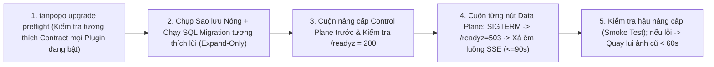

# Cài đặt Self-Hosted, Di trú Trạng thái, Nâng cấp Không Gián đoạn & Môi trường Cách ly Mạng (Installer, Upgrades, Network & Air-Gap Operations) — Tanpopo

> **Tài liệu Kỹ thuật Vận hành Hạ tầng (Phase ASTRA A06 — `DRAFT / READY_FOR_REVIEW`)**
> - **Mã tài liệu:** `SPEC-OPS-01` | **Phiên bản:** `0.1.0-step06-draft` | **Ngày cập nhật:** `2026-11-11`
> - **Vai trò biên soạn:** Principal SRE & Self-Hosted Infrastructure Lead
> - **Trạng thái quản trị:** **Đặc tả Vận hành Đề xuất (`PROPOSED — NO CODE`)** — cụ thể hóa quy trình triển khai và nâng cấp cho kiến trúc [`deployment-topology.md`](../architecture/deployment-topology.md) (`ARCH-OPS-01`), [`data-model.md`](../architecture/data-model.md) (`ARCH-DATA-01`) và [`ADR-0001`](../architecture/adr/0001-core-runtime-and-modular-monolith.md)..[`ADR-0006`](../architecture/adr/0006-immutable-config-snapshots-and-fast-revocation.md).
> - **Truy vết Yêu cầu:** `WF-01`, `WF-11`, `SM-08`, `OPS-01`, `TP-FR-1001`..`1005`, `TP-NFR-0103`, `TP-NFR-0201`, `TP-NFR-0302`, `TP-NFR-0901`, `TP-NFR-0902`.

---

## 1. Giả định Môi trường Khởi chạy Đa Nền tảng (`Linux / macOS / Windows Bootstrap Matrix`)

Nhờ đề xuất đóng gói một tệp nhị phân tĩnh thuần Go (`CGO_ENABLED=0`) nhúng sẵn giao diện tĩnh Web Console (`embed.FS` — `ADR-0001`, `ADR-0004`) và động cơ Wasm thuần Go (`wazero` — `ADR-0002`), máy chủ Tanpopo **không yêu cầu cài đặt trước Node.js, Python, trình biên dịch C hay thư viện hệ thống bên ngoài**:

| Hệ điều hành & Kiến trúc | Kịch bản Triển khai Mục tiêu | Phương thức Khởi chạy & Dịch vụ Nền | Quyền Tệp tin, Lưu trữ & Lưu ý Hệ điều hành Cụ thể |
|---|---|---|---|
| **Linux (`x86_64`, `arm64`)**<br/>*(Ubuntu 22.04+, Debian 12+, RHEL 9+, Alpine 3.20+)* | **Chuẩn sản xuất chính** (VM, Bare-metal, Container, Kubernetes). | Gói `.deb`/`.rpm` + đơn vị `systemd` cứng hóa (`tanpopod.service`) hoặc ảnh OCI `distroless`. | Chạy dưới tài khoản hệ thống không đặc quyền `tanpopo:tanpopo`; thư mục dữ liệu `/var/lib/tanpopo` (`chmod 0700`), thư mục cấu hình `/etc/tanpopo` (`chmod 0750`, tệp cấu hình bên trong `0640`). Yêu cầu đĩa cục bộ (`ext4`/`xfs`, **không đặt SQLite WAL trên ổ mạng NFS/SMB** để tránh hỏng khóa tệp). |
| **macOS (`arm64` Apple Silicon, `x86_64`)**<br/>*(macOS 14+)* | Máy trạm phát triển cá nhân, thử nghiệm cục bộ cùng `Ollama` / `LM Studio`. | Homebrew (`brew install tanpopo`), tệp nhị phân rời hoặc Docker Desktop; dịch vụ nền qua `launchd`. | Dữ liệu mặc định tại `~/.local/share/tanpopo` (`0700`); bản phát hành chính thức cần ký chứng chỉ Apple Developer ID (`codesign` & `notarize`) để Gatekeeper không chặn khi chạy lần đầu. |
| **Windows (`x86_64`, `arm64`)**<br/>*(Windows 11, Windows Server 2022+)* | Máy trạm kỹ sư doanh nghiệp, máy chủ nội bộ Windows hoặc chạy trong **WSL2** / Docker. | Thực thi trực tiếp `tanpopod.exe` / `tanpopo.exe`, đăng ký **Windows Service** (`sc.exe` / `WinSW`), hoặc chạy bản Linux trong WSL2. | - Dữ liệu mặc định tại `%ProgramData%\Tanpopo` (chế độ dịch vụ) hoặc `%LOCALAPPDATA%\Tanpopo` (chế độ cá nhân), khóa quyền đọc riêng bằng `icacls` (gỡ quyền `Users` chung, chỉ giữ `SYSTEM`, `Administrators` và tài khoản dịch vụ).<br/>- Đường dẫn tệp trong cấu hình chuẩn hóa dấu gạch chéo hoặc thoát chuỗi an toàn; khi chạy lệnh công cụ Node/Astryx trong môi trường đóng góp mã nguồn trên PowerShell phải lưu ý chính sách `ExecutionPolicy` đối với tệp `.ps1`.<br/>- Windows Defender Firewall sẽ hỏi quyền mở cổng trong lần lắng nghe ngoài `127.0.0.1` đầu tiên. |

---

## 2. Kiểm tra Tiền điều kiện Tự động Trước Khi Chạy (`tanpopo doctor` Preflight Checks)

Trước khi mở cổng nhận lưu lượng (hoặc bất kỳ lúc nào quản trị viên chạy lệnh `tanpopo doctor`), hệ thống tự động thực hiện **8 phép kiểm tra tiền điều kiện** và báo lỗi rõ ràng kèm lệnh khắc phục nếu chưa đạt:

| Thứ tự | Hạng mục Kiểm tra (`Check ID`) | Tiêu chuẩn Đạt (`PASS`) | Hành vi Khi Thất bại (`FAIL` / `WARN`) |
|---|---|---|---|
| **1** | `clock-skew` | Độ lệch đồng hồ hệ thống so với chuẩn giờ `< 5 giây`. | `WARN` (hoặc `FAIL` khi dùng `AWS SigV4` / `OIDC` / `OAuth 2.1` vì lệch giờ làm hỏng chữ ký xác thực). |
| **2** | `ports-available` | Cổng Data Plane (mặc định `127.0.0.1:8080` ở chế độ cục bộ) và cổng Admin/Metrics (`:9090` khi tách cổng) chưa bị chiếm dụng. | `FAIL` — In rõ số hiệu cổng bị trùng và cờ `--listen` / biến `TANPOPO_LISTEN_ADDR` để đổi cổng. |
| **3** | `master-kek-ready` | Biến `TANPOPO_MASTER_KEY` (hoặc kết nối `Cloud KMS` / `Vault`) có độ ngẫu nhiên `>= 256-bit` hợp lệ. | Ở chế độ thử nghiệm đơn nút lần đầu: tự sinh tệp khóa cục bộ `0600` kèm cảnh báo nổi bật yêu cầu sao lưu (`UX-GR-05`). Ở chế độ `--production`: **`FAIL` cứng** nếu chưa cung cấp khóa chủ tường minh. |
| **4** | `storage-fs-lock` | Thư mục dữ liệu ghi được, còn trống `>= 1 GiB`, hệ tệp hỗ trợ khóa nguyên tử cho SQLite WAL (hoặc kết nối PostgreSQL `>= 16` thành công). | `FAIL` nếu phát hiện thư mục SQLite đặt trên ổ mạng `NFS`/`CIFS` không an toàn hoặc thiếu quyền ghi. |
| **5** | `cluster-cache` *(Chỉ Mode B/C)* | Ping tới `Valkey / Redis` `< 5 ms`, hỗ trợ `EVALSHA` (kịch bản Lua giới hạn tốc độ) và `SUBSCRIBE`. | `FAIL` khi bật `--cluster-mode` mà không chạm tới cụm bộ nhớ đệm. |
| **6** | `bundle-lockfile-integrity` | Toàn bộ gói phần mở rộng liệt kê trong `tanpopo.lock` khớp chính xác mã băm `SHA-256` trên đĩa/kho. | `FAIL` — Chặn khởi chạy gói bị sửa đổi ngoài luồng và ghi sự kiện an ninh. |
| **7** | `tls-posture` | Nếu lắng nghe trên giao diện mạng không phải `127.0.0.1`, phải bật TLS trực tiếp hoặc khai báo `trusted_proxies` đứng sau Reverse Proxy HTTPS. | `FAIL` mặc định khi phơi cổng quản trị HTTP trần ra mạng ngoài mà không có cờ xác nhận tường minh. |
| **8** | `egress-dns-ssrf` | Bộ phân giải DNS hoạt động và bộ lọc mạng nội bộ chặn thành công địa chỉ siêu dữ liệu đám mây `169.254.169.254` / `fd00:ec2::254`. | `FAIL` nếu vòng tự kiểm tra bảo vệ SSRF không hoạt động đúng. |

---

## 3. Khởi tạo Lần đầu Qua Web (`First-Run Setup`) vs Khởi tạo Tự động (`Headless GitOps`)

Hệ thống hỗ trợ song song hai con đường khởi tạo ngày đầu theo đúng `OPS-01`:

1. **Chế độ Tương tác Qua Trình duyệt (`Interactive First-Run Bootstrap` — Mặc định cho Cá nhân & Nhóm nhỏ):**
   - Khi cơ sở dữ liệu chưa có bất kỳ `Organization` nào, `tanpopod` sinh một **`Bootstrap Token` ngẫu nhiên mật mã học 256-bit dùng đúng 1 lần, tự hết hạn sau `15 phút`**, và chỉ ghi ra luồng nhật ký chuẩn cục bộ (`stderr`) của tiến trình khởi động (tuyệt đối không trả qua bất kỳ API công khai nào).
   - Người vận hành mở `http://localhost:8080/setup` (hoặc qua đường hầm SSH / tên miền HTTPS), nhập `Bootstrap Token`, tạo tài khoản `ORG_OWNER` đầu tiên và đi tiếp luồng `UJ-01` (`TTFGR < 3 phút`). Ngay khoảnh khắc tài khoản đầu tiên được ghi vào DB, điểm cuối `/admin/v1/setup:claim-bootstrap` tự khóa vĩnh viễn (`410 Gone`).
2. **Chế độ Khai báo Không Giao diện (`Declarative Headless Bootstrap` — Cho CI/CD, Terraform & Kubernetes):**
   - Cung cấp tệp `tanpopo.bootstrap.yaml` + `tanpopo.lock` kèm biến môi trường bí mật khi khởi chạy (`tanpopo serve --bootstrap-file /etc/tanpopo/tanpopo.bootstrap.yaml`).
   - Tiến trình tự khởi tạo `Organization`, `Projects`, `Environments`, danh sách `Extensions` đã ghim băm, `Policies` và cấu hình OIDC Admin mà không cần mở trình duyệt lần đầu.

---

## 4. Cấu hình TLS, Tường lửa & Quy tắc Mạng Chống SSRF (`TLS, Network & Firewall`)

### 4.1. Ba Mô hình Chấm dứt TLS (`TLS Termination Modes`)
1. **Chế độ Cục bộ (`Loopback Only`):** Mặc định chỉ gắn vào `127.0.0.1:8080` trên máy cá nhân để tránh vô tình mở cổng ra mạng Wi-Fi công cộng.
2. **TLS Tích hợp Sẵn (`Built-in TLS 1.3 / Automatic ACME`):** Dành cho triển khai 1 máy chủ VM gọn nhẹ — chỉ cần cấu hình `tls.domain = "ai-gateway.corp.example.com"` (ACME Let's Encrypt / ZeroSSL) hoặc trỏ cặp chứng chỉ nội bộ `tls.cert_file` / `tls.key_file` (tự nạp lại nóng khi gia hạn chứng chỉ không rớt kết nối).
3. **Đứng sau Cân bằng Tải / Reverse Proxy (`Caddy / Nginx / Envoy / Ingress` — Khuyến nghị cho Mode B & C):**
   - Bắt buộc tắt bộ đệm phản hồi để không làm nghẽn luồng truyền chữ SSE thời gian thực và kéo dài thời gian chờ đọc cho các mô hình suy luận sâu (`reasoning`):

```nginx
# Cấu hình mẫu Nginx chuẩn cho luồng SSE của Tanpopo Data Plane
location / {
    proxy_pass http://tanpopo_dataplane_upstream;
    proxy_http_version 1.1;
    proxy_set_header Connection "";
    proxy_set_header Host $host;
    proxy_set_header X-Forwarded-For $proxy_add_x_forwarded_for;
    proxy_set_header X-Forwarded-Proto $scheme;

    # BẮT BUỘC cho AI Streaming (SSE / MCP Streamable HTTP):
    proxy_buffering off;
    proxy_cache off;
    chunked_transfer_encoding on;
    proxy_read_timeout 300s;
    proxy_send_timeout 300s;
}
```

### 4.2. Ma trận Cổng Tường lửa & Cho phép Mô hình Cục bộ An toàn (`Firewall & LAN GPU Allowlist`)
- **Cổng vào (`Inbound`):**
  - `:8080/tcp` (Data Plane: `/v1/*`, `/native/*`, `/mcp`, `/a2a/*`, `/healthz`, `/readyz`) — chỉ mở cho mạng ứng dụng nội bộ hoặc qua HTTPS Load Balancer.
  - `:9090/tcp` (Control Plane Admin API, Web Console & `/metrics` Prometheus — ở Mode A đơn nút có thể gộp chung trên `:8080`, ở Mode C sản xuất **bắt buộc tách sang cổng/Ingress quản trị nội bộ riêng** bảo vệ bởi VPN/mTLS/SSO).
- **Cổng ra & Bảo vệ SSRF (`Outbound & SSRF Guard`):**
  - Mặc định mọi kết nối từ Tanpopo ra ngoài đều chặn dải IP nội bộ RFC1918 (`10.0.0.0/8`, `172.16.0.0/12`, `192.168.0.0/16`), loopback (`127.0.0.0/8`, `::1`) và link-local/cloud metadata (`169.254.0.0/16`, `fe80::/10`).
  - Khi người dùng muốn kết nối tới máy chủ GPU nội bộ hợp lệ (như `Ollama` tại `127.0.0.1:11434` hoặc cụm `vLLM` tại `10.20.30.40:8000`), `OPERATOR` phải khai báo tường minh vào danh sách **`network.allowed_private_upstreams: ["127.0.0.1:11434", "10.20.30.40:8000"]`** trong cấu hình máy chủ — ngay cả khi đó, dải siêu dữ liệu đám mây `169.254.169.254` **vẫn bị khóa cứng không thể mở**.

---

## 5. Triển khai Container, Máy ảo VM & Cụm Kubernetes (`Container / VM / K8s`)

1. **Container Đơn & Docker Compose (`Mode A` / `Mode B`):**
   - Ảnh container chính thức xây dựng trên nền tối giản không chứa vỏ lệnh (`non-root UID 65532`, `read_only: true`, chỉ gắn ổ ghi tại `/var/lib/tanpopo` và `/tmp` kích thước giới hạn).
   - Bộ `docker-compose.prod.yml` chuẩn đóng gói sẵn `tanpopod`, `postgres:16-alpine` (kèm kiểm tra `pg_isready`), `valkey/valkey:8-alpine` và `caddy:2` tự động cấp HTTPS.
2. **Máy ảo VM (`systemd` Hardening):**
   - Tệp `tanpopod.service` bật sẵn `NoNewPrivileges=yes`, `PrivateTmp=yes`, `ProtectSystem=strict`, `ProtectHome=yes`, `ReadWritePaths=/var/lib/tanpopo`, `LimitNOFILE=65536` (đảm bảo chịu tải hàng nghìn luồng SSE mở đồng thời không chạm trần file descriptor).
3. **Kubernetes Helm Chart (`Mode C — Multi-AZ HA`):**
   - Tách thành 2 `Deployment` độc lập dùng chung một ảnh container nhưng khác cờ `--role`:
     - `tanpopo-controlplane` (`replicas: 2`, bầu chọn leader qua khóa PostgreSQL cho các tác vụ nền làm mới OAuth và dọn TTL).
     - `tanpopo-dataplane` (`HPA minReplicas: 3, maxReplicas: 20` co giãn theo mức CPU và chỉ số `tanpopo_active_streams`, kèm `PodDisruptionBudget minAvailable: 2` và `topologySpreadConstraints` trải đều qua các vùng AZ).
   - Áp dụng `Kubernetes NetworkPolicy` mặc định đóng giữa các Pod Tier-3 Sidecar (chỉ cho phép `tanpopo-dataplane` gọi vào cổng gRPC/UDS của Sidecar).

---

## 6. Quy trình Di trú Lưu trữ (`SQLite -> PostgreSQL`) & Nâng cấp Không Gián đoạn (`SM-08`)

### 6.1. Di trú Khi Mở rộng Quy mô Từ Đơn nút Lên Cụm (`SQLite -> PostgreSQL State Migration`)
Khi một nhóm phát triển từ `Mode A` (SQLite) lên `Mode B/C` (PostgreSQL) mà muốn giữ nguyên toàn bộ cấu hình, khóa đã mã hóa, lịch sử kiểm toán và sổ cái chi phí:
1. Bật chế độ chỉ đọc cấu hình ngắn hạn (`tanpopo admin freeze-writes --reason "Migrate to Postgres"` — lưu lượng suy luận Data Plane vẫn chạy bình thường trên `ConfigSnapshot` RAM!).
2. Chạy lệnh di trú có kiểm chứng tổng kiểm:
   ```bash
   tanpopo storage migrate \
     --from "sqlite:///var/lib/tanpopo/tanpopo.db" \
     --to "postgres://tanpopo_app@pg.internal:5432/tanpopo?sslmode=require" \
     --verify-row-counts --verify-audit-chain
   ```
   *(Do toàn bộ kho khóa chỉ di chuyển các bản mã `ciphertext` bọc dưới cùng `TANPOPO_MASTER_KEY`, quá trình di trú không cần giải mã lộ khóa gốc ra ngoài).*
3. Cập nhật cấu hình sang địa chỉ PostgreSQL + Valkey, khởi chạy các nút mới và gỡ đóng băng ghi cấu hình.

### 6.2. Quy trình 5 Bước Nâng cấp Không Gián đoạn (`Zero-Downtime Rolling Upgrade` — `SM-08`)



- **Chốt chặn An toàn Hợp đồng (`Preflight Gate` — `TP-FR-1004`):** Lệnh `tanpopo upgrade preflight --target-version v0.2.0` đọc danh sách mọi `Extension` đang `ENABLED_ACTIVE`. Nếu bất kỳ gói nào có `compatibility.contractVersion` không tương thích với bản nhị phân đích, lệnh dừng ngay với mã thoát `exit 22 (BLOCKED_INCOMPATIBLE)` và in rõ gói nào cần nâng cấp trước — tuyệt đối không để nâng cấp Core xong mới làm sập Adapter sản xuất.

---

## 7. Vận hành Môi trường Cách ly Mạng Hoàn toàn & Kho Riêng (`Air-Gapped & Private OCI Registry`)

Đối với các tổ chức tài chính, viễn thông hoặc nhà máy chạy trong mạng nội bộ không có đường ra Internet (`Air-Gapped` — `TP-FR-0307`, `TP-FR-1002`):
1. **Đóng gói Gói Cài đặt Ngoại tuyến Trên Máy Trạm Trung gian (`Connected Bastion`):**
   ```bash
   # Tải nhị phân Core + các gói Extension đã ghim + chữ ký Cosign + danh sách thu hồi mới nhất thành 1 tệp nén ký số
   tanpopo bundle export \
     --lockfile ./tanpopo.lock \
     --include-revocation-feed \
     --output tanpopo-airgap-bundle-2026-11.tar.zst
   ```
2. **Kiểm tra & Nạp Vào Mạng Kín (`Offline Import`):**
   - Chuyển tệp `.tar.zst` qua cổng kiểm duyệt vật lý vào mạng kín và chạy:
     ```bash
     tanpopo bundle verify tanpopo-airgap-bundle-2026-11.tar.zst --public-key /etc/tanpopo/trust-root.pub
     tanpopo bundle import tanpopo-airgap-bundle-2026-11.tar.zst --mirror-to oci://harbor.corp.internal/tanpopo-extensions
     ```
3. **Chính sách Khóa Nguồn Cài đặt Nội bộ:**
   - Đặt `extensions.allowed_sources: ["oci://harbor.corp.internal/tanpopo-extensions/*", "local_bundle"]` và `extensions.offline_mode: true` trong tệp cấu hình máy chủ: Tanpopo sẽ tắt hoàn toàn mọi tác vụ nền kiểm tra phiên bản ngoài Internet, dùng phông chữ nội bộ nhúng sẵn trên Web Console (`UX-AC-10`) và chỉ chấp nhận các gói đã ký bởi khóa gốc nội bộ của doanh nghiệp (`private-enterprise`).
