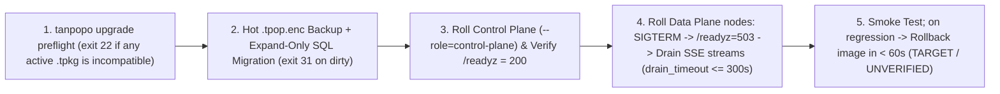

# Self-Hosted Installer, State Migration, Zero-Downtime Upgrades & Air-Gapped Operations — Tanpopo

> **Canonical Infrastructure Operations Specification (Synchronized in `TP-IMP-0002` — Spec Closure Batch B)**
> - **Document ID:** `SPEC-OPS-01` | **Version:** `0.2.0-m0-closure` | **Last Updated:** `2026-11-14`
> - **Authored By:** Principal SRE & Self-Hosted Infrastructure Lead
> - **Single Binary & Artifact Standard (`ADR-0001`, `CR-10`):** Standardizes on the single executable binary **`tanpopo`** (`tanpopo serve --role=all|data-plane|control-plane`; OS packages may optionally install a convenience service alias symlink without introducing separate binaries), extension archive **`.tpkg`**, encrypted backup archive **`.tpop.enc`**, and air-gap bundle **`.tpbundle`** (`.tar.zst`).
> - **Measurement Honesty (`COND-PO-01`):** Startup times (`< 3.0s`), memory targets (`< 128 MiB`), `TTFGR` (`< 3m`), ping bounds (`< 5 ms`), and rollback times (`< 60s`) are **`TARGET / UNVERIFIED`** until empirical verification in `M2`–`M5`.
> - **Requirements Traceability:** `WF-01`, `WF-11`, `SM-08`, `OPS-01`, `TP-FR-1001`..`1005`, `TP-NFR-0103`, `TP-NFR-0201`, `TP-NFR-0302`, `TP-NFR-0901`, `TP-NFR-0902`, `CR-09`, `CR-10`, `GAP-10`, `GAP-12`, `GAP-13`.

---

## 1. Cross-Platform Bootstrap Matrix (`Linux / macOS / Windows`)

Because **`tanpopo`** compiles as a single statically linked pure-Go binary (`CGO_ENABLED=0`) embedding the static Astryx Web Console (`embed.FS` — `ADR-0001`, `ADR-0004`) and pure-Go `wazero` WebAssembly runtime (`ADR-0002`), production hosts require **zero Node.js, Python, C compilers, or external shared libraries**:

| Operating System & Architecture | Target Scenario | Launch & Background Service Method | Filesystem Permissions, Storage & OS Notes |
|---|---|---|---|
| **Linux (`x86_64`, `arm64`)**<br/>*(Ubuntu 22.04+, Debian 12+, RHEL 9+, Alpine 3.20+)* | **Primary production baseline** (VM, Bare-metal, OCI Container, Kubernetes). | `.deb`/`.rpm` packages + hardened `systemd` unit (`tanpopo.service` invoking `tanpopo serve`) or `nonroot` `distroless` OCI image. | Dedicated account `tanpopo:tanpopo`; data dir `/var/lib/tanpopo` (`chmod 0700`), config dir `/etc/tanpopo` (`chmod 0750`, files `0640`). Requires local block storage (`ext4`/`xfs`; **never place SQLite WAL on NFS/SMB**). |
| **macOS (`arm64`, `x86_64`)**<br/>*(macOS 14+)* | Developer workstation, local evaluation alongside `Ollama` / `LM Studio`. | Homebrew (`brew install tanpopo`), standalone `tanpopo` binary, Docker Desktop, or `launchd` service. | Default data path `~/.local/share/tanpopo` (`0700`); release binaries signed (`codesign`) & notarized for Gatekeeper. |
| **Windows (`x86_64`, `arm64`)**<br/>*(Windows 11, Windows Server 2022+)* | Enterprise workstation, on-prem Windows Server, or WSL2 / Docker. | Direct `tanpopo.exe serve` execution, registered **Windows Service** (`sc.exe` / `WinSW`), or WSL2 Linux binary. | Default data path `%ProgramData%\Tanpopo` (service) or `%LOCALAPPDATA%\Tanpopo` (user), locked via `icacls` (`SYSTEM`, `Administrators`, service SID only). Contributors running Node/Astryx tools in PowerShell use `npx.cmd` or configure `ExecutionPolicy` for `.ps1` shims. |

---

## 2. Automated Preflight Checks (`tanpopo doctor`)

Prior to binding traffic sockets on startup (or via `tanpopo doctor`), `tanpopo` runs **8 deterministic preflight checks**:

| Order | Check ID | Pass Criterion (`PASS`) | Failure / Warning Behavior (`FAIL` / `WARN`) |
|---|---|---|---|
| **1** | `clock-skew` | System clock drift `< 5 seconds`. | `WARN` (`FAIL` when `AWS_SIGV4`, `OIDC`, or `OAuth 2.1` drivers are configured). |
| **2** | `ports-available` | Data Plane (`:8080` default) and Admin/Metrics (`:9090` when split) sockets are free. | `FAIL` — Prints colliding port and `--listen` / `TANPOPO_LISTEN_ADDR` override instructions. |
| **3** | `master-kek-ready` | `TANPOPO_MASTER_KEY` (or external `Cloud KMS` / `Vault`) supplies `>= 256-bit` entropy. | Local eval auto-generates `0600` keyfile + persistent UI backup warning (`UX-GR-05`); `--production` **hard-`FAIL`s** if unset. |
| **4** | `storage-fs-lock` | Writable data dir (`>= 1 GiB` free), atomic SQLite WAL locking (or PostgreSQL `>= 16`), and schema `dirty == false`. | `FAIL` on `NFS`/`CIFS` SQLite mounts; halts with **`exit 31`** if SQL migration state is `dirty = true` (`FMEA-06`). |
| **5** | `cluster-cache` *(HA Mode)* | `Valkey` ping `< 5 ms` (`TARGET / UNVERIFIED`), supporting `EVALSHA` (`tp:v1:{<org_id>}:*` hash-tags) and `SUBSCRIBE`. | `FAIL` when `--role=data-plane|control-plane` HA cluster mode lacks reachable Valkey. |
| **6** | `bundle-lockfile-integrity` | Every `.tpkg` extension in `tanpopo.lock` matches its `SHA-256` digest bit-for-bit. | `FAIL` (`exit 22`) — Blocks tampered artifacts and writes a security `AuditEvent`. |
| **7** | `tls-posture` | Non-`127.0.0.1` binds use native TLS or explicit `trusted_proxies` behind HTTPS Ingress. | Default `FAIL` on plaintext non-loopback admin exposure without explicit override. |
| **8** | `egress-dns-ssrf` | Connect-time `SSRFGuard` self-test blocks `169.254.169.254`, `fd00:ec2::254`, and own admin ports. | `FAIL` if metadata-IP or self-loopback guard check fails. |

---

## 3. Interactive First-Run Setup (`allow_private_ip` & Break-Glass) vs. Headless GitOps

1. **Interactive Browser Bootstrap (`SCR-01`, `UJ-01` — Default for Solo & Small Teams):**
   - When `0` `Organization` rows exist, `tanpopo serve` mints a **256-bit single-use `Bootstrap Token` (`TTL = 15m`)** printed solely to local `stderr`.
   - At `/setup`, `POST /admin/v1/bootstrap/complete` creates `ORG_OWNER` (`OPERATOR + ORG_OWNER` in Personal Admin mode) and — when a provider or local `Ollama`/`vLLM` endpoint is entered — **atomically provisions `Provider Connection` (persisting `allow_private_ip = true` upon explicit operator checkbox consent) + `Model Deployment` (`ACTIVE_HEALTHY`) + `Default Route` + show-once `Virtual Key`** (`CR-10`), enabling `TTFGR < 3 minutes` (`TARGET / UNVERIFIED`) without pre-editing server YAML.
   - Immediately upon completion, `/admin/v1/bootstrap/complete` permanently seals with **`410 bootstrap_already_completed`**.
   - **Break-Glass Admin Recovery (`CR-09`):** If an administrator later loses local owner credentials or misconfigures OIDC SSO, host/container operators recover access offline via **`tanpopo admin reset-local-owner`**.
2. **Declarative Headless Bootstrap (`GitOps / Terraform / Kubernetes`):**
   - Launch `tanpopo serve --bootstrap-file /etc/tanpopo/tanpopo.bootstrap.yaml`: idempotently provisions `Organizations`, `Projects`, `Environments`, hash-pinned `.tpkg` `Extensions` (`tanpopo.lock`), `Policies`, and OIDC role bindings with zero browser interaction.

---

## 4. TLS Modes, Firewall Ports & Unified `allow_private_ip` Anti-SSRF Governance (`GAP-10`)

### 4.1. Three TLS Termination Modes
1. **Loopback Default:** Binds strictly to `127.0.0.1:8080` on local workstations.
2. **Built-In TLS 1.3 / ACME:** Supports automatic ACME (`tls.domain`) or hot-reloaded `tls.cert_file` / `tls.key_file`.
3. **Reverse Proxy / Ingress (`Caddy / Nginx / Envoy`):** Must disable upstream buffering and allow `300s` reasoning streams:

```nginx
location / {
    proxy_pass http://tanpopo_dataplane_upstream;
    proxy_http_version 1.1;
    proxy_set_header Connection "";
    proxy_set_header Host $host;
    proxy_set_header X-Forwarded-For $proxy_add_x_forwarded_for;
    proxy_set_header X-Forwarded-Proto $scheme;

    proxy_buffering off;
    proxy_cache off;
    chunked_transfer_encoding on;
    proxy_read_timeout 300s;
    proxy_send_timeout 300s;
}
```

### 4.2. Inbound Ports & Unified Two-Gate Private/Loopback Egress Model (`CR-10`)
- **Inbound Listeners:** `:8080/tcp` (Data Plane: `/v1/*`, `/native/*`, `/mcp`, `/a2a/*`, `/healthz`, `/readyz`); `:9090/tcp` (Control Plane `/admin/v1/*`, embedded Web Console & `/metrics` in split Mode B/C).
- **Unified Anti-SSRF & Local GPU Egress Rules (`SSRFGuard` at `net.Dialer.Control` — `CT-26`):**
  1. **Default Deny:** Blocks RFC1918 (`10.0.0.0/8`, `172.16.0.0/12`, `192.168.0.0/16`), loopback (`127.0.0.0/8`, `::1`), and link-local (`169.254.0.0/16`, `fe80::/10`) at socket `connect()` time (defeating DNS rebinding).
  2. **Explicit Operator Opt-In for Legitimate Local GPU / LAN Services (`Ollama`, `vLLM`, internal MCP/A2A):** Permitted when **either** (a) an `OPERATOR` / `Personal Admin` explicitly enables `allow_private_ip = true` on the `Provider Connection` / `MCP Server` in `SCR-01`/`SCR-04`/`SCR-10` (subject to instance policy `network.allow_operator_private_ip_opt_in = true`, default `true` in standalone Mode A and explicit CIDR allowlist `network.allowed_private_upstreams` in Mode C), **or** (b) the exact `host:port` is listed in `network.allowed_private_upstreams`.
  3. **Unconditional Non-Overridable Blocklist:** Even when `allow_private_ip = true`, cloud metadata addresses (`169.254.169.254`, `fd00:ec2::254`, `169.254.170.2`) and Tanpopo's own listener sockets (`127.0.0.1:8080`, `127.0.0.1:9090`) remain **100% hard-blocked**.

---

## 5. Container, `systemd` VM & Kubernetes HA Deployment

1. **OCI Container & Compose (`Mode A/B`):** Shell-less `nonroot` (`UID 65532`, `read_only: true`) image running `tanpopo serve`; `docker-compose.prod.yml` orchestrates `tanpopo`, `postgres:16-alpine`, `valkey/valkey:8-alpine`, and `caddy:2`.
2. **Hardened Linux `systemd` (`tanpopo.service`):** Enforces `NoNewPrivileges=yes`, `PrivateTmp=yes`, `ProtectSystem=strict`, `ProtectHome=yes`, `ReadWritePaths=/var/lib/tanpopo`, and `LimitNOFILE=65536`.
3. **Kubernetes Helm (`Mode C`):** Single `tanpopo` OCI image deployed as `tanpopo-controlplane` (`--role=control-plane`, `replicas: 2` with `distributed_leases` leader election) and `tanpopo-dataplane` (`--role=data-plane`, `HPA 3..20` scaling on CPU and `tanpopo_active_streams`, `PDB minAvailable: 2`), plus default-deny `NetworkPolicy` around Tier-3 Sidecars (`v0.3`).

---

## 6. Storage Engine Migration (`tanpopo db migrate-engine`) & Rolling Upgrades (`SM-08`)

### 6.1. Checksum-Verified `SQLite WAL -> PostgreSQL 16+` Migration (`FMEA-06`)
1. Freeze Control Plane writes without interrupting live Data Plane traffic:
   ```bash
   tanpopo admin freeze-writes --reason "Migrate SQLite to PostgreSQL 16"
   ```
2. Execute transactional batch migration (automatically pre-creating required monthly `PARTITION BY RANGE` partitions on PostgreSQL for all historical `usage_settlements`, `request_traces_meta`, and `audit_events` timestamps while preserving `Master KEK`-wrapped ciphertexts untouched):
   ```bash
   tanpopo db migrate-engine \
     --from "sqlite:///var/lib/tanpopo/tanpopo.db" \
     --to "postgres://tanpopo_app@pg.internal:5432/tanpopo?sslmode=require" \
     --verify-row-counts --verify-audit-chain
   ```
3. Run `tanpopo admin verify-state --check-audit-chain`, cut nodes over to PostgreSQL + Valkey, and lift the write freeze cleanly:
   ```bash
   tanpopo admin unfreeze-writes --reason "PostgreSQL 16 cutover verified"
   ```

### 6.2. Five-Step Zero-Downtime Rolling Upgrade & `300s` Reasoning Stream Drain (`SM-08`)



- **Configurable `drain_timeout` up to `300s` (`GAP-13`, `OPS-AC-06`):** Upon `SIGTERM`, `tanpopo` immediately flips `/readyz` to `503` while holding open SSE streams until natural completion up to `server.drain_timeout` (default `90s`, configurable up to **`300s`** to match Nginx `proxy_read_timeout 300s` and long-horizon `reasoning` model streams without abrupt `502` cutoffs).
- **Recovery from `BLOCKED_INCOMPATIBLE` (`SM-08`):** If `tanpopo upgrade preflight --target-version v0.2.0` exits `22` (`BLOCKED_INCOMPATIBLE`), the operator either upgrades/disables the incompatible `.tpkg` extension and re-runs preflight (`BLOCKED_INCOMPATIBLE -> PREFLIGHT_CHECKING`) or aborts cleanly back to `RUNNING_STABLE`.

---

## 7. Fully Air-Gapped Operations & Offline Signature Rules (`GAP-12`, `CT-31`)

1. **Export Signed Air-Gap Bundle on Connected Bastion:**
   ```bash
   tanpopo bundle export \
     --lockfile ./tanpopo.lock \
     --include-revocation-feed \
     --output tanpopo-airgap-2026-11.tpbundle
   ```
2. **Verify & Import Inside Isolated Network:**
   ```bash
   tanpopo bundle verify tanpopo-airgap-2026-11.tpbundle --public-key /etc/tanpopo/trust-root.pub
   tanpopo bundle import tanpopo-airgap-2026-11.tpbundle --mirror-to oci://harbor.corp.internal/tanpopo-extensions
   ```
   *(Atomically aborts with `exit 22` if the bundle signature fails, any inner `.tpkg` digest is tampered, or `revocations.json` is past its mandatory `expires_at` freshness timestamp — `CT-31`.)*
3. **Offline Signature & Trust Policy (`extensions.offline_mode: true` — `CR-10`):**
   - Disables all outbound Internet update/catalog checks and serves locally bundled `Figtree` `.woff2` fonts (`0` external browser requests — `UX-AC-10`).
   - Accepts **both `official` `.tpkg` packages** (verified offline against Tanpopo's embedded root public key so bundled Official Reference Adapters load cleanly!) **and `enterprise_signed` packages** (`enterprise_signed = true`, verified against `/etc/tanpopo/trust-root.pub`), subject to each Organization's `min_plugin_trust` policy.
