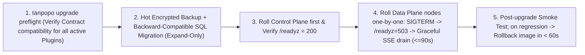

# Self-Hosted Installer, State Migration, Zero-Downtime Upgrades & Air-Gapped Operations — Tanpopo

> **Infrastructure Operations Specification (Phase ASTRA A06 — `DRAFT / READY_FOR_REVIEW`)**
> - **Document ID:** `SPEC-OPS-01` | **Version:** `0.1.0-step06-draft` | **Last Updated:** `2026-11-11`
> - **Authored By:** Principal SRE & Self-Hosted Infrastructure Lead
> - **Governance Status:** **Proposed Operations Specification (`PROPOSED — NO CODE`)** — specifies deployment, state migration, and rolling upgrade workflows for [`deployment-topology.md`](../architecture/deployment-topology.md) (`ARCH-OPS-01`), [`data-model.md`](../architecture/data-model.md) (`ARCH-DATA-01`), and [`ADR-0001`](../architecture/adr/0001-core-runtime-and-modular-monolith.md)..[`ADR-0006`](../architecture/adr/0006-immutable-config-snapshots-and-fast-revocation.md).
> - **Requirements Traceability:** `WF-01`, `WF-11`, `SM-08`, `OPS-01`, `TP-FR-1001`..`1005`, `TP-NFR-0103`, `TP-NFR-0201`, `TP-NFR-0302`, `TP-NFR-0901`, `TP-NFR-0902`.

---

## 1. Cross-Platform Bootstrap Matrix (`Linux / macOS / Windows Bootstrap Matrix`)

Because Tanpopo packages as a single statically linked pure-Go binary (`CGO_ENABLED=0`) embedding the compiled Web Console SPA (`embed.FS` — `ADR-0001`, `ADR-0004`) and a pure-Go WebAssembly runtime (`wazero` — `ADR-0002`), the host server **requires zero pre-installed Node.js, Python, C toolchains, or external shared system libraries**:

| Operating System & Architecture | Target Deployment Scenario | Launch Method & Background Daemon | Filesystem Permissions, Storage & OS-Specific Notes |
|---|---|---|---|
| **Linux (`x86_64`, `arm64`)**<br/>*(Ubuntu 22.04+, Debian 12+, RHEL 9+, Alpine 3.20+)* | **Primary production baseline** (VM, Bare-metal, Container, Kubernetes). | `.deb`/`.rpm` packages + hardened `systemd` unit (`tanpopod.service`) or `distroless` OCI image. | Runs under unprivileged system account `tanpopo:tanpopo`; data directory `/var/lib/tanpopo` (`chmod 0700`), config directory `/etc/tanpopo` (`chmod 0750`, config files `0640`). Requires local block storage (`ext4`/`xfs`; **never place SQLite WAL on NFS/SMB network mounts** to avoid advisory file-lock corruption). |
| **macOS (`arm64` Apple Silicon, `x86_64`)**<br/>*(macOS 14+)* | Developer workstation, local evaluation alongside `Ollama` / `LM Studio`. | Homebrew (`brew install tanpopo`), standalone binary, or Docker Desktop; background service via `launchd`. | Default data path `~/.local/share/tanpopo` (`0700`); official release binaries require Apple Developer ID signing (`codesign` & `notarize`) so Gatekeeper permits first-run execution cleanly. |
| **Windows (`x86_64`, `arm64`)**<br/>*(Windows 11, Windows Server 2022+)* | Enterprise engineering workstation, on-prem Windows Server, or **WSL2** / Docker. | Direct `tanpopod.exe` / `tanpopo.exe` execution, registered **Windows Service** (`sc.exe` / `WinSW`), or Linux binary inside WSL2. | - Default data path `%ProgramData%\Tanpopo` (service mode) or `%LOCALAPPDATA%\Tanpopo` (user mode), restricted via `icacls` (revoking generic `Users` inheritance and retaining only `SYSTEM`, `Administrators`, and the service SID).<br/>- Config file paths normalize forward slashes or safe escaping; contributors running Node/Astryx build tooling on PowerShell must account for `ExecutionPolicy` rules on `.ps1` shims.<br/>- Windows Defender Firewall prompts on first bind outside `127.0.0.1`. |

---

## 2. Automated Preflight Checks (`tanpopo doctor` Preflight Checks)

Prior to binding traffic sockets on startup (or whenever an administrator runs `tanpopo doctor`), Tanpopo automatically executes **8 deterministic preflight checks** and emits actionable remediation commands upon failure:

| Order | Check Identifier (`Check ID`) | Pass Criterion (`PASS`) | Failure / Warning Behavior (`FAIL` / `WARN`) |
|---|---|---|---|
| **1** | `clock-skew` | System clock drift relative to reference time `< 5 seconds`. | `WARN` (escalates to `FAIL` when `AWS SigV4`, `OIDC`, or `OAuth 2.1` drivers are configured, since clock skew invalidates cryptographic request signatures). |
| **2** | `ports-available` | Data Plane socket (default `127.0.0.1:8080` in local mode) and Admin/Metrics socket (`:9090` when split) are free. | `FAIL` — Prints the colliding port number alongside `--listen` / `TANPOPO_LISTEN_ADDR` override instructions. |
| **3** | `master-kek-ready` | `TANPOPO_MASTER_KEY` (or configured `Cloud KMS` / `Vault` key) provides valid `>= 256-bit` entropy. | On first-run local evaluation: auto-generates a `0600` local keyfile and raises a persistent backup warning (`UX-GR-05`). Under `--production`: **hard `FAIL`** if no explicit master key is supplied. |
| **4** | `storage-fs-lock` | Data directory is writable with `>= 1 GiB` free space and supports atomic file locking for SQLite WAL (or connects to PostgreSQL `>= 16`). | `FAIL` if the SQLite path resides on an unsafe `NFS`/`CIFS` mount or lacks write permissions. |
| **5** | `cluster-cache` *(Mode B/C only)* | `Valkey / Redis` round-trip ping `< 5 ms`, supporting `EVALSHA` (Lua rate-limit scripts) and `SUBSCRIBE`. | `FAIL` when `--cluster-mode` is enabled without a reachable shared cache tier. |
| **6** | `bundle-lockfile-integrity` | Every extension package pinned in `tanpopo.lock` matches its on-disk/registry `SHA-256` digest bit-for-bit. | `FAIL` — Blocks loading tampered artifacts and records a security audit event. |
| **7** | `tls-posture` | Binding to any non-`127.0.0.1` interface requires either native TLS or explicit `trusted_proxies` behind an HTTPS Reverse Proxy. | Default `FAIL` when exposing plaintext HTTP admin endpoints on non-loopback interfaces without an explicit override flag. |
| **8** | `egress-dns-ssrf` | DNS resolver succeeds and the internal egress dialer blocks cloud metadata endpoints `169.254.169.254` / `fd00:ec2::254`. | `FAIL` if the self-test SSRF guard check fails to block metadata loopback probes. |

---

## 3. Interactive Web First-Run Setup vs Declarative Headless GitOps

Tanpopo supports two complementary day-one initialization workflows per `OPS-01`:

1. **Interactive Browser Bootstrap (`Interactive First-Run Bootstrap` — Default for Solo & Small Teams):**
   - When the database contains zero `Organization` records, `tanpopod` mints a **cryptographically random 256-bit single-use `Bootstrap Token` with a `15-minute` TTL** and writes it exclusively to the local startup process `stderr` log (never exposed over any public API endpoint).
   - The operator opens `http://localhost:8080/setup` (directly, over an SSH tunnel, or via HTTPS ingress), redeems the `Bootstrap Token`, creates the initial `ORG_OWNER` account, and completes `UJ-01` (`TTFGR < 3 minutes`). The instant the initial owner record commits to storage, `/admin/v1/setup:claim-bootstrap` permanently seals itself (`410 Gone`).
2. **Declarative Headless Bootstrap (`Declarative Headless Bootstrap` — For CI/CD, Terraform & Kubernetes):**
   - Supply `tanpopo.bootstrap.yaml` + `tanpopo.lock` paired with secret environment references at launch (`tanpopo serve --bootstrap-file /etc/tanpopo/tanpopo.bootstrap.yaml`).
   - `tanpopod` idempotently provisions the `Organization`, `Projects`, `Environments`, hash-pinned `Extensions`, `Policies`, and OIDC Admin bindings with zero interactive browser steps.

---

## 4. TLS Configuration, Firewall Rules & Anti-SSRF Egress Guard (`TLS, Network & Firewall`)

### 4.1. Three TLS Termination Modes (`TLS Termination Modes`)
1. **Local Loopback (`Loopback Only`):** Binds strictly to `127.0.0.1:8080` by default on workstations, preventing accidental exposure over public Wi-Fi networks.
2. **Built-In TLS (`Built-in TLS 1.3 / Automatic ACME`):** Designed for lean single-VM deployments — set `tls.domain = "ai-gateway.corp.example.com"` (ACME Let's Encrypt / ZeroSSL) or supply internal certificate paths via `tls.cert_file` / `tls.key_file` (hot-reloaded on renewal without dropping active connections).
3. **Behind Load Balancer / Reverse Proxy (`Caddy / Nginx / Envoy / Ingress` — Recommended for Mode B & C):**
   - Response buffering must be disabled so real-time SSE token streams flush immediately, and read timeouts must accommodate long-horizon `reasoning` models:

```nginx
# Reference Nginx configuration for Tanpopo Data Plane SSE streaming
location / {
    proxy_pass http://tanpopo_dataplane_upstream;
    proxy_http_version 1.1;
    proxy_set_header Connection "";
    proxy_set_header Host $host;
    proxy_set_header X-Forwarded-For $proxy_add_x_forwarded_for;
    proxy_set_header X-Forwarded-Proto $scheme;

    # MANDATORY for AI Streaming (SSE / MCP Streamable HTTP):
    proxy_buffering off;
    proxy_cache off;
    chunked_transfer_encoding on;
    proxy_read_timeout 300s;
    proxy_send_timeout 300s;
}
```

### 4.2. Firewall Port Matrix & Safe LAN GPU Allowlist (`Firewall & LAN GPU Allowlist`)
- **Inbound Ports (`Inbound`):**
  - `:8080/tcp` (Data Plane: `/v1/*`, `/native/*`, `/mcp`, `/a2a/*`, `/healthz`, `/readyz`) — expose only to internal application subnets or through an HTTPS Load Balancer.
  - `:9090/tcp` (Control Plane Admin API, Web Console & Prometheus `/metrics` — may share `:8080` in single-node Mode A, but in production Mode C **must be isolated onto a dedicated internal management port/Ingress** gated by VPN/mTLS/SSO).
- **Outbound Egress & Anti-SSRF Guard (`Outbound & SSRF Guard`):**
  - By default, Tanpopo's outbound dialer denies RFC1918 private ranges (`10.0.0.0/8`, `172.16.0.0/12`, `192.168.0.0/16`), loopback (`127.0.0.0/8`, `::1`), and link-local/cloud metadata ranges (`169.254.0.0/16`, `fe80::/10`).
  - To route to legitimate internal GPU inference servers (such as local `Ollama` on `127.0.0.1:11434` or a LAN `vLLM` cluster at `10.20.30.40:8000`), an `OPERATOR` must explicitly allowlist exact `host:port` endpoints under **`network.allowed_private_upstreams: ["127.0.0.1:11434", "10.20.30.40:8000"]`** in server configuration — even then, cloud metadata IP `169.254.169.254` **remains unconditionally hard-blocked**.

---

## 5. Container, Virtual Machine & Kubernetes Deployment (`Container / VM / K8s`)

1. **Standalone Container & Docker Compose (`Mode A` / `Mode B`):**
   - Official OCI image built on a shell-less minimal base (`non-root UID 65532`, `read_only: true`, mounting writable volumes solely at `/var/lib/tanpopo` and size-capped `/tmp`).
   - Reference `docker-compose.prod.yml` wires `tanpopod`, `postgres:16-alpine` (gated on `pg_isready`), `valkey/valkey:8-alpine`, and `caddy:2` automatic HTTPS.
2. **Virtual Machine (`systemd` Hardening):**
   - `tanpopod.service` enforces `NoNewPrivileges=yes`, `PrivateTmp=yes`, `ProtectSystem=strict`, `ProtectHome=yes`, `ReadWritePaths=/var/lib/tanpopo`, and `LimitNOFILE=65536` (sustaining thousands of concurrent SSE streams without file-descriptor exhaustion).
3. **Kubernetes Helm Chart (`Mode C — Multi-AZ HA`):**
   - Splits into 2 independent `Deployments` sharing one container image differentiated by `--role`:
     - `tanpopo-controlplane` (`replicas: 2`, PostgreSQL advisory-lock leader election for background OAuth refresh and TTL compaction).
     - `tanpopo-dataplane` (`HPA minReplicas: 3, maxReplicas: 20` scaling on CPU utilization and `tanpopo_active_streams`, backed by `PodDisruptionBudget minAvailable: 2` and cross-AZ `topologySpreadConstraints`).
   - Enforces default-deny `Kubernetes NetworkPolicy` around Tier-3 Sidecar Pods (permitting ingress solely from `tanpopo-dataplane` to the Sidecar's gRPC/UDS port).

---

## 6. Storage State Migration (`SQLite -> PostgreSQL`) & Zero-Downtime Upgrades (`SM-08`)

### 6.1. Scaling Up From Single-Node to Clustered Storage (`SQLite -> PostgreSQL State Migration`)
When a team outgrows `Mode A` (SQLite) and graduates to `Mode B/C` (PostgreSQL) while preserving all routes, envelope-encrypted credentials, audit chains, and financial ledgers:
1. Enable brief Control Plane write freeze (`tanpopo admin freeze-writes --reason "Migrate to Postgres"` — live Data Plane inference traffic continues uninterrupted from in-memory `ConfigSnapshot`!).
2. Run checksum-verified state migration:
   ```bash
   tanpopo storage migrate \
     --from "sqlite:///var/lib/tanpopo/tanpopo.db" \
     --to "postgres://tanpopo_app@pg.internal:5432/tanpopo?sslmode=require" \
     --verify-row-counts --verify-audit-chain
   ```
   *(Because vault rows transfer sealed `ciphertext` envelopes wrapped under the same `TANPOPO_MASTER_KEY`, migration never decrypts or exposes raw upstream credentials).*
3. Point server configuration to PostgreSQL + Valkey, boot the clustered nodes, and lift the Control Plane write freeze.

### 6.2. Five-Step Zero-Downtime Rolling Upgrade (`Zero-Downtime Rolling Upgrade` — `SM-08`)



- **Mandatory Contract Compatibility Gate (`Preflight Gate` — `TP-FR-1004`):** `tanpopo upgrade preflight --target-version v0.2.0` inspects every `ENABLED_ACTIVE` `Extension`. If any package declares a `compatibility.contractVersion` outside the target binary's supported window, preflight aborts immediately with `exit 22 (BLOCKED_INCOMPATIBLE)` naming the exact blocking packages — preventing Core upgrades from ever breaking active production Adapters after the fact.

---

## 7. Fully Air-Gapped Operations & Private OCI Registries (`Air-Gapped & Private OCI Registry`)

For financial, telecom, defense, or industrial environments operating inside networks with zero Internet egress (`Air-Gapped` — `TP-FR-0307`, `TP-FR-1002`):
1. **Export Signed Offline Bundle on a Connected Bastion (`Connected Bastion`):**
   ```bash
   # Package Core binary + lockfile-pinned Extensions + Cosign signatures + latest revocation feed into 1 signed archive
   tanpopo bundle export \
     --lockfile ./tanpopo.lock \
     --include-revocation-feed \
     --output tanpopo-airgap-bundle-2026-11.tar.zst
   ```
2. **Verify & Import Across the Air-Gap Diode (`Offline Import`):**
   - Transfer the `.tar.zst` archive across physical/diode inspection media into the isolated network and execute:
     ```bash
     tanpopo bundle verify tanpopo-airgap-bundle-2026-11.tar.zst --public-key /etc/tanpopo/trust-root.pub
     tanpopo bundle import tanpopo-airgap-bundle-2026-11.tar.zst --mirror-to oci://harbor.corp.internal/tanpopo-extensions
     ```
3. **Internal Source Lock Policy:**
   - Configure `extensions.allowed_sources: ["oci://harbor.corp.internal/tanpopo-extensions/*", "local_bundle"]` and `extensions.offline_mode: true` in `tanpopo.yaml`: Tanpopo disables all background Internet update checks, serves locally bundled fonts in the Web Console (`UX-AC-10`), and accepts exclusively packages signed by the enterprise's internal trust root (`private-enterprise`).
