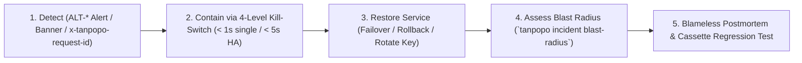

# Health Monitoring, Symptom-Based Alerting, Incident Response & Testable Ops Criteria — Tanpopo

> **Canonical Production SRE & Incident Response Specification (Synchronized in `TP-IMP-0002` — Spec Closure Batch B)**
> - **Document ID:** `SPEC-OPS-03` | **Version:** `0.2.0-m0-closure` | **Last Updated:** `2026-11-14`
> - **Authored By:** Principal SRE & Security Incident Lead
> - **Aligned Contracts:** [`usage-billing-observability.md`](../specifications/usage-billing-observability.md) (`SPEC-CORE-02`), [`openapi/dataplane-v1.yaml`](../../openapi/dataplane-v1.yaml) (`/healthz`, `/readyz`, `/metrics`), [`openapi/admin-v1.yaml`](../../openapi/admin-v1.yaml), and [`ADR-0006`](../architecture/adr/0006-immutable-config-snapshots-and-fast-revocation.md).
> - **Measurement Honesty (`COND-PO-01`):** Every startup (`< 3.0s`), memory (`< 128 MiB`), overhead (`10 ms`), propagation (`< 1.0s` / `< 5.0s`), recovery (`RTO < 15m`), crypto-shredding (`< 60s`), and cardinality (`<= 100,000` series) threshold in this document is **`TARGET / UNVERIFIED`** until empirical verification in `M2`–`M5`.
> - **Requirements Traceability:** `WF-08`, `WF-10`, `WF-12`, `OPS-03`, `OPS-04`, `OPS-07`, `TP-FR-0704`, `TP-FR-0705`, `TP-FR-0801`..`0806`, `TP-NFR-0101`..`0404`, `TP-NFR-0601`, `TP-NFR-0602`, `CR-04`, `CR-07`, `CR-09`, `GAP-13`.

---

## 1. Standardized Health Probe & Bounded Metrics Semantics (`/healthz`, `/readyz`, `/metrics`)

To prevent cascading Kubernetes restart storms whenever an upstream AI vendor or database experiences transient turbulence, the unified `tanpopo` binary strictly separates **Liveness**, **Readiness**, and **Metrics**:

| Endpoint | Orchestration Purpose | `200 OK` Condition | `503` / Error Condition | Infrastructure Consequence |
|---|---|---|---|---|
| **`GET /healthz`** | **Liveness Probe** (Process alive and HTTP loop responsive). | HTTP handler responds within internal bounds. **NEVER** queries SQLite/PostgreSQL, Valkey, or external AI providers! | Process deadlocked or internal loop unresponsive (`> 2s` `TARGET / UNVERIFIED`). | Used solely by `systemd` / `kubelet` to restart genuinely hung processes (`OPS-AC-02`). |
| **`GET /readyz`** | **Readiness Probe** (Safe to accept new Load Balancer connections). | 1. Valid `ConfigSnapshot` loaded;<br/>2. `tanpopo_config_snapshot_age_seconds <= 10` (`Stale-Node Breaker` closed);<br/>3. `wazero` Wasm warm pool initialized;<br/>4. Process has **not** received `SIGTERM`. | 1. Cold-booting prior to initial snapshot;<br/>2. Received `SIGTERM` and draining active SSE streams (`drain_timeout <= 300s`);<br/>3. Partitioned from both PostgreSQL and Valkey for `> 10s` (`FMEA-07`). | Load Balancer immediately stops routing new traffic to this pod while open SSE streams finish draining cleanly. |
| **`GET /metrics`** | **Prometheus Scrape** *(Internal listener `:9090`)*. | Exports canonical metrics (`tanpopo_http_requests_total`, `tanpopo_proxy_overhead_seconds`, `tanpopo_config_snapshot_age_seconds`, `tanpopo_telemetry_dropped_total`, etc.) restricted to the bounded label allowlist `{ org_id, project_id, adapter_id, logical_model, status_class, error_code, accuracy_tier }` (with `telemetry.metrics.include_tenant_labels = false` toggle on high-tenant clusters; **strictly banning** `request_id`, `virtual_key_id`, `principal_id`). | Unauthenticated scrape (`401`) or blocked by internal network ACL (`403`). | Drives `ALT-*` symptom alerts and Kubernetes `HPA` autoscaling (`<= 100,000` active series `TARGET / UNVERIFIED`). |

---

## 2. Symptom-Based Alerting & Error-Budget Burn Rules (`ALT-*`)

| Alert ID | Severity | Symptom-Based Trigger Expression (`TARGET / UNVERIFIED` Thresholds) | Automated Mitigation & Linked Runbook |
|---|---|---|---|
| **`ALT-GATEWAY-BURN`** | **`PAGE`** | Internal Tanpopo `5xx` rate on `tanpopo_http_requests_total{status_class="5xx"}` (excluding upstream `upstream_*` errors) burns `> 2%` of monthly `99.9%` error budget within `1h`. | Inspect recent rollout -> execute `DR-04` `< 60s` image rollback if correlated with an upgrade. |
| **`ALT-LATENCY-SLO`** | **`PAGE`** | `p95` of `tanpopo_proxy_overhead_seconds` exceeds `0.010s` (`10 ms`) continuously for `5 minutes`. | Check `wazero` Wasm pool contention or Valkey saturation -> see `INC-03` & `INC-07`. |
| **`ALT-REVOCATION-LAG`** | **`PAGE`** | Any Data Plane node reports `tanpopo_config_snapshot_age_seconds > 5` sustained for `> 30 seconds` (`TP-NFR-0404`). | Nodes exceeding `> 10s` automatically flip `/readyz = 503`; inspect Valkey Pub/Sub and PostgreSQL `LISTEN/NOTIFY` (`INC-07`). |
| **`ALT-AUDIT-TAMPER`** | **`PAGE`** | `tanpopo admin verify-state --check-audit-chain` or scheduled verifier detects a broken `prev_hash -> event_hash` link in any `Per-Org` or `SYSTEM` audit partition. | Run `tanpopo admin freeze-writes`, preserve storage volume for forensics, and cross-check `.tpop.enc` / WORM backups. |
| **`ALT-PLUGIN-TRAP`** | **`TICKET` / `PAGE`** | `tanpopo_sandbox_traps_total` on an extension exceeds **`> 20` faults / `60s`** (`16 MiB` OOM, `> 15 ms` / `> 5 ms` deadline, or denied egress). | Runtime breaker auto-transitions the extension to **`QUARANTINED`** (`FMEA-05`) -> run forensic blast-radius (`INC-03`). |
| **`ALT-BUDGET-80`** | **`TICKET` / Webhook** | Combined `Settled + Carryover + Active Holds` crosses `80%` or `100%` of `hard_limit_micros`. | Surfaces Console `Banner` + OTel alert in `v0.1`, plus HMAC-signed `webhook_subscriptions` dispatch in `v0.2` (`CR-09`, `INC-01`). |
| **`ALT-OAUTH-EXPIRY`** | **`TICKET`** | A `Provider Connection` transitions to `AUTH_EXPIRED_REAUTH_REQUIRED` (`SM-03`) or TLS certificate has `< 14 days` remaining. | Surfaces Console `Banner` on `SCR-04` prompting PKCE re-authorization (`INC-05`). |
| **`ALT-UNMETERED-SPEND`** | **`TICKET`** | Settlements recorded with `accuracy_tier = "UNMETERED_FLAGGED"` (missing model rate card). | Populate integer `nano-USD` rate card at `SCR-05` (`UX-GR-05`). |

---

## 3. Incident Lifecycle & Seven Detailed On-Call Runbooks (`INC-01` .. `INC-07`)



### `INC-01`: Budget Exhaustion or Runaway Agent Spend Loop
- **Symptoms:** Callers receive `429 project_budget_exceeded` or `micro-USD/min` burn spikes `10x`.
- **Diagnosis:** Open `SCR-12` or run `tanpopo budget inspect --project <slug>` to distinguish legitimate monthly exhaustion, runaway concurrent `RESERVED_HOLD` leases on one `Virtual Key`, or upstream vendor `429`.
- **Remediation:** Revoke or throttle `RPM` on the offending `Virtual Key` (`SCR-13`), or have `ORG_OWNER` raise `hard_limit_micros` (`PUT /admin/v1/budgets/{budgetId}`).

### `INC-02`: Leaked `Virtual Key` — Graceful Rotation vs. Stream-Severing Emergency Revoke
- **Case A — Routine Rotation (`WF-10`):**
  ```bash
  tanpopo key rotate vk_01j9... --grace-period 24h
  ```
- **Case B — Confirmed Leak (`BA-OQ-003` — Permitted from `QUOTA_PAUSED` per `SM-05`):**
  ```bash
  tanpopo killswitch trigger --level virtual-key --target vk_01j9... --abort-streams --reason "Leaked in public repository"
  ```
  Propagates in **`< 1.0s` (single-node) / `< 5.0s` (HA cluster) (`TARGET / UNVERIFIED`)** and severs all open SSE streams using that key.

### `INC-03`: Malfunctioning or Malicious External Extension (`Quarantine` & `Blast-Radius`)
- **Containment:**
  ```bash
  tanpopo killswitch trigger --level extension --target ext_01j9... --abort-streams --reason "Security advisory #2026-04"
  ```
- **Forensic Blast-Radius Query:**
  ```bash
  tanpopo incident blast-radius --extension ext_01j9... --since 168h --output json
  ```
  Lists all `Organizations`, `Projects`, `Virtual Keys`, and `Provider Connections` that traversed the `.tpkg` extension so operators can rotate affected upstream secrets on `SCR-04`.

### `INC-04`: Upstream Provider Outage & `Fail-Closed` Data Residency Fence
- `SM-04` trips failing deployments to `CIRCUIT_OPEN_UNHEALTHY` and fails over pre-first-chunk within allowed regions. If all `EU` targets fail while `EU Only` policy is active, Tanpopo **intentionally returns `503 no_compliant_deployment_available`** rather than spilling regulated data into `US`.

### `INC-05`: Expired or Revoked `Authorized OAuth 2.1` Grant (`SM-03`)
- On upstream `400 invalid_grant`, `Single-Flight` refresh halts immediately (`0` retry storm), sets `AUTH_EXPIRED_REAUTH_REQUIRED`, and fires `ALT-OAUTH-EXPIRY`. `ORG_OWNER` / `TEAM_ADMIN` re-authorizes via `SCR-04`.

### `INC-06`: Upstream MCP Tool Schema Mutation (*MCP Rug-Pull*)
- Mutated tool locks with `403 schema_hash_drift_blocked`. `SECURITY_REVIEWER` / `ORG_OWNER` inspects the **Schema Diff** modal on `SCR-10` before re-pinning via `POST /admin/v1/mcp/tools/{toolId}/approve-schema`.

### `INC-07`: `Valkey` Cluster Outage or Database Partition (`ADR-0006`, `CR-07`)
- **Valkey Unreachable (`PostgreSQL` Healthy):** Revocation sync falls back seamlessly to `PostgreSQL LISTEN/NOTIFY` + `2s` `config_changelog` polling; rate limiting falls back to conservative per-node slices (`limit / N_nodes`); budget pre-holds fall back to PostgreSQL adding active cluster hold margins from **`valkey_hold_checkpoints`** (`1s`–`5s` node heartbeats per `CR-07`) to prevent split-brain budget overruns.
- **Both `PostgreSQL` & `Valkey` Unreachable `> 10s`:** Node trips `/readyz = 503` (`stale_security_state`) to shed load-balancer traffic safely.

---

## 4. Twelve Testable Operational Readiness Criteria (`OPS-AC-01` .. `OPS-AC-12` — `TARGET / UNVERIFIED`)

| Criterion ID | Target Milestone (`CR-04`) | Quantitative Pass Threshold (`TARGET / UNVERIFIED`) | Automated Verification Method |
|---|---|---|---|
| **`OPS-AC-01`** | `v0.1` (`M2`) | Cold start to `/readyz = 200` in `< 3.0s`; standalone idle RSS `< 128 MiB` across Linux, macOS, and Windows. | Clean container / OS runner benchmark (`0` external network calls). |
| **`OPS-AC-02`** | `v0.1` (`M2`) | Simulated `15s` DB outage flips `/readyz` to `503` while `/healthz` stays `200 OK` (`0` spurious restarts). | Fault-injection integration test. |
| **`OPS-AC-03`** | `v0.1` (`< 1s` single) / `v0.3` (`< 5s` HA) | Emergency Revoke blocks new calls (`401`) and severs active SSE sockets in `< 1.0s` standalone / `< 5.0s` 3-node cluster. | Active SSE stream revocation timing test (`AUTH-06`). |
| **`OPS-AC-04`** | `v0.1` (`M2`) | Extension `Quarantine` halts traffic (`503 extension_quarantined`) and `blast-radius` returns `100%` of traversing keys/projects. | Seeded trace history + quarantine integration test. |
| **`OPS-AC-05`** | `v0.1` (`M2`) | Incompatible `.tpkg` `contractVersion` causes `tanpopo upgrade preflight` to exit `22` (`BLOCKED_INCOMPATIBLE`). | CLI preflight test against skewed `tanpopo.lock` fixture (`CT-24`). |
| **`OPS-AC-06`** | `v0.3` (`M4`) | 3-node rolling upgrade under `100` active SSE streams (including long reasoning streams inside configurable `drain_timeout <= 300s`) yields `0` `502`/`503` drops. | `k6` streaming load test across rolling pod replacement. |
| **`OPS-AC-07`** | `v0.1` (`M2`) | `.tpop.enc` backup cannot decrypt secrets without `Master KEK`; clean-host restore passes `tanpopo doctor` in `RTO < 15m`. | Automated `DR-01` / `DR-02` restore drill. |
| **`OPS-AC-08`** | `v0.1` (`M2`) | Editing/deleting `1` byte in `audit_events` is pinpointed by `tanpopo admin verify-state --check-audit-chain`. | Raw SQLite/PostgreSQL mutation test (`CT-30`). |
| **`OPS-AC-09`** | `v0.1` (`M2`) | Deleting a `Project` destroys its `Project DEK` (`project_encryption_keys`) and revokes keys in `< 60s`, rendering cold-backup ciphertexts mathematically unrecoverable (`CR-06`). | Timed deletion + post-shred `AEAD` decryption failure test. |
| **`OPS-AC-10`** | `v0.1` (`M1/M2`) | `0` canary secrets or prompt bodies appear in `stdout` JSON logs, `/metrics`, or `tanpopo support-bundle` archives. | `CanaryScanner` sweep across logs, DB metadata, OTel spans, and tarballs. |
| **`OPS-AC-11`** | `v1.0` (`M5` full bundle; `v0.1` offline UI) | `tanpopo bundle import`, local `Figtree` Web Console (`UX-AC-10`), and LAN GPU routing succeed `100%` with zero Internet egress. | Network-isolated Linux namespace E2E suite (`CT-31`). |
| **`OPS-AC-12`** | `v0.1` (`M2`) | `/metrics` time-series count stays bounded (`<= 100,000` series) and invariant to `100,000` unique `request_id` / `virtual_key_id` values. | High-cardinality load test asserting constant `/metrics` series count. |
