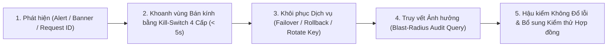

# Giám sát Sức khỏe, Cảnh báo Triệu chứng, Ứng phó Sự cố & Tiêu chí Nghiệm thu Vận hành (Monitoring, Incident Response & Testable Ops Criteria) — Tanpopo

> **Tài liệu Trực chiến SRE & Vận hành Sản xuất (Phase ASTRA A06 — `DRAFT / READY_FOR_REVIEW`)**
> - **Mã tài liệu:** `SPEC-OPS-03` | **Phiên bản:** `0.1.0-step06-draft` | **Ngày cập nhật:** `2026-11-11`
> - **Vai trò biên soạn:** Principal SRE & Security Incident Lead
> - **Trạng thái quản trị:** **Đặc tả Vận hành Đề xuất (`PROPOSED — NO CODE`)** — bám sát kỹ năng `observability-and-instrumentation`, `shipping-and-launch`, đặc tả số đo tại [`usage-billing-observability.md`](../specifications/usage-billing-observability.md) (`SPEC-CORE-02`) và kiến trúc [`ADR-0006`](../architecture/adr/0006-immutable-config-snapshots-and-fast-revocation.md).
> - **Truy vết Yêu cầu:** `WF-08`, `WF-10`, `WF-12`, `OPS-03`, `OPS-04`, `OPS-07`, `TP-FR-0704`, `TP-FR-0705`, `TP-FR-0801`..`0806`, `TP-NFR-0101`..`0404`, `TP-NFR-0601`, `TP-NFR-0602`.

---

## 1. Ngữ nghĩa Thăm dò Sức khỏe Chuẩn Hóa (`/healthz` vs `/readyz` vs `/metrics`)

Để ngăn thảm họa Kubernetes tự khởi động lại dây chuyền (*CrashLoop Storm*) khi một nhà cung cấp AI bên ngoài hoặc cơ sở dữ liệu chập chờn thoáng qua, Tanpopo tách biệt tuyệt đối **Liveness** và **Readiness**:

| Điểm cuối | Mục đích Điều phối | Điều kiện Trả `200 OK` | Điều kiện Trả `503 Service Unavailable` | Hệ quả Ở Tầng Hạ tầng |
|---|---|---|---|---|
| **`GET /healthz`** | **Liveness Probe** (Tiến trình còn sống và không bị treo cứng vòng lặp sự kiện). | Goroutine phản hồi HTTP hoạt động và không kẹt bộ nhớ trong nhân tiến trình. **KHÔNG BAO GIỜ** gọi kiểm tra DB, Valkey hay nhà cung cấp AI ngoài! | Tiến trình treo chết hoặc quá thời gian phản hồi nội bộ (`> 2s`). | Chỉ dùng để `systemd` / `kubelet` khởi động lại tiến trình thực sự bị chết cứng. |
| **`GET /readyz`** | **Readiness Probe** (Nút đủ điều kiện an toàn để nhận yêu cầu mới từ Cân bằng tải). | 1. Đã nạp `ConfigSnapshot` hợp lệ;<br/>2. Độ trễ đồng bộ thu hồi `< 10 giây` (`Stale-Node Breaker` chưa ngắt);<br/>3. Hồ khởi tạo Wasm Sandbox sẵn sàng;<br/>4. Tiến trình **chưa nhận** tín hiệu tắt `SIGTERM`. | 1. Đang khởi động chưa nạp xong cấu hình;<br/>2. Đã nhận `SIGTERM` và đang xả êm các luồng SSE dở (`Draining`);<br/>3. Mất liên lạc hoàn toàn với cả DB lẫn Valkey quá `10 giây` (`ADR-0006`). | Load Balancer / Kubernetes Service **ngừng gửi kết nối mới sang nút này ngay lập tức**, trong khi các luồng đang mở vẫn được chạy nốt êm đẹp. |
| **`GET /metrics`** | **Prometheus Scrape** *(Cổng quản trị nội bộ `:9090`)*. | Xuất các bộ đếm và biểu đồ phân phối (`Histogram`) có tập nhãn hữu hạn (`org_id`, `route`, `adapter`, `status_class` — **cấm gắn `request_id` hay `user_id` làm nhãn metric** để tránh nổ bộ nhớ). | Cổng quản trị chưa xác thực hoặc bị từ chối quyền mạng nội bộ (`401`/`403`). | Cung cấp dữ liệu thời gian thực cho hệ thống cảnh báo triệu chứng và `HPA` co giãn tự động. |

---

## 2. Quy tắc Cảnh báo Theo Triệu chứng & Tốc độ Đốt Ngân sách Lỗi (`Symptom-Based Alerting`)

Tuân thủ nguyên tắc SRE hiện đại: **chỉ đánh thức kỹ sư trực chiến (`PAGE`) khi người dùng thực sự đang chịu thiệt hại hoặc có sự cố an ninh tức thời**; các cảnh báo dự báo xu hướng gửi vào hàng đợi công việc giờ hành chính (`TICKET`):

| Mã Cảnh báo | Mức độ | Điều kiện Kích hoạt Dựa Trên Triệu chứng (`Symptom Condition`) | Hành động Tự động & Sổ tay Ứng phó Liên kết |
|---|---|---|---|
| **`ALT-GATEWAY-BURN`** | **`PAGE`** | Tỷ lệ lỗi nội bộ tầng Gateway (`5xx` do chính Tanpopo sinh ra, **không tính** lỗi `5xx`/`429` từ hãng AI đích) đốt `> 2%` ngân sách lỗi tháng trong `1 giờ` (mục tiêu `99.9%` — `TP-NFR-0201`). | Kiểm tra bản phát hành vừa cuộn → chạy `DR-04` quay lui nếu trùng thời điểm nâng cấp. |
| **`ALT-LATENCY-SLO`** | **`PAGE`** | Độ trễ cộng thêm nội bộ của Tanpopo (`tanpopo_gateway_overhead_ms` p95) vượt `10 ms` liên tục trong `5 phút`. | Kiểm tra nghẽn hồ Wasm Sandbox hoặc nghẽn Valkey → xem `INC-03` & `INC-07`. |
| **`ALT-REVOCATION-LAG`** | **`PAGE`** | Bất kỳ nút Data Plane nào có `tanpopo_config_epoch_lag_seconds > 5` quá `30 giây` (`TP-NFR-0404`). | Nút lệch quá `10s` tự ngắt `/readyz = 503`; kiểm tra kênh Valkey Pub/Sub và PostgreSQL `LISTEN/NOTIFY` (`INC-07`). |
| **`ALT-AUDIT-TAMPER`** | **`PAGE`** | Tác vụ kiểm chứng định kỳ phát hiện đứt gãy chuỗi băm `prev_hash -> event_hash` trong bảng `audit_events`. | Phong tỏa quyền ghi quản trị, cô lập phân vùng lưu trữ để điều tra an ninh và đối chiếu bản sao WORM (`SPEC-OPS-02`). |
| **`ALT-PLUGIN-TRAP`** | **`TICKET` / `PAGE`** | Một gói `Extension` bị ngắt cưỡng bức do tràn bộ nhớ (`OOM > 16 MiB`), quá hạn CPU hoặc cố gọi tên miền trái phép `> 10 lần/phút`. | Nếu nghi ngờ mã độc hoặc gây lỗi diện rộng → kích hoạt cách ly `Quarantine` ngay (`INC-03`). |
| **`ALT-BUDGET-80`** | **`TICKET` / Webhook** | Mức tiêu thụ cộng giữ chỗ (`Settled + Active Holds`) của `Organization` hoặc `Project` chạm ngưỡng `80%` và `100%`. | Gửi Webhook/Email tới `ORG_OWNER` & `TEAM_ADMIN` để chủ động điều chỉnh trước khi luồng bị chặn `429` (`INC-01`). |
| **`ALT-OAUTH-EXPIRY`** | **`TICKET`** | Một `Provider Connection` chuyển sang `AUTH_EXPIRED_REAUTH_REQUIRED` hoặc chứng chỉ TLS còn `< 14 ngày`. | Hiển thị trên `Banner` Console (`SCR-04`) để quản trị viên ủy quyền lại (`INC-05`). |
| **`ALT-UNMETERED-SPEND`** | **`TICKET`** | Xuất hiện giao dịch mang nhãn `UNMETERED_FLAGGED` (thiếu bảng giá mô hình hoặc Adapter không trả số đếm token). | Bổ sung bảng giá tại `SCR-05` để khôi phục tính chính xác sổ cái (`UX-GR-05`). |

---

## 3. Vòng đời Xử lý Sự cố & 7 Sổ tay Trực chiến Chi tiết (`Incident Flow & Runbooks`)



### `INC-01`: Cạn Hạn mức Ngân sách Hoặc Tác nhân Vòng lặp Đốt Tiền (`Quota & Runaway Spend`)
- **Triệu chứng:** Ứng dụng nhận `429 project_budget_exceeded` (hoặc tốc độ tiêu thụ `micro-USD/phút` tăng đột biến gấp `10x`).
- **Chẩn đoán (< 60 giây):** Mở `SCR-12 (/finops/budgets)` hoặc chạy `tanpopo budget inspect --project <slug>` để phân biệt: (a) hết trần ngân sách tháng hợp lệ, (b) một `Virtual Key` bị kẹt vòng lặp vô hạn đang giữ nhiều khoản `RESERVED_HOLD`, hay (c) nhà cung cấp đích trả `429 upstream_rate_limited` (còn tiền trong Tanpopo nhưng chạm trần tài khoản hãng).
- **Xử lý:**
  - Nếu do một tác nhân bị lỗi vòng lặp: thu hồi hoặc hạ trần `RPM` riêng của `Virtual Key` đó ngay lập tức tại `SCR-13` mà không làm ảnh hưởng các khóa khác trong dự án.
  - Nếu nhu cầu kinh doanh tăng thật: `ORG_OWNER` nâng trần ngân sách tại `SCR-12` (khoản âm nhẹ kết chuyển cuối luồng `Negative Balance Carryover` sẽ tự được bù trừ ngay khi hạn mức mới có hiệu lực).

### `INC-02`: Lộ Khóa `Virtual Key` — Xoay Vòng Êm vs Thu hồi Cắt Luồng Khẩn cấp (`Key Rotation & Revoke`)
- **Trường hợp A — Xoay khóa định kỳ hoặc nghi ngờ nhẹ chưa có khai thác (`Graceful Dual-Key Rotation` — `WF-10`):**
  ```bash
  tanpopo key rotate vk_id_01j9... --grace-period 24h
  ```
  Hệ thống sinh khóa kế nhiệm mới thuộc cùng `Environment` và quyền hạn, cho phép cả hai khóa cùng chạy song song trong `24 giờ` để cập nhật biến môi trường ứng dụng không rớt một yêu cầu nào, sau đó tự động hủy khóa cũ.
- **Trường hợp B — Phát hiện khóa lộ công khai trên GitHub hoặc đang bị kẻ lạ gọi (`Emergency Security Revoke` — `BA-OQ-003`):**
  ```bash
  tanpopo killswitch trigger --level virtual-key --target vk_id_01j9... --abort-streams --reason "Leaked in public repo"
  ```
  Khóa bị vô hiệu hóa trên toàn bộ các nút trong **`< 1 giây` (đơn nút) / `< 5 giây` (cụm HA)** và mọi luồng SSE đang mở bằng khóa đó bị ngắt kết nối TCP ngay tức khắc.

### `INC-03`: Phần Mở rộng Bên Ngoài Gây Lỗi Nghiêm trọng Hoặc Nghi ngờ Độc hại (`Plugin Quarantine` — `WF-12`)
- **Triệu chứng:** Cảnh báo `ALT-PLUGIN-TRAP` báo một gói mở rộng liên tục cố gọi ra địa chỉ mạng lạ, làm hỏng dữ liệu phản hồi, hoặc có bản tin an ninh `Revocation Advisory`.
- **Khoanh vùng tức thì (< 5 giây):**
  ```bash
  tanpopo killswitch trigger --level extension --target ext_community_xyz --abort-streams --reason "Security advisory #2026-04"
  ```
  Gói chuyển ngay sang trạng thái `QUARANTINED` trên toàn máy chủ; mọi `Provider Connection` dùng gói đó tự động chuyển sang trạng thái tạm ngưng an toàn.
- **Truy vết bán kính ảnh hưởng (`Blast-Radius Query`):**
  ```bash
  tanpopo incident blast-radius --extension ext_community_xyz --since 7d --output json
  ```
  Lệnh xuất danh sách đầy đủ mọi `Organization`, `Project`, `Virtual Key` và `Provider Connection` từng đi qua gói mở rộng đó trong `7 ngày` qua để quyết định xoay vòng các khóa nhà cung cấp liên quan tại `SCR-04`.

### `INC-04`: Nhà cung cấp AI Đích Sập Diện rộng & Chốt chặn Vùng Cư trú Dữ liệu (`Upstream Outage`)
- **Hành vi tự động:** Bộ ngắt mạch `SM-04` tự động chuyển `Model Deployment` bị lỗi liên tiếp sang `CIRCUIT_OPEN` và định tuyến trước luồng sang đích dự phòng khỏe mạnh kế tiếp trong `Route`.
- **Lưu ý quan trọng về `Data Residency Fail-Closed` (`TP-BR-0502`):** Nếu tổ chức khóa cứng chính sách `EU Only` và tất cả các đích trong vùng `EU` đều sập (chỉ còn đích `US` sống), Tanpopo **cố ý trả `503 no_compliant_deployment_available`** thay vì tự động đẩy dữ liệu sang Mỹ vi phạm pháp lý. Chỉ `ORG_OWNER` mới có thẩm quyền bổ sung thêm nhà cung cấp khác đặt tại `EU` hoặc phê duyệt ngoại lệ tạm thời có ghi kiểm toán.

### `INC-05`: Hết Hạn / Thu hồi Phiên `Authorized OAuth` (`SM-03`)
- **Triệu chứng:** `Single-Flight Token Refresher` nhận lỗi `invalid_grant` từ nhà cung cấp, chuyển kết nối sang `AUTH_EXPIRED_REAUTH_REQUIRED` (không làm lộ thông báo lỗi chứa mã nhạy cảm về phía ứng dụng khách).
- **Xử lý:** `ORG_OWNER` / `TEAM_ADMIN` mở `SCR-04`, bấm **"Re-authorize Connection"** hoàn tất luồng PKCE mới; kết nối tự quay lại `ACTIVE` và khôi phục định tuyến ngay lập tức.

### `INC-06`: Phát hiện Máy chủ MCP Ngoài Tự ý Sửa Đổi Công cụ (`MCP Schema Rug-Pull`)
- **Triệu chứng:** Lời gọi công cụ MCP bị chặn `403 schema_hash_drift_blocked` và thẻ đỏ xuất hiện tại `SCR-10`.
- **Xử lý:** Tuyệt đối không mở lại mù quáng; `REVIEWER` mở hộp **Schema Diff** trên `SCR-10` để kiểm tra xem mô tả công cụ mới có cài cắm chỉ thị tiêm nhiễm (`Prompt Injection`) hay thêm tham số đánh cắp dữ liệu không. Chỉ khi xác nhận là bản nâng cấp hợp lệ từ đội ngũ sở hữu máy chủ MCP mới bấm ghim lại `schema_hash` mới.

### `INC-07`: Mất Kết nối Cụm Bộ nhớ Đệm `Valkey` Hoặc Nghẽn Cơ sở Dữ liệu (`Cluster Degradation`)
- **Hành vi tự bảo vệ (`ADR-0006`):**
  - Khi `Valkey` sập nhưng `PostgreSQL` vẫn sống: truyền tin thu hồi khóa tự động rơi về kênh dự phòng **`PostgreSQL LISTEN/NOTIFY` + vòng quét `2s`** (vẫn giữ trọn SLA `< 5s`!); giới hạn tốc độ chuyển sang bộ đếm RAM cục bộ từng nút chia theo số bản sao ước tính; riêng phê duyệt `destructive` giữ nguyên kiểm tra chặt trên PostgreSQL.
  - Khi một nút Data Plane bị cô lập mạng khỏi cả `PostgreSQL` lẫn `Valkey` quá `10 giây`: nút tự bật `Stale-Node Circuit Breaker` trả `/readyz = 503` để rút khỏi vòng cân bằng tải, ngăn chặn việc phục vụ bằng danh sách thu hồi quá hạn.

---

## 4. Mười Hai Tiêu chí Nghiệm thu Sẵn sàng Vận hành Có Thể Kiểm thử (`OPS-AC-01` .. `OPS-AC-12`)

> **Lưu ý trung thực đo lường (`TARGET / UNVERIFIED`):** Toàn bộ các ngưỡng thời gian, bộ nhớ và độ trễ trong bảng dưới đây (`< 3.0s`, `< 128 MiB`, `< 1.0s`/`< 5.0s`, `RTO < 15m`, `< 60s`) hiện đều là **mục tiêu thiết kế chưa qua đo thực nghiệm (`TARGET / UNVERIFIED`)** do dự án chưa viết mã thực thi.

Toàn bộ năng lực vận hành và SRE của Tanpopo được nghiệm thu qua **12 bài kiểm thử thực tế có ngưỡng đậu/trượt rõ ràng**:

| Mã Tiêu chí | Hạng mục Vận hành Kiểm chứng | Ngưỡng Đậu Định lượng (`Testable Pass Criteria`) | Cách Thức Chạy Kiểm thử Tự động / Diễn tập |
|---|---|---|---|
| **`OPS-AC-01`** | **Khởi động Lạnh & Dấu chân Tài nguyên Đơn nút** | Sẵn sàng trả `/readyz = 200` trong `< 3.0 giây`; tiêu thụ RAM lúc rỗi `< 128 MiB` trên Linux/macOS/Windows (`TP-NFR-0103`). | Đo tự động tiến trình container đơn nút ngay sau khi khởi chạy không phụ thuộc ngoài. |
| **`OPS-AC-02`** | **Tách biệt Đúng Ngữ nghĩa `/healthz` và `/readyz`** | Khi giả lập ngắt kết nối cơ sở dữ liệu trong `15 giây`, `/readyz` chuyển sang `503` nhưng `/healthz` **vẫn giữ `200 OK`** (`0` lần khởi động lại tiến trình oan). | Chặn cổng PostgreSQL bằng `iptables`/`toxiproxy` trong bài kiểm thử tích hợp cụm. |
| **`OPS-AC-03`** | **SLA Thu hồi Khẩn cấp & Cắt Luồng Đang Mở** | Bấm `Emergency Revoke` trên khóa đang truyền luồng SSE dài → yêu cầu mới bị chặn `401` và luồng đang chạy bị đóng socket trong **`< 1.0s` (đơn nút) / `< 5.0s` (cụm 3 nút)** (`TP-NFR-0404`). | Kịch bản kiểm thử bắn luồng SSE 60 giây trên nút #3, phát lệnh thu hồi tại nút #1 và đo đồng hồ bấm giờ tới lúc socket đứt. |
| **`OPS-AC-04`** | **Cách ly `Quarantine` Phần Mở rộng & Báo cáo Bán kính** | Lệnh `Quarantine` vô hiệu hóa gói mở rộng trên toàn cụm trong `< 5.0 giây` và lệnh `blast-radius` liệt kê chính xác `100%` các khóa/dự án từng đi qua gói đó. | Kiểm thử tiêm gói giả lập vi phạm, chạy lệnh cách ly và đối chiếu kết quả truy vấn với lịch sử gọi mẫu. |
| **`OPS-AC-05`** | **Chốt chặn Kiểm tra Tương thích Trước Nâng cấp (`Preflight`)** | Khi có ít nhất 1 gói đang bật mang `contractVersion` không tương thích với bản nhị phân đích, `tanpopo upgrade preflight` trả mã thoát khác `0` (`exit 22`) và chặn nâng cấp. | Chạy kiểm thử CLI với tệp khóa `tanpopo.lock` chứa gói giả lập lệch phiên bản hợp đồng lớn. |
| **`OPS-AC-06`** | **Nâng cấp Cuộn Không Rớt Luồng (`Zero-Downtime Drain`)** | Cuộn nâng cấp cụm 3 nút Data Plane đang xử lý `100` luồng SSE đồng thời → `0` yêu cầu nhận lỗi `502`/`503` do tắt nút đột ngột (các luồng dở hoàn tất trong cửa sổ `drain_timeout`). | Chạy tải liên tục bằng `k6` trong khi thực hiện `rolling restart` và kiểm tra tỷ lệ thành công `100%`. |
| **`OPS-AC-07`** | **Sao lưu Không Chứa Bản Rõ & Khôi phục Đạt `RTO < 15 Phút`** | Tệp sao lưu không thể giải mã khóa nhà cung cấp khi thiếu `Master KEK`; khi cung cấp đúng `Master KEK`, khôi phục trên máy chủ trắng hoàn tất và vượt qua `tanpopo doctor` trong `< 15 phút`. | Diễn tập tự động `DR-01` & `DR-02` trong môi trường kiểm thử sạch hàng tuần. |
| **`OPS-AC-08`** | **Tính Bất biến Của Chuỗi Băm Nhật ký Kiểm toán** | Mọi can thiệp sửa hoặc xóa dù chỉ `1` ký tự trực tiếp trong bảng `audit_events` đều bị `tanpopo admin verify-state --check-audit-chain` phát hiện chính xác tại số thứ tự bản ghi bị sửa. | Bài kiểm thử bảo mật sửa trực tiếp tệp SQLite/bảng Postgres và xác nhận trình kiểm tra báo động đỏ. |
| **`OPS-AC-09`** | **Xóa Vĩnh viễn Tổ chức / Dự án Dưới `60 Giây` (`Crypto-Shredding`)** | Từ lúc gọi lệnh xóa dự án tới khi toàn bộ khóa bị thu hồi, `DEK` bị hủy và dữ liệu nhạy cảm không thể giải mã đạt `< 60 giây` (`TP-NFR-0502`). | Đo thời gian thực thi lệnh xóa dự án có `10.000` bản ghi truy vết và kiểm tra khả năng giải mã bản mã cũ. |
| **`OPS-AC-10`** | **Không Rò rỉ Bí mật Trong Nhật ký & Gói Chẩn đoán** | `0` chuỗi khóa API nhà cung cấp, `Virtual Key` đầy đủ, `OAuth token` hay văn bản prompt xuất hiện trong `stdout` JSON logs, `/metrics` hay tệp nén `tanpopo support-bundle`. | Tạo các khóa có mẫu nhận diện đặc biệt (`CANARY_SECRET_...`), chạy đủ luồng lỗi 4xx/5xx, xuất `support-bundle` và quét regex toàn bộ tệp đầu ra. |
| **`OPS-AC-11`** | **Vận hành Trọn vẹn Trong Mạng Cô lập `Air-Gapped`** | Cài đặt máy chủ, nạp gói mở rộng từ `tanpopo bundle import`, mở Web Console và định tuyến vào máy chủ mô hình nội bộ thành công `100%` trong namespace mạng chặn hoàn toàn cổng ra Internet. | Chạy kiểm thử tích hợp trong Linux network namespace không có tuyến định tuyến ra ngoài (`no default gateway`). |
| **`OPS-AC-12`** | **Giới hạn Từ Vựng Nhãn Số đo (`Bounded Metric Cardinality`)** | Tổng số chuỗi thời gian hoạt động trên `/metrics` luôn bị chặn trên bởi tích hữu hạn của cấu hình, không tăng theo số lượng `request_id` hay câu hỏi người dùng sau `1.000.000` yêu cầu. | Bắn tải `100.000` yêu cầu với `request_id` ngẫu nhiên và kiểm tra số dòng `/metrics` giữ ổn định. |
