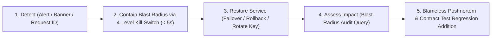

# Health Monitoring, Symptom-Based Alerting, Incident Response & Testable Ops Criteria — Tanpopo

> **Production SRE & Incident Response Specification (Phase ASTRA A06 — `DRAFT / READY_FOR_REVIEW`)**
> - **Document ID:** `SPEC-OPS-03` | **Version:** `0.1.0-step06-draft` | **Last Updated:** `2026-11-11`
> - **Authored By:** Principal SRE & Security Incident Lead
> - **Governance Status:** **Proposed Operations Specification (`PROPOSED — NO CODE`)** — grounded in `observability-and-instrumentation`, `shipping-and-launch`, telemetry contracts in [`usage-billing-observability.md`](../specifications/usage-billing-observability.md) (`SPEC-CORE-02`), and [`ADR-0006`](../architecture/adr/0006-immutable-config-snapshots-and-fast-revocation.md).
> - **Requirements Traceability:** `WF-08`, `WF-10`, `WF-12`, `OPS-03`, `OPS-04`, `OPS-07`, `TP-FR-0704`, `TP-FR-0705`, `TP-FR-0801`..`0806`, `TP-NFR-0101`..`0404`, `TP-NFR-0601`, `TP-NFR-0602`.

---

## 1. Standardized Health Probe Semantics (`/healthz` vs `/readyz` vs `/metrics`)

To prevent cascading Kubernetes restart storms (*CrashLoop Storms*) whenever an upstream AI vendor or database experiences transient turbulence, Tanpopo strictly separates **Liveness** from **Readiness**:

| Endpoint | Orchestration Purpose | `200 OK` Condition | `503 Service Unavailable` Condition | Infrastructure Consequence |
|---|---|---|---|---|
| **`GET /healthz`** | **Liveness Probe** (Process is alive and its HTTP event loop is not deadlocked). | HTTP handler goroutine responds within internal health bounds. **NEVER** queries PostgreSQL, Valkey, or external AI providers! | Process deadlocked or internal loop unresponsive (`> 2s`). | Used solely by `systemd` / `kubelet` to restart genuinely hung processes. |
| **`GET /readyz`** | **Readiness Probe** (Node is safe to accept new incoming requests from Load Balancers). | 1. Valid `ConfigSnapshot` loaded;<br/>2. Revocation epoch lag `< 10 seconds` (`Stale-Node Breaker` closed);<br/>3. Wasm Sandbox warm pool initialized;<br/>4. Process has **not** received `SIGTERM`. | 1. Cold-booting prior to initial snapshot load;<br/>2. Received `SIGTERM` and gracefully draining active SSE streams (`Draining`);<br/>3. Disconnected from both PostgreSQL and Valkey for `> 10 seconds` (`ADR-0006`). | Load Balancer / Kubernetes Service **immediately stops routing new connections to this node**, while already-open SSE streams finish draining cleanly. |
| **`GET /metrics`** | **Prometheus Scrape** *(Internal Admin port `:9090`)*. | Exports counters and `Histograms` restricted to bounded label sets (`org_id`, `route`, `adapter`, `status_class` — **strictly prohibiting `request_id` or `user_id` metric labels** to prevent cardinality explosion). | Unauthenticated scrape or rejected by internal network ACL (`401`/`403`). | Feeds symptom-based alerting rules and Kubernetes `HPA` autoscaling. |

---

## 2. Symptom-Based Alerting & Error-Budget Burn Rules (`Symptom-Based Alerting`)

Following modern SRE practice: **wake on-call engineers (`PAGE`) strictly when users experience active impact or an immediate security invariant is threatened**; route predictive capacity and maintenance warnings to business-hours queues (`TICKET`):

| Alert ID | Severity | Symptom-Based Trigger Condition (`Symptom Condition`) | Automated Mitigation & Linked Runbook |
|---|---|---|---|
| **`ALT-GATEWAY-BURN`** | **`PAGE`** | Internal Gateway error rate (`5xx` originating inside Tanpopo itself, **excluding** upstream vendor `5xx`/`429` responses) burns `> 2%` of the monthly error budget within `1 hour` (`99.9%` SLO target — `TP-NFR-0201`). | Inspect recent deployment rollout → execute `DR-04` rollback if correlated with an upgrade. |
| **`ALT-LATENCY-SLO`** | **`PAGE`** | Internal Tanpopo gateway overhead (`tanpopo_gateway_overhead_ms` p95) exceeds `10 ms` continuously for `5 minutes`. | Inspect Wasm Sandbox pool contention or Valkey saturation → see `INC-03` & `INC-07`. |
| **`ALT-REVOCATION-LAG`** | **`PAGE`** | Any Data Plane node reports `tanpopo_config_epoch_lag_seconds > 5` for more than `30 seconds` (`TP-NFR-0404`). | Nodes lagging `> 10s` automatically trip `/readyz = 503`; inspect Valkey Pub/Sub and PostgreSQL `LISTEN/NOTIFY` (`INC-07`). |
| **`ALT-AUDIT-TAMPER`** | **`PAGE`** | Periodic integrity verifier detects a broken `prev_hash -> event_hash` link inside `audit_events`. | Freeze administrative mutations, isolate storage volume for forensic investigation, and cross-verify against WORM archive (`SPEC-OPS-02`). |
| **`ALT-PLUGIN-TRAP`** | **`TICKET` / `PAGE`** | An `Extension` repeatedly traps due to sandbox memory exhaustion (`OOM > 16 MiB`), CPU fuel timeout, or blocked egress attempts `> 10/min`. | If malicious behavior or widespread regression is suspected → trigger immediate `Quarantine` (`INC-03`). |
| **`ALT-BUDGET-80`** | **`TICKET` / Webhook** | Combined `Settled + Active Holds` spend for an `Organization` or `Project` crosses `80%` and `100%` thresholds. | Dispatch Webhook/Email to `ORG_OWNER` & `TEAM_ADMIN` to adjust limits proactively prior to `429` enforcement (`INC-01`). |
| **`ALT-OAUTH-EXPIRY`** | **`TICKET`** | A `Provider Connection` enters `AUTH_EXPIRED_REAUTH_REQUIRED` or a TLS certificate has `< 14 days` remaining. | Surface Console `Banner` (`SCR-04`) prompting administrator re-authorization (`INC-05`). |
| **`ALT-UNMETERED-SPEND`** | **`TICKET`** | Any settled transaction is flagged `UNMETERED_FLAGGED` (missing model rate card or missing upstream token usage count). | Populate rate card at `SCR-05` to restore ledger precision (`UX-GR-05`). |

---

## 3. Incident Lifecycle & Seven Detailed On-Call Runbooks (`Incident Flow & Runbooks`)



### `INC-01`: Budget Exhaustion or Runaway Agent Spend Loop (`Quota & Runaway Spend`)
- **Symptoms:** Clients receive `429 project_budget_exceeded` (or `micro-USD/min` burn spikes `10x` above baseline).
- **Diagnosis (< 60 seconds):** Open `SCR-12 (/finops/budgets)` or run `tanpopo budget inspect --project <slug>` to distinguish among: (a) legitimate monthly ceiling exhaustion, (b) a runaway agent loop holding excessive concurrent `RESERVED_HOLD` reservations on a single `Virtual Key`, or (c) upstream vendor `429 upstream_rate_limited` (Tanpopo budget remains healthy, but the vendor account quota is exhausted).
- **Remediation:**
  - Runaway agent key: immediately revoke or throttle `RPM` on that individual `Virtual Key` at `SCR-13` without disrupting sibling keys in the project.
  - Legitimate business growth: `ORG_OWNER` raises the project ceiling at `SCR-12` (any minor end-of-stream `Negative Balance Carryover` reconciles automatically against the updated ceiling).

### `INC-02`: Leaked `Virtual Key` — Graceful Rotation vs Emergency Stream-Severing Revoke (`Key Rotation & Revoke`)
- **Case A — Scheduled rotation or low-confidence precaution without active exploitation (`Graceful Dual-Key Rotation` — `WF-10`):**
  ```bash
  tanpopo key rotate vk_id_01j9... --grace-period 24h
  ```
  Mints a successor key inheriting the exact `Environment` and allowlists, keeping both keys valid concurrently for `24 hours` so application deployments roll environment variables with zero dropped requests before automatic old-key retirement.
- **Case B — Confirmed public leak on GitHub or active unauthorized traffic (`Emergency Security Revoke` — `BA-OQ-003`):**
  ```bash
  tanpopo killswitch trigger --level virtual-key --target vk_id_01j9... --abort-streams --reason "Leaked in public repo"
  ```
  Invalidates the key across all nodes within **`< 1 second` (single-node) / `< 5 seconds` (HA cluster)** and immediately severs TCP sockets for every open SSE stream authenticated with that key.

### `INC-03`: Malfunctioning or Suspected Malicious External Extension (`Plugin Quarantine` — `WF-12`)
- **Symptoms:** `ALT-PLUGIN-TRAP` fires on repeated unauthorized egress attempts, corrupted response payloads, or publication of an upstream security `Revocation Advisory`.
- **Immediate Containment (< 5 seconds):**
  ```bash
  tanpopo killswitch trigger --level extension --target ext_community_xyz --abort-streams --reason "Security advisory #2026-04"
  ```
  Transitions the package to `QUARANTINED` instance-wide; every `Provider Connection` backed by that extension automatically suspends safely.
- **Forensic Impact Assessment (`Blast-Radius Query`):**
  ```bash
  tanpopo incident blast-radius --extension ext_community_xyz --since 7d --output json
  ```
  Outputs the complete inventory of `Organizations`, `Projects`, `Virtual Keys`, and `Provider Connections` that traversed the quarantined extension over the past `7 days` to guide targeted upstream credential rotation at `SCR-04`.

### `INC-04`: Widespread Upstream Provider Outage & Fail-Closed Data Residency Gate (`Upstream Outage`)
- **Automated Behavior:** Circuit breaker `SM-04` trips consecutively failing `Model Deployments` to `CIRCUIT_OPEN` and executes pre-stream failover to the next healthy deployment in the `Route`.
- **Critical `Data Residency Fail-Closed` Invariant (`TP-BR-0502`):** If an organization enforces `EU Only` residency and every `EU` deployment suffers an outage (leaving only `US` deployments healthy), Tanpopo **intentionally returns `503 no_compliant_deployment_available`** rather than silently routing regulated payloads to the United States in violation of compliance law. Only an `ORG_OWNER` can register an alternate `EU`-resident provider or issue an explicitly audited temporary policy exception.

### `INC-05`: Expired or Revoked `Authorized OAuth` Grant (`SM-03`)
- **Symptoms:** `Single-Flight Token Refresher` receives `invalid_grant` from the upstream authorization server and transitions the connection to `AUTH_EXPIRED_REAUTH_REQUIRED` (scrubbing raw upstream OAuth payloads from client-facing responses).
- **Remediation:** `ORG_OWNER` / `TEAM_ADMIN` opens `SCR-04`, clicks **`"Re-authorize Connection"`** to complete a fresh PKCE handshake; the connection returns to `ACTIVE` and resumes routing immediately.

### `INC-06`: Upstream MCP Server Unauthorized Tool Mutation (`MCP Schema Rug-Pull`)
- **Symptoms:** MCP tool invocations fail closed with `403 schema_hash_drift_blocked` and a red drift alert surfaces on `SCR-10`.
- **Remediation:** Never blindly re-enable; `REVIEWER` inspects the **Schema Diff** modal on `SCR-10` to check whether modified tool descriptions inject adversarial instructions (`Prompt Injection`) or add covert exfiltration parameters. Re-pin the updated `schema_hash` solely after confirming a legitimate release with the upstream MCP server owners.

### `INC-07`: `Valkey` Cache Cluster Outage or Database Degradation (`Cluster Degradation`)
- **Self-Healing Resilience (`ADR-0006`):**
  - `Valkey` unreachable while `PostgreSQL` remains healthy: key revocation propagation automatically falls back to **`PostgreSQL LISTEN/NOTIFY` + `2s` delta polling** (preserving the `< 5s` revocation SLA!), rate limiting degrades gracefully to per-node local token buckets divided by estimated replica count, and `destructive` tool approvals continue enforcing strict transactional checks in PostgreSQL.
  - Data Plane node partitioned from both `PostgreSQL` and `Valkey` for `> 10 seconds`: automatically trips the `Stale-Node Circuit Breaker` returning `/readyz = 503` to shed load-balancer traffic rather than serving requests against stale revocation state.

---

## 4. Twelve Testable Operational Readiness Acceptance Criteria (`OPS-AC-01` .. `OPS-AC-12`)

> **Measurement Honesty Note (`TARGET / UNVERIFIED`):** Every startup time, memory footprint, propagation latency, and recovery window threshold in the table below (`< 3.0s`, `< 128 MiB`, `< 1.0s`/`< 5.0s`, `RTO < 15m`, `< 60s`) currently carries the **`TARGET / UNVERIFIED`** design-target status because runtime implementation has not yet begun.

Tanpopo's operational and SRE readiness is gated by **12 deterministic acceptance tests with binary pass/fail thresholds**:

| Criterion ID | Operational Verification Dimension | Quantitative Pass Threshold (`Testable Pass Criteria`) | Automated Test / GameDay Drill Method |
|---|---|---|---|
| **`OPS-AC-01`** | **Single-Node Cold Start & Idle Footprint** | Reaches `/readyz = 200` in `< 3.0 seconds`; idle RSS memory remains `< 128 MiB` across Linux/macOS/Windows (`TP-NFR-0103`). | Automated container benchmark measuring process start-to-ready latency with zero external dependencies. |
| **`OPS-AC-02`** | **Strict `/healthz` vs `/readyz` Semantic Separation** | Simulating a `15-second` database outage flips `/readyz` to `503` while `/healthz` **remains `200 OK`** (`0` spurious process restarts). | Fault-injection integration test blocking PostgreSQL traffic via `iptables`/`toxiproxy`. |
| **`OPS-AC-03`** | **Emergency Revocation SLA & Active Stream Cutoff** | Triggering `Emergency Revoke` on a key streaming a long SSE response blocks new calls (`401`) and closes the active socket within **`< 1.0s` (single-node) / `< 5.0s` (3-node cluster)** (`TP-NFR-0404`). | Integration test streaming a 60-second SSE response on Node #3, issuing revoke on Node #1, and timing socket termination. |
| **`OPS-AC-04`** | **Extension `Quarantine` Isolation & Blast-Radius Query** | `Quarantine` disables a target extension across all cluster nodes in `< 5.0 seconds` and `blast-radius` enumerates `100%` of keys/projects that traversed it. | Inject fault-simulating test extension, trigger quarantine, and assert query output against seeded call history. |
| **`OPS-AC-05`** | **Pre-Upgrade Contract Compatibility Gate (`Preflight`)** | Whenever at least 1 active extension carries a `contractVersion` incompatible with the target binary, `tanpopo upgrade preflight` exits non-zero (`exit 22`) and blocks upgrade. | CLI integration test running preflight against a `tanpopo.lock` fixture containing a major-version-skewed extension. |
| **`OPS-AC-06`** | **Zero-Downtime Rolling Upgrade Stream Drain** | Rolling upgrade across a 3-node Data Plane cluster serving `100` concurrent SSE streams yields `0` `502`/`503` errors from abrupt socket termination (streams finish inside `drain_timeout`). | Continuous `k6` streaming load test executed across a Kubernetes/Compose rolling restart, asserting `100%` stream completion. |
| **`OPS-AC-07`** | **Zero-Plaintext Backups & `RTO < 15 Minute` Recovery** | Backup archive cannot decrypt provider keys without `Master KEK`; supplying the valid `Master KEK` restores a clean host and passes `tanpopo doctor` in `< 15 minutes`. | Automated weekly `DR-01` & `DR-02` GameDay recovery pipeline on ephemeral clean hosts. |
| **`OPS-AC-08`** | **Tamper-Evident Audit Hash-Chain Immutability** | Mutating or deleting even `1` character directly inside `audit_events` is pinpointed at the exact tampered sequence number by `tanpopo admin verify-state --check-audit-chain`. | Security test mutating raw SQLite/PostgreSQL storage bytes directly and asserting non-zero tamper detection. |
| **`OPS-AC-09`** | **Sub-`60 Second` Tenant Deletion (`Crypto-Shredding`)** | Elapsed time from invoking project deletion to full key revocation, `DEK` destruction, and mathematical irrecoverability of prior ciphertext is `< 60 seconds` (`TP-NFR-0502`). | Timed deletion benchmark against a project seeded with `10,000` trace rows, verifying post-shred decryption failure. |
| **`OPS-AC-10`** | **Zero Secret Leakage in Logs & Support Bundles** | `0` upstream API keys, full `Virtual Keys`, `OAuth tokens`, or prompt bodies appear in `stdout` JSON logs, `/metrics`, or `tanpopo support-bundle` archives. | Seed canary credentials (`CANARY_SECRET_...`), trigger 4xx/5xx failure paths, generate `support-bundle`, and regex-scan all output artifacts. |
| **`OPS-AC-11`** | **Full Operation Inside Isolated `Air-Gapped` Networks** | Instance bootstrap, `tanpopo bundle import`, Web Console rendering, and LAN model routing succeed `100%` inside a network namespace with zero Internet egress. | End-to-end integration test inside a Linux network namespace configured with `no default gateway`. |
| **`OPS-AC-12`** | **Bounded Prometheus Metric Cardinality** | Active time-series count on `/metrics` remains strictly bounded by finite configuration dimensions and never scales with `request_id` or user query count after `1,000,000` requests. | High-cardinality load test firing `100,000` randomized `request_id` calls and asserting constant `/metrics` series count. |
