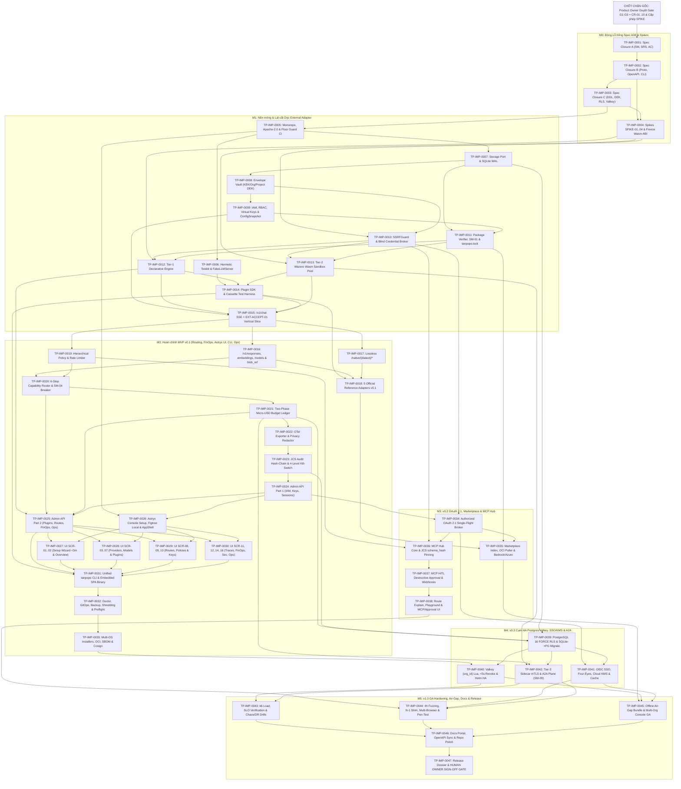

# Đồ thị Phụ thuộc Phi Chu trình (`DAG`), Đường Găng, Quy trình Môi trường & Thứ tự Khởi chạy — Tanpopo

> **Tài liệu Điều phối Phụ thuộc & Hạ tầng Dựng (Phase ASTRA A09 — Gate G4: `READY_FOR_REVIEW` | `DRAFT — EXECUTION BASELINE UNLOCKED`)**
> - **Mã tài liệu:** `PLAN-DAG-01` | **Phiên bản:** `0.1.0-step09-draft` | **Ngày lập:** `2026-11-14`
> - **Vai trò biên soạn:** Staff Engineer, Technical Program Manager & QA Lead
> - **Bảo chứng Toán học của Đồ thị (`Verified Acyclic`):** Mọi cạnh phụ thuộc `TP-IMP-u -> TP-IMP-v` trên toàn bộ `47` đơn vị đều thỏa mãn bất biến chỉ số tăng ngặt `u < v`, chứng minh đồ thị là **Đồ thị Có hướng Phi Chu trình (`DAG` — `0` vòng lặp, `0` định danh phụ thuộc mồ côi)**.

---

## 1. Sơ đồ Phụ thuộc Toàn cục (`End-to-End Implementation Dependency DAG`)

---

## 2. Đường Găng (`Critical Path`), Phân Làn Song song (`Worktree Lanes`) & Thứ tự 5 Đơn vị Đầu Tiên

### 2.1. Chuỗi Đường Găng Dài Nhất (`Critical Path`)
Mọi sự chậm trễ trên chuỗi **22 chặng liên tiếp cho `MVP v0.1`** (và thêm **4 chặng cho `v1.0 GA`**) dưới đây sẽ kéo lùi trực tiếp ngày sẵn sàng phát hành:
- **Đường găng tới `MVP v0.1`:** `TP-IMP-0001` → `0002` → `0003` → `0005` → `0007` → `0008` → `0009` → `0011` → `0013` → `0014` → `0015` → `0016` → `0020` *(qua `0019` song song)* → `0021` → `0022` → `0023` → `0024` → `0025` → `0027..0030` *(song song 4 nhánh)* → `0031` → `0032` → `0033`.
- **Đường găng tiếp nối tới `v1.0 GA`:** `0033` + `0039` → `0040` → `0043` *(song song `0044`, `0045`)* → `0046` → `0047`.

### 2.2. Các Cửa sổ Chạy Song song Hiệu suất Cao Qua `git worktree`
Khi dùng nhiều AI Agents thực thi đồng thời (mỗi Agent một thư mục `git worktree` riêng), có **4 điểm nở rộng song song lớn** không đụng độ tệp:
1. **Ngay sau `TP-IMP-0003`:** Chạy song song `TP-IMP-0004` (`tools/spikes/*` có `tools/spikes/go.mod` cô lập riêng biệt) và `TP-IMP-0005` (`go.mod` gốc, `web/console`, `.github/workflows`, `.gitignore`).
2. **Ngay sau `TP-IMP-0011` + `0010`:** Chạy song song `TP-IMP-0012` (`internal/extension/declarative`) và `TP-IMP-0013` (`internal/extension/wasm`).
3. **Ngay sau `TP-IMP-0015`:** Chạy song song 3 làn: Làn Giao thức & Official Adapters (`0016`, `0017`, `0018`), Làn Chính sách/Định tuyến/Sổ cái (`0019` → `0023`), và (từ `0024`) Làn Khung Giao diện Astryx (`0026`).
4. **Ngay sau `TP-IMP-0025` + `0026`:** Chạy **song song 4 làn giao diện độc lập** (`0027`, `0028`, `0029`, `0030` — mỗi đơn vị sở hữu tập trang màn hình riêng trong `web/console/src/pages/*`), đồng thời ở backend có thể tách nhánh sớm cho `0034` (`OAuth 2.1`) và `0039` (`PostgreSQL Driver`)!

### 2.3. Thứ tự 5 Đơn vị Đầu Tiên Có Thể Bắt đầu Ngay Khi Mở Khóa (`Conditional First 5 Units`)

> **Trạng thái hiện thực hôm nay:** **`0` đơn vị đang `READY`** vì `Gate G1–G3` và `CR-01`..`10` đang chờ Product Owner phê duyệt (`GAP-01`).
> **Ngay khoảnh khắc Product Owner phê duyệt `Gate G1–G3` + `CR-01`..`10` (và cấp phép chạy Spikes), 5 đơn vị đầu tiên chuyển sang `READY` theo đúng thứ tự sau:**

1. **[`TP-IMP-0001`](./units/TP-IMP-0001.md)** *(Tuần tự #1)* — Đóng đặc tả Lô A: Vá điểm chết máy trạng thái `SM-01`..`09`, bổ sung đủ `AC` cho `TP-FR-0701`, `0702`, `0901` và hiệu chỉnh cổng thoát `v0.1`.
2. **[`TP-IMP-0002`](./units/TP-IMP-0002.md)** *(Tuần tự #2, ngay sau `0001`)* — Đóng đặc tả Lô B: Hoàn thiện `runtime.proto` biên dịch sạch, phong bì `blob_ref` đa phương thức, đầy đủ `51` endpoint `OpenAPI 3.1` và chuẩn hóa cây lệnh CLI / metric / mã lỗi.
3. **[`TP-IMP-0003`](./units/TP-IMP-0003.md)** *(Tuần tự #3, ngay sau `0002`)* — Đóng đặc tả Lô C: Hoàn thiện DDL `8` bảng còn thiếu, `Project DEK`, khóa tổ hợp `(org_id, id)` + `FORCE RLS`, chuỗi băm `audit_events` theo `org_id`/JCS và lược đồ khóa Valkey `{org_id}`.
4. **[`TP-IMP-0004`](./units/TP-IMP-0004.md)** *(Song song Làn A ngay sau `0003`)* — Chạy 4 thử nghiệm có bấm giờ `SPIKE-01`..`04` và ghi biên bản khóa cứng chuẩn `Wasm ABI` (`POC-01`).
5. **[`TP-IMP-0005`](./units/TP-IMP-0005.md)** *(Song song Làn B ngay sau `0003`)* — Khởi tạo cấu trúc Monorepo (`cmd/`, `internal/`, `web/console/`), đồng bộ giấy phép `Apache-2.0` (`ISS-002`), dựng chốt chặn `CONSTRAINTS.md` Floor Guard và đường ống CI `Stage 0/1`.

---

## 3. Điều kiện Tiền đề Môi trường, Dữ liệu Kiểm thử Khép kín & Quy trình Dựng / Đóng gói (`Env, Test Data & Packaging Procedures`)

1. **Điều kiện Tiền đề Máy Trạm Kỹ sư & CI Runner (`Environmental Prerequisites`):**
   - **Go Toolchain:** `Go >= 1.24` (`module github.com/nguywnben/tanpopo`). **Lưu ý cờ biên dịch bắt buộc:** Trình phát hiện tranh chấp `-race` của Go yêu cầu `CGO_ENABLED=1` (cần trình biên dịch C trên máy trạm/CI), do đó **tuyệt đối không bao giờ gộp `CGO_ENABLED=0` và `-race` trên cùng một dòng lệnh** — luôn tách làm 2 bước: (a) kiểm tra thuần Go không C: `CGO_ENABLED=0 go test ./...` (PowerShell: `$env:CGO_ENABLED='0'; go test ./...`), và (b) kiểm tra tranh chấp dữ liệu: `go test -race ./...` (hoặc gọi trình chạy đa nền tảng `go run ./scripts/ci/check.go`).
   - **Node.js & UI Toolchain:** `Node.js >= 22.13.0`, `npm` (luôn cài bằng `npm ci --ignore-scripts`), gọi Astryx CLI qua `npx @astryxdesign/cli ...` (trên Windows PowerShell dùng `cmd /c npx @astryxdesign/cli ...` theo `ISS-006`).
   - **Công cụ Hợp đồng & Bảo mật:** `buf` / `protoc`, `golangci-lint`, `govulncheck`, `osv-scanner`, `gitleaks`, `cosign`, `syft`/`cyclonedx-gomod`, và Docker/Compose cục bộ (chỉ cần cho kiểm thử tích hợp `PostgreSQL 16` + `Valkey 8` ở `Stage 2 CI` và `TP-IMP-0039+`).
   - **Mẫu Wasm Kiểm thử Đóng Sẵn (`Zero Host TinyGo Requirement for Unit Tests`):** Các mô-đun `.wasm` nhỏ phục vụ kiểm thử đối kháng (`infinite_loop.wasm`, `oom_alloc.wasm`, `unreachable_trap.wasm`, `unapproved_wasi.wasm`, `echo_transform.wasm`) được dựng sẵn từ mã nguồn `.wat` minh bạch lưu trong `internal/testkit/wasmfixtures/` để `go test` chạy được ngay trên mọi máy Windows/macOS/Linux mà không bắt buộc cài trước `TinyGo`; `TinyGo` / `Rust wasm32` chỉ cần khi tác giả biên dịch gói mẫu SDK mới.
2. **Quy trình Dữ liệu Kiểm thử Khép kín (`Hermetic Test Data & Zero External AI Cost`):**
   - Mọi gói kiểm thử bắt buộc đặt `TANPOPO_TEST_HERMETIC=1` ngay trong `TestMain`, kích hoạt `testkit/netguard` đánh trượt tức thì mọi kết nối socket ra ngoài `127.0.0.0/8` / `::1`.
   - Mọi thông tin xác thực trong bộ kiểm thử dùng chuỗi mồi nhử chuẩn `sk-tp-canary-DO-NOT-LEAK-9f8e7d6c` để `CanaryScanner` quét hậu kiểm trên toàn bộ nhật ký, DB, OTel spans và `support-bundle`.
   - Mỗi ca kiểm thử tạo một thư mục `t.TempDir()` (với SQLite) hoặc một `org_id` `UUIDv7` ngẫu nhiên có hạt giống `TANPOPO_TEST_SEED` (với PostgreSQL/Valkey) để chạy `t.Parallel()` an toàn tuyệt đối.
3. **Quy trình Biên dịch Nhị phân Đơn & Đóng gói Xuất xưởng (`Build & Package Procedure`):**
   - Bước 1 *(Web Console Static Build)*: `cd web/console && npm ci --ignore-scripts && npm run build && npx @astryxdesign/cli doctor --built dist` (`0 fail`).
   - Bước 2 *(Embed & Pure-Go Cross-Compile)*: Sao chép/liên kết tài sản tĩnh vào gói nhúng `internal/webui/dist`, chạy `CGO_ENABLED=0 GOOS=<os> GOARCH=<arch> go build -mod=readonly -trimpath -ldflags="-s -w -X main.version=<git-tag>" -o dist/tanpopo ./cmd/tanpopo`.
   - Bước 3 *(Provenance & Signing)*: Sinh tệp băm `SHA256SUMS`, xuất `sbom.cdx.json`, ký không khóa `cosign sign-blob` và chạy kiểm thử khói ngoại tuyến trên nhị phân vừa tạo trước khi trình duyệt cổng phát hành.
