# Lộ trình Triển khai Tổng thể & Kiến trúc Phân rã Epics Từ A đến Z (Master Implementation Roadmap) — Tanpopo

> **Tài liệu Kế hoạch Chương trình Kỹ thuật Nháp (Phase ASTRA A09 — Gate G4: `READY_FOR_REVIEW` | `DRAFT — EXECUTION BASELINE UNLOCKED`)**
> - **Mã tài liệu:** `PLAN-RM-01` | **Phiên bản:** `0.1.0-step09-draft` | **Ngày lập:** `2026-11-14`
> - **Vai trò biên soạn:** Technical Program Manager, Staff Engineer & QA Lead
> - **CẢNH BÁO QUẢN TRỊ BẮT BUỘC (`DO NOT LOCK EXECUTION BASELINE`):**
>   1. Tính đến thời điểm lập kế hoạch A09, các cổng **Gate G1 (`SD-G1-01`..`05`)**, **Gate G2 (`TD-G2-01`..`06`, `BA-OQ-001`..`05`)** và **Gate G3 (`ADR-0001`..`0006`)** đều đang ở trạng thái **`READY_FOR_REVIEW`** (Product Owner chưa phê duyệt).
>   2. Báo cáo kiểm toán độc lập A08 ([`integrated-audit.md`](../reviews/integrated-audit.md)) hiện có kết quả **`FAIL`** với **`11 CRITICAL` blockers** và **10 Yêu cầu Thay đổi (`CR-01`..`CR-10`)** đang mở tại [`unresolved-gaps.md`](../reviews/unresolved-gaps.md).
>   3. Do đó, kế hoạch này là **Bản Nháp Điều phối Có Điều kiện (`DRAFT — PRE-APPROVAL`)**, **tuyệt đối chưa khóa Execution Baseline và chưa phê duyệt Gate G4**. Toàn bộ `47` đơn vị thực thi (`TP-IMP-0001`..`0047`) hiện mang trạng thái trung thực là **`BLOCKED`** chờ Product Owner ký duyệt mở khóa ở Mục 1.2.

---

## 1. Triết lý Sắp xếp Lộ trình Theo Phụ thuộc Kiến trúc Thực tế (`Risk-First & Contract-First Phasing`)

### 1.1. Tại sao Điều chỉnh Thứ tự Theo Phụ thuộc Thật Thay Vì Cắt Ngang Truyền thống?
Theo nguyên tắc của kỹ năng `planning-and-task-breakdown` và `incremental-implementation`, nếu xây toàn bộ cơ sở dữ liệu rồi xây toàn bộ 57 API rồi mới ghép giao diện ở cuối cùng, rủi ro lớn nhất của Tanpopo (**chứng minh một `External Provider Adapter` cài từ ngoài chạy truyền luồng SSE tốc độ cao qua Wasm Sandbox + `Blind Credential Broker` mà không biên dịch lại Core — `MO-02`, `RSK-001`, `RSK-004`**) sẽ bị đẩy lùi hàng tháng trời.

Thay vào đó, lộ trình A–Z của Tanpopo được sắp xếp theo **chiều phụ thuộc nhân quả thực tế gồm 9 Chặng (`Phases`) gom trong 6 Cột mốc (`M0` .. `M5`)**:

```mermaid
flowchart LR
    P0["Chặng 0 (M0): Đóng 11 Lỗ hổng Spec A08 & Chạy PoC SPIKE-01..04"] --> P1["Chặng 1 (M1a): Nền móng Monorepo, Hermetic Testkit, Kho SQLite, Vault & Auth"]
    P1 --> P2["Chặng 2 (M1b): Lát cắt Dọc Sống còn — External Adapter Install -> Test -> Connect -> Unified SSE"]
    P2 --> P3["Chặng 3 (M2a): Đủ Giao thức Unified/Native, Official Adapters, Policy, Router, Sổ cái Micro-USD & Audit"]
    P3 --> P4["Chặng 4 (M2b): Admin API (ETag/409), tanpopo CLI & Giao diện Astryx neutral (Setup < 3m)"]
    P4 --> P5["Chặng 5 (M2c): Tự vận hành Đơn nút, Đóng gói Đa OS, Sao lưu/Xóa < 60s & Cổng MVP v0.1"]
    P5 --> P6["Chặng 6 (M3 - v0.2): Authorized OAuth 2.1, Marketplace/OCI, MCP Governance Hub & Playground"]
    P6 --> P7["Chặng 7 (M4 - v0.3): Cụm HA Postgres/Valkey, Thu hồi < 5s, OIDC/4-Mắt, KMS & Mặt phẳng A2A"]
    P7 --> P8["Chặng 8 (M5 - v1.0 GA): Đóng băng Contract 12m, Air-Gap Bundle, Đo tải/Pen-Test, Tài liệu & Phát hành Có Duyệt"]
```

1. **Đóng đặc tả trước khi giao cho Agent thực thi (`Chặng 0 / M0` — `TP-IMP-0001`..`0004`):** Tuân thủ nghiêm quy tắc *"nếu tài liệu thiếu, phải bổ sung docs trước khi chuyển cho Luna"*. Ngay sau khi Product Owner chốt `CR-01`..`10`, 3 đơn vị đầu tiên cập nhật dứt điểm máy trạng thái, `runtime.proto`, `OpenAPI 3.1` và `8` bảng DDL còn thiếu, tiếp theo là `SPIKE-01`..`04` khóa cứng Wasm ABI (`POC-01`).
2. **Chứng minh Lát cắt Dọc Khác biệt Cốt lõi Sớm Nhất (`Chặng 1–2 / M1` — `TP-IMP-0005`..`0015`):** Chỉ dựng phần nhân tối thiểu (Monorepo + Mạng kiểm thử khóa Internet + SQLite WAL + Kho khóa `AEAD` + Khóa ảo + `SSRFGuard` + `Blind Broker`) để chạy thông suốt từ đầu đến cuối kịch bản **`EXT-ACCEPT-01`**: *khởi tạo Adapter ngoài → chạy `tanpopo plugin test` ngoại tuyến → cài đặt duyệt quyền vào `tanpopo.lock` → gắn khóa mù → gọi `/v1/chat/completions` truyền luồng SSE thành công mà mã băm nhị phân Core không đổi*.
3. **Mở rộng Bề rộng `MVP (v0.1)` Trên Hạt nhân Đã Chứng minh (`Chặng 3–5 / M2` — `TP-IMP-0016`..`0033`):** Bổ sung `/v1/responses`, `/v1/embeddings`, `/v1/models`, luồng `blob_ref` đa phương thức, `/native/*`, bộ 5 Official Adapters, Định tuyến/Chính sách, Sổ cái hai pha `micro-USD`, OTel, Chuỗi băm kiểm toán, Admin API, Web Console Astryx `neutral`, CLI và bộ cài đặt đa nền tảng.
4. **Mở rộng Hệ sinh thái Tác nhân & Quy mô Cụm Doanh nghiệp (`Chặng 6–8 / M3–M5` — `TP-IMP-0034`..`0047`):** Giao cuốn chiếu `v0.2` (OAuth 2.1, Marketplace/OCI, MCP Hub, Route Explain, Playground), `v0.3` (PostgreSQL 16 + Valkey HA, OIDC/Four-Eyes, KMS, Sidecar Tầng 3 & A2A Plane) và `v1.0 GA` (Air-Gap Bundle, đo tải `SLO`, kiểm thử xâm nhập, đánh bóng kho mã và phát hành công khai có chữ ký duyệt của Owner).

---

### 1.2. Danh mục Các Chốt Chặn Cấp Chương trình Hiện Tại (`Program-Level Blockers`)

Không một đơn vị viết mã sản phẩm nào được chuyển từ `BLOCKED` sang `READY` cho tới khi giải tỏa **3 chốt chặn gốc** sau:
1. **`BLK-GOV-01` (Chờ Product Owner duyệt Cổng `G1 / G2 / G3`):** Phê duyệt `SD-G1-01`..`05`, `TD-G2-01`..`06`, `BA-OQ-001`..`05` và `ADR-0001`..`0006` tại [`decisions.md`](../governance/decisions.md).
2. **`BLK-AUD-02` (Chờ Product Owner chốt `CR-01`..`CR-10` & Đóng `11 CRITICAL` Gaps của A08):** Quyết định phương án tại [`unresolved-gaps.md`](../reviews/unresolved-gaps.md) và hoàn tất các đơn vị vá đặc tả `TP-IMP-0001`..`0003`.
3. **`BLK-POC-03` (Chờ Product Owner cấp phép chạy `SPIKE-01`..`04`):** Mở khóa thực nghiệm `TP-IMP-0004` để chọn dứt điểm giao diện bộ nhớ Wasm (`POC-01`) trước khi viết `TP-IMP-0013` và SDK `TP-IMP-0014`.

---

## 2. Kiến trúc 10 Epics, Ranh giới Sở hữu Giao diện & Quản trị Nợ Kỹ thuật (`Epics & Module Boundaries`)

Mỗi Epic sở hữu một ranh giới gói mã nguồn độc lập tuân thủ **Đồ thị Phụ thuộc Phi Chu trình (`Acyclic Capability Map`)** tại [`prd.md`](../product/prd.md) Mục 5 và [`system-design.md`](../architecture/system-design.md) Mục 2.3:

| Mã Epic | Tên Epic & Phạm vi Sở hữu Gói Mã (`Package Ownership`) | Giao diện Cung cấp (`Exposed Contracts`) | Phụ thuộc Đầu vào | Rủi ro Nợ Kỹ thuật & Nhu cầu Di trú (`Tech Debt & Migration`) | Đơn vị Thực thi (`TP-IMP`) |
|---|---|---|---|---|---|
| **`EP-00`** | **Đóng Lỗ hổng Đặc tả A08 & Thử nghiệm Spikes** *(`docs/*`, `proto/*`, `openapi/*`, `tools/spikes/*` cô lập)* | Chuẩn đóng băng `runtime.proto`, `openapi/*.yaml`, DDL `26` bảng chuẩn, quyết định Wasm ABI `POC-01`. | Quyết định của Owner trên `G1–G3` & `CR-01`..`10`. | Đặt `tools/spikes/go.mod` tách biệt hoàn toàn khỏi `go.mod` gốc và đóng băng/xóa mã nháp sau khi ghi biên bản vào ADR để không rò rỉ vào nhân sản xuất. | `0001` .. `0004` |
| **`EP-01`** | **Nền tảng Kho mã, CI Khép kín, Lưu trữ, Kho khóa & IAM** *(`internal/storage`, `internal/security/vault`, `internal/iam`, `internal/config/snapshot`, `internal/testkit/*`)* | `RelationalStore`, `SecretVault` (`AEAD AAD`), `AuthMiddleware`, `ConfigSnapshot`, `FakeLLMServer`, `netguard`. | `EP-00` (`0001`..`0003`). | Bắt buộc viết giao diện `storage/port` trung lập ngay từ ngày đầu để không nợ câu lệnh riêng của SQLite khi thêm PostgreSQL ở `EP-08`. | `0005` .. `0009` |
| **`EP-02`** | **Động cơ Phần mở rộng Cô lập, `Blind Broker` & SDK** *(`internal/security/{egress,broker}`, `internal/extension/*`, `internal/provider/catalog`, `sdk/*`)* | `SSRFGuard`, `BlindBroker`, `LockfileManager`, `ProviderRuntime`, `DeclarativeEngine`, `WazeroPool`, `tanpopo plugin test`. | `EP-00` (`0004`), `EP-01`. | Duy trì bộ chuyển đổi tương thích `Contract Shim N-1` ngay khi tăng bản phụ hợp đồng `0.x -> 1.0`. | `0010` .. `0014` |
| **`EP-03`** | **Mặt phẳng Giao thức Suy luận Hợp nhất & Phương ngữ Gốc** *(`internal/ingress/{http,sse,native}`, `extensions/official/*`)* | `/v1/chat/completions`, `/v1/responses`, `/v1/embeddings`, `/v1/models`, `/native/{dialect}/*`, `blob_ref` streaming. | `EP-01`, `EP-02`. | Không nhúng ngoại lệ của từng hãng AI vào `internal/ingress`; mọi biến đổi hãng phải đi qua hợp đồng `Official Adapters` (*dogfooding*). | `0015` .. `0018` |
| **`EP-04`** | **Động cơ Chính sách, Định tuyến Năng lực, Sổ cái `Micro-USD` & Kiểm toán** *(`internal/policy`, `internal/ratelimit`, `internal/routing`, `internal/finops`, `internal/telemetry`, `internal/security/{audit,killswitch}`)* | `PolicyEvaluator`, `RouteResolver` (`SM-04`), `TwoPhaseLedger` (`SM-07`), `OTelExporter`, `HashChainAudit`, `KillSwitch`. | `EP-01`, `EP-03`. | Chế độ đơn nút dùng bộ đếm/giữ chỗ nguyên tử trong RAM + SQLite; sang `EP-08` cắm thêm bộ điều phối `Valkey Lua` qua cùng interface mà không sửa `RouteResolver`. | `0019` .. `0023` |
| **`EP-05`** | **Mặt phẳng Quản trị REST API, Astryx Web Console & `tanpopo` CLI** *(`internal/admin/http`, `internal/webui`, `web/console/*`, `internal/cli/*`, `cmd/tanpopo`)* | `/admin/v1/*` (`ETag`/`409`), SPA tĩnh nhúng qua `embed.FS` (`SCR-01..09, 11..14, 16`), cây lệnh `tanpopo`. | `EP-01`..`EP-04`. | Dời sạch `src/` gốc về `web/console/` ngay ở `TP-IMP-0005`/`0026`; dùng Vite alias đóng gói phông `Figtree` nội bộ để không phải sửa tệp sinh tự động `astryx-themes.js`. | `0024` .. `0031` |
| **`EP-06`** | **Tự Vận hành Đơn nút, Sao lưu/Xóa Sạch & Đóng gói Đa Nền tảng** *(`internal/ops/*`, `deploy/*`, `.github/workflows/release*`)* | `/healthz`, `/readyz`, `tanpopo doctor`, `backup/restore`, `Crypto-Shredding < 60s`, đủ 10 bước `EXT-ACCEPT-01`, gói Linux/macOS/Windows/OCI + `SBOM`/`Cosign`. | `EP-05`. | Mọi thay đổi bảng SQL từ `v0.1` trở đi bắt buộc tuân thủ di trú 2 bước **Expand → Contract** để bảo toàn khả năng quay lui nhị phân tức thì (`DR-04`). | `0032` .. `0033` |
| **`EP-07`** | **Hệ sinh thái `v0.2`: `Authorized OAuth 2.1`, Marketplace/OCI & `MCP Hub`**\u003cbr/\u003e*(`internal/security/oauth`, `internal/ingress/mcp`, `internal/webhook`, mở rộng `web/console`)* | Luồng `OAuth 2.1` làm mới đơn luồng, chỉ mục Marketplace/kho OCI, `/mcp` (`schema_hash` + duyệt `destructive`), `Route Explain`, `Playground` (`SCR-10`, `15`). | `EP-02`..`EP-06`. | Tránh nợ tương thích với các MCP IDE thực tế bằng cách dùng phản hồi JSON-RPC chuẩn cho phê duyệt bất đồng bộ (`CR-08`). | `0034` .. `0038` |
| **`EP-08`** | **Quy mô Doanh nghiệp `v0.3`: Cụm HA `Postgres/Valkey`, IAM/KMS & `A2A Plane`** *(`internal/storage/postgres`, `internal/cluster/valkey`, `internal/iam/oidc`, `internal/security/foureyes`, `internal/ingress/{cache,a2a}`, `internal/extension/sidecar`, `deploy/helm`)* | `PostgreSQL 16 FORCE RLS`, `tanpopo db migrate-engine`, `Valkey {org_id}` Lua, thu hồi `< 5s`, `OIDC + Four-Eyes`, `KMS`, `Tier-3 Sidecar`, `/a2a/*`. | `EP-06`, `EP-07`. | Di trú `SQLite -> Postgres` phải tự tạo trước các phân vùng tháng lịch sử và đối soát khớp `100%` tổng sổ cái + chuỗi băm kiểm toán (`CT-32`). | `0039` .. `0042` |
| **`EP-09`** | **Kiểm chứng Cứng hóa `v1.0 GA`, Gói `Air-Gap`, Tài liệu & Xuất xưởng Có Duyệt** *(`tests/perf`, `tests/chaos`, `tests/security`, `docs/guides`, `CHANGELOG.md`)* | Báo cáo đo thật `SLO-01..08`, fuzzing `>= 4h` + Pen-Test hộp xám, `tanpopo bundle`, Multi-Org Console GA, cổng kiểm tra tài liệu-code và hồ sơ trình ký `GATE-REL-01..07`. | `EP-06`..`EP-08`. | **Cấm tuyệt đối CI tự động gắn thẻ hoặc phát hành bản công khai khi chưa có chữ ký phê duyệt của Product Owner (`GATE-REL-07`).** | `0043` .. `0047` |

---

## 3. Chiến lược Nhánh Git, Tích hợp Liên tục, Cờ Tính năng & Triển khai Canary (`Git, Rollout & Rollback Strategy`)

1. **Phát triển Dựa trên Nhánh Chính Ngắn Hạn (`Trunk-Based + Short-Lived Unit Branches`):**
   - Mỗi đơn vị `TP-IMP-xxxx` làm việc trên một nhánh ngắn hạn riêng `feat/tp-imp-xxxx-<slug>` (hoặc thư mục `git worktree` cô lập khi chạy nhiều AI Agents song song trên các đơn vị không phụ thuộc nhau).
   - Quy mô PR mục tiêu: `150–450` dòng logic kiểm thử được; gộp về `main` ngay khi vượt qua `Stage 0..3 CI` và rà soát phù hợp mức rủi ro (`STANDARD_REVIEW` vs `REQUIRES_STRONG_REVIEW`).
   - Chuẩn thông điệp commit tuân thủ nghiêm `DEC-008`: trong các pha ASTRA dùng `<type>: step <NN> - <mô tả>`; khi bước vào thực thi đơn vị sau Gate G4 dùng `<type>(<module>): step 10 - <mô tả rõ lý do> (TP-IMP-xxxx)` (hoặc `<type>(<module>): <mô tả> [TP-IMP-xxxx]` nếu Product Owner chấp thuận mở rộng `DEC-008` tại Gate G4).
2. **Cờ Tính năng Cho Các Mặt phẳng Đang Xây Dở (`Feature Flags`):**
   - Khi gộp dần các đơn vị của nhịp `v0.2` (`MCP Hub`, `Authorized OAuth`) hoặc `v0.3` (`A2A Plane`, `Tier-3 Sidecar`, `Response Cache`) vào `main`, toàn bộ điểm cuối và mục điều hướng UI chưa hoàn chỉnh được khóa mặc định `OFF` sau cấu hình `features.enable_mcp_plane = false`, `features.enable_a2a_plane = false` (kiểm thử cả 2 trạng thái `ON` và `OFF` trong CI; xóa cờ trong vòng 1 bản phụ sau khi GA).
3. **Quy trình Triển khai Cuộn Có Kiểm soát Ngân sách Lỗi (`Canary Rollout & Error-Budget Gate`):**
   - Trước khi cuộn bản mới lên môi trường tự vận hành sản xuất: chạy `tanpopo upgrade preflight` (`exit 0`) → chụp sao lưu nóng → áp dụng SQL migration *Expand-Only* → nâng cấp `Control Plane` → nâng cấp thử **1 nút `Data Plane Canary` nhận `5%` lưu lượng** trong `30–60 phút`.
   - **Ngưỡng Quyết định Tự động:**
     - *Tiến tiếp (`25% -> 50% -> 100%`):* Tỷ lệ lỗi nội bộ `< 0.05%`, `p95` độ trễ cộng thêm không tăng quá `20%` so với nền, `0` lỗi lệch `ConfigSnapshot`.
     - *Quay lui Tức thì (`Rollback < 60 giây` — `DR-04`):* Tốc độ đốt ngân sách lỗi `>= 14.4x`, `p95` độ trễ tăng `> 50%`, phát sinh bất kỳ lỗi rò rỉ dữ liệu/sai lệch sổ cái nào → trỏ lại ảnh container bản trước không cần khôi phục lạnh cơ sở dữ liệu.

---

## 4. Mô hình Giả định Năng lực Đội ngũ & Biên độ Bất định (`Capacity & Uncertainty Assumptions — NO FAKE ETAs`)

> **Kỷ luật trung thực lập kế hoạch:** Dự án tuyệt đối **không bịa đặt ngày giao hàng cố định giả tạo** khi các cổng `G1–G3` chưa duyệt và chưa chốt quy mô nhân sự. Bảng dưới đây cung cấp **ước lượng nỗ lực tương đối theo phiên làm việc tập trung (`Focused Engineering/Agent Sessions`, kèm biên độ bất định `P50 – P90`)** dựa trên 2 kịch bản nguồn lực rõ ràng:

- **Giả định Kịch bản Năng lực A (`Solo Technical Founder + AI Coding Agents`):** 1 kỹ sư chính trực tiếp phê duyệt `REQUIRES_STRONG_REVIEW`, chạy song song tối đa 2 luồng Agent qua `git worktree`.
- **Giả định Kịch bản Năng lực B (`Small Core Team 3 Kỹ sư: 1 Backend/Security, 1 Platform/Infra, 1 Frontend/DX + AI Agents`):** Chạy song song 3 làn công việc sau khi qua `M1a`.

| Cột mốc | Số lượng Unit (`TP-IMP`) | Tổng Nỗ lực Ước tính (`Unit-Sessions`) | Ước tính Thời lượng Tương đối — **Kịch bản A (1 Người + Agents)** *(`UNVERIFIED ESTIMATE`)* | Ước tính Thời lượng Tương đối — **Kịch bản B (3 Kỹ sư + Agents)** *(`UNVERIFIED ESTIMATE`)* | Nguồn Bất định Lớn nhất (`Uncertainty Drivers`) |
|---|---|---|---|---|---|
| **`M0` (Đóng Spec A08 & Spikes)** | `4` (`0001`..`0004`) | `6 – 10` phiên | `~1.0 – 1.5 tuần` *(sau khi Owner duyệt CR)* | `~3 – 5 ngày` | Kết quả đo thực tế của `SPIKE-02` (nếu phải đổi biên bộ nhớ Wasm). |
| **`M1` (Foundation & Lát cắt Adapter Ngoài)** | `11` (`0005`..`0015`) | `16 – 24` phiên | `~2.5 – 4.0 tuần` | `~1.5 – 2.5 tuần` | Xử lý biên hủy luồng SSE `< 500ms` và cô lập tài nguyên `wazero` đa OS. |
| **`M2` (Hoàn chỉnh `MVP v0.1` Console/CLI/Ops)** | `18` (`0016`..`0033`) | `28 – 42` phiên | `~4.5 – 7.0 tuần` | `~2.5 – 4.0 tuần` | Độ tỉ mỉ `WCAG 2.2 AA` + `astryx doctor --built` trên 14 màn hình `v0.1` và đóng gói Windows/macOS. |
| **`M3` (`v0.2` OAuth 2.1, Marketplace & MCP Hub)** | `5` (`0034`..`0038`) | `12 – 18` phiên | `~2.0 – 3.5 tuần` | `~1.5 – 2.0 tuần` | Tương thích thực tế với các phiên bản mới của trình khách `Claude Code` / `Cursor` (`POL-02`). |
| **`M4` (`v0.3` Cụm HA Postgres/Valkey, SSO & A2A)** | `4` (`0039`..`0042`) | `12 – 20` phiên | `~2.5 – 4.0 tuần` | `~1.5 – 2.5 tuần` | Kiểm thử hỗn loạn mạng phân tán (`Valkey`/`Postgres` failover) và giao thức `A2A`. |
| **`M5` (`v1.0 GA` Air-Gap, Đo tải, Pen-Test & Phát hành)** | `5` (`0043`..`0047`) | `10 – 18` phiên *(chưa tính lịch đối tác Pen-Test ngoài)* | `~2.0 – 3.5 tuần` *(+ lịch Pen-Test độc lập)* | `~1.5 – 2.5 tuần` *(+ lịch Pen-Test độc lập)* | Phát hiện từ kiểm thử xâm nhập hộp xám độc lập trước mốc `1.0`. |
