# Master Implementation Roadmap & End-to-End Epic Decomposition — Tanpopo

> **Technical Program Plan (`HANDOFF_VERDICT: GO` | `TP-IMP-0001..0008: DONE` | `READY_FOR_REVIEW: TP-IMP-0009` | `READY: TP-IMP-0010`)**
> - **Document ID:** `PLAN-RM-01` | **Version:** `1.9.0-tp-imp-0009-ready-for-review` | **Date:** `2026-11-14`
> - **Authors:** Technical Program Manager, Staff Engineer & QA Lead
> - **MANDATORY GOVERNANCE NOTICE (`TP-IMP-0005..0008 ACCEPTED — TP-IMP-0009 READY_FOR_REVIEW, TP-IMP-0010 READY`):**
>   1. On `2026-11-14`, the Product Owner approved **Gate G1 (`SD-G1-01`..`05`)**, **Gate G2 (`TD-G2-01`..`06`, `BA-OQ-001`..`05`)**, **Gate G3 (`ADR-0001`..`0006`)**, and **`CR-01`..`10`** (`DEC-009` + `COND-PO-01`..`05` in [`decisions.md`](../governance/decisions.md)), authorizing **Milestone `M0` (`TP-IMP-0001`..`0004`)**.
>   2. All 4 `M0` units (`TP-IMP-0001`..`0004`) are **`DONE`**, closing all `13 / 13` specification gaps in [`unresolved-gaps.md`](../reviews/unresolved-gaps.md) and locking `POC-01` & `POC-02` in [`spike-results.md`](../architecture/spike-results.md).
>   3. Following Product Owner acceptance of **`TP-IMP-0005`** (`DEC-011`, `1f4f5a1`, CI `43584413913`), **`CR-11` / `TP-IMP-0006`** (`DEC-012`/`DEC-013`, `b929deb`, CI `43590868455`), **`TP-IMP-0007`** (`DEC-015`, `4cc8b6ad`, CI `43595815734`), **`CR-12` Option A (`DEC-017`)**, and **`TP-IMP-0008`** (`DEC-018`, `14238799`, CI `43606876169` `SUCCESS`, Stage 0 + Stage 1 Linux `-race >= 90%`, macOS `-race >= 90%`, Windows `CGO_ENABLED=0`), **`TP-IMP-0001`..`0008` are `DONE` (`8 / 47`)**, **`TP-IMP-0009` (`1 / 47`) is `READY_FOR_REVIEW`** (pending remote CI `-race` & Owner acceptance), **`TP-IMP-0010` (`1 / 47`) is `READY`**, and `TP-IMP-0011`..`0047` (`37 / 47`) remain **`BLOCKED`** behind upstream dependency, `REQUIRES_STRONG_REVIEW`, and `COND-PO-01`..`05` gates.

---

## 1. Architectural Dependency Phasing Philosophy (`Risk-First & Contract-First Phasing`)

### 1.1. Why Sequence by Causal Architectural Dependencies Instead of Horizontal Layers?
Following `planning-and-task-breakdown` and `incremental-implementation` principles, building the entire database layer first, then all 57 API endpoints, and finally wiring the UI at the end would defer Tanpopo's highest existential risk (**proving an externally installed `External Provider Adapter` can stream high-throughput SSE through the Wasm Sandbox + `Blind Credential Broker` without recompiling Core — `MO-02`, `RSK-001`, `RSK-004`**) by months.

Instead, Tanpopo's end-to-end roadmap is sequenced along **causal architectural dependencies across 9 `Phases` grouped into 6 Milestones (`M0` .. `M5`)**:

```mermaid
flowchart LR
    P0["Phase 0 (M0): Close 11 A08 Spec Gaps & Run SPIKE-01..04 PoCs"] --> P1["Phase 1 (M1a): Monorepo Foundation, Hermetic Testkit, SQLite Store, Vault & Auth"]
    P1 --> P2["Phase 2 (M1b): Existential Vertical Slice — External Adapter Install -> Test -> Connect -> Unified SSE"]
    P2 --> P3["Phase 3 (M2a): Full Unified/Native Protocols, Official Adapters, Policy, Router, Micro-USD Ledger & Audit"]
    P3 --> P4["Phase 4 (M2b): Admin API (ETag/409), tanpopo CLI & Astryx neutral Console (Setup < 3m)"]
    P4 --> P5["Phase 5 (M2c): Single-Node Self-Hosting, Multi-OS Packaging, Backup/Shredding < 60s & MVP v0.1 Gate"]
    P5 --> P6["Phase 6 (M3 - v0.2): Authorized OAuth 2.1, Marketplace/OCI, MCP Governance Hub & Playground"]
    P6 --> P7["Phase 7 (M4 - v0.3): HA Postgres/Valkey Cluster, Revocation < 5s, OIDC/Four-Eyes, KMS & A2A Plane"]
    P7 --> P8["Phase 8 (M5 - v1.0 GA): 12m Contract Freeze, Air-Gap Bundle, Load/Pen-Test, Docs & Human-Gated Release"]
```

1. **Close Specification Gaps Before Agent Execution (`Phase 0 / M0` — `TP-IMP-0001`..`0004`):** Strictly enforces the rule that *"missing documentation must be completed before handing units to execution agents."* Immediately after the Product Owner resolves `CR-01`..`10`, the first three units finalize state machines, `runtime.proto`, `OpenAPI 3.1`, and all missing DDL tables, followed by `SPIKE-01`..`04` to lock the Wasm ABI (`POC-01`).
2. **Prove the Differentiating Core Vertical Slice Earliest (`Phases 1–2 / M1` — `TP-IMP-0005`..`0015`):** Builds only the minimal kernel (Monorepo + Internet-blocked hermetic test harness + SQLite WAL + `AEAD` Envelope Vault + Virtual Keys + `SSRFGuard` + `Blind Broker`) required to run the core path of **`EXT-ACCEPT-01`** end-to-end: *scaffold an External Adapter → run offline `tanpopo plugin test` → install and approve capabilities into `tanpopo.lock` → bind a blind secret → invoke `/v1/chat/completions` SSE streaming with an unchanged Core binary hash*.
3. **Expand `MVP (v0.1)` Breadth Atop the Proven Kernel (`Phases 3–5 / M2` — `TP-IMP-0016`..`0033`):** Adds `/v1/responses`, `/v1/embeddings`, `/v1/models`, multimodal `blob_ref` streaming, `/native/*`, the 5 Official Adapters, Capability Routing/Policy Engine, Two-Phase `micro-USD` Budget Ledger, OTel, Hash-Chained Audit Log, Admin API, Astryx `neutral` Web Console, CLI, and multi-platform installers.
4. **Scale Agentic Ecosystem & Enterprise High Availability (`Phases 6–8 / M3–M5` — `TP-IMP-0034`..`0047`):** Incrementally delivers `v0.2` (OAuth 2.1, Marketplace/OCI, MCP Hub, Route Explain, Playground), `v0.3` (PostgreSQL 16 + Valkey HA, OIDC/Four-Eyes, KMS, Tier-3 Sidecar & A2A Plane), and `v1.0 GA` (Air-Gap Bundle, `SLO` load benchmarks, grey-box penetration testing, repository polish, and Owner-signed public release).

---

### 1.2. Current Program-Level Blockers (`Program-Level Blockers`)

No product-code implementation unit may transition from `BLOCKED` to `READY` until all **3 root blockers** below are cleared:
1. **`BLK-GOV-01` (Awaiting Product Owner Approval on Gates `G1 / G2 / G3`):** Sign-off on `SD-G1-01`..`05`, `TD-G2-01`..`06`, `BA-OQ-001`..`05`, and `ADR-0001`..`0006` in [`decisions.md`](../governance/decisions.md).
2. **`BLK-AUD-02` (Awaiting Product Owner Decisions on `CR-01`..`CR-10` & Closure of `11 CRITICAL` A08 Gaps):** Option selection in [`unresolved-gaps.md`](../reviews/unresolved-gaps.md) and completion of spec-remediation units `TP-IMP-0001`..`0003`.
3. **`BLK-POC-03` (Awaiting Product Owner Authorization to Run `SPIKE-01`..`04`):** Unlocks empirical execution of `TP-IMP-0004` to lock the Wasm memory ABI (`POC-01`) prior to implementing `TP-IMP-0013` and SDK `TP-IMP-0014`.

---

## 2. Architecture of the 10 Epics, Interface Ownership & Tech Debt Governance (`Epics & Module Boundaries`)

Each Epic owns an independent source-package boundary adhering to the **Acyclic Capability Map** in [`prd.md`](../product/prd.md) Section 5 and [`system-design.md`](../architecture/system-design.md) Section 2.3:

| Epic ID | Epic Name & Source Package Scope (`Package Ownership`) | Exposed Interfaces (`Exposed Contracts`) | Upstream Dependencies | Tech Debt Risks & Migration Controls (`Tech Debt & Migration`) | Implementation Units (`TP-IMP`) |
|---|---|---|---|---|---|
| **`EP-00`** | **A08 Spec Closure & Empirical PoC Spikes** *(`docs/*`, `proto/*`, `openapi/*`, isolated `tools/spikes/*`)* | Frozen `runtime.proto`, `openapi/*.yaml`, canonical `26`-table DDL, `POC-01` Wasm ABI decision. | Owner sign-off on `G1–G3` & `CR-01`..`10`. | Isolate `tools/spikes/go.mod` completely from the root `go.mod` and archive/remove throwaway spike code after recording results in ADRs so prototype code never leaks into production Core. | `0001` .. `0004` |
| **`EP-01`** | **Repo Foundation, Hermetic CI, Storage, Vault & IAM** *(`internal/storage`, `internal/security/vault`, `internal/iam`, `internal/config/snapshot`, `internal/testkit/*`)* | `RelationalStore`, `SecretVault` (`AEAD AAD`), `AuthMiddleware`, `ConfigSnapshot`, `FakeLLMServer`, `netguard`. | `EP-00` (`0001`..`0003`). | Author dialect-neutral `storage/port` interfaces from day one to avoid SQLite-specific SQL debt when adding PostgreSQL in `EP-08`. | `0005` .. `0009` |
| **`EP-02`** | **Sandboxed Extension Engine, `Blind Broker` & SDK** *(`internal/security/{egress,broker}`, `internal/extension/*`, `internal/provider/catalog`, `sdk/*`)* | `SSRFGuard`, `BlindBroker`, `LockfileManager`, `ProviderRuntime`, `DeclarativeEngine`, `WazeroPool`, `tanpopo plugin test`. | `EP-00` (`0004`), `EP-01`. | Maintain an `N-1 Contract Shim` compatibility adapter whenever bumping minor contract versions across `0.x -> 1.0`. | `0010` .. `0014` |
| **`EP-03`** | **Unified Inference Protocol & Native Dialect Plane** *(`internal/ingress/{http,sse,native}`, `extensions/official/*`)* | `/v1/chat/completions`, `/v1/responses`, `/v1/embeddings`, `/v1/models`, `/native/{dialect}/*`, `blob_ref` streaming. | `EP-01`, `EP-02`. | Prohibit vendor-specific branching inside `internal/ingress`; all provider transformations must flow through `Official Adapters` contracts (*dogfooding*). | `0015` .. `0018` |
| **`EP-04`** | **Policy Engine, Capability Router, `Micro-USD` Ledger & Audit** *(`internal/policy`, `internal/ratelimit`, `internal/routing`, `internal/finops`, `internal/telemetry`, `internal/security/{audit,killswitch}`)* | `PolicyEvaluator`, `RouteResolver` (`SM-04`), `TwoPhaseLedger` (`SM-07`), `OTelExporter`, `HashChainAudit`, `KillSwitch`. | `EP-01`, `EP-03`. | Single-node mode uses atomic in-memory + SQLite counters/reservations; `EP-08` plugs in the `Valkey Lua` coordinator behind the exact same interface without modifying `RouteResolver`. | `0019` .. `0023` |
| **`EP-05`** | **Admin Control Plane REST API, Astryx Web Console & `tanpopo` CLI** *(`internal/admin/http`, `internal/webui`, `web/console/*`, `internal/cli/*`, `cmd/tanpopo`)* | `/admin/v1/*` (`ETag`/`409`), static SPA embedded via `embed.FS` (`SCR-01..09, 11..14, 16`), `tanpopo` CLI command tree. | `EP-01`..`EP-04`. | Relocate root `src/` cleanly into `web/console/` during `TP-IMP-0005`/`0026`; use a Vite alias to bundle local `Figtree` fonts without hand-editing generated `astryx-themes.js`. | `0024` .. `0031` |
| **`EP-06`** | **Single-Node Operations, Backup/Shredding & Multi-OS Packaging** *(`internal/ops/*`, `deploy/*`, `.github/workflows/release*`)* | `/healthz`, `/readyz`, `tanpopo doctor`, `backup/restore`, `Crypto-Shredding < 60s`, full 10-step `EXT-ACCEPT-01`, Linux/macOS/Windows/OCI artifacts + `SBOM`/`Cosign`. | `EP-05`. | Every SQL schema change from `v0.1` onward must follow two-phase **Expand → Contract** migrations to preserve instant binary rollback (`DR-04`). | `0032` .. `0033` |
| **`EP-07`** | **Ecosystem `v0.2`: `Authorized OAuth 2.1`, Marketplace/OCI & `MCP Hub`** *(`internal/security/oauth`, `internal/ingress/mcp`, `internal/webhook`, extended `web/console`)* | Single-flight `OAuth 2.1` refresh broker, Marketplace index/OCI puller, `/mcp` (`schema_hash` + `destructive` HITL approval), `Route Explain`, `Playground` (`SCR-10`, `15`). | `EP-02`..`EP-06`. | Avoid compatibility debt with real-world MCP IDEs by returning standard JSON-RPC responses for asynchronous human approvals (`CR-08`). | `0034` .. `0038` |
| **`EP-08`** | **Enterprise Scale `v0.3`: HA `Postgres/Valkey`, IAM/KMS & `A2A Plane`** *(`internal/storage/postgres`, `internal/cluster/valkey`, `internal/iam/oidc`, `internal/security/foureyes`, `internal/ingress/{cache,a2a}`, `internal/extension/sidecar`, `deploy/helm`)* | `PostgreSQL 16 FORCE RLS`, `tanpopo db migrate-engine`, `Valkey {org_id}` Lua, `< 5s` cluster revocation, `OIDC + Four-Eyes`, `KMS`, `Tier-3 Sidecar`, `/a2a/*`. | `EP-06`, `EP-07`. | `SQLite -> Postgres` migration must pre-create historical monthly partitions and verify `100%` ledger sum + audit hash-chain parity (`CT-32`). | `0039` .. `0042` |
| **`EP-09`** | **`v1.0 GA` Hardening Verification, `Air-Gap` Bundle, Docs & Gated Launch** *(`tests/perf`, `tests/chaos`, `tests/security`, `docs/guides`, `CHANGELOG.md`)* | Empirical `SLO-01..08` benchmark report, `>= 4h` fuzzing + grey-box Pen-Test, `tanpopo bundle`, Multi-Org GA Console, doc-code drift gate, and `GATE-REL-01..07` sign-off dossier. | `EP-06`..`EP-08`. | **Strictly prohibit CI from automatically tagging or publishing public releases without explicit Product Owner sign-off (`GATE-REL-07`).** | `0043` .. `0047` |

---

## 3. Git Branching, Continuous Integration, Feature Flags & Canary Rollout (`Git, Rollout & Rollback Strategy`)

1. **Trunk-Based Development with Short-Lived Unit Branches (`Trunk-Based + Short-Lived Unit Branches`):**
   - Each `TP-IMP-xxxx` unit executes on an isolated short-lived branch `feat/tp-imp-xxxx-<slug>` (or an isolated `git worktree` directory when running parallel AI coding agents across independent units).
   - Target PR size: `150–450` lines of testable logic; merge into `main` immediately upon passing `Stage 0..3 CI` and risk-appropriate review (`STANDARD_REVIEW` vs `REQUIRES_STRONG_REVIEW`).
   - Commit messages follow [`git-workflow-and-versioning`](../../.agents/skills/git-workflow-and-versioning/SKILL.md) (`DEC-008` as amended by `DEC-014` & `DEC-016`: standard `<type>: <short description>` or `<type>(<scope>): <short description>`, with `step <NN>` retired and every verified commit pushed immediately to `origin/main` without force-pushing or tagging/releasing).
2. **Feature Flags for In-Progress Protocol Planes (`Feature Flags`):**
   - When incrementally merging `v0.2` (`MCP Hub`, `Authorized OAuth`) or `v0.3` (`A2A Plane`, `Tier-3 Sidecar`, `Response Cache`) units into `main`, incomplete endpoints and UI navigation items default to `OFF` behind `features.enable_mcp_plane = false` and `features.enable_a2a_plane = false` (both `ON` and `OFF` states are tested in CI; flags are removed within one minor version post-GA).
3. **Error-Budget-Gated Canary Rollout (`Canary Rollout & Error-Budget Gate`):**
   - Before rolling out a new version to production self-hosted environments: run `tanpopo upgrade preflight` (`exit 0`) → capture hot backup → apply *Expand-Only* SQL migration → upgrade `Control Plane` → upgrade **1 `Data Plane Canary` node receiving `5%` traffic** for `30–60 minutes`.
   - **Automated Decision Thresholds:**
     - *Promote (`25% -> 50% -> 100%`):* Internal error rate `< 0.05%`, `p95` added gateway latency increase `<= 20%` over baseline, `0` `ConfigSnapshot` drift errors.
     - *Immediate Rollback (`Rollback < 60s` — `DR-04`):* Error-budget burn rate `>= 14.4x`, `p95` latency increase `> 50%`, or any data leak / ledger discrepancy → re-point to the previous container image without requiring a cold database restore.

---

## 4. Team Capacity Assumptions & Uncertainty Bounds (`Capacity & Uncertainty Assumptions — NO FAKE ETAs`)

> **Honest Planning Discipline:** This program strictly **refuses to fabricate fixed calendar delivery dates** while Gates `G1–G3` remain unapproved and staffing is unconfirmed. The table below provides **relative effort estimates in Focused Engineering/Agent Sessions (`P50 – P90` uncertainty ranges)** across two explicit resource scenarios:

- **Capacity Scenario A (`Solo Technical Founder + AI Coding Agents`):** 1 lead engineer directly reviewing `REQUIRES_STRONG_REVIEW` units, running up to 2 parallel Agent streams via `git worktree`.
- **Capacity Scenario B (`Small Core Team of 3 Engineers: 1 Backend/Security, 1 Platform/Infra, 1 Frontend/DX + AI Agents`):** Running 3 parallel worktree lanes after clearing `M1a`.

| Milestone | Unit Count (`TP-IMP`) | Estimated Total Effort (`Unit-Sessions`) | Relative Duration — **Scenario A (1 Engineer + Agents)** *(`UNVERIFIED ESTIMATE`)* | Relative Duration — **Scenario B (3 Engineers + Agents)** *(`UNVERIFIED ESTIMATE`)* | Primary Uncertainty Drivers (`Uncertainty Drivers`) |
|---|---|---|---|---|---|
| **`M0` (A08 Spec Closure & Spikes)** | `4` (`0001`..`0004`) | `6 – 10` sessions | `~1.0 – 1.5 weeks` *(after Owner CR sign-off)* | `~3 – 5 days` | Empirical `SPIKE-02` benchmark findings (if Wasm memory boundary requires adjustment). |
| **`M1` (Foundation & External Adapter Slice)** | `11` (`0005`..`0015`) | `16 – 24` sessions | `~2.5 – 4.0 weeks` | `~1.5 – 2.5 weeks` | `< 500ms` SSE stream-abort edge cases and cross-OS `wazero` resource isolation. |
| **`M2` (Complete `MVP v0.1` Console/CLI/Ops)** | `18` (`0016`..`0033`) | `28 – 42` sessions | `~4.5 – 7.0 weeks` | `~2.5 – 4.0 weeks` | `WCAG 2.2 AA` + `astryx doctor --built` rigor across 14 `v0.1` screens and Windows/macOS packaging. |
| **`M3` (`v0.2` OAuth 2.1, Marketplace & MCP Hub)** | `5` (`0034`..`0038`) | `12 – 18` sessions | `~2.0 – 3.5 weeks` | `~1.5 – 2.0 weeks` | Real-world protocol compatibility with evolving `Claude Code` / `Cursor` MCP clients (`POL-02`). |
| **`M4` (`v0.3` HA Postgres/Valkey, SSO & A2A)** | `4` (`0039`..`0042`) | `12 – 20` sessions | `~2.5 – 4.0 weeks` | `~1.5 – 2.5 weeks` | Distributed network-partition chaos testing (`Valkey`/`Postgres` failover) and `A2A` protocol edge cases. |
| **`M5` (`v1.0 GA` Air-Gap, Load, Pen-Test & Launch)** | `5` (`0043`..`0047`) | `10 – 18` sessions *(excl. external Pen-Test calendar)* | `~2.0 – 3.5 weeks` *(+ independent Pen-Test lead time)* | `~1.5 – 2.5 weeks` *(+ independent Pen-Test lead time)* | Findings from independent grey-box penetration testing prior to `1.0` freeze. |
