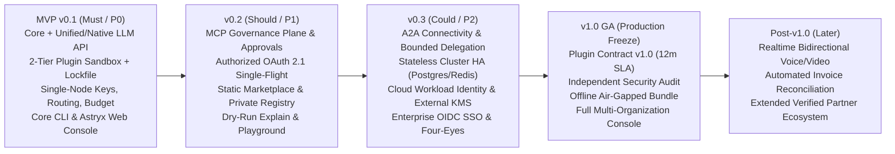

# Phạm vi Bản phát hành & Phân kỳ Lộ trình (Release Scope & Phasing) — Tanpopo

> **Tài liệu Định nghĩa Sản phẩm (Phase ASTRA A03 — Gate G2: `READY_FOR_REVIEW` | `DRAFT — UNLOCKED SCOPE`)**
> - **Phiên bản:** `0.1.0-step03-draft`
> - **Ngày cập nhật:** `2026-11-11`
> - **Vai trò biên soạn:** Principal Requirements Engineer & Product Manager
> - **Trạng thái quản trị:** **Bản nháp chưa khóa phạm vi (`DRAFT`)** — chờ Product Owner phê duyệt Cổng **Gate G1** (`SD-G1-01`..`SD-G1-05`) và **Gate G2** (`TD-G2-01`..`TD-G2-06`) tại [`docs/governance/decisions.md`](../governance/decisions.md).
> - **Liên kết Nguồn chân lý (SSOT):** Đặc tả chi tiết từng mã `TP-FR-*` / `TP-NFR-*` nằm duy nhất tại [`docs/requirements/srs.md`](../requirements/srs.md); mô tả 14 thuộc tính từng tính năng `FT-*` nằm tại [`docs/product/feature-catalog.md`](./feature-catalog.md).

---

## 1. Nguyên tắc Phân kỳ Lộ trình (`Foundation-First, Thin Vertical Milestones`)

Để giải quyết rủi ro dàn trải phạm vi (`RSK-002`) mà vẫn bảo toàn tầm nhìn nền tảng toàn diện (`DEC-001`, `DEC-003`), Tanpopo áp dụng nguyên tắc:

1. **Thiết kế Khung Dữ liệu & Ranh giới 4 Lớp Ngay từ Đầu:** Ngay từ bản thiết kế kiến trúc đầu tiên, mô hình thực thể, khóa phân quyền và sổ cái sự kiện được tách sẵn cho cả 4 lớp độc lập (`Provider`, `Plugin`, `MCP`, `A2A`) cùng chuỗi phân cấp `Organization → Project → Environment` để **không bao giờ phải đập đi xây lại cơ sở dữ liệu** khi nâng cấp từ `v0.1` lên `v1.0`.
2. **Không Nhồi nhét Tất cả vào `MVP (v0.1)`:** Bản `v0.1` chỉ ôm trọn những yêu cầu **`Must` (`P0`)** nhằm chứng minh dứt điểm luận điểm sống còn của Tanpopo: *người dùng khởi chạy cổng tự vận hành trong dưới 3 phút, cài đặt `Provider Adapter` cô lập từ bên ngoài không cần nâng cấp Core, gọi suy luận an toàn và kiểm soát cứng ngân sách/khóa ảo trên cả CLI lẫn Web Console*. Các mặt phẳng `MCP`, `A2A`, cụm phân tán `HA` và `Enterprise SSO` được tách sang các nhịp kế tiếp có kiểm soát.
3. **Mỗi Cột mốc Đều Độc lập Dùng được Thực tế (`Shippable & Operable`):** Không có cột mốc nào giao giao diện rỗng (mock UI) hoặc API thiếu cơ chế bảo vệ `Fail-Closed`.

---

## 2. Tổng quan Phạm vi theo Từng Cột mốc (`v0.1` → `v1.0` → `Post-v1.0`)

| Cột mốc | Mục tiêu chiến lược trọng tâm | Nhóm người dùng mở khóa chính | Những gì chủ đích **CHƯA đưa vào** cột mốc này |
|---|---|---|---|
| **`MVP (v0.1)`** | Chứng minh kiến trúc **Extension-First AI Gateway** tự vận hành đơn nút gọn nhẹ, an toàn và dùng được ngay trong sản xuất quy mô nhỏ/vừa. | **Dev Teams (5–50 kỹ sư)** & **Solo Power Users** chính thống. | Chưa có mặt phẳng `MCP`, chưa có `A2A`, chưa có `Authorized OAuth` tự động làm mới, chưa có chế độ cụm nhiều bản sao (`HA`), chưa bật giao diện đa `Organization`. |
| **`v0.2`** | Mở rộng mặt phẳng quản trị sang **Công cụ Tác nhân (`MCP`)**, xác thực `Authorized OAuth 2.1` và hệ sinh thái phân phối `Marketplace / Private Registry`. | **AI Platform Teams** & đội ngũ vận hành Coding/Enterprise Agents nội bộ. | Chưa có mặt phẳng ủy quyền liên tác nhân `A2A`, chưa có chế độ cụm phân tán đa vùng. |
| **`v0.3`** | Bổ sung mặt phẳng **Liên tác nhân (`A2A`)**, kiến trúc **Scale-out HA không trạng thái** và tích hợp định danh đám mây doanh nghiệp (`OIDC`, `Workload Identity`, `KMS`). | **AI Platform Teams quy mô lớn (50–500+ kỹ sư)** chạy lưu lượng cao. | Hợp đồng Plugin vẫn ở giai đoạn hoàn thiện cuối (`0.x` cam kết `N-1 minor`) trước khi đóng băng dài hạn. |
| **`v1.0` (GA)** | Đóng băng **Hợp đồng `Plugin Contract v1.0`** (cam kết tương thích ngược `>= 12 tháng`), hoàn tất kiểm toán bảo mật độc lập, xuất gói mạng kín (`Air-gapped Bundle`) và mở quản trị đa tổ chức (`Multi-Org`) toàn diện. | **Doanh nghiệp chịu quản lý chặt (`Regulated Enterprise`)** & Nhà phát triển Plugin đối tác dài hạn. | Giao thức truyền thanh/hình hai chiều thời gian thực (`WebRTC`/`Realtime Voice`) và tự động đối khớp hóa đơn PDF/CSV từ hãng ngoài. |
| **`Post-v1.0`** | Mở rộng mặt phẳng truyền thông đa phương tiện hai chiều thời gian thực và tự động hóa tài chính nâng cao (`FinOps Intelligence`). | Các ứng dụng tác nhân giọng nói/thị giác thời gian thực & bộ phận tài chính tập đoàn. | Toàn bộ các hạng mục thuộc danh sách loại trừ vĩnh viễn (`NG-01`..`NG-08` / `REJ-001`..`004`). |

---

## 3. Ma trận Phân bổ Tính năng & Yêu cầu (`FT-*` / `TP-FR-*`) theo Phiên bản

| Phân hệ (`Module`) | Mã `FT` | Phạm vi `MVP (v0.1)` (`Must` + chọn lọc `Should` nền tảng) | Phạm vi `v0.2` (`Should`) | Phạm vi `v0.3` (`Could`) | Phạm vi `v1.0 GA` (Hoàn thiện & Đóng băng) | Phạm vi `Post-v1.0` (`Later`) |
|---|---|---|---|---|---|---|
| **`gateway-protocols`** | `FT-01`, `FT-02` | `TP-FR-0101`..`0104` (Unified Chat/Responses/Embeddings/Models, SSE, Capability Pre-check, cấm fallback sau partial stream, hủy upstream `< 500 ms`); `TP-FR-0105` (`Should` — Native Passthrough cho Anthropic/Gemini). | Mở rộng bộ kiểm tra năng lực cho các phương thức xác thực OAuth & mô phỏng khô. | Tối ưu hóa truyền luồng đa bản sao không trạng thái (`>= 1.000` luồng SSE/nút). | Đóng băng ma trận tương thích giao thức v1.0. | `TP-FR-0106` (`Later` — Cổng truyền luồng âm thanh/hình ảnh hai chiều `Realtime WebSocket/WebRTC`). |
| **`provider-credentials`** | `FT-03`, `FT-04` | `TP-FR-0201`..`0204` (Chuỗi 4 thực thể `Adapter→Connection→Model→Deployment`, hỗ trợ `Ollama`/`vLLM` kèm `cold_start_timeout`, chia sẻ kết nối một chiều, kho khóa ghi một chiều `Write-Only Vault`). | `TP-FR-0205` (`Authorized OAuth 2.1` PKCE/Client Credentials + làm mới đơn luồng `Single-Flight`). | `TP-FR-0206` (`Workload Identity`, `OIDC`, `mTLS`, tích hợp `External KMS/Vault`). | Chuẩn hóa xoay vòng khóa chủ (`Master Key Rotation`) không gián đoạn. | Tự động đồng bộ hạn mức thương mại thời gian thực từ API quản trị của hãng. |
| **`plugin-marketplace`** | `FT-05`, `FT-06` | `TP-FR-0301`..`0306` (Gói Khai báo Tầng 1 + Sandbox Tầng 2 mặc định đóng + `Blind Credential Broker` + cài từ Git/URL/ZIP kèm `tanpopo.lock`, 3 nhãn `Trust Tier`, SDK & `plugin test`, chặn tăng quyền khi update & `Rollback` + **5–6 Official Reference Adapters**: OpenAI, Anthropic, Gemini, OpenAI-Compatible/`vLLM`, `Ollama`). | `TP-FR-0307` (Kết nối Chỉ mục Marketplace tĩnh công khai, Private Registry nội bộ, luồng cảnh báo thu hồi `Revocation Feed`). | Phân phối đồng bộ gói phần mở rộng tự động qua các nút Data Plane trong cụm HA. | Đóng băng `Plugin Contract v1.0` (`>= 12 tháng` tương thích ngược) & xuất gói `Offline Air-gapped Bundle`. | Hệ sinh thái kiểm định đối tác chuyên sâu và bộ chuyển đổi chuyên ngành mở rộng. |
| **`mcp-a2a`** | `FT-07`, `FT-08` | *(Chỉ định nghĩa sẵn ranh giới mô hình dữ liệu & khóa phân quyền trong nhân Core; chưa mở điểm cuối lưu lượng).* | `TP-FR-0401`..`0404` (Toàn bộ **MCP Governance Plane**: lọc công cụ có phân trang, ghim `schema_hash`, duyệt con người cho `destructive` tool, cấm retry mù). | `TP-FR-0405`..`0406` (Toàn bộ **A2A Connectivity Plane**: khám phá `AgentCard`, ủy quyền bất đồng bộ, chống khuếch đại đặc quyền, giới hạn `<= 5` bước nhảy). | Kiểm toán liên thông chuỗi tác vụ phức hợp `Agent → A2A → MCP → LLM` cấp doanh nghiệp. | Mở rộng giao thức sự kiện tác nhân dài hạn đa tổ chức liên kết. |
| **`iam-tenancy`** | `FT-09` | `TP-FR-0501`..`0503` (Mô hình `Org → Project → Env` tối ưu mặc định 1 `Org` đa `Project`, RBAC cốt lõi + `Personal Mode`, vòng đời `Virtual Key` băm một chiều, xoay hai khóa song hành & thu hồi khẩn cấp). | Mở rộng phân quyền chi tiết cấp từng công cụ MCP và vai trò `Reviewer` chuyên trách phê duyệt. | `TP-FR-0504` (Liên kết `Enterprise OIDC SSO` và quy tắc phê duyệt chéo bốn mắt `Four-Eyes Principle`). | Mở khóa giao diện quản trị nhiều `Organization` độc lập hoàn toàn trên cùng 1 máy chủ (`Multi-Org GA`). | Đồng bộ danh mục nhóm người dùng tự động (`SCIM Provisioning`). |
| **`routing-resilience`** | `FT-10` | `TP-FR-0601`..`0603` (Định tuyến nhận thức năng lực, ép cứng `Data Residency Fail-Closed`, chuyển mạch trước luồng `<= 3` đích & `Circuit Breaker`). | `TP-FR-0604` (Trình mô phỏng và giải thích quyết định khô `Dry-Run Route & Policy Explain`). | Chia sẻ trạng thái sức khỏe đích & ngắt mạch xuyên cụm qua tầng bộ nhớ phân tán. | Chính sách định tuyến trọng số theo độ trễ thực tế (`Latency-Aware Weighted Routing`). | Định tuyến dự báo chi phí/chất lượng thích ứng theo loại tác vụ. |
| **`policy-security`** | `FT-11`, `FT-12` | `TP-FR-0701`..`0705` (Động cơ chính sách `Fail-Closed`, giới hạn RPM/TPM/Concurrency đơn nút, chặn SSRF biên mạng, tuân thủ nguồn gốc plugin/cấm lách thuê bao cá nhân, `Immutable Audit Log` & công tắc ngắt khẩn cấp 4 cấp). | Chính sách kiểm soát công cụ MCP và tích hợp bộ lọc nội dung/PII dưới dạng `Extension`. | Giới hạn tốc độ phân tán toàn cụm (`Distributed Rate Limiting`) độ trễ thấp. | Xuất luồng kiểm toán bất biến ký số liên tục sang SIEM doanh nghiệp & hoàn tất kiểm toán an ninh độc lập. | Thư viện mẫu chính sách tuân thủ theo ngành (tài chính, y tế). |
| **`telemetry-finops`** | `FT-13`, `FT-14` | `TP-FR-0801`..`0802`, `0805`..`0806` (Sổ cái giữ chỗ hai pha đơn nút, quyết toán `EXACT`/`ESTIMATED`/`UNMETERED_FLAGGED`, xuất chuẩn `OTLP`, mặc định `Metadata-Only` che bí mật); bản cơ bản của `TP-FR-0803` (cảnh báo ngưỡng mềm). | Hoàn thiện `TP-FR-0803` (Báo cáo đối soát `Chargeback` chi tiết đa chiều & webhook cảnh báo tài chính). | Sổ cái giữ chỗ hạn mức phân tán chống vượt trần khi chạy nhiều bản sao Data Plane song song. | Chốt kiểm chứng sai số tài chính và chính sách lưu giữ/kiểm toán dài hạn. | `TP-FR-0804` (`Later` — Tự động đối chiếu hóa đơn nhà cung cấp & gợi ý tối ưu chi phí thông minh). |
| **`console-cli-api`** | `FT-15` | `TP-FR-0901`..`0903` (Admin REST API có `ETag`/`409`, Web Console dùng **Astryx `neutral`** cho Setup Wizard/Adapter/Connection/Route/Key/Budget/Logs/Kill-Switch, và `tanpopo` CLI cho vận hành + `plugin init/test/pack`). | `TP-FR-0904` (`Interactive Playground`, giao diện `Route Explain`, màn hình quản trị MCP & hàng đợi duyệt `ApprovalRequest`). | Sơ đồ trực quan cây ủy quyền liên tác nhân A2A và bảng giám sát sức khỏe cụm HA. | Hoàn thiện khả năng tiếp cận WCAG 2.2 AA toàn diện, đa tổ chức và trải nghiệm nâng cấp một chạm. | Bảng điều khiển phân tích tối ưu hóa chi phí chuyên sâu. |
| **`selfhost-ops`** | `FT-16` | `TP-FR-1001`..`1004` (Khởi chạy đơn nút cơ sở dữ liệu nhúng + `/healthz` `/readyz`, cấu hình khai báo `tanpopo.lock`, sao lưu mã hóa/xóa sạch dữ liệu cơ bản, kiểm tra tương thích `Preflight Check` trước nâng cấp). | Công cụ đồng bộ Private Registry & kiểm tra luồng thu hồi tự động theo lịch. | `TP-FR-1005` (Chế độ triển khai cụm `Stateless Scale-out` với PostgreSQL + Redis/Valkey & Helm/Compose mẫu). | Quy trình nâng cấp lăn không gián đoạn (`Zero-Downtime Rolling Upgrade`) & đóng gói mạng kín hoàn chỉnh. | Bộ điều khiển vận hành tự động trên Kubernetes (`Kubernetes Operator`). |

---

## 4. Tiêu chí Xuất xưởng Kiểm chứng được cho Từng Cột mốc (`Milestone Exit Criteria`)

1. **Điều kiện Xuất xưởng `MVP (v0.1)`:**
   - `100%` yêu cầu phân loại `Must` đạt toàn bộ kịch bản nghiệm thu `TP-AC-*` tương ứng (bao gồm toàn bộ bộ kiểm thử bảo mật nền tảng `TP-AC-SEC-01`, `02`, `04`, `05`, `06`, `07`).
   - Người vận hành mới hoàn tất từ lúc tải gói tới truy vấn suy luận được quản trị đầu tiên trong `< 3 phút` (`MO-03` — mục tiêu dự kiến).
   - Cài đặt thành công ít nhất 1 `Declarative Pack` và 1 `Sandbox Plugin` từ kho Git/gói nén ngoài lên tệp thực thi Core đang chạy **mà không biên dịch lại Core**, đồng thời chặn đứng `100%` nỗ lực gọi mạng trái phép hoặc đọc khóa gốc thô.
   - Bản dựng giao diện Web Console vượt qua `cmd /c npx astryx doctor --built <dir>` với `0 fail` và không chứa thẻ bố cục thô vi phạm quy chuẩn.
2. **Điều kiện Xuất xưởng `v0.2`:**
   - Vượt qua trọn bộ nghiệm thu mặt phẳng MCP (`TP-AC-F0401`..`F0403`, `TP-AC-SEC-08`) và OAuth 2.1 được cấp phép (`TP-AC-F0203`, `TP-AC-SEC-03`): chặn `100%` trường hợp thay đổi `schema_hash` ngầm, giả mạo tham số duyệt công cụ `destructive`, hoặc đua tranh làm mới OAuth song song.
3. **Điều kiện Xuất xưởng `v0.3`:**
   - Chịu tải ổn định chế độ nhiều bản sao Data Plane không trạng thái (`TP-AC-F1003`, `TP-AC-N02`, `TP-AC-N03`); thu hồi khóa khẩn cấp lan truyền toàn cụm trong `< 5 giây`; chặn `100%` nỗ lực khuếch đại đặc quyền qua chuỗi ủy quyền A2A (`TP-AC-F0404`).
4. **Điều kiện Xuất xưởng `v1.0 GA`:**
   - Công bố chính thức đặc tả đóng băng `Plugin Contract v1.0`, vượt qua kiểm tra nâng cấp lùi `N-1` (`TP-AC-N10`), xuất thành công gói cài đặt chạy trong mạng cách ly hoàn toàn (`Air-gapped`) và không còn lỗ hổng bảo mật mức `Critical`/`High` tồn đọng.

---

## 5. Sáu Đánh đổi Trọng yếu Trình Product Owner Phê duyệt tại Gate G2 (`TD-G2-01` .. `TD-G2-06`)

> Các đánh đổi dưới đây cụ thể hóa phạm vi và hành vi kỹ thuật của PRD/SRS để Product Owner ra quyết định dứt điểm trước khi bước sang pha Thiết kế Kiến trúc (**A04**):

| Mã Đánh đổi | Vấn đề đánh đổi | Phương án Đề xuất trong PRD/SRS (`PROPOSED`) | Lợi ích đạt được | Chi phí / Hệ quả chấp nhận | Phương án thay thế nếu Owner muốn đổi |
|---|---|---|---|---|---|
| **`TD-G2-01`** | **Ranh giới `MVP (v0.1)` đối với Mặt phẳng MCP** (liên kết `SD-G1-03`) | Giữ ranh giới dữ liệu MCP trong thiết kế nền nhưng **đặt mặt phẳng lưu lượng MCP ở `v0.2` (`Should`)**, tập trung `v0.1` cho Core + Plugin Engine + LLM Gateway + Console/CLI. | Rút ngắn đáng kể đường tới bản chạy thật đầu tiên; đảm bảo chất lượng vùng cô lập Plugin và sổ cái ngân sách thật vững trước khi gánh thêm giao thức MCP. | Ngày ra mắt `v0.1` chưa có ngay tính năng lọc công cụ MCP để quảng bá rộng cho nhóm người dùng thuần Coding Agent. | Đẩy `FT-07` (`TP-FR-0401`..`0404`) lên `Must` trong `v0.1`, chấp nhận kéo dài thời gian làm `v0.1` thêm ~40–50%. |
| **`TD-G2-02`** | **Chiến lược Giao diện Suy luận: Dịch chuẩn chung vs Giữ nguyên phương ngữ gốc** | Kết hợp **Unified OpenAI-Compatible API (`Must`) + Lossless Native Dialect Passthrough (`Should` ngay ở `v0.1`) + Kiểm tra năng lực nghiêm ngặt trả `400` thay vì cắt tham số ngầm**. | Vừa tương thích tức thì hệ sinh thái OpenAI SDK, vừa không làm mất tính năng mới trong ngày của Anthropic/Gemini, không bao giờ lừa ứng dụng bằng kết quả bị cắt xén ngầm. | Đội ngũ phát triển phải duy trì bộ trích xuất số đo token cho cả luồng dịch chuẩn lẫn luồng phương ngữ gốc. | Chỉ làm Unified API ở `v0.1` và hoãn Native Passthrough sang `v0.2` (nhưng sẽ làm giảm sức hút với người dùng Claude Code / công cụ chuyên biệt). |
| **`TD-G2-03`** | **Độ chính xác Ngân sách Luồng Song song vs Độ trễ & Trải nghiệm Cuối luồng** (liên kết `BA-OQ-002`) | Dùng **Giữ chỗ hạn mức trước khi mở luồng (`Pre-Request Hold`)** kết hợp **Ghi nhận số dư âm nhẹ chuyển tiếp (`Negative Balance Carryover`)** nếu thực tế cuối luồng nhích qua mức ước tính, thay vì cắt ngang luồng ở vài từ cuối. | Chặn đứng tấn công bắn 50 luồng song song phá trần ngân sách mà không làm hỏng phản hồi hợp lệ đang truyền dở ở giây cuối cùng (vốn nhà cung cấp vẫn tính phí). | Tổng chi tiêu thực tế có thể nhích qua trần cứng một biên độ rất nhỏ trong phạm vi của 1 yêu cầu cuối cùng trước khi khóa hẳn. | Cắt đứt luồng SSE ngay tức khắc ở mili-giây chạm trần ước tính (trải nghiệm ứng dụng xấu và dễ mất trắng tiền phần đã sinh). |
| **`TD-G2-04`** | **Mô hình Thực thi Phần mở rộng: Độ dễ tạo Adapter vs Cô lập An ninh** (liên kết `SD-G1-02`) | **Hai tầng kết hợp (`Declarative Pack` không mã thực thi + `Capability Sandbox` mặc định đóng)** đi kèm **`Blind Host Credential Broker`** (tiêm khóa ở Host, không trao khóa thô cho plugin thường). | 80% nhà cung cấp chuẩn tạo xong Adapter dưới 30 phút với rủi ro mã độc bằng 0; 20% ca phức tạp vẫn làm được an toàn mà không sợ plugin đánh cắp khóa API gốc. | Phải thiết kế và bảo trì cả bộ đọc cấu hình khai báo lẫn môi trường chạy Sandbox cô lập ngay từ `v0.1`. | Chỉ hỗ trợ Tầng 1 Khai báo ở `v0.1` và lùi Sandbox lập trình sang `v0.2` (nhẹ hơn cho `v0.1` nhưng chưa cài được các cổng nội bộ có chữ ký HMAC/xác thực tùy biến). |
| **`TD-G2-05`** | **Tương tác Phê duyệt Con người cho Công cụ MCP `destructive`** (liên kết `BA-OQ-004`) | Hỗ trợ **Chế độ Kép**: chờ đồng bộ ngắn hạn (`<= 60 giây`) cho phiên tương tác trực tiếp **và** trả mã chờ kèm `Pre-Approval Token` gắn chặt băm tham số cho phê duyệt bất đồng bộ qua Console/Webhook. | Không làm treo/đứt kết nối HTTP của các MCP Client hiện hữu khi người duyệt phản hồi sau vài phút, đồng thời chống tuyệt đối việc đánh tráo tham số sau khi duyệt. | Thêm một trạng thái mã phê duyệt ngắn hạn trong máy trạng thái `SM-06` và hướng dẫn tác nhân gọi lại. | Chỉ hỗ trợ giữ kết nối chờ đồng bộ (dễ cài đặt nhưng không dùng được với quy trình duyệt qua Slack/Ticket mất vài phút). |
| **`TD-G2-06`** | **Độ phức tạp Vận hành Ngày đầu vs Khả năng Mở rộng Quy mô Cụm** (liên kết `SD-G1-01`, `BA-OQ-001`) | Mặc định `v0.1` chạy **Đơn nút cơ sở dữ liệu nhúng (1 lệnh, tối ưu 1 `Org` đa `Project`)**, thiết kế qua lớp trừu tượng lưu trữ để nâng lên **Cụm không trạng thái (PostgreSQL + Redis) & Đa `Org`** ở `v0.3`/`v1.0`. | Bảo toàn trọn vẹn chỉ tiêu khởi chạy `< 3 phút` và `< 128 MB RAM` khi rỗi cho nhóm nhỏ mà không chặn đường lớn lên quy mô doanh nghiệp. | Cần viết bộ kiểm thử hợp đồng lưu trữ cho cả 2 trình điều khiển (nhúng và phân tán) khi bước sang `v0.3`. | Bắt buộc cài đặt PostgreSQL + Redis ngay từ `v0.1` (giảm công làm tầng lưu trữ nhúng nhưng đánh mất lợi thế dễ tự host ngày đầu). |
