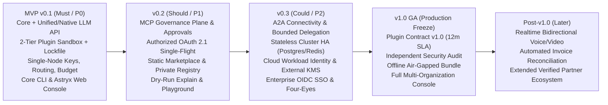

# Release Scope & Roadmap Phasing — Tanpopo

> **Product Definition Document (Phase ASTRA A03 — Gate G2: `READY_FOR_REVIEW` | `DRAFT — UNLOCKED SCOPE`)**
> - **Version:** `0.1.0-step03-draft`
> - **Last Updated:** `2026-11-11`
> - **Authored By:** Principal Requirements Engineer & Product Manager
> - **Governance Status:** **Unlocked-scope draft (`DRAFT`)** — awaiting formal Product Owner approval of **Gate G1** (`SD-G1-01`..`SD-G1-05`) and **Gate G2** (`TD-G2-01`..`TD-G2-06`) in [`docs/governance/decisions.md`](../governance/decisions.md).
> - **Single Source of Truth (SSOT) Cross-References:** Authoritative requirement specifications for every `TP-FR-*` / `TP-NFR-*` ID reside exclusively in [`docs/requirements/srs.md`](../requirements/srs.md); 14-attribute domain specifications for every `FT-*` feature reside in [`docs/product/feature-catalog.md`](./feature-catalog.md).

---

## 1. Roadmap Phasing Principles (`Foundation-First, Thin Vertical Milestones`)

To neutralize scope-overreach risk (`RSK-002`) while preserving Tanpopo's comprehensive multi-plane architecture (`DEC-001`, `DEC-003`), release phasing enforces three rules:

1. **Establish the 4-Layer Domain Schema & Boundaries on Day 1:** Right from the initial architecture baseline, entity schemas, authorization scopes, and event ledgers cleanly separate all 4 independent layers (`Provider`, `Plugin`, `MCP`, `A2A`) alongside the `Organization → Project → Environment` tenancy hierarchy — ensuring **zero destructive database rewrites** as deployments progress from `v0.1` to `v1.0`.
2. **Never Overload `MVP (v0.1)`:** `v0.1` scopes strictly to **`Must` (`P0`)** essentials needed to prove Tanpopo's core thesis end-to-end: *an operator starts the self-hosted gateway in under 3 minutes, installs an isolated external `Provider Adapter` without upgrading Core, routes governed inference safely, and enforces hard budgets and virtual keys across both CLI and Web Console*. The `MCP` plane, `A2A` plane, distributed `HA` clustering, and `Enterprise SSO` ship in disciplined subsequent waves.
3. **Every Milestone Is Independently `Shippable & Operable`:** No milestone ships dead mock UI screens or endpoints lacking `Fail-Closed` security enforcement.

---

## 2. Milestone Scope Overview (`v0.1` → `v1.0` → `Post-v1.0`)

| Milestone | Strategic Focus | Primary Unlocked User Cohort | Intentionally **Deferred Out** of This Milestone |
|---|---|---|---|
| **`MVP (v0.1)`** | Prove a lightweight, secure, immediately usable single-node **Extension-First AI Gateway** for small/mid-scale production workloads. | **Dev Teams (5–50 engineers)** & legitimate **Solo Power Users**. | No live `MCP` plane, no `A2A` plane, no automated `Authorized OAuth` refresh, no multi-replica `HA` clustering, and no multi-`Organization` UI switcher. |
| **`v0.2`** | Expand governance to **Agent Tools (`MCP`)**, `Authorized OAuth 2.1` flows, and the `Marketplace / Private Registry` distribution ecosystem. | **AI Platform Teams** & teams operating internal Coding/Enterprise Agents. | No cross-agent `A2A` delegation plane; no multi-region distributed cluster mode. |
| **`v0.3`** | Deliver the **Agent-to-Agent (`A2A`)** plane, **Stateless Scale-out HA** clustering, and enterprise cloud identity/secret integrations (`OIDC`, `Workload Identity`, `KMS`). | **Large AI Platform Teams (50–500+ engineers)** running sustained high-throughput workloads. | Plugin Contract remains under final `0.x` stabilization (`N-1 minor` window) ahead of long-term GA freeze. |
| **`v1.0` (GA)** | Freeze **`Plugin Contract v1.0`** (`>= 12 months` backward-compatibility SLA), complete independent security audit, ship `Air-gapped Bundle` export, and unlock full `Multi-Org` administration. | **Regulated Enterprises** & long-term partner Plugin Publishers. | Real-time bidirectional audio/video streaming (`WebRTC`/`Realtime Voice`) and automated external vendor PDF/CSV invoice reconciliation. |
| **`Post-v1.0`** | Expand into real-time bidirectional multimodal media planes and advanced automated financial intelligence (`FinOps Intelligence`). | Real-time voice/vision agent applications & corporate finance controllers. | All permanently excluded capabilities (`NG-01`..`NG-08` / `REJ-001`..`004`). |

---

## 3. Feature & Requirement Allocation Matrix (`FT-*` / `TP-FR-*`) Across Releases

| Domain (`Module`) | `FT` IDs | `MVP (v0.1)` Scope (`Must` + Foundational `Should`) | `v0.2` Scope (`Should`) | `v0.3` Scope (`Could`) | `v1.0 GA` Scope (Hardening & Freeze) | `Post-v1.0` Scope (`Later`) |
|---|---|---|---|---|---|---|
| **`gateway-protocols`** | `FT-01`, `FT-02` | `TP-FR-0101`..`0104` (Unified Chat/Responses/Embeddings/Models, SSE, Capability Pre-check, forbid post-partial-stream fallback, `< 500 ms` upstream cancel); `TP-FR-0105` (`Should` — Native Passthrough for Anthropic/Gemini). | Extend capability pre-checks across OAuth auth modes & dry-run explain simulator. | Optimize stateless multi-replica streaming (`>= 1,000` concurrent SSE streams/node). | Freeze v1.0 protocol compatibility matrix. | `TP-FR-0106` (`Later` — Bidirectional audio/video `Realtime WebSocket/WebRTC` gateway). |
| **`provider-credentials`** | `FT-03`, `FT-04` | `TP-FR-0201`..`0204` (4-entity chain `Adapter→Connection→Model→Deployment`, `Ollama`/`vLLM` with `cold_start_timeout`, one-way connection sharing, `Write-Only Vault`). | `TP-FR-0205` (`Authorized OAuth 2.1` PKCE/Client Credentials + `Single-Flight` token refresh). | `TP-FR-0206` (`Workload Identity`, `OIDC`, `mTLS`, `External KMS/Vault` backends). | Zero-downtime `Master Key Rotation` runbooks and automation. | Real-time commercial quota synchronization against upstream vendor admin APIs. |
| **`plugin-marketplace`** | `FT-05`, `FT-06` | `TP-FR-0301`..`0306` (Tier-1 Declarative Pack + default-deny Tier-2 Sandbox + `Blind Credential Broker` + Git/URL/ZIP install with `tanpopo.lock`, 3 `Trust Tier` labels, SDK & `plugin test`, block silent permission escalation on update & `Rollback` + **5–6 Official Reference Adapters**: OpenAI, Anthropic, Gemini, OpenAI-Compatible/`vLLM`, `Ollama`). | `TP-FR-0307` (Public static Marketplace Index integration, internal Private Registry, automated `Revocation Feed` advisory sync). | Automated extension artifact synchronization across stateless HA Data Plane replicas. | Freeze `Plugin Contract v1.0` (`>= 12 months` backward compatibility) & ship `Offline Air-gapped Bundle` export. | Expanded verified partner ecosystem and specialized vertical industry adapters. |
| **`mcp-a2a`** | `FT-07`, `FT-08` | *(Define canonical domain schema & permission namespaces in Core foundation only; runtime traffic endpoints remain unexposed).* | `TP-FR-0401`..`0404` (Full **MCP Governance Plane**: paginated tool ACL filtering, `schema_hash` pinning, human approval on `destructive` tools, block unsafe retries). | `TP-FR-0405`..`0406` (Full **A2A Connectivity Plane**: `AgentCard` discovery, async task delegation, anti-privilege-amplification, `<= 5` max hops). | Enterprise end-to-end composite audit chains spanning `Agent → A2A → MCP → LLM`. | Cross-organization federated long-running agent event protocols. |
| **`iam-tenancy`** | `FT-09` | `TP-FR-0501`..`0503` (`Org → Project → Env` hierarchy optimized for default single-`Org` multi-`Project`, core RBAC + `Personal Mode`, one-way hashed `Virtual Key` lifecycle, dual-valid rotation & emergency revocation). | Granular per-MCP-tool RBAC bindings and dedicated `Reviewer` approval workflows. | `TP-FR-0504` (`Enterprise OIDC SSO` federation and mandatory `Four-Eyes Principle` dual approvals). | Unlock full multi-tenant `Multi-Org GA` administration console on a single instance. | Automated directory group synchronization (`SCIM Provisioning`). |
| **`routing-resilience`** | `FT-10` | `TP-FR-0601`..`0603` (Capability-aware routing, strict `Data Residency Fail-Closed` enforcement, pre-stream failover `<= 3` targets & `Circuit Breaker`). | `TP-FR-0604` (`Dry-Run Route & Policy Explain` simulator). | Cluster-wide deployment health & circuit-breaker state sharing via distributed store. | Live `Latency-Aware Weighted Routing` policies. | Adaptive task-aware cost/quality predictive routing. |
| **`policy-security`** | `FT-11`, `FT-12` | `TP-FR-0701`..`0705` (`Fail-Closed` policy engine, single-node RPM/TPM/Concurrency limits, perimeter SSRF guard, plugin provenance & consumer-subscription-ban enforcement, `Immutable Audit Log` & 4-level emergency kill-switches). | MCP tool governance policies and optional PII/content guardrail filters packaged as `Extension` modules. | Low-latency cluster-wide `Distributed Rate Limiting`. | Continuous cryptographically signed audit log streaming to enterprise SIEM & independent third-party security audit. | Pre-built vertical compliance policy packs (finance, healthcare). |
| **`telemetry-finops`** | `FT-13`, `FT-14` | `TP-FR-0801`..`0802`, `0805`..`0806` (Single-node two-phase reservation ledger, `EXACT`/`ESTIMATED`/`UNMETERED_FLAGGED` settlement, `OTLP` export, default `Metadata-Only` secret redaction); baseline `TP-FR-0803` (soft-threshold alerts). | Complete `TP-FR-0803` (Multi-dimensional `Chargeback` reporting & financial alert webhooks). | Distributed quota reservation ledger preventing cap breaches across parallel Data Plane replicas. | Finalize financial variance certification and long-term audit retention policies. | `TP-FR-0804` (`Later` — Automated upstream vendor invoice reconciliation & intelligent spend optimization insights). |
| **`console-cli-api`** | `FT-15` | `TP-FR-0901`..`0903` (Admin REST API with `ETag`/`409`, Web Console built on **Astryx `neutral`** covering Setup Wizard/Adapter/Connection/Route/Key/Budget/Logs/Kill-Switch, and `tanpopo` CLI covering ops + `plugin init/test/pack`). | `TP-FR-0904` (`Interactive Playground`, `Route Explain` UI, MCP governance views & `ApprovalRequest` review queue). | Interactive A2A delegation tree visualizer and HA cluster health dashboard. | Complete WCAG 2.2 AA certification, multi-organization UI workflows, and guided one-click upgrade UX. | Deep FinOps cost-optimization analytics workspaces. |
| **`selfhost-ops`** | `FT-16` | `TP-FR-1001`..`1004` (Single-node embedded-DB bootstrap + `/healthz` `/readyz`, declarative `tanpopo.lock` config, encrypted backup/erasure baseline, upgrade `Preflight Check`). | Private Registry mirror sync CLI & scheduled revocation-feed polling. | `TP-FR-1005` (`Stateless Scale-out` cluster deployment with PostgreSQL + Redis/Valkey & reference Helm/Compose manifests). | `Zero-Downtime Rolling Upgrade` automation & certified air-gapped bundle lifecycle. | Automated `Kubernetes Operator` lifecycle controller. |

---

## 4. Verifiable Milestone Exit Criteria (`Milestone Exit Criteria`)

1. **`MVP (v0.1)` Exit Criteria:**
   - `100%` of `Must` requirements pass all corresponding `TP-AC-*` acceptance scenarios (including the complete foundational security suite `TP-AC-SEC-01`, `02`, `04`, `05`, `06`, `07`).
   - A clean-room operator completes download-to-first-governed-inference in `< 3 minutes` (`MO-03` — pre-benchmark target).
   - Successfully installs at least 1 external `Declarative Pack` and 1 `Sandbox Plugin` from Git/archive onto a running Core binary **without recompiling Core**, while blocking `100%` of unauthorized network egress or raw master-key read attempts.
   - Production Web Console build passes `cmd /c npx astryx doctor --built <dir>` with `0 fail` and contains zero raw layout tags violating design-system rules.
2. **`v0.2` Exit Criteria:**
   - Passes 100% of MCP Plane (`TP-AC-F0401`..`F0403`, `TP-AC-SEC-08`) and Authorized OAuth 2.1 (`TP-AC-F0203`, `TP-AC-SEC-03`) acceptance suites: blocks `100%` of silent `schema_hash` mutations, `destructive` tool parameter tampering, and concurrent OAuth refresh race conditions.
3. **`v0.3` Exit Criteria:**
   - Sustains stateless multi-replica Data Plane load (`TP-AC-F1003`, `TP-AC-N02`, `TP-AC-N03`); emergency key revocation propagates cluster-wide within `< 5 seconds`; blocks `100%` of privilege-amplification attempts across A2A delegation chains (`TP-AC-F0404`).
4. **`v1.0 GA` Exit Criteria:**
   - Publishes frozen `Plugin Contract v1.0` specification, passes `N-1` backward-upgrade compatibility suite (`TP-AC-N10`), verifies complete offline `Air-gapped` bundle installation, and resolves all open `Critical`/`High` security findings.

---

## 5. Six Critical Tradeoffs Submitted for Product Owner Decision at Gate G2 (`TD-G2-01` .. `TD-G2-06`)

> These six engineering tradeoffs crystallize PRD/SRS scope and runtime behavior for explicit Product Owner sign-off prior to entering System Architecture (**A04**):

| Tradeoff ID | Decision Topic | Proposed PRD/SRS Baseline (`PROPOSED`) | Benefit Gained | Accepted Cost / Consequence | Alternative Option if Owner Prefers |
|---|---|---|---|---|---|
| **`TD-G2-01`** | **`MVP (v0.1)` Boundary for the MCP Plane** (linked to `SD-G1-03`) | Define MCP schema boundaries in the `v0.1` data model but **schedule live MCP traffic endpoints in `v0.2` (`Should`)**, focusing `v0.1` squarely on Core + Plugin Engine + LLM Gateway + Console/CLI. | Dramatically shortens time-to-first-usable-release; hardens the Plugin Sandbox and two-phase budget ledger thoroughly before layering MCP transport state. | Initial `v0.1` launch does not immediately ship MCP tool filtering for pure Coding Agent marketing. | Pull `FT-07` (`TP-FR-0401`..`0404`) into `v0.1` `Must`, accepting a ~40–50% longer `v0.1` build cycle. |
| **`TD-G2-02`** | **Inference Ingress Strategy: Normalized Translation vs. Native Dialect Passthrough** | Ship **Unified OpenAI-Compatible API (`Must`) + Lossless Native Dialect Passthrough (`Should` in `v0.1`) + Strict capability pre-check returning `400` rather than silently dropping parameters**. | Delivers instant OpenAI SDK drop-in compatibility while preserving same-day Anthropic/Gemini frontier features, never deceiving apps with silently degraded outputs. | Engineering maintains token-usage extractors across both normalized and native-passthrough response streams. | Ship Unified API only in `v0.1` and defer Native Passthrough to `v0.2` (weakening day-1 appeal for Claude Code / specialized agent harnesses). |
| **`TD-G2-03`** | **Concurrent Streaming Budget Precision vs. Tail-of-Stream UX** (linked to `BA-OQ-002`) | Combine **Pre-Stream Quota Reservation (`Pre-Request Hold`)** with bounded **`Negative Balance Carryover`** if final settled tokens slightly exceed the initial hold, rather than severing an active stream on its last few words. | Stops 50-stream parallel budget-busting attacks cold without corrupting a legitimate in-flight response at the 99% mark (which the upstream vendor bills anyway). | Total settled spend can marginally exceed a hard cap within the bounded margin of the single final in-flight request before locking completely. | Sever SSE streams instantaneously at the exact millisecond estimated spend touches the cap (poor application UX and wasted spend on truncated output). |
| **`TD-G2-04`** | **Extension Execution Model: Authoring Simplicity vs. Security Isolation** (linked to `SD-G1-02`) | **Two-Tier Hybrid (`Declarative Pack` with zero executable code + default-deny `Capability Sandbox`)** paired with **`Blind Host Credential Broker`** (Host injects secrets at egress; standard plugins never touch raw keys). | 80% of standard providers take under 30 minutes to author with zero malware surface; the complex 20% remain achievable safely without risking master API key theft. | Requires building and maintaining both the declarative manifest engine and the isolated Wasm sandbox runtime starting in `v0.1`. | Ship Tier-1 Declarative Packs only in `v0.1` and defer programmable Sandboxes to `v0.2` (lighter `v0.1`, but blocks custom HMAC/bespoke internal enterprise gateways). |
| **`TD-G2-05`** | **Human-in-the-Loop Approval UX for `destructive` MCP Tools** (linked to `BA-OQ-004`) | Support **Dual-Mode Approval**: short synchronous hold (`<= 60 seconds`) for interactive sessions **plus** immediate pending challenge returning a parameter-hash-bound `Pre-Approval Token` for asynchronous Console/Webhook sign-off. | Avoids dropping HTTP connections on existing MCP Clients when human reviewers take several minutes via Slack/Ticket, while cryptographically preventing post-approval argument tampering. | Adds a short-lived approval token state inside `SM-06` and requires agents to retry with the approved token. | Support synchronous connection-holding waits only (simpler state machine, but unusable for multi-minute asynchronous Slack/Ticket review workflows). |
| **`TD-G2-06`** | **Day-1 Self-Host Simplicity vs. Horizontal Cluster Scale** (linked to `SD-G1-01`, `BA-OQ-001`) | Default `v0.1` to **Single-Node Embedded DB (1 command, optimized for 1 `Org` multi-`Project`)**, abstracted cleanly behind storage ports to unlock **Stateless Clustering (PostgreSQL + Redis) & Multi-`Org`** in `v0.3`/`v1.0`. | Preserves `< 3 minutes` onboarding and `< 128 MB RAM` idle footprint for small teams without architectural dead-ends at enterprise scale. | Requires maintaining storage contract conformance tests across both embedded and distributed drivers starting in `v0.3`. | Mandate external PostgreSQL + Redis right in `v0.1` (saves embedded driver work but destroys Day-1 self-hosting ergonomics). |
