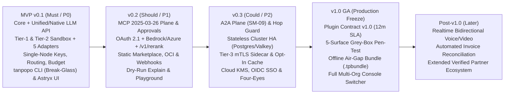

# Release Scope & Roadmap Phasing — Tanpopo

> **Product Definition Document (Phase ASTRA A03 — Reconciled in `TP-IMP-0001`)**
> - **Version:** `0.2.0-tp-imp-0001`
> - **Last Updated:** `2026-11-14`
> - **Authored By:** Principal Requirements Engineer & Product Manager
> - **Governance Status:** **`APPROVED (Subject to COND-PO-01..05)`** — Gate G1 (`SD-G1-01`..`05`), Gate G2 (`BA-OQ-001`..`05`, `TD-G2-01`..`06`), and Audit A08 Change Requests (`CR-01`..`04`, `CR-08`, `CR-09`) approved by the Product Owner in [`docs/governance/decisions.md`](../governance/decisions.md) (closing `GAP-09`).
> - **Single Source of Truth (SSOT) Cross-References:** Authoritative requirement specifications for every `TP-FR-*` / `TP-NFR-*` ID reside exclusively in [`docs/requirements/srs.md`](../requirements/srs.md); 14-attribute domain specifications for every `FT-*` feature reside in [`docs/product/feature-catalog.md`](./feature-catalog.md).

---

## 1. Roadmap Phasing Principles (`Foundation-First, Thin Vertical Milestones`)

To neutralize scope-overreach risk (`RSK-002`) while preserving Tanpopo's comprehensive multi-plane architecture (`DEC-001`, `DEC-003`), release phasing enforces three rules:

1. **Establish the 4-Layer Domain Schema & Boundaries on Day 1:** Right from the initial architecture baseline, entity schemas, authorization scopes (`6` canonical RBAC roles), and event ledgers cleanly separate all 4 independent layers (`Provider`, `Plugin`, `MCP`, `A2A`) alongside the `Organization → Project → Environment` tenancy hierarchy — ensuring **zero destructive database rewrites** as deployments progress from `v0.1` to `v1.0`.
2. **Never Overload `MVP (v0.1)`:** `v0.1` scopes strictly to **`Must` (`P0`)** essentials needed to prove Tanpopo's core thesis end-to-end: *an operator starts the single-binary self-hosted gateway in under 3 minutes (`TARGET / UNVERIFIED`), installs an isolated external `Provider Adapter` without upgrading Core, routes governed inference safely across the **5 Official Reference Adapters**, and enforces hard budgets and virtual keys across both CLI and Web Console*. The `MCP 2025-03-26` plane, `A2A` plane (`SM-09`), `Tier-3 Sidecar`, distributed `HA` clustering, and `Enterprise SSO` ship in disciplined subsequent waves.
3. **Every Milestone Is Independently `Shippable & Operable`:** No milestone ships dead mock UI screens or endpoints lacking `Fail-Closed` security enforcement, and no `v0.3`/`v1.0` enterprise capability (`Air-Gap Bundle`, `< 5s` cluster revocation, Multi-Org UI Switcher) artificially blocks `MVP (v0.1)` (`CR-04`).

---

## 2. Milestone Scope Overview (`v0.1` → `v1.0` → `Post-v1.0`)

| Milestone | Strategic Focus | Primary Unlocked User Cohort | Intentionally **Deferred Out** of This Milestone |
|---|---|---|---|
| **`MVP (v0.1)`** | Prove a lightweight, secure, immediately usable single-node **Extension-First AI Gateway** for small/mid-scale production workloads. | **Dev Teams (5–50 engineers)** & legitimate **Solo Power Users**. | No live `MCP` plane, no `A2A` plane, no `AWS Bedrock` (`SigV4`) / `Azure OpenAI` / `/v1/rerank` (`v0.2`), no `Tier-3 Sidecar` or `Response Cache` (`v0.3`), no multi-replica `HA` clustering (`v0.3`), and no Multi-Org Console UI Switcher or `.tpbundle` `Air-Gap Bundle` (`v1.0`). |
| **`v0.2`** | Expand governance to **Agent Tools (`MCP Specification 2025-03-26`)**, `Authorized OAuth 2.1`, `AWS Bedrock`/`Azure OpenAI`, `/v1/rerank`, HMAC `Webhooks`, and the `Marketplace / Private Registry` distribution ecosystem. | **AI Platform Teams** & teams operating internal Coding/Enterprise Agents. | No cross-agent `A2A` delegation plane; no `Tier-3 Sidecar` or multi-node distributed cluster mode. |
| **`v0.3`** | Deliver the **Agent-to-Agent (`A2A` — `SM-09`)** plane, **`Tier-3 Isolated Sidecar`**, **Stateless Scale-out HA** clustering (`PostgreSQL 16 FORCE RLS` + `Valkey`), opt-in **`Response Cache`**, and enterprise identity/KMS (`OIDC`, `Workload Identity`, `Four-Eyes`). | **Large AI Platform Teams (50–500+ engineers)** running sustained high-throughput workloads. | Plugin Contract remains under final `0.x` stabilization (`N-1 minor` window) ahead of long-term GA freeze; Multi-Org UI Switcher and `.tpbundle` Air-Gap Bundle finalize in `v1.0`. |
| **`v1.0` (GA)** | Freeze **`Plugin Contract v1.0`** (`>= 12 months` backward-compatibility SLA), complete 5-surface Grey-Box Penetration Test, ship `.tpbundle` `Air-Gap Bundle` export/import, and unlock the full **Multi-Org Console Switcher**. | **Regulated Enterprises** & long-term partner Plugin Publishers. | Real-time bidirectional audio/video streaming (`WebRTC`/`Realtime Voice`) and automated external vendor PDF/CSV invoice reconciliation. |
| **`Post-v1.0`** | Expand into real-time bidirectional multimodal media planes and advanced automated financial intelligence (`FinOps Intelligence`). | Real-time voice/vision agent applications & corporate finance controllers. | All permanently excluded capabilities (`NG-01`..`NG-08` / `REJ-001`..`004`). |

---

## 3. Feature & Requirement Allocation Matrix (`FT-*` / `TP-FR-*`) Across Releases

| Domain (`Module`) | `FT` IDs | `MVP (v0.1)` Scope (`Must` + Foundational `Should`) | `v0.2` Scope (`Should`) | `v0.3` Scope (`Could`) | `v1.0 GA` Scope (Hardening & Freeze) | `Post-v1.0` Scope (`Later`) |
|---|---|---|---|---|---|---|
| **`gateway-protocols`** | `FT-01`, `FT-02` | `TP-FR-0101`..`0104` (Unified Chat/Responses/Embeddings/Models, SSE with automatic `stream_options.include_usage = true`, Capability Pre-check, forbid post-partial-stream fallback, `< 500 ms` `TARGET / UNVERIFIED` upstream cancel); `TP-FR-0105` (`Should` — Native Passthrough for Anthropic/Gemini). | **`TP-FR-0107` (`Should` — Unified Rerank Endpoint `POST /v1/rerank`)**; extend capability pre-checks across OAuth auth modes & dry-run explain simulator. | Optimize stateless multi-replica streaming (`>= 1,000` concurrent SSE streams/node — `TARGET / UNVERIFIED`). | Freeze v1.0 protocol compatibility matrix. | `TP-FR-0106` (`Later` — Bidirectional audio/video `Realtime WebSocket/WebRTC` gateway). |
| **`provider-credentials`** | `FT-03`, `FT-04` | `TP-FR-0201`..`0204` (4-entity chain `Adapter→Connection→Model→Deployment`, `Ollama`/`vLLM` with `allow_private_ip` & `first_byte_timeout_ms`, one-way connection sharing, 3-tier `AEAD` `Write-Only Vault`). | `TP-FR-0205` (`Authorized OAuth 2.1` PKCE/Client Credentials/Device Code + `Single-Flight` token refresh) + `HOST_AWS_SIGV4` host signing primitive. | `TP-FR-0206` (`Workload Identity`, `OIDC`, `mTLS`, `External KMS/Vault` backends). | Zero-downtime `Master Key Rotation` runbooks and automation. | Real-time commercial quota synchronization against upstream vendor admin APIs. |
| **`plugin-marketplace`** | `FT-05`, `FT-06` | `TP-FR-0301`..`0306` (Tier-1 Declarative Pack + default-deny Tier-2 `wazero` Sandbox + `Blind Credential Broker` (`Cookie` ban, `0` Wasm secret bytes) + Git SHA/`.tpkg` install with `tanpopo.lock`, 3 `origin_trust_tier` values (`official`, `verified`, `unverified_external`) + `enterprise_signed` + `^@tanpopo(-[a-z0-9]+)?/`, SDK & `plugin test`, escalation block & `Rollback` + **exact 5 Official Reference Adapters**: **`OpenAI`**, **`Anthropic`**, **`Gemini`**, **`OpenAI-Compatible (vLLM/SGLang/Groq/Together/DeepSeek)`**, and **`Ollama`**). | `TP-FR-0307` (Signed static Marketplace Index, internal Private Registry, automated `revocations.json` sync) + **`AWS Bedrock` (`SigV4`) and `Azure OpenAI` Official Reference Adapters (`CR-01`)**. | **`TP-FR-0308` (`Could` — `Tier-3 Isolated Sidecar` over `ConnectRPC` `0600` UDS / `mTLS` — `CR-02`)** + automated extension artifact sync across HA Data Plane replicas. | Freeze `Plugin Contract v1.0` (`>= 12 months` backward compatibility) & ship full `.tpbundle` **`Offline Air-Gap Bundle`** export/import (`TP-FR-0307`). | Expanded verified partner ecosystem and specialized vertical industry adapters. |
| **`mcp-a2a`** | `FT-07`, `FT-08` | *(Define canonical domain schema & permission namespaces in Core foundation only; runtime traffic endpoints remain unexposed).* | `TP-FR-0401`..`0404` (**MCP Governance Plane pinned to `MCP Specification 2025-03-26 (Streamable HTTP)`** per `COND-PO-04`: paginated tool ACL filtering, JCS `schema_hash` pinning, standard HTTP `200` JSON-RPC 5-tuple JCS HITL approval `SM-06`, block unsafe retries, empirical client compatibility suite `CT-36`). | `TP-FR-0405`..`0406` (Full **A2A Connectivity Plane** with dedicated `SM-09` task lifecycle, `AgentCard` discovery, anti-privilege-amplification, `<= 5` max hops). | Enterprise end-to-end composite audit chains spanning `Agent → A2A → MCP → LLM`. | Cross-organization federated long-running agent event protocols. |
| **`iam-tenancy`** | `FT-09` | `TP-FR-0501`..`0503` (`Org → Project → Env` SQL hierarchy + `OPERATOR` CLI/API `POST /admin/v1/organizations` for live multi-org isolation tests while optimizing `0.x` UI for 1 `Org` / multi-`Project`; **6 canonical RBAC roles** `{OPERATOR, ORG_OWNER, TEAM_ADMIN, SECURITY_REVIEWER, FINOPS_VIEWER, DEVELOPER}` + `Personal Admin` (`OPERATOR + ORG_OWNER`); `SHA-256` `Virtual Key` lifecycle `SM-05`). | Granular per-MCP-tool RBAC bindings and dedicated `SECURITY_REVIEWER` HITL approval workflows (`SM-06`). | `TP-FR-0504` (`Enterprise OIDC SSO` federation and mandatory `Four-Eyes Principle` dual approvals). | Unlock full multi-tenant **Multi-Org Console UI Switcher** on a single instance (`BA-OQ-001`, `CR-04`). | Automated directory group synchronization (`SCIM Provisioning`). |
| **`routing-resilience`** | `FT-10` | `TP-FR-0601`..`0603` (Capability-aware routing, strict `Data Residency Fail-Closed` enforcement, pre-stream failover `<= 3` targets & `SM-04` `HALF_OPEN_PROBING` Circuit Breaker). | `TP-FR-0604` (`Dry-Run Route & Policy Explain` simulator). | Cluster-wide deployment health & circuit-breaker state sharing via distributed store. | Live `Latency-Aware Weighted Routing` policies. | Adaptive task-aware cost/quality predictive routing. |
| **`policy-security`** | `FT-11`, `FT-12` | `TP-FR-0701`..`0705` (`Fail-Closed` policy engine with `422 policy_relaxation_forbidden`, single-node `RPM`/`TPM`/`MaxConcurrentStreams` `429 rate_limit_exceeded` + `Retry-After`, socket-level SSRF guard, `org_extension_policies` & consumer-subscription-ban enforcement, JCS hash-chained `Audit Log` & 4-level emergency kill-switches). | MCP tool governance policies and optional PII/content guardrail filters packaged as `Extension` modules. | **`TP-FR-0706` (`Could` — Opt-In Tenant-Isolated Exact-Match Response Cache, disabled by default, encrypted under `Project DEK`)** + cluster-wide `Distributed Rate Limiting`. | Continuous cryptographically signed audit log streaming to enterprise SIEM & 5-surface Grey-Box Penetration Test. | Pre-built vertical compliance policy packs (finance, healthcare). |
| **`telemetry-finops`** | `FT-13`, `FT-14` | `TP-FR-0801`..`0802`, `0805`..`0806` (Single-node `micro-USD` two-phase reservation ledger `SM-07`, automatic `include_usage`, `EXACT`/`ESTIMATED`/`UNMETERED_FLAGGED` settlement, `OTLP` export, default `Metadata-Only` secret redaction); `v0.1` Console `Banner` & OTel soft-threshold alerts (`TP-FR-0803` baseline). | Complete **`TP-FR-0803` (`Should` — `webhook_subscriptions` HMAC-SHA256 webhook delivery worker & multi-dimensional `Chargeback` exports — `CR-09`)**. | Distributed `Valkey` (`tp:v1:{<org_id>}:*`) + `1s` PostgreSQL checkpoint quota reservation ledger preventing cap breaches across HA replicas. | Finalize financial variance certification and long-term audit retention policies. | `TP-FR-0804` (`Later` — Automated upstream vendor invoice reconciliation & intelligent spend optimization insights). |
| **`console-cli-api`** | `FT-15` | `TP-FR-0901`..`0903` (Admin REST API with HMAC cursor pagination `limit`/`cursor` & `ETag`/`409 Conflict`, Web Console built on **Astryx `neutral`** with local `Figtree` `.woff2` fonts, and unified `tanpopo` CLI including **`tanpopo admin reset-local-owner`** + `plugin init/test/pack`). | `TP-FR-0904` (`Interactive Playground` via ephemeral 15m session keys, `Route Explain` UI, MCP governance views & `ApprovalRequest` queue). | Interactive A2A delegation tree visualizer and HA cluster health dashboard. | Complete WCAG 2.2 AA certification, Multi-Org Console UI Switcher, and guided upgrade UX. | Deep FinOps cost-optimization analytics workspaces. |
| **`selfhost-ops`** | `FT-16` | `TP-FR-1001`..`1004` (Single-node `SQLite WAL` bootstrap + `/healthz` `/readyz` + **`tanpopo admin reset-local-owner`**, declarative `tanpopo.lock` config, `.tpop.enc` encrypted backup & `Project DEK` crypto-shredding, `SM-08` upgrade `Preflight Check`). | Private Registry mirror sync CLI & scheduled `revocations.json` feed polling. | `TP-FR-1005` (`Stateless Scale-out` cluster deployment with `PostgreSQL 16+` + `Valkey` & reference Helm/Compose manifests). | `Zero-Downtime Rolling Upgrade` automation & certified `.tpbundle` `Air-Gap Bundle` lifecycle (`CT-31`). | Automated `Kubernetes Operator` lifecycle controller. |

---

## 4. Verifiable Milestone Exit Criteria (`Milestone Exit Criteria`)

1. **`MVP (v0.1)` Exit Criteria *(Self-Contained Standalone Profile — `CR-04`)*:**
   - `100%` of `v0.1` `Must` requirements pass all corresponding `TP-AC-*` and `CT-*`/`AUTH-*` suites — including **`TP-AC-F0301B`** across all **5 Official Reference Adapters** (`OpenAI`, `Anthropic`, `Gemini`, `OpenAI-Compatible`, `Ollama`), **`TP-AC-SEC-04B`/`CT-34`** (`RPM`/`TPM`/`Concurrency` `429`), **`TP-AC-SEC-05B`/`CT-33`** (`422 policy_relaxation_forbidden`), and **`TP-AC-F0901B`/`CT-35`** (HMAC cursor pagination & `409 Conflict`).
   - **Multi-Tenant Isolation Without `v1.0` UI Blockers (`CR-04`):** Verifies `100%` cross-organization API/DB isolation (`TP-AC-SEC-07`, `AUTH-13`..`15`) by provisioning a second tenant via `OPERATOR` CLI/API (`POST /admin/v1/organizations`); Multi-Org Console UI Switcher and `.tpbundle` `Air-Gap Bundle` are explicitly **not** `v0.1` blockers (`v0.1` verifies zero-external-CDN offline Web Console rendering `UX-AC-10` and **`< 1s` (`TARGET / UNVERIFIED`) single-node emergency revocation**).
   - A clean-room operator completes download-to-first-governed-inference in **`< 3 minutes` (`TARGET / UNVERIFIED` — `COND-PO-01`)**, and `tanpopo admin reset-local-owner` passes local break-glass recovery verification.
   - Installs at least 1 external `Declarative Pack` and 1 `Tier-2 Wasm Sandbox Plugin` onto a running `tanpopo` binary **without recompiling Core** (`EXT-ACCEPT-01`), blocking `100%` of unauthorized egress and raw secret memory reads.
   - Production Web Console build passes `npx @astryxdesign/cli doctor --built <dir>` with `0 fail` and `0` raw `div`/`span` elements.
2. **`v0.2` Exit Criteria:**
   - Passes `100%` of **`MCP Specification 2025-03-26 (Streamable HTTP)`** governance (`TP-AC-F0401`..`F0403`, `TP-AC-SEC-08`) and empirical client compatibility suite **`CT-36`** (`COND-PO-04`), Authorized OAuth 2.1 (`TP-AC-F0203`, `TP-AC-SEC-03`), `AWS Bedrock` (`SigV4`) + `Azure OpenAI` Official Adapters, `/v1/rerank` (`TP-AC-F0106`), and HMAC `Webhooks` (`TP-FR-0803`).
3. **`v0.3` Exit Criteria:**
   - Sustains stateless multi-replica HA load (`TP-AC-F1003`, `TP-AC-N02`, `TP-AC-N03`), **`< 5 seconds` (`TARGET / UNVERIFIED`) cluster-wide emergency revocation** (`TP-AC-N04` cluster profile), `A2A` plane delegation bounds (`SM-09`, `TP-AC-F0404`), `Tier-3 Isolated Sidecar` (`TP-AC-F0305`), and conditional opt-in `Response Cache` isolation (`TP-AC-SEC-09`, `CT-28`).
4. **`v1.0 GA` Exit Criteria:**
   - Publishes frozen `Plugin Contract v1.0` (`>= 12m` SLA), passes `N-1` upgrade compatibility (`TP-AC-N10`), ships the **Multi-Org Console UI Switcher** and full `.tpbundle` **`Offline Air-Gap Bundle`** (`CT-31`), and closes all `Sev-0`/`Sev-1` findings from the 5-surface Grey-Box Penetration Test.

---

## 5. Six Approved Gate G2 Scope & Architecture Tradeoffs (`TD-G2-01` .. `TD-G2-06`)

> Approved by the Product Owner alongside `CR-01`..`10` (subject to `COND-PO-01..05`):

| Tradeoff ID | Decision Topic | Approved Baseline (`APPROVED — Subject to COND-PO-01..05`) | Benefit Gained | Accepted Cost / Consequence |
|---|---|---|---|---|
| **`TD-G2-01`** | **`MVP (v0.1)` Boundary for the MCP Plane** (`SD-G1-03`) | Define MCP schema boundaries in `v0.1` and **deliver live `MCP Specification 2025-03-26 (Streamable HTTP)` endpoints in `v0.2` (`Should`)** verified empirically via `CT-36` (`COND-PO-04`). | Protects `v0.1` focus and schedule while ensuring `v0.2` MCP launches against a pinned, empirically tested spec. | Initial `v0.1` launch focuses on LLM Unified/Native inference, 5 Official Adapters, Sandbox, and FinOps ledger. |
| **`TD-G2-02`** | **Inference Ingress Strategy: Normalized Translation vs. Native Dialect Passthrough** | Ship **Unified OpenAI-Compatible API (`Must`) + Lossless Native Dialect Passthrough (`Should` in `v0.1`) + Strict `400 capability_not_supported` check**. | Instant OpenAI SDK drop-in compatibility plus zero day-zero feature loss for Anthropic/Gemini clients (`CT-08`, `CT-13`). | Engineering maintains token-usage extractors across both normalized and native-passthrough response streams. |
| **`TD-G2-03`** | **Concurrent Streaming Budget Precision vs. Tail-of-Stream UX** (`BA-OQ-002`) | Combine **Pre-Stream Quota Reservation (`Pre-Request Hold`)** with bounded **`Negative Balance Carryover`** rather than severing an active stream on its last few words. | Prevents 50-stream parallel budget-busting bursts (`CT-29`) without corrupting an in-flight response at the 99% mark. | Total settled spend can marginally exceed a hard cap within the bounded tail of the final admitted request before hard-locking. |
| **`TD-G2-04`** | **Extension Execution Model: Phased 3-Tier Isolation** (`SD-G1-02`, `CR-02`, `CR-05`) | **3-Tier Target Architecture (`ADR-0002`):** `Tier-1 Declarative` + `Tier-2 wazero Wasm` (`0` Wasm secret bytes, `Cookie` ban) in `v0.1`, adding **`TP-FR-0308` (`Could` — `v0.3`) `Tier-3 ConnectRPC UDS/mTLS Sidecar`**. | ~75–80% of standard providers author in minutes with zero executable code; complex adapters stay memory-isolated; heavy native/stdio workloads get a clean `v0.3` escape hatch. | Maintains declarative evaluator + `wazero` host in `v0.1` and ConnectRPC UDS/mTLS supervisor in `v0.3`. |
| **`TD-G2-05`** | **Human-in-the-Loop Approval UX for `destructive` MCP Tools** (`BA-OQ-004`, `CR-08`) | **Dual-Mode Approval (`SM-06`: `PENDING -> APPROVED -> CONSUMED`):** short synchronous wait (`<= 60s`) **plus** standard HTTP `200` MCP JSON-RPC pending responses bound to 5-tuple `JCS` parameter hash. | Works cleanly with unmodified `MCP 2025-03-26` IDE clients while cryptographically preventing post-approval argument tampering (`CT-22`, `CT-36`). | Requires atomic `APPROVED -> CONSUMED` single-use state transition in `approval_requests`. |
| **`TD-G2-06`** | **Day-1 Self-Host Simplicity vs. Horizontal Cluster Scale** (`SD-G1-01`, `BA-OQ-001`, `CR-04`) | Default `v0.1` to **Single-Node `SQLite WAL`** (`OPERATOR` API enabled for multi-org tests; UI streamlined for 1 `Org` / multi-`Project`), scaling out via `storage/port` to **`PostgreSQL 16 + Valkey` HA (`v0.3`)** and **Multi-Org UI (`v1.0`)**. | Preserves `< 3m` onboarding and `< 128 MB` idle RSS (`TARGET / UNVERIFIED`) without architectural dead-ends at enterprise scale. | Enforces portable SQL discipline and Dual-DB conformance tests (`CT-32`) starting in `v0.3`. |
