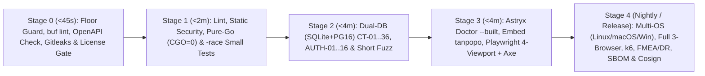

# End-to-End Verification Strategy, Hermetic Test Doubles & Multi-OS/Browser CI Pipeline — Tanpopo

> **Canonical Quality Assurance & CI Architecture Specification (Synchronized in `TP-IMP-0002` — Spec Closure Batch B)**
> - **Document ID:** `SPEC-QA-02` | **Version:** `0.2.0-m0-closure` | **Last Updated:** `2026-11-14`
> - **Authoring Role:** Principal QA Architect, Test Systems Lead & CI/CD Engineer
> - **Aligned Contracts:** [`proto/tanpopo/extension/v1/runtime.proto`](../../proto/tanpopo/extension/v1/runtime.proto), [`openapi/dataplane-v1.yaml`](../../openapi/dataplane-v1.yaml), [`openapi/admin-v1.yaml`](../../openapi/admin-v1.yaml), [`contract-test-matrix.md`](./contract-test-matrix.md) (`SPEC-QA-01`), and [`execution-baseline.md`](../governance/execution-baseline.md).
> - **Measurement Honesty (`COND-PO-01`):** Every per-test time budget (`< 50 ms`, `< 5 s`, `< 60 s`) and CI stage runtime target (`< 45 s` .. `< 25 min`) in this document is **`TARGET / UNVERIFIED`** until empirical CI pipeline execution begins in `M1`–`M5`.
> - **Requirements Traceability:** `TP-FR-0101`..`1005`, `TP-NFR-0101`..`1002`, `TP-AC-F0101`..`F1003`, `TP-AC-SEC-01`..`08`, `TP-AC-N01`..`10`, `UX-AC-01`..`12`, `OPS-AC-01`..`12`, `COND-PO-04`, `GAP-13`.

---

## 1. Resource-Based Test Pyramid

Tanpopo allocates verification coverage by execution resource footprint so defects fail at the fastest deterministic layer:

| Tier | Resource Scope | Per-Test Time Budget (`TARGET / UNVERIFIED`) | Primary Verification Scope | Execution Cadence |
|---|---|---|---|---|
| **Tier 1: `Small` (`Unit & Property`)** | Pure in-memory single process; `0` disk I/O, `0` sockets, deterministic `FakeClock`. | `< 50 ms` | Policy intersection `Instance ∩ Org ∩ Project ∩ Env`, 6-step route ranking, state machines **`SM-01`..`SM-09`**, `micro-USD` conservation (`FZ-06`), 5-tuple JCS hashing, SSE frame splitting, OpenAPI/`runtime.proto` schema linting. | Every local save & `Stage 1` on every PR. |
| **Tier 2: `Medium` (`Dual-DB, Contract & Fuzz`)** | Loopback `127.0.0.1` only + `SQLite WAL` + `PostgreSQL 16` + `Valkey` + `wazero` Sandbox + Cassette fixtures. | `< 5 s` | Full `CT-01`..`CT-36` (as milestones unlock) and `AUTH-01`..`AUTH-16`, `SQLite <-> PostgreSQL` behavioral parity, `BlindBroker` (`Cookie` ban `NEG-3`), `BlobRef` (`> 64 KiB` outside `16 MiB` Wasm `NEG-1`), `SSRFGuard`, and short fuzzing. | Mandatory `Stage 2` gate on every PR. |
| **Tier 3: `Large` (`System E2E, Multi-Browser, Multi-OS & Load`)** | Single unified **`tanpopo`** binary embedding the Astryx SPA + `Playwright` (Chromium, Firefox, WebKit) + `axe-core` + loopback `FakeLLM / FakeIdP / FakeMCP` servers. | `< 60 s` | `EXT-ACCEPT-01`, journeys `UJ-01`..`UJ-08` across 5 UI states and 4 viewport bands, `WCAG 2.2 AA` Light/Dark audits, `Air-Gap` zero-external-request UI (`UX-AC-10`), `DR-01`..`04` drills, and `k6` benchmarks. | Smoke E2E on every PR (`Stage 3`); full Multi-OS/Browser, load & chaos suite nightly & pre-release (`Stage 4`). |

---

## 2. Functional, Negative, Contract & E2E Matrix Across 9 Business Domains

| Business Domain | Functional Happy Path | Negative & Adversarial Cases | Contract / Integration / E2E Gates |
|---|---|---|---|
| **1. `Provider Adapter` & Multimodal `BlobRef`** | Sync (`TransformResponse`) & streaming (`TransformStreamChunk`) across the 5 `v0.1` Official Adapters (`OpenAI`, `Anthropic`, `Gemini`, `OpenAI-Compatible/vLLM`, `Ollama`), `v0.2` `Bedrock`/`Azure`/`/v1/rerank`, and `/native/*`. | `32 MiB` multimodal attachment (`> 64 KiB` kept outside `16 MiB` Wasm via `BlobRef` — `NEG-1`), truncated tool JSON (`502 upstream_malformed_response`), `400 dialect_mismatch`. | `CT-06`, `CT-09`, `CT-13`, `FZ-03`, `EXT-ACCEPT-01`. |
| **2. `SSE` Streaming & Client Cancellation** | Immediate chunk relay, auto `stream_options.include_usage=true` (`CR-09`), `: ping` heartbeats, `< 500 ms` (`TARGET / UNVERIFIED`) cancel teardown. | Abrupt TCP reset after chunk `k >= 1` (`mid_stream_abort`, `0` fallback), multi-byte UTF-8 split across segments. | `CT-07`, `CT-10`, `CT-11`, `FZ-03`, `FMEA-01`. |
| **3. Two-Phase `Micro-USD` Ledger** | Text-only byte pre-hold + separate `BlobRef` media unit schedule -> `SETTLED_EXACT` across 5 token dimensions + `MediaUsage`. | `50` parallel budget-exhaustion racers (`429 project_budget_exceeded`), missing `usage`, `Valkey` `{org_id}` hash-tag Lua & `valkey_hold_checkpoints` failover (`CR-07`). | `CT-12`, `CT-29`, `FZ-06`, `FMEA-04`. |
| **4. Capability Routing & Residency** | `PRIORITY_FAILOVER` / `WEIGHTED` / `LOWEST_COST` (`<= 4` attempts pre-stream), zero-side-effect `POST /admin/v1/routes/explain`. | Unsupported `snake_case` capability (`strict_json_schema`, `vision`, `audio_input`, `document_input`) -> `400 capability_not_supported`; all `EU` targets down -> `503 no_compliant_deployment_available`. | `CT-08`, `CT-10`, `CT-12`, `UJ-05`, `FMEA-01`. |
| **5. `MCP` (`2025-03-26`) & `A2A` (`SM-09`)** | Per-key `<server>__<tool>` ACL pagination, HTTP `200` JSON-RPC async HITL approval with 5-tuple JCS hash (`CR-08`), A2A `SM-09` lifecycle. | *MCP Rug-Pull* (`403 schema_hash_drift_blocked`), `0` retry on `mutating`/`destructive` timeout (`504 ambiguous_side_effect_timeout`), argument mutation (`403 parameter_hash_mismatch`), A2A `> 5` hops (`400 delegation_depth_exceeded`), **empirical IDE client verification (`CT-36` — `COND-PO-04`)**. | `CT-21`..`23`, **`CT-36`**, `FZ-04`, `UJ-06`, `FMEA-02`. |
| **6. Extension Sandbox & Lifecycle (`SM-01`)** | Stage `.tpkg` -> inspect `permission-diff` -> approve -> hot-enable -> `< 5s` (`TARGET / UNVERIFIED`) rollback. | Permission escalation (`UPDATING_PENDING_RECONSENT`), Wasm infinite loop / `> 16 MiB` OOM -> `502 extension_execution_fault` & `> 20` faults/60s -> `QUARANTINED`, outbound `Cookie` header ban (`NEG-3`). | `CT-14`..`18`, `CT-24`, `FZ-05`, `FMEA-05`. |
| **7. Marketplace & Supply Chain** | Install from signed Marketplace, 40-hex Git commit SHA, `.tpkg`, and digest-pinned Private OCI. | Mutable Git ref (`CT-25`), `^@tanpopo(-[a-z0-9]+)?/` spoofing (`403 reserved_namespace_spoofing`), *Zip-Slip* / *Zip-Bomb* (`> 64 MiB`), `DEC-004` consumer scraper rejection. | `CT-01`..`05`, `CT-20`, `CT-25`, `FZ-02`. |
| **8. 6-Role RBAC, Vault & Revocation** | OIDC PKCE login, 6-role RBAC matrix, `Master KEK -> Org DEK -> Project DEK`, `Per-Org + SYSTEM` JCS audit chains, `POST /admin/v1/playground/sessions`. | Virtual Key on `/admin/v1/*` (`401 invalid_credential_plane`), `QUOTA_PAUSED -> REVOKED` (`SM-05`), missing `X-CSRF-Token` (`403`), cross-org IDOR (`404`), `409 optimistic_lock_conflict`. | `AUTH-01`..`16`, `CT-30`, `FMEA-07`, `FMEA-08`. |
| **9. Multi-OS Installer, Migration & Air-Gap** | `tanpopo serve` (`< 3s` `TARGET / UNVERIFIED`), `SCR-01` `allow_private_ip` local `Ollama` setup, `tanpopo admin reset-local-owner`, `tanpopo db migrate-engine`, `.tpop.enc` backup, `< 60s` (`TARGET / UNVERIFIED`) `Project DEK` crypto-shredding. | Dirty SQL migration (`exit 31`), `offline_mode` verifying both `official` + `enterprise_signed` `.tpkg` and rejecting expired `revocations.json` (`exit 22` — `CT-31`), `0` Google Fonts requests (`NEG-2`). | `CT-31`, `CT-32`, `OPS-AC-01`..`12`, `UX-AC-10`, `FMEA-06`. |

---

## 3. Hermetic Local Fake Ecosystem & Zero-External-Call Guarantee

> **Non-Negotiable Hermetic Invariant:** Zero automated tests may ever touch external Internet hosts or invoke paid third-party AI APIs (`0 USD` external spend).

1. **Four Deterministic Loopback Test Doubles (`internal/testkit` on `127.0.0.1:0`):**
   - **`FakeLLMServer`:** Emulates OpenAI (`/v1/chat/completions`, `/v1/responses`, `/v1/embeddings`, `/v1/rerank`), Anthropic, Gemini, and Ollama wire shapes with `X-Tanpopo-Fake-Fault` fault injection (`tcp_rst_after_chunks`, `http_status=429`, `omit_stream_usage`, `echo_auth_header_in_error`).
   - **`FakeOAuthIdP`:** Loopback OIDC / OAuth 2.1 server (`PKCE S256`, `RFC 8707` audience checks, rotating refresh tokens, `400 invalid_grant`).
   - **`FakeMCPServer`:** Loopback `MCP 2025-03-26 Streamable HTTP` server (`300` paginated tools, live *Rug-Pull* description mutation, `mutating` read-timeout injection).
   - **`FakeRegistryAndGitServer`:** Loopback smart Git HTTP + `OCI v2` registry with ephemeral `Cosign` / `Ed25519` test keys.
2. **Dual-Layer Outbound Socket Guard:**
   - **In-Process (`testkit/netguard`):** Active whenever `TANPOPO_TEST_HERMETIC=1`, failing immediately with a stack trace on any dial outside `127.0.0.0/8` or `::1`.
   - **OS Network Isolation & Canary Env Traps:** CI test steps run inside loopback-only network namespaces (`unshare --net` / `--internal`) with `OPENAI_API_KEY=CANARY_FORBIDDEN_CI_KEY`, etc.

---

## 4. Two-Command Go Test Discipline, Multi-OS Matrix & Multi-Browser / 4-Viewport Matrix

1. **Mandatory Two-Command Go Test Separation (`execution-baseline.md`):**
   Because Go's race detector (`-race`) requires `CGO_ENABLED=1` whereas production `tanpopo` binaries compile with `CGO_ENABLED=0`, local verification and CI **always execute two separate commands** (never combining `CGO_ENABLED=0` and `-race` in one invocation):
   - **Pure-Go Verification:** `CGO_ENABLED=0 TANPOPO_TEST_HERMETIC=1 go test ./...` *(PowerShell: `$env:CGO_ENABLED='0'; $env:TANPOPO_TEST_HERMETIC='1'; go test ./...`)*
   - **Race-Detector Verification:** `TANPOPO_TEST_HERMETIC=1 go test -race ./...`
2. **Multi-OS CI Runner Matrix (`TP-NFR-0901` — Closing `AUD-025`):**
   - **`ubuntu-24.04` (`linux/amd64` & `linux/arm64`):** Full Stages `0`–`4`, `PostgreSQL 16 + Valkey` containers, and Linux `unshare --net` air-gap tests.
   - **`macos-15` (`darwin/arm64` + cross-built `darwin/amd64`):** Verifies pure-Go `CGO_ENABLED=0` `tanpopo` build, `SQLite WAL` locking, `0700` data directory permissions, and `wazero` sandbox parity.
   - **`windows-2022` (`windows/amd64` + cross-built `windows/arm64`):** Verifies `tanpopo.exe` cold start, Windows path normalization, `icacls` ACL hardening, and `npx.cmd @astryxdesign/cli` tooling compatibility.
3. **Multi-Browser & 4-Band Responsive Viewport Matrix (`TP-NFR-0701`, `TP-AC-N07` — Closing `AUD-025`):**
   - **Browsers (`Playwright`):** `Chromium` (Chrome / Edge engine), `Firefox`, and `WebKit` (Safari engine).
   - **Continuous 4-Tier Viewport Matrix (`Zero Gap at 1024px–1279px`):**
     1. `1440x900` — Desktop (`>= 1280px`: 3-region `SideNav + LayoutContent + LayoutPanel`)
     2. `1152x800` — Compact Desktop (`1024px – 1279px`: `SideNav + LayoutContent` with slide-over `Drawer` inspector)
     3. `834x1112` — Tablet (`768px – 1023px`: collapsible `SideNav` + modal `Dialog` / `Drawer`)
     4. `375x812` — Mobile Emergency (`375px – 767px`: mobile nav drawer + `< 15s` `TARGET / UNVERIFIED` one-handed Kill-Switch & key revocation)
4. **Canary Secret Scanner (`OPS-AC-10`):** Post-test sweep across `stdout/stderr`, SQL metadata columns, OTel spans, DOM/HAR captures, and `support-bundle` tarballs fails CI on `>= 1` match of `sk-tp-canary-DO-NOT-LEAK-*`.

---

## 5. Five-Stage Hermetic CI Pipeline on GitHub Actions

| CI Stage | Concrete Tools & Commands | Time Budget (`TARGET / UNVERIFIED`) | Merge-Blocking Rule |
|---|---|---|---|
| **`Stage 0: Contract, Floor & Supply-Chain Guard`** | `buf lint` (`proto/tanpopo/extension/v1/runtime.proto`), OpenAPI `3.1.0` schema & `SCR-01..16` parity check (`openapi/*.yaml`), legacy binary drift check (`0` legacy binary refs), `CONSTRAINTS.md` floor guard (`0` `.skip`/`@ts-ignore`/`//nolint:gosec`/raw `div`-`span`), `gitleaks`, `Apache-2.0` license gate. | `< 45 s` | Any violation aborts immediately. |
| **`Stage 1: Static Analysis & Small Tests`** | `golangci-lint`, `govulncheck ./...`, `tsc --noEmit`, separate `CGO_ENABLED=0 go test -short ./...` and `go test -race -short ./...` + `FZ-06` ledger conservation property test. | `< 2 min` | `0` warnings, `0` data races, pure-Go `CGO_ENABLED=0` green. |
| **`Stage 2: Dual-DB Contract & Adversarial`** | Full `CT-01`..`CT-36` and `AUTH-01`..`AUTH-16` + `CanaryScanner` across **both `SQLite WAL` and `PostgreSQL 16 + Valkey`** in an offline network namespace; short `FZ-01`..`05` fuzzing (`10s`/target) + multi-OS smoke tests (`linux`, `macos-15`, `windows-2022`). | `< 4 min` | `100%` parity across SQLite & PostgreSQL and all 3 OS families. |
| **`Stage 3: Astryx Doctor & Offline E2E`** | Build `web/console` (local `Figtree` `.woff2` Vite alias) -> `npx @astryxdesign/cli doctor --built dist` (`0 fail`) -> embed into **`tanpopo`** -> run `EXT-ACCEPT-01`, `UJ-01`..`08` across all 4 viewports (`1440`, `1152`, `834`, `375`), `0` external requests (`UX-AC-10`), and `@axe-core/playwright` (`Light` + `Dark`). | `< 4 min` | Blocks merge on any `astryx doctor`, E2E, `1024–1279px` layout, or `WCAG 2.2 AA` failure. |
| **`Stage 4: Multi-Browser, Load, Chaos & Signing`** *(Nightly & Pre-Release)* | Full 3-engine Playwright matrix (`Chromium`, `Firefox`, `WebKit`), `15 min`/target fuzzing, `k6` `SLO-01`..`08` verification, `FMEA-01`..`08` & `DR-01`..`04` drills, 6-target OS/arch builds, `CycloneDX SBOM`, and `Cosign` signing. | `< 25 min` | Must pass `100%` prior to any release sign-off gate (`TP-IMP-0047`). |
