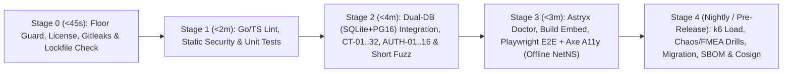

# Chiến lược Kiểm thử Đầu-Cuối, Môi trường Giả lập Khép kín & Đường ống CI (Verification Strategy & Hermetic CI) — Tanpopo

> **Tài liệu Kiến trúc Đảm bảo Chất lượng (Phase ASTRA A07 — Gate G3: `READY_FOR_REVIEW` | `PROPOSED — NO CODE`)**
> - **Mã tài liệu:** `SPEC-QA-02` | **Phiên bản:** `0.1.0-step07-draft` | **Ngày cập nhật:** `2026-11-12`
> - **Vai trò biên soạn:** Principal QA Architect, Test Systems Lead & CI/CD Engineer
> - **Trạng thái quản trị:** **Đặc tả Kiểm thử Đề xuất (`PROPOSED`)** — áp dụng nguyên tắc *Red-Green-Refactor*, phân loại theo quy mô tài nguyên (*Small / Medium / Large*) từ [`test-driven-development`](../../.agents/skills/test-driven-development/SKILL.md) và các cổng chất lượng tự động từ [`ci-cd-and-automation`](../../.agents/skills/ci-cd-and-automation/SKILL.md).
> - **Truy vết Yêu cầu:** `TP-FR-0101`..`1005`, `TP-NFR-0101`..`1002`, `TP-AC-F0101`..`F1003`, `TP-AC-SEC-01`..`08`, `TP-AC-N01`..`10`, `UX-AC-01`..`12`, `OPS-AC-01`..`12`, `SPEC-QA-01`.

---

## 1. Mô hình Phân tầng Kiểm thử Theo Quy mô Tài nguyên (`Resource-Based Test Pyramid`)

Thay vì viết hàng trăm bài kiểm thử giao diện chậm chạp và hay nhiễu (*flaky*), Tanpopo phân bổ độ phủ theo tài nguyên thực thi để phát hiện lỗi ở tầng rẻ và nhanh nhất:

| Cấp độ | Quy mô Tài nguyên | Giới hạn Thời gian / Bài (`TARGET`) | Phạm vi Xác minh Chính | Môi trường Chạy |
|---|---|---|---|---|
| **Tầng 1: `Small` (`Unit & Property Tests`)** | Thuần bộ nhớ trong 1 tiến trình; `0` I/O đĩa thực, `0` mạng, đồng hồ giả `FakeClock`. | `< 50 ms` | Đại số hợp nhất chính sách `Org ∩ Project ∩ Env`, xếp hạng định tuyến, máy trạng thái `SM-01`..`08`, số học sổ cái `micro-USD` (`FZ-06`), chuẩn hóa JCS `schema_hash`, tách khung SSE. | Mọi lần lưu tệp cục bộ & `Stage 1` trên mọi PR. |
| **Tầng 2: `Medium` (`Dual-DB Integration, Contract & Fuzz`)** | Chỉ chạm loopback `127.0.0.1` + `SQLite WAL` + container `PostgreSQL 16` + `Valkey` + `wazero` Sandbox + Băng ghi Cassette. | `< 5 s` | Ma trận `CT-01`..`CT-32`, `AUTH-01`..`AUTH-16`, đối xứng `SQLite <-> PostgreSQL`, `Blind Broker`, `SSRFGuard`, `Single-Flight OAuth`, chạy fuzzing theo ngân sách thời gian. | `Stage 2` bắt buộc trên mọi PR. |
| **Tầng 3: `Large` (`System E2E, Accessibility, Load & Chaos`)** | Nhị phân `tanpopod` thật nhúng SPA Astryx + `Playwright` + `axe-core` + cụm giả lập + các máy chủ `FakeLLM / FakeIdP / FakeMCP` cục bộ. | `< 60 s` | Kịch bản `EXT-ACCEPT-01`, 8 hành trình `UJ-01`..`UJ-08` đủ 5 trạng thái, kiểm định `WCAG 2.2 AA`, cài đặt `Air-Gap`, diễn tập khôi phục `DR-01`..`04`, đo tải `k6` và tiêm lỗi hỗn loạn. | Bộ khói E2E chạy trên mọi PR (`Stage 3`); đo tải dài và hỗn loạn chạy hằng đêm & trước phát hành (`Stage 4`). |

---

## 2. Ma trận Độ phủ Chức năng, Phủ định, Tích hợp & E2E Trên 9 Miền Nghiệp vụ

Mỗi miền nghiệp vụ bắt buộc phải có đủ **luồng thành công (`Happy Path`)**, **luồng phủ định/lạm dụng (`Negative & Adversarial`)**, **kiểm thử hợp đồng/tích hợp (`Contract / Integration`)** và **nghiệm thu đầu-cuối (`E2E`)**:

| Miền Nghiệp vụ | Kiểm thử Chức năng (`Happy Path`) | Kiểm thử Phủ định & Biên (`Negative / Edge`) | Hợp đồng / Tích hợp / E2E Xác minh |
|---|---|---|---|
| **1. `Provider Adapter` & Chuẩn hóa Giao thức** | Gọi đồng bộ & streaming qua OpenAI, Anthropic, Gemini, Bedrock, Ollama và `/native/*` giữ nguyên trường mở rộng. | Hãng đích trả JSON cắt cụt, mã lỗi lạ `529`, tiêu đề thiếu `Content-Type`, hoặc thân phản hồi phình đại `> 32 MiB`. | `CT-06`, `CT-09`, `CT-13`, `FZ-03`, `EXT-ACCEPT-01`. |
| **2. Truyền luồng `SSE` & Hủy Kết nối (`Cancel`)** | Chuyển tiếp tức thì từng mảnh SSE, lọc dòng `: ping`, dọn sạch kết nối upstream khi khách đóng tab/hủy `AbortController`. | Đứt kết nối TCP sau mảnh thứ `k` (`Partial Stream`), khách đọc chậm làm đầy bộ đệm (*Slow Consumer*), ký tự `UTF-8` bị cắt đôi giữa 2 gói TCP. | `CT-07`, `CT-10`, `CT-11`, `FZ-03`, `FMEA-01`. |
| **3. Quyết toán Ngân sách Hai pha (`Usage Settlement`)** | Giữ chỗ `Pre-Hold` -> Quyết toán `SETTLED_EXACT` khớp cả 5 thành phần token (input, output, reasoning, cache read/write). | 50 truy vấn bắn song song lúc cạn tiền; hãng đích không trả usage cuối luồng; chi phí thật nhỉnh hơn mức giữ chỗ (`Negative Balance Carryover`). | `CT-12`, `CT-29`, `FZ-06`, `FMEA-04`. |
| **4. Định tuyến, Khớp Năng lực & Dự phòng (`Routing / Fallback`)** | Chọn đích theo trọng số/chi phí/độ trễ; tự động chuyển sang đích dự phòng khi đích chính trả `429`/`503` **trước mảnh đầu tiên**; giải thích tuyến `Dry-Run`. | Yêu cầu tính năng `vision` / `audio` / `strict_json_schema` mà đích không có -> trả `400`; mọi đích thuộc vùng `EU` đều sập -> đóng an toàn `503`, cấm tràn sang `US`. | `CT-08`, `CT-10`, `CT-12`, `UJ-05`, `FMEA-01`. |
| **5. Tác động Phụ Của Công cụ `MCP` & Ủy quyền `A2A`** | Lọc danh sách công cụ theo `Virtual Key`, phân trang `> 200` công cụ, thực thi công cụ `read_only`, duyệt đồng bộ/bất đồng bộ công cụ `destructive`. | Máy chủ MCP đổi ngầm mô tả công cụ (*Rug-Pull*); quá hạn mạng khi gọi công cụ `mutating` (**`0` retry tự động**); đổi tham số sau khi xin duyệt; vòng lặp A2A `> 5` bước nhảy. | `CT-21`..`23`, `FZ-04`, `UJ-06`, `FMEA-02`. |
| **6. Vòng đời Phần mở rộng (`Plugin Lifecycle`)** | Cài đặt -> Duyệt bảng quyền -> Kích hoạt nóng -> Nâng cấp êm qua `DRAINING` -> Quay lui `Rollback` về bản cũ. | Bản cập nhật lén xin thêm quyền mạng/bí mật (`UPDATING_PENDING_RECONSENT`); plugin Wasm lặp vô tận hoặc tràn RAM; cách ly khẩn cấp `QUARANTINED` cắt lưu lượng `< 1s`. | `CT-17`, `CT-18`, `CT-24`, `UJ-02`, `UJ-07`, `FMEA-05`. |
| **7. Marketplace & 4 Nguồn Cài đặt** | Cài đặt thành công từ: (1) Chỉ mục Marketplace tĩnh đã ký, (2) URL Git ghim `40-hex SHA`, (3) Gói `.tpkg`/`.zip` cục bộ, (4) Kho `OCI Private Registry` nội bộ. | Thẻ Git động không ghim SHA; chữ ký `Cosign` sai; mạo danh `@tanpopo-official/*`; nén `Zip-Slip` / `Zip-Bomb`; nộp gói lách thuê bao tiêu dùng. | `CT-01`..`05`, `CT-20`, `CT-25`, `FZ-02`. |
| **8. Xác thực, Đa Tổ chức & Thu hồi Nhanh** | Đăng nhập `OIDC + PKCE`, xoay `Virtual Key` có cửa sổ ân hạn, làm mới đơn luồng `Authorized OAuth 2.1`, kiểm toán băm chuỗi. | Dùng `Virtual Key` gọi `/admin/v1/*`; tự duyệt `Four-Eyes`; dò `UUID` chéo tổ chức (`IDOR`); cấy ghép bản mã chéo tổ chức; nút cụm mất liên lạc kênh thu hồi. | `AUTH-01`..`16`, `CT-30`, `FMEA-07`, `FMEA-08`. |
| **9. Bộ cài Tự vận hành, `Air-Gap` & Khôi phục Thảm họa** | Khởi chạy đơn nhị phân `< 3s`, tiền kiểm `tanpopo doctor`, nhập gói ngoại tuyến `Air-Gap`, sao lưu nóng và khôi phục sang máy mới, di trú `SQLite -> Postgres`. | Chạy dưới quyền `root` không cờ xác nhận; gói `Air-Gap` quá hạn danh sách thu hồi; mất kết nối giữa chừng khi đang chạy migration DB; khôi phục thiếu `Master KEK`. | `CT-31`, `CT-32`, `OPS-AC-01`..`12`, `FMEA-06`. |

---

## 3. Hệ sinh thái Giả lập Cục bộ & Cơ chế Khóa Cứng Không Gọi Dịch vụ AI Trả phí (`Hermetic Zero-External-Call Guarantee`)

> **Quy tắc bất biến của CI & Kiểm thử Cục bộ:** Không một bài kiểm thử tự động nào (Unit, Contract, Integration, Fuzz hay E2E) được phép phụ thuộc vào mạng ngoài hoặc vô tình gọi tới API trả phí thật của OpenAI, Anthropic, Google, AWS hay bất kỳ hãng AI nào.

### 3.1. Bốn Máy chủ Giả lập Có Tiêm Lỗi Tất định (`testkit/*` Local Fakes)
1. **`FakeLLMServer` (`127.0.0.1:0`):** Giả lập chính xác định dạng đường truyền của OpenAI (`/v1/chat/completions`, `/v1/responses`, `/v1/embeddings`), Anthropic (`/v1/messages`), Gemini (`streamGenerateContent`) và Ollama. Hỗ trợ điều khiển lỗi tất định qua tiêu đề kiểm thử `X-Tanpopo-Fake-Fault`:
   - `delay_first_byte_ms=300`, `inter_chunk_ms=10`,
   - `tcp_rst_after_chunks=5` (kiểm thử đứt luồng giữa chừng `FMEA-01`),
   - `http_status=429;retry_after=12` (kiểm thử chuyển mạch dự phòng),
   - `omit_stream_usage=true` hoặc `corrupt_json_at_byte=128` (kiểm thử `FMEA-04` và bộ tách khung),
   - `echo_auth_header_in_error=true` (kiểm thử bộ lọc chống rò rỉ khóa trong thông báo lỗi `CT-16`).
2. **`FakeOAuthIdP` (`127.0.0.1:0`):** Máy chủ OIDC / OAuth 2.1 cục bộ phát hành khóa ký `JWKS` tạm thời cho mỗi ca kiểm thử, hỗ trợ `PKCE S256`, xoay `refresh_token`, thu hồi token chủ động và giả lập sập máy chủ `503` (`FMEA-08`).
3. **`FakeMCPServer` (`127.0.0.1:0`):** Máy chủ MCP Streamable HTTP cục bộ cho phép bật/tắt `300` công cụ mẫu, tiêm độ trễ treo trên công cụ `mutating` (`FMEA-02`) và đổi ngầm mô tả công cụ giữa phiên chạy để kích hoạt chốt chặn `schema_hash` (`CT-21`).
4. **`FakeRegistryAndGitServer` (`127.0.0.1:0`):** Phục vụ giao thức Git HTTP thông minh và kho ảnh `OCI v2` cục bộ kèm cặp khóa `Cosign` kiểm thử dùng một lần để kiểm định trọn vẹn 4 nguồn cài đặt phần mở rộng mà không chạm GitHub hay Docker Hub.

### 3.2. Hai Lớp Chặn Mạng Cơ học Trong Bộ Kiểm thử (`Dual-Layer Outbound Network Guard`)
1. **Lớp 1 — Chốt Chặn Socket Ngay Trong Tiến trình Kiểm thử (`testkit/netguard`):**
   - Trong `TestMain` của toàn bộ gói kiểm thử Go và trình chạy E2E, biến `TANPOPO_TEST_HERMETIC=1` được bật mặc định, cài móc vào `http.DefaultTransport` và `net.Dialer.Control`.
   - Bất kỳ nỗ lực mở kết nối TCP/UDP nào tới địa chỉ IP **không nằm trong `127.0.0.0/8` hoặc `::1`** (hoặc bất kỳ truy vấn DNS nào ra ngoài `.test.local` / `localhost`) đều bị **ngắt tức khắc và làm bài test `FAIL` ngay lập tức kèm toàn bộ dấu vết ngăn xếp (`stack trace`)**.
2. **Lớp 2 — Cô lập Không gian Mạng Cấp Hệ điều hành Trong CI (`OS Network Namespace`) & Biến Mồi Nhử:**
   - Sau bước tải bộ nhớ đệm thư viện có kiểm soát khóa băm, các bước thực thi kiểm thử (`go test`, `tanpopo plugin test`, `playwright test`) trong GitHub Actions chạy bên trong không gian mạng cô lập chỉ bật giao diện `lo` (`unshare --net` trên Linux runner hoặc mạng container nội bộ `--internal` không có cổng NAT ra Internet).
   - Toàn bộ biến môi trường nhạy cảm trên runner được gán giá trị mồi nhử vô hiệu: `OPENAI_API_KEY=CANARY_FORBIDDEN_CI_KEY`, `ANTHROPIC_API_KEY=CANARY_FORBIDDEN_CI_KEY`, `GEMINI_API_KEY=CANARY_FORBIDDEN_CI_KEY`.

---

## 4. Cô lập Dữ liệu Kiểm thử, Tái hiện Tất định & Quét Bí mật Chim Hoàng Yến (`Determinism & Canary Redaction`)

1. **Cô lập Tuyệt đối Giữa Các Bài Kiểm thử Chạy Song song (`t.Parallel()` Isolation):**
   - Với `SQLite`: mỗi bài kiểm thử nhận một thư mục tạm riêng `t.TempDir()` tự xóa sạch sau khi xong.
   - Với `PostgreSQL 16` & `Valkey`: mỗi bài kiểm thử tạo một `org_id` `UUIDv7` riêng biệt (và tiền tố khóa riêng trên `Valkey`), cho phép hàng trăm bài tích hợp chạy song song trên cùng một container DB mà không bao giờ đụng độ trạng thái.
2. **Tái hiện Tất định `100%` Không Phụ thuộc Thời gian Thực (`Deterministic Reproduction`):**
   - Mọi bộ đếm cửa sổ trượt, hạn token, cửa sổ ân hạn khóa và thời gian chờ ngắt mạch đều đọc qua giao diện `clock.Clock` (trong kiểm thử truyền `FakeClock.Advance(duration)` thay vì dùng `time.Sleep()` gây chậm và chập chờn).
   - Mọi bài kiểm thử ngẫu nhiên/fuzzing đều in hạt giống `TANPOPO_TEST_SEED=<uint64>` ra đầu dòng nhật ký để kỹ sư tái hiện lại chính xác từng bước bằng một lệnh duy nhất trên máy cá nhân.
3. **Cổng Quét Bí mật Chim Hoàng Yến Tự động (`Automated Canary Secret Scanner` — `OPS-AC-10`):**
   - Trong mỗi lần chạy tích hợp và E2E, bộ khung tự động nạp chuỗi khóa đặc biệt `sk-tp-canary-DO-NOT-LEAK-9f8e7d6c` và token OAuth `eyJ_tp_canary_secret_token_9f8e7d6c`, ép hệ thống đi qua cả truy vấn thành công, lỗi `400/401/429/500`, đứt luồng SSE và xuất gói `tanpopo support-bundle`.
   - Ngay cuối bài chạy, kịch bản hậu kiểm quét toàn bộ tệp nhật ký `stdout/stderr`, toàn bộ cột văn bản trong `SQLite/PostgreSQL`, các span `OpenTelemetry` thu được và tệp nén `support-bundle`: **phát hiện dù chỉ `1` lần xuất hiện chuỗi canary sẽ đánh sập toàn bộ cổng CI ngay lập tức**.

---

## 5. Kiến trúc Đường ống CI 5 Giai đoạn Trên GitHub Actions (`Hermetic CI Pipeline`)

| Giai đoạn CI | Công cụ & Lệnh Kiểm định Cụ thể | Ngân sách Thời gian (`TARGET`) | Điều kiện Chặn Gộp Mã (`Merge-Blocking Rule`) |
|---|---|---|---|
| **`Stage 0: Floor & Supply-Chain Guard`** | Kiểm tra chống hạ chuẩn `CONSTRAINTS.md` (cấm thêm `.skip`, `@ts-ignore`, `//nolint:gosec`), `gitleaks --redact`, kiểm tra 1 lockfile duy nhất, `npm ci --ignore-scripts`, kiểm tra giấy phép phụ thuộc (`0` `GPL`/`AGPL`). | `< 45 giây` | Bất kỳ vi phạm nào dừng ngay lập tức toàn bộ pipeline để tiết kiệm tài nguyên. |
| **`Stage 1: Static Analysis & Small Tests`** | `golangci-lint` (`gosec`, `errcheck`, `govet`), `govulncheck ./...`, `osv-scanner`, `tsc --noEmit`, `go test -race -short ./...` + kiểm thử thuộc tính `FZ-06`. | `< 2 phút` | `0` cảnh báo bảo mật tĩnh, `0` lỗi đua dữ liệu (`-race`), đạt ngưỡng độ phủ nhánh trên các gói nhân bảo mật/tài chính. |
| **`Stage 2: Dual-DB Contract & Adversarial`** | Chạy song song toàn bộ bộ tích hợp (`CT-01`..`CT-32`, `AUTH-01`..`AUTH-16`, quét `Canary Secret`) trên **cả 2 ma trận `SQLite WAL` và `PostgreSQL 16 + Valkey`** trong không gian mạng khóa Internet; chạy fuzzing `FZ-01`..`05` (`10s`/hàm trên PR). | `< 4 phút` | Phải xanh `100%` trên cả `SQLite` lẫn `PostgreSQL`; lệch hành vi giữa 2 hệ DB bị chặn cứng (`RSK-013`). |
| **`Stage 3: Astryx UI Doctor & Hermetic E2E`** | Build SPA Console -> chạy `npx @astryxdesign/cli doctor` & `doctor --built` (`0 fail`) -> nhúng vào `tanpopod` -> chạy `EXT-ACCEPT-01`, khói `UJ-01`..`08` và quét tiếp cận `axe-core` (`0` lỗi `critical`/`serious`). | `< 3 phút` | Chặn gộp mã nếu `astryx doctor` báo lỗi, rớt kịch bản E2E hoặc vi phạm `WCAG 2.2 AA`. |
| **`Stage 4: Reliability, Chaos & Release Signing`** *(Chạy hằng đêm & khi cắt nhánh Release)* | Chạy fuzzing sâu (`15 phút`/hàm), đo tải `k6` đối chiếu ngân sách `p95`/`p99`, diễn tập `FMEA-01`..`08` & khôi phục `DR-01`..`04` trên dữ liệu thật giả lập, biên dịch đa nền tảng, xuất `CycloneDX SBOM` và ký `Cosign`. | `< 25 phút` | Bắt buộc vượt qua `100%` trước khi gắn thẻ phát hành bất kỳ bản `v0.x` hay `v1.0` nào. |