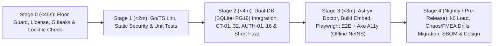

# End-to-End Verification Strategy, Hermetic Test Doubles & CI Pipeline — Tanpopo

> **Quality Assurance Architecture Specification (Phase ASTRA A07 — Gate G3: `READY_FOR_REVIEW` | `PROPOSED — NO CODE`)**
> - **Document ID:** `SPEC-QA-02` | **Version:** `0.1.0-step07-draft` | **Last Updated:** `2026-11-12`
> - **Authoring Role:** Principal QA Architect, Test Systems Lead & CI/CD Engineer
> - **Governance Status:** **Proposed Verification Specification (`PROPOSED`)** — applies *Red-Green-Refactor* discipline, resource-scoped test tiers (*Small / Medium / Large*) from [`test-driven-development`](../../.agents/skills/test-driven-development/SKILL.md), and automated quality gates from [`ci-cd-and-automation`](../../.agents/skills/ci-cd-and-automation/SKILL.md).
> - **Requirements Traceability:** `TP-FR-0101`..`1005`, `TP-NFR-0101`..`1002`, `TP-AC-F0101`..`F1003`, `TP-AC-SEC-01`..`08`, `TP-AC-N01`..`10`, `UX-AC-01`..`12`, `OPS-AC-01`..`12`, `SPEC-QA-01`.

---

## 1. Resource-Based Test Pyramid

Rather than relying on hundreds of slow, flaky browser-driven tests, Tanpopo allocates verification coverage by execution resource footprint so defects fail at the fastest, cheapest deterministic layer:

| Tier | Resource Scope | Per-Test Time Budget (`TARGET`) | Primary Verification Scope | Execution Cadence |
|---|---|---|---|---|
| **Tier 1: `Small` (`Unit & Property Tests`)** | Pure in-memory single process; `0` real disk I/O, `0` network sockets, deterministic `FakeClock`. | `< 50 ms` | Policy intersection algebra `Org ∩ Project ∩ Env`, candidate route ranking, state machines `SM-01`..`08`, `micro-USD` ledger conservation (`FZ-06`), JCS `schema_hash` canonicalization, SSE frame parsing. | Every local file save & `Stage 1` on every PR. |
| **Tier 2: `Medium` (`Dual-DB Integration, Contract & Fuzz`)** | Loopback `127.0.0.1` only + `SQLite WAL` + `PostgreSQL 16` container + `Valkey` + `wazero` Sandbox + Cassette fixtures. | `< 5 s` | Full `CT-01`..`CT-32` and `AUTH-01`..`AUTH-16` matrices, `SQLite <-> PostgreSQL` behavioral parity, `Blind Broker`, `SSRFGuard`, `Single-Flight OAuth`, and time-budgeted fuzz runs. | Mandatory `Stage 2` gate on every PR. |
| **Tier 3: `Large` (`System E2E, Accessibility, Load & Chaos`)** | Real `tanpopod` binary embedding the Astryx SPA + `Playwright` + `axe-core` + local multi-node cluster + loopback `FakeLLM / FakeIdP / FakeMCP` servers. | `< 60 s` | `EXT-ACCEPT-01`, all 8 journeys `UJ-01`..`UJ-08` across 5 UI states, `WCAG 2.2 AA` audits, `Air-Gap` bundle import, `DR-01`..`04` recovery drills, `k6` load benchmarks, and chaos fault injection. | E2E smoke suite on every PR (`Stage 3`); extended soak load and chaos drills nightly & pre-release (`Stage 4`). |

---

## 2. Functional, Negative, Integration & E2E Coverage Matrix Across 9 Business Domains

Every business domain must maintain complete coverage across **Happy Path**, **Negative & Adversarial**, **Contract / Integration**, and **End-to-End (`E2E`)** verification:

| Business Domain | Functional Happy Path | Negative & Edge Cases | Contract / Integration / E2E Gates |
|---|---|---|---|
| **1. `Provider Adapter` & Protocol Normalization** | Sync & streaming inference across OpenAI, Anthropic, Gemini, Bedrock, Ollama, plus lossless `/native/*` extension fields. | Upstream returns truncated JSON, non-standard `529` status, missing `Content-Type`, or oversized `> 32 MiB` bodies. | `CT-06`, `CT-09`, `CT-13`, `FZ-03`, `EXT-ACCEPT-01`. |
| **2. `SSE` Streaming & Client Cancellation** | Zero-buffering chunk forwarding, `: ping` keep-alive filtering, immediate upstream teardown when caller closes tab or fires `AbortController`. | Abrupt TCP reset after chunk `k` (`Partial Stream`), backpressured *Slow Consumer*, multi-byte `UTF-8` rune split across TCP segments. | `CT-07`, `CT-10`, `CT-11`, `FZ-03`, `FMEA-01`. |
| **3. Two-Phase Budget Settlement (`Usage Settlement`)** | `Pre-Hold` reservation -> `SETTLED_EXACT` across all 5 token components (input, output, reasoning, cache read/write). | 50 parallel requests racing final budget dollars; upstream omits terminal `usage`; actual cost slightly exceeds pre-hold (`Negative Balance Carryover`). | `CT-12`, `CT-29`, `FZ-06`, `FMEA-04`. |
| **4. Capability-Aware Routing & Failover** | Weighted/cost/latency candidate selection; automatic failover on upstream `429`/`503` **prior to first chunk**; `Dry-Run` route explainability. | Request requires `vision` / `audio` / `strict_json_schema` unsupported by target -> `400`; all `EU` deployments down -> fail-closed `503`, zero spillover to `US`. | `CT-08`, `CT-10`, `CT-12`, `UJ-05`, `FMEA-01`. |
| **5. `MCP` Tool Side Effects & `A2A` Delegation** | Per-`Virtual Key` tool filtering, `> 200`-tool cursor pagination, `read_only` tool invocation, sync/async human approval for `destructive` tools. | MCP server silently edits tool description (*Rug-Pull*); network timeout during `mutating` tool call (**`0` automatic retries**); post-approval argument tampering; A2A loop `> 5` hops. | `CT-21`..`23`, `FZ-04`, `UJ-06`, `FMEA-02`. |
| **6. Extension Lifecycle (`Plugin Lifecycle`)** | Stage -> Approve permission sheet -> Hot-enable -> Graceful `DRAINING` upgrade -> Instant `Rollback` to prior version. | Update stealthily adds network/secret permissions (`UPDATING_PENDING_RECONSENT`); Wasm infinite loop or OOM; emergency `QUARANTINED` cutoff in `< 1s`. | `CT-17`, `CT-18`, `CT-24`, `UJ-02`, `UJ-07`, `FMEA-05`. |
| **7. Marketplace & 4 Installation Sources** | Install cleanly from: (1) Signed static Marketplace index, (2) `40-hex SHA`-pinned Git URL, (3) Local `.tpkg`/`.zip` archive, (4) Internal `OCI Private Registry`. | Unpinned mutable Git tag; bad `Cosign` signature; `@tanpopo-official/*` namespace squatting; `Zip-Slip` / `Zip-Bomb`; consumer subscription scraper submission. | `CT-01`..`05`, `CT-20`, `CT-25`, `FZ-02`. |
| **8. AuthN/AuthZ, Multi-Tenancy & Fast Revocation** | `OIDC + PKCE` login, grace-window `Virtual Key` rotation, single-flight `Authorized OAuth 2.1` refresh, hash-chained audit logs. | Calling `/admin/v1/*` with a `Virtual Key`; `Four-Eyes` self-approval; cross-tenant `UUID` probing (`IDOR`); cross-org ciphertext transplant; cluster node partitioned from revocation bus. | `AUTH-01`..`16`, `CT-30`, `FMEA-07`, `FMEA-08`. |
| **9. Self-Hosted Installer, `Air-Gap` & Disaster Recovery** | `< 3s` single-binary startup, `tanpopo doctor` preflight, offline `Air-Gap` bundle import, hot backup & clean-host restore, `SQLite -> Postgres` migration. | Launching as `root` without explicit override flag; expired revocation feed in `Air-Gap` bundle; mid-flight DB migration disconnect; restore missing `Master KEK`. | `CT-31`, `CT-32`, `OPS-AC-01`..`12`, `FMEA-06`. |

---

## 3. Hermetic Local Fake Ecosystem & Zero-External-Call Guarantee

> **Non-Negotiable CI & Local Test Invariant:** Zero automated tests (Unit, Contract, Integration, Fuzz, or E2E) may ever depend on external network reachability or accidentally invoke live paid APIs at OpenAI, Anthropic, Google, AWS, or any third-party AI vendor.

### 3.1. Four Deterministic Fault-Injecting Local Servers (`testkit/*` Local Fakes)
1. **`FakeLLMServer` (`127.0.0.1:0`):** Emulates exact wire dialects for OpenAI (`/v1/chat/completions`, `/v1/responses`, `/v1/embeddings`), Anthropic (`/v1/messages`), Gemini (`streamGenerateContent`), and Ollama. Accepts deterministic fault-injection directives via `X-Tanpopo-Fake-Fault`:
   - `delay_first_byte_ms=300`, `inter_chunk_ms=10`,
   - `tcp_rst_after_chunks=5` (exercises `FMEA-01` mid-stream abort),
   - `http_status=429;retry_after=12` (exercises pre-stream failover),
   - `omit_stream_usage=true` or `corrupt_json_at_byte=128` (exercises `FMEA-04` and frame parser resilience),
   - `echo_auth_header_in_error=true` (exercises `CT-16` credential redaction in upstream error bodies).
2. **`FakeOAuthIdP` (`127.0.0.1:0`):** Ephemeral loopback OIDC / OAuth 2.1 server minting per-test `JWKS` signing keys and supporting `PKCE S256`, `refresh_token` rotation, active revocation, and simulated `503` outages (`FMEA-08`).
3. **`FakeMCPServer` (`127.0.0.1:0`):** Loopback Streamable HTTP MCP server exposing up to `300` synthetic tools, injecting read-timeout stalls on `mutating` tools (`FMEA-02`), and mutating live tool descriptions mid-run to trigger `schema_hash` locks (`CT-21`).
4. **`FakeRegistryAndGitServer` (`127.0.0.1:0`):** Serves smart Git HTTP and `OCI v2` registry APIs on loopback paired with ephemeral `Cosign` test keypairs to verify all 4 extension installation sources without touching GitHub or Docker Hub.

### 3.2. Dual-Layer Mechanical Outbound Network Guard
1. **Layer 1 — In-Process Socket Interceptor (`testkit/netguard`):**
   - Enabled by default (`TANPOPO_TEST_HERMETIC=1`) inside `TestMain` across every Go test package and E2E harness, hooking `http.DefaultTransport` and `net.Dialer.Control`.
   - Any attempt to dial a TCP/UDP address **outside `127.0.0.0/8` or `::1`** (or resolve DNS outside `.test.local` / `localhost`) is **aborted immediately and fails the test with a full stack trace**.
2. **Layer 2 — OS Network Namespace Isolation in CI & Canary Env Vars:**
   - Once checksum-verified dependency caches are restored, CI test execution steps (`go test`, `tanpopo plugin test`, `playwright test`) execute inside an isolated network namespace exposing only `lo` (`unshare --net` on Linux runners or `--internal` container networks with zero NAT gateway).
   - Sensitive provider env vars on CI runners are populated with inert canary traps: `OPENAI_API_KEY=CANARY_FORBIDDEN_CI_KEY`, `ANTHROPIC_API_KEY=CANARY_FORBIDDEN_CI_KEY`, `GEMINI_API_KEY=CANARY_FORBIDDEN_CI_KEY`.

---

## 4. Parallel Test Data Isolation, Deterministic Reproduction & Canary Secret Scanning

1. **Strict `t.Parallel()` Isolation:**
   - `SQLite`: each test provisions a private `t.TempDir()` automatically cleaned up upon completion.
   - `PostgreSQL 16` & `Valkey`: each test mints a unique `UUIDv7` `org_id` (and isolated `Valkey` key prefix), enabling hundreds of concurrent integration tests against a shared DB container with zero state collisions.
2. **`100%` Wall-Clock-Free Determinism (`Deterministic Reproduction`):**
   - Sliding rate-limit windows, token TTLs, key rotation grace periods, and circuit-breaker cooldowns read time exclusively via `clock.Clock` (tests advance `FakeClock.Advance(duration)` rather than calling slow, flaky `time.Sleep()`).
   - Randomized property/fuzz runs log `TANPOPO_TEST_SEED=<uint64>` up front so engineers can reproduce any failure bit-for-bit with a single local command.
3. **Automated Canary Secret Scanner (`OPS-AC-10`):**
   - Every integration and E2E suite seeds high-entropy canary credentials `sk-tp-canary-DO-NOT-LEAK-9f8e7d6c` and OAuth token `eyJ_tp_canary_secret_token_9f8e7d6c`, driving traffic through `200` completions, `400/401/429/500` faults, mid-stream aborts, and `tanpopo support-bundle` exports.
   - A post-run scanner sweeps all `stdout/stderr` logs, every text column in `SQLite/PostgreSQL`, captured `OpenTelemetry` spans, and `support-bundle` archives: **even `1` canary match fails the entire CI pipeline immediately**.

---

## 5. Five-Stage Hermetic CI Pipeline on GitHub Actions

| CI Stage | Concrete Tools & Commands | Time Budget (`TARGET`) | Merge-Blocking Rule |
|---|---|---|---|
| **`Stage 0: Floor & Supply-Chain Guard`** | `CONSTRAINTS.md` anti-bar-lowering check (blocks `.skip`, `@ts-ignore`, `//nolint:gosec`), `gitleaks --redact`, single-lockfile check, `npm ci --ignore-scripts`, dependency license gate (`0` `GPL`/`AGPL`). | `< 45 s` | Any violation aborts the entire pipeline immediately to save runner compute. |
| **`Stage 1: Static Analysis & Small Tests`** | `golangci-lint` (`gosec`, `errcheck`, `govet`), `govulncheck ./...`, `osv-scanner`, `tsc --noEmit`, `go test -race -short ./...` + `FZ-06` property conservation test. | `< 2 min` | `0` static security warnings, `0` `-race` data races, and mandatory branch coverage floor on security/ledger packages. |
| **`Stage 2: Dual-DB Contract & Adversarial`** | Parallel execution of the full integration suite (`CT-01`..`CT-32`, `AUTH-01`..`AUTH-16`, `Canary Secret` sweep) across **both `SQLite WAL` and `PostgreSQL 16 + Valkey`** inside an offline network namespace; short fuzzing of `FZ-01`..`05` (`10s`/target per PR). | `< 4 min` | Must pass `100%` on both `SQLite` and `PostgreSQL`; any behavioral divergence between DB engines blocks merge (`RSK-013`). |
| **`Stage 3: Astryx UI Doctor & Hermetic E2E`** | Build SPA Console -> run `npx @astryxdesign/cli doctor` & `doctor --built` (`0 fail`) -> embed into `tanpopod` -> run `EXT-ACCEPT-01`, `UJ-01`..`08` smoke journeys, and `axe-core` accessibility scans (`0` `critical`/`serious` violations). | `< 3 min` | Blocks merge on any `astryx doctor` failure, E2E failure, or `WCAG 2.2 AA` regression. |
| **`Stage 4: Reliability, Chaos & Release Signing`** *(Nightly & Release Branch Cut)* | Deep fuzzing (`15 min`/target), `k6` load benchmarks against `p95`/`p99` budgets, `FMEA-01`..`08` & `DR-01`..`04` drills over realistic synthetic datasets, cross-platform binary builds, `CycloneDX SBOM` generation, and `Cosign` signing. | `< 25 min` | Must pass `100%` before tagging any `v0.x` or `v1.0` release. |
