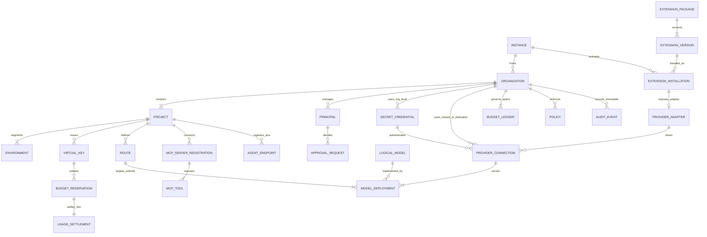
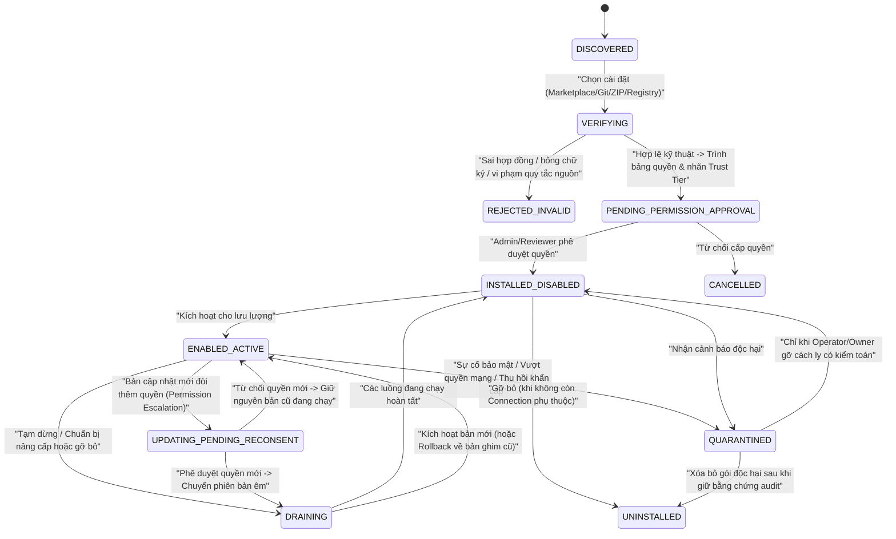
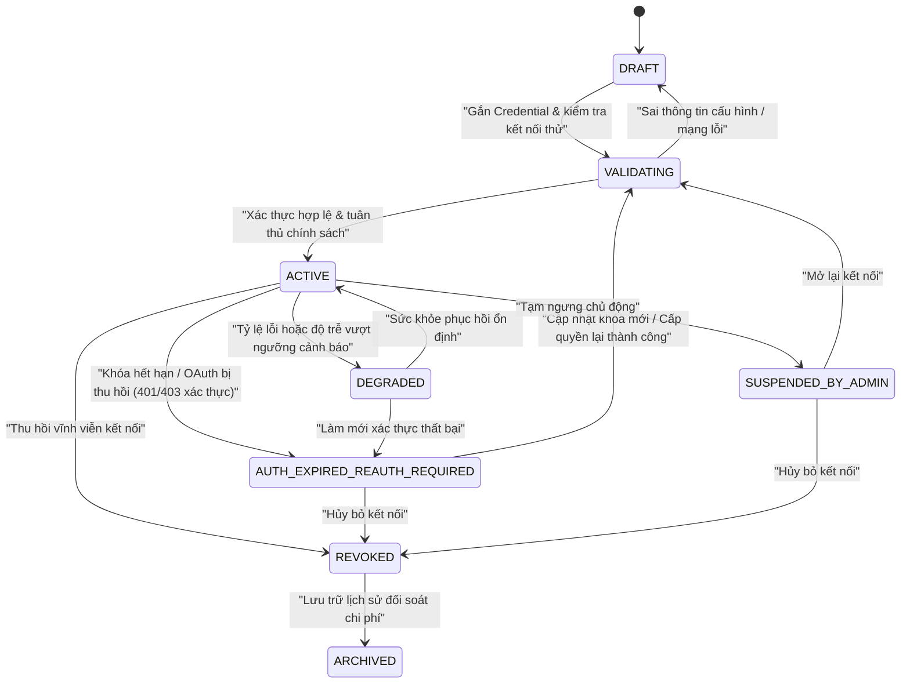
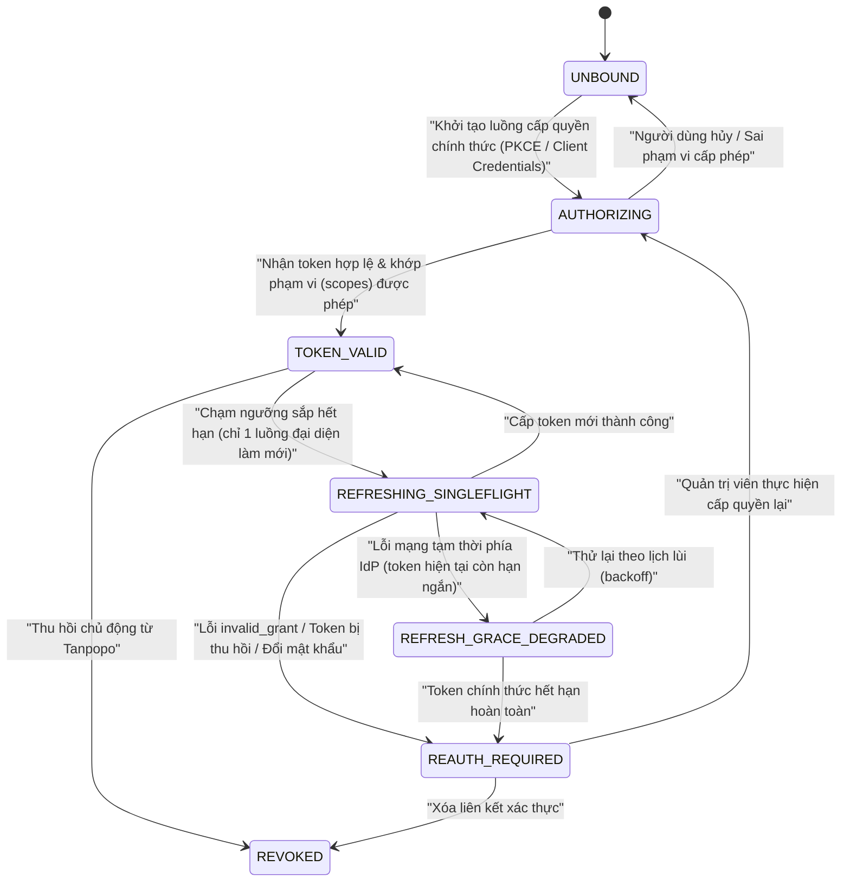
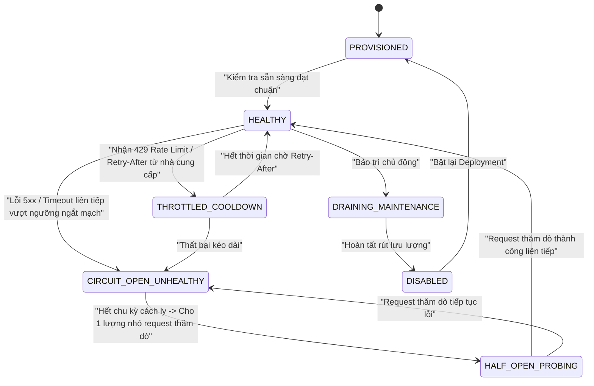
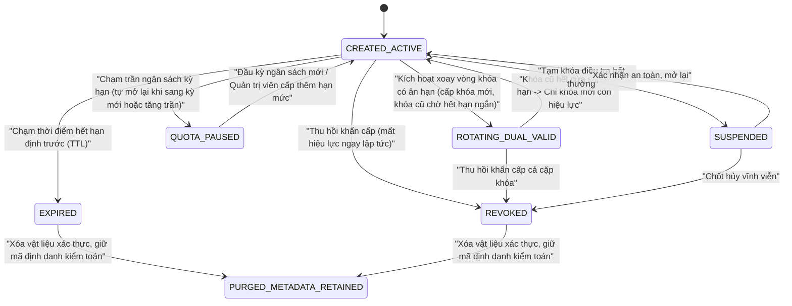
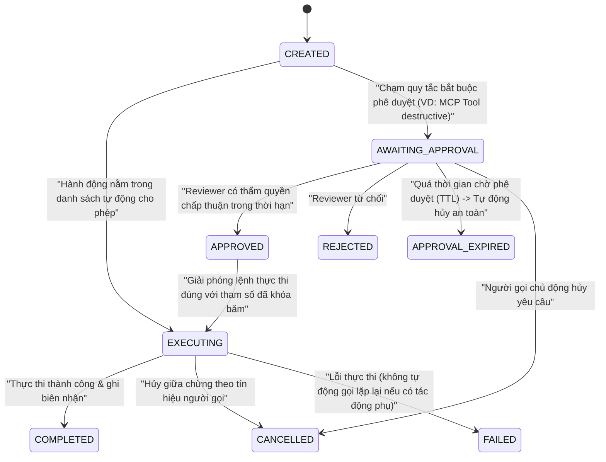
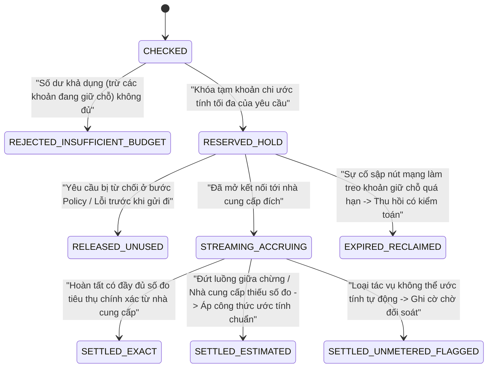
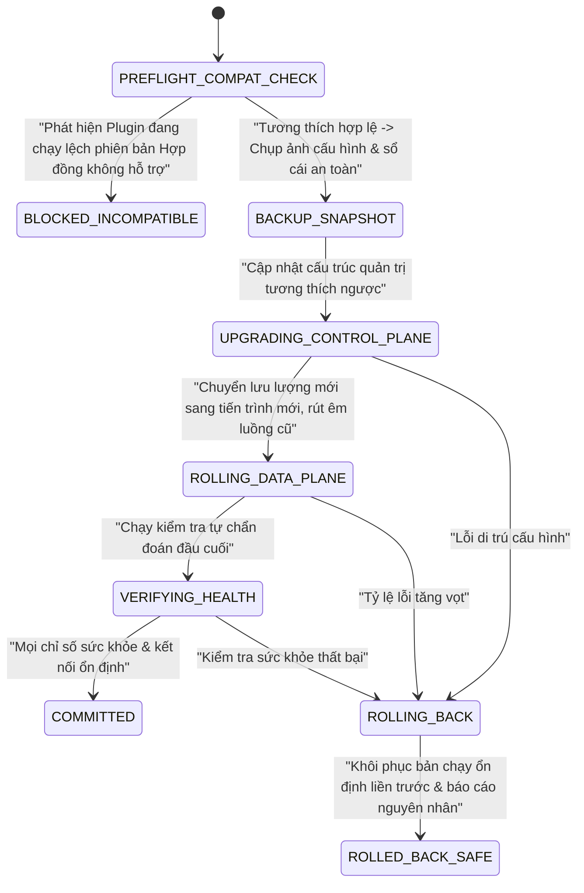

# Mô hình Tác nhân, Bản đồ Thực thể Nghiệp vụ & Máy Trạng thái (Actors, Business Entity Map & State Machines) — Tanpopo

> **Tài liệu Phân tích Nghiệp vụ (Phase ASTRA A02 — `DRAFT / UNLOCKED SCOPE`)**
> - **Phiên bản:** `0.1.0-a02-draft`
> - **Ngày cập nhật:** `2026-11-11`
> - **Vai trò biên soạn:** Lead Business Analyst & Product Architect
> - **Trạng thái quản trị:** **Bản nháp chưa khóa phạm vi (`DRAFT`)** — chờ Product Owner phê duyệt Cổng **Gate G1** và **Gate G2** tại [`docs/governance/decisions.md`](../governance/decisions.md). Không chứa giả định khóa cứng ngôn ngữ lập trình hay cơ sở dữ liệu.

---

## 1. Danh mục Đầy đủ 12 Tác nhân Nghiệp vụ (Actors Matrix)

Mỗi tác nhân dưới đây có phạm vi thẩm quyền, mục tiêu vận hành và ranh giới tin cậy độc lập:

| Mã | Tác nhân (Actor) | Bản chất & Cấp độ tin cậy | Quyền hạn cốt lõi (Allowed) | Ranh giới bị cấm (Prohibited) |
|---|---|---|---|---|
| **ACT-01** | **Personal Admin** | Con người — Tin cậy tối đa trên máy chủ cá nhân (`Single-Tenant Mode`) | Thực hiện trọn vẹn vai trò của `Operator`, `Organization Owner` và `Team Admin` trên bản cài đặt cá nhân của mình. | Không áp dụng trong chế độ tổ chức nhiều phòng ban nếu chính sách yêu cầu phân tách nhiệm vụ (Segregation of Duties). |
| **ACT-02** | **Organization Owner** | Con người — Thẩm quyền quản trị cao nhất trong một `Organization` | Thiết lập cấu trúc `Project`/`Environment`, ngân sách tổng, chính sách vùng dữ liệu, ngưỡng tin cậy Plugin, quy tắc lưu giữ/xóa dữ liệu và nút ngắt khẩn cấp cấp tổ chức. | Không xem được dữ liệu của `Organization` khác trên cùng `Instance`; không sửa đổi hạ tầng máy chủ gốc của `Operator`. |
| **ACT-03** | **Team Admin** | Con người — Thẩm quyền quản trị trong phạm vi một `Project` được giao | Quản lý thành viên nhóm, tạo/xoay vòng/thu hồi `Virtual Key`, tạo `Route`, chia nhỏ ngân sách nhóm, gắn `Provider Connection` của riêng nhóm (nếu tổ chức cho phép). | Không được tự ý cài đặt `Extension` mới lên hệ thống hoặc nâng trần ngân sách vượt quá hạn mức do `Organization Owner` cấp. |
| **ACT-04** | **Developer** | Con người — Người tiêu dùng nội bộ trong `Project` | Sử dụng khóa ảo được cấp, thử nghiệm trên Playground, xem danh mục `Model`/`MCP Tool` được phép và tra cứu log/trace trong `Environment` được phân quyền. | Không được đọc giá trị khóa gốc (`Credential`), không sửa chính sách an toàn hay phê duyệt quyền của chính mình. |
| **ACT-05** | **API Client** | Phần mềm tự động — Không tương tác giao diện người dùng | Gửi yêu cầu suy luận mô hình (Unified API hoặc phương ngữ gốc) kèm `Virtual Key` hợp lệ; nhận luồng phản hồi và mã lỗi chuẩn hóa. | Không được gọi API quản trị Control Plane; không được biết khóa hay cấu hình tài khoản nhà cung cấp phía sau. |
| **ACT-06** | **Extension Publisher** | Con người / Tổ chức phát triển bên trong hoặc bên ngoài — **Mặc định không tin cậy tuyệt đối** cho tới khi qua kiểm định | Đóng gói `Extension Version` kèm `Manifest` khai báo quyền, bộ kiểm thử hợp đồng và chữ ký nguồn gốc; phát hành lên Marketplace, Git hoặc kho riêng. | Không được yêu cầu quyền ẩn ngoài `Manifest`; bên thứ ba không được mạo danh nhãn `official` của Tanpopo. |
| **ACT-07** | **Reviewer** | Con người thẩm định độc lập (Cấp Marketplace công khai hoặc Cấp Bảo mật nội bộ) | *(Cấp Marketplace)* Duyệt/từ chối/thu hồi nhãn `verified`. *(Cấp Tổ chức)* Phê duyệt hoặc từ chối cài đặt/nâng cấp plugin tăng quyền và lệnh gọi công cụ `destructive`. | Không được tự phê duyệt yêu cầu nhạy cảm do chính mình khởi tạo nếu tổ chức bật chế độ kiểm soát hai người (Four-Eyes Principle). |
| **ACT-08** | **Operator** | Con người — Quản trị hạ tầng hệ thống (`Instance / SRE`) | Cài đặt ban đầu, nâng cấp/hạ cấp nhân Tanpopo, cấu hình kho bí mật chủ, sao lưu/phục hồi, giám sát sức khỏe hạ tầng và cách ly khẩn cấp plugin cấp hệ thống. | Không được bỏ qua nhật ký kiểm toán (`Audit Event`) khi can thiệp khẩn cấp vào trạng thái khóa hoặc kết nối. |
| **ACT-09** | **MCP Client** | Phần mềm (IDE, ứng dụng tác nhân) kết nối vào mặt phẳng MCP | Khám phá danh sách công cụ/tài nguyên đã lọc theo quyền và gửi yêu cầu thực thi công cụ kèm ngữ cảnh định danh. | Không được nhìn thấy hoặc gọi trực tiếp các công cụ nằm ngoài phạm vi cấp phép của `Virtual Key` / `Principal`. |
| **ACT-10** | **MCP Server** | Hệ thống công cụ đích bên dưới (nội bộ hoặc bên thứ ba) — **Bán tin cậy** | Công bố danh mục `Tools`/`Resources`/`Prompts` và thực thi lệnh gọi được Tanpopo chuyển tiếp hợp lệ. | Không được tự ý thay đổi mô tả/cấu trúc công cụ đã ghim (`schema_hash`) mà không bị cổng phát hiện và chặn kiểm duyệt lại. |
| **ACT-11** | **Agent** | Tác nhân tự chủ (nội bộ hoặc đối tác từ xa qua mặt phẳng A2A) | Thực hiện chuỗi tác vụ kết hợp mô hình + MCP hoặc gửi/nhận ủy quyền tác vụ bất đồng bộ (`Agent Task`) trong giới hạn ngân sách và thời gian sống được cấp. | Không được tự nới rộng quyền hạn ủy nhiệm (privilege amplification) vượt quá quyền của chủ thể gốc đã kích hoạt tác nhân. |
| **ACT-12** | **External Identity / AI Provider** | Dịch vụ xác thực (IdP/OAuth) và Nhà cung cấp mô hình bên ngoài — Ranh giới pháp nhân độc lập | *(IdP)* Xác thực danh tính và phát hành token ủy quyền hợp lệ. *(AI Provider)* Xử lý yêu cầu suy luận theo biểu giá, hạn mức và điều khoản thương mại riêng. | Không thuộc quyền kiểm soát vận hành của Tanpopo; sự cố hoặc thay đổi điều khoản từ phía họ phải được Tanpopo cô lập an toàn. |

---

## 2. Bản đồ Thực thể Nghiệp vụ & Quyền Sở hữu (Business Entity Map & Ownership)

### 2.1. Sơ đồ Quan hệ Thực thể Cốt lõi (Domain ER Diagram)

### 2.2. Phân biệt Rạch ròi 4 Thực thể trong Chuỗi Mô hình (Tránh Nhầm lẫn Nghiệp vụ)

| Thực thể | Câu hỏi nghiệp vụ trả lời | Ví dụ thực tế | Chủ sở hữu & Vòng đời |
|---|---|---|---|
| **1. `Provider Adapter`** | *"Làm thế nào để nói chuyện đúng giao thức với dòng nhà cung cấp này?"* | Gói `anthropic-official@1.4.0` hoặc `corp-internal-llm@0.2.1` | Thuộc danh mục phần mở rộng cấp `Instance`/`Organization`. Không chứa khóa bí mật và không gắn với riêng dự án nào. |
| **2. `Provider Connection`** | *"Chúng ta chứng thực bằng tài khoản/khóa nào và đi tới địa chỉ dịch vụ nào?"* | Kết nối `"Anthropic Thương mại Prod - Khối Sản phẩm"` gắn với `API Key #A1` | Thuộc `Organization` (có thể chia sẻ có kiểm soát cho một số `Project`) hoặc thuộc riêng một `Project`. |
| **3. `Model`** *(Logical Model)* | *"Mô hình này có năng lực gì về mặt bản chất?"* | Mô hình logic `claude-sonnet-4-5` (hỗ trợ `200k context`, `vision`, `tool_calling`, `thinking`) | Danh mục chuẩn hóa từ `Provider Adapter` kết hợp khai báo quản trị; độc lập với tài khoản thanh toán. |
| **4. `Model Deployment`** | *"Đích vận hành cụ thể nào sẽ nhận lưu lượng ngay lúc này, ở vùng địa lý nào, giá bao nhiêu và đang sống hay chết?"* | `Deployment #1`: `claude-sonnet-4-5` qua kết nối `Bedrock Frankfurt (EU)` vs `Deployment #2`: qua `Anthropic Direct (US)` | Gắn 1-1 với một `Provider Connection`. **Mọi quyết định định tuyến, ngắt mạch (circuit breaker), vùng dữ liệu và tính giá đều thực thi trên `Model Deployment`.** |

### 2.3. Ma trận Quyền Sở hữu, Chia sẻ & Cô lập Dữ liệu (Ownership & Sharing Matrix)

| Thực thể nghiệp vụ | Cấp sở hữu gốc (Primary Owner) | Phạm vi chia sẻ hợp lệ | Hành vi khi xóa chủ sở hữu |
|---|---|---|---|
| `Organization (Tenant)` | `Organization Owner` | **Tuyệt đối không chia sẻ** bất kỳ tài nguyên sống nào sang `Organization` khác. | Chuyển sang trạng thái chờ đóng băng → thu hồi toàn bộ khóa/kết nối → xóa dữ liệu nghiệp vụ theo chính sách lưu giữ. |
| `Secret Credential` | `Organization` hoặc `Project` | Khóa cấp `Organization` chỉ cho phép `Project` *sử dụng gián tiếp* qua `Provider Connection` được cấp quyền, không bao giờ phơi bày chuỗi bí mật thô. | Cấm xóa cứng nếu đang gắn với `Provider Connection` đang hoạt động (phải gỡ liên kết hoặc thu hồi kết nối trước). |
| `Provider Connection` & `Model Deployment` | `Organization` (dùng chung có chọn lọc) hoặc `Project` (dùng riêng) | Có thể cấp quyền tiêu dùng xuống từng `Project` / `Environment` thông qua `Policy` và `Route`. | Ngừng nhận lưu lượng mới (`Draining`), giữ lại định danh lịch sử tối thiểu trong sổ cái chi phí để không làm hỏng báo cáo đối soát. |
| `Virtual Key` | `Environment` thuộc một `Project` | Chỉ thuộc duy nhất 1 `Environment` của 1 `Project` (không dùng chung một khóa ảo cho cả `dev` và `prod`). | Thu hồi tức thì hiệu lực xác thực; giữ bản ghi siêu dữ liệu khóa đã băm để tra cứu nhật ký kiểm toán. |
| `Extension Installation` | `Instance` (với chính sách bật/tắt theo `Organization`) | Gói cài đặt được kiểm soát bởi `Operator`; từng `Organization` chỉ được kích hoạt các plugin phù hợp chính sách tin cậy của mình. | Gỡ cài đặt chỉ thành công khi không còn `Provider Connection` hay `Policy` đang hoạt động nào phụ thuộc vào nó (hoặc phải cưỡng bức `Quarantine`). |
| `MCP Server Registration` & `MCP Tool` | `Organization` hoặc `Project` | Lọc quyền truy cập đến từng tên công cụ cụ thể (`Tool-level Scoping`) cho từng `Virtual Key` / vai trò. | Thu hồi phiên kết nối công cụ và hủy các yêu cầu chờ phê duyệt đang treo. |
| `Budget Ledger` & `Audit Event` | `Organization` (phân bổ hạn mức con cho `Project` / `Virtual Key`) | Chỉ đọc theo phân cấp quản trị (`Team Admin` chỉ thấy sổ cái của `Project` mình; `Org Owner` thấy toàn tổ chức). | **Bất biến (Append-only/Immutable)** trong suốt thời hạn lưu giữ pháp lý/tài chính ngay cả khi khóa ảo hay dự án con đã ngừng hoạt động. |

---

## 3. Tám Máy Trạng thái & Chuyển tiếp Nghiệp vụ (State Machines & Transitions)

### SM-01: Vòng đời Phần mở rộng (`Plugin / Extension Lifecycle`)

- **Điểm chặn nghiệp vụ cốt lõi:** Mọi bản cập nhật phát sinh quyền mới (`Permission Escalation`) **bắt buộc** dừng ở `UPDATING_PENDING_RECONSENT`, tuyệt đối không tự động nâng cấp ngầm. Trạng thái `QUARANTINED` cắt lập tức mọi luồng mới và quyền mạng mà không xóa nhật ký điều tra.

---

### SM-02: Vòng đời Kết nối Nhà cung cấp (`Provider Connection Lifecycle`)

---

### SM-03: Vòng đời OAuth Được Cấp phép & Tái Ủy quyền (`Authorized OAuth Token Lifecycle`)

---

### SM-04: Trạng thái Sức khỏe Đích Mô hình (`Model Deployment Health Lifecycle`)

---

### SM-05: Vòng đời Khóa Ảo (`Virtual Key Lifecycle`)

---

### SM-06: Vòng đời Phê duyệt & Tác vụ Bất đồng bộ (`Approval & Task Lifecycle`)

---

### SM-07: Vòng đời Tạm giữ & Quyết toán Ngân sách (`Budget Reservation & Settlement Lifecycle`)

---

### SM-08: Vòng đời Phát hành & Nâng cấp Hệ thống (`Release & Upgrade Lifecycle`)

