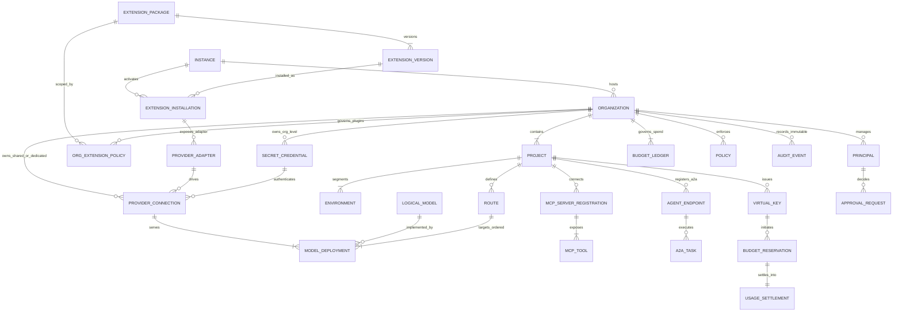
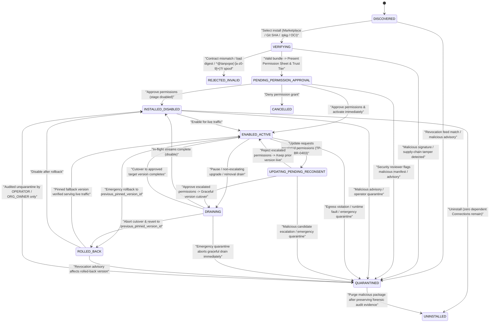
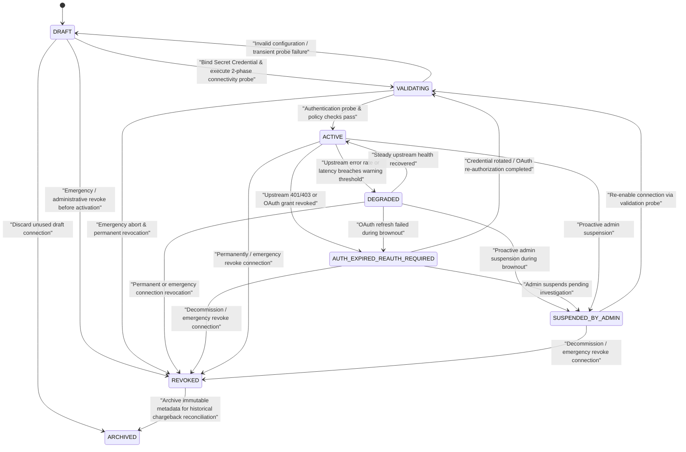
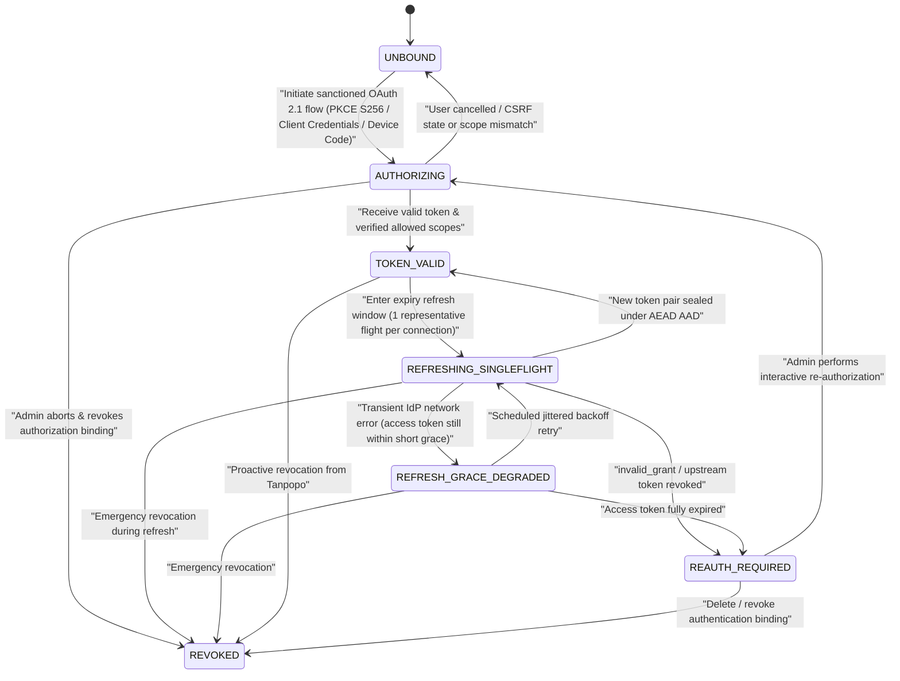
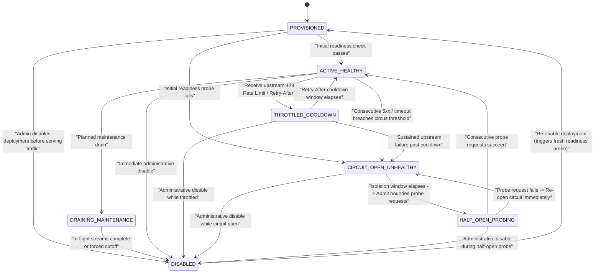
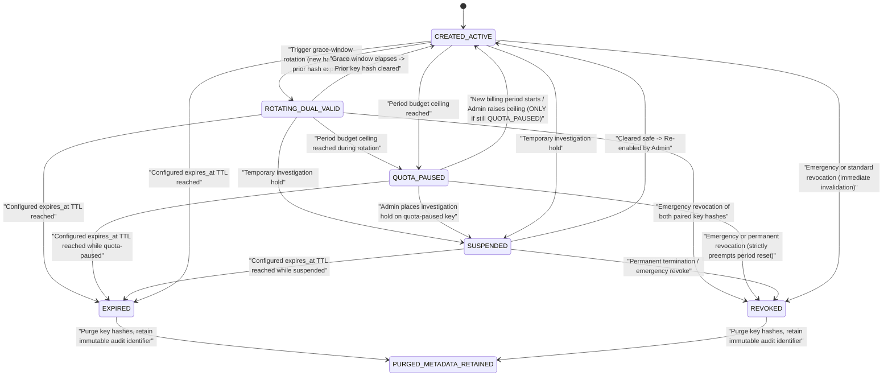
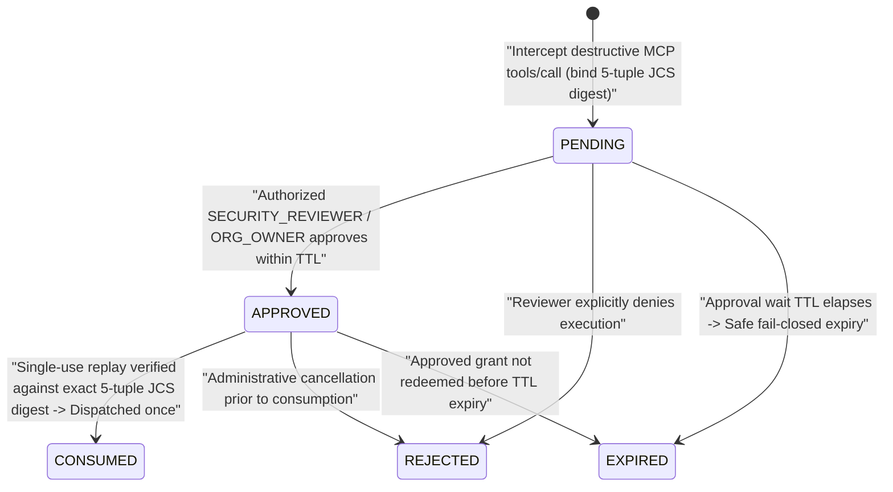
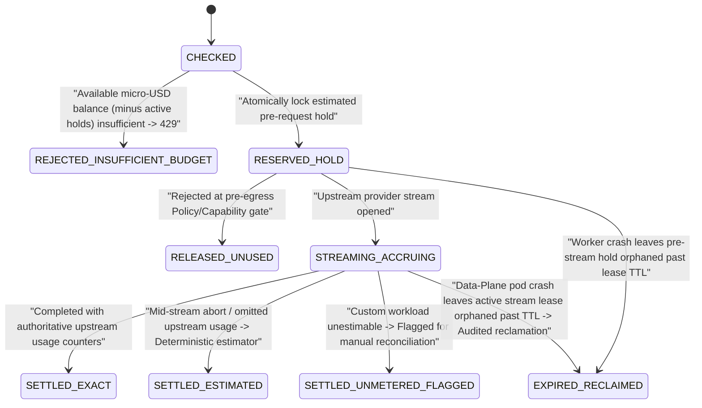
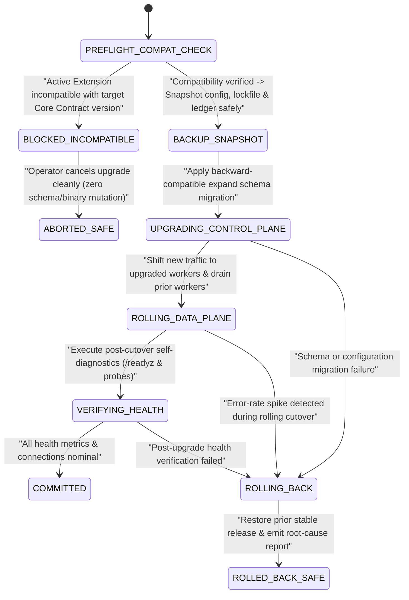
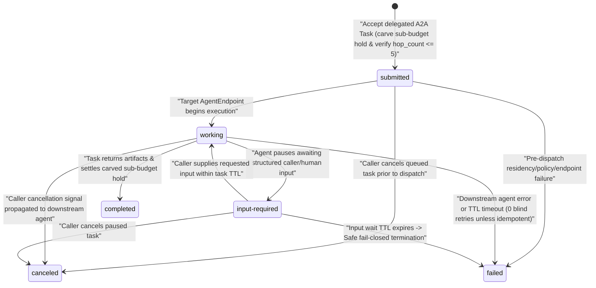

# Actors, Business Entity Map & State Machines — Tanpopo

> **Business Analysis Specification (Phase ASTRA A02 — Reconciled in `TP-IMP-0001`)**
> - **Version:** `0.2.0-tp-imp-0001`
> - **Last Updated:** `2026-11-14`
> - **Authoring Role:** Lead Business Analyst & Product Architect
> - **Governance Status:** **`APPROVED (Subject to COND-PO-01..05)`** — Gate G1, Gate G2, and Change Requests `CR-03`, `CR-04`, and `CR-08` approved by the Product Owner in [`docs/governance/decisions.md`](../governance/decisions.md) (closing `GAP-08` and `GAP-09`).

---

## 1. Complete Catalog of 12 Business Actors & Canonical RBAC Roles

Each actor below operates within an independent authority scope, operational objective, and trust boundary:

| ID | Actor | Nature & Trust Level | Core Allowed Privileges (Allowed) | Prohibited Boundaries (Prohibited) |
|---|---|---|---|---|
| **ACT-01** | **Personal Admin** | Human — Full trust on a personal server (`Single-Tenant Bootstrap Mode`) | Exercises the combined responsibilities of `OPERATOR` and `ORG_OWNER` (automatically granted `OPERATOR + ORG_OWNER` role bindings upon initial bootstrap) on a self-hosted instance. | Not applicable in multi-department organizational deployments where policy mandates Segregation of Duties (`Four-Eyes`). |
| **ACT-02** | **Organization Owner** (`ORG_OWNER`) | Human — Highest administrative authority within an `Organization` | Configures `Project`/`Environment` hierarchy, top-level budgets, data residency policies, `org_extension_policies` trust thresholds, retention/erasure rules, and organization-wide emergency kill-switches. | Cannot inspect data belonging to other `Organization` tenants on the same `Instance`; cannot alter host-level infrastructure owned by `OPERATOR`. |
| **ACT-03** | **Team Admin** (`TEAM_ADMIN`) | Human — Administrative authority scoped to an assigned `Project` | Manages project members, creates/rotates/revokes `Virtual Key` credentials, defines `Route` policies, subdivides project budgets, and attaches dedicated project `Provider Connection` resources (where permitted by organization policy). | Cannot install new `Extension` packages onto the instance, relax inherited `Organization` policies (`422 policy_relaxation_forbidden`), or raise budget ceilings above allocations granted by `ORG_OWNER`. |
| **ACT-04** | **Developer** (`DEVELOPER`) | Human — Internal consumer within a `Project` | Uses issued virtual keys, experiments in the Playground, runs dry-run `Route Explain` simulations, views permitted `Model`/`MCP Tool` catalogs, and inspects metadata logs/traces within authorized `Environment` scopes. | Cannot read raw upstream `Credential` secrets, modify safety policies or budgets, or approve permission/HITL requests. |
| **ACT-05** | **API Client** | Automated software — Headless, non-UI consumer | Sends model inference requests (Unified API or native dialect) bearing a valid `Virtual Key`; consumes streamed responses and canonical error envelopes. | Cannot invoke Control Plane administrative APIs; never observes upstream provider keys or account configurations. |
| **ACT-06** | **Extension Publisher** | Human / Internal or external engineering entity — **Untrusted by default** until verified | Packages `Extension Version` artifacts with permission-declaring `Manifest` files, contract test suites, and provenance signatures; publishes to Marketplace, Git, or private registries. | Cannot request undeclared capabilities outside the `Manifest`; third parties cannot claim the reserved `^@tanpopo(-[a-z0-9]+)?/` namespace or spoof Tanpopo's `official` provenance tier. |
| **ACT-07** | **Reviewer** (`SECURITY_REVIEWER` / Marketplace Verifier) | Independent human verifier (Public Marketplace tier or Internal Organization `SECURITY_REVIEWER` role) | *(Marketplace level)* Approves/rejects/revokes the `verified` badge. *(Organization level — `SECURITY_REVIEWER`)* Approves or rejects permission-escalating plugin installs/updates (`Four-Eyes`) and `destructive` MCP tool invocations (`SM-06`). | Cannot self-approve sensitive requests initiated by the same principal (`403 self_approval_forbidden`). |
| **ACT-08** | **Operator** (`OPERATOR`) | Human — System infrastructure administrator (`Instance / SRE`) | Executes initial bootstrap, manages multi-org provisioning (`POST /admin/v1/organizations`), upgrades/rolls back Tanpopo Core, runs host break-glass recovery (`tanpopo admin reset-local-owner`), configures master secret protection, manages backups/recovery, and enforces instance-wide plugin quarantine. | Cannot bypass immutable `Audit Event` logging during emergency interventions on keys, organizations, or connections. |
| **ACT-09** | **MCP Client** | Software (IDE, agent runtime) connecting to the MCP plane (`MCP Specification 2025-03-26`) | Discovers permission-filtered tool/resource/prompt catalogs and submits authenticated tool execution calls over Streamable HTTP. | Cannot enumerate or invoke tools outside the authorized scope of its `Virtual Key`. |
| **ACT-10** | **MCP Server** | Downstream tool backend (internal or third-party) — **Semi-trusted** | Publishes `Tools`/`Resources`/`Prompts` catalogs and executes tool calls validly forwarded by Tanpopo. | Cannot silently mutate pinned tool descriptions/schemas (`schema_hash`) without triggering gateway detection and re-approval blocking. |
| **ACT-11** | **Agent** | Autonomous agent (internal or remote partner via the A2A plane) | Executes multi-step model + MCP workflows or sends/receives asynchronous delegated tasks (`A2A Task`, `SM-09`) within granted budget, residency, and hop-depth (`<= 5`) bounds. | Cannot amplify delegated privileges beyond the entitlements and remaining budget of the originating principal. |
| **ACT-12** | **External Identity / AI Provider** | External authentication service (IdP/OAuth) and upstream model vendor — Independent legal boundary | *(IdP)* Authenticates principals and issues valid authorization tokens. *(AI Provider)* Processes inference calls under its own pricing, rate limits, and commercial terms. | Outside Tanpopo's operational control; upstream outages or terms changes must be safely contained by Tanpopo. |

### 1.1. Canonical Six RBAC Roles (`CR-04`)

Control Plane authorization (`role_bindings.role_name`) standardizes strictly on **6 canonical RBAC roles** across SQL constraints, OpenAPI schemas, CLI flags, and Web Console views:

| Canonical `role_name` | Valid Binding Scope (`scope_type`) | Mapped Actor(s) | Core Authorization Summary |
|---|---|---|---|
| **`OPERATOR`** | `INSTANCE` | `ACT-08` (`ACT-01`) | Host/instance lifecycle, extension staging & quarantine, `POST /admin/v1/organizations`, `allow_private_ip` network policy, Core upgrades, backups, and host health. |
| **`ORG_OWNER`** | `ORG` | `ACT-02` (`ACT-01`) | Full tenant administration within one `Organization`: projects, environments, org budgets, `org_extension_policies`, data residency ceilings, retention/crypto-shredding, and org kill-switches. |
| **`TEAM_ADMIN`** | `PROJECT` | `ACT-03` | Project-level routes, deployments (within org policy), virtual keys, MCP server registrations, A2A endpoints, and project sub-budgets (narrowing only; never relaxing parent org policies). |
| **`SECURITY_REVIEWER`** | `ORG` / `PROJECT` | `ACT-07` | Independent `Four-Eyes` approval of external/escalating extension permissions (`SM-01`), `destructive` MCP tool `ApprovalRequest` decisions (`SM-06`), and read-only security audit inspection. |
| **`FINOPS_VIEWER`** | `ORG` / `PROJECT` | Financial / Audit Stakeholder | Read-only visibility into `budget_ledgers`, `usage_settlements` (`EXACT` / `ESTIMATED` / `UNMETERED_FLAGGED`), cost rollups, and `Chargeback` exports; zero access to secrets, policies, or route mutations. |
| **`DEVELOPER`** | `PROJECT` | `ACT-04` | Read-only model/MCP catalogs, dry-run `Route Explain`, `Playground` ephemeral session execution, and scoped metadata trace inspection within authorized environments. |

> **Bootstrap Rule (`Personal Admin` Mode):** Initializing Tanpopo in standalone single-admin mode provisions the default `Organization`, `Project`, and `Environment` and binds the initial owner principal to **`OPERATOR` (`INSTANCE`) + `ORG_OWNER` (`ORG`)** without introducing a non-standard 7th role enum.

---

## 2. Business Entity Map & Ownership

### 2.1. Core Domain ER Diagram

### 2.2. Explicit Disambiguation of the 4-Entity Model Chain

| Entity | Business Question Answered | Concrete Example | Ownership & Lifecycle |
|---|---|---|---|
| **1. `Provider Adapter`** | *"How do we speak the wire protocol of this provider family?"* | Package `@tanpopo/anthropic@1.4.0` or `@acme-corp/internal-llm@0.2.1` | Belongs to the `Instance` extension catalog (`origin_trust_tier` in `{official, verified, unverified_external}` + orthogonal `enterprise_signed BOOLEAN`; `^@tanpopo(-[a-z0-9]+)?/` reserved for project-signed official packages). Contains zero secret keys. |
| **2. `Provider Connection`** | *"Which account/credential authenticates us, and to which service endpoint?"* | Connection `"Anthropic Commercial Prod - Product Division"` bound to `API Key #A1` | Owned by an `Organization` (optionally shared downward to selected `Project` scopes) or dedicated to a single `Project`. |
| **3. `Model`** *(Logical Model)* | *"What intrinsic capabilities does this model family possess?"* | Logical model `claude-sonnet-4-5` (supporting `200k context`, `vision`, `tool_calling`, `thinking`) | Normalized catalog entry derived from `Provider Adapter` metadata plus admin overrides; independent of billing accounts. |
| **4. `Model Deployment`** | *"Which concrete operational target receives live traffic right now, in what data region, at what unit price, and in what health state?"* | `Deployment #1`: `claude-sonnet-4-5` via `Bedrock Frankfurt (EU)` vs `Deployment #2`: via `Anthropic Direct (US)` | Bound 1-to-1 to a `Provider Connection`. **All routing, circuit breaking (`SM-04`), data residency, and pricing enforcement operate on `Model Deployment`.** |

### 2.3. Ownership, Sharing & Data Isolation Matrix

| Business Entity | Primary Owner | Valid Sharing Scope | Owner Deletion Behavior |
|---|---|---|---|
| `Organization (Tenant)` | `ORG_OWNER` | **Zero cross-tenant sharing** of any live resource across different `Organization` boundaries. | Transitions to `PENDING_ERASURE` → revokes all keys/connections → crypto-shreds `Org DEK` / `Project DEK` → purges operational data per retention policy. |
| `Secret Credential` | `Organization` or `Project` | `Organization`-owned secrets permit *indirect consumption* by authorized child `Project` scopes via a `Provider Connection`, never exposing raw secret plaintext. | Hard deletion blocked (`409 resource_in_use`) while bound to an active `Provider Connection` (must detach or revoke the connection first). |
| `Provider Connection` & `Model Deployment` | `Organization` (selectively shared) or `Project` (dedicated) | Consumption rights can be granted downward to specific `Project` / `Environment` scopes via `Policy` and `Route` bindings. | Stops admitting new traffic (`DRAINING_MAINTENANCE` / `REVOKED`); retains minimal historical identifiers in the cost ledger to preserve chargeback reconciliation integrity (`ARCHIVED`). |
| `Virtual Key` | `Environment` within a `Project` | Strictly bound to 1 `Environment` of 1 `Project` (a single virtual key is never shared across `dev` and `prod`). | Immediately invalidates authentication authority (`REVOKED` → `PURGED_METADATA_RETAINED`); retains hashed key metadata for audit log traceability. |
| `Extension Installation` & `Org Extension Policy` | `Instance` (`OPERATOR`) + per-`Organization` policy (`ORG_OWNER`) | Installed artifacts are governed by `OPERATOR`; each `Organization` enables and pins permitted packages via `org_extension_policies` satisfying its `min_plugin_trust` rule. | Uninstallation succeeds only when no active `Provider Connection` or `Policy` depends on it (unless forcibly transitioned to `QUARANTINED`). |
| `MCP Server Registration`, `MCP Tool` & `Approval Request` | `Organization` or `Project` | Scopes access down to individual tool names (`<server_slug>__<tool_name>`) per `Virtual Key`; `Approval Request` (`SM-06`) binds strictly to a single 5-tuple JCS call digest. | Revokes active tool sessions and expires/rejects pending `Approval Request` records. |
| `Agent Endpoint` & `A2A Task` | `Project` | Delegated `A2A Task` (`SM-09`) runs under monotonically attenuated child budget, data-residency intersection, and `hop_count <= max_delegation_hops`. | Cancels non-terminal tasks (`CANCELED`) and settles/releases carved sub-budget holds. |
| `Budget Ledger` & `Audit Event` | `Organization` (sub-allocating child ceilings to `Project` / `Environment` / `Virtual Key`) | Read-only along administrative hierarchy (`TEAM_ADMIN` views their `Project` ledger; `ORG_OWNER` and `FINOPS_VIEWER` view authorized scope ledgers). | **Append-only / Immutable** throughout statutory/financial retention windows even after child keys or projects are decommissioned. |

---

## 3. Nine Business State Machines & Transitions (`SM-01` .. `SM-09`)

> **Emergency Containment Invariant (`AC-1`):** Every non-terminal state across `SM-01` (`Extension`), `SM-02` (`Provider Connection`), `SM-04` (`Model Deployment`), and `SM-05` (`Virtual Key`) possesses an explicit, direct transition to its emergency containment state (`QUARANTINED`, `REVOKED`, `DISABLED`, `REVOKED`) so an operator or security administrator never has to step through intermediate states during an active incident.

### SM-01: Plugin / Extension Lifecycle

- **Canonical Lifecycle States:** `DISCOVERED`, `VERIFYING`, `PENDING_PERMISSION_APPROVAL`, `INSTALLED_DISABLED`, `ENABLED_ACTIVE`, `UPDATING_PENDING_RECONSENT`, `DRAINING`, `ROLLED_BACK`, `QUARANTINED` *(plus terminal exit outcomes `REJECTED_INVALID`, `CANCELLED`, `UNINSTALLED`)*.

- **Core Business Gate:** `PENDING_PERMISSION_APPROVAL` explicitly supports either staging into `INSTALLED_DISABLED` or direct activation into `ENABLED_ACTIVE` once consent (including `Four-Eyes` `SECURITY_REVIEWER` sign-off where configured) is recorded. Every non-terminal state (`DISCOVERED`, `VERIFYING`, `PENDING_PERMISSION_APPROVAL`, `INSTALLED_DISABLED`, `ENABLED_ACTIVE`, `UPDATING_PENDING_RECONSENT`, `DRAINING`, `ROLLED_BACK`) transitions directly to `QUARANTINED` upon security violation or revocation advisory, severing traffic and network capabilities immediately while preserving forensic logs.

---

### SM-02: Provider Connection Lifecycle

- **Canonical Lifecycle States:** `DRAFT`, `VALIDATING`, `ACTIVE`, `DEGRADED`, `AUTH_EXPIRED_REAUTH_REQUIRED`, `SUSPENDED_BY_ADMIN`, `REVOKED`, `ARCHIVED`.

---

### SM-03: Authorized OAuth Token Lifecycle

- **Canonical Lifecycle States:** `UNBOUND`, `AUTHORIZING`, `TOKEN_VALID`, `REFRESHING_SINGLEFLIGHT`, `REFRESH_GRACE_DEGRADED`, `REAUTH_REQUIRED`, `REVOKED`.

---

### SM-04: Model Deployment Health Lifecycle

- **Canonical Lifecycle States:** `PROVISIONED`, `ACTIVE_HEALTHY`, `THROTTLED_COOLDOWN`, `CIRCUIT_OPEN_UNHEALTHY`, `HALF_OPEN_PROBING`, `DRAINING_MAINTENANCE`, `DISABLED`.

- **State Naming Invariant:** Standardizes exclusively on `ACTIVE_HEALTHY` and `HALF_OPEN_PROBING` across all specifications, SQL rows, metrics, and UI views; every operational/degraded state (`PROVISIONED`, `ACTIVE_HEALTHY`, `THROTTLED_COOLDOWN`, `CIRCUIT_OPEN_UNHEALTHY`, `HALF_OPEN_PROBING`, `DRAINING_MAINTENANCE`) transitions directly to `DISABLED`.

---

### SM-05: Virtual Key Lifecycle

- **Canonical Lifecycle States:** `CREATED_ACTIVE`, `ROTATING_DUAL_VALID`, `QUOTA_PAUSED`, `SUSPENDED`, `EXPIRED`, `REVOKED`, `PURGED_METADATA_RETAINED`.

- **Mandatory Non-Revival Security Invariant (`SM-05`):** `QUOTA_PAUSED` transitions directly to `REVOKED`, `SUSPENDED`, or `EXPIRED`. Once a key enters `REVOKED` or `EXPIRED`, authentication hashes are permanently invalidated — a compromised or revoked key **can never auto-revive** when the next daily/monthly billing period resets or when a parent budget ceiling is topped up.

---

### SM-06: MCP Human-in-the-Loop (`HITL`) Approval Lifecycle

- **Scope (`CR-08`):** Dedicated **exclusively** to `ApprovalRequest` records (`approval_requests.state`) governing `destructive` MCP tool invocations (and `Four-Eyes` governance sign-offs). Asynchronous inter-agent task orchestration is decoupled into **`SM-09`**.
- **Canonical Lifecycle States:** `PENDING`, `APPROVED`, `CONSUMED`, `REJECTED`, `EXPIRED`.

- **Cryptographic Binding & Wire Compatibility (`CR-08`, `COND-PO-04`):** Each `PENDING` approval binds deterministically to `SHA-256(JCS({org_id, virtual_key_id, server_slug, tool_name, arguments}))` (self-approval by the initiating principal is hard-blocked with `403 self_approval_forbidden`). Over `MCP Specification 2025-03-26 (Streamable HTTP)`, asynchronous pending approvals return standard HTTP `200` JSON-RPC 2.0 responses rather than non-standard `202` HTTP headers, and transitioning `APPROVED -> CONSUMED` is atomic (`UPDATE approval_requests SET state = 'CONSUMED' WHERE id = ? AND state = 'APPROVED'`) so an approved grant can never execute twice.

---

### SM-07: Budget Reservation & Settlement Lifecycle

- **Canonical Lifecycle States:** `CHECKED`, `REJECTED_INSUFFICIENT_BUDGET`, `RESERVED_HOLD`, `RELEASED_UNUSED`, `STREAMING_ACCRUING`, `SETTLED_EXACT`, `SETTLED_ESTIMATED`, `SETTLED_UNMETERED_FLAGGED`, `EXPIRED_RECLAIMED`.

---

### SM-08: Release & System Upgrade Lifecycle

- **Canonical Lifecycle States:** `PREFLIGHT_COMPAT_CHECK`, `BLOCKED_INCOMPATIBLE`, `ABORTED_SAFE`, `BACKUP_SNAPSHOT`, `UPGRADING_CONTROL_PLANE`, `ROLLING_DATA_PLANE`, `VERIFYING_HEALTH`, `COMMITTED`, `ROLLING_BACK`, `ROLLED_BACK_SAFE`.

---

### SM-09: A2A Inter-Agent Task Lifecycle

- **Scope (`CR-08`, `TP-FR-0405`..`0406`):** Governs stateful asynchronous inter-agent task delegations across the dedicated `/a2a/*` plane (JSON-RPC 2.0 over HTTP/SSE), decoupled completely from MCP `ApprovalRequest` (`SM-06`).

#### Canonical 1-to-1 A2A Wire-to-Database State Mapping (`SM-09`)

| Canonical A2A Wire State (JSON-RPC / SSE) | Persisted SQL Enum (`a2a_tasks.state`) | Terminal? | Sub-Budget Hold & Governance Behavior |
|---|---|---|---|
| **`submitted`** | `SUBMITTED` | No | Sub-budget carved from parent ledger (`RESERVED_HOLD`); `x-tanpopo-trace-root` and `hop_count` stamped. |
| **`working`** | `WORKING` | No | Active downstream agent execution (`STREAMING_ACCRUING`); cancellation signals propagate within `< 500 ms` (`TARGET / UNVERIFIED`). |
| **`input-required`** | `INPUT_REQUIRED` | No | Execution paused awaiting caller response; bounded by task expiration `TTL` so holds cannot hang indefinitely. |
| **`completed`** | `COMPLETED` | **Yes** | Output artifacts recorded; carved sub-budget settled (`SETTLED_EXACT` / `SETTLED_ESTIMATED`) and unused hold margin returned to parent. |
| **`failed`** | `FAILED` | **Yes** | Terminal error envelope recorded; side-effecting tasks never blindly retried (`TP-BR-0603`); accrued/unused hold settled cleanly. |
| **`canceled`** | `CANCELED` | **Yes** | Caller abort confirmed; downstream execution severed and remaining hold balance released. |
