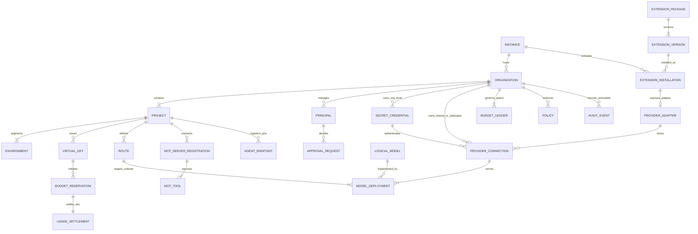
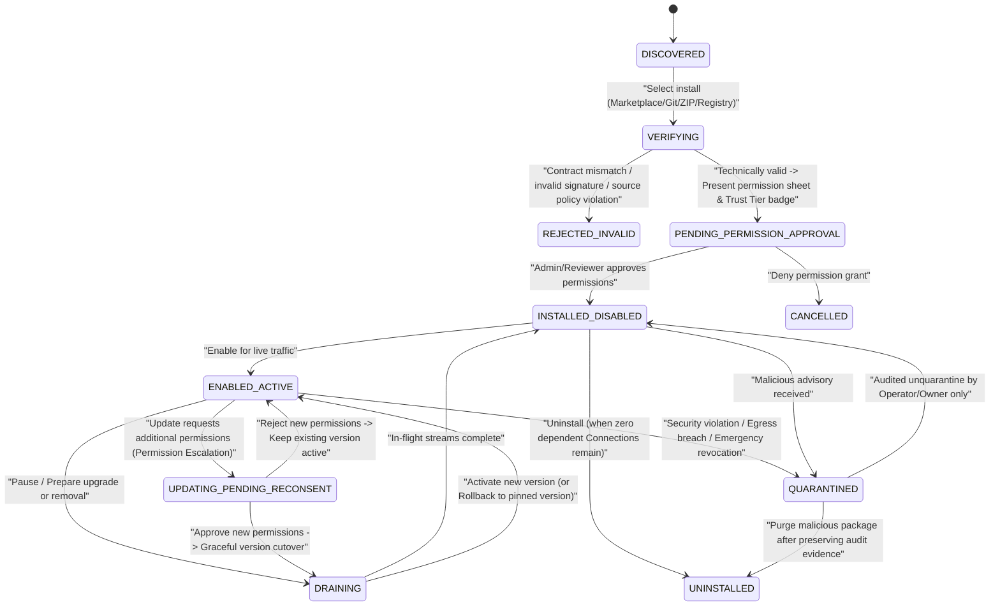
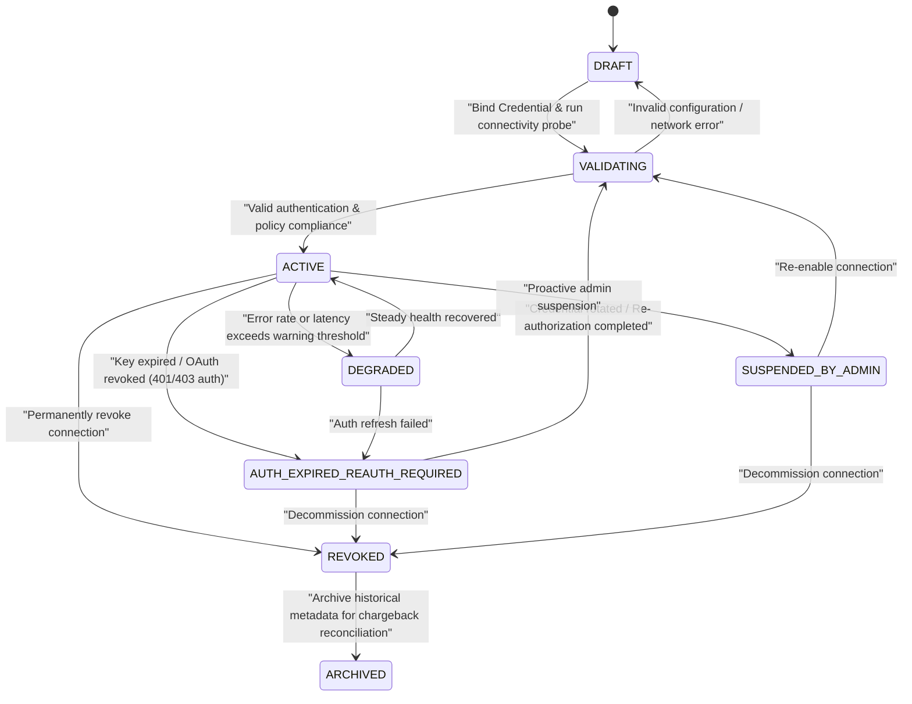
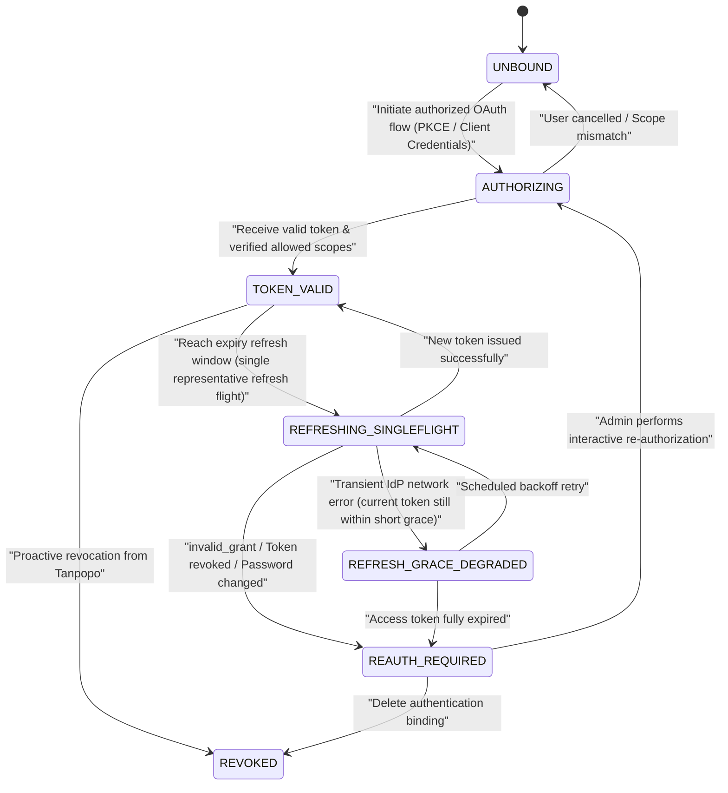
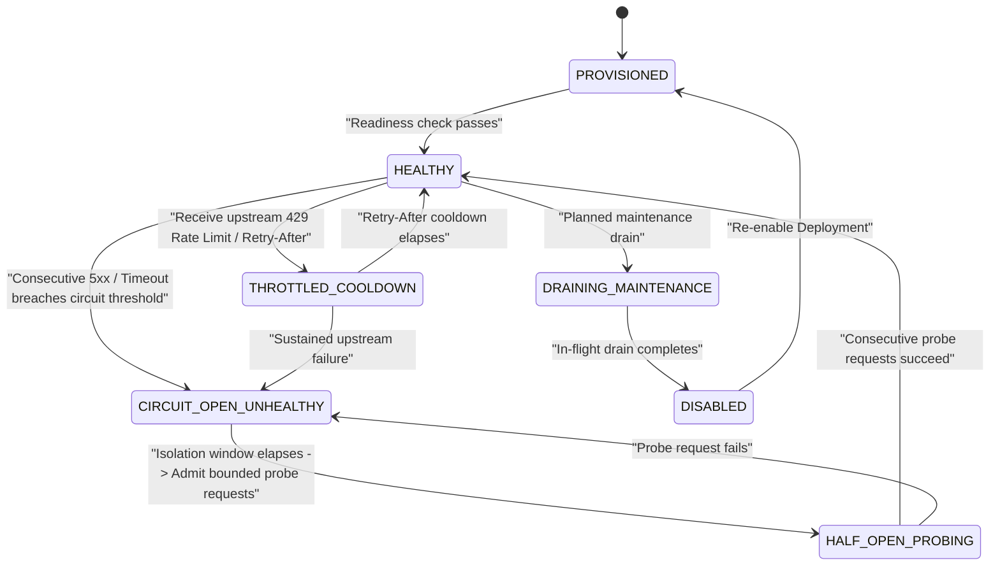
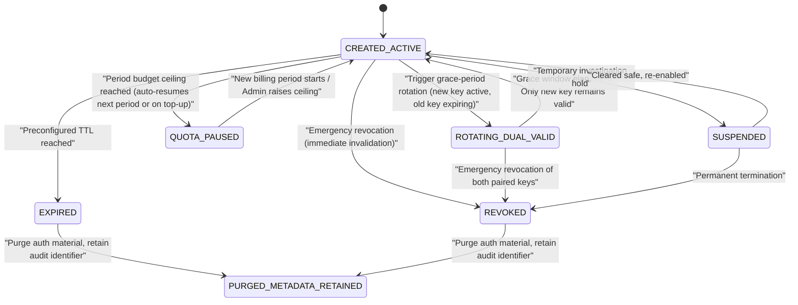
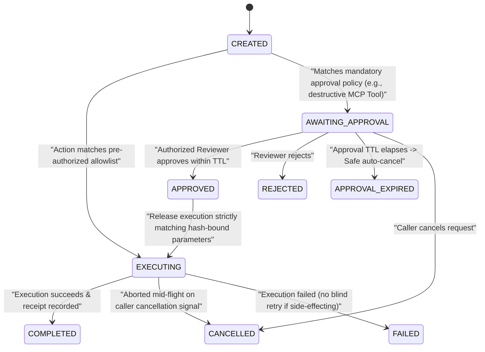
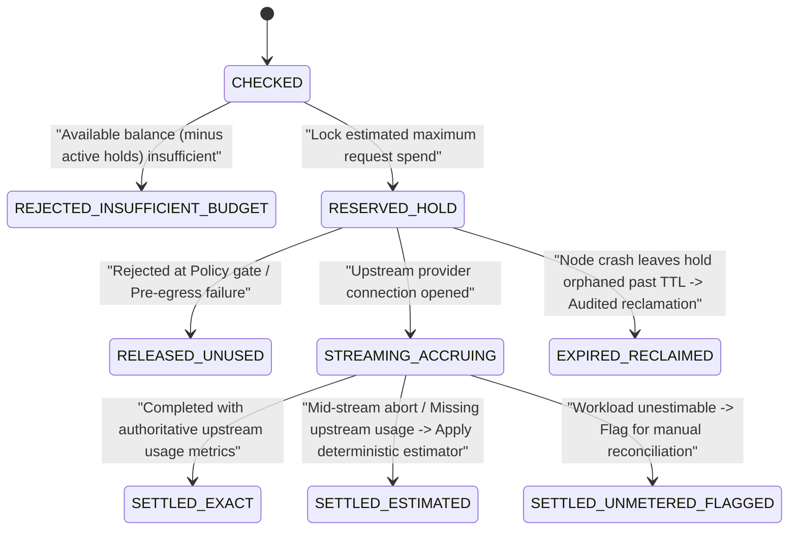
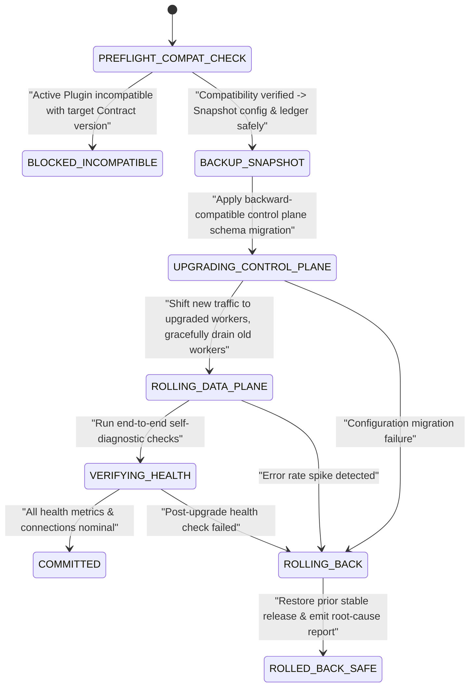

# Actors, Business Entity Map & State Machines — Tanpopo

> **Business Analysis Specification (Phase ASTRA A02 — `DRAFT / UNLOCKED SCOPE`)**
> - **Version:** `0.1.0-a02-draft`
> - **Last Updated:** `2026-11-11`
> - **Authoring Role:** Lead Business Analyst & Product Architect
> - **Governance Status:** **Unlocked-scope draft (`DRAFT`)** — awaiting Product Owner approval of **Gate G1** and **Gate G2** in [`docs/governance/decisions.md`](../governance/decisions.md). Contains zero hard-locked programming language or database assumptions.

---

## 1. Complete Catalog of 12 Business Actors (Actors Matrix)

Each actor below operates within an independent authority scope, operational objective, and trust boundary:

| ID | Actor | Nature & Trust Level | Core Allowed Privileges (Allowed) | Prohibited Boundaries (Prohibited) |
|---|---|---|---|---|
| **ACT-01** | **Personal Admin** | Human — Full trust on a personal server (`Single-Tenant Mode`) | Exercises the combined responsibilities of `Operator`, `Organization Owner`, and `Team Admin` on a self-hosted personal instance. | Not applicable in multi-department organizational deployments where policy mandates Segregation of Duties. |
| **ACT-02** | **Organization Owner** | Human — Highest administrative authority within an `Organization` | Configures `Project`/`Environment` hierarchy, top-level budgets, data residency policies, Plugin trust thresholds, retention/erasure rules, and organization-wide emergency kill-switches. | Cannot inspect data belonging to other `Organization` tenants on the same `Instance`; cannot alter host-level infrastructure owned by `Operator`. |
| **ACT-03** | **Team Admin** | Human — Administrative authority scoped to an assigned `Project` | Manages project members, creates/rotates/revokes `Virtual Key` credentials, defines `Route` policies, subdivides project budgets, and attaches dedicated project `Provider Connection` resources (where permitted by organization policy). | Cannot install new `Extension` packages onto the instance or raise budget ceilings above allocations granted by the `Organization Owner`. |
| **ACT-04** | **Developer** | Human — Internal consumer within a `Project` | Uses issued virtual keys, experiments in the Playground, views permitted `Model`/`MCP Tool` catalogs, and inspects logs/traces within authorized `Environment` scopes. | Cannot read raw upstream `Credential` secrets, modify safety policies, or self-approve permission requests. |
| **ACT-05** | **API Client** | Automated software — Headless, non-UI consumer | Sends model inference requests (Unified API or native dialect) bearing a valid `Virtual Key`; consumes streamed responses and canonical error envelopes. | Cannot invoke Control Plane administrative APIs; never observes upstream provider keys or account configurations. |
| **ACT-06** | **Extension Publisher** | Human / Internal or external engineering entity — **Untrusted by default** until verified | Packages `Extension Version` artifacts with permission-declaring `Manifest` files, contract test suites, and provenance signatures; publishes to Marketplace, Git, or private registries. | Cannot request undeclared capabilities outside the `Manifest`; third parties cannot spoof Tanpopo's `official` provenance tier. |
| **ACT-07** | **Reviewer** | Independent human verifier (Public Marketplace tier or Internal Security tier) | *(Marketplace level)* Approves/rejects/revokes the `verified` badge. *(Organization level)* Approves or rejects permission-escalating plugin installs/updates and `destructive` tool invocations. | Cannot self-approve sensitive requests initiated by the same principal when organizational Four-Eyes controls are enabled. |
| **ACT-08** | **Operator** | Human — System infrastructure administrator (`Instance / SRE`) | Executes initial bootstrap, upgrades/rolls back Tanpopo Core, configures master secret protection, manages backups/recovery, monitors host health, and enforces instance-wide plugin quarantine. | Cannot bypass immutable `Audit Event` logging during emergency interventions on keys or connections. |
| **ACT-09** | **MCP Client** | Software (IDE, agent runtime) connecting to the MCP plane | Discovers permission-filtered tool/resource catalogs and submits authenticated tool execution calls. | Cannot enumerate or invoke tools outside the authorized scope of its `Virtual Key` / `Principal`. |
| **ACT-10** | **MCP Server** | Downstream tool backend (internal or third-party) — **Semi-trusted** | Publishes `Tools`/`Resources`/`Prompts` catalogs and executes tool calls validly forwarded by Tanpopo. | Cannot silently mutate pinned tool descriptions/schemas (`schema_hash`) without triggering gateway detection and re-approval blocking. |
| **ACT-11** | **Agent** | Autonomous agent (internal or remote partner via the A2A plane) | Executes multi-step model + MCP workflows or sends/receives asynchronous delegated tasks (`Agent Task`) within granted budget and TTL bounds. | Cannot amplify delegated privileges beyond the entitlements and remaining budget of the originating principal. |
| **ACT-12** | **External Identity / AI Provider** | External authentication service (IdP/OAuth) and upstream model vendor — Independent legal boundary | *(IdP)* Authenticates principals and issues valid authorization tokens. *(AI Provider)* Processes inference calls under its own pricing, rate limits, and commercial terms. | Outside Tanpopo's operational control; upstream outages or terms changes must be safely contained by Tanpopo. |

---

## 2. Business Entity Map & Ownership

### 2.1. Core Domain ER Diagram

### 2.2. Explicit Disambiguation of the 4-Entity Model Chain

| Entity | Business Question Answered | Concrete Example | Ownership & Lifecycle |
|---|---|---|---|
| **1. `Provider Adapter`** | *"How do we speak the wire protocol of this provider family?"* | Package `anthropic-official@1.4.0` or `corp-internal-llm@0.2.1` | Belongs to the `Instance`/`Organization` extension catalog. Contains zero secret keys and is decoupled from individual projects. |
| **2. `Provider Connection`** | *"Which account/credential authenticates us, and to which service endpoint?"* | Connection `"Anthropic Commercial Prod - Product Division"` bound to `API Key #A1` | Owned by an `Organization` (optionally shared downward to selected `Project` scopes) or dedicated to a single `Project`. |
| **3. `Model`** *(Logical Model)* | *"What intrinsic capabilities does this model family possess?"* | Logical model `claude-sonnet-4-5` (supporting `200k context`, `vision`, `tool_calling`, `thinking`) | Normalized catalog entry derived from `Provider Adapter` metadata plus admin overrides; independent of billing accounts. |
| **4. `Model Deployment`** | *"Which concrete operational target receives live traffic right now, in what data region, at what unit price, and in what health state?"* | `Deployment #1`: `claude-sonnet-4-5` via `Bedrock Frankfurt (EU)` vs `Deployment #2`: via `Anthropic Direct (US)` | Bound 1-to-1 to a `Provider Connection`. **All routing, circuit breaking, data residency, and pricing enforcement operate on `Model Deployment`.** |

### 2.3. Ownership, Sharing & Data Isolation Matrix

| Business Entity | Primary Owner | Valid Sharing Scope | Owner Deletion Behavior |
|---|---|---|---|
| `Organization (Tenant)` | `Organization Owner` | **Zero cross-tenant sharing** of any live resource across different `Organization` boundaries. | Transitions to pending freeze → revokes all keys/connections → purges operational data per retention policy. |
| `Secret Credential` | `Organization` or `Project` | `Organization`-owned secrets permit *indirect consumption* by authorized child `Project` scopes via a `Provider Connection`, never exposing raw secret plaintext. | Hard deletion blocked while bound to an active `Provider Connection` (must detach or revoke the connection first). |
| `Provider Connection` & `Model Deployment` | `Organization` (selectively shared) or `Project` (dedicated) | Consumption rights can be granted downward to specific `Project` / `Environment` scopes via `Policy` and `Route` bindings. | Stops admitting new traffic (`Draining`); retains minimal historical identifiers in the cost ledger to preserve chargeback reconciliation integrity. |
| `Virtual Key` | `Environment` within a `Project` | Strictly bound to 1 `Environment` of 1 `Project` (a single virtual key is never shared across `dev` and `prod`). | Immediately invalidates authentication authority; retains hashed key metadata for audit log traceability. |
| `Extension Installation` | `Instance` (with per-`Organization` enablement policy) | Installed artifacts are governed by `Operator`; each `Organization` may activate only plugins satisfying its trust policy. | Uninstallation succeeds only when no active `Provider Connection` or `Policy` depends on it (unless forcibly transitioned to `Quarantine`). |
| `MCP Server Registration` & `MCP Tool` | `Organization` or `Project` | Scopes access down to individual tool names (`Tool-level Scoping`) per `Virtual Key` / role. | Revokes active tool sessions and cancels pending approval requests. |
| `Budget Ledger` & `Audit Event` | `Organization` (sub-allocating child ceilings to `Project` / `Virtual Key`) | Read-only along administrative hierarchy (`Team Admin` views only their `Project` ledger; `Org Owner` views organization-wide records). | **Append-only / Immutable** throughout statutory/financial retention windows even after child keys or projects are decommissioned. |

---

## 3. Eight Business State Machines & Transitions (`SM-01` .. `SM-08`)

### SM-01: Plugin / Extension Lifecycle

- **Core Business Gate:** Every extension update introducing expanded capabilities (`Permission Escalation`) **must** halt at `UPDATING_PENDING_RECONSENT` and never silently auto-upgrade. Entering `QUARANTINED` immediately severs new traffic and network permissions while preserving forensic logs.

---

### SM-02: Provider Connection Lifecycle

---

### SM-03: Authorized OAuth Token Lifecycle

---

### SM-04: Model Deployment Health Lifecycle

---

### SM-05: Virtual Key Lifecycle

---

### SM-06: Approval & Task Lifecycle

---

### SM-07: Budget Reservation & Settlement Lifecycle

---

### SM-08: Release & Upgrade Lifecycle

