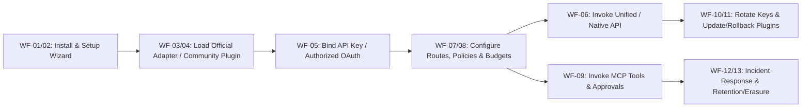
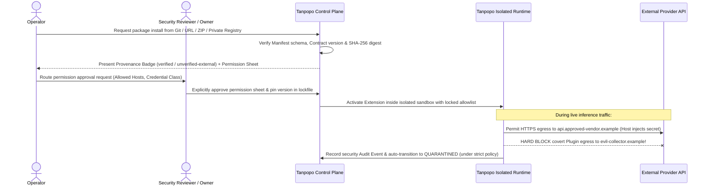
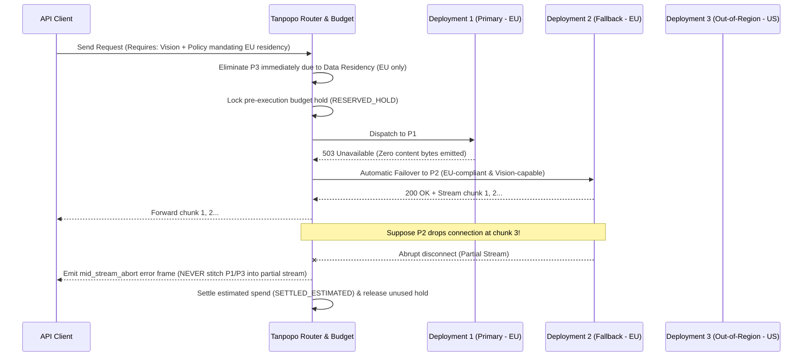
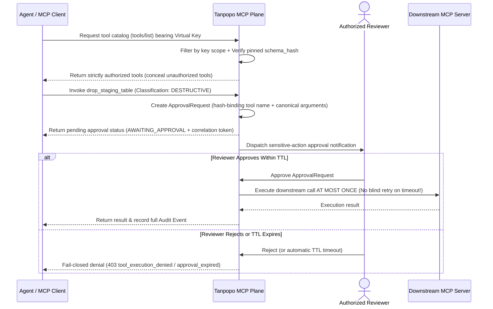

# End-to-End Workflows & Edge Cases — Tanpopo

> **Business Analysis Specification (Phase ASTRA A02 — `DRAFT / UNLOCKED SCOPE`)**
> - **Version:** `0.1.0-a02-draft`
> - **Last Updated:** `2026-11-11`
> - **Authoring Role:** Lead Business Analyst & Product Architect
> - **Governance Status:** **Unlocked-scope draft (`DRAFT`)** — dependent on **Gate G1** and **Gate G2** approval in [`docs/governance/decisions.md`](../governance/decisions.md). Every workflow below defines expected user- and operator-observable behavior, decoupled from underlying programming language or database choices.

---

## 1. User & Operational Journey Overview Map

---

## 2. Thirteen End-to-End Business Workflows (`WF-01` .. `WF-13`)

### WF-01: First Install & System Sovereignty Bootstrap (`First Install & Bootstrap`)
- **Actors:** `Operator` (or `Personal Admin`).
- **Preconditions:** Clean host environment with zero pre-existing Tanpopo configuration state.
- **Happy Path:**
  1. The `Operator` boots the instance for the first time; the system detects uninitialized state and keeps all public AI data-plane ports closed until root administrator bootstrap completes.
  2. The system prompts to confirm or generate the root secret vault key (`Master Secret Protection`) and provisions the initial administrative principal (`Personal Admin` or initial `Operator` + `Organization Owner`).
  3. The system records the genesis audit event (`INSTANCE_BOOTSTRAPPED`) and advances into `WF-02`.
- **Negative & Edge Cases:**
  - *Abandoned setup or unauthorized network probing during bootstrap:* The one-time bootstrap token is emitted solely to the `Operator`'s direct local console/stdout and expires after a short TTL; external network callers cannot hijack administrative setup without this token.
  - *Missing master key backup in production mode:* The system surfaces an explicit warning if persistent mode starts without confirming master recovery key backup.

---

### WF-02: Day-1 Quick Setup Wizard (`Setup Wizard`)
- **Actors:** `Personal Admin` or `Organization Owner` + `Team Admin`.
- **Happy Path:**
  1. Initialize the default workspace hierarchy (`Organization` → `Project` → `Environment: development`).
  2. Select the first upstream integration from bundled `Official Adapters` (either a commercial cloud API vendor or a local on-premise model server).
  3. Enter a valid credential, pass the live connectivity probe, and issue the first `Virtual Key` pre-configured with a safe default spend ceiling.
  4. Immediately execute a sample verification query and inspect live latency, token consumption, and the initial trace record (`TTFGR < 3 minutes`).
- **Negative & Edge Cases:**
  - *Unreachable local model server or blocked outbound firewall:* The Wizard distinguishes DNS resolution failures, firewall/TCP timeouts, and upstream authentication rejections rather than reporting a generic failure, and allows saving the connection as a draft to resume later.
  - *User attempts to paste personal consumer subscription browser cookies (ChatGPT Plus/Claude Pro, etc.):* UI copy and documentation state unambiguously that Tanpopo accepts only commercial credentials or provider-authorized identities (`TP-BR-0301`), rejecting malformed browser-session artifacts.

---

### WF-03: Add Official API Provider
- **Actors:** `Organization Owner` or authorized `Team Admin`.
- **Happy Path:**
  1. Select an `Official Adapter` (`Trust Tier = official`).
  2. Create a `Provider Connection`, assign a descriptive name, tag its `Data Region` (e.g., `US`, `EU`, `Internal`), and bind a `Credential`.
  3. The system probes connectivity and automatically syncs or suggests available `Model Deployment` entries populated with default `Capability Profile` metadata and reference pricing.
  4. The administrator enables the desired `Model Deployment` targets, transitioning them to `ACTIVE` / `HEALTHY`.
- **Negative & Edge Cases:**
  - *Valid API key on an upstream account with exhausted prepaid balance (`402/429 insufficient_quota`):* Connection configuration saves cleanly, while affected `Model Deployment` entries raise an upstream-quota warning flag so the router avoids directing primary traffic to them.
  - *Vendor launches a brand-new model absent from bundled rate cards:* Administrators can declare custom `Model Deployment` IDs and custom unit pricing directly in configuration without awaiting a Core binary update.

---

### WF-04: Install Community / External Plugin & Permission Inspection (`Marketplace / Git / ZIP / Private Registry`)
- **Actors:** `Extension Publisher` (publishes), `Operator` (initiates install), `Reviewer` / `Organization Owner` (approves permissions).
- **Installation & Runtime Egress Guard Sequence:**

- **Happy Path:**
  1. The `Operator` selects an artifact from one of 4 sources: Marketplace catalog, Git repository (pinned tag/commit), archive upload (ZIP/tarball), or internal Private Registry.
  2. The Control Plane parses the `Extension Manifest`, validates `Contract Version` compatibility, verifies cryptographic signatures (if present), and assigns the exact `Trust Tier` (`verified` or `unverified-external`).
  3. The system renders a mandatory **Permission Inspection Sheet**: which outbound domains this package requests, what credential class it requires, and which lifecycle hooks it touches.
  4. Once the `Organization Owner` / `Reviewer` grants explicit consent, the package is pinned in the lockfile and transitions to `ENABLED_ACTIVE`.
- **Mandatory Negative Cases:**
  - *Untrusted external source / digest mismatch / wildcard network request (`*`):* Installation is rejected by default (wildcard `*` egress is blocked unless explicitly permitted with a high-severity banner inside an isolated sandbox test environment) and logged in the audit trail.
  - *External package claiming to turn personal subscriptions into free APIs:* Never granted `official` or `verified` status on Tanpopo channels; on self-hosted instances, the `unverified-external` badge explicitly warns that Tanpopo provides zero legal/TOS warranty for third-party artifacts (`TP-BR-0203`, `TP-BR-0302`).
  - *Untrusted Plugin Runtime Violation:* If a plugin attempts egress to an unapproved host or probes cross-`Organization` memory/state, the runtime aborts the request immediately, blocks egress, and triggers `QUARANTINED` containment.

---

### WF-05: API Key & Authorized OAuth Connection
- **Actors:** `Organization Owner` / `Team Admin`, `External Identity Provider (IdP)`.
- **Happy Path:**
  1. For **API Keys / Service Principals**: The administrator submits the secret into the write-only vault (never echoed back in plaintext after save) and binds it to a `Provider Connection`.
  2. For **`Authorized OAuth`**: The administrator initiates a standard authorization flow using a legitimate registered client identity and provider-documented `scopes`; upon `External IdP` consent, Tanpopo vaults the refresh token and renews access tokens silently via `single-flight refresh` without interrupting concurrent traffic.
- **Mandatory Negative Cases:**
  - *Credentials Expired / Revoked Upstream:* When token renewal fails with revocation (`invalid_grant` / `401`), the `Provider Connection` immediately transitions to `AUTH_EXPIRED_REAUTH_REQUIRED`, stops admitting new traffic (failing over to healthy backup connections if configured on the `Route`), dispatches an urgent operator alert, and **never leaks raw upstream tokens or headers back to the `API Client`**.
  - *Concurrent Refresh Stampede:* 100 simultaneous requests arriving at token expiry trigger exactly 1 single-flight refresh rather than 100 parallel refresh calls that would lock out the account at the `External IdP`.

---

### WF-06: Unified API & Native Passthrough Consumption (Including Partial Stream, Timeout, Retry & Cancellation)
- **Actors:** `API Client` / `Developer` / `Agent`.
- **Happy Path:**
  1. The `API Client` sends a request bearing a `Virtual Key` (and optional `Idempotency-Key`) to a unified endpoint or lossless native dialect endpoint.
  2. Tanpopo authenticates the key's `Organization`/`Project`/`Environment` binding, evaluates `Policy`, verifies target model capabilities, locks a provisional budget hold (`RESERVED_HOLD`), and forwards the request to the selected `Model Deployment`.
  3. Response chunks stream in real time back to the `API Client`; upon clean completion, the gateway records exact cost settlement (`SETTLED_EXACT`) and trace metadata.
- **Mandatory Negative & Edge Cases:**
  - *Cross-Tenant Access Attempt:* An `API Client` in `Tenant A` attempts to reference a `Route`, `Connection`, or trace belonging to `Tenant B` → Rejected immediately at ingress with a non-enumerable error (concealing `Tenant B` resource existence) plus a high-severity security audit event.
  - *Fallback After Partial Stream — SILENT FAILOVER PROHIBITED:* Once the upstream provider has emitted at least 1 content chunk to the `API Client` and subsequently drops the connection or errors mid-stream, Tanpopo **strictly prohibits** silently invoking a backup provider into the same stream (which would concatenate two incoherent responses and corrupt client state/JSON). The gateway emits an explicit terminal stream-abort error frame, settles already-streamed tokens via deterministic estimation (`SETTLED_ESTIMATED`), and lets the `API Client` decide whether to retry cleanly from scratch.
  - *Timeouts:* Enforces 3 distinct timeout phases: (a) `First-Byte Timeout` (eligible for pre-stream failover when side-effect-free), (b) `Idle-Chunk Timeout` between consecutive stream frames (cleanly severing stalled streams), and (c) `Max Request Duration`.
  - *Client Cancellation:* When an `API Client` disconnects mid-generation, Tanpopo immediately propagates cancellation to the upstream provider connection to halt wasted token generation, settles partial usage, and releases unused held budget.

---

### WF-07: Capability-Aware Routing & Provider Failover (`Routing & Provider Failover`)
- **Actors:** Configured by `Team Admin` / `Organization Owner`; consumed by `API Client`.
- **Pre-Stream Failover vs Safe Mid-Stream Abort Sequence:**

- **Mandatory Negative Cases:**
  - *All Compliant Providers Unavailable:* If both primary and backup `EU` deployments are down while a `US` deployment remains healthy under a hard `EU` data-residency policy, the router **must `Fail-Closed`** — returning `503 no_compliant_deployment_available` and never leaking data across prohibited geographic boundaries.
  - *Request Exceeds Capabilities of All Route Targets:* Immediately return `400 capability_not_supported` at ingress with zero outbound provider calls.

---

### WF-08: Quotas, Hierarchical Budgets & Chargeback Without Exact Usage (`Quota, Budget & Chargeback`)
- **Actors:** `Organization Owner` / `Team Admin` (configure & reconcile); `API Client` / `Agent` (consume).
- **Happy Path:**
  1. Budgets are configured hierarchically (`Organization` ≥ sum or cap of `Project` → `Environment` → `Virtual Key`) with soft warning thresholds (e.g., `80%`) and hard cutoff ceilings (`100%`).
  2. Each incoming request places a provisional `RESERVED_HOLD` based on estimated maximum output; upon completion with authoritative upstream token counts, the ledger settles `SETTLED_EXACT` and immediately releases unused hold balance.
- **Mandatory Negative Cases:**
  - *Concurrent Burst Near Budget Exhaustion:* Requests exceeding remaining available balance (net of active `RESERVED_HOLD` reservations) are blocked immediately with `429 budget_exceeded` (or routed to zero-cost internal models only when explicit policy downgrade is enabled).
  - *Chargeback Without Exact Usage:* When a stream aborts mid-flight or a self-hosted/third-party upstream omits standard token counters:
    1. The gateway computes deterministic estimated consumption from input payload size and actual output bytes streamed through the proxy.
    2. Records the ledger entry with explicit **`usage_accuracy = ESTIMATED`** (or **`UNMETERED_FLAGGED`** for non-tokenizable multimodal workloads).
    3. In internal `Chargeback Report` exports, **strictly separates `Exact` spend columns from `Estimated / Unmetered` reconciliation columns** so finance teams are never misled by fabricated `0 USD` entries or opaque blended totals.

---

### WF-09: MCP Tool Invocation, Side-Effect Guard & Human Approval (`MCP Tool Call & Approval`)
- **Actors:** `MCP Client` / `Agent`, `Reviewer` / `Team Admin`, `MCP Server`.
- **Destructive Tool Governance Sequence:**

- **Mandatory Negative Cases:**
  - *Destructive / Mutating Tool Guard:* If an `Agent` invokes a `destructive` tool without valid approval (or mutates even a single argument character after approval), execution is blocked. Crucially, if a `mutating`/`destructive` tool call encounters a network `timeout` after dispatch, Tanpopo **performs zero blind retries**—preventing double deletions or duplicate charges—and returns `ambiguous_side_effect_timeout` for explicit reconciliation.
  - *Downstream MCP Schema Drift / Rug-Pull:* If a tool's live schema fingerprint diverges from its administrator-pinned `schema_hash`, the tool is automatically suspended from `Agent` invocation until re-approved.

---

### WF-10: Zero-Downtime Rotation & Emergency Credential Revocation (`Rotate & Revoke Credentials`)
- **Actors:** `Team Admin`, `Organization Owner`, `Operator`.
- **Happy Path (Graceful Rotation):**
  1. For a `Virtual Key`: Issues a replacement key in `ROTATING_DUAL_VALID` state co-valid alongside the prior key during a bounded grace window (e.g., `24 hours`) so application teams deploy updates with zero downtime before the old key auto-expires.
  2. For an upstream `Credential`: The administrator updates the secret on the `Provider Connection`; Tanpopo validates the new credential via health probe and cuts new traffic over seamlessly without touching downstream team `Virtual Key` tokens.
- **Negative & Emergency Path (Immediate Compromise Revocation):**
  - Invoking **`Revoke Immediately`** bypasses all grace windows, transitioning the key to `REVOKED` system-wide within seconds. For active long-lived SSE streams opened by a compromised key, administrators can enforce **`Terminate In-Flight Streams`** to sever open connections immediately.

---

### WF-11: Update, Permission-Escalation Block & Plugin Rollback (`Update & Rollback Plugin`)
- **Actors:** `Operator` and `Organization Owner` / `Reviewer`.
- **Happy Path:**
  1. When a new `Extension` version requests permissions **less than or equal to** the previously approved manifest set and remains contract-compatible, the `Operator` triggers a graceful upgrade: new requests route to the new version while active streams on the prior version finish draining (`DRAINING`).
  2. If runtime regressions appear on the new version, the `Operator` executes a single-step **`Rollback`** to the previously pinned version without losing `Provider Connection` bindings.
- **Mandatory Negative Cases:**
  - *Permission Escalation on Update:* Version `1.3.0` requests an additional outbound domain or broader credential scope compared to `1.2.0`. The Control Plane **blocks automatic activation of `1.3.0`**, holds the update in `UPDATING_PENDING_RECONSENT` (keeping `1.2.0` serving live traffic unless flagged vulnerable), and requires explicit `Reviewer`/`Owner` consent on the permission diff.
  - *Concurrent Updates:* Two administrators concurrently edit the same `Route` or upgrade the same `Plugin` → Optimistic concurrency version checks reject the stale write with an explicit conflict error rather than silently overwriting peer changes.

---

### WF-12: Incident Detection, Containment & Recovery (`Incident Containment & Recovery`)
- **Actors:** `Operator`, `Organization Owner`, `Team Admin`.
- **Standard Incident Playbooks:**
  1. *Runaway spend spike / infinite agent loop:* Instantly suspend the offending `Virtual Key` or `Project` (`SUSPENDED`) via emergency kill-switch without disrupting sibling projects.
  2. *Compromised / faulty external plugin:* Transition the plugin to `QUARANTINED` instance-wide; automatically disable dependent `Provider Connection` resources safely and immediately list every `Project`/`Virtual Key` that traversed that plugin during the exposure window.
  3. *Host disaster recovery from backup:* Provision a clean instance, restore the encrypted configuration & ledger backup archive, verify vault integrity and pinned plugin digests in maintenance mode, and reopen data-plane ingress only after readiness checks pass.

---

### WF-13: Lifecycle Data Retention, Anonymization & Deletion (`Retention & Deletion Lifecycle`)
- **Actors:** `Organization Owner`, `Operator`.
- **Happy Path:**
  1. Under privacy-by-default settings, Tanpopo persists only operational metadata (timestamps, model IDs, latency, error codes, token counters, spend); prompt/completion payloads are stored only when explicitly enabled with a short automatic `TTL`.
  2. Upon deleting a `Project` or `Organization`, the system first freezes and revokes all active keys/connections, irrecoverably purges secret credentials and stored query logs belonging to that tenant scope, and retains only anonymized aggregate financial/audit entries where mandated by statutory accounting policy.
- **Negative Case:**
  - *Deletion requested while streams remain active or budget holds remain unsettled:* Transitions the project into a frozen draining state rejecting new requests, waits for active streams to settle (or force-aborts past a short drain timeout), and executes clean erasure without leaving orphaned records.
