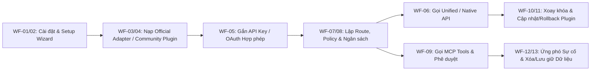
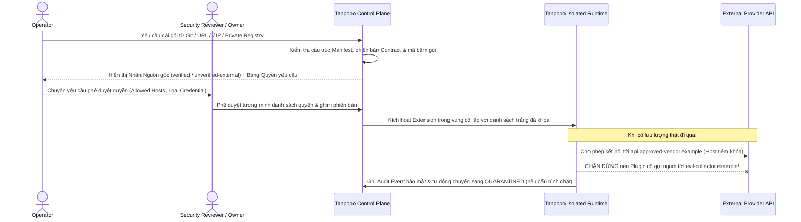
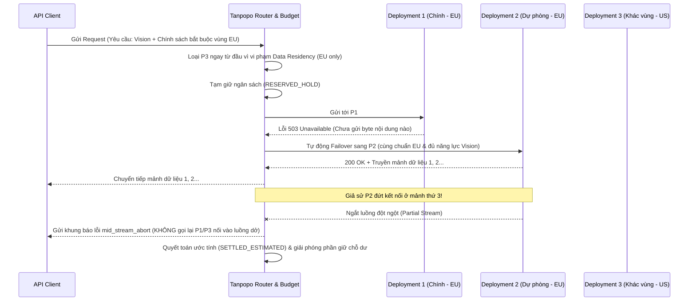
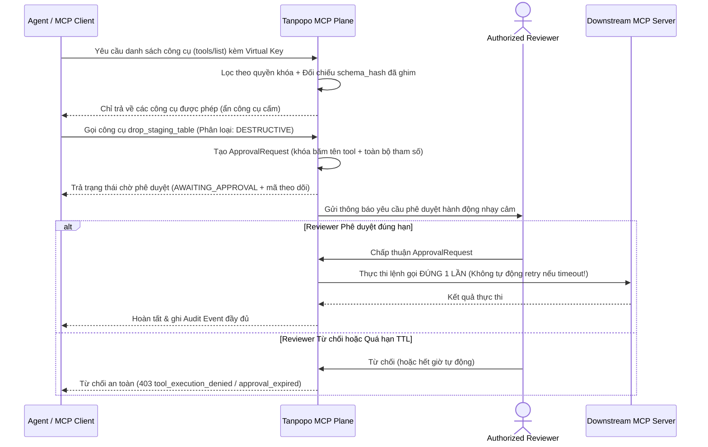

# Luồng Nghiệp vụ Đầu-Cuối & Xử lý Tình huống Biên (End-to-End Workflows & Edge Cases) — Tanpopo

> **Tài liệu Phân tích Nghiệp vụ (Phase ASTRA A02 — `DRAFT / UNLOCKED SCOPE`)**
> - **Phiên bản:** `0.1.0-a02-draft`
> - **Ngày cập nhật:** `2026-11-11`
> - **Vai trò biên soạn:** Lead Business Analyst & Product Architect
> - **Trạng thái quản trị:** **Bản nháp chưa khóa phạm vi (`DRAFT`)** — phụ thuộc phê duyệt Cổng **Gate G1** và **Gate G2** tại [`docs/governance/decisions.md`](../governance/decisions.md). Mọi luồng nghiệp vụ dưới đây mô tả hành vi kỳ vọng từ góc nhìn người dùng và vận hành, tách biệt với lựa chọn ngôn ngữ/cơ sở dữ liệu bên dưới.

---

## 1. Bản đồ Tổng quan Chuỗi Hành trình Người dùng & Vận hành

---

## 2. Mười Ba Hành trình Nghiệp vụ Đầu-Cuối (`WF-01` .. `WF-13`)

### WF-01: Cài đặt Lần đầu & Khởi tạo Chủ quyền Hệ thống (`First Install & Bootstrap`)
- **Tác nhân:** `Operator` (hoặc `Personal Admin`).
- **Tiền điều kiện:** Môi trường máy chủ trống chưa có trạng thái cấu hình Tanpopo.
- **Happy Path:**
  1. `Operator` khởi chạy hệ thống lần đầu; hệ thống phát hiện trạng thái chưa khởi tạo và khóa mọi cổng lưu lượng AI công khai cho tới khi hoàn tất thiết lập quản trị viên gốc.
  2. Hệ thống yêu cầu xác nhận hoặc sinh khóa bảo vệ kho bí mật gốc (`Master Secret Protection`) và tạo tài khoản quản trị đầu tiên (`Personal Admin` hoặc `Operator` + `Organization Owner` đầu tiên).
  3. Hệ thống ghi nhận bản ghi kiểm toán đầu tiên (`INSTANCE_BOOTSTRAPPED`) và chuyển sang bước hướng dẫn `WF-02`.
- **Negative & Edge Cases:**
  - *Bỏ dở giữa chừng hoặc truy cập trái phép lúc khởi tạo:* Mã thông báo thiết lập một lần (bootstrap token) chỉ hiển thị tại môi trường điều khiển trực tiếp của `Operator` và tự hết hạn sau khoảng thời gian ngắn; bên ngoài mạng không thể chiếm quyền quản trị nếu chưa có token này.
  - *Thiếu cấu hình khóa bảo vệ kho bí mật trong môi trường sản xuất:* Hệ thống cảnh báo rõ ràng nếu chạy chế độ lưu trữ lâu dài mà chưa sao lưu khóa chủ khôi phục.

---

### WF-02: Trình Hướng dẫn Thiết lập Nhanh Ngày Đầu (`Setup Wizard`)
- **Tác nhân:** `Personal Admin` hoặc `Organization Owner` + `Team Admin`.
- **Happy Path:**
  1. Khởi tạo không gian mặc định (`Organization` → `Project` → `Environment: development`).
  2. Chọn kết nối đầu tiên từ danh sách `Official Adapters` có sẵn (ví dụ nhà cung cấp API thương mại hoặc mô hình tự chạy trong mạng nội bộ).
  3. Nhập thông tin xác thực hợp lệ, kiểm tra kết nối thành công, sinh `Virtual Key` đầu tiên có gắn trần chi tiêu an toàn mặc định.
  4. Thực hiện ngay một truy vấn kiểm tra mẫu và hiển thị chi tiết độ trễ, số token tiêu thụ cùng bản ghi nhật ký đầu tiên (`TTFGR < 3 phút`).
- **Negative & Edge Cases:**
  - *Máy chủ mô hình nội bộ chưa bật hoặc mạng chặn ra ngoài:* Wizard hiển thị chẩn đoán phân biệt rõ lỗi phân giải tên miền, lỗi tường lửa hay lỗi xác thực thay vì chỉ báo "thất bại chung chung", đồng thời cho phép lưu nháp để cấu hình tiếp sau.
  - *Người dùng cố dán cookie trình duyệt của gói thuê bao cá nhân (ChatGPT Plus/Claude Pro...):* Giao diện và tài liệu nêu rõ hệ thống chỉ nhận khóa thương mại/định danh được nhà cung cấp cấp phép (`TP-BR-0301`), từ chối định dạng phiên trình duyệt không hợp chuẩn.

---

### WF-03: Thêm Nhà cung cấp Chính thức (`Add Official API Provider`)
- **Tác nhân:** `Organization Owner` hoặc `Team Admin` (nếu được phân quyền).
- **Happy Path:**
  1. Chọn một `Official Adapter` (nhãn `Trust Tier = official`).
  2. Tạo một `Provider Connection`, đặt tên gợi nhớ, gắn vùng dữ liệu (`Data Region`, ví dụ `US`, `EU`, `Internal`) và liên kết `Credential`.
  3. Hệ thống kiểm tra kết nối, tự động đồng bộ hoặc gợi ý danh mục các `Model Deployment` khả dụng kèm hồ sơ năng lực (`Capability Profile`) và biểu giá tham chiếu.
  4. Quản trị viên bật các `Model Deployment` muốn cho phép sử dụng; trạng thái chuyển sang `ACTIVE` / `HEALTHY`.
- **Negative & Edge Cases:**
  - *Khóa API hợp lệ nhưng tài khoản nhà cung cấp hết tín dụng trả trước (`402/429 insufficient_quota`):* Kết nối vẫn lưu được cấu hình nhưng `Model Deployment` gắn cờ cảnh báo hạn mức phía nhà cung cấp để bộ định tuyến không điều lưu lượng chính vào đó.
  - *Nhà cung cấp ra mắt model mới chưa có trong bảng giá mặc định:* Cho phép quản trị viên khai báo bổ sung `Model Deployment` và biểu giá thủ công ngay trên cấu hình mà không cần chờ cập nhật nhân hệ thống.

---

### WF-04: Cài đặt Community / External Plugin & Kiểm định Quyền hạn (`Marketplace / Git / ZIP / Private Registry`)
- **Tác nhân:** `Extension Publisher` (xuất bản), `Operator` (khởi tạo cài đặt), `Reviewer` / `Organization Owner` (phê duyệt quyền).
- **Sơ đồ Trình tự Cài đặt & Chặn Vượt quyền:**

- **Happy Path:**
  1. `Operator` chọn cài đặt từ một trong 4 nguồn: Danh mục Marketplace, kho Git (kèm tag/commit), tệp gói tải lên (ZIP/archive) hoặc Private Registry nội bộ.
  2. Hệ thống phân tích `Extension Manifest`, đối chiếu phiên bản hợp đồng (`Contract Version`), kiểm tra chữ ký số (nếu có) và xác định rõ nhãn `Trust Tier` (`verified` hoặc `unverified-external`).
  3. Hệ thống trình bày **Bảng Kê Quyền hạn Bắt buộc (Permission Inspection Sheet)**: gói này xin gọi tới tên miền nào, cần kiểu thông tin xác thực gì, chạm vào sự kiện nào.
  4. Sau khi `Organization Owner` / `Reviewer` chấp thuận tường minh, gói được ghi vào danh mục khóa phiên bản và chuyển sang `ENABLED_ACTIVE`.
- **Negative Cases bắt buộc:**
  - *Nguồn ngoài không đáng tin cậy / sai mã băm / đòi quyền truy cập mạng toàn cục (`*`):* Hệ thống từ chối cài đặt mặc định (chặn quyền `*` trừ khi chính sách môi trường thử nghiệm cô lập cho phép có cảnh báo đỏ) và ghi nhật ký từ chối.
  - *Gói bên ngoài tuyên bố biến gói thuê bao cá nhân thành API miễn phí:* Không bao giờ được cấp nhãn `official`/`verified` trên kênh của Tanpopo; trên máy chủ tự vận hành, nhãn `unverified-external` cảnh báo rõ Tanpopo không bảo chứng tính hợp pháp điều khoản của gói bên thứ ba (`TP-BR-0203`, `TP-BR-0302`).
  - *Hành vi vượt quyền lúc chạy (Untrusted Plugin Runtime Violation):* Nếu plugin cố kết nối tới tên miền ngoài danh sách đã duyệt hoặc cố đọc dữ liệu của `Organization` khác, hệ thống hủy yêu cầu ngay lập tức, chặn kết nối ra ngoài và kích hoạt quy trình cách ly `QUARANTINED`.

---

### WF-05: Kết nối API Key & OAuth Được Cấp phép (`API Key & Authorized OAuth Connection`)
- **Tác nhân:** `Organization Owner` / `Team Admin`, `External Identity Provider (IdP)`.
- **Happy Path:**
  1. Với **API Key / Định danh dịch vụ**: Quản trị viên nhập bí mật một chiều (write-only, giao diện không bao giờ hiển thị lại chuỗi gốc sau khi lưu) và gắn với `Provider Connection` cụ thể.
  2. Với **OAuth được cấp phép (`Authorized OAuth`)**: Quản trị viên khởi tạo luồng ủy quyền chuẩn với định danh ứng dụng hợp lệ và phạm vi quyền (`scopes`) được nhà cung cấp công bố chính thức; sau khi xác nhận trên `External IdP`, Tanpopo nhận và bảo quản mã làm mới, tự động gia hạn ngầm theo cơ chế một luồng đại diện (`single-flight refresh`) để không làm gián đoạn các truy vấn đang chạy.
- **Negative Cases bắt buộc:**
  - *Thông tin xác thực hết hạn hoặc bị thu hồi từ phía nhà cung cấp (`Credentials Expired / Revoked`):* Khi làm mới thất bại với lỗi thu hồi quyền (`invalid_grant` / `401`), `Provider Connection` lập tức chuyển sang `AUTH_EXPIRED_REAUTH_REQUIRED`, ngừng nhận lưu lượng mới (chuyển hướng sang kết nối dự phòng hợp lệ khác nếu `Route` có cấu hình), gửi cảnh báo vận hành khẩn cấp và **tuyệt đối không trả thông tin token/header gốc về cho `API Client`**.
  - *Đua tranh làm mới đồng thời:* 100 truy vấn tới cùng lúc khi token vừa chạm ngưỡng hết hạn không được gọi 100 lệnh làm mới song song làm khóa tài khoản phía `External IdP`.

---

### WF-06: Sử dụng Unified API & Native Passthrough (Bao gồm Partial Stream, Timeout, Retry & Cancellation)
- **Tác nhân:** `API Client` / `Developer` / `Agent`.
- **Happy Path:**
  1. `API Client` gửi yêu cầu kèm `Virtual Key` (và mã định danh chống trùng lặp `Idempotency-Key` tùy chọn) tới điểm cuối chuẩn hóa hoặc điểm cuối giữ nguyên phương ngữ gốc.
  2. Tanpopo xác thực khóa thuộc đúng `Organization`/`Project`/`Environment`, kiểm tra `Policy`, kiểm tra sự tương thích năng lực mô hình, khóa tạm hạn mức ngân sách (`RESERVED_HOLD`) và chuyển yêu cầu tới `Model Deployment` được chọn.
  3. Dữ liệu phản hồi được truyền luồng thời gian thực về `API Client`; khi kết thúc hoàn chỉnh, hệ thống quyết toán chi phí thật (`SETTLED_EXACT`) và ghi nhận truy vết.
- **Negative & Edge Cases bắt buộc:**
  - *Truy cập chéo tổ chức/dự án (`Cross-Tenant Access Attempt`):* `API Client` thuộc `Tenant A` cố chỉ định tên `Route`, `Connection` hoặc tra cứu truy vết thuộc `Tenant B` → Hệ thống từ chối ngay ở cửa ngõ (không tiết lộ sự tồn tại của tài nguyên bên kia) và ghi sự kiện bảo mật mức cao.
  - *Đứt luồng sau khi đã truyền một phần (`Fallback After Partial Stream` — CẤM CHUYỂN MẠCH NGẦM):* Khi nhà cung cấp đích đã gửi ít nhất 1 mảnh nội dung về cho `API Client` rồi mới đứt mạng hoặc báo lỗi quá tải giữa chừng, Tanpopo **nghiêm cấm** tự động gọi lại nhà cung cấp dự phòng nối tiếp vào cùng luồng (vì sẽ ghép hai câu trả lời rời rạc làm hỏng dữ liệu/JSON của ứng dụng). Hệ thống phải gửi sự kiện báo lỗi kết thúc luồng tường minh, quyết toán phần dung lượng đã phát sinh theo cơ chế ước tính (`SETTLED_ESTIMATED`) và để `API Client` quyết định thử lại từ đầu.
  - *Quá thời gian chờ (`Timeouts`):* Tách bạch 3 ngưỡng: (a) quá hạn kết nối/byte đầu tiên (`First-Byte Timeout` — cho phép chuyển mạch dự phòng nếu chưa phát sinh tác động phụ), (b) quá hạn đứng im giữa hai mảnh luồng (`Idle-Chunk Timeout` — ngắt sạch luồng treo), và (c) thời lượng tối đa toàn yêu cầu (`Max Request Duration`).
  - *Người gọi chủ động hủy yêu cầu (`Client Cancellation`):* Khi `API Client` ngắt kết nối giữa chừng, Tanpopo lập tức truyền tín hiệu hủy xuống kết nối nhà cung cấp phía sau để dừng tốn thêm token vô ích, sau đó quyết toán phần đã chạy và giải phóng ngay khoản ngân sách tạm giữ còn dư.

---

### WF-07: Tạo Tuyến Định tuyến Nhận thức Năng lực & Chuyển mạch Dự phòng (`Routing & Provider Failover`)
- **Tác nhân:** `Team Admin` / `Organization Owner` thiết lập; `API Client` thụ hưởng.
- **Sơ đồ Trình tự Chuyển mạch Trước Luồng vs Ngắt An toàn Giữa Luồng:**

- **Negative Cases bắt buộc:**
  - *Tất cả nhà cung cấp hợp lệ đều ngừng hoạt động (`All Compliant Providers Unavailable`):* Nếu đích chính và đích dự phòng tại vùng `EU` đều sập, chỉ còn một đích sống tại vùng `US` trong khi chính sách dữ liệu khóa cứng ở `EU`, hệ thống bắt buộc **`Fail-Closed`** — trả lỗi `503 no_compliant_deployment_available` chứ tuyệt đối không âm thầm đẩy dữ liệu sang vùng cấm.
  - *Yêu cầu vượt quá năng lực của mọi đích trong tuyến:* Trả lỗi `400 capability_not_supported` ngay tại cổng mà không phát sinh lệnh gọi thừa ra ngoài.

---

### WF-08: Hạn mức, Ngân sách Phân cấp & Đối soát khi Thiếu Số đo Chính xác (`Quota, Budget & Chargeback`)
- **Tác nhân:** `Organization Owner` / `Team Admin` (cấu hình & đối soát); `API Client` / `Agent` (tiêu dùng).
- **Happy Path:**
  1. Ngân sách được thiết lập theo cây phân cấp (`Organization` ≥ tổng hoặc trần của `Project` → `Environment` → `Virtual Key`) kèm ngưỡng cảnh báo mềm (ví dụ `80%`) và trần chặn cứng (`100%`).
  2. Mỗi yêu cầu mới thực hiện bước tạm giữ (`RESERVED_HOLD`) dựa trên giới hạn đầu ra tối đa ước tính; khi hoàn tất với đầy đủ thông tin token từ nhà cung cấp, hệ thống ghi sổ `SETTLED_EXACT` và hoàn trả phần dư ngay lập tức.
- **Negative Cases bắt buộc:**
  - *Bắn dồn dập song song khi ngân sách sắp cạn:* Các yêu cầu vượt quá phần số dư khả dụng (sau khi đã trừ các khoản đang `RESERVED_HOLD`) bị chặn ngay với lỗi `429 budget_exceeded` (hoặc chuyển sang tuyến mô hình nội bộ miễn phí nếu chính sách dự án bật chế độ hạ cấp có chủ đích).
  - *Hạch toán phân bổ chi phí khi không có số đo chính xác (`Chargeback Without Exact Usage`):* Khi luồng bị đứt giữa chừng hoặc một nhà cung cấp tự vận hành/bên thứ ba không trả về bộ đếm token chuẩn:
    1. Hệ thống tính toán mức tiêu thụ ước lượng từ kích thước đầu vào và lượng dữ liệu đầu ra thực tế đã đi qua cổng.
    2. Ghi nhận giao dịch với cờ trạng thái tường minh **`usage_accuracy = ESTIMATED`** (hoặc **`UNMETERED_FLAGGED`** nếu là định dạng đa phương thức không thể đếm chữ trực tiếp).
    3. Trong báo cáo phân bổ chi phí nội bộ (`Chargeback Report`), hệ thống **tách riêng cột Chi phí Chính xác (`Exact`) và Chi phí Ước tính/Cần đối soát (`Estimated / Unmetered`)** để bộ phận tài chính không bị đánh lừa bởi con số `0 USD` giả tạo hay số cộng gộp mù mờ.

---

### WF-09: Gọi Công cụ MCP, Bảo vệ Tác động Phụ & Phê duyệt Con người (`MCP Tool Call & Approval`)
- **Tác nhân:** `MCP Client` / `Agent`, `Reviewer` / `Team Admin`, `MCP Server`.
- **Sơ đồ Trình tự Kiểm soát Công cụ Có Tính Phá hủy (`Destructive Tool`):**

- **Negative Cases bắt buộc:**
  - *Công cụ có tính phá hủy hoặc làm thay đổi dữ liệu (`Destructive / Mutating Tool`):* Nếu `Agent` gọi công cụ thuộc nhóm `destructive` mà chưa có phê duyệt hợp lệ (hoặc cố sửa một ký tự tham số sau khi đã được duyệt), lệnh gọi bị chặn đứng. Đặc biệt, nếu lệnh gọi công cụ `mutating`/`destructive` gặp lỗi quá thời gian chờ mạng (`timeout`), Tanpopo **tuyệt đối không tự động thử lại (no blind retry)** để tránh xóa nhầm hai lần hoặc trừ tiền hai lần, mà trả về trạng thái `ambiguous_side_effect_timeout` để kiểm tra.
  - *Máy chủ MCP tự ý sửa mô tả công cụ (`Schema Drift / Rug-Pull`):* Nếu dấu vân tay cấu trúc công cụ khác với bản đã được quản trị viên duyệt, công cụ đó lập tức bị tạm khóa không cho `Agent` sử dụng cho đến khi được duyệt lại.

---

### WF-10: Xoay vòng Không Gián đoạn & Thu hồi Khẩn cấp Khóa (`Rotate & Revoke Credentials`)
- **Tác nhân:** `Team Admin`, `Organization Owner`, `Operator`.
- **Happy Path (Xoay vòng êm):**
  1. Với `Virtual Key`: Hệ thống phát hành khóa mới trong trạng thái `ROTATING_DUAL_VALID` cùng hiệu lực với khóa cũ trong một cửa sổ ân hạn xác định (ví dụ `24 giờ`) để kỹ sư kịp cập nhật ứng dụng không gây sập dịch vụ, sau đó tự động đóng khóa cũ.
  2. Với `Credential` nhà cung cấp: Quản trị viên cập nhật khóa mới trên `Provider Connection`; hệ thống kiểm tra khóa mới sống tốt rồi chuyển toàn bộ luồng mới sang khóa mới mà không cần sửa bất kỳ `Virtual Key` nào của các nhóm nội bộ.
- **Negative & Emergency Path (Thu hồi tức thì khi lộ khóa):**
  - Khi bấm lệnh **Thu hồi khẩn cấp (`Revoke Immediately`)**, cửa sổ ân hạn bị bỏ qua hoàn toàn; khóa chuyển thẳng sang `REVOKED` trên toàn hệ thống trong vài giây. Đối với các luồng streaming dài đang mở bằng khóa vừa bị thu hồi do nghi ngờ tấn công, quản trị viên có tùy chọn cắt đứt ngay lập tức (`Terminate In-Flight Streams`).

---

### WF-11: Cập nhật, Chặn Tăng Quyền Ngầm & Quay lui Plugin (`Update & Rollback Plugin`)
- **Tác nhân:** `Operator` và `Organization Owner` / `Reviewer`.
- **Happy Path:**
  1. Khi có phiên bản mới của một `Extension` mà tập quyền yêu cầu trong `Manifest` **nhỏ hơn hoặc bằng** tập quyền đã duyệt trước đó và tương thích hợp đồng, `Operator` kích hoạt nâng cấp êm: lưu lượng mới đi vào bản mới, các luồng đang dở trên bản cũ chạy nốt rồi đóng (`DRAINING`).
  2. Nếu phát hiện lỗi vận hành trên bản mới, `Operator` kích hoạt lệnh **Quay lui (`Rollback`)** về phiên bản đã ghim trước đó chỉ trong một bước mà không mất cấu hình `Provider Connection`.
- **Negative Cases bắt buộc:**
  - *Plugin yêu cầu quyền mới khi cập nhật (`Permission Escalation on Update`):* Bản `1.3.0` yêu cầu thêm quyền kết nối tới một tên miền mới hoặc đòi đọc thêm một loại thông tin xác thực mới so với bản `1.2.0`. Hệ thống **chặn đứng việc tự động kích hoạt bản `1.3.0`**, chuyển tiến trình cập nhật sang trạng thái chờ `UPDATING_PENDING_RECONSENT` (trong khi bản `1.2.0` vẫn phục vụ bình thường nếu không bị đánh dấu lỗ hổng), và yêu cầu `Reviewer`/`Owner` phê duyệt lại phần quyền chênh lệch.
  - *Cập nhật đồng thời xung đột (`Concurrent Updates`):* Hai quản trị viên cùng sửa một `Route` hoặc nâng cấp cùng một `Plugin` một lúc → Hệ thống kiểm tra phiên bản bản ghi (optimistic concurrency) và từ chối thao tác đến sau với thông báo xung đột rõ ràng thay vì ghi đè mất dữ liệu của nhau.

---

### WF-12: Phát hiện, Cô lập & Khôi phục từ Sự cố (`Incident Containment & Recovery`)
- **Tác nhân:** `Operator`, `Organization Owner`, `Team Admin`.
- **Các kịch bản ứng phó chuẩn:**
  1. *Sự cố đốt chi phí bất thường / vòng lặp tác nhân lỗi:* Tạm dừng tức thì `Virtual Key` hoặc `Project` liên quan (`SUSPENDED`) thông qua nút ngắt khẩn cấp mà không làm ảnh hưởng các dự án khác.
  2. *Sự cố plugin ngoài nhiễm độc / lỗi nghiêm trọng:* Chuyển plugin sang `QUARANTINED` trên toàn hệ thống; hệ thống tự động vô hiệu hóa an toàn các `Provider Connection` dùng plugin đó và liệt kê ngay danh sách mọi `Project`/`Virtual Key` từng đi qua plugin trong khoảng thời gian nghi vấn để rà soát.
  3. *Khôi phục từ bản sao lưu khi hỏng hạ tầng:* `Operator` khởi tạo lại hệ thống, nạp bản sao lưu cấu hình & sổ cái đã mã hóa, kiểm tra tính toàn vẹn của kho bí mật và danh sách plugin đã ghim ở chế độ bảo trì kín trước khi mở lại cổng nhận lưu lượng thật.

---

### WF-13: Lưu giữ, Ẩn danh hóa & Xóa Dữ liệu theo Vòng đời (`Retention & Deletion Lifecycle`)
- **Tác nhân:** `Organization Owner`, `Operator`.
- **Happy Path:**
  1. Theo cấu hình mặc định bảo vệ quyền riêng tư, hệ thống chỉ lưu siêu dữ liệu vận hành (thời gian, mô hình, độ trễ, mã lỗi, số lượng token, chi phí); nội dung văn bản prompt/phản hồi chi tiết chỉ lưu khi được bật rõ ràng kèm thời hạn tự động xóa ngắn (`TTL`).
  2. Khi xóa một `Project` hoặc `Organization`, hệ thống buộc đóng và thu hồi toàn bộ khóa/kết nối đang hoạt động trước, xóa vĩnh viễn kho bí mật và nội dung nhật ký truy vấn nhạy cảm của đơn vị đó, đồng thời chỉ giữ lại tổng hợp bút toán tài chính/kiểm toán tối thiểu đã ẩn danh nếu chính sách kế toán của đơn vị tự vận hành yêu cầu.
- **Negative Case:**
  - *Yêu cầu xóa dự án khi vẫn còn lưu lượng đang chạy hoặc khoản giữ chỗ ngân sách chưa quyết toán:* Hệ thống chuyển dự án sang trạng thái đóng băng ngừng nhận yêu cầu mới, chờ quyết toán xong các luồng đang mở (hoặc cưỡng bức hủy sau ngưỡng chờ ngắn) rồi mới thực thi lệnh xóa sạch để không tạo ra bản ghi mồ côi.
