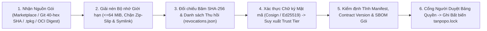

# Cô lập Sandbox Phần Mở rộng & Bảo mật Chuỗi Cung ứng (Plugin Sandbox, Provenance & Supply-Chain Security) — Tanpopo

> **Tài liệu Kỹ thuật Bảo mật Nền tảng Mở rộng (Phase ASTRA A07 — Gate G3: `READY_FOR_REVIEW` | `PROPOSED — NO CODE`)**
> - **Mã tài liệu:** `SPEC-SEC-02` | **Phiên bản:** `0.1.0-step07-draft` | **Ngày cập nhật:** `2026-11-12`
> - **Vai trò biên soạn:** Principal Security Engineer & Sandbox Runtime Architect
> - **Trạng thái quản trị:** **Đặc tả Bảo mật Đề xuất (`PROPOSED`)** — quy định chi tiết các chốt kiểm soát phòng vệ chiều sâu cho [`extension-contract.md`](../specifications/extension-contract.md) (`SPEC-EXT-01`), [`marketplace-lifecycle.md`](../specifications/marketplace-lifecycle.md) (`SPEC-EXT-04`), [`ADR-0002`](../architecture/adr/0002-three-tier-extension-sandbox-and-blind-broker.md) và [`security-checklist.md`](../../.agents/references/security-checklist.md).
> - **Truy vết Yêu cầu:** `DEC-002`, `DEC-004`, `TP-FR-0301`..`0307`, `TP-FR-0705`, `TP-FR-1004`, `TP-NFR-0202`, `TP-NFR-0401`, `TP-NFR-0403`, `RSK-001`, `RSK-005`, `RSK-012`, `RSK-014`.

---

## 1. Bảo mật Chuỗi Cung ứng Kép: Cho Chính Tanpopo Core & Cho Hệ sinh thái Extension

Một hệ thống AI Gateway chỉ an toàn khi **cả hai chuỗi cung ứng** — (A) chuỗi biên dịch nhị phân/giao diện của chính dự án Tanpopo và (B) chuỗi phân phối các gói `Extension` do người dùng cài thêm — đều được khóa chặt chống đầu độc:

### 1.1. Chuỗi Cung ứng Nội bộ Của Tanpopo (`Core & Web Console Build Hardening`)
Tuân thủ nghiêm ngặt mục *Dependency Security & Install-Script Gate* trong [`security-checklist.md`](../../.agents/references/security-checklist.md):
1. **Một Tệp Khóa Có Thẩm quyền Duy nhất Trên Mỗi Ranh giới Cài đặt:**
   - Phần Core Go khóa bằng `go.mod` + `go.sum` (`go build -mod=readonly -trimpath`, `CGO_ENABLED=0`); phần Web Console khóa bằng `package-lock.json` duy nhất thông qua `npm ci`. Cổng CI dừng ngay nếu phát hiện tệp khóa cạnh tranh (`yarn.lock` / `pnpm-lock.yaml` thừa) hoặc tệp khóa bị sửa đổi trong quá trình dựng.
2. **Chặn Kịch bản Cài đặt Phụ thuộc Trước Khi Chạy (`Default-Deny Lifecycle Scripts`):**
   - Mọi bước cài đặt gói Node.js cho giao diện quản trị bắt buộc chạy với cờ **`npm ci --ignore-scripts`** (hoặc chính sách `strict-allow-scripts=true` đã duyệt từng phiên bản cụ thể). Tuyệt đối không phê duyệt tràn lan kịch bản `postinstall` chưa qua đọc mã nguồn.
3. **Quét Lỗ hổng Theo Khả năng Chạm Tới, Ký Số & Xuất `SBOM` Cho Mỗi Bản Phát hành:**
   - Quét tự động `govulncheck ./...`, `npm audit` và `osv-scanner scan source -r .` trên mỗi PR; nghiêm cấm chạy tự động `npm audit fix --force`.
   - Mỗi bản phát hành chính thức của `tanpopod` / `tanpopo` CLI sinh kèm hóa đơn vật liệu phần mềm **`CycloneDX SBOM` (`sbom.cdx.json`)**, chứng thực nguồn gốc dựng **`SLSA Build Provenance`** và chữ ký không khóa **`Sigstore Cosign`** để người tự vận hành kiểm tra trước khi chạy.

### 1.2. Chuỗi Cung ứng Cho Gói Phần Mở rộng Bên Ngoài (`Extension Provenance & Verification`)

| Chốt Kiểm soát Chuỗi Cung ứng | Quy tắc Thực thi Kỹ thuật Cụ thể | Xử lý Khi Vi phạm |
|---|---|---|
| **Cấm Tham chiếu Động (`No Mutable Refs`)** | Khi cài từ Git hoặc kho OCI ở môi trường sản xuất, hệ thống buộc phân giải và ghim vào **`commit SHA` 40 ký tự** hoặc **`OCI sha256 digest`** kèm mã băm `SHA-256` của toàn bộ gói nén trong `tanpopo.lock`. | Từ chối cài đặt nếu `expected_sha256` không khớp từng bit (`exit 22` / `400 hash_mismatch`). |
| **Xác thực Nguồn gốc Tách Rời Khỏi Lời Tự Khai** | Nhãn `official` chỉ được cấp khi chữ ký khớp khóa gốc của dự án Tanpopo; `verified` khi khớp chứng chỉ nhà phát hành đã đăng ký trong sổ cái công khai và không bị thu hồi; `private-enterprise` khi khớp khóa công khai nội bộ do `OPERATOR` cấu hình tại `/etc/tanpopo/trusted-keys/`. Mọi trường hợp còn lại bắt buộc mang nhãn `unverified-external`. | Bác bỏ mọi nỗ lực giả mạo trường `trustTier` hoặc chiếm dụng tiền tố `@tanpopo-official/*` (`CT-05`). |
| **Gắn Kèm `SBOM` Trong Gói `.tpkg` (`Tier-2` / `Tier-3`)** | Lệnh `tanpopo plugin pack` tự động nhúng tệp `bom.cdx.json` liệt kê các thư viện biên dịch vào `.wasm` / ảnh Sidecar để doanh nghiệp có thể quét CVE nhanh đối với toàn bộ phần mở rộng đang cài mà không cần mã nguồn gốc. | Gói thiếu `SBOM` không được xét cấp nhãn `verified` trên Marketplace chính thức. |
| **Cơ chế Cảnh báo Thu hồi & Cách ly Khẩn (`CVE / Malicious Quarantine`)** | Máy chủ có thể đối chiếu định kỳ (hoặc nạp ngoại tuyến qua `tanpopo bundle import`) tệp `revocations.json` đã ký số. Nếu phát hiện phiên bản phần mở rộng đang cài dính mã độc mức `CRITICAL`, hệ thống phát cảnh báo `PAGE` và cho phép (hoặc tự động theo chính sách máy chủ) chuyển gói sang **`QUARANTINED`** trong `< 5 giây`. | Ngắt toàn bộ kết nối dùng gói đó, cắt luồng mở và xuất báo cáo bán kính tác động (`INC-03`). |

---

## 2. Biên giới Cô lập Cứng Ở Ba Tầng Thực thi (`Sandbox Resource & Network Boundaries`)

Tanpopo áp dụng nguyên tắc **Quyền Tối thiểu Theo Năng lực (`Capability-Based Least Privilege`)**: phần mở rộng bắt đầu với **`0` quyền** và chỉ nhận được đúng các hàm cầu nối (`Host Functions`) khớp với những gì quản trị viên đã duyệt trong `Permission Inspection Sheet`:

| Khía cạnh Cô lập | `Tier 1: Declarative Pack` *(Mặc định Khuyến nghị)* | `Tier 2: Wasm Capability Sandbox` (`wazero` Pure-Go) | `Tier 3: Isolated Sidecar` *(Chỉ Doanh nghiệp / Nặng)* |
|---|---|---|---|
| **Thực thi Mã Tùy ý** | **Không (`0` mã thực thi)** — chỉ là dữ liệu cấu hình JSON/YAML được trình thông dịch an toàn của Core đọc. | Chạy mã bytecode WebAssembly trong không gian địa chỉ tuyến tính tách biệt hoàn toàn với ngăn xếp và vùng nhớ Go của Host. | Chạy trong container/tiến trình không đặc quyền riêng biệt, giao tiếp qua `ConnectRPC` trên UDS hoặc `mTLS`. |
| **Hệ Tệp (`Filesystem`)** | Không truy cập. | **`0` quyền gắn thư mục hệ tệp Host** (`No WASI preopened dirs`). Mọi thao tác trên đĩa của Host đều bất khả thi từ bên trong Wasm. | Hệ tệp gốc chỉ đọc (`readOnlyRootFilesystem: true`), chỉ có `/tmp` bộ nhớ ngắn hạn giới hạn `64 MiB`. |
| **Biến Môi trường & Tiến trình** | Không truy cập. | **`0` biến môi trường Host**, không có đồng hồ độ phân giải nano-giây phục vụ tấn công kênh kề thời gian, không thể gọi `fork`/`exec`. | Chỉ nhận cấu hình phi bí mật riêng của Sidecar; bật `NoNewPrivileges`, gỡ toàn bộ `Linux Capabilities` (`cap_drop: ALL`). |
| **Mạng Đi Ra (`Network Egress`)** | Chỉ qua `Host HTTP Proxy` tới đúng `allowed_hosts` đã duyệt. | **Không có quyền mở socket TCP/UDP trực tiếp.** Chỉ trả về cấu trúc `UpstreamHttpSpec` để Host kiểm tra `allowed_hosts` + `SSRFGuard` rồi mới gọi mạng hộ. | Khóa cứng bằng `Kubernetes NetworkPolicy` / tường lửa hệ điều hành: chỉ được nói chuyện với `tanpopod` (hoặc cổng egress proxy kiểm soát). |
| **Trần CPU / Chống Treo Vòng lặp** | Biểu thức ánh xạ không Turing-complete (`0` vòng lặp). | Giới hạn thời gian thực thi mỗi lần gọi móc (`<= 50 ms` cho biến đổi yêu cầu, `<= 5 ms` cho mảnh SSE — *`TARGET / UNVERIFIED`*) thông qua cơ chế đóng ngữ cảnh cắt ngang của `wazero`. | Giới hạn `cgroup CPU quota` + `ConnectRPC deadline` cứng từ phía Host; quá hạn sẽ cắt kết nối. |
| **Trần Bộ nhớ (`Memory Cap`)** | Kích thước tệp cấu hình `<= 1 MiB`. | Khóa cứng trần trang bộ nhớ tuyến tính Wasm (`maxMemoryPages`: mặc định **`16 MiB`**, tối đa tuyệt đối **`64 MiB`** nếu được duyệt). Tràn bộ nhớ chỉ hủy đúng phiên Wasm đó, tiến trình Core giữ nguyên `100%` ổn định. | Giới hạn `cgroup memory.max` (ví dụ `256 MiB`); nếu `OOMKilled` không ảnh hưởng tiến trình `tanpopod`. |
| **Tiếp cận Bí mật (`Secrets`)** | Chỉ khai báo tên khe `secret_slot` để `Blind Broker` tiêm hộ. | **Mặc định mù (`0 byte` khóa thật trong bộ nhớ Wasm).** Chế độ ngoại lệ mở niêm phong có phạm vi (`scoped_secret_unseal`) bị tắt mặc định, chỉ mở khi quản trị viên cấp cao phê duyệt đặc biệt cho bài toán ký số tùy biến không chuẩn. | Mặc định ưu tiên để Host tiêm hộ ở biên; nếu Sidecar bắt buộc cầm chứng chỉ riêng thì chỉ được cấp đúng thông tin của `Connection` đó, tuyệt đối không thấy kho chung. |

---

## 3. Kiểm soát Vòng đời Cài đặt, Cập nhật Chống Leo thang Quyền & Gỡ Bỏ An toàn

1. **Cổng Chặn Tự động Nâng Quyền Khi Cập nhật (`Anti-Escalation Re-Consent Gate` — `TP-BR-0403`):**
   - Trước khi kích hoạt bản cập nhật từ phiên bản $v_{old}$ lên $v_{new}$, Core tính toán tập hợp chênh lệch quyền:

$$
\Delta P = P(v_{new}) \setminus P(v_{old})
$$

   - Nếu $\Delta P \neq \emptyset$ (ví dụ thêm dù chỉ 1 tên miền mới vào `network.allowed_hosts`, thêm 1 khe bí mật mới, nâng tầng thực thi từ `Tier 1` lên `Tier 2`, hoặc tăng trần bộ nhớ), bản cập nhật **bị khóa cứng ở trạng thái `UPDATING_PENDING_RECONSENT`**, lưu lượng sản xuất tiếp tục chảy qua $v_{old}$ không gián đoạn cho tới khi quản trị viên (và `Reviewer` nếu bật `Four-Eyes`) ký duyệt rõ ràng bản chênh lệch $\Delta P$ kèm bản ghi kiểm toán.
2. **Thao tác Xóa / Gỡ Cài đặt Tập tin An toàn (`Safe Path Containment`):**
   - Khi gỡ bỏ một phiên bản phần mở rộng cũ không còn được tham chiếu trên đĩa, bộ quản lý gói tuân thủ quy tắc *Destructive Operations on Derived Paths* trong [`security-checklist.md`](../../.agents/references/security-checklist.md): phân giải đường dẫn thật (`filepath.EvalSymlinks`), xác minh nằm sâu ít nhất `1` cấp bên dưới thư mục gốc cho phép `/var/lib/tanpopo/plugins/blobs/` và khớp dấu sở hữu mã băm trước khi xóa — không bao giờ ghép chuỗi tên gói từ `Manifest` trực tiếp vào lệnh xóa tệp.
3. **Cách ly Sự cố Lỗi Liên tiếp (`Per-Extension Fault Breaker`):**
   - Nếu một phần mở rộng gây lỗi hoảng loạn (`trap` / `panic` / `OOM`) vượt ngưỡng cấu hình (ví dụ `> 20 lần` trong `60 giây`), bộ bảo vệ tự động mở mạch bảo vệ riêng cho phần mở rộng đó, thu hồi các phiên Wasm hỏng khỏi hồ tái sử dụng và phát cảnh báo `ALT-PLUGIN-TRAP` mà không làm chậm bất kỳ nhà cung cấp nào khác trên cùng máy chủ.
