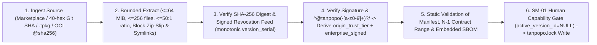

# Plugin Sandbox, Provenance & Supply-Chain Security — Tanpopo

> **Extension Platform Security Specification (Phase ASTRA A07 — Updated in `TP-IMP-0003` Spec Closure Batch C)**
> - **Document ID:** `SPEC-SEC-02` | **Version:** `0.2.0-step03-closure` | **Last Updated:** `2026-11-14`
> - **Authoring Role:** Principal Security Engineer & Sandbox Runtime Architect
> - **Governance Status:** **Accepted Security Specification (`ACCEPTED` — `CR-02, CR-03, CR-04, CR-05, CR-10` & `COND-PO-01..05`)** — defines defense-in-depth supply-chain and sandbox controls synchronized with [`data-model.md`](../architecture/data-model.md) (`ARCH-DATA-01`), [`ADR-0002`](../architecture/adr/0002-three-tier-extension-sandbox-and-blind-broker.md), [`extension-contract.md`](../specifications/extension-contract.md) (`SPEC-EXT-01`), and [`marketplace-lifecycle.md`](../specifications/marketplace-lifecycle.md) (`SPEC-EXT-04`). **All execution-deadline, memory-overhead, and `< 5s` quarantine figures carry the `TARGET / UNVERIFIED` label until empirically validated in `TP-IMP-0004` (`SPIKE-01`, `SPIKE-02`), `TP-IMP-0013`, and `TP-IMP-0043` (`COND-PO-01`).**
> - **Requirements Traceability:** `GAP-04`, `GAP-09`, `GAP-12`, `GAP-13`; `DEC-002`, `DEC-004`, `TP-FR-0301`..`0308`, `TP-FR-0705`, `TP-FR-1004`, `TP-NFR-0202`, `TP-NFR-0401`, `TP-NFR-0403`, `RSK-001`, `RSK-005`, `RSK-012`, `RSK-014`.

---

## 1. Dual Supply-Chain Security: Tanpopo Core & the Extension Ecosystem

An AI Gateway is only trustworthy when **both supply chains** — (A) the build pipeline producing the `tanpopo` binary and Web Console, and (B) the distribution pipeline delivering user-installed `.tpkg` extension packages — are hardened against tampering and dependency poisoning:

### 1.1. Internal Supply Chain for Tanpopo (`Core & Web Console Build Hardening`)

Strictly enforces the *Dependency Security & Install-Script Gate* in [`security-checklist.md`](../../.agents/references/security-checklist.md):
1. **Single Authoritative Lockfile per Install Boundary:**
   - Go Core locks dependencies via `go.mod` + `go.sum` (`go build -mod=readonly -trimpath`, `CGO_ENABLED=0`); the Web Console (`web/console/`) locks dependencies via a single `package-lock.json` enforced through `npm ci`. CI fails immediately if competing lockfiles (`yarn.lock` / `pnpm-lock.yaml`) exist or if any lockfile mutates during build.
2. **Default-Deny Dependency Lifecycle Scripts:**
   - Every Node.js dependency installation step for `web/console/` runs with **`npm ci --ignore-scripts`** (or a version-pinned per-package allowlist). Blanket execution of uninspected `postinstall` scripts is prohibited.
3. **Vulnerability Scanning, Cryptographic Signing & Release `SBOM`:**
   - Automated scans via `govulncheck ./...`, `npm audit`, and `osv-scanner scan source -r .` run on every PR; automated `npm audit fix --force` is forbidden.
   - Every official release of the unified **`tanpopo`** binary and `nonroot` OCI image ships with a **`CycloneDX SBOM` (`sbom.cdx.json`)**, **`SLSA Build Provenance`** attestation, and **`Sigstore Cosign`** signatures for self-hosted verification prior to execution (`TP-IMP-0033`).

### 1.2. External `.tpkg` Extension Supply Chain (`Provenance, Trust Tiers & Revocation`)

| Supply-Chain Control | Concrete Technical Enforcement Rule (`CR-03`, `CR-04`, `CR-10`) | Violation Handling |
|---|---|---|
| **No Mutable References (`CT-25`)** | Installing from Git or OCI resolves and pins an immutable **40-character `commit SHA`** or **`OCI @sha256:...` digest** paired with full `.tpkg` archive `SHA-256` inside `tanpopo.lock` (`extension_versions.bundle_sha256`). | Reject mutable refs (`main`, `:latest`) when unpinned (`422 unpinned_git_reference` / `422 unpinned_oci_digest`); abort on hash mismatch (`exit 22` / `400 hash_mismatch`). |
| **Orthogonal 3-Tier Provenance + Enterprise Signature (`CR-03`)** | `extension_packages.origin_trust_tier` enforces strictly **3** values: `'official'` (signed by Tanpopo root key), `'verified'` (signed by vetted publisher certificate), or `'unverified_external'` (all other packages). Independently, `extension_versions.enterprise_signed` (`BOOLEAN`) + `signing_key_fingerprint` record verification against an `OPERATOR`-configured internal key (`/etc/tanpopo/trusted-keys/`), enabling `organizations.min_plugin_trust` policies of `OFFICIAL_ONLY`, `VERIFIED_OR_ENTERPRISE_SIGNED`, `VERIFIED_ONLY`, or `ANY_APPROVED` alongside per-org `org_extension_policies`. Under `offline_mode: true` (`Air-Gap` `.tpbundle`), both root-signed `official` packages and `enterprise_signed` packages verify cleanly offline. | Block any manifest attempting to spoof `origin_trust_tier` or claim a namespace matching **`^@tanpopo(-[a-z0-9]+)?/`** (`@tanpopo/*`, `@tanpopo-official/*`, etc.) without a valid Tanpopo project root signature (`403 reserved_namespace_spoofing` — `CT-05`). |
| **Embedded `SBOM` Inside `.tpkg` (`Tier-2` / `Tier-3`)** | `tanpopo plugin pack` embeds `bom.cdx.json` (`extension_versions.sbom_digest`) enumerating dependencies compiled into the `.wasm` module or Sidecar image. | Packages lacking an embedded `SBOM` are ineligible for the `'verified'` Marketplace tier. |
| **Anti-Rollback Signed Revocation Feed (`extension_revocations`)** | Instances poll or offline-import (`tanpopo bundle import`) signed `revocations.json` feeds enforcing a strictly increasing `version_serial` and unexpired `feed_expires_at_ms` (`TP-IMP-0035`). Matching `CRITICAL` / `CRITICAL_MALICIOUS` digests emit a `PAGE` alert and auto-transition `SM-01` to **`QUARANTINED`** (`< 5s TARGET / UNVERIFIED`). | Reject downgraded `version_serial` or forged feeds; on valid match, sever dependent connections, abort active SSE streams, and emit a `Blast-Radius` report (`INC-03`). |

---

## 2. Hard Isolation Boundaries Across Three Execution Tiers (`ADR-0002`, `CR-02`, `CR-05`)

Every extension starts with **`0` ambient capabilities** and receives only the exact permissions explicitly approved in `extension_installations.approved_permissions_json`:

| Isolation Dimension | `DECLARATIVE_T1` *(v0.1 Default)* | `WASM_SANDBOX_T2` (`wazero` Pure-Go — *v0.1*) | `ISOLATED_SIDECAR_T3` *(Enterprise Optional — v0.3 `TP-FR-0308`)* |
|---|---|---|---|
| **Executable Code** | **None (`0` guest code)** — static YAML/JSON mapping evaluated by Core's non-Turing-complete interpreter (`<= 32` depth, `<= 256` steps). | Executes `.wasm` bytecode inside isolated linear memory with `0` CGO JIT surface. Large media (`> 64 KiB`, up to `32 MiB`) stays in Host `blob_ref://` buffers outside Wasm memory (`CR-05`). | Dedicated unprivileged container/process (`disabled` by default) over `ConnectRPC` via `0600` UDS or mutual `mTLS` (`AUTH-08`). |
| **Filesystem** | No access. | **`0` preopened WASI directories.** Host filesystem access is structurally impossible. | `readOnlyRootFilesystem: true` with ephemeral `/tmp` capped at `64 MiB`. |
| **Env Vars & Processes** | No access. | **`0` Host environment variables**, coarsened clock (no nanosecond side-channel), `0` `fork`/`exec`. | Non-secret Sidecar config only; `NoNewPrivileges=true` and `cap_drop: ALL`. |
| **Network Egress** | Host `BlindBroker` + `SSRFGuard` to approved `allowed_hosts` only. | **Zero raw TCP/UDP sockets.** Returns `UpstreamHttpSpec` (and 2-phase `BuildValidationProbe` / `VerifyValidationResult`) executed by Host via `BlindBroker` + connect-time `SSRFGuard`. | Locked via `Kubernetes NetworkPolicy` / OS firewall to communicate solely with `tanpopo` (or controlled egress proxy). |
| **CPU / Deadline Cap (`TARGET / UNVERIFIED`)** | Loop-free deterministic evaluation (`< 0.5 ms/op TARGET / UNVERIFIED`). | Interruptible context/epoch deadlines (`<= 15 ms` request/response transform, `<= 2 ms` hard ceiling per SSE chunk to protect `< 1 ms p95` `SLO-03` — `TARGET / UNVERIFIED`). | `cgroup` CPU quota + Host `ConnectRPC` deadline; expiry cancels the RPC stream (`502 extension_execution_fault`). |
| **Memory Cap (`TARGET / UNVERIFIED`)** | Pack manifest/mapping size `<= 1 MiB`. | Hard Wasm linear-memory ceiling: **`16 MiB` default** (`64 MiB` absolute maximum when explicitly approved). OOM traps only that guest instance; `tanpopo` remains `100%` stable. | `cgroup memory.max` (e.g., `256 MiB`); Sidecar `OOMKilled` events never crash `tanpopo`. |
| **Secrets Access (`CR-05`)** | Symbolic `secret_slot` references only; outbound `Cookie`/`Set-Cookie` injection hard-banned. | **Unconditionally blind (`0 bytes` of raw secrets in Wasm memory — `scoped_secret_unseal` is completely eliminated from Tier-1 and Tier-2).** Custom cryptographic request signing uses `HostCryptoSignSpec` (`HMAC_SHA256`, `AWS_SIGV4`, `RSA_SHA256`) inside `BlindBroker`; `Cookie`/`Set-Cookie` injection is hard-banned (`DEC-004`). | Defaults to Host `BlindBroker` injection; if an `OPERATOR`-managed Sidecar requires a dedicated client certificate or HSM library, it receives strictly that single connection's credential and never accesses the shared vault. |

---

## 3. Lifecycle Staging, Anti-Escalation Updates & Safe Uninstallation (`SM-01`)

1. **Staging Without Premature Activation & Anti-Escalation Re-Consent (`TP-BR-0403`, `CR-06`, `CT-18`):**
   - Initial staging creates an `extension_installations` row in `PENDING_PERMISSION_APPROVAL` with **`active_version_id = NULL`** and `candidate_version_id = <exv_id>` (preventing premature activation or `NOT NULL` constraint failures before human review).
   - Before activating an upgrade from $v_{\text{old}}$ to $v_{\text{new}}$, Core computes the capability delta set:

$$
\Delta P = P(v_{\text{new}}) \setminus P(v_{\text{old}})
$$

   - Whenever $\Delta P \neq \emptyset$ (adding any new hostname to `allowed_hosts`, adding a `secret_slot`, escalating execution tier from `DECLARATIVE_T1` to `WASM_SANDBOX_T2` / `ISOLATED_SIDECAR_T3`, or raising `maxMemoryPages`), the installation parks in **`UPDATING_PENDING_RECONSENT`** with `candidate_version_id = v_new` while `active_version_id = v_old` continues serving live traffic uninterrupted until an authorized `SECURITY_REVIEWER` / `ORG_OWNER` / `OPERATOR` (plus a second principal under `Four-Eyes`) approves $\Delta P$ with an `audit_events` record.
2. **Safe File Uninstallation & Garbage Collection (`CT-04`):**
   - Pruning unreferenced extension blobs resolves canonical paths via `filepath.EvalSymlinks`, verifies containment at depth `>= 1` beneath `<data_dir>/plugins/blobs/`, and checks `SHA-256` ownership markers prior to deletion — never concatenating raw manifest names into filesystem removal calls, and never executing `postinstall` or `preuninstall` scripts.
3. **Consecutive Fault Circuit Breaking (`FMEA-05`):**
   - If an extension exceeds the configured fault threshold (e.g., `> 20` Wasm traps, timeouts, or panics within `60s`), `fault_guard` automatically transitions `extension_installations.state` to `QUARANTINED`, evicts warm Wasm instances from the pool, increments `config_changelog`, and emits `ALT-PLUGIN-TRAP` without impacting any other provider on the same `tanpopo` host.
