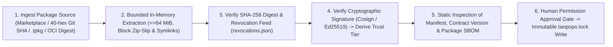

# Plugin Sandbox, Provenance & Supply-Chain Security — Tanpopo

> **Extension Platform Security Specification (Phase ASTRA A07 — Gate G3: `READY_FOR_REVIEW` | `PROPOSED — NO CODE`)**
> - **Document ID:** `SPEC-SEC-02` | **Version:** `0.1.0-step07-draft` | **Last Updated:** `2026-11-12`
> - **Authoring Role:** Principal Security Engineer & Sandbox Runtime Architect
> - **Governance Status:** **Proposed Security Specification (`PROPOSED`)** — defines defense-in-depth security controls for [`extension-contract.md`](../specifications/extension-contract.md) (`SPEC-EXT-01`), [`marketplace-lifecycle.md`](../specifications/marketplace-lifecycle.md) (`SPEC-EXT-04`), [`ADR-0002`](../architecture/adr/0002-three-tier-extension-sandbox-and-blind-broker.md), and [`security-checklist.md`](../../.agents/references/security-checklist.md).
> - **Requirements Traceability:** `DEC-002`, `DEC-004`, `TP-FR-0301`..`0307`, `TP-FR-0705`, `TP-FR-1004`, `TP-NFR-0202`, `TP-NFR-0401`, `TP-NFR-0403`, `RSK-001`, `RSK-005`, `RSK-012`, `RSK-014`.

---

## 1. Dual Supply-Chain Security: Tanpopo Core & the Extension Ecosystem

An AI Gateway is only trustworthy when **both supply chains** — (A) the build pipeline producing Tanpopo's own Core binary and Web Console, and (B) the distribution pipeline delivering user-installed `Extension` packages — are hardened against tampering and poisoning:

### 1.1. Internal Supply Chain for Tanpopo (`Core & Web Console Build Hardening`)
Strictly enforces the *Dependency Security & Install-Script Gate* in [`security-checklist.md`](../../.agents/references/security-checklist.md):
1. **Single Authoritative Lockfile per Install Boundary:**
   - The Go Core locks dependencies via `go.mod` + `go.sum` (`go build -mod=readonly -trimpath`, `CGO_ENABLED=0`); the Web Console locks dependencies via a single `package-lock.json` enforced through `npm ci`. The CI gate fails immediately if competing lockfiles (`yarn.lock` / `pnpm-lock.yaml`) are detected or if any lockfile mutates during build.
2. **Default-Deny Dependency Lifecycle Scripts (`Default-Deny Lifecycle Scripts`):**
   - Every Node.js dependency installation step for the Admin Console must run with **`npm ci --ignore-scripts`** (or an explicit per-package, version-pinned `strict-allow-scripts=true` allowlist). Blanket approval of uninspected `postinstall` scripts is strictly prohibited.
3. **Reachability-Aware Vulnerability Scanning, Cryptographic Signing & Release `SBOM`:**
   - Automated scans via `govulncheck ./...`, `npm audit`, and `osv-scanner scan source -r .` run on every PR; automated `npm audit fix --force` execution is strictly forbidden.
   - Every official release of `tanpopod` / `tanpopo` CLI ships with a **`CycloneDX SBOM` (`sbom.cdx.json`)**, **`SLSA Build Provenance`** attestation, and keyless **`Sigstore Cosign`** signatures for self-hosted operators to verify prior to execution.

### 1.2. External Extension Package Supply Chain (`Extension Provenance & Verification`)

| Supply-Chain Control | Concrete Technical Enforcement Rule | Violation Handling |
|---|---|---|
| **No Mutable References (`No Mutable Refs`)** | When installing from Git or an OCI registry in production, the installer resolves and pins to a **40-character `commit SHA`** or **`OCI sha256 digest`** paired with the full archive `SHA-256` digest in `tanpopo.lock`. | Reject installation immediately if `expected_sha256` fails bit-for-bit verification (`exit 22` / `400 hash_mismatch`). |
| **Provenance Verification Decoupled from Self-Declaration** | The `official` tier is granted only when the signature matches the Tanpopo project root key; `verified` when matching a non-revoked publisher certificate registered in the public transparency ledger; `private-enterprise` when matching an internal public key configured by `OPERATOR` under `/etc/tanpopo/trusted-keys/`. Every other package is unconditionally labeled `unverified-external`. | Reject any attempt to spoof the `trustTier` field or squat on the `@tanpopo-official/*` prefix (`CT-05`). |
| **Embedded `SBOM` Inside `.tpkg` Archives (`Tier-2` / `Tier-3`)** | `tanpopo plugin pack` automatically embeds `bom.cdx.json` enumerating libraries compiled into the `.wasm` module or Sidecar image so enterprises can run fast CVE scans across installed extensions without requiring original source code. | Packages lacking an embedded `SBOM` are ineligible for the `verified` badge on the official Marketplace. |
| **Revocation Feed & Emergency Quarantine (`CVE / Malicious Quarantine`)** | Instances periodically poll (or import offline via `tanpopo bundle import`) a cryptographically signed `revocations.json` feed. If an installed extension version matches a `CRITICAL` malware or CVE advisory, the system emits a `PAGE` alert and allows (or automatically triggers per instance policy) transition to **`QUARANTINED`** within `< 5s`. | Sever all connections using that package, abort open streams, and emit a blast-radius forensic report (`INC-03`). |

---

## 2. Hard Isolation Boundaries Across Three Execution Tiers (`Sandbox Resource & Network Boundaries`)

Tanpopo enforces **Capability-Based Least Privilege**: every extension starts with **`0` capabilities** and receives only the exact `Host Functions` corresponding to permissions explicitly approved by an administrator in the `Permission Inspection Sheet`:

| Isolation Dimension | `Tier 1: Declarative Pack` *(Recommended Default)* | `Tier 2: Wasm Capability Sandbox` (`wazero` Pure-Go) | `Tier 3: Isolated Sidecar` *(Enterprise / Heavy Only)* |
|---|---|---|---|
| **Arbitrary Code Execution** | **None (`0` executable code)** — pure JSON/YAML configuration interpreted by the Core safe evaluator. | Executes WebAssembly bytecode inside a linear memory address space completely isolated from the Host Go stack and heap. | Runs inside a dedicated unprivileged container/process communicating over `ConnectRPC` via UDS or mutual `mTLS`. |
| **Filesystem** | No access. | **`0` preopened Host filesystem directories** (`No WASI preopened dirs`). Host disk operations are structurally impossible from inside Wasm. | Read-only root filesystem (`readOnlyRootFilesystem: true`) with only an ephemeral tmpfs `/tmp` capped at `64 MiB`. |
| **Environment Variables & Processes** | No access. | **`0` Host environment variables**, no nanosecond-resolution clock for timing side-channel attacks, and no `fork`/`exec` capability. | Receives only non-secret Sidecar-specific config; enforces `NoNewPrivileges` and drops all Linux capabilities (`cap_drop: ALL`). |
| **Network Egress** | Only through `Host HTTP Proxy` to approved `allowed_hosts`. | **No direct TCP/UDP socket access.** Returns an `UpstreamHttpSpec` structure for the Host to validate against `allowed_hosts` + `SSRFGuard` before executing outbound calls on its behalf. | Locked down via `Kubernetes NetworkPolicy` / OS firewall: permitted to communicate only with `tanpopod` (or a controlled egress proxy). |
| **CPU Cap / Infinite-Loop Protection** | Non-Turing-complete mapping expressions (`0` loops). | Per-hook execution deadline (`<= 50 ms` for request transforms, `<= 5 ms` per SSE chunk — *`TARGET / UNVERIFIED`*) enforced via `wazero` interruptible context cancellation. | Enforced via `cgroup CPU quota` + hard Host-side `ConnectRPC deadline`; deadline expiry terminates the RPC stream. |
| **Memory Cap** | Declarative pack size `<= 1 MiB`. | Hard Wasm linear memory page ceiling (`maxMemoryPages`: **`16 MiB`** default, **`64 MiB`** absolute maximum when explicitly approved). OOM aborts only that Wasm instance while the Core process remains `100%` stable. | Enforced via `cgroup memory.max` (e.g., `256 MiB`); Sidecar `OOMKilled` events never impact `tanpopod`. |
| **Secrets Access** | Declares symbolic `secret_slot` names only for `Blind Broker` injection. | **Blind by default (`0 bytes` of raw secret material in Wasm memory).** The scoped unsealing exception (`scoped_secret_unseal`) is disabled by default and requires privileged administrator approval for non-standard custom request signing. | Defaults to Host-side edge injection; if a Sidecar strictly requires a dedicated client certificate, it receives only that `Connection`'s credential and never sees the shared vault. |

---

## 3. Installation Lifecycle Controls, Anti-Escalation Updates & Safe Uninstallation

1. **Anti-Escalation Re-Consent Gate on Updates (`TP-BR-0403`):**
   - Before activating an update from version $v_{old}$ to $v_{new}$, Core computes the capability delta set:

$$
\Delta P = P(v_{new}) \setminus P(v_{old})
$$

   - If $\Delta P \neq \emptyset$ (for example, adding even a single new domain to `network.allowed_hosts`, requesting a new secret slot, escalating execution tier from `Tier 1` to `Tier 2`, or raising the memory cap), the update is **hard-locked in `UPDATING_PENDING_RECONSENT`**. Production traffic continues flowing uninterrupted through $v_{old}$ until an administrator (plus an independent `Reviewer` when `Four-Eyes` is enabled) explicitly signs off on $\Delta P$ with an immutable audit record.
2. **Safe File Uninstallation & Garbage Collection (`Safe Path Containment`):**
   - When pruning an unreferenced historical extension version from disk, the package manager enforces the *Destructive Operations on Derived Paths* rule in [`security-checklist.md`](../../.agents/references/security-checklist.md): resolve canonical real paths (`filepath.EvalSymlinks`), verify a depth of at least `1` directory level beneath the allowed root `/var/lib/tanpopo/plugins/blobs/`, and verify content-hash ownership markers before deletion — never concatenating raw `Manifest` package names directly into file removal calls.
3. **Consecutive Fault Isolation (`Per-Extension Fault Breaker`):**
   - If an extension triggers panics or runtime faults (`trap` / `panic` / `OOM`) exceeding the configured threshold (e.g., `> 20` faults within `60s`), the fault guard trips a dedicated circuit breaker for that extension, evicts tainted Wasm instances from the warm instance pool, and emits `ALT-PLUGIN-TRAP` without degrading any other provider running on the same host.
