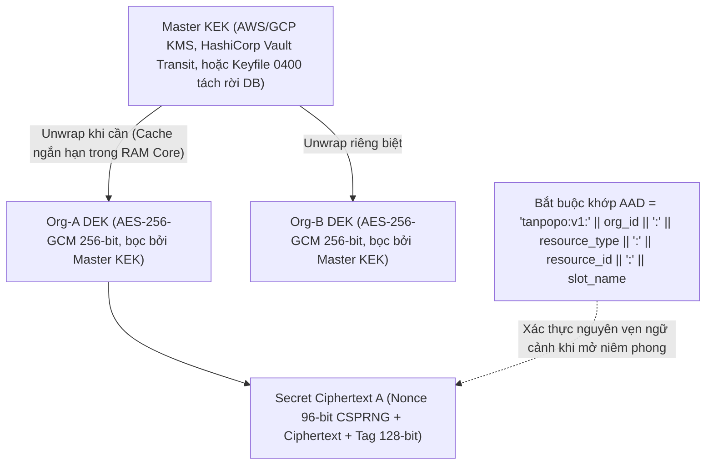

# Quản lý Bí mật Một chiều, Mã hóa Phong bì & Cô lập Đa Tổ chức (Secrets Management, AuthZ & Tenant Isolation) — Tanpopo

> **Tài liệu Kỹ thuật Bảo mật Dữ liệu & Đa Thuê bao (Phase ASTRA A07 — Gate G3: `READY_FOR_REVIEW` | `PROPOSED — NO CODE`)**
> - **Mã tài liệu:** `SPEC-SEC-03` | **Phiên bản:** `0.1.0-step07-draft` | **Ngày cập nhật:** `2026-11-12`
> - **Vai trò biên soạn:** Principal Security Engineer & Cryptography / IAM Lead
> - **Trạng thái quản trị:** **Đặc tả Bảo mật Đề xuất (`PROPOSED`)** — quy định cơ chế mã hóa phong bì có gắn ngữ cảnh (`AEAD AAD`), vòng đời bí mật một chiều, cô lập đa tầng theo `Organization / Project / Environment`, kiểm tra quyền trên mọi hành động quản trị và ranh giới giữa **khả năng kỹ thuật giao thức** với **quyền hợp pháp theo chính sách nhà cung cấp (`DEC-004`)**.
> - **Truy vết Yêu cầu:** `DEC-003`, `DEC-004`, `TP-BR-0101`..`0104`, `TP-BR-0301`..`0304`, `TP-BR-0802`..`0803`, `TP-FR-0204`..`0206`, `TP-FR-0501`..`0504`, `TP-FR-0701`..`0705`, `TP-NFR-0402`, `TP-NFR-0404`, `TP-NFR-0501`..`0502`, `RSK-001`, `RSK-003`, `RSK-006`, `RSK-011`, `RSK-016`.

---

## 1. Kiến trúc Mã hóa Phong bì Gắn Ngữ cảnh (`Envelope Encryption with AEAD Context Binding`)

Mọi thông tin nhạy cảm bậc cao (`Upstream API Keys`, `Authorized OAuth Refresh/Access Tokens`, khóa ký webhook, hoặc mẫu gỡ lỗi ngắn hạn) đều được bảo vệ qua phân cấp khóa 2 tầng để vừa cho phép xoay khóa gốc tức thì, vừa chống tấn công cấy ghép bản mã chéo tổ chức (`Ciphertext Transplant Attack`):

### 1.1. Năm Quy tắc Mật mã & Vòng đời Bí mật Một Chiều (`Write-Only Secret Discipline`)
1. **Gắn Cứng Dữ liệu Xác thực Bổ sung (`AEAD AAD Binding`):**
   - Khi mã hóa hoặc giải mã bất kỳ bản ghi bí mật nào bằng `AES-256-GCM`, tầng `vault` bắt buộc truyền chuỗi định danh bất biến `AAD = "tanpopo:v1:" || org_id || ":" || resource_type || ":" || resource_id || ":" || slot_name`.
   - **Hệ quả bảo mật:** Kể cả khi kẻ tấn công chiếm quyền sửa bảng SQL và chép giá trị cột `secret_ciphertext` từ `Connection` của `Org A` sang `Connection` của `Org B` (hoặc đổi `allowed_hosts` bằng cách tráo dòng), phép giải mã `GCM Open` lập tức thất bại với lỗi xác thực thẻ mật mã (`cipher: message authentication failed`) — khóa của `Org A` không bao giờ có thể bị mở nhầm cho đối tượng khác.
2. **Bí mật Chỉ Đi Một Chiều (`Write-Only Plaintext`):**
   - Khóa gốc chỉ được gửi lên duy nhất 1 lần lúc tạo hoặc xoay khóa qua kết nối TLS. Mọi phản hồi `GET / LIST / PATCH /admin/v1/*`, tệp xuất cấu hình GitOps, gói `tanpopo support-bundle` và bản sao lưu chỉ trả về trạng thái `configured: true`, dấu thời gian xoay khóa và `secret_version` — **tuyệt đối không bao giờ có API đọc ngược lại khóa rõ**.
3. **Tiêm Mù Tại Biên Mạng & Xóa Vùng Nhớ Ngắn Hạn (`Blind Injection & Buffer Hygiene`):**
   - `Blind Host Credential Broker` chỉ giải mã bí mật ngay tại bước dựng tiêu đề HTTP đi ra của tiến trình Core sau khi đã xác minh tên miền đích nằm trong `Connection.allowed_hosts` và vượt qua `SSRFGuard`. Mảng byte chứa bí mật giải mã được xóa về `0` (`clear(plaintextBuf)`) ngay sau khi ghi vào luồng TLS đi ra và không bao giờ đi vào cấu trúc ngữ cảnh truyền sang Wasm hay trình ghi nhật ký.
4. **Băm Một Chiều Cho Khóa Ảo Đường Dữ liệu (`Virtual Key Hashing`):**
   - Khóa ảo cấp cho ứng dụng khách (`vk_tp_<env>_<random_256bit>`) không dùng mã hóa hai chiều mà chỉ lưu mã băm `SHA-256` kèm `key_prefix` nhận diện. Lúc xác thực truy vấn suy luận, hệ thống băm khóa gửi lên và so sánh bằng `crypto/subtle.ConstantTimeCompare` trên bảng chỉ mục bộ nhớ của `ConfigSnapshot` (chống hoàn toàn tấn công đo thời gian `Timing Side-Channel`).
5. **Xoay `Master KEK` Trực tuyến Không Gián đoạn (`Online KEK Re-Wrapping`):**
   - Lệnh `tanpopo vault rotate-kek` chỉ cần giải bọc và bọc lại các khóa trung gian `Org DEK` (số lượng nhỏ) sang `KEK` thế hệ mới trong giao dịch nguyên tử mà không phải giải mã hàng vạn bản ghi thông tin xác thực hay làm rớt các luồng SSE đang mở (`DR-04`).

---

## 2. Cô lập Đa Tổ chức Chiều Sâu 4 Lớp (`Four-Layer Tenant, Project & Environment Isolation`)

Để triệt tiêu lỗi rò rỉ dữ liệu chéo tổ chức (`Cross-Tenant IDOR` / `Cache Bleed`), Tanpopo không dựa vào một câu lệnh `WHERE` đơn lẻ ở tầng ứng dụng mà khóa đồng thời ở **4 lớp độc lập**:

| Lớp Cô lập | Cơ chế Thực thi Bắt buộc | Hành vi Khi Có Truy cập Trái phép / Lỗi Lập trình |
|---|---|---|
| **Lớp 1: Ngữ cảnh Định danh Bất biến (`Auth Context Binding`)** | `org_id`, `project_id` và `environment_id` ở Data Plane được suy xuất **duy nhất từ bản ghi `Virtual Key` đã xác thực**; ở Control Plane suy xuất từ phiên người dùng đã kiểm tra bảng thành viên RBAC (`org_memberships` / `project_grants`). Hệ thống phớt lờ hoặc từ chối mọi trường `org_id` giả mạo truyền kèm trong thân JSON. | Chặn ngay tại middleware xác thực trước khi chạm tới logic nghiệp vụ (`AUTH-13`). |
| **Lớp 2: Ràng buộc Quan hệ Kép & `PostgreSQL FORCE RLS`** | Mọi bảng thuộc phạm vi thuê bao đều dùng khóa chính/khóa ngoại tổ hợp `(org_id, id)` trên cả SQLite và PostgreSQL (`TP-BR-0102`, cấm nối chéo `Route` của `Org A` sang `Connection` của `Org B`). Trên PostgreSQL `16+`, mọi giao dịch mở đầu bằng `SET LOCAL app.current_org_id = '<uuid>'` cùng chính sách `ENABLE` + **`FORCE ROW LEVEL SECURITY`**. | Ngay cả khi một truy vấn SQL mới viết thiếu mệnh đề lọc `org_id`, cơ sở dữ liệu vẫn tự động trả về `0` dòng của tổ chức khác (`AUTH-14`). |
| **Lớp 3: Phân vùng Khóa Bộ nhớ Đệm & Cấm Chia sẻ Cache Chéo Thuê bao** | Mọi khóa trên `Valkey/Redis` và bộ nhớ cục bộ bắt buộc tuân thủ khuôn dạng phân cấp cứng: `tp:v1:{org_id}:{project_id}:{env_id}:{subsystem}:{hash}`. Khi tính năng bộ nhớ đệm phản hồi (`Exact / Semantic Cache`) được bật ở cấu hình tùy chọn, phạm vi tra cứu bị khóa chặt trong **cùng `org_id + project_id + env_id + model_deployment_id + policy_version_hash + tool_acl_hash`** — **nghiêm cấm tuyệt đối** việc dùng chung cache câu trả lời giữa hai tổ chức hoặc hai môi trường khác nhau. | Không bao giờ xảy ra hiện tượng người dùng ở `Project B` nhận được câu trả lời đã lưu đệm từ truy vấn nội bộ của `Project A` (`CT-28`, `FMEA-03`). |
| **Lớp 4: Phản hồi Đồng nhất Chống Dò Tồn tại (`Anti-Oracle 404`)** | Khi chủ thể thuộc `Org A` gọi `/admin/v1/connections/{id_cua_Org_B}` hoặc tra cứu `request_id` của `Org B`, API trả về mã **`404 resource_not_found`** có cấu trúc và độ trễ giống hệt trường hợp `UUID` không tồn tại (thay vì trả `403` làm lộ việc đối tượng đó có thật), đồng thời ghi ngầm sự kiện `cross_tenant_probe_blocked` vào nhật ký kiểm toán an ninh. | Kẻ tấn công không thể quét dò danh sách tài nguyên của tổ chức khác trên cùng cụm máy chủ (`AUTH-15`). |

---

## 3. Ủy quyền Mọi Thao tác Quản trị (`Every-Action AuthZ`), Tín nhiệm Liên Dịch vụ & Khán giả Token

### 3.1. Ma trận Tách Biệt Mặt phẳng Xác thực & Chống Tự Phê duyệt (`Plane Separation & Four-Eyes`)
1. **Cấm Dùng Lẫn Khóa Giữa Data Plane và Control Plane:**
   - Mang `Virtual Key` (`vk_tp_...`) gọi bất kỳ đường dẫn `/admin/v1/*` nào → Từ chối cứng **`401 invalid_credential_plane`**.
   - Mang phiên cookie quản trị Web Console gọi trực tiếp `/v1/chat/completions` (trừ endpoint thử nghiệm nội bộ `/admin/v1/playground/completions` có kiểm tra quyền `Playground:Execute` + `CSRF` + gắn hạn mức thử nghiệm riêng) → Từ chối **`401`**.
2. **Ủy quyền Từng Hành động & Kiểm soát Cạnh tranh (`Action-Level RBAC + Optimistic Locking`):**
   - Mọi handler trong `/admin/v1/*` bắt buộc khai báo cặp `(Resource, Permission)` tường minh trong bảng định tuyến trung tâm (khởi tạo máy chủ sẽ `panic` ngay lúc kiểm thử nếu có một route `/admin/v1/*` nào chưa gắn bộ kiểm tra quyền).
   - Các phiên trình duyệt dùng cookie bắt buộc cờ `HttpOnly; Secure; SameSite=Strict` kết hợp kiểm tra tiêu đề `Origin` và mã chống giả mạo yêu cầu chéo trang (`CSRF Token`) trên mọi phương thức `POST / PUT / PATCH / DELETE`.
   - Mọi thao tác cập nhật cấu hình bắt buộc gửi kèm `If-Match: "<etag>"` để chống ghi đè mù giữa hai quản trị viên (`409 conflict_version_mismatch`).
3. **Nguyên tắc Bốn Mắt (`Four-Eyes Separation of Duties` — `TP-BR-0404`):**
   - Khi chính sách tổ chức bật `require_four_eyes_approval = true`, hệ thống kiểm tra bất biến `approver.principal_id != requester.principal_id` ở tầng giao dịch DB đối với 4 nhóm thao tác nhạy cảm: (a) kích hoạt gói `unverified-external` hoặc nâng quyền $\Delta P$, (b) bật chế độ ngoại lệ `scoped_secret_unseal`, (c) phê duyệt lệnh gọi công cụ MCP cấp `destructive`, và (d) bật ghi mẫu gỡ lỗi văn bản tạm thời (`TTL <= 72h`).

### 3.2. Tín nhiệm Liên Dịch vụ (`Service-to-Service`) & Cấm Chuyển tiếp Token Trái phép (`RFC 8707`)
- **`Control Plane <-> Data Plane` (Chế độ tách vai trò):** Các nút Data Plane chỉ chấp nhận thông báo làm mới `config_epoch` đã ký HMAC/mTLS nội bộ và đọc cấu hình từ cơ sở dữ liệu bằng tài khoản DB chỉ có quyền đọc (`SELECT` trên các bảng cấu hình, `INSERT` trên bảng sổ cái/kiểm toán — không có quyền `DROP`/`ALTER` hay sửa chính sách).
- **`Tanpopo Core <-> Tier-3 Sidecar`:** Trên cùng máy chủ dùng Unix Domain Socket đặt quyền `0600` thuộc người dùng dịch vụ riêng; qua mạng cụm bắt buộc **`mTLS` hai chiều** với chứng chỉ ngắn hạn (`TTL <= 24h`) gắn định danh `SPIFFE URI SAN` của đúng phiên bản phần mở rộng đó.
- **Khóa Khán giả Token (`RFC 8707 Audience Binding`) & Cấm Chuyển tiếp Mù (`No Token Relay`):**
  - Token OIDC của quản trị viên đăng nhập vào Tanpopo có `aud = tanpopo-control-plane` — Tanpopo **tuyệt đối không bao giờ** chuyển tiếp (`relay`) nguyên xi token này sang nhà cung cấp AI hay máy chủ MCP bên ngoài.
  - Token `Authorized OAuth 2.1` lưu cho một `Provider Connection` hoặc `MCP Server` được gắn cứng danh sách `allowed_audience_hosts` (và tham số `resource` theo `RFC 8707` khi máy chủ ủy quyền hỗ trợ); mọi nỗ lực cấu hình lại URL đích sang miền khác mà không cấp quyền OAuth lại từ đầu đều làm vô hiệu hóa tức thì token đang lưu (`SM-03 -> INVALIDATED_HOST_CHANGE`, `CT-19`).

### 3.3. Phân định Rạch ròi: Hỗ trợ Kỹ thuật Giao thức vs Quyền Hợp pháp Theo Chính sách Hãng (`DEC-004`)

Một yêu cầu cốt lõi của chiến lược xác minh Tanpopo là **tách biệt minh bạch giữa năng lực kỹ thuật của giao thức xác thực và quyền thương mại/điều khoản dịch vụ của nhà cung cấp**:

| Tình huống Xác thực | Khả năng Kỹ thuật Ở Tầng Giao thức | Tính Hợp lệ Chính sách & Pháp lý (`DEC-004`) | Hành vi Cưỡng chế Của Tanpopo & Kiểm thử |
|---|---|---|---|
| **1. `API Key` / `Cloud IAM` thương mại chính thức (OpenAI Platform, Anthropic Console, Vertex AI, Bedrock)** | Hỗ trợ đầy đủ (`Bearer`, `x-api-key`, `SigV4`, `Workload Identity`). | **Được phép đầy đủ (`COMMERCIAL_API`).** | Hỗ trợ chính thức trong `Official Adapters`, tính toán sổ cái `micro-USD` đầy đủ (`AUTH-04`, `CT-06`). |
| **2. `OAuth 2.1` cho Cổng AI Nội bộ Doanh nghiệp (Okta / Entra ID / Keycloak bọc trước vLLM / Azure / Gateway công ty)** | Chuẩn `Authorization Code + PKCE` hoặc `Client Credentials` với `client_id` do chính doanh nghiệp sở hữu. | **Được phép đầy đủ (`SELF_HOSTED_INFRA` / `COMMERCIAL_API`).** | Hỗ trợ chính thức qua trình điều khiển `Authorized OAuth 2.1` chuẩn (`AUTH-08`, `CT-19`). |
| **3. `OAuth 2.1` chính thức của hãng AI/MCP có công bố chương trình đối tác cấp `client_id` hợp lệ** | Chuẩn `OAuth 2.1 + PKCE` / `Device Code` với `scope` công khai. | **Chỉ được phép khi hãng đó có điều khoản công khai cho phép ứng dụng bên thứ ba gọi API (`POL-01`).** | Chỉ bật trên `Official/Verified Adapter` sau khi đính kèm bằng chứng tài liệu điều khoản của hãng (`AUTH-09`). |
| **4. Chiếm dụng phiên đăng nhập web / `session cookie` / `client_id` nội bộ đóng của gói thuê bao cá nhân (`ChatGPT Plus/Pro`, `Codex`, `Claude Pro/Max`, `Google Antigravity`, `Copilot Individual`...)** | Dù về mặt HTTP thô đều là gửi chuỗi ký tự trong tiêu đề `Cookie` hoặc `Authorization`... | **BỊ CẤM TUYỆT ĐỐI (`REJ-003` / `DEC-004`) — Vi phạm điều khoản dịch vụ nhà cung cấp.** | Core **không cung cấp** trình thu thập cookie trình duyệt; lược đồ DB khóa cứng `billing_mode`; cổng kiểm định Marketplace đánh trượt tự động (`CT-20`, `AUTH-16`); giao diện cấm gắn nhãn chính thức (`UX-GR-03`). |

---

## 4. Phân loại Dữ liệu, Cư trú Địa lý (`Fail-Closed`) & Xóa Mật mã Tức thì (`Crypto-Shredding`)

1. **Bốn Mức Phân loại Dữ liệu & Lưu Giữ Mặc định:**
   - `C1 — Công khai (`Public`)`: Danh mục mô hình logic, siêu dữ liệu gói trên Marketplace công khai.
   - `C2 — Siêu dữ liệu Vận hành (`Operational Metadata`)`: Số lượng token, độ trễ, mã trạng thái HTTP, `request_id` (lưu mặc định, không chứa văn bản hội thoại).
   - `C3 — Cấu hình Thuê bao & Sổ cái Tài chính (`Confidential Tenant Config & FinOps`)`: Bảng định tuyến, chính sách, bút toán `micro-USD`, sự kiện kiểm toán băm chuỗi (lưu `>= 365 ngày`, bảo vệ bởi `RLS`).
   - `C4 — Bí mật Tối mật & Nội dung Hội thoại/PII (`Restricted Secrets & Payload`)`: Khóa xác thực (mã hóa phong bì vĩnh viễn) và văn bản prompt/completion/tham số công cụ (**mặc định lưu `0 byte`**; nếu quản trị viên bật gỡ lỗi có phê duyệt thì mã hóa bằng `Org DEK` và tự hủy cứng sau `TTL <= 72 giờ`).
2. **Cưỡng chế Vùng Cư trú Dữ liệu Đóng An toàn (`Data Residency Fail-Closed` — `TP-BR-0502`):**
   - Nếu chính sách của `Org / Project` đặt `allowed_data_regions = ["EU"]`, bộ định tuyến loại bỏ toàn bộ `Model Deployment` mang nhãn ngoài `"EU"` **trước khi xếp hạng và cả khi chuyển mạch dự phòng**. Khi mọi đích `"EU"` đều sập, hệ thống trả ngay `503 no_compliant_deployment_available` thay vì âm thầm rò rỉ dữ liệu sang máy chủ `"US"` (`CT-08`, `EXT-ACCEPT-01`).
3. **Xóa Vĩnh viễn Dưới `60 Giây` Bằng Hủy Khóa (`Crypto-Shredding` — `TP-NFR-0502`):**
   - Khi thực thi yêu cầu xóa toàn bộ dữ liệu của một `Organization` (hoặc kho gỡ lỗi của `Project`), hệ thống xóa bản ghi `Org DEK` khỏi kho khóa, quét xóa các khóa đệm `tp:v1:{org_id}:*` trên `Valkey/Redis` và ghi biên bản kiểm toán có chữ ký. Ngay lập tức trong `< 60 giây`, mọi bản mã bí mật và mẫu hội thoại gỡ lỗi của tổ chức đó (kể cả nằm trong các tệp sao lưu lạnh trước đó) trở thành nhiễu ngẫu nhiên không thể khôi phục về mặt toán học (`OPS-AC-09`).