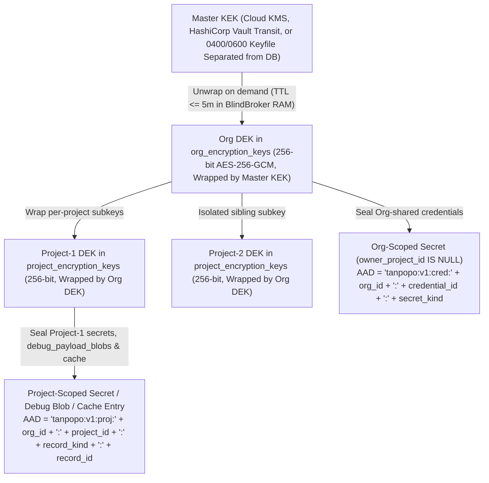

# Write-Only Secrets Management, Envelope Encryption & Multi-Tenant Isolation — Tanpopo

> **Data Security & Multi-Tenancy Specification (Phase ASTRA A07 — Updated in `TP-IMP-0003` Spec Closure Batch C)**
> - **Document ID:** `SPEC-SEC-03` | **Version:** `0.2.0-step03-closure` | **Last Updated:** `2026-11-14`
> - **Authoring Role:** Principal Security Engineer & Cryptography / IAM Lead
> - **Governance Status:** **Accepted Security Specification (`ACCEPTED` — `CR-04, CR-05, CR-06, CR-09, CR-10` & `COND-PO-01..05`)** — defines three-tier context-bound envelope encryption (`Master KEK -> Org DEK -> Project DEK`), the two canonical `AEAD AAD` formulas, write-only secret lifecycle rules, four-layer multi-tenant isolation, per-`Org` + `SYSTEM` `RFC 8785 JCS` audit hash chains, and mechanical enforcement of `DEC-004`. **All revocation (`< 1s` / `< 5s`) and erasure (`< 60s`) timing figures carry the `TARGET / UNVERIFIED` label until empirically validated in `TP-IMP-0008`, `TP-IMP-0032`, `TP-IMP-0040`, and `TP-IMP-0043` (`COND-PO-01`, `COND-PO-02`).**
> - **Requirements Traceability:** `GAP-04`, `GAP-05`, `GAP-06`; `DEC-003`, `DEC-004`, `TP-BR-0101`..`0104`, `TP-BR-0301`..`0304`, `TP-BR-0802`..`0803`, `TP-FR-0204`..`0206`, `TP-FR-0501`..`0504`, `TP-FR-0701`..`0705`, `TP-NFR-0402`, `TP-NFR-0404`, `TP-NFR-0501`..`0502`, `RSK-001`, `RSK-003`, `RSK-006`, `RSK-011`, `RSK-016`.

---

## 1. Three-Tier Context-Bound Envelope Encryption (`Master KEK -> Org DEK -> Project DEK`)

All high-sensitivity records (`Upstream API Keys`, `Authorized OAuth 2.1 Token Sets`, `PKCE` verifiers, webhook HMAC secrets, opt-in `<= 72h` debug payload captures, and opt-in `v0.3` response cache entries) are protected by a **three-tier `AES-256-GCM` envelope key hierarchy** (`CR-06`) that supports online root-key rotation, independent single-`Project` or full-`Organization` cryptographic key destruction, and hard defense against cross-tenant or cross-project ciphertext transplant attacks (`AUTH-14`):



### 1.1. Five Mandatory Cryptographic & Secret-Hygiene Rules

1. **Two Canonical `AEAD AAD` Binding Formulas (`Zero Drift Across All Modules` — `CR-06`):**
   - Every `AES-256-GCM` seal and unseal call generates a fresh `96-bit` CSPRNG nonce (`crypto/rand`) and binds one of **two exact canonical Additional Authenticated Data (`AAD`) byte strings** matching [`data-model.md`](../architecture/data-model.md):
     - **Formula 1 — `Organization`-Scoped Secret (`secret_credentials.owner_project_id IS NULL`, sealed under `Org DEK`):**
       ```text
       "tanpopo:v1:cred:" + org_id + ":" + credential_id + ":" + secret_kind
       ```
     - **Formula 2 — `Project`-Scoped Secret, Debug Blob, or Cache Entry (sealed under `Project DEK`):**
       ```text
       "tanpopo:v1:proj:" + org_id + ":" + project_id + ":" + record_kind + ":" + record_id
       ```
       where `(record_kind, record_id)` is `("cred", credential_id)` for project-owned `secret_credentials`, `("debug_blob", request_id)` for `debug_payload_blobs`, and `("cache_entry", cache_key_sha256)` for `response_cache_entries`.
   - **Ciphertext Transplant Defense (`AUTH-14`):** Even if an attacker with raw SQL write access copies `(nonce, ciphertext)` from `Org A` into `Org B` — or from `Project P1` into `Project P2` within the same organization — `GCM Open` fails immediately (`cipher: message authentication failed`).
2. **Write-Only Plaintext Lifecycle & Capability-Gated Unsealing (`UnsealCapability`):**
   - Raw secret values are accepted strictly once during creation or rotation over TLS. Every `GET / LIST / PATCH /admin/v1/*` response, GitOps export, `tanpopo support-bundle` archive, and `.tpop.enc` backup returns only `{ id, org_id, owner_project_id, name, secret_kind, bound_audience, key_fingerprint, version, updated_at_ms }` — **zero plaintext read-back APIs exist**.
   - In source code (`TP-IMP-0008`), `vault.UnsealWithCapability(cap, ...)` requires an unexported-field token `UnsealCapability` minted exactly once inside `cmd/tanpopo` for `BlindBroker` (verified by AST check in `scripts/ci/check.go`).
3. **Blind Edge Injection, Outbound `Cookie` Ban & Buffer Zeroization:**
   - `BlindHostCredentialBroker` unseals credentials (or executes `HostCryptoSignSpec` `HMAC_SHA256` / `AWS_SIGV4` / `RSA_SHA256`) strictly at outbound HTTP header construction after verifying `allowed_hosts` and connect-time `SSRFGuard`.
   - **Zero `scoped_secret_unseal` in Tier-1/2 (`CR-05`):** Tier-1 Declarative Packs and Tier-2 Wasm Sandboxes receive **`0 bytes`** of raw secret material under all configurations. Outbound injection of `Cookie` or `Set-Cookie` headers is unconditionally blocked (`DEC-004`). Transient plaintext buffers are scrubbed immediately via `defer clear(plaintextBuf)`.
4. **Plain `SHA-256` Hashing for Data-Plane Virtual Keys (`vk_tp_` — `CR-06`, `AUD-026`):**
   - Client-facing virtual keys follow `vk_tp_<env>_<32_base62_chars>` (`256-bit` CSPRNG entropy). Only raw 32-byte **`SHA-256(rawKey)`** digests are stored in `virtual_keys.active_key_hash` and `previous_key_hash` alongside display fields `key_prefix` and `last_four`.
   - Hot-path authentication compares digests using `crypto/subtle.ConstantTimeCompare` against `ConfigSnapshot`; because plain `SHA-256` over 256-bit random tokens requires no `Master KEK` pepper, rotating `Master KEK` never invalidates active client virtual keys.
5. **Online `Master KEK` Re-Wrapping with Pre-Retirement Cache Eviction (`DR-03` — `AUD-010`):**
   - `tanpopo vault rotate-kek --old-kek-id kek_v1 --new-kek-id kek_v2` atomically re-wraps only the `org_encryption_keys` rows (`Org DEKs`) without rewriting `project_encryption_keys` or `secret_credentials`, appends a `KEY_ROTATE` epoch to `config_changelog`, and broadcasts on `Valkey Pub/Sub` + `PG LISTEN/NOTIFY` so all Data Plane pods evict cached `dek:org:<org_id>:kek_v1` entries within `< 5s` (`TARGET / UNVERIFIED`) **before** `kek_v1` is disabled in KMS/Vault.

---

## 2. Four-Layer Multi-Tenant Isolation (`Org / Project / Environment`)

Tanpopo enforces tenant, project, and environment isolation simultaneously across **four independent architectural layers**:

| Isolation Layer | Mandatory Enforcement Mechanism | Behavior on Bug or Attack |
|---|---|---|
| **Layer 1: Immutable Principal & Key Binding (`Auth Context`)** | Data-Plane `(org_id, project_id, env_id)` derives **exclusively** from the authenticated `Virtual Key` hash in `ConfigSnapshot`. Control-Plane scope derives from the authenticated session verified against `principals` + `role_bindings` (`6` canonical roles: `OPERATOR`, `ORG_OWNER`, `TEAM_ADMIN`, `SECURITY_REVIEWER`, `FINOPS_VIEWER`, `DEVELOPER`). Client-supplied `org_id` fields in JSON request bodies are ignored/rejected. | Blocked at authentication middleware (`AUTH-13`). |
| **Layer 2: Composite SQL Keys & `PostgreSQL FORCE RLS`** | Every tenant-owned table enforces composite `(org_id, id)` primary and foreign keys on both SQLite (`PRAGMA foreign_keys = ON;`) and PostgreSQL (`TP-BR-0102`). On PostgreSQL `16+`, every transaction runs `SET LOCAL app.current_org_id = '<org_id>'` under `ENABLE` + **`FORCE ROW LEVEL SECURITY`** (`CREATE POLICY tenant_isolation ... USING (org_id = current_setting('app.current_org_id', true))`). | Even a query omitting `WHERE org_id = $1` returns **`0` cross-tenant rows** (`AUTH-14`). |
| **Layer 3: Hash-Tagged Valkey Keyspace & `Project DEK`-Sealed Cache (`CR-07`, `CR-09`)** | Every Valkey key embeds `{<org_id>}` as its sole cluster hash tag: `tp:v1:{<org_id>}:<subsystem>:...` (preventing `CROSSSLOT` errors while isolating tenant state). When opt-in exact response caching (`v0.3` — `TP-IMP-0041`) is enabled, lookup keys compute `SHA-256(JCS({ org_id, project_id, env_id, policy_revision, model_deployment_id, tools_schema_hash, canonical_request }))` and seal payloads under **`Project DEK`** (`record_kind = "cache_entry"`). | `Project B` can never hit or decrypt `Project A`'s cached responses (`CT-28`, `FMEA-03`). |
| **Layer 4: Uniform Anti-Enumeration (`Anti-Oracle 404`)** | Probing an `Org B` resource ID or `request_id` from an `Org A` session returns **`404 resource_not_found`** with uniform shape and timing (never `403`), while recording `cross_tenant_probe_blocked` in `audit_events`. | Prevents cross-tenant UUID enumeration (`AUTH-15`). |

---

## 3. Administrative AuthZ, Service Trust & `DEC-004` Policy Boundary

### 3.1. Plane Separation, `Playground` Ephemeral Sessions & `Four-Eyes` Governance

1. **Strict Credential-Plane Separation (`AUTH-07` & `CR-10`):**
   - Presenting a Data-Plane `Virtual Key` (`vk_tp_...`) against `/admin/v1/*` -> Hard reject **`401 invalid_credential_plane`**.
   - Presenting an Admin browser session cookie directly against `/v1/*`, `/native/*`, `/mcp`, or `/a2a/*` -> Hard reject **`401 invalid_credential_plane`**.
   - **Standardized `Playground` Flow (`SCR-15` — `CR-10`):** The Web Console calls `POST /admin/v1/playground/sessions` (enforcing RBAC + `X-CSRF-Token`) to mint a short-lived (`TTL = 15 minutes`), micro-budget-capped ephemeral `vk_tp_...` key (`is_ephemeral_playground = true`), then invokes the standard `/v1/*` Data-Plane hot path identical to external SDKs.
2. **Every-Route RBAC, `X-CSRF-Token` & Optimistic Concurrency:**
   - Every `/admin/v1/*` route (except `/bootstrap/status` and `/auth/login`) registers an explicit `(Resource, Action)` permission constant (verified by reflection test in `TP-IMP-0024`).
   - Browser cookie sessions enforce `HttpOnly; Secure; SameSite=Strict`, `Origin` validation, and mandatory **`X-CSRF-Token`** verification on `POST / PUT / PATCH / DELETE` (`403 csrf_validation_failed`).
   - Configuration mutations require `If-Match: "v<version>"`, returning **`409 optimistic_lock_conflict`** on stale writes.
3. **Four-Eyes Dual Control (`OPS-02`, `TP-FR-0504`, `TP-IMP-0041`):**
   - When `organizations.require_four_eyes_approval = true`, SQL `CHECK` constraints on `approval_requests` and `admin_change_requests` enforce `approver_principal_id <> initiator_principal_id` (`403 self_approval_forbidden`) across high-impact operations: (a) activating an `unverified_external` extension or approving capability escalation $\Delta P \neq \emptyset$, (b) approving a `destructive` MCP tool call, (c) rotating/destroying root or tenant encryption keys or lifting an emergency Kill-Switch, and (d) enabling opt-in debug payload capture (`TTL <= 72h`).

### 3.2. Service-to-Service Trust & `RFC 8707` Audience Binding

- **`Control Plane <-> Data Plane`:** Data Plane pods connect using a non-`SUPERUSER`, non-`BYPASSRLS` database role (`tanpopo doctor` refuses startup if `BYPASSRLS` is granted).
- **`tanpopo Core <-> Tier-3 Sidecar` (`v0.3`):** Co-located deployments bind `0600` Unix Domain Sockets; networked deployments mandate mutual `mTLS` (`TTL <= 24h` SPIFFE URI SAN certificates — `AUTH-08`).
- **`RFC 8707` Resource/Audience Binding & Zero Token Relay:**
  - Admin OIDC tokens (`aud = tanpopo-control-plane`) and caller `vk_tp_*` keys terminate at Tanpopo and are never relayed upstream.
  - Stored `Authorized OAuth 2.1` tokens in `secret_credentials` / `oauth_token_states` bind `bound_audience` / `bound_resource_uri`; changing an upstream host without re-authorizing OAuth transitions `SM-03` to `INVALIDATED_HOST_CHANGE` and blocks replay (`403 credential_audience_mismatch` — `CT-19`).

### 3.3. Protocol Capability vs. Provider Policy Legitimacy (`DEC-004`)

| Authentication Scenario | Protocol Capability | Legal / Policy Posture (`DEC-004`) | Mechanical Enforcement in Tanpopo |
|---|---|---|---|
| **1. Official Commercial `API Key` / `Cloud IAM` (`OpenAI`, `Anthropic`, `Gemini`, `Bedrock`, `Vertex`, `Azure`)** | `Bearer`, `x-api-key`, `x-goog-api-key`, `AWS_SIGV4`, `Workload Identity`. | **Permitted (`COMMERCIAL_API`).** | Supported in Official Adapters with integer `micro-USD` accounting (`CT-06`). |
| **2. Enterprise Internal `OAuth 2.1` (`Okta` / `Entra ID` / `Keycloak` fronting internal `vLLM` / gateways)** | `Authorization Code + PKCE S256` or `Client Credentials` with enterprise-owned `client_id`. | **Permitted (`SELF_HOSTED_INFRA` / `COMMERCIAL_API`).** | Supported via `Authorized OAuth 2.1` coordinator (`AUTH-09`, `CT-19`). |
| **3. Vendor-Published Third-Party `OAuth 2.1` / `Device Flow` Partner Program** | `PKCE S256` / `RFC 8628` with documented scopes. | **Permitted strictly when vendor publishes third-party OAuth terms (`POL-01`).** | Enabled on `official`/`verified` packages only with archived vendor documentation. |
| **4. Scraping Web Sessions / `Cookies` / Closed `client_id`s from Personal Consumer Subscriptions (`ChatGPT Plus/Pro`, `Codex`, `Claude Pro/Max`, `Google Antigravity`, etc.)** | Raw HTTP headers (`Cookie` / `Authorization`). | **STRICTLY PROHIBITED (`REJ-003` / `DEC-004`).** | `BlindBroker` hard-bans `Cookie`/`Set-Cookie` injection; SQL constrains `billing_mode`; `^@tanpopo(-[a-z0-9]+)?/` blocks spoofing; Marketplace & `UX-GR-03` reject consumer-subscription scraping (`CT-20`, `AUTH-16`). |

---

## 4. `C1..C4` Data Classification, Partitioned Audit Chains & Crypto-Shredding

1. **Canonical Four-Tier Data Classification (`C1..C4` — `AUD-030`):**
   - **`C1 — Public`:** Global `logical_models` catalog, contract schemas, and public Marketplace metadata.
   - **`C2 — Operational Metadata`:** `request_traces_meta` (`request_id`, HTTP status, waterfall latencies, token counts — **`0 bytes` of conversational text**; default `30-day` retention).
   - **`C3 — Confidential Tenant Config & FinOps`:** Routing, policy, `micro-USD` financial tables (`budget_ledgers`, `usage_settlements`, `usage_rollups_hourly`), and immutable `audit_events` (`>= 365 days`, protected by composite `(org_id, id)` keys + `FORCE RLS`).
   - **`C4 — Restricted Secrets & Opt-In Debug Payloads`:** Credentials (`secret_credentials`, `oauth_authorization_sessions`) permanently envelope-encrypted under `Org DEK` / `Project DEK`, and prompt/completion/tool payloads (**`0 bytes` stored by default**; if explicitly enabled for bounded debugging, sealed under **`Project DEK`** in `debug_payload_blobs` with hard SQL `CHECK` `TTL <= 72 hours`).
2. **Per-`Organization` + `SYSTEM` `RFC 8785 JCS` Audit Hash Chains (`CR-06`, `TP-IMP-0023`):**
   - `audit_events` partitions chains by `chain_key` (`org_id` for tenant events; `'SYSTEM'` when `org_id IS NULL`), chaining gapless `seq_no` via `entry_hash = SHA-256(chain_key + ":" + seq_no + ":" + prev_hash + ":" + JCS(event_envelope))` from `prev_hash = SHA-256("tanpopo:audit:genesis:v1:" + chain_key)` at `seq_no = 1`.
   - `ORG_OWNER` principals can run `VerifyAuditChain` across `100%` of their organization's history under `PostgreSQL FORCE RLS` with zero dependency on `Org B` or `'SYSTEM'` rows (`NEG-2`).
3. **Fail-Closed Geo-Residency (`TP-BR-0502`):**
   - When `allowed_data_regions = ["EU"]` applies, non-`EU` deployments are pruned at Step 2 of `ResolveRoute` prior to ranking and failover; if all `EU` targets are unhealthy, Tanpopo returns **`503 no_compliant_deployment_available`** (`CT-08`).
4. **Organization & Single-Project Crypto-Shredding (`< 60s TARGET / UNVERIFIED` — `TP-NFR-0502`, `OPS-AC-09`):**
   - Deleting a single `Project` destroys its `project_encryption_keys (org_id, project_id)` row and broadcasts a `SHRED` epoch to zeroize cached `Project DEK` bytes across `BlindBroker` nodes while leaving sibling projects and the parent `Org` `audit_events` chain intact. Deleting an `Organization` destroys `org_encryption_keys`, purges `tp:v1:{<org_id>}:*` keys in Valkey, and emits an anonymized `tenant.crypto_shredded` receipt.

> [!IMPORTANT]
> **Product Owner Verification Condition (`COND-PO-02` — Crypto-Shredding & Backup Undecipherability Are `TARGET / UNVERIFIED` Until Tested):**
> Cold-backup undecipherability and the `< 60-second` erasure SLA are **NOT** proven by schema or key-hierarchy design alone. Both guarantees remain **`TARGET / UNVERIFIED`** until full key-lifecycle tests, live `.tpop.enc` and PostgreSQL PITR backup/restore drills, multi-node RAM `DEK` cache eviction and buffer zeroization checks, SQLite WAL/page residue inspections, and post-shredding non-recoverability tests pass in **`TP-IMP-0008`** and **`TP-IMP-0032`** (and clustered DR drills in **`TP-IMP-0043`**).
