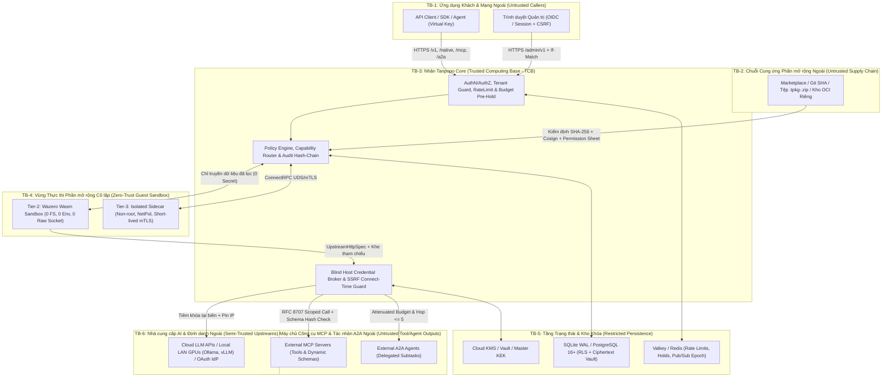

# Mô hình Mối đe dọa Theo Ranh giới Tin cậy & Ma trận Đối kháng (Threat Model & Trust Boundaries) — Tanpopo

> **Tài liệu Kiến trúc Bảo mật Cốt lõi (Phase ASTRA A07 — Gate G3: `READY_FOR_REVIEW` | `PROPOSED — NO CODE`)**
> - **Mã tài liệu:** `SPEC-SEC-01` | **Phiên bản:** `0.1.0-step07-draft` | **Ngày cập nhật:** `2026-11-12`
> - **Vai trò biên soạn:** Principal Security Engineer & Threat Modeling Lead
> - **Trạng thái quản trị:** **Đặc tả Bảo mật Đề xuất (`PROPOSED`)** — áp dụng quy trình *Threat Model First* (`STRIDE` + `OWASP Top 10:2021/2025` + `OWASP Top 10 for LLM Applications 2025`) trên toàn bộ kiến trúc [`system-design.md`](../architecture/system-design.md) (`ARCH-SYS-01`), [`extension-contract.md`](../specifications/extension-contract.md) (`SPEC-EXT-01`) và [`risk-register.md`](../discovery/risk-register.md).
> - **Truy vết Yêu cầu:** `DEC-002`..`004`, `TP-FR-0204`, `TP-FR-0301`..`0306`, `TP-FR-0401`..`0406`, `TP-FR-0701`..`0705`, `TP-NFR-0401`..`0502`, `TP-AC-SEC-01`..`08`.

---

## 1. Tài sản Trọng yếu Cần Bảo vệ (`Crown-Jewel Assets`)

Trước khi đặt chốt kiểm soát, mô hình mối đe dọa định danh **7 nhóm tài sản có giá trị cao nhất** mà kẻ tấn công nhắm tới trên một máy chủ Tanpopo tự vận hành:

| Mã Tài sản | Tài sản Bảo mật | Hậu quả Tối đa Nếu Bị Xâm phạm (`Worst-Case Impact`) |
|---|---|---|
| **`AST-01`** | **Khóa Bảo vệ Chủ (`Master KEK`) & Khóa Tổ chức (`Org DEKs`)** | Giải mã toàn bộ kho thông tin xác thực của mọi tổ chức trên máy chủ (`P0 Catastrophic`). |
| **`AST-02`** | **Thông tin Xác thực Nhà cung cấp Đích (`Upstream API Keys`, `Authorized OAuth Refresh/Access Tokens`, `IAM Credentials`)** | Đánh cắp hạn mức tài chính không giới hạn ở hãng AI đích hoặc truy cập trái phép tài nguyên đám mây doanh nghiệp (`P0 Catastrophic`). |
| **`AST-03`** | **Tính Cô lập Của Nhân Thực thi (`Tanpopo Core Process` & Máy chủ Host)** | Thực thi mã từ xa (`RCE`), đọc hệ tệp/biến môi trường máy chủ hoặc di chuyển ngang vào mạng nội bộ doanh nghiệp (`P0 Catastrophic`). |
| **`AST-04`** | **Nội dung Suy luận, Dữ liệu Đa phương thức & Tham số Công cụ Của Từng Tổ chức (`Tenant Prompts, Completions & PII`)** | Rò rỉ bí mật kinh doanh/dữ liệu cá nhân chéo tổ chức (`Cross-Tenant Breach`) hoặc vi phạm luật cư trú dữ liệu `GDPR` (`P0 Catastrophic`). |
| **`AST-05`** | **Hành động Có Tác động Phụ Qua Mặt phẳng Công cụ & Tác nhân (`MCP mutating/destructive Tools`, `A2A Tasks`)** | Xóa cơ sở dữ liệu sản xuất, sửa mã nguồn hoặc leo thang đặc quyền qua tác nhân bị tiêm nhiễm chỉ thị (`Prompt Injection` — `P0 Critical`). |
| **`AST-06`** | **Tính Toàn vẹn Của Cấu hình Quản trị, Sổ cái Ngân sách & Chuỗi Kiểm toán (`ConfigSnapshot`, `Ledger`, `audit_events`)** | Miễn phí hóa trái phép chi phí sử dụng, vượt trần ngân sách đốt tiền (`Denial of Wallet`), hoặc xóa dấu vết tấn công (`P1 High`). |
| **`AST-07`** | **Uy tín Chuỗi Cung ứng & Tính Chính danh Pháp lý Của Dự án Tanpopo (`Signing Keys`, `@tanpopo-official/*`)** | Phát tán gói độc hại mạo danh chính chủ hoặc kéo dự án vào kiện tụng vi phạm điều khoản thuê bao tiêu dùng (`DEC-004` — `P0 Strategic`). |

---

## 2. Bản đồ 7 Ranh giới Tin cậy (`Trust Boundaries Diagram`)

Nguyên tắc cốt lõi từ kỹ năng `security-and-hardening`: **Độ tin cậy đi theo chủ thể đã ghi ra dữ liệu đó, không đi theo kênh truyền tải nó vào hệ thống** (phản hồi từ nhà cung cấp AI, mô tả công cụ từ MCP Server, hay gói `.tpkg` cài từ đĩa cục bộ đều là **dữ liệu không tin cậy**).

---

## 3. Phân tích `STRIDE` & Kịch bản Lạm dụng Trên Mười Ba Mối Đe dọa Bắt buộc (`TM-01` .. `TM-13`)

Bảng dưới đây phân tích toàn diện **13 véc-tơ tấn công bắt buộc** của một nền tảng AI Gateway `extension-first`, gắn từng mối đe dọa với phân loại `STRIDE` / `OWASP LLM`, chốt kiểm soát kỹ thuật và mã bài kiểm thử xác minh cụ thể:

| Mã Đe dọa | Véc-tơ Tấn công & Kịch bản Lạm dụng Cụ thể (`Abuse Case`) | Ranh giới & Phân loại | Biện pháp Phòng vệ Kiến trúc Bắt buộc (`Preventive & Detective Controls`) | Bài Kiểm thử Nghiệm thu (`SPEC-QA-01/02`) |
|---|---|---|---|---|
| **`TM-01`** **Gói Plugin Ngoài Độc hại (`Git / ZIP / OCI`)** | Kẻ tấn công lừa quản trị viên nạp tệp `.tpkg`/`.zip` chứa đường dẫn thoát thư mục `../../etc/cron.d/pwn` (*Zip-Slip*), `symlink` trỏ ra hệ tệp Host, hoặc tệp nén `1 MB` bung ra `10 GB` làm tràn RAM/đĩa (*Zip-Bomb*). | `TB-2 → TB-3` `Tampering`, `DoS`, `EoP` | Giải nén hoàn toàn trong bộ nhớ giới hạn luồng đọc (`io.LimitReader <= 64 MiB`), cấm tuyệt đối mục chứa `..`, đường dẫn tuyệt đối hoặc cờ `symlink`/`hardlink` trước khi chạm đĩa; chỉ nạp vào thư mục cách ly định danh theo `SHA-256`. | `CT-04`, `FZ-02` |
| **`TM-02`** **Đầu độc Chuỗi Cung ứng & Kịch bản Cài đặt (`Supply-Chain Tampering`)** | Sửa đổi thẻ Git (`mutable tag v1.0`) sau khi đã công bố, cài mã độc vào kịch bản `postinstall` của gói phụ thuộc npm, hoặc đổi gói trên đường tải mạng. | `TB-2 → TB-3` `Tampering` `OWASP A08 / LLM03` | Cấm ghim theo nhánh/thẻ Git động — bắt buộc ghim mã băm commit `40-hex` + `SHA-256` gói trong `tanpopo.lock`; kiểm tra chữ ký `Cosign` trước khi nạp; trong CI khóa cứng `npm ci --ignore-scripts` và quét `govulncheck` + `osv-scanner`. | `CT-03`, `CT-25`, `SEC-GATE-02` |
| **`TM-03`** **Mạo danh Nhà phát hành Chính thức (`Impersonated Publisher`)** | Gói cộng đồng đặt tên `@tanpopo-official/openai-pro` hoặc chỉnh sửa JSON `Manifest` tự ghi `"trustTier": "official"` nhằm đánh lừa quản trị viên bỏ qua cảnh giác. | `TB-2 → TB-1` `Spoofing` | `trustTier` **không bao giờ đọc từ lời tự khai trong Manifest** mà do Core tự tính toán từ việc đối chiếu mật mã với khóa công khai gốc nhúng cứng của dự án (`Offline Root Public Key`); mạo danh không gian tên dành riêng bị từ chối cứng ngay lúc dàn dựng (`403 reserved_namespace_spoofing`). | `CT-05`, `UX-AC-03` |
| **`TM-04`** **Phần Mở rộng Độc hại Thoát Sandbox Hoặc Làm Treo Core** | Mã Wasm bên thứ ba cố mở socket mạng ngầm, đọc `/proc/self/environ`, chạy vòng lặp vô tận `while(1)` đốt sạch CPU hoặc xin cấp phát bộ nhớ làm sập cả tiến trình `tanpopod`. | `TB-4 → TB-3` `EoP`, `DoS` | Cấm nạp mã chung tiến trình (`dlopen`/`plugin`); động cơ `wazero` khởi tạo với **không hệ tệp, không biến môi trường, không socket thô**, áp trần bộ nhớ tuyến tính `<= 16 MiB`/phiên và bộ đếm nhiên liệu/ngắt ngữ cảnh CPU mỗi lệnh gọi; tự động ngắt mạch plugin lỗi liên tiếp. | `CT-17`, `FZ-05`, `SPIKE-02` |
| **`TM-05`** **Đánh cắp Khóa Xác thực Gốc (`Credential Exfiltration`)** | Adapter cộng đồng đọc trộm khóa `sk-live-...` rồi giấu (steganography/base64) vào trong văn bản câu trả lời AI hoặc tiêu đề HTTP gửi về máy chủ của kẻ tấn công; hoặc hãng giả lập nhại lại khóa trong thông báo lỗi `401`. | `TB-4 / TB-6 → TB-1` `Info Disclosure` `OWASP LLM02` | **`Blind Host Credential Broker` (`ADR-0002`):** Plugin chỉ cầm mã khe tượng trưng (`slot_handle_01`), **không hề có khóa thật trong RAM của Wasm**; Host chỉ tiêm khóa thật tại điểm xuất mạng khi tên miền đích khớp chính xác `allowed_hosts` đã duyệt của chính kết nối đó; bộ lọc đầu ra quét xóa mọi dấu vết bí mật trong luồng lỗi/nhật ký. | `CT-14`, `CT-16`, `OPS-AC-10` |
| **`TM-06`** **Tấn công `SSRF`, `DNS Rebinding` & Rò rỉ Qua Chuyển hướng** | Cấu hình địa chỉ mô hình nội bộ, URL máy chủ MCP hoặc `image_url` đa phương thức trỏ vào tên miền `rebind.attacker.com` (`TTL=0`) nhảy IP sang `169.254.169.254` (lấy IAM role AWS/GCP) hoặc quét cổng mạng LAN; hoặc trả `302 Redirect` sang miền khác để lấy cắp tiêu đề `Authorization`. | `TB-1 / TB-6 → TB-3` `Info Disclosure`, `EoP` `OWASP A10` | Kiểm tra địa chỉ IP thực tế **ngay bên trong móc `net.Dialer.Control` lúc mở socket `connect()`** (triệt tiêu hoàn toàn kẽ hở `TOCTOU` của DNS Rebinding); khóa cứng `169.254.0.0/16` & `fd00:ec2::254` trong mọi chế độ; tắt tự động đuổi theo chuyển hướng chéo miền hoặc lột sạch tiêu đề xác thực. | `CT-15`, `CT-26` |
| **`TM-07`** **Tiêm nhiễm Chỉ thị (`Prompt Injection`), Đầu độc Công cụ MCP & Đầu ra Độc hại** | Tài liệu/trang web bên ngoài chứa chỉ thị ẩn xúi mô hình gọi công cụ MCP `delete_database`; máy chủ MCP ngoài lén sửa mô tả công cụ (*Rug-Pull*); hoặc mô hình trả về mã độc `<script>` / chuỗi thoát thiết bị đầu cuối nhằm tấn công trình duyệt quản trị viên xem truy vết. | `TB-6 / TB-7 → TB-3 / TB-1` `Tampering`, `EoP` `OWASP LLM01, 05, 06` | Không bao giờ coi `system prompt` là ranh giới bảo mật: lọc cứng danh sách công cụ theo `Virtual Key`, khóa dấu vân tay `schema_hash` (sửa 1 ký tự mô tả lập tức khóa công cụ `403`), bắt buộc người thật `Reviewer` duyệt khớp mã băm tham số cho công cụ `destructive`, mã hóa thoát toàn bộ văn bản hiển thị trên Web Console + `CSP` chặt, lọc chuỗi điều khiển ANSI trên CLI. | `CT-21`, `CT-22`, `CT-27` |
| **`TM-08`** **Đánh cắp Hoặc Chuyển tiếp Trái phép `OAuth Token` (`Token Relay / Confused Deputy`)** | Đánh chặn callback OAuth qua CSRF, đua tranh làm mới token, hoặc lừa Tanpopo lấy `access_token` cấp cho dịch vụ A gửi sang máy chủ MCP/Adapter B của bên thứ ba; hoặc lạm dụng cookie thuê bao cá nhân. | `TB-6 / TB-7 → TB-3` `Spoofing`, `EoP` | Bắt buộc `OAuth 2.1 + PKCE (S256)` + `state` gắn chặt phiên quản trị; khóa cứng phạm vi khán giả nhận token (`RFC 8707 Resource Indicators` & `allowed_audience_hosts`); cấm tuyệt đối chuyển tiếp nguyên xi token người dùng sang máy chủ ngoài khác miền tin cậy; bác bỏ mọi luồng dán cookie thuê bao tiêu dùng (`DEC-004`). | `CT-19`, `CT-20`, `AUTH-08`..`12` |
| **`TM-09`** **Vượt Rào Chéo Tổ chức & Tham chiếu Đối tượng Trực tiếp (`Cross-Tenant IDOR`)** | Quản trị viên của `Org A` đoán hoặc truyền `UUID` của `Connection`, `Route` hoặc `request_id` thuộc `Org B` vào `/admin/v1/*` hoặc lợi dụng trùng khóa bộ nhớ đệm để nhận câu trả lời chứa dữ liệu của `Org B`. | `TB-1 → TB-3 / TB-5` `Info Disclosure`, `EoP` `OWASP A01` | Mọi truy vấn và khóa ngoại đều neo cứng `org_id` lấy từ phiên xác thực (không bao giờ lấy từ thân JSON khách gửi) kết hợp `PostgreSQL RLS FORCE`; trả đồng nhất `404` không lộ sự tồn tại tài nguyên; mọi khóa bộ nhớ đệm đều bắt đầu bằng `org_id:project_id:env_id`. | `AUTH-13`..`15`, `CT-28` |
| **`TM-10`** **Rò rỉ Khóa Ảo `Virtual Key` & Tấn công Kênh Kề Thời gian** | Khóa `vk_tp_...` vô tình bị đẩy lên kho Git công khai, bị ghi vào nhật ký truy cập của proxy, hoặc kẻ tấn công đo thời gian phản hồi micro-giây để dò từng ký tự mã khóa. | `TB-1 → TB-3` `Spoofing`, `Info Disclosure` | Chỉ lưu mã băm `SHA-256` của khóa ảo trong DB, đối chiếu hằng định thời gian (`crypto/subtle.ConstantTimeCompare`), gắn tiền tố dễ nhận diện `vk_tp_` để trình quét bí mật (`gitleaks`/GitHub Secret Scanning) phát hiện tự động, và cung cấp `Emergency Revoke` cắt luồng `< 1s`/`< 5s`. | `AUTH-04`..`06`, `OPS-AC-03` |
| **`TM-11`** **Lưu Tồn Dư Dữ liệu Nhạy cảm (`Retention & Erasure Failure`)** | Nội dung hội thoại chứa PII bị lưu ngầm vào bảng truy vết, tệp nhật ký lỗi hoặc bản sao lưu cũ và vẫn đọc được sau khi khách hàng đã yêu cầu xóa dữ liệu theo `GDPR`. | `TB-5` `Info Disclosure` | Mặc định `Metadata-Only Telemetry` (`0 byte` lưu văn bản prompt/completion); nội dung gỡ lỗi nếu bật bị kẹp trần cứng `TTL <= 72h`; khi xóa `Project`/`Organization`, hủy vĩnh viễn khóa mật mã riêng `DEK` (*Crypto-Shredding*) trong `< 60 giây` làm vô hiệu hóa cả dữ liệu trong bản sao lưu cũ. | `OPS-AC-09`, `OPS-AC-10` |
| **`TM-12`** **Từ chối Dịch vụ & Lạm dụng Đốt Ngân sách (`DoS / Denial of Wallet`)** | Mở đồng loạt 500 kết nối song song ngay khoảnh khắc số dư còn `1 USD` để vượt trần ngân sách; gửi thân JSON sâu 10.000 tầng; treo kết nối đọc chậm (*Slowloris SSE*); hoặc tác nhân A2A tự gọi đệ quy vô hạn. | `TB-1 / TB-7 → TB-3` `DoS` `OWASP LLM10` | Giữ chỗ ngân sách nguyên tử **trước khi mở luồng** (`Pre-Request Budget Hold`); giới hạn kích thước thân yêu cầu, độ sâu JSON (`<= 64`), `ReadHeaderTimeout <= 5s`, trần luồng đồng thời theo khóa và trần bước nhảy ủy quyền A2A `hop_count <= 5`. | `CT-23`, `CT-29`, `SPIKE-03` |
| **`TM-13`** **Chối bỏ Hành động Quản trị Hoặc Xóa Dấu vết Kiểm toán (`Repudiation`)** | Quản trị viên nội bộ xấu nâng trần ngân sách, tắt bộ lọc PII hoặc đọc trộm dữ liệu gỡ lỗi rồi sửa/xóa dòng nhật ký trong cơ sở dữ liệu để phi tang. | `TB-3 → TB-5` `Repudiation`, `Tampering` | Mọi thao tác thay đổi cấu hình, duyệt quyền và xem dữ liệu nhạy cảm đều ghi bắt buộc vào bảng `audit_events` chỉ cho phép nối thêm (*Append-Only*), liên kết chuỗi băm mật mã `SHA-256(prev_hash || canonical_event)` và xuất thời gian thực ra kho WORM độc lập. | `OPS-AC-08`, `CT-30` |

---

## 4. Các Cổng Chặn Bảo mật Cấp Thiết kế (`Non-Negotiable Design Invariants`)

Bất kỳ đề xuất tính năng hoặc PR mã nguồn nào vi phạm dù chỉ **1 trong 6 bất biến** dưới đây đều bị đánh trượt tự động tại cổng rà soát bảo mật mà không cần xét các yếu tố khác:
1. **Không mã bên thứ ba nào chạy chung không gian bộ nhớ tiến trình Core** (`0` `plugin.Open`, `0` `dlopen`, `0` `eval` / `Function()`).
2. **Không một endpoint `/admin/v1/*` nào chấp nhận xác thực bằng `Virtual Key` của Data Plane**, và không một thao tác ghi quản trị nào bỏ qua kiểm tra quyền sở hữu `org_id`/`project_id` cùng kiểm toán bất biến.
3. **Không một `Extension` Tầng 1 hoặc Tầng 2 mặc định nào nhìn thấy chuỗi khóa gốc (`API Key` / `OAuth Token`) trong bộ nhớ của nó** (`Blind Host Credential Broker` là bắt buộc).
4. **Không một kết nối mạng đi ra ngoài nào được phép bỏ qua bộ lọc IP lúc `connect()` chống `169.254.169.254` / `DNS Rebinding`.**
5. **Không bao giờ nối ghép ngầm phản hồi từ nhà cung cấp dự phòng sau khi đã phát mảnh dữ liệu đầu tiên về phía khách (`No Post-First-Chunk Silent Failover`).**
6. **Không bao giờ thiết kế, duy trì hay gắn nhãn hỗ trợ cho cơ chế lách điều khoản biến gói thuê bao tiêu dùng cá nhân thành cổng API dùng chung (`DEC-004`).**
