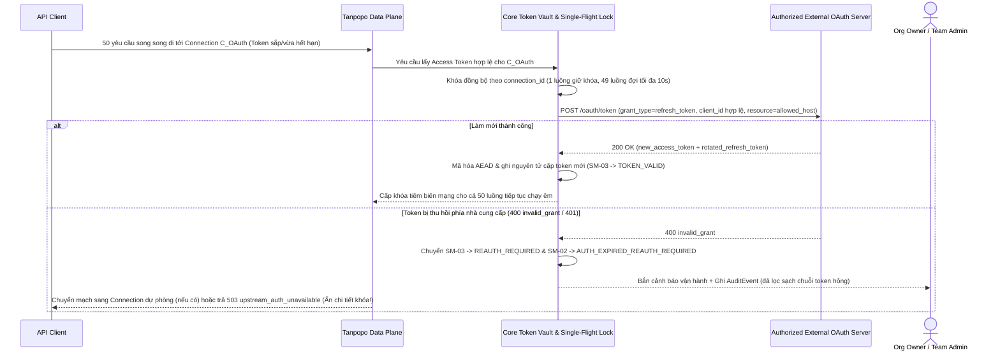

# Đặc tả Hợp đồng Xác thực, Kho Khóa Cô lập & Ranh giới Tuân thủ Kết nối (Authentication Contracts & Connection Governance) — Tanpopo

> **Tài liệu Đặc tả Kiến trúc & Bảo mật (Phase ASTRA A04 — `DRAFT / ILLUSTRATIVE CANDIDATE SPEC`)**
> - **Mã tài liệu:** `SPEC-EXT-03` | **Phiên bản:** `0.1.0-step04-draft` | **Ngày cập nhật:** `2026-11-11`
> - **Vai trò biên soạn:** Platform Architect & Security-Minded SDK Designer
> - **Tuyên bố Trạng thái Chuẩn hóa:** Các giao diện `Auth Driver`, luồng làm mới OAuth và cấu trúc bản ghi kho khóa dưới đây **mang tính minh họa thiết kế (`ILLUSTRATIVE — PRE-ADR`)**; chi tiết mật mã lưu trữ cụ thể sẽ chốt cùng quyết định ngôn ngữ Core và KMS (`OQ-001`, `TP-FR-0206`).
> - **Truy vết Yêu cầu:** `DEC-004`, `REJ-003`, `TP-FR-0203`..`0206`, `TP-FR-0303`, `TP-FR-0703`, `TP-BR-0102`, `TP-BR-0301`..`0304`, `TP-BR-0402`, `TP-AC-SEC-01`, `03`, `04`, `06`.

---

## 1. Bất biến Bảo mật Cốt lõi của Kho Thông tin Xác thực (`Credential Vault Invariants`)

1. **Cấm Mở Toàn bộ Kho Khóa (`Zero Full-Vault Access`):** Không một `Extension Package`, `Provider Adapter`, `Auth Driver`, `MCP Server` hay quản trị viên giao diện nào có hàm liệt kê hoặc đọc toàn bộ kho bí mật. Mọi truy cập vật liệu xác thực đều bị khóa cứng theo bộ bốn định danh: `(organization_id, connection_id, secret_slot, allowed_audience_hosts[])`.
2. **Ghi Một chiều (`Write-Only Plaintext`):** Giá trị bí mật chỉ đi vào qua Admin API/CLI một chiều, được mã hóa xác thực AEAD (`AES-256-GCM` hoặc `XChaCha20-Poly1305` với Khóa Bảo vệ Dữ liệu `DEK` được bọc bởi Khóa Chủ `KEK`) trước khi chạm đĩa. Mọi phản hồi quản trị chỉ trả về định danh tham chiếu `secret_ref`, trạng thái hiệu lực và dấu vân tay ẩn danh.
3. **Cấm Dùng Chéo Đích Nhận (`No Token Cross-Audience`):** Mã thông báo hoặc khóa gắn cho `Connection A` (hoặc `MCP Server X`) **tuyệt đối không bao giờ** được phép đính kèm vào yêu cầu gửi tới tên miền ngoài `allowed_audience_hosts` của chính kết nối đó, không tự động đi theo phản hồi chuyển hướng HTTP `301/302/307/308` khác miền, và không bao giờ chuyển tiếp chéo giữa các mặt phẳng `Provider` ↔ `MCP` ↔ `A2A` (`TP-AC-SEC-04`).

---

## 2. Năm Hợp đồng Xác thực Chuẩn & Giới hạn của `Custom Auth Driver`

| Phương thức xác thực | Cơ chế thực thi an toàn trong Tanpopo | Điều kiện sử dụng hợp lệ | Giới hạn bảo mật bắt buộc |
|---|---|---|---|
| **1. `API Key / Bearer / Static Header`** | **`host_blind_inject`**: Plugin chỉ chỉ định tên khe `secretSlot: "api_key"`; **Host Egress Broker** tự gắn tiêu đề tại biên mạng ngay trước khi đẩy vào TLS socket. | Khóa API thương mại trả theo mức dùng hoặc khóa máy chủ nội bộ. | Mã của Plugin (Tầng 1/2/3) hoàn toàn không nhìn thấy chuỗi khóa thật trong bộ nhớ (`TP-BR-0402`). |
| **2. `Authorized OAuth 2.1 / OIDC`** *(Auth Code + PKCE `S256` & Client Credentials)* | **Core OAuth Broker** quản lý toàn bộ trao đổi mã, lưu `refresh_token` mã hóa, kiểm tra `state` chống CSRF và đối chiếu tham số đích `resource` (RFC 8707). | Nhà cung cấp công bố tài liệu OAuth chính thức và cấp `client_id` hợp pháp cho tích hợp bên thứ ba / doanh nghiệp. | Từ chối kích hoạt nếu tập `scopes` trả về không khớp yêu cầu; làm mới đơn luồng (`Single-Flight`) và không bao giờ lộ `refresh_token` cho Plugin. |
| **3. `OAuth 2.0 Device Flow`** *(RFC 8628 — Có điều kiện)* | Core hiển thị `verification_uri` + `user_code` trên CLI/Console cho máy chủ không trình duyệt; tự động thăm dò tuân thủ nghiêm `interval` và tín hiệu `slow_down`. | **Chỉ bật khi nhà cung cấp đích chính thức hỗ trợ và cấp phép Device Flow cho ứng dụng tích hợp.** | Nghiêm cấm nhúng lén `client_id` rút trích từ ứng dụng đóng của hãng khác; mã chờ hết hạn tự hủy sạch sau `expires_in` (`<= 15 phút`). |
| **4. `Workload Identity & mTLS`** *(OIDC Token Exchange / IAM / Client Cert)* | **Host TLS & Cloud Broker** thực hiện trao đổi mã OIDC môi trường (AWS STS, GCP Workload Identity, Azure Managed Identity) hoặc bắt tay chứng chỉ `mTLS`. | Môi trường đám mây doanh nghiệp hoặc cổng AI nội bộ bảo mật cao. | Khóa riêng tư (`private key`) của chứng chỉ `mTLS` nằm cố định trong Host/HSM, không bao giờ đi qua biên giới IPC/Wasm vào Plugin. |
| **5. `Bounded Custom Auth Driver`** *(Ký động doanh nghiệp)* | **Ưu tiên `host_crypto_sign`:** Guest tạo chuỗi chuẩn hóa (`canonical_string_to_sign`) gửi Host ký HMAC/RSA rồi gắn chữ ký. **Ngoại lệ `scoped_secret_unseal`:** Chỉ mở đúng 1 khe `secretSlot` của riêng kết nối đó khi thuật toán ký độc quyền không có trong Host. | Cổng AI nội bộ tập đoàn hoặc đám mây khu vực dùng chuẩn chữ ký gói tin riêng. | Chế độ `scoped_secret_unseal` bắt buộc gắn cờ cảnh báo đỏ `SECURITY_HIGH_RISK` khi duyệt quyền (`WF-04`), vẫn bị khóa chặt mạng ở `allowedHosts` và ghi `AuditEvent` mỗi lần cấp. |

---

## 3. Quyền Sở hữu Kết nối (`Local vs Remote Ownership`) & Luồng Làm mới / Thu hồi

### 3.1. Ba Cấp độ Sở hữu `Provider Connection` & `MCP Connection`
1. **Kết nối Cấp Tổ chức Dùng chung (`Org-Shared Service Connection`):** Do `Organization Owner` gắn khóa thương mại của công ty và chia sẻ một chiều quyền *gọi* xuống các `Project` được chọn (`TP-BR-0102`); thành viên dự án không đọc/xuất được khóa.
2. **Kết nối Dành riêng Cấp Dự án (`Project-Owned Connection`):** Do `Team Admin` gắn khóa riêng của phòng ban mình; hoàn toàn cô lập với các `Project` khác trong cùng `Organization`.
3. **Ủy quyền Cấp Cá nhân Định danh (`Per-Principal Delegated Connection` — đặc biệt trên mặt phẳng MCP / OAuth cá nhân hợp lệ):** Khi kết nối dùng `Authorized OAuth` đại diện danh tính cá nhân của một kỹ sư (ví dụ quyền đọc Jira/GitHub qua MCP), mã token được khóa chặt theo `(principal_id, connection_id)`. **Khóa ảo của Người dùng B tuyệt đối không được mượn phiên OAuth cá nhân của Người dùng A**, ngăn chặn hoàn toàn lỗi leo thang quyền ngang (`Confused Deputy`).

### 3.2. Sơ đồ Trình tự Minh họa: Làm mới Đơn luồng (`Single-Flight`) & Cô lập Thu hồi (`SM-02` / `SM-03`)

---

## 4. Ranh giới `Official` / `Community` / `Private` & Phân tích Rủi ro Gói Thuê bao Tiêu dùng

### 4.1. Chính sách Phân phối và Thực thi Theo Nguồn gốc (`DEC-004`, `TP-BR-0201`..`0202`)

| Phân nhóm | Chủ thể phát triển | Kênh phân phối | Tiêu chuẩn xác thực được phép | Hành vi của Tanpopo Runtime |
|---|---|---|---|---|
| **`Official Adapters`** | Đội ngũ dự án Tanpopo | Đóng gói sẵn hoặc trên Official Marketplace (chữ ký khóa gốc Tanpopo). | **Chỉ dùng API thương mại chính thức, Cloud IAM/OIDC hoặc chương trình OAuth được nhà cung cấp công bố hợp lệ.** | Nhãn `official`; đầy đủ kiểm thử `VERIFIED`. |
| **`Verified Community`** | Đối tác / Nhà phát triển cộng đồng | Official Marketplace (sau khi vượt qua kiểm duyệt tuân thủ & hợp đồng). | Chỉ dùng phương thức truy cập không vi phạm điều khoản nhà cung cấp (`TP-BR-0302`). | Nhãn `verified`; vẫn bắt buộc chạy trong Sandbox mặc định đóng và duyệt quyền mạng. |
| **`Private Enterprise`** | Đội ngũ AI Platform nội bộ của tổ chức tự host | Private OCI/Git Registry hoặc gói ký bằng khóa nội bộ của chính doanh nghiệp đó. | Tùy biến theo cổng nội bộ doanh nghiệp (SSO nội bộ, mTLS, HMAC cổng riêng). | Nhãn `unverified-external` (kèm cờ `Org-Approved` nội bộ nếu khớp chữ ký tổ chức); chạy trong Sandbox/Sidecar cô lập. |
| **`Unverified Community`** | Bên thứ ba bất kỳ trên Internet | Kho Git công khai / URL / tệp nén người vận hành tự tải về. | Runtime trung lập về kỹ thuật nhưng **không bao giờ bảo chứng tính hợp pháp điều khoản**. | Đóng dấu cố định `unverified-external` trong UI & `AuditEvent`; chặn mặc định ở tổ chức khóa chính sách chặt (`TP-BR-0202`). |

### 4.2. Nghiên cứu Điển hình về Rủi ro (`Risk Case Studies`): Kết nối Thuê bao Tiêu dùng Bên thứ ba

> **Tuyên bố Rõ ràng (`CONFIRMED_BY_OWNER` — `DEC-004` / `REJ-003`):** Các dịch vụ tiêu dùng trả phí cố định như **`ChatGPT Plus/Pro`**, **`Codex` (gói tiêu dùng cá nhân)**, **`Claude Pro/Max`**, **`Google Antigravity`** được đề cập dưới đây **chỉ với tư cách là điển hình phân tích rủi ro pháp lý, vận hành và an ninh (`Risk Case Studies`)**, **tuyệt đối KHÔNG phải** là các tích hợp được Tanpopo hỗ trợ, cam kết hay bảo đảm hoạt động.

| Khía cạnh rủi ro | Phân tích thực tế trên các gói thuê bao tiêu dùng cá nhân | Quy tắc kiềm tỏa cứng trong thiết kế Tanpopo |
|---|---|---|
| **1. Ranh giới Pháp lý & Điều khoản (`Entitlement Gap`)** | Gói thuê bao cá nhân được định giá trọn gói cho thao tác trực tiếp của con người trong ứng dụng chính hãng; điều khoản dịch vụ của các hãng đều cấm trích xuất phiên đăng nhập để làm điểm cuối API tự động hoặc chia sẻ nhiều người dùng. | **Không hợp thức hóa bằng cảnh báo (`TP-BR-0301`):** Tanpopo cấm thiết kế luồng *"Tôi hiểu rủi ro, hãy mở khóa chế độ biến tài khoản Plus/Pro thành API"*. |
| **2. Rủi ro Sập Sản xuất & Khóa Tài khoản Hàng loạt** | Nhà cung cấp có thể thay đổi cấu trúc giao diện nội bộ bất kỳ lúc nào hoặc quét khóa vĩnh viễn tài khoản vi phạm không hoàn tiền, làm tê liệt ngay lập tức mọi ứng dụng phụ thuộc vào nó. | Tài liệu SDK, Setup Wizard và thông điệp sản phẩm khẳng định rõ Tanpopo chỉ hướng tới khóa API thương mại, mô hình tự host và kết nối được cấp phép chính thức. |
| **3. Rủi ro Lộ Toàn bộ Dữ liệu Cá nhân (`Session Blast Radius`)** | Khác với API Key có thể giới hạn phạm vi, cookie phiên trình duyệt hoặc token rút trích từ ứng dụng đóng thường nắm toàn quyền đọc lịch sử trò chuyện cá nhân, tệp tải lên và thông tin thanh toán của chủ tài khoản. | **Không thiết kế công cụ lách bảo vệ:** Tanpopo **tuyệt đối không** xây dựng trình lấy cookie trình duyệt, trình giả lập vân tay TLS/trình duyệt, trình xoay proxy dân cư hay cơ chế giải/vượt CAPTCHA, anti-bot (Cloudflare Turnstile, reCAPTCHA...). |
| **4. Rủi ro Ô nhiễm Thương hiệu Dự án Mã nguồn Mở** | Các gói cộng đồng tự phát trên GitHub thường đặt tên dễ gây hiểu lầm là do cổng chính thức hậu thuẫn. | Kiểm duyệt Marketplace bác bỏ `100%` gói lách thuê bao tiêu dùng (`TP-AC-SEC-06`), bảo vệ không gian tên `@tanpopo/*` và hỗ trợ luồng thu hồi cảnh báo (`Revocation Feed`). |

---

## 5. Các Điểm Phụ thuộc Chính sách Nhà cung cấp Chưa Thể Kết luận Sớm (`Open Policy Unknowns`)

1. **`POL-01` — Chương trình Cấp phép OAuth Bên thứ ba của Từng Hãng AI Thương mại:** Hiện tại, chính sách cho phép ứng dụng bên thứ ba dùng luồng OAuth *"Sign in with Provider"* để gọi suy luận thay mặt người dùng khác nhau rất lớn giữa các hãng (có hãng mở công khai qua OAuth chuẩn với hạn mức riêng, có hãng chỉ cấp cho đối tác ký hợp đồng riêng, có hãng cấm hoàn toàn và chỉ cho dùng API Key). Do đó, Tanpopo chỉ cung cấp **khung kỹ thuật `Authorized OAuth 2.1` chuẩn**, còn việc bật cấu hình cho hãng nào trên `Official Adapter` phải căn cứ vào tài liệu điều khoản công khai còn hiệu lực của hãng đó tại thời điểm phát hành.
2. **`POL-02` — Tiêu chuẩn Ủy quyền OAuth Động trên Mặt phẳng MCP:** Đặc tả ủy quyền của hệ sinh thái MCP (bao gồm `Dynamic Client Registration` vs `Client ID Metadata Documents` và `RFC 8707 Resource Indicators`) đang tiếp tục hoàn thiện nhanh; thiết kế ở bước A04 giữ lớp cấu hình máy chủ ủy quyền linh hoạt để khớp chuẩn chính thức khi bắt đầu triển khai `v0.2`.
