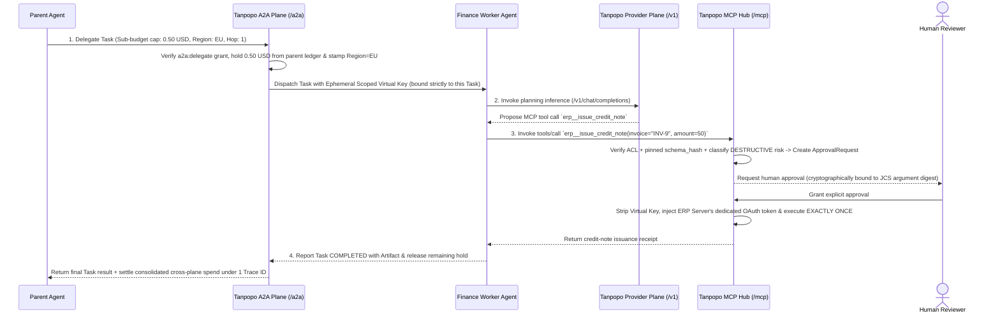

# MCP Hub Plane & A2A Inter-Agent Plane Architectural Boundary Specification — Tanpopo

> **Agent Connectivity Architecture Specification Document (ASTRA Phase A04 — `DRAFT / ILLUSTRATIVE CANDIDATE SPEC`)**
> - **Document ID:** `SPEC-EXT-05` | **Version:** `0.1.0-step04-draft` | **Last Updated:** `2026-11-11`
> - **Authoring Role:** Platform Architect & Security-Minded SDK Designer
> - **Standardization Status Statement:** The protocol route conventions, approval parameter-binding digests, and A2A delegation envelopes below are **illustrative candidate designs (`ILLUSTRATIVE — PRE-ADR`)** aligned with the open **Model Context Protocol (MCP)** and **Agent2Agent (A2A)** specifications, and are not claimed as frozen internal standards prior to ADR sign-off.
> - **Requirements Traceability:** `DEC-003`, `REJ-004`, `SM-06`, `SM-07`, `WF-09`, `TP-FR-0401`..`0406`, `TP-BR-0104`, `TP-BR-0601`..`0604`, `TP-AC-F0401`..`0404`, `TP-AC-SEC-05`, `08`.

---

## 1. Why Conflating `MCP` and `A2A` into `Provider Adapter` Is Strictly Prohibited (`DEC-003`)

Several early experimental proxies attempt to disguise MCP tool servers or A2A agents as "synthetic chat models" inside a `Provider Adapter`. Tanpopo explicitly rejects that anti-pattern (`REJ-004`) because the four architectural planes exhibit fundamentally incompatible execution semantics and threat models:

| Architectural Attribute | **`Provider` Plane (LLM Inference)** | **`MCP` Plane (Tools / Context)** | **`A2A` Plane (Inter-Agent Tasks)** | **`Plugin / Extension` Plane** |
|---|---|---|---|---|
| **Unit of Interaction** | Single-turn token generation request (`Stateless Request / SSE`). | Discovery & invocation of external side-effecting operations (`Tools / Resources / Prompts`). | Asynchronous, multi-step stateful workflow that may pause for human/caller input (`Stateful Task`). | Artifact bundle extending internal gateway capabilities (`Package Artifact`). |
| **Retry Policy (`Retry`)** | Permitted to retry / fail over to an equivalent model **prior to the first emitted chunk**. | **Blind retries strictly FORBIDDEN** on `mutating`/`destructive` tools (prevents double-deletes / duplicate charges — `TP-BR-0603`). | Cannot silently swap to a different agent mid-flight inside a stateful task. | Not a live network traffic plane. |
| **Metering / Quota Unit** | Input/output/cache/reasoning tokens, images, audio seconds. | Tool invocation count, execution latency, and side-effect risk budgets. | Attenuated `Sub-Budget Hold` carved directly out of the parent agent's ledger. | Sandbox CPU fuel (milliseconds) and linear RAM ceilings. |
| **Distinct Security Threats** | Commercial API key leakage, `Data Residency` drift, concurrent streaming budget overrun. | Malicious prompt injection via mutated tool descriptions (*MCP Rug-Pull*), accidental production DB wipes, cross-server token replay (*Confused Deputy*). | Infinite inter-agent delegation loops, privilege amplification beyond caller scope. | Sandbox escape, permission escalation across package upgrades. |

---

## 2. Tool Governance Plane Specification — `Tanpopo MCP Hub` (`/mcp/...`)

### 2.1. Server Registration, Transports & Collision-Free Discovery
1. **Supported Transports (`Transports`):**
   - **Primary Standard (`Primary`):** `MCP Streamable HTTP` (supporting both single JSON-RPC responses and bidirectional SSE stream upgrades) alongside backward-compatible `HTTP + SSE`.
   - **Local `stdio` Servers:** To eliminate arbitrary OS command execution (`RCE`) vulnerabilities, project administrators **may never enter raw shell commands in the Web Console**; `stdio`-based MCP servers must be packaged as `Operator`-approved **Isolated Sidecars (Tier 3)** bridged into the Hub over isolated internal IPC.
2. **Anti-Shadowing Deterministic Namespacing (`Deterministic Tool Namespacing`):**
   - Every tool surfaced through the Hub receives an immutable prefix `<server_slug>__<tool_name>` (e.g., `billing_db__query_invoices`, `github_corp__create_issue`) so newly registered MCP servers can never collide with or hijack trusted tool names (*Tool Shadowing*).
3. **ACL-Filtered Discovery (`Per-Tool ACL`) & Cursor Pagination (`TP-FR-0401`):**
   - When an `MCP Client` calls `tools/list` (or `resources/list`, `prompts/list`), the Hub filters entries against the `Virtual Key`'s `mcp:invoke:<server>:<tool>` grants *prior* to cursor pagination (`cursor`), ensuring: (a) unauthorized tools remain completely invisible to the agent (saving LLM context window budget), and (b) catalogs of hundreds of tools paginate cleanly without truncating at 100 items.

### 2.2. OAuth Audience Isolation (`MCP OAuth & Audience Isolation`)
- **Zero Client Token Passthrough (`Zero Token Passthrough`):** The credential presented by an `MCP Client` to Tanpopo (a `Virtual Key` or an OAuth token with `aud = tanpopo-mcp-hub`) **always terminates and is stripped at the Hub**.
- Upstream calls from the Hub to a backing `MCP Server` authenticate using a dedicated `Secret Credential` or an independent `Authorized OAuth 2.1` grant carrying an RFC 8707 `resource` / `audience` indicator bound exclusively to that `MCP Server` (`TP-AC-SEC-04`). Even if `MCP Server A` is compromised, it receives zero credential material reusable against `MCP Server B` or the LLM Provider plane.

### 2.3. `Tool Firewall`, `schema_hash` Pinning & Human-in-the-Loop Approval (`SM-06`)

1. **Structural Fingerprinting Against *MCP Rug-Pull* (`TP-FR-0402`):**
   - When an administrator approves an MCP tool, the Hub canonicalizes `(tool_name, description, input_schema)` using RFC 8785 JSON Canonicalization Scheme (JCS) and records `schema_hash = SHA-256(...)`.
   - If the upstream `MCP Server` silently alters even a single sentence inside `description` (a primary vector for covert *Prompt Injection*), the Hub detects `live_schema_hash != approved_schema_hash`, blocks execution in enforced environments immediately, and emits a high-priority `AuditEvent`.
2. **Edge Input/Output Validation (`Tool Firewall`):**
   - Validates tool call arguments strictly against the pinned `input_schema` prior to forwarding, enforces maximum tool-output byte caps returned to the agent, and runs secret/PII redaction hooks (when an organization enables a `Guardrail Extension`).
3. **Immutable Parameter-Bound Human Approval (`TP-FR-0403`, `TP-BR-0602`):**
   - For every tool classified as `destructive`, the Hub computes an immutable invocation digest:
     `approval_binding_hash = SHA-256(org_id || principal_id || server_slug || tool_name || JCS(arguments))`
   - Supports **two complementary execution modes** (`TD-G2-05`):
     - *Short Synchronous Hold (`<= 60 seconds`):* Tailored for interactive IDE/chat sessions where a human operator approves immediately in real time.
     - *Asynchronous `Pre-Approval Token` Flow:* The Hub immediately returns a pending approval envelope with a request ID; once a `Reviewer` approves via Web Console or Webhook, the agent replays the tool call carrying the signed `Pre-Approval Token`. Any mutation to even a single argument bit invalidates `approval_binding_hash` and fails with `403 parameter_hash_mismatch`.
4. **Zero Blind Retry on Side-Effecting Tools (`TP-FR-0404`, `TP-BR-0603`):**
   - Automatic transient-network retries may be configured exclusively for `read-only` tools; `mutating` and `destructive` tools are dispatched **at most once**, returning `ambiguous_side_effect_timeout` if the connection drops post-dispatch.

---

## 3. Inter-Agent Connectivity Plane Specification — `Tanpopo A2A Plane` (`/a2a/...`)

### 3.1. `AgentCard` Boundaries & Asynchronous `A2A Task` Lifecycle
- **Permission-Scoped Registration & Discovery (`TP-FR-0405`):** Each internal or partner agent registers as a distinct `AgentEndpoint` entity paired with its `AgentCard` capability descriptor (`skills`, `artifacts` input/output schemas, push-notification support, and `Data Region`). Agent catalog discovery honors project-level `a2a:discover` and `a2a:delegate:<agent_id>` permissions.
- **Stateful Asynchronous Task Tracking:** Unlike stateless `/v1/chat/completions`, the `/a2a/...` plane tracks `task_id` lifecycles across `submitted → working → input-required → completed | failed | canceled`, propagating a unified correlation header `x-tanpopo-trace-root` across every downstream LLM or MCP invocation spawned by that task.

### 3.2. `Monotonic Privilege & Budget Attenuation` (`TP-FR-0406`)

Whenever a `Parent Agent (Agent P)` delegates a subtask to a `Child Agent (Agent C)` across the A2A plane, Tanpopo enforces three non-bypassable anti-amplification guardrails (`TP-BR-0604`):
1. **Sub-Budget Carving (`Sub-Budget Carving`):** The maximum budget ceiling assigned to `budget(Task_C)` must be less than or equal to `Agent P`'s remaining available balance (carved and held directly against the originating project's ledger).
2. **Data Residency & Scope Intersection:** The subtask's effective data residency policy is the **set intersection** of caller and callee constraints (`Region_Effective = Region(Caller) ∩ Region(Agent_C)`). An empty intersection rejects immediately with `403 residency_incompatible`.
3. **Cycle Detection & Delegation Depth Bounding:** Every A2A hop appends the caller's agent identifier to the lineage chain and increments `hop_count`. Any circular call (`A → B → A`) or `hop_count > max_delegation_hops` (default `5`) is rejected immediately with `400 delegation_depth_exceeded`.

---

## 4. Illustrative Sequence Diagram: Cross-Plane Interaction Across Three Independent Planes (`A2A` + `Provider` + `MCP`)

