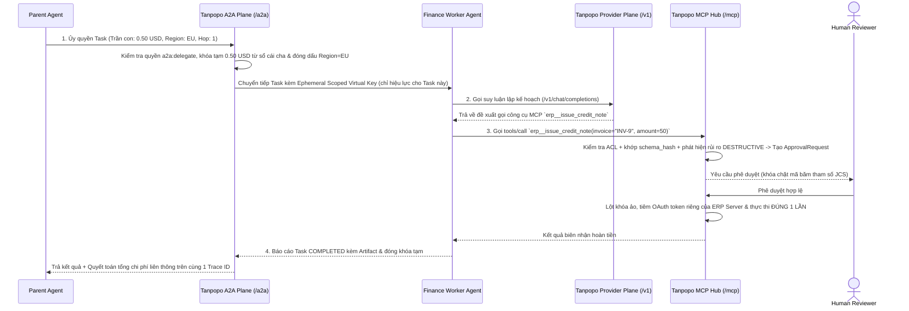

# Đặc tả Ranh giới Kiến trúc Mặt phẳng MCP Hub & Mặt phẳng Liên Tác nhân A2A (MCP Hub & A2A Plane Specification) — Tanpopo

> **Tài liệu Đặc tả Kiến trúc Kết nối Tác nhân (Phase ASTRA A04 — `DRAFT / ILLUSTRATIVE CANDIDATE SPEC`)**
> - **Mã tài liệu:** `SPEC-EXT-05` | **Phiên bản:** `0.1.0-step04-draft` | **Ngày cập nhật:** `2026-11-11`
> - **Vai trò biên soạn:** Platform Architect & Security-Minded SDK Designer
> - **Tuyên bố Trạng thái Chuẩn hóa:** Các đường dẫn giao thức, cấu trúc băm tham số phê duyệt và phong bì ủy quyền A2A dưới đây **mang tính minh họa thiết kế (`ILLUSTRATIVE — PRE-ADR`)**, bám sát đặc tả mở của **Model Context Protocol (MCP)** và **Agent2Agent (A2A)**, chưa tự nhận là chuẩn nội bộ đã đóng băng.
> - **Truy vết Yêu cầu:** `DEC-003`, `REJ-004`, `SM-06`, `SM-07`, `WF-09`, `TP-FR-0401`..`0406`, `TP-BR-0104`, `TP-BR-0601`..`0604`, `TP-AC-F0401`..`0404`, `TP-AC-SEC-05`, `08`.

---

## 1. Tại sao Cấm Tuyệt đối Gộp `MCP` và `A2A` vào `Provider Adapter`? (`DEC-003`)

Một số cổng thử nghiệm cố ép công cụ MCP hoặc tác nhân A2A giả dạng thành một "mô hình Chat giả" bên trong `Provider Adapter`. Tanpopo bác bỏ hướng đi này (`REJ-004`) vì 4 mặt phẳng có bản chất kỹ thuật và mô hình rủi ro trái ngược hoàn toàn:

| Thuộc tính kiến trúc | **Lớp `Provider` (LLM Inference)** | **Lớp `MCP` (Tools / Context)** | **Lớp `A2A` (Inter-Agent Tasks)** | **Lớp `Plugin / Extension`** |
|---|---|---|---|---|
| **Đơn vị giao dịch** | Yêu cầu suy luận sinh token một lượt (`Stateless Request / SSE`). | Khám phá & gọi hàm có tác động thực tế lên hệ thống ngoài (`Tools / Resources / Prompts`). | Tác vụ bất đồng bộ kéo dài nhiều bước, có thể tạm dừng hỏi thêm thông tin (`Stateful Task`). | Gói phần mềm mở rộng năng lực nội bộ cho cổng (`Package Artifact`). |
| **Chính sách Thử lại (`Retry`)** | Được phép thử lại / chuyển mạch sang mô hình tương đương **trước mảnh đầu tiên**. | **Cấm tuyệt đối thử lại mù** với công cụ `mutating`/`destructive` (tránh xóa lặp / trừ tiền hai lần — `TP-BR-0603`). | Không thể tự động đổi sang một tác nhân khác giữa chừng tác vụ đang giữ trạng thái. | Không phải mặt phẳng lưu lượng mạng trực tiếp. |
| **Đơn vị tính phí / Hạn mức** | Token đầu vào/ra/cache/suy luận, ảnh, giây âm thanh. | Số lượt gọi công cụ, độ trễ và hạn mức tác động phụ. | Trần ngân sách ủy quyền con (`Sub-Budget Hold`) trích từ ngân sách tác nhân cha. | Giới hạn CPU (mili-giây) và bộ nhớ RAM của Sandbox. |
| **Rủi ro an ninh đặc thù** | Lộ khóa API thương mại, trượt vùng dữ liệu (`Data Residency`), lố tiền luồng song song. | Chèn chỉ thị độc hại qua mô tả công cụ (*MCP Rug-Pull*), xóa nhầm cơ sở dữ liệu sản xuất, chuyển tiếp nhầm token (*Confused Deputy*). | Vòng lặp ủy quyền vô tận giữa các tác nhân, khuếch đại đặc quyền vượt quyền gốc. | Mã độc thoát vùng cô lập, leo thang quyền khi cập nhật gói. |

---

## 2. Đặc tả Mặt phẳng Quản trị Công cụ — `Tanpopo MCP Hub` (`/mcp/...`)

### 2.1. Đăng ký Máy chủ, Giao thức Vận chuyển & Khám phá Không Đụng độ Tên
1. **Giao thức vận chuyển (`Transports`):**
   - **Chuẩn chính (`Primary`):** `MCP Streamable HTTP` (hỗ trợ cả phản hồi đơn và nâng cấp luồng sự kiện hai chiều chuẩn xác) cùng chế độ tương thích ngược `HTTP + SSE`.
   - **Máy chủ cục bộ dạng `stdio`:** Để ngăn lỗ hổng thực thi lệnh hệ điều hành tùy ý (`RCE`), quản trị viên dự án **không được nhập lệnh shell tùy ý trên giao diện Web**; các máy chủ `stdio` chỉ được phép đóng gói thành **Isolated Sidecar (Tầng 3)** do `Operator` phê duyệt hạ tầng và kết nối vào Hub qua giao thức mạng nội bộ cô lập.
2. **Định danh Không gian Tên Chống Chiếm Quyền (`Deterministic Tool Namespacing`):**
   - Mọi công cụ từ `MCP Server` khi qua Hub đều được gắn tiền tố định danh bất biến `<server_slug>__<tool_name>` (ví dụ `billing_db__query_invoices`, `github_corp__create_issue`) để một máy chủ MCP mới không bao giờ đặt trùng tên công cụ nhằm đánh lừa tác nhân gọi nhầm (*Tool Shadowing*).
3. **Khám phá Lọc Quyền (`Per-Tool ACL`) & Phân trang Chuẩn (`TP-FR-0401`):**
   - Khi `MCP Client` gọi `tools/list` (hoặc `resources/list`, `prompts/list`), Hub lọc danh sách theo quyền `mcp:invoke:<server>:<tool>` của `Virtual Key` ngay trước khi phân trang con trỏ (`cursor`), đảm bảo: (a) tác nhân hoàn toàn không biết tới sự tồn tại của công cụ cấm (giúp tiết kiệm ngữ cảnh mô hình), và (b) hỗ trợ danh mục hàng trăm công cụ mà không cắt cụt ở mốc 100.

### 2.2. Cách ly Đích Nhận Xác thực OAuth (`MCP OAuth & Audience Isolation`)
- **Cấm chuyển tiếp mù Token của Client (`Zero Token Passthrough`):** Mã xác thực mà `MCP Client` gửi tới Tanpopo (`Virtual Key` hoặc OAuth token có `aud = tanpopo-mcp-hub`) **luôn bị dừng lại và lột bỏ tại Hub**.
- Khi gọi xuống `MCP Server` phía sau, Hub sử dụng `Secret Credential` hoặc luồng `Authorized OAuth 2.1` riêng biệt có tham số `resource` / `audience` (RFC 8707) khớp duy nhất với địa chỉ của `MCP Server` đó (`TP-AC-SEC-04`). Nếu `MCP Server A` bị xâm nhập, nó không bao giờ lấy được mã thông báo để giả danh người dùng gọi sang `MCP Server B` hoặc mặt phẳng LLM.

### 2.3. Tường lửa Công cụ (`Tool Firewall`), Ghim `schema_hash` & Phê duyệt Con người (`SM-06`)

1. **Khóa Dấu vân tay Cấu trúc Chống *MCP Rug-Pull* (`TP-FR-0402`):**
   - Tại thời điểm quản trị viên duyệt một công cụ, Hub chuẩn hóa JSON theo chuẩn sắp xếp khóa tất định (RFC 8785 JCS) đối với bộ ba `(tool_name, description, input_schema)` và lưu `schema_hash = SHA-256(...)`.
   - Nếu `MCP Server` tự động thay đổi dù chỉ 1 câu trong `description` (nơi tin tặc thường cài bẫy *Prompt Injection* ngầm), Hub phát hiện `live_schema_hash != approved_schema_hash`, lập tức chặn thực thi công cụ trong môi trường kiểm soát chặt và ghi `AuditEvent` cảnh báo.
2. **Kiểm tra Đầu vào/Ra tại Biên (`Tool Firewall`):**
   - Xác thực tham số gọi công cụ khớp chặt với `input_schema` đã ghim trước khi chuyển tiếp; giới hạn kích thước đầu ra tối đa trả về cho tác nhân và chạy qua móc lọc che bí mật/PII (nếu tổ chức bật `Guardrail Extension`).
3. **Phê duyệt Con người Gắn Băm Tham số Bất biến (`TP-FR-0403`, `TP-BR-0602`):**
   - Với mọi công cụ phân loại `destructive`, Hub tính mã khóa yêu cầu:
     `approval_binding_hash = SHA-256(org_id || principal_id || server_slug || tool_name || JCS(arguments))`
   - Hỗ trợ **2 chế độ song hành** (`TD-G2-05`):
     - *Chờ đồng bộ ngắn hạn (`<= 60 giây`):* Dành cho phiên làm việc trực tiếp có người ngồi trước màn hình bấm duyệt ngay.
     - *Phê duyệt bất đồng bộ bằng `Pre-Approval Token`:* Hub trả ngay cấu trúc báo chờ kèm mã yêu cầu; sau khi `Reviewer` duyệt trên Web Console/Webhook, tác nhân gọi lại đính kèm `Pre-Approval Token`. Nếu bất kỳ tham số nào bị sửa đổi dù nhỏ nhất, `approval_binding_hash` sẽ lệch và bị từ chối `403 parameter_hash_mismatch`.
4. **Cấm Thử lại Mù Công cụ Có Tác động Phụ (`TP-FR-0404`, `TP-BR-0603`):**
   - Chỉ công cụ `read-only` mới được phép cấu hình thử lại lỗi mạng tạm thời; công cụ `mutating` và `destructive` luôn gửi tối đa **1 lần duy nhất**, trả mã `ambiguous_side_effect_timeout` nếu đứt kết nối sau khi đã đẩy gói tin đi.

---

## 3. Đặc tả Mặt phẳng Liên Tác nhân — `Tanpopo A2A Plane` (`/a2a/...`)

### 3.1. Ranh giới Hồ sơ `AgentCard` và Vòng đời Tác vụ (`A2A Task`)
- **Đăng ký & Khám phá Có Phân quyền (`TP-FR-0405`):** Mỗi tác nhân nội bộ hoặc đối tác được đăng ký thành thực thể `AgentEndpoint` riêng kèm hồ sơ năng lực `AgentCard` (danh sách kỹ năng `skills`, định dạng đầu vào/ra `artifacts`, chế độ thông báo đẩy, vùng dữ liệu). Lệnh khám phá danh mục tác nhân tuân theo quyền `a2a:discover` và `a2a:delegate:<agent_id>` của dự án.
- **Quản lý Vòng đời Tác vụ Bất đồng bộ:** Khác với `/v1/chat/completions`, mặt phẳng `/a2a/...` theo dõi trạng thái tác vụ có định danh `task_id` xuyên suốt các chặng `submitted → working → input-required → completed | failed | canceled`, đồng thời gắn mã truy vết liên thông `x-tanpopo-trace-root` cho mọi lệnh gọi LLM hoặc MCP phát sinh bên trong tác vụ đó.

### 3.2. Chính sách Ủy quyền Thu hẹp Đơn điệu (`Monotonic Privilege & Budget Attenuation` — `TP-FR-0406`)

Khi `Tác nhân Cha (Agent P)` ủy quyền một tác vụ con sang `Tác nhân Đích (Agent C)` qua mặt phẳng A2A, Tanpopo cưỡng chế 3 rào chắn chống khuếch đại đặc quyền (`TP-BR-0604`):
1. **Thu hẹp Ngân sách (`Sub-Budget Carving`):** Hạn mức tối đa cấp cho tác vụ con `budget(Task_C)` phải nhỏ hơn hoặc bằng số dư khả dụng còn lại của `Agent P` (khoản này được trích giữ chỗ trực tiếp trên sổ cái của dự án khởi xướng).
2. **Thu hẹp Vùng Dữ liệu & Phạm vi Quyền:** Ràng buộc vùng dữ liệu hiệu lực của tác vụ con là **phép giao** giữa chính sách của người gọi và vùng của tác nhân đích (`Region_Effective = Region(Caller) ∩ Region(Agent_C)`). Nếu giao tập rỗng → từ chối `403 residency_incompatible`.
3. **Chống Vòng lặp & Giới hạn Độ sâu Chuỗi Ủy quyền:** Mỗi bước chuyển tiếp A2A đính kèm danh sách định danh tác nhân đã đi qua và bộ đếm `hop_count`. Nếu phát hiện gọi vòng tròn (`A → B → A`) hoặc `hop_count > max_delegation_hops` (mặc định `5`) → từ chối ngay với `400 delegation_depth_exceeded`.

---

## 4. Sơ đồ Trình tự Minh họa: Tương tác Xuyên 3 Mặt phẳng Độc lập (`A2A` + `Provider` + `MCP`)

