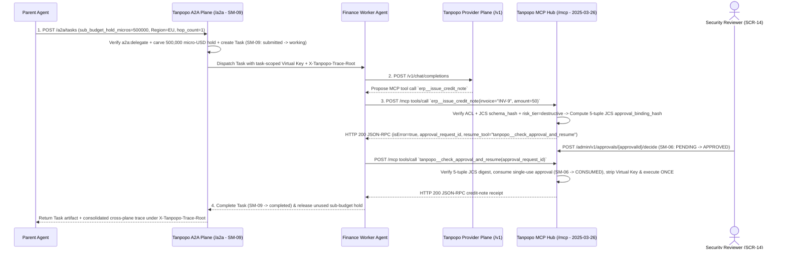

# MCP Hub Plane & A2A Inter-Agent Plane Architectural Boundary Specification — Tanpopo

> **Canonical Agent Connectivity Specification (Synchronized in `TP-IMP-0002` — Spec Closure Batch B)**
> - **Document ID:** `SPEC-EXT-05` | **Version:** `0.2.0-m0-closure` | **Last Updated:** `2026-11-14`
> - **Authoring Role:** Platform Architect & Security-Minded SDK Designer
> - **Pinned Protocol Baseline & Verification Honesty (`CR-08`, `COND-PO-04`):**
>   - **Pinned MCP Wire Baseline:** **`MCP Specification 2025-03-26 (Streamable HTTP)`** on `/mcp` ([`openapi/dataplane-v1.yaml`](../../openapi/dataplane-v1.yaml)).
>   - **Dedicated State Machines:** Human-in-the-loop approvals remain governed by **`SM-06`**, while asynchronous Agent2Agent tasks are governed by dedicated **`SM-09` (`A2A Task Lifecycle`)**.
>   - **Client Compatibility Verification Condition (`COND-PO-04`):** Although returning standard HTTP `200` JSON-RPC envelopes eliminates the deterministic MCP `202` transport violation, **end-to-end compatibility across external IDE and agent MCP clients (`Claude Code`, `Cursor`, `Codex`, etc.) is NOT claimed as `100%` proven upfront and MUST be empirically verified via automated interoperability test `CT-36` (`EXP-05`) during `M3` (`v0.2`)**.
> - **Measurement Honesty (`COND-PO-01`):** Synchronous approval hold bounds (`<= 60 seconds`) and propagation figures are **`TARGET / UNVERIFIED`**.
> - **Requirements Traceability:** `DEC-003`, `REJ-004`, `SM-06`, `SM-07`, `SM-09`, `WF-09`, `TP-FR-0401`..`0406`, `TP-BR-0104`, `TP-BR-0601`..`0604`, `TP-AC-F0401`..`0404`, `TP-AC-SEC-05`, `08`, `CR-08`, `CT-21`..`23`, `CT-36`.

---

## 1. Why Conflating `MCP` and `A2A` into `Provider Adapter` Is Strictly Prohibited (`DEC-003`)

Tanpopo permanently rejects disguising MCP tool servers or A2A agents as synthetic chat models (`REJ-004`) because the four architectural planes have incompatible execution semantics, state lifecycles, and threat models:

| Architectural Attribute | **`Provider` Plane (`/v1/*`, `/native/*`)** | **`MCP` Plane (`/mcp` — `v0.2`)** | **`A2A` Plane (`/a2a/*` — `v0.3`)** | **`Plugin / Extension` Plane** |
|---|---|---|---|---|
| **Unit of Interaction** | Single-turn inference request (`Stateless HTTP / SSE`). | Discovery & invocation of external side-effecting operations (`Tools / Resources / Prompts`). | Multi-step stateful workflow governed by **`SM-09`** (`submitted -> working -> input-required -> completed \| failed \| canceled`). | Immutable `.tpkg` / OCI artifact extending gateway capabilities (`SM-01`). |
| **Retry Policy** | Pre-first-chunk failover permitted (`1 + max_failover_hops <= 4`). | **`0` automatic retries** on `mutating` and `destructive` tools (`TP-BR-0603`, `FMEA-02`). | Never swaps target agent mid-task inside a stateful `SM-09` session. | Not a live network traffic plane. |
| **Metering / Quota Unit** | 5 token dimensions + `MediaUsage` (`micro-USD`). | Tool call count, latency, and side-effect risk policy. | Attenuated `Sub-Budget Hold` carved from parent project ledger (`SM-07`). | Sandbox CPU deadlines (`<= 15 ms` / `<= 5 ms`) and `16 MiB` Wasm RAM. |
| **Distinct Security Threats** | Credential leakage, `Data Residency` drift, concurrent budget overrun. | Mutated tool descriptions (*MCP Rug-Pull*), destructive side effects, cross-audience token replay (*Confused Deputy*). | Delegation loops (`> 5` hops), privilege or budget amplification. | Sandbox escape, stealth permission escalation on upgrade. |

---

## 2. Tool Governance Plane — `Tanpopo MCP Hub` (`/mcp` — Pinned to `MCP 2025-03-26 Streamable HTTP`)

### 2.1. Pinned Transport, Sidecar `stdio` Containment & Collision-Free Discovery
1. **Pinned Transport Standard (`MCP Specification 2025-03-26`):**
   - Exposes `POST /mcp`, `GET /mcp`, and `DELETE /mcp` honoring `Mcp-Session-Id` headers (`Streamable HTTP` supporting both single JSON-RPC 2.0 responses and `text/event-stream` upgrades; HTTP `202 Accepted` is reserved strictly for empty JSON-RPC notifications/responses per spec).
   - **Zero Raw Shell `stdio` Commands:** Administrators can never enter shell commands in the Web Console or Admin API; `stdio` MCP servers must run inside `OPERATOR`-approved **Tier-3 Isolated Sidecars (`v0.3`)** bridged over internal IPC.
2. **Deterministic Anti-Shadowing Tool Namespacing:**
   - Every tool is exposed under `<server_slug>__<tool_name>` (e.g., `billing_db__query_invoices`, `github_corp__create_issue`), preventing cross-server *Tool Shadowing*.
3. **Per-Tool ACL Filtering Prior to Cursor Pagination (`TP-FR-0401`, `CT-21`):**
   - On `tools/list` (and `resources/list`, `prompts/list`), the Hub filters against the caller `Virtual Key`'s `allowed_mcp_tools` grants *before* computing pagination cursors (`cursor` -> `nextCursor`), hiding unauthorized tools completely and paginating `250+` tools without truncation.

### 2.2. OAuth Audience Isolation (`Zero Token Passthrough` — `AUTH-16`)
- Credentials presented by an `MCP Client` to Tanpopo (`Virtual Key` `vk_tp_*` or OAuth token with `aud = tanpopo-mcp-hub`) **always terminate and are stripped at the Hub**.
- Upstream calls from the Hub to a registered `MCP Server` authenticate via a dedicated vault credential or `Authorized OAuth 2.1` grant bound via RFC 8707 `resource` indicator exclusively to that `MCP Server`'s `allowed_audience_hosts` (`TP-AC-SEC-04`).

### 2.3. `Tool Firewall`, JCS `schema_hash` Pinning & 5-Tuple JSON-RPC HITL Approval (`SM-06`, `CR-08`, `COND-PO-04`)

1. **RFC 8785 JCS `schema_hash` Pinning Against *MCP Rug-Pull* (`TP-FR-0402`, `CT-21`):**
   - Canonicalizes `{ name, description, inputSchema }` via RFC 8785 (JCS) and pins `schema_hash = SHA-256(JCS(...))`.
   - Any upstream mutation (`live_schema_hash != approved_schema_hash`) locks the tool immediately (`SCHEMA_DRIFT_LOCKED`), rejects invocations with `403 schema_hash_drift_blocked`, and emits a high-priority `AuditEvent` (`INC-06`).
2. **Canonical `snake_case` Side-Effect Risk Tiers & Zero Blind Retry (`TP-FR-0404`, `FMEA-02`):**
   - Every tool carries `risk_tier` in `{ read_only, mutating, destructive }` (newly discovered unclassified tools default fail-closed to **`mutating`**).
   - Automatic transient-network retry (`<= 1`) is allowed solely for `read_only` tools; **`mutating` and `destructive` tools enforce `0` automatic retries**, propagating `Idempotency-Key` and returning `504 ambiguous_side_effect_timeout` on post-dispatch network drops (`CT-22`).
3. **5-Tuple JCS Approval Hash & Standard HTTP `200` JSON-RPC HITL Flow (`CR-08`, `COND-PO-04`):**
   - For every `destructive` tool invocation, the Hub computes the canonical **5-tuple RFC 8785 JCS digest** (binding directly to `virtual_key_id` rather than a nullable `principal_id`):
     `approval_binding_hash = SHA-256(JCS({org_id, virtual_key_id, server_slug, tool_name, arguments}))`
   - Supports **two execution modes**:
     - *Mode 1 — Short Synchronous Hold (`<= 60 seconds` `TARGET / UNVERIFIED`):* Holds the JSON-RPC call briefly while an interactive operator approves in `SCR-14` (`SM-06`: `PENDING -> APPROVED -> CONSUMED`).
     - *Mode 2 — Standard HTTP `200` MCP JSON-RPC Asynchronous Flow (`CR-08`):* Instead of returning non-standard HTTP `202` + `X-Tanpopo-Approval-Token`, the Hub returns a **standard MCP HTTP `200` JSON-RPC response** (`result.isError = true`) carrying structured `McpAsyncApprovalPendingContent` (`approval_request_id`, `approval_binding_hash`, `expires_at`) and exposes the built-in system tool `tanpopo__check_approval_and_resume(approval_request_id)` (plus `_meta.tanpopoApprovalToken` single-use nonce replay once a `SECURITY_REVIEWER` / `ORG_OWNER` approves via `POST /admin/v1/approvals/{approvalId}/decide`). Mutating even 1 character of `arguments` on replay invalidates the 5-tuple digest and fails closed with `403 parameter_hash_mismatch` (`CT-22`).
   - **Mandatory Interoperability Gate (`COND-PO-04`):** Real-world behavioral parity of `isError: true` + `tanpopo__check_approval_and_resume` across unmodified IDE/agent MCP clients must be empirically validated and recorded under **`CT-36`** (`EXP-05`) in `M3` (`v0.2`) before claiming drop-in client support.

---

## 3. Inter-Agent Connectivity Plane — `Tanpopo A2A Plane` (`/a2a/*` — Dedicated `SM-09`)

### 3.1. `AgentCard` Discovery & Dedicated `SM-09` (`A2A Task Lifecycle`)
- **Permission-Scoped Registration & Discovery (`TP-FR-0405`):** External or internal agents register as `AgentEndpoint` records (`POST /admin/v1/a2a/agents`) publishing an `AgentCard` (`skills`, `data_region`, `max_delegation_hops <= 5`). Discovery via `GET /a2a/agents` filters strictly by `a2a:discover` and `a2a:delegate:<agent_id>` grants.
- **Dedicated `SM-09` State Machine (`CR-08`):** Decoupled completely from `SM-06` (`ApprovalRequest`), `a2a_tasks` transitions follow canonical Agent2Agent states over JSON-RPC 2.0 / HTTP+SSE (`POST /a2a/tasks`, `GET /a2a/tasks/{taskId}`, `POST /a2a/tasks/{taskId}/cancel`):
  - `submitted` -> `working` -> `input-required` (resumable back to `working`) -> terminal `{ completed | failed | canceled }`.
  - Propagates `X-Tanpopo-Trace-Root` across every downstream `/v1/*` and `/mcp` call spawned by the task.

### 3.2. Monotonic Privilege, Residency & Budget Attenuation (`TP-FR-0406`, `CT-23`)

Whenever `Parent Agent P` delegates a subtask to `Child Agent C` across `/a2a/tasks`:
1. **Sub-Budget Carving (`SM-07`):** `sub_budget_hold_micros(Task_C)` must be `<=` `Agent P`'s remaining available project budget balance and is held atomically prior to dispatch (`403 budget_or_privilege_exceeded` on breach).
2. **Data Residency & Scope Intersection:** `Region_Effective = Region(Caller) ∩ Region(Agent_C)`; an empty intersection fails closed immediately with `403 residency_incompatible`.
3. **Cycle Detection & `hop_count <= 5` Ceiling:** Appends caller agent ID to `lineage_agent_ids` and increments `hop_count`; any cycle (`A -> B -> A`) or `hop_count > max_delegation_hops` (`<= 5`) fails immediately with **`400 delegation_depth_exceeded`**.

---

## 4. End-to-End Cross-Plane Sequence (`A2A SM-09` + `Provider /v1` + `MCP SM-06`)

