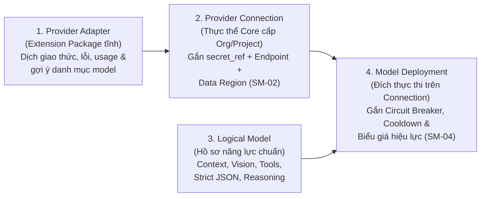
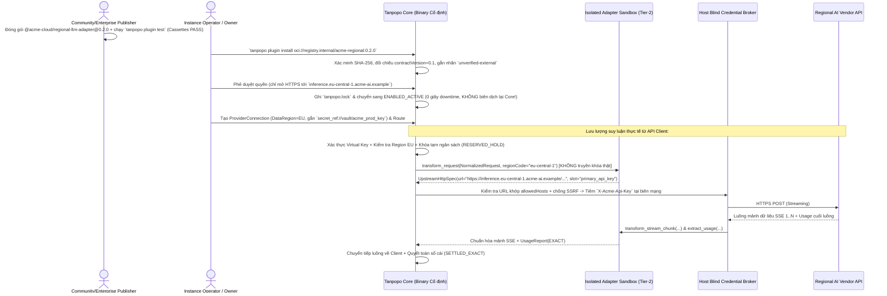

# Đặc tả Kiến trúc `Provider Adapter`, Ma trận Đảm bảo Năng lực & Quy tắc Chuyển mạch — Tanpopo

> **Tài liệu Đặc tả Kiến trúc Phần mở rộng (Phase ASTRA A04 — `DRAFT / ILLUSTRATIVE CANDIDATE SPEC`)**
> - **Mã tài liệu:** `SPEC-EXT-02` | **Phiên bản:** `0.1.0-step04-draft` | **Ngày cập nhật:** `2026-11-11`
> - **Vai trò biên soạn:** Platform Architect & Security-Minded SDK Designer
> - **Tuyên bố Trạng thái Chuẩn hóa:** Các ví dụ cấu hình Gói Khai báo (Tầng 1) và luồng trình tự dưới đây **mang tính minh họa thiết kế (`ILLUSTRATIVE — PRE-ADR`)** nhằm kiểm chứng khả năng cài đặt nhà cung cấp mới độc lập hoàn toàn với chu kỳ phát hành Tanpopo Core.
> - **Truy vết Yêu cầu:** `TP-FR-0101`..`0105`, `TP-FR-0201`..`0203`, `TP-FR-0301`..`0306`, `TP-FR-0601`..`0603`, `TP-FR-0802`, `TP-BR-0501`..`0505`, `TP-BR-0703`.

---

## 1. Kiến trúc Tách biệt 4 Tầng từ Gói Phần mềm tới Đích Lưu lượng

Một sai lầm phổ biến của các cổng thế hệ cũ là trộn lẫn mã chuyển đổi giao thức với thông tin tài khoản và bảng giá. Trong Tanpopo, `Provider Adapter` chỉ là **tầng đầu tiên (bất biến và phi trạng thái đối với khóa khách hàng)** trong chuỗi 4 thực thể:



- **Hệ quả thiết kế quan trọng:**
  1. Nâng cấp hoặc quay lui `Provider Adapter` từ `0.2.0` về `0.1.9` **không làm mất** bất kỳ `Provider Connection`, khóa bí mật hay lịch sử chi phí nào của các dự án đang dùng nó.
  2. Khi nhà cung cấp AI tung ra một mô hình mới vào buổi sáng (ví dụ `vendor-model-next`) dùng chung giao thức hiện tại của Adapter, quản trị viên có thể khai báo ngay `Model Deployment` + `Capability Profile` + biểu giá trên Control Plane **mà không cần cập nhật cả Core lẫn Adapter** (`WF-03`).

---

## 2. Ba Cấp độ Đảm bảo Năng lực (`DECLARED` vs `TESTED` vs `VERIFIED`)

Để ngăn chặn tình trạng tác giả phần mở rộng đánh dấu bừa `"supports_all": true` khiến ứng dụng gặp lỗi lúc chạy thật, mọi năng lực trong `Capability Profile` của một `Provider Adapter` mang một trong **3 trạng thái kiểm chứng rõ ràng**:

| Cấp độ đảm bảo | Nguồn xác lập | Điều kiện kỹ thuật bắt buộc | Cách Bộ Định tuyến (`Router`) & Chính sách Sử dụng |
|---|---|---|---|
| **1. `DECLARED`** *(Tự khai báo)* | Do `Extension Publisher` ghi trong `Manifest` hoặc do quản trị viên thêm tay cho model mới. | Hợp lệ về mặt cú pháp JSON Schema nhưng chưa có bằng chứng kiểm thử đi kèm gói. | Cho phép dùng trong `development` / `staging`; trên Console hiển thị nhãn *Tự khai báo (Chưa kiểm thử tự động)*. |
| **2. `TESTED`** *(Đã qua kiểm thử hợp đồng)* | Được xác nhận bởi công cụ `tanpopo plugin test` dựa trên tệp băng ghi (`Cassettes`) đính kèm gói. | Có tối thiểu 1 kịch bản băng ghi đầu-cuối hợp lệ cho đúng năng lực đó (ví dụ băng ghi gọi hàm, băng ghi `strict_json_schema`, băng ghi đếm `reasoning_tokens`) vượt qua kiểm định schema của Host. | Đủ điều kiện tiêu chuẩn cho lưu lượng sản xuất nội bộ thông thường. |
| **3. `VERIFIED`** *(Đã chứng thực thực tế)* | Do hệ thống kiểm định của Tanpopo Marketplace (cho gói `official`/`verified`) hoặc `Reviewer` nội bộ của tổ chức ký xác nhận. | Vượt qua bộ kiểm thử hợp đồng mở rộng đối chiếu với phản hồi thực tế của nhà cung cấp đích (bao gồm cả các ca lỗi `429`, đứt luồng và kiểm tra tuân thủ điều khoản). | Chính sách môi trường `production` nghiêm ngặt có thể cấu hình: *"Chỉ định tuyến yêu cầu có `strict_json_schema` tới các đích đạt mức `TESTED` hoặc `VERIFIED`"*. |

---

## 3. Đặc tả Chuyển đổi Chuyên sâu cho `Provider Adapter` (Tầng 1 & Tầng 2)

### 3.1. Minh họa Gói `Declarative Provider Adapter` (Tầng 1 — Không thực thi mã tùy ý)

Khoảng 75–80% nhà cung cấp AI thương mại và máy chủ mô hình mở (`vLLM`, `SGLang`, `Ollama`, các đám mây suy luận khu vực) chỉ khác nhau ở đường dẫn URL, cách đặt tên tiêu đề xác thực, danh mục mô hình, giới hạn tham số và tên trường đếm token:

```yaml
# MINH HỌA GÓI KHAI BÁO TẦNG 1 (ILLUSTRATIVE CANDIDATE — KHÔNG CHẠY CODE TÙY Ý)
apiVersion: tanpopo.dev/extension/v1alpha1
kind: DeclarativeProviderAdapter

metadata:
  id: "@community/nova-infer-declarative"
  version: "0.1.0"
  license: "Apache-2.0"

compatibility:
  contractVersion: "0.1"
  coreVersionRange: ">=0.1.0 <0.3.0"

permissions:
  networkEgress:
    allowedHosts: ["api.nova-infer.example"]
    allowPrivateIp: false
    requireTls: true

adapter:
  slug: "nova-infer"
  baseUrlTemplate: "https://api.nova-infer.example/v1"
  wireProtocol: "openai_chat_v1"          # Sử dụng bộ phân tích luồng an toàn có sẵn của Core
  auth:
    - id: "bearer_api_key"
      mode: "host_blind_inject"
      secretSlot: "api_key"
      headerName: "Authorization"
      valuePrefix: "Bearer "

  timeoutsDefault:
    connectTimeoutMs: 5000
    firstByteTimeoutMs: 30000             # Có thể nâng lên 60000+ cho Ollama/vLLM nạp nguội
    idleChunkTimeoutMs: 15000

  rateLimitMapping:
    retryAfterHeader: "retry-after"
    remainingRequestsHeader: "x-ratelimit-remaining-requests"
    remainingTokensHeader: "x-ratelimit-remaining-tokens"

  usageExtraction:
    inputTokensPath: "$.usage.prompt_tokens"
    outputTokensPath: "$.usage.completion_tokens"
    cacheReadTokensPath: "$.usage.prompt_tokens_details.cached_tokens"
    reasoningTokensPath: "$.usage.completion_tokens_details.reasoning_tokens"

  modelsCatalog:
    - modelId: "nova-70b-instruct"
      contextWindow: 131072
      maxOutputTokens: 8192
      capabilities:
        streaming: true
        toolCalling: true
        parallelToolCalls: true
        strictJsonSchema: false           # Cấm giả vờ hỗ trợ nếu đích chỉ có json_object mềm!
        jsonObjectMode: true
        visionInput: false
        audioInput: false
        reasoningTokens: false
      referencePricingUsdPer1M:           # Chỉ mang tính tham chiếu; Admin có thể ghi đè trên Deployment
        input: 0.60
        output: 1.80
```

### 3.2. Trách nhiệm Xử lý Từng Nhóm Chức năng Giao thức của Adapter

Chi tiết tương thích giao thức phía ứng dụng khách được quy định tại [`api-protocol-compatibility.md`](./api-protocol-compatibility.md); ở phía nhà cung cấp đích, mọi `Provider Adapter` phải tuân thủ 8 quy tắc sau:

1. **Chat, Embeddings & Đa phương thức (`Vision / Audio / Document`):**
   - Khai báo rõ giới hạn kích thước tệp tối đa, danh sách `MIME types` chấp nhận và chế độ truyền (`https_url` hay `inline_base64`).
   - Nếu ứng dụng gửi URL ảnh nhưng nhà cung cấp đích chỉ nhận `base64`, việc tải ảnh hộ **chỉ được thực hiện bởi dịch vụ tải an toàn của Core** (có kiểm tra chống SSRF chặn toàn bộ IP nội bộ) nếu chính sách tuyến cho phép tường minh; Adapter không tự mở kết nối tải URL tùy ý.
2. **Gọi hàm (`Tool Calling`) & Đầu ra JSON Có Cấu trúc:**
   - Khi streaming lời gọi hàm theo từng mảnh (`tool_call_chunks`), Adapter chỉ chuyển tiếp các mảnh delta đúng thứ tự chỉ mục (`index`), không tự ý sửa chuỗi tham số của mô hình.
   - Nếu mô hình lượng tử hóa nội bộ trả về JSON gọi hàm bị gãy cú pháp ở chế độ không luồng, Adapter phân loại mã lỗi là `UPSTREAM_MALFORMED_TOOL_CALL` (để ứng dụng hoặc chính sách tuyến biết là lỗi chất lượng mô hình, tránh đánh nhầm là lỗi sập mạng toàn cục).
3. **Truyền luồng SSE (`Streaming`) & Nhịp Giữ Kết nối (`Keep-Alive`):**
   - Bóc tách đúng ranh giới sự kiện SSE (`data: ...`), bỏ qua an toàn các dòng chú thích giữ kết nối (`: ping` / `: keep-alive`) không tính là mảnh nội dung nghiệp vụ, và nhận diện chính xác dấu hiệu kết thúc luồng chuẩn của từng hãng (ví dụ `[DONE]` hoặc sự kiện `message_stop` có `stop_reason`).
4. **Giới hạn Tốc độ Phía Nhà cung cấp (`Upstream Rate Limits`):**
   - Trích xuất `Retry-After` (cả dạng số giây lẫn ngày HTTP) và tiêu đề hạn mức còn lại để trả về cho bộ điều khiển sức khỏe `SM-04` của Core đưa đúng `Model Deployment` đó vào trạng thái nghỉ ngắn `THROTTLED_COOLDOWN` thay vì bắn mù liên tục.
5. **Đo đếm Tiêu thụ (`Usage / Metering`) & Ước tính Dự phòng:**
   - Hỗ trợ bóc tách đầy đủ 5 thành phần: `input_tokens`, `output_tokens`, `cache_read_tokens`, `cache_write_tokens`, `reasoning_tokens` (cùng đơn vị ảnh/giây âm thanh nếu có).
   - Nếu nhà cung cấp không gửi khung tổng kết token ở mảnh SSE cuối (ví dụ trên một số bản dựng máy chủ cục bộ cũ hoặc khi luồng bị ngắt giữa chừng), Core tự động áp bộ đếm ước lượng dự phòng và đóng dấu `ESTIMATED` (hoặc `UNMETERED_FLAGGED` nếu thiếu hoàn toàn đơn vị đo/bảng giá — `TP-BR-0703`).
6. **Đường đi Giữ nguyên Phương ngữ Gốc (`Native Dialect Passthrough`):**
   - Adapter có thể đăng ký tiền tố phương ngữ gốc (ví dụ `/native/anthropic`, `/native/gemini`). Ở chế độ này, Adapter **không dịch lại thân gói tin**, mà chỉ cung cấp 2 móc nhẹ: (a) kiểm tra tên mô hình để áp chính sách, và (b) đọc chỉ số sử dụng từ phản hồi gốc để quyết toán sổ cái.

---

## 4. Ma trận Quy tắc Thử lại & Chuyển mạch Dự phòng (`Retry & Fallback Rules`)

| Tình huống lỗi từ Nhà cung cấp Đích | Thời điểm xảy ra | Quyết định bắt buộc của Tanpopo Core + Adapter | Trạng thái `SM-02` / `SM-04` |
|---|---|---|---|
| **Lỗi kết nối TCP/TLS, DNS, hoặc quá hạn `first_byte_timeout`** | **Trước khi** phát mảnh nội dung đầu tiên | **Cho phép Failover** sang `Model Deployment` hợp lệ kế tiếp trong `Route` (tối đa `<= 3` đích). | Tăng bộ đếm lỗi; mở `CIRCUIT_OPEN_UNHEALTHY` nếu vượt ngưỡng. |
| **HTTP `429 Too Many Requests` / `529 Overloaded`** | **Trước khi** phát mảnh nội dung đầu tiên | **Cho phép Failover** ngay sang đích kế tiếp; gắn `THROTTLED_COOLDOWN` theo `Retry-After` lên đích vừa báo `429`. | `Deployment` → `THROTTLED_COOLDOWN`. |
| **HTTP `401 Unauthorized` / `403 Invalid Key`** | **Trước khi** phát mảnh nội dung đầu tiên | **Cho phép Failover** sang `Provider Connection` dự phòng khác (nếu có); **không thử lại** trên chính kết nối vừa lỗi khóa. | `Connection` → `AUTH_EXPIRED_REAUTH_REQUIRED` + bắn cảnh báo quản trị (`TP-BR-0304`). |
| **HTTP `400` / `422` (Sai tham số đầu vào hoặc từ chối an toàn nội dung)** | **Trước khi** phát mảnh nội dung đầu tiên | **Cấm thử lại / Cấm Failover** (ngoại trừ lỗi thiếu năng lực cục bộ đã được bộ lọc năng lực loại từ trước); trả mã lỗi chuẩn về `API Client`. | Giữ nguyên `HEALTHY` (lỗi do dữ liệu yêu cầu, không phải sập đích). |
| **Đứt kết nối mạng, lỗi nội bộ SSE hoặc quá hạn `idle_chunk_timeout`** | **SAU KHI** đã phát `>= 1` mảnh nội dung/tool call (`Partial Stream`) | **CẤM TUYỆT ĐỐI FAILOVER (`TP-BR-0503`).** Phát khung lỗi `mid_stream_abort`, đóng luồng SSE sạch và quyết toán `SETTLED_ESTIMATED`. | Ghi nhận lỗi gián đoạn lên `Deployment`. |
| **Đích dự phòng còn sống duy nhất nằm ngoài `Data Region` cho phép** | Bất kỳ thời điểm nào | **CẤM TUYỆT ĐỐI FAILOVER (`TP-BR-0501` — `Fail-Closed`).** Trả ngay `503 no_compliant_deployment_available`. | Không gửi dữ liệu sang vùng cấm. |
| **Đang gọi đường dẫn phương ngữ gốc (`/native/<dialect>/...`)** | Trước khi phát mảnh đầu tiên | Chỉ cho phép chuyển mạch sang `Model Deployment` **cùng chia sẻ chính xác `dialect` đó**; cấm chuyển chéo sang họ giao thức khác (`TP-AC-F0105`). | Lọc ứng viên theo `dialect` trước khi gọi. |

---

## 5. Luồng Trình tự Minh họa: Cài đặt & Gọi External Provider Adapter Không Cần Sửa Core


