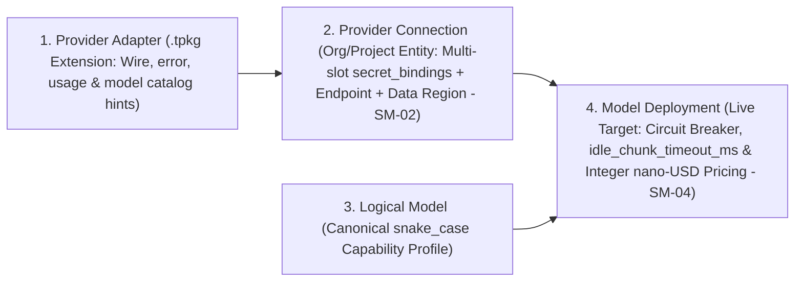
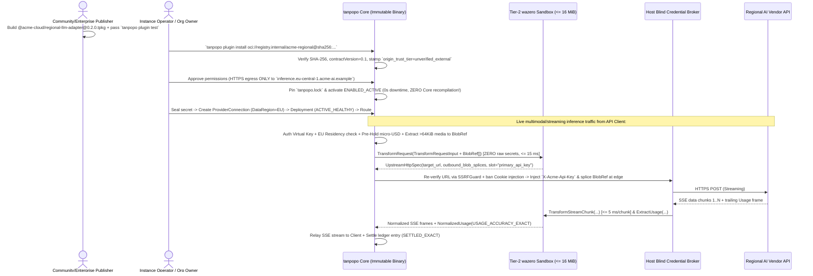

# `Provider Adapter` Architecture, Capability Assurance Matrix & Failover Specification — Tanpopo

> **Canonical Provider Adapter Specification (Synchronized in `TP-IMP-0002` — Spec Closure Batch B)**
> - **Document ID:** `SPEC-EXT-02` | **Version:** `0.2.0-m0-closure` | **Last Updated:** `2026-11-14`
> - **Authoring Role:** Platform Architect & Security-Minded SDK Designer
> - **Machine-Readable Contract Reference:** [`proto/tanpopo/extension/v1/runtime.proto`](../../proto/tanpopo/extension/v1/runtime.proto) (`ExtensionRuntimeService`), [`openapi/dataplane-v1.yaml`](../../openapi/dataplane-v1.yaml), and [`api-contracts.md`](./api-contracts.md) (`NormalizedInferenceRequestEnvelope`).
> - **Official Adapter Roster Phasing (`CR-01`):** `MVP (v0.1)` ships **5 Official Reference Adapters** (`OpenAI`, `Anthropic`, `Google Gemini`, `OpenAI-Compatible / vLLM`, `Ollama` — exercising both Tier-1 Declarative and Tier-2 Wasm in production); **`AWS Bedrock` (`AWS_SIGV4`), `Azure OpenAI`, and `/v1/rerank`** ship in **`v0.2` (`M3`)**.
> - **Measurement Honesty (`COND-PO-01`):** All timeout, latency, and failover timing values in this specification are **`TARGET / UNVERIFIED`** until empirical verification in `M0` (`SPIKE-01/02`) and `M5`.
> - **Requirements Traceability:** `TP-FR-0101`..`0105`, `TP-FR-0201`..`0203`, `TP-FR-0301`..`0306`, `TP-FR-0601`..`0603`, `TP-FR-0802`, `TP-BR-0501`..`0505`, `TP-BR-0703`, `CR-01`, `CR-05`, `CR-09`.

---

## 1. Four-Layer Decoupled Architecture from Software Package to Traffic Target

A `Provider Adapter` is strictly **the first layer (immutable and completely stateless with respect to customer secrets)** in a four-entity chain:



- **Key Architectural Consequences:**
  1. Upgrading or rolling back a `Provider Adapter` from `0.2.0` to `0.1.9` **never drops or invalidates** any `Provider Connection`, vault credential, or historical `usage_settlements` row.
  2. When an AI vendor launches a new model overnight speaking an existing wire dialect, an administrator registers its `Logical Model` + `Model Deployment` + integer `nano-USD` rate card immediately in the Control Plane **without updating either the `tanpopo` Core binary or the Adapter** (`WF-03`).

---

## 2. Three Capability Assurance Tiers (`DECLARED` vs `TESTED` vs `VERIFIED`)

Every canonical `snake_case` capability flag (`streaming`, `tool_calling`, `parallel_tool_calls`, `strict_json_schema`, `json_object`, `vision`, `audio_input`, `document_input`, `reasoning`, `prompt_caching`, `embeddings`, `rerank`) in a `Capability Profile` carries one of **three explicit assurance levels**:

| Assurance Tier | Establishing Authority | Mandatory Technical Evidence | Router & Policy Enforcement Behavior |
|---|---|---|---|
| **1. `DECLARED`** *(Self-Asserted)* | Declared by the `Extension Publisher` in `Manifest` or added manually by an admin. | Syntactically valid JSON Schema, backed by zero automated test cassettes in the `.tpkg` archive. | Permitted in `dev` / `staging`; flagged in Console UI via `Token` as *Self-Declared*. |
| **2. `TESTED`** *(Contract-Tested)* | Validated by `tanpopo plugin test` against deterministic offline HTTP/SSE `Cassettes`. | At least 1 passing cassette fixture per capability (`tool_calling`, `strict_json_schema`, `reasoning`, etc.). | Standard baseline eligibility for internal production routes. |
| **3. `VERIFIED`** *(Live-Attested)* | Cryptographically attested by Tanpopo Marketplace CI (`official`/`verified`) or internal `SECURITY_REVIEWER`. | Passes extended conformance suite (`429` throttling, `mid_stream_abort`, and `DEC-004` ToS compliance). | Regulated `prod` policies may mandate `MinCapabilityAssurance = VERIFIED` or `TESTED`. |

---

## 3. Deep-Dive Translation Semantics for `Provider Adapter` (Tier 1 & Tier 2)

### 3.1. Canonical `Declarative Provider Adapter` Package (Tier 1 — Zero Arbitrary Code Execution)

All capability keys use canonical **`snake_case`**, and all advisory pricing uses **64-bit integer `nano-USD` per token** (`0` floating-point numbers — e.g., `600 nano-USD/token = $0.60 / 1M tokens`):

```yaml
apiVersion: tanpopo.dev/extension/v1alpha1
kind: DeclarativeProviderAdapter

metadata:
  id: "@community/nova-infer-declarative"
  version: "0.1.0"
  license: "Apache-2.0"

compatibility:
  contractVersion: "0.1"
  coreVersionRange: ">=0.1.0 <0.3.0"

permissions:
  networkEgress:
    allowedHosts: ["api.nova-infer.example"]
    allowPrivateIp: false
    requireTls: true

adapter:
  slug: "nova-infer"
  baseUrlTemplate: "https://api.nova-infer.example/v1"
  wireProtocol: "openai_chat_v1"          # Automatically injects stream_options.include_usage=true when stream=true (CR-09)
  auth:
    - id: "bearer_api_key"
      mode: "host_blind_inject"
      secretSlot: "primary_api_key"
      headerName: "Authorization"         # Cookie / Set-Cookie strictly forbidden (DEC-004)
      valuePrefix: "Bearer "

  timeoutsDefault:
    connectTimeoutMs: 5000
    firstByteTimeoutMs: 30000             # Tunable to 60000+ for cold-loading Ollama/vLLM weights
    idleChunkTimeoutMs: 15000

  rateLimitMapping:
    retryAfterHeader: "retry-after"
    remainingRequestsHeader: "x-ratelimit-remaining-requests"
    remainingTokensHeader: "x-ratelimit-remaining-tokens"

  usageExtraction:
    inputTokensPath: "$.usage.prompt_tokens"
    outputTokensPath: "$.usage.completion_tokens"
    cacheReadTokensPath: "$.usage.prompt_tokens_details.cached_tokens"
    reasoningTokensPath: "$.usage.completion_tokens_details.reasoning_tokens"

  modelsCatalog:
    - modelId: "nova-70b-instruct"
      contextWindow: 131072
      maxOutputTokens: 8192
      capabilities:                       # Canonical snake_case dictionary (GAP-13)
        streaming: true
        tool_calling: true
        parallel_tool_calls: true
        strict_json_schema: false         # Must NEVER claim true if upstream supports only best-effort json_object!
        json_object: true
        vision: false
        audio_input: false
        document_input: false
        reasoning: false
        prompt_caching: true
        embeddings: false
        rerank: false
      referencePricingNanoUsdPerToken:    # 64-bit integer nano-USD per token (1,000 nano-USD/tok = $1.00 / 1M tokens)
        input_token_nano_usd: 600
        output_token_nano_usd: 1800
        cache_read_token_nano_usd: 150
```

### 3.2. Adapter Responsibilities Across Protocol Functional Domains

1. **Synchronous & Streaming Inference + Out-of-Band `BlobRef` Multimodal Payloads (`CR-05`):**
   - Implement both `TransformRequest` + `TransformResponse` (for `stream: false` chat, `/v1/responses`, `/v1/embeddings`, and `v0.2` `/v1/rerank`) and `TransformStreamChunk` (for SSE streaming).
   - Multimodal payloads `> 64 KiB` (up to `32 MiB`) arrive in `TransformRequestInput` as compact `BlobRef` descriptors (`blob_ref://<request_id>/<part_index>`); Guest emits splice placeholders in `UpstreamHttpSpec` and Host streams decoded or base64-encoded bytes directly onto the egress TLS socket outside Wasm's `16 MiB` memory ceiling.
   - Any optional URL-to-`base64` fetching is executed solely by Core's hardened `SSRFGuard` media fetcher when permitted by route policy.
2. **Tool Calling & Structured JSON Outputs:**
   - Preserve exact `tool_calls` array `index` ordering across SSE argument deltas without mutating JSON fragments.
   - Classify truncated or malformed upstream tool-call JSON in non-streaming responses as `502 upstream_malformed_response` via `NormalizeError`.
3. **SSE Streaming, Automatic `include_usage` Injection (`CR-09`) & Keep-Alives:**
   - On OpenAI-compatible wire protocols (`openai_chat_v1`), whenever `stream: true` is requested, automatically inject `stream_options: {"include_usage": true}` into the outbound payload so compliant upstreams emit exact trailing token usage frames.
   - Strip upstream keep-alive comments (`: ping`, `: keep-alive`) without emitting empty content deltas, while Host emits `: ping\n\n` every `15s` during long `reasoning` pauses.
4. **Upstream Rate Limits (`SM-04`):**
   - Parse `Retry-After` (delta-seconds and HTTP-date) and `X-RateLimit-Remaining-*` headers in `NormalizeError` so Core places throttled deployments into `THROTTLED_COOLDOWN`.
5. **Multi-Component & Multimodal Usage Metering (`ExtractUsage` -> `NormalizedUsage`):**
   - Extract all 5 token dimensions (`input_tokens`, `output_tokens`, `cache_read_tokens`, `cache_write_tokens`, `reasoning_tokens`) plus `MediaUsage` (`image_count`, `image_pixels`, `audio_input_seconds`, `document_pages`, `rerank_search_units`).
   - When upstream omits `usage` or aborts mid-stream, Host falls back to text-only UTF-8 byte estimation + `BlobRef` media unit schedules and stamps `ESTIMATED` or `UNMETERED_FLAGGED` (never `EXACT = 0` — `FMEA-04`).
6. **Lossless Native Dialect Passthrough (`InspectNativeRequest`):**
   - On `/native/{dialect}/{upstreamPath}`, the Adapter leaves request/response bodies untouched and implements `InspectNativeRequest` (extracting `target_model`, `stream`, `required_capabilities`, `max_output_tokens_hint`, and `credential_injections`) plus `ExtractUsage` for post-call settlement.

---

## 4. `Retry & Fallback Rules` Matrix (`1 + max_failover_hops <= 4` Pre-Stream Attempts)

| Upstream Failure Scenario | Failure Timing | Mandatory Tanpopo Core + Adapter Decision | `SM-02` / `SM-04` State Transition |
|---|---|---|---|
| **TCP/TLS failure, DNS error, `first_byte_timeout`, or Wasm trap (`502 extension_execution_fault`)** | **Before** emitting the first content chunk | **Failover PERMITTED** to the next eligible `Model Deployment` in the `Route` (default `max_failover_hops = 3`, i.e., `1` primary + `3` fallbacks = **`4` max total attempts**). | Increment failure counter; trip `CIRCUIT_OPEN_UNHEALTHY` on threshold breach (or `QUARANTINED` on `> 20` Wasm faults/60s). |
| **HTTP `429 Too Many Requests` / `529 Overloaded`** | **Before** emitting the first content chunk | **Failover PERMITTED** immediately to next candidate; set `THROTTLED_COOLDOWN` per `Retry-After`. | `Deployment` -> `THROTTLED_COOLDOWN`. |
| **HTTP `401 Unauthorized` / `403 Invalid Key`** | **Before** emitting the first content chunk | **Failover PERMITTED** to a backup `Provider Connection`; **never retry** on the failing connection. | `Connection` -> `AUTH_EXPIRED_REAUTH_REQUIRED` + fire `ALT-OAUTH-EXPIRY`. |
| **HTTP `400` / `422` (Invalid caller payload or safety refusal)** | **Before** emitting the first content chunk | **Retry / Failover FORBIDDEN**; return `CanonicalErrorEnvelope` to `API Client`. | Keep `ACTIVE_HEALTHY`. |
| **Socket drop, upstream SSE error, or `idle_chunk_timeout`** | **AFTER** emitting `>= 1` content/tool-call chunk (`Partial Stream`) | **FAILOVER STRICTLY FORBIDDEN (`TP-BR-0503` / `FMEA-01`).** Emit terminal `mid_stream_abort` SSE error event, close stream cleanly, and settle as `SETTLED_ESTIMATED`. | Record stream-interruption penalty against `Deployment`. |
| **Only surviving healthy backup resides outside permitted `Data Region`** | At any point | **FAILOVER STRICTLY FORBIDDEN (`TP-BR-0501` — `Fail-Closed`).** Return `503 no_compliant_deployment_available`. | Zero payload bytes leave approved regions. |
| **Caller invoked `/native/{dialect}/{upstreamPath}`** | Before emitting the first chunk | Failover permitted **exclusively** to backup deployments sharing the **exact same `dialect`**; cross-dialect targets fail with `400 dialect_mismatch` (`CT-13`). | Pre-filter candidate pool by `dialect`. |

---

## 5. End-to-End Sequence: Installing & Invoking an External `.tpkg` Adapter Without Modifying Core


