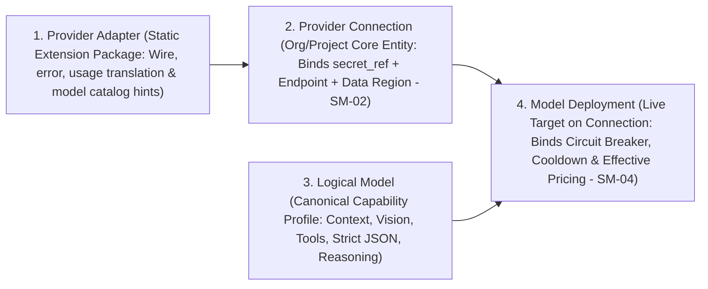
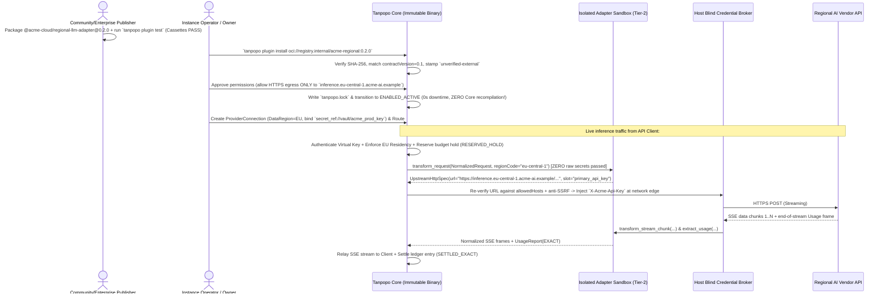

# `Provider Adapter` Architecture, Capability Assurance Matrix & Failover Specification — Tanpopo

> **Extension Architecture Specification Document (ASTRA Phase A04 — `DRAFT / ILLUSTRATIVE CANDIDATE SPEC`)**
> - **Document ID:** `SPEC-EXT-02` | **Version:** `0.1.0-step04-draft` | **Last Updated:** `2026-11-11`
> - **Authoring Role:** Platform Architect & Security-Minded SDK Designer
> - **Standardization Status Statement:** The Declarative Package (Tier 1) configuration examples and sequence flows below are **illustrative candidate designs (`ILLUSTRATIVE — PRE-ADR`)** demonstrating how new upstream providers can be onboarded completely independently of Tanpopo Core release cycles.
> - **Requirements Traceability:** `TP-FR-0101`..`0105`, `TP-FR-0201`..`0203`, `TP-FR-0301`..`0306`, `TP-FR-0601`..`0603`, `TP-FR-0802`, `TP-BR-0501`..`0505`, `TP-BR-0703`.

---

## 1. Four-Layer Decoupled Architecture from Software Package to Traffic Target

A recurring architectural flaw in legacy AI proxies is coupling wire-translation code directly to customer credentials and pricing tables. In Tanpopo, a `Provider Adapter` is strictly **the first layer (immutable and completely stateless with respect to customer secrets)** in a four-entity chain:



- **Key Architectural Consequences:**
  1. Upgrading or rolling back a `Provider Adapter` from `0.2.0` to `0.1.9` **never drops or invalidates** any `Provider Connection`, vault credential, or historical spend ledger entry across consuming projects.
  2. When an AI vendor launches a new model overnight (e.g., `vendor-model-next`) speaking the Adapter's existing wire protocol, an administrator can register its `Model Deployment` + `Capability Profile` + pricing table immediately in the Control Plane **without updating either Core or the Adapter** (`WF-03`).

---

## 2. Three Capability Assurance Tiers (`DECLARED` vs `TESTED` vs `VERIFIED`)

To prevent extension authors from blindly setting `"supports_all": true` and causing runtime production failures, every capability flag in a `Provider Adapter`'s `Capability Profile` carries one of **three explicit assurance levels**:

| Assurance Tier | Establishing Authority | Mandatory Technical Evidence | Router & Policy Enforcement Behavior |
|---|---|---|---|
| **1. `DECLARED`** *(Self-Asserted)* | Declared by the `Extension Publisher` in the `Manifest` or added manually by an admin for a newly released model. | Syntactically valid JSON Schema, but backed by zero automated test cassettes in the package. | Permitted in `development` / `staging`; flagged in the Console UI as *Self-Declared (Unverified by Automated Tests)*. |
| **2. `TESTED`** *(Contract-Tested)* | Validated by `tanpopo plugin test` against deterministic HTTP/SSE `Cassettes` bundled with the package. | Contains at least 1 end-to-end cassette fixture exercising that specific capability (e.g., tool calling, `strict_json_schema`, `reasoning_tokens` extraction) passing Host schema checks. | Standard baseline eligibility for general internal production traffic. |
| **3. `VERIFIED`** *(Live-Attested)* | Cryptographically attested by the Tanpopo Marketplace CI pipeline (for `official`/`verified` packages) or an enterprise's internal `Reviewer`. | Passes the extended contract conformance suite against live upstream vendor endpoints (including `429` throttling, mid-stream abort, and ToS compliance checks). | High-assurance `production` policies may mandate: *"Route `strict_json_schema` requests exclusively to `TESTED` or `VERIFIED` deployments"*. |

---

## 3. Deep-Dive Translation Semantics for `Provider Adapter` (Tier 1 & Tier 2)

### 3.1. Illustrative `Declarative Provider Adapter` Package (Tier 1 — Zero Arbitrary Code Execution)

Roughly 75–80% of commercial AI providers and open-weight inference engines (`vLLM`, `SGLang`, `Ollama`, regional inference clouds) differ solely in URL templates, authentication header names, model catalogs, parameter bounds, and token-usage JSON paths:

```yaml
# ILLUSTRATIVE TIER-1 DECLARATIVE PACKAGE (CANDIDATE — ZERO ARBITRARY CODE EXECUTION)
apiVersion: tanpopo.dev/extension/v1alpha1
kind: DeclarativeProviderAdapter

metadata:
  id: "@community/nova-infer-declarative"
  version: "0.1.0"
  license: "Apache-2.0"

compatibility:
  contractVersion: "0.1"
  coreVersionRange: ">=0.1.0 <0.3.0"

permissions:
  networkEgress:
    allowedHosts: ["api.nova-infer.example"]
    allowPrivateIp: false
    requireTls: true

adapter:
  slug: "nova-infer"
  baseUrlTemplate: "https://api.nova-infer.example/v1"
  wireProtocol: "openai_chat_v1"          # Reuses Core's memory-safe built-in SSE parser
  auth:
    - id: "bearer_api_key"
      mode: "host_blind_inject"
      secretSlot: "api_key"
      headerName: "Authorization"
      valuePrefix: "Bearer "

  timeoutsDefault:
    connectTimeoutMs: 5000
    firstByteTimeoutMs: 30000             # Tunable to 60000+ for cold-loading Ollama/vLLM weights
    idleChunkTimeoutMs: 15000

  rateLimitMapping:
    retryAfterHeader: "retry-after"
    remainingRequestsHeader: "x-ratelimit-remaining-requests"
    remainingTokensHeader: "x-ratelimit-remaining-tokens"

  usageExtraction:
    inputTokensPath: "$.usage.prompt_tokens"
    outputTokensPath: "$.usage.completion_tokens"
    cacheReadTokensPath: "$.usage.prompt_tokens_details.cached_tokens"
    reasoningTokensPath: "$.usage.completion_tokens_details.reasoning_tokens"

  modelsCatalog:
    - modelId: "nova-70b-instruct"
      contextWindow: 131072
      maxOutputTokens: 8192
      capabilities:
        streaming: true
        toolCalling: true
        parallelToolCalls: true
        strictJsonSchema: false           # Must NEVER claim true if upstream supports only best-effort json_object!
        jsonObjectMode: true
        visionInput: false
        audioInput: false
        reasoningTokens: false
      referencePricingUsdPer1M:           # Advisory reference pricing; Admins can override per Deployment
        input: 0.60
        output: 1.80
```

### 3.2. Adapter Responsibilities Across Protocol Functional Domains

Client-facing wire compatibility is specified in [`api-protocol-compatibility.md`](./api-protocol-compatibility.md); facing upstream providers, every `Provider Adapter` must uphold the following protocol rules:

1. **Chat, Embeddings & Multimodal Payloads (`Vision / Audio / Document`):**
   - Explicitly declare maximum attachment byte limits, accepted `MIME types`, and delivery modes (`https_url` vs. `inline_base64`).
   - When an application submits an image URL to an upstream provider that accepts only `base64`, URL fetching **may be performed exclusively by Core's hardened media fetcher** (enforcing strict anti-SSRF private-IP blocking) when explicitly permitted by route policy; an Adapter never opens arbitrary URL fetch sockets on its own.
2. **Tool Calling & Structured JSON Outputs:**
   - When streaming incremental function calls (`tool_call_chunks`), the Adapter forwards argument delta chunks strictly preserving array `index` order without mutating model-emitted JSON fragments.
   - If a quantized model emits syntactically broken tool-call JSON in non-streaming mode, the Adapter classifies the failure as `UPSTREAM_MALFORMED_TOOL_CALL` (distinguishing model-quality defects from transport outages).
3. **SSE Streaming (`Streaming`) & Keep-Alive Heartbeats (`Keep-Alive`):**
   - Accurately frame SSE event boundaries (`data: ...`), safely ignore upstream keep-alive comment frames (`: ping` / `: keep-alive`) without counting them as content chunks, and detect each vendor's terminal stream sentinel (e.g., `[DONE]` or `message_stop` carrying `stop_reason`).
4. **Upstream Rate Limits (`Upstream Rate Limits`):**
   - Parse `Retry-After` headers (both delta-seconds and HTTP-date formats) alongside remaining-quota headers so Core's `SM-04` health state machine places that specific `Model Deployment` into `THROTTLED_COOLDOWN` instead of blindly hammering a throttled endpoint.
5. **Usage Metering (`Usage / Metering`) & Fallback Estimation:**
   - Extract all five token dimensions: `input_tokens`, `output_tokens`, `cache_read_tokens`, `cache_write_tokens`, and `reasoning_tokens` (plus image counts / audio seconds where applicable).
   - If an upstream server omits the final SSE usage summary frame (e.g., older local model runners or mid-stream disconnects), Core automatically engages its fallback byte/token estimator and stamps `ESTIMATED` (or `UNMETERED_FLAGGED` when unit pricing or modality metering is absent — `TP-BR-0703`).
6. **Lossless Native Dialect Passthrough (`Native Dialect Passthrough`):**
   - An Adapter may register a native passthrough prefix (e.g., `/native/anthropic`, `/native/gemini`). In this mode, the Adapter **does not rewrite request/response bodies**, providing only two lightweight hooks: (a) extracting the target model identifier for policy evaluation, and (b) extracting native usage counters for ledger settlement.

---

## 4. `Retry & Fallback Rules` Matrix

| Upstream Failure Scenario | Failure Timing | Mandatory Tanpopo Core + Adapter Decision | `SM-02` / `SM-04` State Transition |
|---|---|---|---|
| **TCP/TLS handshake failure, DNS error, or `first_byte_timeout`** | **Before** emitting the first content chunk | **Failover PERMITTED** to the next eligible `Model Deployment` in the `Route` (bounded `<= 3` targets). | Increment failure counter; trip `CIRCUIT_OPEN_UNHEALTHY` on threshold breach. |
| **HTTP `429 Too Many Requests` / `529 Overloaded`** | **Before** emitting the first content chunk | **Failover PERMITTED** immediately to the next candidate; apply `THROTTLED_COOLDOWN` per `Retry-After` on the throttled target. | `Deployment` → `THROTTLED_COOLDOWN`. |
| **HTTP `401 Unauthorized` / `403 Invalid Key`** | **Before** emitting the first content chunk | **Failover PERMITTED** to a backup `Provider Connection` (if configured); **never retry** on the broken connection itself. | `Connection` → `AUTH_EXPIRED_REAUTH_REQUIRED` + emit admin alert (`TP-BR-0304`). |
| **HTTP `400` / `422` (Invalid caller payload or content safety refusal)** | **Before** emitting the first content chunk | **Retry / Failover FORBIDDEN** (capability mismatches are pre-filtered prior to dispatch); return canonical error to `API Client`. | Keep `HEALTHY` (caller input defect, not upstream infrastructure failure). |
| **Socket drop, internal SSE error, or `idle_chunk_timeout`** | **AFTER** emitting `>= 1` content/tool-call chunk (`Partial Stream`) | **FAILOVER STRICTLY FORBIDDEN (`TP-BR-0503`).** Emit terminal `mid_stream_abort` frame, close SSE cleanly, and settle as `SETTLED_ESTIMATED`. | Record stream-interruption sample against `Deployment`. |
| **Only surviving healthy backup resides outside permitted `Data Region`** | At any point | **FAILOVER STRICTLY FORBIDDEN (`TP-BR-0501` — `Fail-Closed`).** Return `503 no_compliant_deployment_available` immediately. | Zero payload bytes leave approved regions. |
| **Caller invoked a native dialect route (`/native/<dialect>/...`)** | Before emitting the first chunk | Failover permitted **exclusively** to backup `Model Deployment` targets sharing the **exact same `dialect`**; cross-dialect failover is forbidden (`TP-AC-F0105`). | Pre-filter candidate pool by `dialect`. |

---

## 5. Illustrative Sequence Diagram: Installing & Invoking an External Provider Adapter Without Modifying Core


