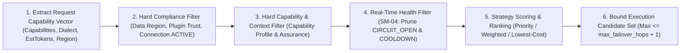

# Capability-Aware Routing & Hierarchical Policy Engine Specification — Tanpopo

> **Core Technical Specification Document (ASTRA Phase A05 — Gate G3: `READY_FOR_REVIEW` | `PROPOSED — PRE-APPROVAL`)**
> - **Document ID:** `SPEC-CORE-01` | **Version:** `0.1.0-step05-draft` | **Last Updated:** `2026-11-11`
> - **Authoring Role:** Principal Architect & Security Architect
> - **Governance Status:** **Proposed Design Specification (`PROPOSED`)** — details the deterministic runtime algorithms for `Domain 06 (Routing)` and `Domain 07 (Policy & Security)` in [`srs.md`](../requirements/srs.md).
> - **Requirements Traceability:** `TP-FR-0102`, `TP-FR-0103`, `TP-FR-0601`..`0604`, `TP-FR-0701`..`0705`, `TP-BR-0501`..`0505`, `SM-04`.

---

## 1. Hierarchical Policy Algebra (`Hierarchical Policy Algebra`: `Org ∩ Project ∩ Env`)

To guarantee that no downstream `Team Admin` or `Developer` can ever relax security guardrails established by an `Organization Owner` (`TP-FR-0701`), Tanpopo's policy evaluator enforces **`Monotonic Restrictive Intersection`**:

| Policy Dimension | Composition Operator `EffectivePolicy = P_org ⊗ P_project ⊗ P_env` | Behavior on Empty Intersection (`∅`) |
|---|---|---|
| **Data Residency (`AllowedDataRegions`)** | `R_eff = R_org ∩ R_project ∩ R_route ∩ R_request_header` | **Hard Block (`Fail-Closed`):** Returns `503 no_compliant_deployment_available`. |
| **Model / Adapter Allowlist (`ModelAllowlist`)** | `M_eff = M_org ∩ M_project ∩ M_env ∩ M_virtual_key` | **Hard Block (`Fail-Closed`):** Returns `403 model_denied_by_policy`. |
| **Minimum Extension Trust Tier (`MinPluginTrust`)** | `T_eff = max_strictness(T_org, T_project, T_env)` *(Strictness order: `OFFICIAL_ONLY > VERIFIED_PLUS > PRIVATE_ENTERPRISE > UNVERIFIED_ALLOWED`)* | Prunes every `Model Deployment` backed by an Adapter below `T_eff`. |
| **Minimum Capability Assurance (`MinCapabilityAssurance`)** | `A_eff = max_strictness(A_org, A_env)` *(`VERIFIED > TESTED > DECLARED`)* | Prunes `DECLARED`-only deployments from production environments requiring `TESTED`. |
| **Rate-Limit & Payload Size Ceilings** | `L_eff = min(L_org, L_project, L_env, L_virtual_key)` | Rejects with `413 payload_too_large` or `429 rate_limit_exceeded`. |
| **Content / PII Filters (`Guardrail Hooks`)** | Mandatory ordered concatenation: `Hooks_org ++ Hooks_project ++ Hooks_env` (child scopes cannot strip parent hooks). | If any `FAIL_CLOSED` hook rejects or times out → aborts the request prior to upstream dispatch. |

### Mandatory Failure-Posture Matrix (`Fail-Closed vs Controlled Fail-Open Matrix` — `TP-BR-0502`)

| Control Domain | Mandatory Posture on Internal Check Error / Dependency Outage | Architectural Rationale |
|---|---|---|
| **1. `Virtual Key` Auth, RBAC & `Org/Env/Plane` Isolation** | **Unconditional `FAIL_CLOSED` (`100%`)** | Never permit unauthenticated or cross-tenant request execution. |
| **2. `Data Residency` & Plugin Trust Thresholds** | **Unconditional `FAIL_CLOSED` (`100%`)** | Leaking regulated data into a prohibited jurisdiction even once constitutes an irreversible compliance breach. |
| **3. `Hard Budget Limit` Ledger** | **Unconditional `FAIL_CLOSED` (`100%`)** | Prevents runaway financial spend during distributed store degradation. |
| **4. Human Approval & `schema_hash` Pinning for `destructive` MCP** | **Unconditional `FAIL_CLOSED` (`100%`)** | Halting an agent is strictly safer than executing an unapproved destructive mutation. |
| **5. External `OpenTelemetry (OTLP)` Export Pipeline** | **Controlled `FAIL_OPEN` (`Drop-Oldest` + Drop Counter Alert)** | An unresponsive external log/trace collector must never take down live production inference (`TP-FR-0805`). |
| **6. Valkey `RPM/TPM` Counters During Valkey Partition** | **Fallback to Conservative Local Per-Node Ceiling (`limit / N_nodes`)** | Preserves safe gateway availability while still bounding abuse across cluster nodes (`ADR-0006`). |

---

## 2. Six-Step Capability-Aware Routing Algorithm (`6-Step Capability-Aware Routing Pipeline`)

Every request targeting a `Route` (or logical model slug) is resolved deterministically against the in-memory `ConfigSnapshot` (`< 0.2 ms`):



1. **Step 1 — Request Capability Vector Extraction (`Request Capability Extraction`):**
   - Inspects the request for: image blocks (`vision = true`), audio (`audio_input = true`), document/PDF blocks (`document_input = true`), `tools` definitions (`tool_calling = true`, `parallel_tool_calls`), `response_format.type == "json_schema"` with `strict == true` (`strict_json_schema = true`), `reasoning_effort`, ingress wire dialect (`openai_compatible` vs `native:<dialect>`), and fast token bound estimation `estimated_input_tokens + max_output_tokens`.
2. **Step 2 — Hard Compliance & Entitlement Filter (`Hard Compliance Filter`):**
   - Eliminates every `Model Deployment` where: (a) the parent `Provider Connection` is not `ACTIVE`/`DEGRADED` (`SM-02`), (b) the backing `Extension Installation` is `QUARANTINED`/`DISABLED`, (c) `data_region` lies outside `AllowedDataRegions` (`TP-FR-0602`), or (d) the wire dialect mismatches an ingress `/native/<dialect>/...` call.
   - *Error disambiguation rule:* If Step 2 yields an empty candidate set due to data residency constraints → immediately returns **`503 no_compliant_deployment_available`**.
3. **Step 3 — Hard Capability & Context-Window Filter (`Hard Capability Filter` — `TP-FR-0102`):**
   - Matches every required capability flag from Step 1 against each `Model Deployment`'s effective `Capability Profile` and `MinCapabilityAssurance` threshold, verifying `estimated_total_tokens <= context_window`.
   - **Zero silent parameter stripping:** If zero surviving candidates support a requested capability (e.g., `strict_json_schema = true`) → immediately returns **`400 capability_not_supported`** naming the missing capability.
4. **Step 4 — Real-Time Health & Circuit Filter (`Health & Circuit Filter` — `SM-04`):**
   - Excludes deployments currently in `CIRCUIT_OPEN_UNHEALTHY`, `DRAINING_MAINTENANCE`, `DISABLED`, or `THROTTLED_COOLDOWN` where `cooldown_until > now()`.
   - For a deployment transitioning into `HALF_OPEN_PROBING` upon cooldown expiry, admits at most `1` concurrent probe request gated by an atomic `CAS (Compare-And-Swap)` flag.
5. **Step 5 — Route Strategy Ranking (`Strategy Ranking`):**
   - **`PRIORITY_FAILOVER`:** Sorts ascending by `priority_order`, breaking ties via `Smooth Weighted Round-Robin`.
   - **`WEIGHTED`:** Selects via weighted random sampling proportional to `weight` (deterministically seeded under contract test runs).
   - **`LOWEST_COST`:** Computes expected spend `E_cost = est_in * price_in + est_out * price_out` (in integer `nano-USD`) and sorts ascending from cheapest to most expensive, breaking ties by lower moving-average `EWMA TTFT` latency.
6. **Step 6 — Failover Hop Bounding & Mid-Stream Failover Lockout:**
   - Truncates the candidate list to at most `1 + max_failover_hops` attempts (default `1 + 3 = 4` maximum attempts).
   - **Immutable `No Mid-Stream Fallback` Lock (`TP-FR-0103`):** The failover loop executes solely while `bytes_or_events_emitted_to_client == 0`. The instant the first content chunk leaves Tanpopo toward the `API Client`, all remaining fallback candidates are permanently discarded for that request.

---

## 3. `SM-04` Circuit Breaker & Cooldown State-Machine Mathematics (`Circuit Breaker & Cooldown Parameters`)

Each `Model Deployment` maintains an in-memory `Sliding Ring Window` (`60 seconds` partitioned into `12` buckets of `5 seconds`) governed by deterministic default thresholds:
- **`THROTTLED_COOLDOWN`:** Trips immediately upon HTTP `429` or `529`. Cooldown duration is computed as `cooldown_duration = clamp(Retry-After, min=1s, max=120s)` (falling back to exponential `2s, 4s, 8s` with `jitter ±20%` when `Retry-After` is absent).
- **`CIRCUIT_OPEN_UNHEALTHY` Trip Condition:** Trips when the `60-second` window observes `min_requests >= 10` **and** a transport/system failure rate (`TCP/TLS error`, `timeout`, `HTTP 500/502/503/504`) reaching `failure_rate_threshold >= 50%` (or `5` consecutive transport failures). Default open duration: `open_duration = 30 seconds`.
- **`HALF_OPEN_PROBING → HEALTHY` Recovery:** After `30 seconds`, admits `probe_success_required = 2` sequential probe calls; if both succeed, closes the circuit back to `HEALTHY`; if `1` probe encounters a system failure, immediately re-opens `CIRCUIT_OPEN_UNHEALTHY`. *(Note: Caller-induced HTTP `400/422` responses never increment circuit-breaker failure counters).*

---

## 4. `Dry-Run Route Explain` Simulator Contract (`TP-FR-0604`)

`POST /admin/v1/routes:explain` (and `tanpopo route explain`) executes **the exact same Data Plane `ResolveRoute` code path**, halting immediately prior to budget-hold reservation and upstream socket dispatch to return a full diagnostic decision tree:

```json
{
  "request_id": "req_explain_01jc8z001",
  "dry_run": true,
  "route_slug": "prod-eu-assistant",
  "effective_policy": {
    "allowed_data_regions": ["EU"],
    "min_plugin_trust": "VERIFIED_PLUS",
    "min_capability_assurance": "TESTED"
  },
  "required_capabilities": ["streaming", "tool_calling", "strict_json_schema"],
  "selected_candidates_ordered": [
    {
      "rank": 1,
      "deployment_id": "dep_eu_frankfurt_primary",
      "data_region": "EU",
      "estimated_cost_micros": 4250,
      "reason": "MATCHED_PRIMARY_HEALTHY"
    }
  ],
  "rejected_deployments": [
    {
      "deployment_id": "dep_us_east_backup",
      "stage": "HARD_COMPLIANCE_FILTER",
      "rule_code": "DATA_RESIDENCY_MISMATCH",
      "detail": "Deployment region 'US' is outside effective allowed regions ['EU']."
    },
    {
      "deployment_id": "dep_eu_oss_70b",
      "stage": "HARD_CAPABILITY_FILTER",
      "rule_code": "CAPABILITY_NOT_SUPPORTED",
      "detail": "Deployment declares strict_json_schema=false."
    }
  ]
}
```
