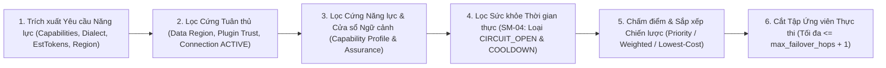

# Đặc tả Động cơ Định tuyến Nhận thức Năng lực & Chính sách Phân cấp (Capability-Aware Routing & Policy Engine Specification) — Tanpopo

> **Tài liệu Đặc tả Kỹ thuật Cốt lõi (Phase ASTRA A05 — Gate G3: `READY_FOR_REVIEW` | `PROPOSED — PRE-APPROVAL`)**
> - **Mã tài liệu:** `SPEC-CORE-01` | **Phiên bản:** `0.1.0-step05-draft` | **Ngày cập nhật:** `2026-11-11`
> - **Vai trò biên soạn:** Principal Architect & Security Architect
> - **Trạng thái quản trị:** **Đặc tả Thiết kế Đề xuất (`PROPOSED`)** — chi tiết hóa thuật toán thời gian chạy cho `Domain 06 (Routing)` và `Domain 07 (Policy & Security)` tại [`srs.md`](../requirements/srs.md).
> - **Truy vết Yêu cầu:** `TP-FR-0102`, `TP-FR-0103`, `TP-FR-0601`..`0604`, `TP-FR-0701`..`0705`, `TP-BR-0501`..`0505`, `SM-04`.

---

## 1. Đại số Hợp nhất Chính sách Phân cấp (`Hierarchical Policy Algebra`: `Org ∩ Project ∩ Env`)

Để đảm bảo không một `Team Admin` hay `Developer` nào ở cấp dưới có thể tự nới lỏng rào chắn an ninh do `Organization Owner` đặt ra (`TP-FR-0701`), bộ đánh giá chính sách của Tanpopo áp dụng **Phép Giao Thu hẹp Đơn điệu (`Monotonic Restrictive Intersection`)**:

| Chiều chính sách | Phép toán hợp nhất `EffectivePolicy = P_org ⊗ P_project ⊗ P_env` | Hành vi khi kết quả giao bằng rỗng (`∅`) |
|---|---|---|
| **Vùng cư trú dữ liệu (`AllowedDataRegions`)** | `R_eff = R_org ∩ R_project ∩ R_route ∩ R_request_header` | **Chặn cứng (`Fail-Closed`):** Trả `503 no_compliant_deployment_available`. |
| **Danh sách Mô hình / Adapter cho phép (`ModelAllowlist`)** | `M_eff = M_org ∩ M_project ∩ M_env ∩ M_virtual_key` | **Chặn cứng (`Fail-Closed`):** Trả `403 model_denied_by_policy`. |
| **Ngưỡng Tin cậy Phần mở rộng tối thiểu (`MinPluginTrust`)** | `T_eff = max_strictness(T_org, T_project, T_env)` *(Thứ tự nghiêm ngặt: `OFFICIAL_ONLY > VERIFIED_PLUS > PRIVATE_ENTERPRISE > UNVERIFIED_ALLOWED`)* | Loại bỏ mọi `Model Deployment` chạy trên Adapter thấp hơn ngưỡng `T_eff`. |
| **Ngưỡng Bảo chứng Năng lực (`MinCapabilityAssurance`)** | `A_eff = max_strictness(A_org, A_env)` *(`VERIFIED > TESTED > DECLARED`)* | Loại bỏ các đích chỉ tự khai báo `DECLARED` khỏi môi trường sản xuất yêu cầu `TESTED`. |
| **Trần Hạn mức Tốc độ & Kích thước Gói tin** | `L_eff = min(L_org, L_project, L_env, L_virtual_key)` | Từ chối `413 payload_too_large` hoặc `429 rate_limit_exceeded`. |
| **Bộ lọc Nội dung / PII (`Guardrail Hooks`)** | Chuỗi nối tiếp bắt buộc: `Hooks_org ++ Hooks_project ++ Hooks_env` (cấp dưới không thể xóa hook cấp trên). | Nếu bất kỳ hook `FAIL_CLOSED` nào từ chối hoặc gặp lỗi quá hạn → hủy yêu cầu trước khi gửi đi. |

### Ma trận Tư thế Xử lý Lỗi Bắt buộc (`Fail-Closed vs Controlled Fail-Open Matrix` — `TP-BR-0502`)

| Nhóm kiểm soát | Tư thế bắt buộc khi bộ kiểm tra gặp lỗi nội bộ / mất kết nối | Lý do kiến trúc |
|---|---|---|
| **1. Xác thực `Virtual Key`, RBAC, Cô lập `Org/Env/Plane`** | **`FAIL_CLOSED` tuyệt đối (`100%`)** | Không bao giờ cho phép truy cập không định danh hoặc chéo người thuê. |
| **2. Ràng buộc `Data Residency` & Ngưỡng Tin cậy Plugin** | **`FAIL_CLOSED` tuyệt đối (`100%`)** | Trượt dữ liệu sang quốc gia cấm một lần là vi phạm pháp lý không thể thu hồi. |
| **3. Sổ cái Trần Ngân sách Cứng (`Hard Budget Limit`)** | **`FAIL_CLOSED` tuyệt đối (`100%`)** | Ngăn rủi ro cháy tài khoản thanh toán khi cụm đếm phân tán gặp sự cố. |
| **4. Phê duyệt Con người & Ghim `schema_hash` cho MCP `destructive`** | **`FAIL_CLOSED` tuyệt đối (`100%`)** | Thà dừng tác nhân còn hơn thực thi lệnh xóa/ghi nhầm tham số. |
| **5. Đường xuất giám sát `OpenTelemetry (OTLP)` bên ngoài** | **`FAIL_OPEN` có kiểm soát (`Drop-Oldest` + Đếm cảnh báo)** | Máy chủ thu log bị treo không được phép làm sập toàn bộ lưu lượng sản xuất (`TP-FR-0805`). |
| **6. Bộ đếm `RPM/TPM` trên Valkey khi Valkey đứt kết nối** | **Chuyển sang Trần Cục bộ Bảo thủ (`limit / N_nodes`)** | Giữ hệ thống sống an toàn mà vẫn chống được bão lạm dụng trên từng nút (`ADR-0006`). |

---

## 2. Thuật toán Định tuyến Nhận thức Năng lực 6 Bước (`6-Step Capability-Aware Routing Pipeline`)

Mỗi yêu cầu đi vào một `Route` (hoặc tên mô hình logic) được bộ giải quyết tuyến xử lý tất định trên `ConfigSnapshot` trong bộ nhớ (`< 0.2 ms`):



1. **Bước 1 — Phân tích Vector Năng lực Yêu cầu (`Request Capability Extraction`):**
   - Kiểm tra sự hiện diện của: khối ảnh (`vision = true`), âm thanh (`audio_input = true`), tài liệu/PDF (`document_input = true`), danh sách hàm `tools` (`tool_calling = true`, `parallel_tool_calls`), `response_format.type == "json_schema"` có `strict == true` (`strict_json_schema = true`), tham số `reasoning_effort`, phương ngữ đường dẫn (`openai_compatible` vs `native:<dialect>`) và ước tính nhanh `estimated_input_tokens + max_output_tokens`.
2. **Bước 2 — Sàng lọc Tuân thủ & Quyền (`Hard Compliance Filter`):**
   - Loại bỏ mọi `Model Deployment` mà: (a) `Provider Connection` không ở trạng thái `ACTIVE`/`DEGRADED` (`SM-02`), (b) `Extension Installation` bị `QUARANTINED`/`DISABLED`, (c) `data_region` không nằm trong `AllowedDataRegions` (`TP-FR-0602`), hoặc (d) phương ngữ không khớp khi gọi qua `/native/<dialect>/...`.
   - *Quy tắc phân biệt mã lỗi:* Nếu sau Bước 2 tập ứng viên rỗng do lệch vùng dữ liệu → trả ngay **`503 no_compliant_deployment_available`**.
3. **Bước 3 — Sàng lọc Năng lực & Ngữ cảnh (`Hard Capability Filter` — `TP-FR-0102`):**
   - Đối chiếu từng cờ yêu cầu ở Bước 1 với `Capability Profile` hiệu lực của `Model Deployment` và ngưỡng `MinCapabilityAssurance`. Kiểm tra `estimated_total_tokens <= context_window`.
   - **Cấm tuyệt đối cắt bỏ tham số ngầm:** Nếu không có đích nào hỗ trợ năng lực yêu cầu (ví dụ `strict_json_schema = true`) → trả ngay **`400 capability_not_supported`** kèm tên năng lực bị thiếu.
4. **Bước 4 — Sàng lọc Sức khỏe & Ngắt mạch (`Health & Circuit Filter` — `SM-04`):**
   - Loại bỏ các đích đang ở `CIRCUIT_OPEN_UNHEALTHY`, `DRAINING_MAINTENANCE`, `DISABLED`, hoặc `THROTTLED_COOLDOWN` mà `cooldown_until > now()`.
   - Với đích vừa hết hạn cách ly chuyển sang `HALF_OPEN_PROBING`, chỉ cho phép tối đa `1` yêu cầu thăm dò đồng thời đi vào nhờ cờ nguyên tử `CAS (Compare-And-Swap)`.
5. **Bước 5 — Sắp xếp theo Chiến lược Tuyến (`Strategy Ranking`):**
   - **`PRIORITY_FAILOVER`:** Sắp xếp tăng dần theo `priority_order`; nếu bằng nhau thì phân tải tròn đều có trọng số (`Smooth Weighted Round-Robin`).
   - **`WEIGHTED`:** Chọn ngẫu nhiên có trọng số theo `weight` (hạt giống tất định khi chạy kiểm thử).
   - **`LOWEST_COST`:** Tính chi phí kỳ vọng `E_cost = est_in * price_in + est_out * price_out` (bằng số nguyên `nano-USD`), sắp xếp từ rẻ nhất tới đắt nhất; nếu bằng giá ưu tiên đích có độ trễ trung bình động (`EWMA TTFT`) thấp hơn.
6. **Bước 6 — Giới hạn Số Bước Nhảy & Cấm Chuyển mạch Giữa Luồng:**
   - Cắt danh sách tối đa `1 + max_failover_hops` (mặc định `1 + 3 = 4` lần thử tối đa).
   - **Khóa bất biến `No Mid-Stream Fallback` (`TP-FR-0103`):** Vòng lặp chuyển mạch chỉ hoạt động khi `bytes_or_events_emitted_to_client == 0`. Ngay khi mảnh dữ liệu đầu tiên rời khỏi Tanpopo về phía `API Client`, danh sách dự phòng bị hủy bỏ hoàn toàn cho yêu cầu đó.

---

## 3. Toán học Máy Trạng thái Ngắt mạch `SM-04` (`Circuit Breaker & Cooldown Parameters`)

Mỗi `Model Deployment` duy trì một bộ đếm cửa sổ trượt vòng (`Sliding Ring Window` `60 giây`, chia `12` ô `5 giây`) với các ngưỡng cấu hình chuẩn:
- **`THROTTLED_COOLDOWN`:** Kích hoạt tức thì khi nhận HTTP `429` hoặc `529`. Thời gian nghỉ `cooldown_duration = clamp(Retry-After, min=1s, max=120s)` (nếu thiếu tiêu đề `Retry-After`, dùng lùi mũ `2s, 4s, 8s` có nhiễu ngẫu nhiên `jitter ±20%`).
- **Mở ngắt mạch `CIRCUIT_OPEN_UNHEALTHY`:** Kích hoạt khi trong cửa sổ `60 giây` có tối thiểu `min_requests >= 10` **và** tỷ lệ lỗi hệ thống (`TCP/TLS error`, `timeout`, `HTTP 500/502/503/504`) vượt `failure_rate_threshold >= 50%` (hoặc `5` lỗi mạng liên tiếp tuyệt đối). Thời gian mở mạch mặc định: `open_duration = 30 giây`.
- **Khôi phục `HALF_OPEN_PROBING → HEALTHY`:** Sau `30 giây`, cho `probe_success_required = 2` yêu cầu liên tiếp đi qua; nếu cả 2 thành công thì đóng mạch về `HEALTHY`, nếu `1` yêu cầu lỗi hệ thống thì lập tức mở lại mạch `CIRCUIT_OPEN_UNHEALTHY`. *(Lưu ý: HTTP `400/422` do lỗi dữ liệu của người gọi không bao giờ làm tăng bộ đếm mở mạch).*

---

## 4. Hợp đồng Trình Mô phỏng & Giải thích Quyết định Khô (`Dry-Run Route Explain` — `TP-FR-0604`)

Điểm cuối `POST /admin/v1/routes:explain` (và lệnh `tanpopo route explain`) chạy **chính xác cùng một hàm `ResolveRoute` của Data Plane** nhưng dừng lại trước bước giữ chỗ ngân sách và gọi mạng, trả về cây giải trình đầy đủ để kỹ sư gỡ lỗi tức thì:

```json
{
  "request_id": "req_explain_01jc8z001",
  "dry_run": true,
  "route_slug": "prod-eu-assistant",
  "effective_policy": {
    "allowed_data_regions": ["EU"],
    "min_plugin_trust": "VERIFIED_PLUS",
    "min_capability_assurance": "TESTED"
  },
  "required_capabilities": ["streaming", "tool_calling", "strict_json_schema"],
  "selected_candidates_ordered": [
    {
      "rank": 1,
      "deployment_id": "dep_eu_frankfurt_primary",
      "data_region": "EU",
      "estimated_cost_micros": 4250,
      "reason": "MATCHED_PRIMARY_HEALTHY"
    }
  ],
  "rejected_deployments": [
    {
      "deployment_id": "dep_us_east_backup",
      "stage": "HARD_COMPLIANCE_FILTER",
      "rule_code": "DATA_RESIDENCY_MISMATCH",
      "detail": "Deployment region 'US' is outside effective allowed regions ['EU']."
    },
    {
      "deployment_id": "dep_eu_oss_70b",
      "stage": "HARD_CAPABILITY_FILTER",
      "rule_code": "CAPABILITY_NOT_SUPPORTED",
      "detail": "Deployment declares strict_json_schema=false."
    }
  ]
}
```