# 07 — End-to-End Business Workflow Analysis (Current RC9 vs Target Enterprise Experience)

- **Document ID:** `TEEP-01-DOC-07`
- **Research Execution Date:** `2026-11-27`
- **Cross-References:** [`04-CURRENT-TANPOPO-PRODUCT-AUDIT.md`](./04-CURRENT-TANPOPO-PRODUCT-AUDIT.md), [`06-PERSONAS-AND-USER-NEEDS.md`](./06-PERSONAS-AND-USER-NEEDS.md), [`13-PRELIMINARY-CAPABILITY-INVENTORY.md`](./13-PRELIMINARY-CAPABILITY-INVENTORY.md)

---

## 1. Workflow Audit Summary (`WF-01` .. `WF-14`)

Every core operational and developer workflow in frozen RC9 (`ac9ae87a`) was traced end-to-end across Web Console (`web/console/src/`), Admin/Data Plane APIs (`internal/admin/http/`, `internal/ingress/`), and CLI (`cmd/tanpopo/`, `internal/cli/`).

| ID | Business Workflow | Primary Personas | Current RC9 Status (`[VERIFIED_FACT]`) | Measured Friction / Breakpoint Today | Target Expanded Experience (`HYPOTHESIS`) |
|---|---|---|---|---|---|
| **`WF-01`** | **Day-0 First-Time Setup to First Governed Token** | `PER-01`, `PER-02` | 🔴 **Broken on unsigned builds / High-friction (`15–25m`) when signed** | `/setup` sees `available_adapters: []` -> skips quickstart & `FirstKeyDialog`; unsigned `@tanpopo/*` hits `403 org_trust_policy_denied` with `0` UI/CLI fix; requires `7` screens, `8` forms, and manual `nano-USD` conversion. | **2-step `< 90s` (`HYPOTHESIS / UNVERIFIED`) Guided Quickstart** in `/setup` & `tanpopo init`: pick built-in provider -> paste key / auto-detect local Ollama -> auto-activate, probe, import models + `$ / 1M` rate cards, create route, and mint starter `vk_tp_*` + SDK snippets. |
| **`WF-02`** | **Provider Onboarding, Model Discovery & Rate-Card Maintenance** | `PER-03`, `PER-04`, `PER-07` | ⚠️ **Manual & Create-Only Trap** | `Probe connection` discards `detected_model_ids`; trailing `/v1` causes `/v1/v1/models` `404`; `POST /connections` blocks `AWS_SIGV4` (`connections.go:798,808`); zero Logical Model edit/retire (`PG-004`); zero Deployment rate-card edit in UI. | Inline secret sealing + `/v1` URL normalizer + 4-layer Model Intelligence auto-import (`detected_model_ids` × signed catalog `$ / 1M` -> `nano_usd_per_1m_tokens`) + full versioned rate-card edit & model retirement. |
| **`WF-03`** | **Multi-Provider Routing, Policy Authoring & Safe Production Change** | `PER-03`, `PER-04`, `PER-06` | ⚠️ **Partial (`Route Explain` exists; no traffic replay or policy reset)** | Route UI omits `allowed_data_regions`; `request_timeout_ms` is unwired; Policy UI omits `response_cache_*` and lacks `DELETE` reset-to-parent; `GuardrailHooks` are unwired; operators edit live routes without knowing historical traffic impact. | Cedar + structural policy editor with reset-to-parent, wired deadlines & guardrails, and pre-commit **Metadata-Only Historical Traffic Replay ("What-If Engine")** quantifying blocked calls & `micro-USD` spend delta before saving. |
| **`WF-04`** | **Model Deprecation & Fleet Upgrade Migration** | `PER-02`, `PER-03`, `PER-07` | ❌ **100% Manual Out-of-Band** | Zero deprecation metadata, zero capability parity diff across routes, zero shadow canary evaluation. | Signed `CATALOG_FEED` EOL alerts (`T-90d/30d/7d`) -> **Automated Deprecation & Migration Advisor** verifying capability/context parity, historical cost delta, and budget-capped `1%` shadow canary before 1-click `If-Match` route cutover. |
| **`WF-05`** | **Workforce SSO, SCIM Provisioning & Workload Identity Onboarding** | `PER-05`, `PER-10` | 🔴 **Incomplete (`OIDC` & `WIF` unwired; no SCIM/SAML)** | `s.oidc` & `TokenVerifier` are `nil` in `serve.go`; `LoginPage` lacks `org_id` & password rotation; members cannot be deleted/suspended; `PG-001`/`PG-012` preselect defaults; workloads rely solely on static `vk_tp_*` keys. | Per-org OIDC + hardened SAML 2.0 + MFA/Passkeys, SCIM 2.0 `< 5s` (`HYPOTHESIS / UNVERIFIED`) cascading offboarding, scoped Admin PATs/Service Accounts, and secretless K8s/SPIFFE/Cloud Workload Identity Federation. |
| **`WF-06`** | **FinOps Budgeting, Period Rollover & Cost-Center Chargeback** | `PER-07`, `PER-04` | ⚠️ **Partial (`rollup` unwired; no auto-rollover; no date filter)** | `rollup.Aggregator` uncalled (`DEF-078`); `DAILY`/`MONTHLY` budgets stop enforcing after `period_end_ms` until manually touched; Chargeback UI lacks `from`/`to` date pickers & `vi` enum i18n (`PG-003`); budgets cannot be deleted. | Automated period rollover worker, wired hourly rollups, hierarchical pod budget leases, `org_units` cost-center tags + platform markup bps, `FOCUS 1.1` Parquet/CSV export, and JCS-signed chargeback receipts. |
| **`WF-07`** | **MCP Tool Onboarding, Schema Drift Triage & Per-User OBO Auth** | `PER-08`, `PER-05`, `PER-06` | ⚠️ **Partial (4 RPCs/call; UI wipes tools on reload; grant revoke dead)** | MCP `2025-03-26` only (`2026-07-28` fails); `toolsByServer` lost on browser refresh; `listMcpToolGrants`/`revokeMcpToolGrant` dead in `McpHubPage.tsx`; no MCP server edit/delete (`PG-004`); no per-user OAuth (`oauth.Service` hardcoded to provider connections). | Dual-stack MCP (`2025-03-26` + `2026-07-28`), cached schema verification, full server/grant CRUD, **MCP Drift Risk Classifier** (`BENIGN` vs `BREAKING` vs `RUG_PULL`), progressive tool discovery, and zero-tax `RFC 8693` OBO brokering. |
| **`WF-08`** | **Multi-Agent A2A Task Delegation, Cost Tracking & Swarm Containment** | `PER-08`, `PER-06` | ⚠️ **Partial (Custom `/a2a/tasks` REST; off by default with no UI notice)** | Incompatible with LF A2A `v1.0.1` SDKs; buffered upstream HTTP; `1s` DB poll on SSE; no cross-plane (`LLM + MCP + A2A`) causal trace tree. | Compliant LF A2A `v1.0.1` (`/.well-known/agent-card.json`, `/message:send`, `/message:stream`, 8 states, JCS+JWS cards) + `X-Tanpopo-Trace-Root` causal cost/audit waterfall + 1-click tree-wide swarm kill-switch. |
| **`WF-09`** | **Production Incident Diagnosis & Privacy-Safe Failure Triage** | `PER-02`, `PER-03`, `PER-06` | 🔴 **Metadata works; Debug Payload Capture uncalled in `ac9ae87a` (`[SOURCE_VERIFIED]`)** | `CreateDebugCaptureSession` has `0` non-test callers (`debug_payload_blobs` empty); `TracesPage` `error_code` filter is client-side only; `ttl.Cleaner` unwired. | Rich server-side trace filters + wired `ttl.Cleaner`/partition drop + **`RFC 9180 HPKE` Recipient-Key-Encrypted Flight Recorder** sealing failure capsules to offline Project Triage Public Keys (`0` private triage keys on gateway nodes). |
| **`WF-10`** | **Emergency Containment (Kill-Switch, Quarantine & Four-Eyes)** | `PER-05`, `PER-06`, `PER-03` | ⚠️ **Functional at 1–5 orgs; `TX1+TX2` split & `O(N_orgs)` bottleneck** | Four-Eyes Change Requests have `0` Console UI; `PG-010` hides `SYSTEM` audit log in Security UI; `PG-014` renders `0 pending` under `403`; global quarantine splits `TX1`+`TX2`, omits direct Valkey `publishChange`, and loops `19 * N_orgs` queries (`ARCH-OBS-01`). | Full Four-Eyes Change Request UI, `SYSTEM`/`ORG` audit toggle, **8-Layer Pre-Action Blast-Radius Topology Preview**, and single-TX `O(1)` (`< 5 ms` `[HYPOTHESIS]` DB commit) emergency quarantine with instant Valkey broadcast. |
| **`WF-11`** | **Extension Authoring, Marketplace Publishing & Air-Gap Sync** | `PER-09`, `PER-03`, `PER-06` | ⚠️ **Strong `.tpbundle` foundation; `1/4` categories wired; `RR-001`** | Only `PROVIDER_ADAPTER` executes; C-only Wasm skeleton; `RR-001` archive mismatch; `ExtensionsPage` lacks `org_extension_policies` UI, browser `.tpkg` upload, and graceful non-incident disable; `bundle import` is SQLite-only. | Go/Rust/TS SDKs across **11 extension categories**, unified cross-OS deterministic `.tpkg` packer, Keyless OIDC Sigstore + TUF + OCI `1.1` Marketplace, Harbor air-gap mirroring, and Console trust-policy + canary ring controls. |
| **`WF-12`** | **Cluster HA Operations, KEK Rotation, Backup/DR & Tenant Erasure** | `PER-03`, `PER-06` | 🔴 **High-Risk Gaps on PostgreSQL HA (`DEF-072`, `DEF-041`)** | Source-identified `handleRetireMasterKEK` PG `FORCE RLS` visibility hazard (`[SOURCE_VERIFIED]`); `TANPOPO_MASTER_KEY_PREVIOUS` hardcoded ID `"kek_prev_0"`; `5` CLI ops (`rotate-kek`, `backup`, `preflight`, `shred`, `reset-local-owner`) SQLite-only; `0` DP nodes still shows `Ready`; `DEF-041` leaves VKeys/sessions live if Phase 3 fails. | Fixed PG KEK retirement + `<id>=<key>` rotation + cluster-wide KEK scrub, PG-compatible ops CLI + PITR verification runbook, Valkey/OTLP/DP topology health alerts (`PG-007`), immediate `DELETING` key/session fence + background erasure worker, and GDPR Art. 17 HMAC salt-shredding. |
| **`WF-13`** | **GitOps, CI/CD & Terraform Declarative Fleet Management** | `PER-03`, `PER-04` | 🔴 **Broken (`DEF-004` remote CLI `401`; `gitops` file-copy only)** | `tanpopo config reconcile` never writes to SQLite/PG; zero `tanpopo config diff | apply`; zero Terraform provider; all remote CLI commands fail `401`. | Scoped Admin Service Accounts (`sak_tp_*`), full remote CLI read/write parity, declarative DB `tanpopo config plan | apply`, official OpenTofu/Terraform provider, and portable signed `SOLUTION_PACK`s. |
| **`WF-14`** | **Regulatory Audit & Resilience Attestation (`EU AI Act`, `SOC 2`, `DORA`)** | `PER-06`, `PER-03` | ⚠️ **Primitives exist; manual evidence assembly** | Audit chains and `FORCE RLS` exist, but compliance teams must stitch SQL/CLI outputs manually and lack recurring automated resilience drill receipts. | 1-command **Signed Compliance Evidence Pack** (`EU AI Act Art. 12/14/50`, `ISO 42001`, `SOC 2`, `HIPAA`) + built-in **Loopback Chaos Drill Studio** producing signed `dora-drill-receipt.json` attestations (`0` paid API calls). |

---

## 2. Deep Workflow Comparison: `WF-01` Day-0 Onboarding (RC9 vs Target Progressive Disclosure)

```mermaid
flowchart TD
    subgraph RC9["Current Frozen RC9 Reality (7 Screens · 8 Forms · curl Detour on Source Builds)"]
        R1["1. Boot tanpopo serve\nRead bootstrap.token"] --> R2["2. /setup Wizard\navailable_adapters=[] -> Skips Quickstart & FirstKey"]
        R2 --> R3["3. /extensions/marketplace\nStage & Approve @tanpopo/openai (Unverified on source build)"]
        R3 --> R4["4. BLOCKED: 403 org_trust_policy_denied\nSteal cookie + CSRF in DevTools -> manual curl PUT /extension-policies"]
        R4 --> R5["5. /providers/connections\nDrawer 1: Seal Secret -> Drawer 2: Create Connection -> Row Menu: Probe (discards models!)"]
        R5 --> R6["6. /models\nDrawer 3: Register LogicalModel -> Drawer 4: Add Deployment + manual $/1M to nano-USD math"]
        R6 --> R7["7. /routes & /access/virtual-keys\nDrawer 5: Create 1:1 Route -> Drawer 6: Issue Virtual Key -> First Token (15-25 min)"]
    end

    subgraph Target["Target Progressive-Disclosure Onboarding (1 Wizard · 0 curl Hacks · <90s Target)"]
        T1["1. Boot tanpopo serve (or tanpopo init)\nEmbedded Official Ed25519/TUF Signatures Verified Across All OSes"] --> T2["2. Guided /setup Quickstart\nOwner Account + Master Key Check + Pick Provider (OpenAI / Anthropic / Gemini / Local Ollama)"]
        T2 --> T3["3. Single Atomic Transaction\nAuto-Activate Adapter + Seal Key + Blind Probe + Import Entitled Models w/ Signed $/1M Rate Cards + Create Default Route"]
        T3 --> T4["4. Instant FirstKeyDialog + Live Smoke Stream\nCopy vk_tp_* + Verified curl / Python / TS / Claude Code / Cursor Snippets (<90s HYPOTHESIS)"]
    end
```

**Architectural Invariant Preserved:** Notice that Step `T3` creates the **exact same normalized rows** (`extension_installations`, `secret_credentials`, `provider_connections`, `logical_models`, `model_deployments`, `route_policies`, `virtual_keys`) inside one atomic Control-Plane transaction as an enterprise team configuring them separately across Day-2 separation-of-duties roles (`OPERATOR`, `ORG_OWNER`, `FINOPS_VIEWER`, `DEVELOPER`). Zero schema shortcuts or special-case bypass tables are introduced.
