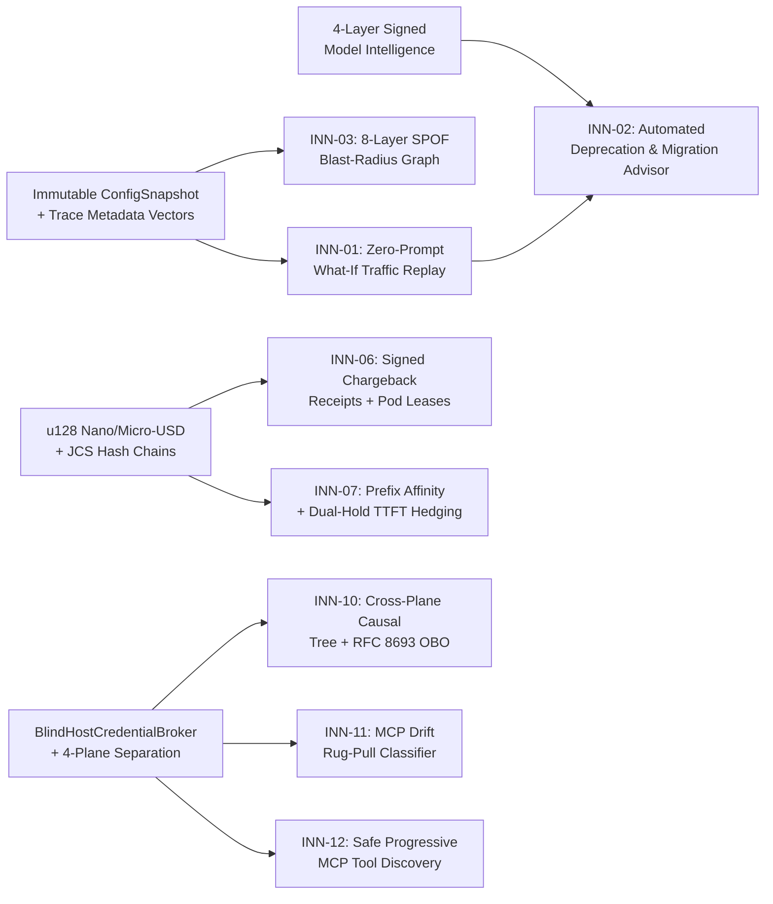

# 11 — Validated Original Product Innovation Opportunities

- **Document ID:** `TEEP-01-DOC-11`
- **Research Execution Date:** `2026-11-27`
- **Founder Requirement Addressed:** `6.F` (Original Product Innovation Grounded Against Real User Pain & Competitor Evidence)
- **Validation Discipline:** Every concept below (`INN-01`..`INN-12`) rejects superficial "chatbot-in-sidebar" gimmicks that violate air-gap or privacy invariants. Each concept builds directly on Tanpopo's existing architectural primitives (`ConfigSnapshot`, 128-bit integer `nano/micro-USD`, `RFC 8785 JCS`, `BlindHostCredentialBroker`, `wazero` sandboxes, and 4-plane `LLM + Plugin + MCP + A2A` separation) and labels unmeasured performance projections **`HYPOTHESIS / UNVERIFIED`** without claiming unverified market-first status.

---

## 1. Innovation Portfolio Summary & Audited Differentiation Matrix (`INN-01` .. `INN-12`)

| ID | Innovation Concept | Acute Operator / Developer Pain Solved | Architectural Synergy & Audited Competitor Gaps (`2026-11` Audit) | Primary Domains & Candidate Priority |
|---|---|---|---|---|
| **`INN-01`** | **Metadata-Only Historical Traffic Replay ("What-If Engine")** | Fear that tightening a regional/ABAC policy or changing route weights will silently break `15%` of production traffic or spike monthly spend. | Audited replay tools (Portkey, Langfuse, Braintrust) rely on stored prompt payloads — conflicting with `0-byte` prompt persistence policies. Tanpopo's `ResolveRoute` + `pricing.Calculate` can replay structural `request_traces_meta` vectors (`>= 50k traces/s` `HYPOTHESIS / UNVERIFIED`) with **`0` prompt bytes stored**. | `DOM-04`, `DOM-11`, `DOM-24` (`P1`) |
| **`INN-02`** | **Automated Model Deprecation & Migration Advisor** | Vendor checkpoint sunsets every 3–6 months force chaotic manual checks across dozens of routes for capability parity, context limits, and cost shocks. | LiteLLM lists static `deprecation_date` strings (`407` already past in Nov 2026). Tanpopo combines signed `CATALOG_FEED` EOL alerts + exercised capability parity scan + `micro-USD` replay delta + budget-capped `1%` shadow canary into a 1-click `If-Match` migration patch. | `DOM-03`, `DOM-04`, `DOM-15` (`P1`) |
| **`INN-03`** | **8-Layer Live Dependency & Pre-Mutation Blast-Radius Graph** | Rotating a Vault secret, disabling a connection, or quarantining a plugin triggers surprise outages because SPOF cut-sets and live SSE streams are invisible. | Envoy/K8s graphs stop at CRDs; LiteLLM/Bifrost show flat configs. Tanpopo links `Extension -> Adapter -> Secret/DEK -> Connection -> Deployment -> Route -> Policy/Key -> ActiveStreamRegistry` in RAM, computing SPOF cut-sets *before* destructive actions confirm. | `DOM-16`, `DOM-20`, `DOM-24` (`P1`) |
| **`INN-04`** | **Portable Signed Solution Packs (`.tpkg` Declarative AI Blueprints)** | Every enterprise rebuilds GDPR customer-support, HIPAA clinical RAG, or safe coding-agent MCP stacks from scratch across incompatible YAML/UI formats. | Helm CRDs require Kubernetes; SaaS templates lock into cloud portals. `SOLUTION_PACK`s (`0` imperative scripts, `@sha256`-pinned deps + JSON Schema vars) run `tanpopo pack plan \| apply` identically on laptop SQLite and air-gapped K8s PG16. | `DOM-17`, `DOM-18`, `DOM-25` (`P1`) |
| **`INN-05`** | **Hermetic Loopback Chaos & Resilience Drill Studio** | SOC 2, ISO 27001, and EU DORA require recurring proof that breakers, residency fences, budget hard-stops, and MCP drift locks work — without paid API calls or customer impact. | Service-mesh fault injection only injects HTTP 5xx/delays (unaware of FinOps holds & MCP rug-pulls). Promotes Tanpopo's `fakellm`/`fakemcp`/`fmea_suite` into an `OPERATOR`-gated loopback drill runner emitting JCS-signed `dora-drill-receipt.json` attestations (`0` external egress). | `DOM-05`, `DOM-11`, `DOM-24` (`P2`) |
| **`INN-06`** | **Cryptographic FinOps Settlement Receipts & Escrow Budget Leases** | Business Units dispute internal AI chargebacks (*"Your gateway miscounted cached tokens!"*), while synchronous DB ledger locks cap throughput at `109 RPS`. | Most audited gateways log mutable floats asynchronously. Tanpopo chains `RFC 8785 JCS` settlement digests + immutable `applied_pricing_snapshot_json` into Ed25519-signed monthly BU invoices verifiable offline (`tanpopo finops verify-invoice`), paired with escrow-backed pod budget leases (`[DESIGN_PROPOSAL]`). | `DOM-06`, `DOM-11` (`P1`) |
| **`INN-07`** | **Dual-Mode Prefix/KV-Cache Affinity Router + Budget-Held TTFT Hedging** | Round-robin multi-key/multi-pod routing destroys `50–97.5%` Anthropic/OpenAI/Gemini prompt-cache discounts and `vLLM`/`llm-d` KV locality, while commercial APIs suffer `10x` p99 TTFT stalls. | `llm-d` lacks commercial FinOps awareness; SaaS gateways lack GPU KV routing. Keyed in-RAM `SipHash` over leading prefix blocks (`0` prompt persistence) drives **Bounded-Load Consistent Hashing (`c=1.25`)** + upfront dual-hold pre-first-token hedging. | `DOM-04`, `DOM-05`, `DOM-07` (`P1`) |
| **`INN-08`** | **Recipient-Key-Encrypted (`RFC 9180 HPKE`) Failure Flight Recorder** | Developers need failing multi-tool payloads to reproduce `400`/`502` bugs, while CISOs forbid storing prompts decryptable by Gateway `OPERATOR`s, DBAs, or `Master KEK`. | Vault `Project DEK` blobs can still be unwrapped on a server holding `Master KEK`. `HPKE SealBase` encrypts failure capsules to an **offline Project Triage X25519 Public Key** and zeroes RAM (`clear(buf)`), leaving `0` private triage decryption keys on gateway nodes. | `DOM-08`, `DOM-09`, `DOM-23` (`P2`) |
| **`INN-09`** | **Deterministic Zero-LLM Smart Setup & Self-Healing `doctor --interactive`** | Self-hosters hit Docker loopback SSRF blocks, corporate TLS CAs, PG `BYPASSRLS`, or trailing `/v1` `404`s; cloud AI troubleshooting assistants fail in air-gapped networks. | `100%` offline deterministic decision trees (`CheckDiagnosticCode` mapped to 15-locale playbooks) + 2-step `/setup` quickstart auto-detecting local `Ollama`/`vLLM` and verifying streaming settlement in `< 90s` (`HYPOTHESIS / UNVERIFIED`). | `DOM-16`, `DOM-20` (`P0/P1`) |
| **`INN-10`** | **Cross-Plane (`LLM + MCP + A2A`) Causal Governance Graph & `RFC 8693` OBO Broker** | A 1-prompt agent swarm fires 18 HTTP calls across `/v1`, `/mcp`, and `/a2a`; today's gateways cannot bound total tree spend, prove human-to-tool lineage, or kill a runaway swarm in 1 click. | Links all 4 planes via `X-Tanpopo-Trace-Root` (`causal_root_id`) without conflating schemas (`DEC-003`), enforces `max_tree_budget_micros`, mints nested `act`-claim `RFC 8693` OBO tokens, and exposes `POST /admin/v1/agents/trees/{id}:abort`. | `DOM-10`, `DOM-12`, `DOM-13` (`P2`) |
| **`INN-11`** | **Deterministic MCP "Shadow Twin" & Contract-Drift Canary Gate** | `SM-06` JCS `schema_pin` rightly blocks mutated MCP tools (`403`), but daily benign CI/CD tool updates cause alert fatigue or tempt blind re-pinning of `GlassWorm`-style prompt rug-pulls. | Classifies JCS AST diffs into `BENIGN_ADDITIVE`, `BREAKING_CONTRACT` (identifying affected Virtual Keys), or **`SUSPECTED_RUG_PULL_HIGH_RISK`** (detecting imperative prompt injections, invisible Unicode tags `U+E0000..E007F`, and exfil URLs) + read-only cassette dry-run before Four-Eyes promotion. | `DOM-09`, `DOM-12`, `DOM-15` (`P1`) |
| **`INN-12`** | **Host-Governed Progressive MCP Tool Search & AST Schema Compression** | Attaching `200+` enterprise MCP tools burns `50,000+` input tokens per chat turn and degrades model tool accuracy, while Bifrost's `Code Mode` executes unsafe LLM-generated scripts. | Exposes RBAC-scoped `tanpopo__search_tools` meta-discovery (and native Anthropic `defer_loading: true` passthrough on `/v1/messages`) + deterministic JSON Schema prose compaction (`CONTEXT_TRANSFORMER`), cutting tool-context tokens `50–85%` (`HYPOTHESIS / UNVERIFIED`) with **`0` `eval` code execution**. | `DOM-07`, `DOM-12`, `DOM-22` (`P1`) |

---

## 2. Compounding Moat Analysis: How Innovations Reinforce Core Governance

Crucially, none of `INN-01`..`INN-12` require weakening `DEC-001`..`DEC-004`, storing unencrypted customer prompts, adding ClickHouse as a mandatory Day-1 dependency, or breaking `CGO_ENABLED=0`. Instead, each innovation monetizes architectural discipline that Tanpopo RC9 has already paid the engineering cost to establish.
