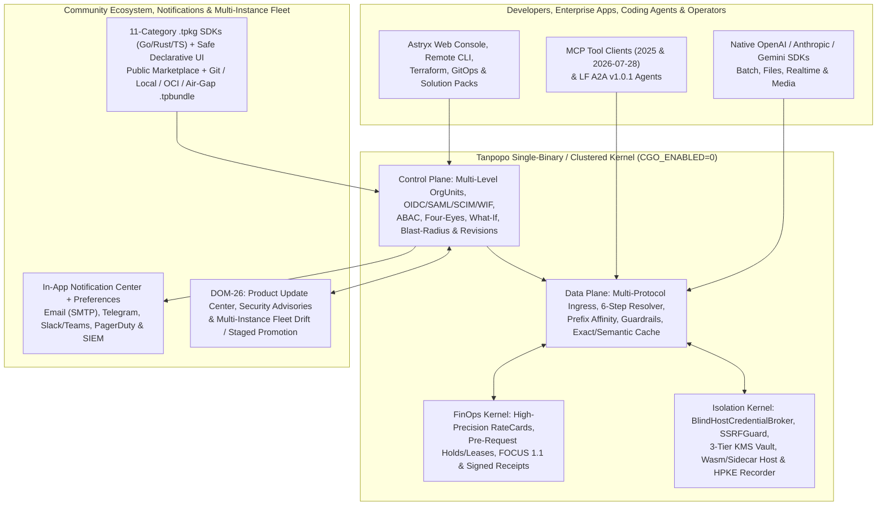

# 01 — Enterprise Platform Capability Map (`26` Domains, `6` Strategic Capability Groups)

- **Document ID:** `TEEP-02A-DOC-01`
- **Purpose:** Maps how Tanpopo evolves from an extension-first AI gateway into a cohesive, single-binary-capable **Enterprise AI Infrastructure Platform** across `26` functional domains without degenerating into disconnected microservices or bloated external OLAP dependencies.

---

## 1. Platform Topology: Four Governed Planes + Extensible Control & Fleet Fabric

---

## 2. Complete 26-Domain Capability Summary

| Domain ID | Domain Name | Review Group | Total `FEAT`s | `CAT-PROD` | `CAT-ADMIN` | `CAT-ECO` | `P0` / `P1` / `P2` / `P3` | Specification File |
|---|---|---|---:|---:|---:|---:|---|---|
| `DOM-01` | **Universal AI Gateway** | G1 | `8` | `8` | `0` | `0` | `5` / `2` / `1` / `0` | [`01-UNIVERSAL-GATEWAY-PROVIDERS-MODELS-AND-MEDIA.md`](./03-FUNCTIONAL-DOMAINS/01-UNIVERSAL-GATEWAY-PROVIDERS-MODELS-AND-MEDIA.md) |
| `DOM-02` | **Provider Management** | G1 | `8` | `0` | `7` | `1` | `4` / `3` / `1` / `0` | [`01-UNIVERSAL-GATEWAY-PROVIDERS-MODELS-AND-MEDIA.md`](./03-FUNCTIONAL-DOMAINS/01-UNIVERSAL-GATEWAY-PROVIDERS-MODELS-AND-MEDIA.md) |
| `DOM-03` | **Model Intelligence** | G1 | `7` | `0` | `7` | `0` | `4` / `2` / `1` / `0` | [`01-UNIVERSAL-GATEWAY-PROVIDERS-MODELS-AND-MEDIA.md`](./03-FUNCTIONAL-DOMAINS/01-UNIVERSAL-GATEWAY-PROVIDERS-MODELS-AND-MEDIA.md) |
| `DOM-04` | **Routing and Orchestration** | G2 | `8` | `4` | `3` | `1` | `2` / `4` / `2` / `0` | [`02-ROUTING-RELIABILITY-FINOPS-AND-CACHING.md`](./03-FUNCTIONAL-DOMAINS/02-ROUTING-RELIABILITY-FINOPS-AND-CACHING.md) |
| `DOM-05` | **Reliability Engineering** | G2 | `5` | `2` | `3` | `0` | `1` / `3` / `1` / `0` | [`02-ROUTING-RELIABILITY-FINOPS-AND-CACHING.md`](./03-FUNCTIONAL-DOMAINS/02-ROUTING-RELIABILITY-FINOPS-AND-CACHING.md) |
| `DOM-06` | **AI FinOps** | G2 | `7` | `1` | `6` | `0` | `2` / `3` / `2` / `0` | [`02-ROUTING-RELIABILITY-FINOPS-AND-CACHING.md`](./03-FUNCTIONAL-DOMAINS/02-ROUTING-RELIABILITY-FINOPS-AND-CACHING.md) |
| `DOM-07` | **Caching and Performance** | G2 | `3` | `3` | `0` | `0` | `0` / `2` / `1` / `0` | [`02-ROUTING-RELIABILITY-FINOPS-AND-CACHING.md`](./03-FUNCTIONAL-DOMAINS/02-ROUTING-RELIABILITY-FINOPS-AND-CACHING.md) |
| `DOM-08` | **Observability** | G3 | `7` | `0` | `6` | `1` | `3` / `2` / `2` / `0` | [`03-OBSERVABILITY-SECURITY-IAM-PRIVACY-COMPLIANCE.md`](./03-FUNCTIONAL-DOMAINS/03-OBSERVABILITY-SECURITY-IAM-PRIVACY-COMPLIANCE.md) |
| `DOM-09` | **AI Security and Guardrails** | G3 | `6` | `0` | `5` | `1` | `4` / `2` / `0` / `0` | [`03-OBSERVABILITY-SECURITY-IAM-PRIVACY-COMPLIANCE.md`](./03-FUNCTIONAL-DOMAINS/03-OBSERVABILITY-SECURITY-IAM-PRIVACY-COMPLIANCE.md) |
| `DOM-10` | **Identity and Access Management** | G3 | `8` | `1` | `7` | `0` | `4` / `4` / `0` / `0` | [`03-OBSERVABILITY-SECURITY-IAM-PRIVACY-COMPLIANCE.md`](./03-FUNCTIONAL-DOMAINS/03-OBSERVABILITY-SECURITY-IAM-PRIVACY-COMPLIANCE.md) |
| `DOM-11` | **Governance and Compliance** | G3 | `7` | `0` | `7` | `0` | `3` / `3` / `1` / `0` | [`03-OBSERVABILITY-SECURITY-IAM-PRIVACY-COMPLIANCE.md`](./03-FUNCTIONAL-DOMAINS/03-OBSERVABILITY-SECURITY-IAM-PRIVACY-COMPLIANCE.md) |
| `DOM-12` | **MCP Infrastructure** | G4 | `8` | `3` | `4` | `1` | `2` / `4` / `2` / `0` | [`04-AGENTIC-MCP-A2A-PROMPTS-EVALS-AND-CONTEXT.md`](./03-FUNCTIONAL-DOMAINS/04-AGENTIC-MCP-A2A-PROMPTS-EVALS-AND-CONTEXT.md) |
| `DOM-13` | **Agent and A2A Infrastructure** | G4 | `5` | `3` | `2` | `0` | `1` / `2` / `2` / `0` | [`04-AGENTIC-MCP-A2A-PROMPTS-EVALS-AND-CONTEXT.md`](./03-FUNCTIONAL-DOMAINS/04-AGENTIC-MCP-A2A-PROMPTS-EVALS-AND-CONTEXT.md) |
| `DOM-14` | **Prompt Management** | G4 | `3` | `2` | `1` | `0` | `0` / `0` / `3` / `0` | [`04-AGENTIC-MCP-A2A-PROMPTS-EVALS-AND-CONTEXT.md`](./03-FUNCTIONAL-DOMAINS/04-AGENTIC-MCP-A2A-PROMPTS-EVALS-AND-CONTEXT.md) |
| `DOM-15` | **AI Evaluation** | G4 | `4` | `3` | `0` | `1` | `0` / `0` / `3` / `1` | [`04-AGENTIC-MCP-A2A-PROMPTS-EVALS-AND-CONTEXT.md`](./03-FUNCTIONAL-DOMAINS/04-AGENTIC-MCP-A2A-PROMPTS-EVALS-AND-CONTEXT.md) |
| `DOM-16` | **Infrastructure Operations** | G6 | `5` | `0` | `5` | `0` | `2` / `3` / `0` / `0` | [`06-OPERATIONS-RESILIENCE-GITOPS-AND-FLEET.md`](./03-FUNCTIONAL-DOMAINS/06-OPERATIONS-RESILIENCE-GITOPS-AND-FLEET.md) |
| `DOM-17` | **Extension Platform and SDK** | G5 | `5` | `0` | `0` | `5` | `0` / `4` / `1` / `0` | [`05-EXTENSIONS-MARKETPLACE-NOTIFICATIONS-AND-DX.md`](./03-FUNCTIONAL-DOMAINS/05-EXTENSIONS-MARKETPLACE-NOTIFICATIONS-AND-DX.md) |
| `DOM-18` | **Marketplace and Community Ecosystem** | G5 | `7` | `0` | `5` | `2` | `1` / `6` / `0` / `0` | [`05-EXTENSIONS-MARKETPLACE-NOTIFICATIONS-AND-DX.md`](./03-FUNCTIONAL-DOMAINS/05-EXTENSIONS-MARKETPLACE-NOTIFICATIONS-AND-DX.md) |
| `DOM-19` | **Notifications and Integrations** | G5 | `7` | `1` | `5` | `1` | `0` / `6` / `1` / `0` | [`05-EXTENSIONS-MARKETPLACE-NOTIFICATIONS-AND-DX.md`](./03-FUNCTIONAL-DOMAINS/05-EXTENSIONS-MARKETPLACE-NOTIFICATIONS-AND-DX.md) |
| `DOM-20` | **Product and Developer Experience** | G5 | `6` | `4` | `2` | `0` | `4` / `2` / `0` / `0` | [`05-EXTENSIONS-MARKETPLACE-NOTIFICATIONS-AND-DX.md`](./03-FUNCTIONAL-DOMAINS/05-EXTENSIONS-MARKETPLACE-NOTIFICATIONS-AND-DX.md) |
| `DOM-21` | **Async, Batch, Realtime & Multimodal Media Workloads** | G1 | `5` | `5` | `0` | `0` | `0` / `2` / `3` / `0` | [`01-UNIVERSAL-GATEWAY-PROVIDERS-MODELS-AND-MEDIA.md`](./03-FUNCTIONAL-DOMAINS/01-UNIVERSAL-GATEWAY-PROVIDERS-MODELS-AND-MEDIA.md) |
| `DOM-22` | **Context, Memory, RAG & Vector Governance** | G4 | `4` | `3` | `0` | `1` | `0` / `2` / `1` / `1` | [`04-AGENTIC-MCP-A2A-PROMPTS-EVALS-AND-CONTEXT.md`](./03-FUNCTIONAL-DOMAINS/04-AGENTIC-MCP-A2A-PROMPTS-EVALS-AND-CONTEXT.md) |
| `DOM-23` | **Privacy Engineering, Data Sovereignty & Cryptographic Custody** | G3 | `5` | `1` | `4` | `0` | `0` / `1` / `3` / `1` | [`03-OBSERVABILITY-SECURITY-IAM-PRIVACY-COMPLIANCE.md`](./03-FUNCTIONAL-DOMAINS/03-OBSERVABILITY-SECURITY-IAM-PRIVACY-COMPLIANCE.md) |
| `DOM-24` | **Resilience, Chaos Engineering & Pre-Flight Policy Simulation** | G6 | `4` | `0` | `4` | `0` | `0` / `2` / `2` / `0` | [`06-OPERATIONS-RESILIENCE-GITOPS-AND-FLEET.md`](./03-FUNCTIONAL-DOMAINS/06-OPERATIONS-RESILIENCE-GITOPS-AND-FLEET.md) |
| `DOM-25` | **GitOps, Terraform/IaC & Portable Declarative Solution Packs** | G6 | `6` | `0` | `2` | `4` | `0` / `4` / `2` / `0` | [`06-OPERATIONS-RESILIENCE-GITOPS-AND-FLEET.md`](./03-FUNCTIONAL-DOMAINS/06-OPERATIONS-RESILIENCE-GITOPS-AND-FLEET.md) |
| `DOM-26` | **Multi-Instance Fleet & Release Lifecycle Management** | G6 | `5` | `0` | `5` | `0` | `0` / `2` / `3` / `0` | [`06-OPERATIONS-RESILIENCE-GITOPS-AND-FLEET.md`](./03-FUNCTIONAL-DOMAINS/06-OPERATIONS-RESILIENCE-GITOPS-AND-FLEET.md) |

---

## 3. Rationale for Adding `DOM-26` (Multi-Instance Fleet & Release Lifecycle Management)

While `DOM-16` (*Infrastructure Operations*) governs nodes within a **single** Tanpopo cluster sharing one database, and `DOM-25` (*GitOps & Solution Packs*) governs declarative configuration artifacts, real enterprise adopters and self-hosted operators face two distinct lifecycle challenges that lacked a home in `DOM-01`..`DOM-25`:
1. **Software & Security Lifecycle Awareness (`FEAT-149`, `FEAT-150`):** Operators need an in-product **Update Center** and **Security Advisory Matcher (`TANPOPO-SA-*`)** that works both via opt-in zero-telemetry signed feeds and 100% offline air-gap manifest uploads — alerting admins when Core binaries, Model Intelligence Packs, or installed `.tpkg` extensions have updates or security advisories.
2. **Multi-Instance & Multi-Environment Governance (`FEAT-151`..`FEAT-153`):** Enterprises run separate `dev`, `staging`, `prod-eu`, `prod-us`, and disconnected edge instances. `DOM-26` provides federated health/version visibility, semantic configuration drift detection, governed `dev -> staging -> prod` promotion (including `.tppromote` air-gap couriers), and fleet-wide emergency extension quarantine without turning standalone Tanpopo into a multi-service deployment.
