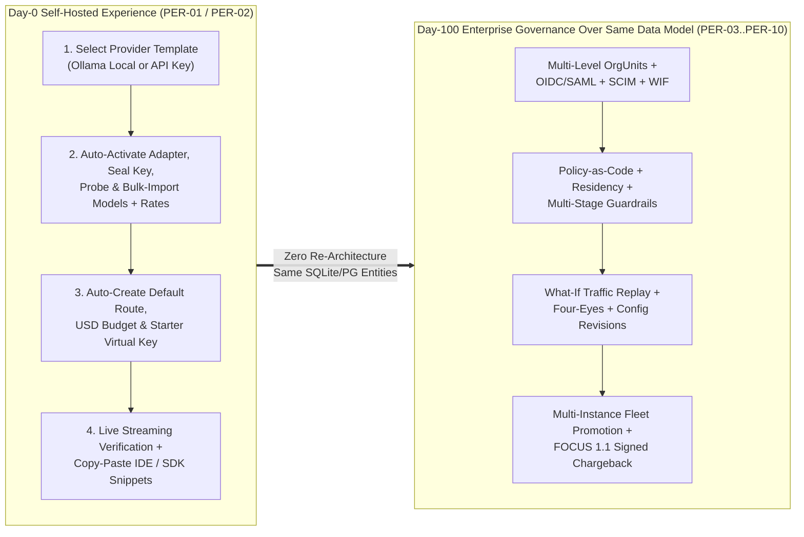

# 04 — Cross-Domain End-to-End Business Workflow Map (`WF-01` .. `WF-18`)

- **Document ID:** `TEEP-02A-DOC-04`
- **Mission:** `TEEP-02A` — Proposed Master Feature Catalog
- **Purpose:** Demonstrates how proposed capabilities across all `26` functional domains (`DOM-01`..`DOM-26`) compose into coherent, progressive end-to-end workflows — serving both a first-time solo self-hoster on a single SQLite binary (`PER-01`) and a global multi-instance enterprise organization (`PER-03`..`PER-10`) without fragmenting Tanpopo into disconnected microservices.
- **Cross-References:** [`02-MASTER-FEATURE-CATALOG.md`](./02-MASTER-FEATURE-CATALOG.md), [`07-INNOVATION-PORTFOLIO.md`](./07-INNOVATION-PORTFOLIO.md), [`08-FOUNDATIONAL-BACKLOG.md`](./08-FOUNDATIONAL-BACKLOG.md), [`10-FOUNDER-REVIEW-GUIDE.md`](./10-FOUNDER-REVIEW-GUIDE.md)

---

## 1. Progressive Architecture Principle: One Kernel, Progressive Disclosure

A recurring failure mode in enterprise infrastructure products is forcing solo users through seven enterprise setup screens on Day 0, or conversely building a "toy mode" whose data model must be thrown away at enterprise scale.

---

## 2. Complete Cross-Domain Workflow Catalog (`WF-01` .. `WF-18`)

`WF-01`..`WF-14` carry forward and expand the `TEEP-01` workflow baseline ([`07-BUSINESS-WORKFLOW-ANALYSIS.md`](../../01-intelligence/07-BUSINESS-WORKFLOW-ANALYSIS.md)); `WF-15`..`WF-18` add the underrepresented operational, ecosystem UI, configuration-revision, and multi-instance fleet lifecycles identified in `TEEP-02A`.

| Workflow ID | End-to-End Business Workflow | Primary Personas | RC9 Baseline Friction (`[RUNTIME_VERIFIED]` / `[SOURCE_VERIFIED]`) | Proposed End-to-End Experience (`[DESIGN_PROPOSAL]`) | Participating Domains & Anchor `FEAT-*` / `ARCH-*` / `FND-*` |
|---|---|---|---|---|---|
| **`WF-01`** | **Day-0 First-Time Setup to First Governed Streaming Token** | `PER-01`, `PER-02` | `/setup` receives `available_adapters: []` (`DEF-049`); unsigned builds fail `403 org_trust_policy_denied` (`FND-010`); requires `7` screens, `8` forms, and manual `nano-USD` conversion. | Guided 2-step `/setup` & `tanpopo init` (`< 90s` `[HYPOTHESIS]`): choose a Provider Setup Template (`FEAT-011`) or auto-detected local `Ollama`/`vLLM`, paste key (or run keyless local), automatically stage/enable adapter (`FEAT-108`), probe & import models + `$/1M` rates (`FEAT-018`, `FEAT-019`), create starter route + budget + Virtual Key, and verify live streaming (`FEAT-119`) + IDE profile (`FEAT-118`). | `DOM-01..04`, `06`, `18`, `19`, `20` · `FEAT-001..003`, `011`, `012`, `018`, `019`, `108`, `118`, `119` · `FND-003`, `010` |
| **`WF-02`** | **Provider Onboarding, Account Model Discovery & Rate-Card Maintenance** | `PER-03`, `PER-04`, `PER-07` | Probe discards `detected_model_ids` and hides failures (`PG-013`); trailing `/v1` causes `/v1/v1/models` `404`; `connections.go:798` blocks `AWS_SIGV4`; zero Logical Model delete/edit (`PG-004`) or Console deployment rate-card edit. | Pick setup template (`FEAT-011`) -> seal secret or bind `SigV4`/`Entra ID`/`WIF` (`FEAT-013`) -> run two-phase blind probe (`FEAT-012`) -> 1-click bulk import of entitled models enriched by 4-layer catalog (`FEAT-017`..`020`) -> maintain, version, deprecate, drain, and retire models/connections (`FEAT-014`, `FEAT-021`, `FEAT-120`). | `DOM-02`, `03`, `20` · `FEAT-009`..`021`, `120` · `ARCH-008`, `009` · `FND-013`, `016` |
| **`WF-03`** | **Multi-Provider Routing, Policy Authoring & Pre-Flight Impact Verification** | `PER-03`, `PER-04`, `PER-06` | Route UI omits `allowed_data_regions`; `request_timeout_ms` unwired (`FND-004`); Policy UI omits cache settings and lacks `DELETE` reset-to-parent; live route/policy edits carry unknown blast radius. | Author conditional/weighted/prefix-affinity routes (`FEAT-024`..`027`) and hierarchical ABAC policies (`FEAT-063`) with deadlines (`FEAT-033`) and guardrails (`FEAT-054`), run **Metadata-Only What-If Traffic Replay** (`FEAT-139`) over 7–30 days of historical trace vectors (`0` prompt bytes), inspect cost/rejection deltas, pass Four-Eyes (`FEAT-068`), and retain instant revision rollback (`FEAT-143`). | `DOM-04`, `05`, `09`, `10`, `11`, `24`, `25` · `FEAT-024`..`033`, `054`, `063`, `068`, `139`, `143` · `FND-004`, `015` |
| **`WF-04`** | **Model Deprecation Triage & Capability-Verified Fleet Migration** | `PER-02`, `PER-03`, `PER-07` | 100% manual out-of-band tracking; zero sunset alerts, capability parity checks, or shadow canary evaluation. | Receive `T-90d`/`T-30d`/`T-7d` deprecation notifications in Notification Center / Email / Telegram / Slack (`FEAT-112`, `FEAT-113`, `FEAT-115`) -> open **Model Migration Advisor** (`FEAT-022`) -> verify exercised capability & token-window parity -> simulate 30-day `micro-USD` cost delta (`FEAT-139`) -> run optional budget-capped `1%` shadow canary (`FEAT-092`) -> apply `If-Match` route cutover and retire old deployment (`FEAT-021`). | `DOM-03`, `04`, `15`, `19`, `24` · `FEAT-018`, `021`, `022`, `092`, `112`, `113`, `139` |
| **`WF-05`** | **Workforce SSO, SCIM Lifecycle & Secretless Workload Onboarding** | `PER-05`, `PER-10` | `OIDC` & `TokenVerifier` nil in `serve.go`; RAM-only admin sessions; no SAML/SCIM/MFA; static `vk_tp_*` keys required for workloads. | Configure per-org `OIDC`/`SAML 2.0` + `WebAuthn` MFA (`FEAT-060`, `FEAT-061`), automate `SCIM 2.0` user/group sync & `< 5s` (`[HYPOTHESIS]`) offboarding revocation (`FEAT-062`), delegate `OrgUnit` administration (`FEAT-066`), mint scoped CI Service Accounts (`FEAT-065`), and bind Kubernetes/SPIFFE/CI workloads secretlessly via `WIF` (`FEAT-064`). | `DOM-10` · `FEAT-060`..`067` · `ARCH-011` · `FND-002`, `004`, `012` |
| **`WF-06`** | **FinOps Budgeting, Period Rollover, Chargeback & Invoice Reconciliation** | `PER-07`, `PER-04` | `rollup.NewAggregator` uncalled (`DEF-078`); no automatic period rollover; Chargeback lacks date pickers & `vi` enum translation (`PG-003`); no budget delete or `FOCUS 1.1` export. | Enforce low-latency pre-request holds (`FEAT-037`, `ARCH-002`) across multi-level budgets with automatic rollover & burn-rate alerts (`FEAT-038`, `FEAT-039`, `FEAT-112`), evaluate conditional cache/context/batch tiers (`FEAT-040`), export `FOCUS 1.1` + signed monthly BU receipts (`FEAT-041`, `FEAT-042`, `ARCH-003`), and reconcile against cloud vendor invoices (`FEAT-043`). | `DOM-06`, `19`, `20` · `FEAT-037`..`043`, `112`, `122` · `ARCH-002`, `003` · `FND-005` |
| **`WF-07`** | **MCP Tool Onboarding, Drift Classification & Per-User OBO Authorization** | `PER-08`, `PER-05`, `PER-06` | `4` upstream RPCs per tool call; `2025-03-26` only; UI loses discovered tools on refresh; grant revoke dead; no MCP server delete (`PG-004`) or per-user OBO. | Browse/register `2025-03-26` or `2026-07-28` MCP servers (`FEAT-075`, `FEAT-077`), pin JCS input+output schemas, triage upstream changes via **MCP Shadow Twin & Drift Classifier** (`FEAT-076`), compress large tool catalogs via progressive discovery (`FEAT-080`), enforce `HITL` approvals (`FEAT-078`), and exchange per-user `RFC 8693` OBO tokens in `BlindHostCredentialBroker` (`FEAT-079`). | `DOM-12`, `19` · `FEAT-075`..`082`, `115` · `ARCH-008` · `FND-015`, `017` |
| **`WF-08`** | **Multi-Agent `A2A v1.0.1` Delegation & Cross-Plane Swarm Containment** | `PER-08`, `PER-06` | Pre-standard `/a2a/tasks` incompatible with LF `A2A v1.0.1`; buffered upstream HTTP; `1s` SQL poll on SSE; no cross-plane trace/budget tree. | Register and verify standard `A2A v1.0.1` agents (`FEAT-083`, `FEAT-084`), stream upstream task events with `SM-09` sub-budget carving (`FEAT-085`), inspect unified `LLM + MCP + A2A` causal trace/cost trees, and abort runaway agent swarms in 1 click (`FEAT-087`). | `DOM-13` · `FEAT-083`..`087` |
| **`WF-09`** | **Privacy-Preserving Incident Triage & Failure Reproduction** | `PER-02`, `PER-03`, `PER-06` | `CreateDebugCaptureSession` uncalled (`0` rows in `debug_payload_blobs`); client-side-only `error_code` filter; `ttl.Cleaner` unwired. | Filter server-side 12-stage trace waterfalls (`FEAT-047`, `FEAT-048`) or tail live anomalies (`FEAT-053`); for opted-in routes, capture failing request capsules encrypted via **`RFC 9180 HPKE`** to an offline Project Triage Public Key (`FEAT-134`, `0` private triage keys on gateway nodes) with automatic TTL reaping (`FEAT-051`). | `DOM-08`, `23` · `FEAT-047`..`053`, `134` · `FND-004` |
| **`WF-10`** | **Pre-Mutation Blast-Radius Preview, Four-Eyes & Atomic Containment** | `PER-05`, `PER-06`, `PER-03` | Four-Eyes lacks Console UI; `SYSTEM` audit hidden in UI (`PG-010`); global quarantine splits `TX1+TX2`, omits direct Valkey broadcast, and runs `O(N_orgs)` loops. | Before rotating a secret, disabling a connection, or quarantining an extension, inspect the **8-Layer Live Dependency & SPOF Cut-Set Graph** (`FEAT-140`), route high-impact mutations through Four-Eyes Console approval (`FEAT-068`), or execute single-TX atomic emergency kill-switch/quarantine (`FEAT-058`) with forensic timeline export (`FEAT-142`). | `DOM-09`, `11`, `24` · `FEAT-058`, `068`, `070`, `140`, `142` · `ARCH-010`, `011` · `FND-008` |
| **`WF-11`** | **Community Extension Authoring, Marketplace Publishing & Private Source Sync** | `PER-09`, `PER-03`, `PER-05` | Only `PROVIDER_ADAPTER` wired; C-only guest skeleton; `RR-001` archive drift; no public Marketplace discovery, private Git source, or browser `.tpkg` upload. | Scaffold extension in Go/Rust/TS (`FEAT-102`) across `11` backend categories (`FEAT-100`) + safe declarative Console UI views (`FEAT-104`), validate locally via `tanpopo plugin test --fuzz` (`FEAT-103`), publish via OIDC + 7-stage CI (`FEAT-106`) for Marketplace discovery (`FEAT-105`), OR install directly from private Git repos, local `.tpkg` archives, OCI registries, or `.tpbundle` couriers (`FEAT-110`, `FEAT-111`). | `DOM-17`, `18` · `FEAT-100`..`111` · `ARCH-014`, `015`, `018` · `FND-003` |
| **`WF-12`** | **Cluster HA Operations, Safe Vault `KEK` Rotation, DR & Tenant Erasure** | `PER-03`, `PER-06` | Suspected PG `FORCE RLS` `0`-count hazard in `handleRetireMasterKEK` (`FND-001`); `5` CLI ops SQLite-only; `0` DP nodes shows `Ready`; `DEF-041` partial-shred window. | Monitor honest cluster quorum, Valkey, OTLP, and loaded-KEK health (`FEAT-095`), isolate `/admin/v1/*` on `--admin-listen` (`FEAT-098`), rotate Cloud KMS / Vault KEKs safely across PG16 nodes (`FEAT-059`, `FND-001`), verify PG PITR backups (`FEAT-096`), and execute fenced tenant/subject erasure (`FEAT-074`, `FEAT-135`). | `DOM-09`, `11`, `16`, `23` · `FEAT-059`, `074`, `095`..`099`, `135` · `ARCH-012`, `013` · `FND-001`, `007`, `014` |
| **`WF-13`** | **Declarative GitOps, Terraform/IaC & Portable Solution Pack Rollout** | `PER-03`, `PER-04` | Remote CLI fails `401` (`DEF-004`); `gitops` only copies files without reconciling DB; zero Terraform provider or portable blueprint packs. | Authenticate via Service Account (`FEAT-065`, `FEAT-123`), manage infrastructure via `tanpopo config diff | plan | apply` (`FEAT-144`) or `terraform-provider-tanpopo` (`FEAT-145`), gate PRs with automated What-If checks (`FEAT-148`), or deploy complete use-case architectures in `< 60s` (`[HYPOTHESIS]`) via signed `SOLUTION_PACK`s (`FEAT-147`). | `DOM-10`, `20`, `25` · `FEAT-065`, `123`, `144`..`148` · `FND-012` |
| **`WF-14`** | **Continuous Regulatory Evidence & Hermetic Resilience Attestation** | `PER-06`, `PER-03` | Audit hash chains exist, but compliance packages and resilience proofs require manual SQL/script stitching. | Enforce regional/BAA/ZDR & EU AI Act provenance controls (`FEAT-069`, `FEAT-071`), schedule non-destructive **Hermetic Loopback Chaos Drills** (`FEAT-141`, `0` paid API calls), and export signed compliance + resilience evidence bundles (`FEAT-072`). | `DOM-11`, `24` · `FEAT-069`..`073`, `141` |
| **`WF-15`** | **In-App Notification Triage & Multi-Channel Alerting (`Email`, `Telegram`, `ChatOps`)** *(Added in `TEEP-02A`)* | `PER-01`, `PER-03`, `PER-05`, `PER-07` | Zero in-app notification inbox, zero user alert preferences, zero native Email or Telegram channels, and `ORG_OWNER` blocked from webhooks (`FND-009`). | Configure `SMTP` Email, `Telegram Bot`, `Slack`/`Teams`, or `PagerDuty` in `< 2 min` (`[HYPOTHESIS]`) using Integration Setup Templates (`FEAT-113`, `FEAT-115`, `FEAT-116`); customize per-user/role routing & digest rules; triage unread alerts directly inside the Console Notification Center (`FEAT-112`) with 1-click navigation to the affected budget, connection, approval, or advisory. | `DOM-19` · `FEAT-112`..`117` · `ARCH-016` · `FND-009` |
| **`WF-16`** | **Product Update Center, Security Advisory Triage & Guided Patching** *(Added in `TEEP-02A`)* | `PER-01`, `PER-03`, `PER-05` | Operators have no built-in visibility into new Tanpopo releases, Model Intelligence Pack updates, or CVEs/advisories affecting installed `.tpkg` extensions. | View available Core, Model Pack, and Extension updates in the **Product Update Center** (`FEAT-149`, via opt-in zero-telemetry signed feed or air-gap manifest upload); receive automatic **`TANPOPO-SA-*` Security Advisory** matches against `tanpopo.lock` (`FEAT-150`); run preflight compatibility/migration checks; and upgrade, pin, or quarantine affected extensions with full audit trail. | `DOM-16`, `18`, `19`, `26` · `FEAT-107`, `109`, `112`, `149`, `150` |
| **`WF-17`** | **Configuration Revision History Inspection, Semantic Diff & Safe Rollback** *(Added in `TEEP-02A`)* | `PER-03`, `PER-04`, `PER-05` | In-place mutations overwrite prior route, policy, model, and budget configurations with no built-in revision diff or 1-click rollback. | Open **Revision History** (`FEAT-143`) on any Route, Policy, Connection, Deployment, Prompt, Budget, or Workspace; compare `rev_N` vs `rev_N-1` side-by-side with automatic secret-value redaction; run a pre-rollback What-If simulation (`FEAT-139`); and restore the prior known-good revision atomically via `If-Match`. | `DOM-20`, `24`, `25` · `FEAT-120`, `139`, `143`, `144` |
| **`WF-18`** | **Multi-Instance Fleet Governance, Drift Detection & Environment Promotion** *(Added in `TEEP-02A`)* | `PER-03`, `PER-06` | Each Tanpopo deployment is managed in isolation; enterprises have no unified inventory, drift detector, or promotion workflow across `dev`, `staging`, regional cells, and air-gapped sites. | Enroll `dev`, `staging`, `prod-eu`, `prod-us`, and edge instances into the **Fleet Registry** (`FEAT-151`); monitor cross-instance version, health, and configuration drift against golden baselines; promote validated configurations + `.tpkg` lockfiles through staged gates (`dev -> staging -> prod` or `.tppromote` air-gap courier packs, `FEAT-152`); and push emergency security baselines or quarantines fleet-wide (`FEAT-153`). | `DOM-23`, `25`, `26` · `FEAT-138`, `144`, `149`..`153` |
