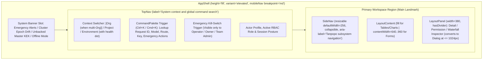

# Information Architecture & Terminology Governance — Tanpopo

> **Product Experience Architecture Specification (Phase ASTRA A06 — `DRAFT / READY_FOR_REVIEW`)**
> - **Document ID:** `SPEC-UX-01` | **Version:** `0.1.0-step06-draft` | **Last Updated:** `2026-11-11`
> - **Authored By:** Lead Product Designer & Developer Experience Lead
> - **Governance Status:** **Proposed Design Specification (`PROPOSED — NO CODE`)** — strictly aligned with [`prd.md`](../product/prd.md), [`srs.md`](../requirements/srs.md), [`workflows.md`](../requirements/workflows.md), [`system-design.md`](../architecture/system-design.md), and [`ADR-0004`](../architecture/adr/0004-web-console-stack-astryx-evaluation-and-repo-layout.md). No UI code is implemented and no sensory theme beyond the default `neutral` package is locked without Product Owner sign-off.
> - **Requirements Traceability:** `TP-FR-0201`..`0504`, `TP-FR-0902`, `TP-NFR-0701`, `TP-NFR-0702`, `TP-NFR-1001`, `TP-NFR-1002`, `DEC-003`, `DEC-004`, `BA-OQ-001`.

---

## 1. Control-Plane Workspace Organization Principles (IA Principles)

The Tanpopo Web Console simultaneously serves two distinct operator archetypes (`SD-G1-01`): a **Solo Developer / Small Team** who needs to send their first successful inference request in under `3 minutes` (`TTFGR < 180s`), and an **Enterprise AI Platform / Security Team** governing dozens of upstream connections, `micro-USD` budgets, MCP gateways, and third-party extensions without conceptual ambiguity.

Four invariant principles govern the entire Information Architecture (`IA`):
1. **Strict Separation of the Four Architectural Planes (`DEC-003`):** `Extension Package (Plugin)`, `Provider / Model`, `MCP Governance`, and `A2A Agents` maintain distinct navigation branches, icons, and nouns — never collapsed into a vague catch-all `"Integrations"` bucket.
2. **Explicit Hierarchical Context with Day-One Progressive Disclosure (`BA-OQ-001`):** Every data-bearing screen is anchored to the `Organization → Project → Environment` hierarchy. In default `0.x` single-organization deployments (`1` `Organization`), the context switcher hides the redundant `Organization` layer to reduce cognitive load, surfacing only `Project / Environment` in `TopNav`.
3. **Risk Transparency Before Action (`No Hidden Community Risk`):** Never place a one-click install button where it obscures publisher identity (`Publisher`), package source (`Origin`), or network/secret capabilities (`Permission Inspection Sheet`).
4. **Emergency Controls Always Within Reach (`<= 3 Interactions`):** The 4-level emergency `Kill-Switch` (revoke virtual key, freeze project, disable connection, quarantine plugin) remains reachable directly from `TopNav` or the `CommandPalette` (`Ctrl+K` / `Cmd+K`) across both desktop and mobile (`375px`) viewports.

---

## 2. Global Navigation Frame (`Global Shell & Context Frame`)

Per the `layout/scaffold` architecture of the Astryx Design System, Tanpopo is classified as a **Suite Console** and composes [`AppShell`](design-system-integration.md) across two strictly separated navigation axes:

- **`TopNav` vs `SideNav` Role Separation Rule:** `TopNav` carries **exclusively** overarching scope (`Project / Environment`), the `CommandPalette` search trigger, approval/alert notifications, and the actor session menu. `SideNav` houses the complete product capability tree organized into **5 fixed functional groups**; item counts on navigation links use `Badge` **strictly for actionable pending items** (e.g., `3` pending `destructive` tool approvals, `1` plugin awaiting permission re-consent on upgrade).

---

## 3. Information Architecture Tree & URL Routing Map (11 Mandatory Domains)

The table below specifies all **11 mandatory IA domains** of Tanpopo, mapping canonical URL paths, data scope boundaries (`Instance-Wide` vs `Environment-Scoped`), and target release waves (`SD-G1-03` — preventing empty unshipped screens from appearing broken):

| SideNav Group | IA Domain (11 Mandatory Areas) | Canonical URL Paths | Data Scope | Target Release Wave (`PROPOSED`) | Screen ID (`SPEC-UX-03`) |
|---|---|---|---|---|---|
| *(Outside Main Shell)* | **1. Onboarding & Setup** | `/setup` `/login` | Instance-wide (`Instance`) | `v0.1` (`Must`) | `SCR-01` |
| **A. Overview & Observability** | **2. Overview (Primary Dashboard)** | `/overview` | Per `Project / Env` (or Global for `Operator`) | `v0.1` (`Must`) | `SCR-02` |
| **A. Overview & Observability** | **8. Observability & FinOps** | `/observability/traces` `/finops/budgets` `/finops/chargeback` | Per `Org / Project / Env` | `v0.1` (`Must` — core) `v0.2` (`Should` — full Chargeback) | `SCR-11` `SCR-12` |
| **B. Model Gateway & Routing** | **3. Providers, Connections & Models** | `/providers/adapters` `/providers/connections` `/models` | `Adapters`: Instance-wide `Connections`: `Org` or `Project` `Models / Deployments`: `Env` | `v0.1` (`Must`) *(OAuth 2.1 in `v0.2`)* | `SCR-03` `SCR-04` `SCR-05` |
| **B. Model Gateway & Routing** | **6. Routes & Policies** | `/routes` `/routes/explain` `/policies` | Hierarchical inheritance `Org → Project → Env` | `v0.1` (`Must` — Route/Policy) `v0.2` (`Should` — `Route Explain`) | `SCR-08` `SCR-09` |
| **C. Ecosystem & Agents** | **4. Extension Marketplace & Installed Plugins** | `/extensions/marketplace` `/extensions/installed` `/extensions/lockfile` | Installed at `Instance` scope, enabled/disabled at `Org / Project` scope | `v0.1` (`Must` — Git/URL/Archive) `v0.2` (`Should` — Curated Catalog & Private OCI) | `SCR-06` `SCR-07` |
| **C. Ecosystem & Agents** | **5. MCP Tools & A2A Agents** | `/mcp/servers` & `/mcp/tools` `/a2a/agents` & `/a2a/tasks` | Per `Project / Env` | `MCP`: `v0.2` (`Should`) `A2A`: `v0.3` (`Could`) | `SCR-10` |
| **D. Access & Security** | **7. API Keys, Users & Teams** | `/access/virtual-keys` `/access/members` `/access/roles` | `Keys`: Hard-bound to `1` `Env` `Members/Roles`: `Org / Project` | `v0.1` (`Must`) *(OIDC SSO in `v0.3`)* | `SCR-13` |
| **D. Access & Security** | **9. Security, Approvals & Kill-Switches** | `/security/approvals` `/security/audit-log` `/security/kill-switches` | Per `Org / Project` (`Quarantine` is `Instance`-wide) | `v0.1` (`Must` — Audit & Kill-Switch) `v0.2` (`Should` — MCP Approvals) | `SCR-14` |
| **E. Developer Tools & System** | **11. Developer Tools** | `/devtools/playground` `/devtools/api-explorer` `/devtools/sdk-snippets` `/devtools/diagnostics` | Active `Env` scope | `v0.1` (`Must` — Snippets/Smoke Test) `v0.2` (`Should` — Playground) | `SCR-15` |
| **E. Developer Tools & System** | **10. Operations & Settings** | `/ops/health` `/ops/backups` `/ops/upgrades` `/settings/residency-retention` | `Ops`: Instance-wide (`OPERATOR`) `Residency/Retention`: `Org` | `v0.1` (`Must`) | `SCR-16` |

> **Phased Feature Visibility Rule (`Phased IA Rule`):** In release `v0.1`, unshipped subsystems such as `MCP Hub (v0.2)` or `A2A Agents (v0.3)` **must never render as broken empty screens**; they remain hidden by default from production `SideNav` (or explicitly badged with a `Token` reading `Roadmap v0.2 / v0.3` inside an architecture preview drawer if an operator enables roadmap preview mode).

---

## 4. Role-Based Navigation Visibility Matrix (`RBAC Visibility Matrix`)

| IA Domain | `Personal Admin` *(Single-User)* | `OPERATOR` *(Infrastructure)* | `ORG_OWNER` *(Organization Owner)* | `TEAM_ADMIN` *(Project Admin)* | `REVIEWER` *(Independent Auditor)* | `DEVELOPER` *(Integration Engineer)* |
|---|---|---|---|---|---|---|
| **1. Onboarding (`/setup`)** | Full access (first run) | Full access (first run) | None | None | None | None |
| **2. Overview (`/overview`)** | Global | Cluster & infrastructure health | Full `Organization` | Assigned `Project` scope | Read-only within scope | Read-only for assigned `Project/Env` |
| **3. Providers / Connections / Models** | Full access | View Adapters; zero access to `Org` secrets | Full access to `Org`-level `Connections` | Create `Project`-scoped `Connections` | Read-only configuration | Read-only catalog of permitted `Models` |
| **4. Marketplace / Installed Plugins** | Full access | Install / Upgrade / Quarantine at instance level | Enable/Disable for `Org`; request installs | View enabled plugins | **Approve Permissions (`Four-Eyes`)** | Read-only view of active Adapters |
| **5. MCP Tools & A2A Agents** | Full access | View connectivity posture | Full `Org` policy control | Register `Project`-scoped MCP/Agents | **Approve `destructive` calls (`SM-06`)** | View Tools permitted for own keys |
| **6. Routes & Policies** | Full access | Instance-floor baseline policies | `Org`-ceiling policies | Create `Routes` & narrow `Project` `Policies` | Read-only & run `Route Explain` | Run dry-run `Route Explain` |
| **7. Virtual Keys, Users & Teams** | Full access | Manage instance operators | Manage members, roles & keys | Issue / Rotate / Revoke keys in `Project` | Read-only key inventory | Create / Rotate personal keys (if `Policy` allows) |
| **8. Observability & FinOps** | Full access | Technical OTel metrics & resource posture | Full Ledger, Budgets & `Chargeback` | `Project` Budgets & Traces | Read-only for audit review | View traces & spend of own keys only |
| **9. Security, Approvals & Kill-Switches** | Full access | `Quarantine` Plugins; read infra Audit | Read full `Org` Audit; `Org` Kill-Switch | Kill-Switch for own `Key`/`Project` | **Approval Queue & Audit Read** | View status of own pending approval requests |
| **10. Operations & Settings** | Full access | **Full access** (Backups, Upgrades, Cluster) | Configure `Org` `Data Residency` & `TTL` | View residency rules applied to project | Read-only retention policies | Infrastructure `Ops` hidden |
| **11. Developer Tools** | Full access | `support-bundle` diagnostic export | Full access | Full access within `Project` | `Route Explain` only | **Primary workspace** (`Playground`, SDKs) |

---

## 5. Terminology Consistency & Risk De-Conflation Standard (`Design & Terminology Consistency`)

Every UI label, error message, documentation page, and CLI command **must** enforce the canonical vocabulary below (strictly prohibiting overloaded use of `"Provider"` to mean software package, credential profile, and model simultaneously):

| Canonical UI & CLI Concept | Concise In-Product Definition | Representative UI Example | What It MUST NEVER Be Confused With |
|---|---|---|---|
| **`Extension Package` (`Plugin`)** | A versioned, cryptographically signed software bundle installed into Tanpopo from the Marketplace, Git, URL, or OCI registry. | `tanpopo-adapter-mistral@1.2.0` (`Tier 1: Declarative`) | Never call it a `"Provider"` or `"Connection"` (a single `Extension` package may bundle both an `Adapter` and a `Guardrail`). |
| **`Provider Adapter`** | A protocol driver teaching Tanpopo how to communicate with an upstream AI service family or model server. | `OpenAI Official Adapter`, `Ollama Local Adapter` | Holds zero API keys or billing state; strictly a protocol translator. |
| **`Provider Connection`** | A concrete credential profile (API Key, `Authorized OAuth`, AWS IAM, etc.) binding an `Adapter` to a live upstream account. | `prod-openai-eu-key-01` (`ACTIVE`, region `EU`) | Never call it a `"Plugin"`; one `Adapter` can back `10` distinct departmental `Provider Connections`. |
| **`Logical Model`** | A normalized model capability identifier targeted by client applications via API or bound inside a `Route`. | `claude-sonnet-4`, `llama-3.3-70b` | Not hard-wired to a single upstream API key. |
| **`Model Deployment`** | A physical execution target binding `Logical Model` + `Provider Connection` + `Data Region` + `micro-USD` rate card. | `claude-sonnet-4 via prod-vertex-eu (Region: EU)` | The exact entity health-checked by the Router (`SM-04`) and metered for settlement. |
| **`MCP Server` & `MCP Tool`** | An external Model Context Protocol server and its individual callable functions (pinned by `schema_hash` and risk tier). | Server `github-enterprise-mcp` → Tool `delete_repo` (`destructive`) | Never rendered in the same table as `Provider Adapters` or `LLM Models`. |
| **`A2A Agent`** | An autonomous agent registered via an `AgentCard` accepting asynchronous delegated tasks under budget caps and hop limits. | `sec-triage-agent` (`max_hops: 3`) | Never conflated with a stateless single-function `MCP Tool`. |

### Mandatory Three-Dimension Trust Display Before Any Install / Upgrade (`No One-Click Blind Install`)

Across every listing in `Extension Marketplace` and the `Install from Git / URL / Archive` workflow, the UI **strictly prohibits single-click silent activation buttons**, instead rendering **3 independent `Token` badges (each with a distinct icon)** directly on the package row and repeating them inside the mandatory `Permission Inspection Sheet`:
1. **Installation Source (`Origin`):** `Curated Marketplace` | `Git Repository (Pinned SHA)` | `Direct Archive (.tpkg)` | `Private OCI Registry`.
2. **Publisher Identity & Assurance (`Publisher Trust Tier`):**
   - `Official` (verified shield icon — maintained and signed by the Tanpopo project, strictly compliant with official APIs per `DEC-004`),
   - `Verified Publisher` (verification badge icon — DNS/OIDC identity verified and passing contract test suite `CT-01`..`24`),
   - `Private Enterprise` (signed by the self-hosting organization's own internal trust root),
   - `Unverified External` (warning triangle icon — unvetted third-party package; requires an explicit administrator risk acknowledgment checkbox before activation unlocks).
3. **Runtime Isolation Tier (`Execution Tier`):** `Tier 1: Declarative (Zero Code)` | `Tier 2: Wasm Sandbox` | `Tier 3: Isolated Sidecar`.
